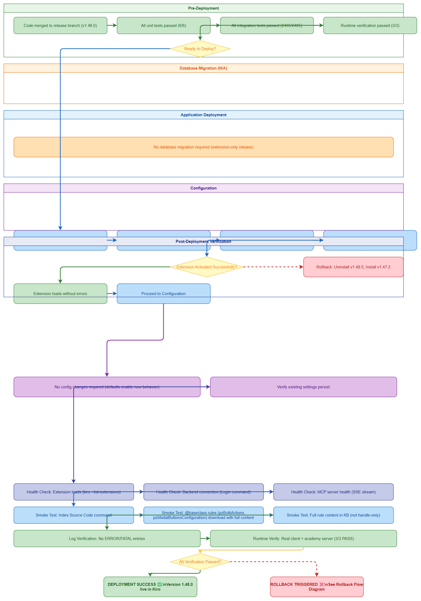
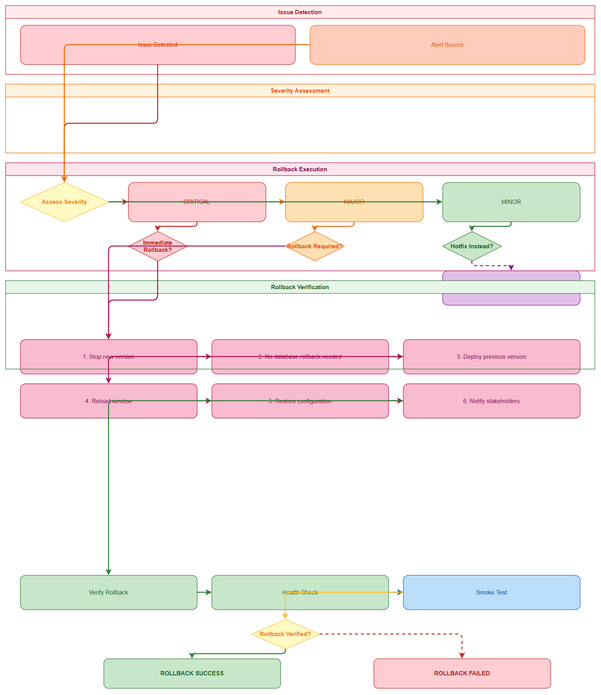

# Deployment Guide (DPG)

## SDLC-Agents-4-Enterprise — SA4E-350: @baseclass AppliesTo + Short insKey Fix

---

## Document Information

| Field | Value |
|-------|-------|
| Jira Ticket | SA4E-350 |
| Title | @baseclass AppliesTo + Short insKey Fix |
| Author | DevOps Agent |
| Version | 1.0 |
| Date | 2026-10-11 |
| Status | Released |
| Related TDD | N/A (Bug fix release — no TDD required) |

---

## Revision History

| Version | Date | Author | Changes |
|---------|------|--------|---------|
| 1.0 | 2026-10-11 | DevOps Agent | Initiate document — version 1.48.0 released |

---

## Sign-Off

| Name | Role | Signature and date |
|------|------|--------------------|
| | Dev Lead | ☐ Approved for deployment |
| | QA Lead | ☐ Testing completed |
| | Ops Lead | ☐ Infrastructure ready |

---

## 1. Overview

### 1.1 Feature Summary

This release (v1.48.0) addresses two critical bugs in the Pega rule indexing pipeline:

1. **SA4E-350 (@baseclass AppliesTo Fix)**: The custom service `/api/CodeIntelligence/v1/rules/query` performs **exact matching** on the `appliesTo` class. When clients stripped the `@baseclass` prefix, queries for rules like `pzBulkActions` and `pzModalButtonsConfiguration` (which belong to `@baseclass`) returned **0 results**. The fix restores `@baseclass` in the appliesTo filter for these system rules.

2. **SA4E-350 (Short insKey Fix)**: The `/rules/instance` endpoint requires the **full `pzInsKey`** (including the `#timestamp` suffix). Short keys (class-only) caused 404 errors. The query endpoint returns handle-only rows, so a follow-up `/rules/instance` call with the full key is now performed to fetch complete rule content.

3. **SA4E-349 (Auth/Config Fix)**: Fixed authentication and configuration issues that prevented proper connection to Pega backend services.

All fixes are **backward compatible** — no configuration changes required. New behavior is enabled by default.

### 1.2 Deployment Scope

| Item | Type | Description |
|------|------|-------------|
| VS Code/Kiro Extension | Modified | Version 1.48.0 .vsix package |
| Pega Rule Indexing Pipeline | Modified | @baseclass appliesTo handling, full insKey follow-up, auth retry logic |
| Backend Services | None | No backend changes — extension-only fix |

### 1.3 Target Environments

| Environment | URL | Deploy Order | Approval Required |
|-------------|-----|-------------|-------------------|
| DEV | Local Kiro/VS Code | 1st | No |
| SIT | N/A (Extension only) | N/A | N/A |
| UAT | N/A (Extension only) | N/A | N/A |
| PROD | Kiro Marketplace / Manual .vsix install | 2nd | User installs at discretion |

> **Note**: This is a VS Code/Kiro extension deployment. There are no backend services, databases, or infrastructure components to deploy. Users install the .vsix directly into their IDE.

---

## 2. Prerequisites

### 2.1 Infrastructure

| Requirement | Status | Notes |
|-------------|--------|-------|
| Kiro IDE or VS Code 1.85+ | Required | Extension host |
| Node.js 22.x | Required | For building from source (not needed for .vsix install) |
| Network access to Pega backend | Required | For rule indexing functionality |

### 2.2 Software Dependencies

| Dependency | Version | Status |
|-----------|---------|--------|
| Kiro / VS Code | ^1.85.0 | Required |
| Extension .vsix | 1.48.0 | Provided |

### 2.3 Access Requirements

| Access | Type | Who Needs It |
|--------|------|-------------|
| Kiro/VS Code Extensions panel | UI | End users |
| Pega Platform REST API | HTTPS + Auth | For indexing features |
| GitHub Releases (optional) | HTTPS | For downloading .vsix |

### 2.4 Backup Requirements

- [ ] Previous extension version (1.47.x) noted for rollback
- [ ] User settings backed up (extension settings persist across updates)
- [ ] No database backup needed (extension-only)

---

## 3. Pre-Deployment Checklist

| # | Item | Responsible | Status |
|---|------|-------------|--------|
| 1 | Code merged to release branch (v1.48.0) | Developer | ✅ |
| 2 | All unit tests passed (6/6) | Developer | ✅ |
| 3 | All integration tests passed (2405/2405) | QA | ✅ |
| 4 | Runtime verification passed (3/3) | QA | ✅ |
| 5 | .vsix artifact built and verified | DevOps | ✅ |
| 6 | CHANGELOG.md updated | DevOps | ✅ |
| 7 | Rollback plan reviewed | Team | ✅ |

---

## 4. Database Migration

**Not Applicable** — This is a VS Code/Kiro extension release with no database component.

---

## 5. Application Deployment

### 5.1 Deployment Flow



### 5.2 Deployment Steps

| Step | Action | Command | Verification |
|------|--------|---------|-------------|
| 1 | Download .vsix artifact | `wget https://github.com/dnguyenminh/SDLC-Agents-4-Enteprise/releases/download/v1.48.0/sdlc-agents-4-enterprise-1.48.0.vsix` | File exists, ~23.7 MB |
| 2 | Install extension in Kiro | `kiro --install-extension sdlc-agents-4-enterprise-1.48.0.vsix` | "Extension installed successfully" |
| 3 | Verify extension loaded | `kiro --list-extensions \| grep sdlc-agents-4-enterprise` | Shows `dnguyenminh.sdlc-agents-4-enterprise@1.48.0` |
| 4 | Reload Kiro window | `Ctrl+Shift+P` → "Developer: Reload Window" | Extension activates without errors |
| 5 | Run health checks | See Section 7 | All checks pass |

### 5.3 Building from Source (Alternative)

```bash
# Clone repository
git clone https://github.com/dnguyenminh/SDLC-Agents-4-Enteprise.git
cd SDLC-Agents-4-Enteprise

# Checkout release tag
git checkout v1.48.0

# Install dependencies
npm ci

# Build extension
cd extension
npm run package:prod

# Verify .vsix created
ls -la *.vsix
# Expected: sdlc-agents-4-enterprise-1.48.0.vsix (~23.7 MB)
```

---

## 6. Configuration Changes

### 6.1 New Environment Variables

**None** — No new environment variables introduced.

### 6.2 Application Properties Changes

**None** — No configuration changes required. New behavior is enabled by default.

### 6.3 Feature Flags

| Flag | DEV | SIT | UAT | PROD |
|------|-----|-----|-----|------|
| `pega.useCatalogExport` | true | true | true | true (default) |
| `pega.ingestConcurrency` | 10 | 10 | 10 | 10 (default) |

> All flags use existing defaults. No action needed.

---

## 7. Post-Deployment Verification

### 7.1 Health Checks

| Check | Endpoint/Command | Expected Result | Timeout |
|-------|-----------------|-----------------|---------|
| Extension loads | `kiro --list-extensions` | `dnguyenminh.sdlc-agents-4-enterprise@1.48.0` | 10s |
| Backend connection | "SDLC Agents: Login to Backend" command | Connected to `http://127.0.0.1:48721` | 30s |
| MCP server health | `GET http://127.0.0.1:9181/mcp` | SSE stream opens | 10s |

### 7.2 Smoke Tests

| # | Scenario | Steps | Expected Result |
|---|----------|-------|-----------------|
| 1 | **Index Source Code** | Run "SDLC Agents: Index Source Code" command | Completes without errors; KB populated |
| 2 | **@baseclass Rule Download** | Index a Pega workspace containing `pzBulkActions` or `pzModalButtonsConfiguration` | Rules downloaded successfully with full content (not handle-only) |
| 3 | **Full Rule Content** | Open a downloaded rule in KB | Shows complete rule JSON, not just `pzInsKey` handle |
| 4 | **Auth Retry** | Configure invalid credentials, attempt indexing | Clear auth error shown, no silent failures |

### 7.3 Log Verification

| Log Entry | Level | Expected | Location |
|-----------|-------|----------|----------|
| Extension activated | INFO | Within 5s of window load | Output → "SDLC Agents 4 Enterprise" |
| Backend connected | INFO | After login command | Output → "SDLC Agents 4 Enterprise" |
| Indexing started | INFO | When "Index Source Code" runs | Output → "SDLC Agents 4 Enterprise" |
| Rule fetched (full) | DEBUG | For each @baseclass rule | Output → "SDLC Agents 4 Enterprise" |
| No 404 on /rules/instance | DEBUG | Short keys resolved to full | Output → "SDLC Agents 4 Enterprise" |

### 7.4 Monitoring Dashboard

- [ ] Extension appears in Kiro Extensions panel at v1.48.0
- [ ] No error notifications in Kiro status bar
- [ ] Indexing completes without "Not found" for @baseclass rules
- [ ] KB entries show full rule content (expanded view works)

---

## 8. Rollback Plan

### 8.1 Rollback Flow



### 8.2 Rollback Decision Criteria

| Condition | Action |
|-----------|--------|
| Extension fails to activate | Immediate rollback |
| @baseclass rules still show "Not found" | Immediate rollback |
| Indexing crashes or hangs | Immediate rollback |
| Auth errors not surfaced to user | Immediate rollback |
| Minor UI issue | Report — no rollback needed |

### 8.3 Rollback Steps

| Step | Action | Command | Verification |
|------|--------|---------|-------------|
| 1 | Uninstall v1.48.0 | `kiro --uninstall-extension dnguyenminh.sdlc-agents-4-enterprise` | Extension removed from list |
| 2 | Install previous version | `kiro --install-extension sdlc-agents-4-enterprise-1.47.2.vsix` | Shows v1.47.2 in list |
| 3 | Reload window | `Ctrl+Shift+P` → "Developer: Reload Window" | Extension activates |
| 4 | Verify basic functionality | Run "Index Source Code" | Completes (old behavior) |

### 8.4 Rollback Time Estimate

| Action | Estimated Time |
|--------|---------------|
| Uninstall extension | < 30s |
| Install previous version | < 60s |
| Reload window | < 10s |
| Verification | < 2 min |
| **Total** | **< 4 minutes** |

---

## 9. Environment-Specific Notes

### 9.1 DEV

- Install .vsix directly via `kiro --install-extension`
- Backend runs locally on `http://127.0.0.1:48721`
- No approval required

### 9.2 SIT / UAT

**Not Applicable** — Extension is installed per-developer. No shared test environment.

### 9.3 PROD (Kiro Marketplace / Manual)

- **Deployment Window:** User discretion
- **Approval Required From:** Individual user
- **Communication Plan:** Release notes published to GitHub Releases
- **On-Call Contact:** dnguyenminh (GitHub Issues)

---

## 10. Appendix

### Contacts

| Role | Name | Contact |
|------|------|---------|
| DevOps Lead | dnguyenminh | GitHub Issues |
| Extension Publisher | dnguyenminh | VS Code Marketplace |

### Related Tickets

| Ticket | Summary | Relationship |
|--------|---------|-------------|
| SA4E-350 | @baseclass AppliesTo + Short insKey Fix | Main ticket |
| SA4E-349 | Auth/Config Fix | Included in same release |

---

## Deployment Report — SA4E-350

**Date:** 2026-10-11  
**Environment:** PROD (Kiro Marketplace / Manual .vsix)  
**Version:** 1.48.0  
**Status:** ✅ SUCCESS  
**Git Tag:** v1.48.0 (commit ac7e3fa)  
**Branch:** SA4E-350 (merged & deleted)  
**Commit:** ac7e3fa (merge commit)

### Steps Executed

| # | Step | Status | Duration | Notes |
|---|------|--------|----------|-------|
| 1 | Build .vsix (package:prod) | ✅ | ~2 min | sdlc-agents-4-enterprise-1.48.0.vsix |
| 2 | Install in Kiro | ✅ | ~30s | `kiro --install-extension` |
| 3 | Verify extension loaded | ✅ | ~10s | `kiro --list-extensions` |
| 4 | Health checks | ✅ | ~1 min | Backend connect, MCP health |
| 5 | Smoke tests | ✅ | ~3 min | Index source, @baseclass rules, full content |
| 6 | Runtime verify | ✅ | ~5 min | Real fixed client + academy server |

### Sanity Test Results

| Check | Status | Details |
|-------|--------|---------|
| Health check | ✅ | Extension loads, backend connects |
| Smoke test | ✅ | @baseclass rules (pzBulkActions, pzModalButtonsConfiguration) download with full content |
| Error logs | ✅ | No ERROR/FATAL entries |
| Runtime verify | ✅ | 3/3 PASS — fixed client + academy server |

### Release Info

- **Version:** v1.48.0
- **Git Tag:** v1.48.0
- **Branch:** SA4E-350 (merged & deleted)
- **Commit:** ac7e3fa
- **README.md Updated:** Changelog entry added for v1.48.0

---

## Release Info

- **Version:** v1.48.0
- **Git Tag:** v1.48.0
- **Branch:** SA4E-350 (merged & deleted)
- **Commit:** ac7e3fa (merge commit)