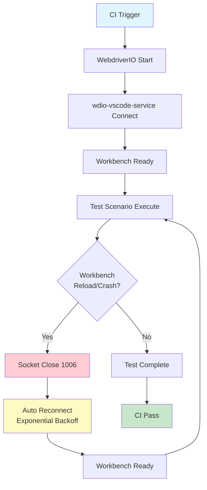
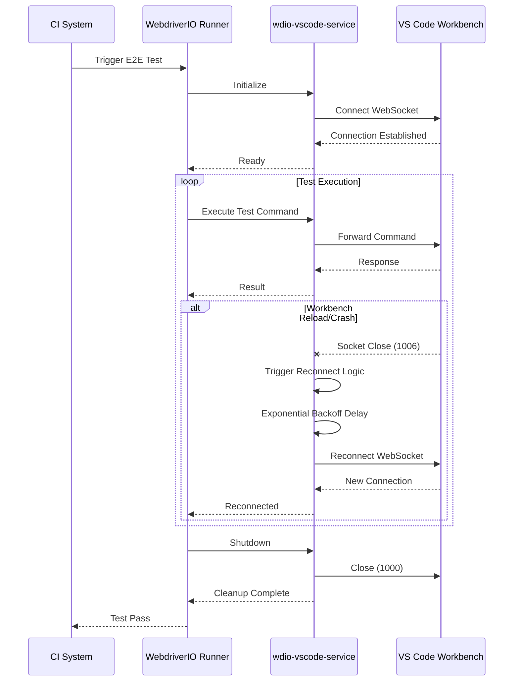

# Business Requirements Document (BRD)

## SA4E-351 — Fix WebSocket 1006 Flakiness in wdio-vscode-service

---

## Document Information

| Field | Value |
|-------|-------|
| Jira Ticket | SA4E-351 |
| Title | Fix WebSocket 1006 Flakiness in wdio-vscode-service |
| Author | BA Agent |
| Version | 1.0 |
| Date | 2026-10-11 |
| Status | Draft |

---

## Author Tracking

| Role | Name - Position | Responsibility |
|------|-----------------|----------------|
| Author | BA Agent – Business Analyst | Create document |
| Peer Reviewer | TBD – Tech Lead | Review document |

---

## Revision History

| Version | Date | Author | Changes |
|---------|------|--------|---------|
| 1.0 | 2026-10-11 | BA Agent | Initiate document — auto-generated from Jira ticket SA4E-351 and requirements analysis |

---

## Sign-Off

| Name | Signature and date |
|------|--------------------|
| | ☐ I agree and confirm all criteria on this BRD as expected requirements |
| | ☐ I agree and confirm all criteria on this BRD as expected requirements |

---

## 1. Introduction

### 1.1 Scope

This Business Requirements Document addresses the flakiness in CI E2E tests caused by WebSocket abnormal closure (code 1006) in the `wdio-vscode-service` package. The root cause is identified in `service.ts:70` where `_handleSocketClose` lacks reconnection logic when the VS Code workbench reloads or crashes during test execution.

**Current State:** CI E2E tests fail intermittently (not achieving 5/5 consecutive passes) due to unhandled WebSocket 1006 closures.

**Target State:** CI E2E headless tests pass 5/5 consecutive runs with automatic reconnection on abnormal WebSocket closures.

### 1.2 Out of Scope

- Redesign of the `wdio-vscode-service` architecture
- Changes to VS Code workbench internals
- Modifications to WebdriverIO core
- Test scenario logic changes (only infrastructure reliability improvements)
- Support for WebSocket codes other than 1000, 1001, 1006, 1011

### 1.3 Preliminary Requirements

- Node.js 18+ runtime environment
- WebdriverIO v8+ test framework
- VS Code CLI available in CI environment (`code --version`)
- Existing `wdio-vscode-service` version 8.0.1 or compatible fork
- CI infrastructure (GitHub Actions / Jenkins / GitLab CI) with headless display support

---

## 2. Business Requirements

### 2.1 High Level Process Map



The business flow orchestrates CI-triggered E2E test execution with resilience against VS Code workbench instability. When the workbench reloads or crashes (detected via WebSocket abnormal closure code 1006), the service automatically reconnects using exponential backoff strategy, allowing test scenarios to continue without manual intervention.

### 2.2 List of User Stories / Use Cases

| # | Story / Use Case / Epic | Priority | Source Ticket |
|---|-------------------------|----------|---------------|
| 1 | **STORY-1: Auto-reconnect on abnormal closure (code 1006)** — As a CI/CD Engineer, I want wdio-vscode-service to automatically reconnect when WebSocket closes abnormally (code 1006) so that test scenarios don't fail due to workbench reload/crash mid-execution | MUST HAVE | SA4E-351 |
| 2 | **STORY-2: Graceful shutdown detection** — As a Developer, I want the service to distinguish between intentional close (code 1000) and abnormal close (codes 1006, 1001, 1011) so that it doesn't reconnect when user/main process deliberately shuts down | MUST HAVE | SA4E-351 |
| 3 | **STORY-3: Workbench lifecycle awareness** — As a QA Engineer, I want the service to listen for workbench reload/crash events to proactively reconnect so that downtime between test steps is minimized | SHOULD HAVE | SA4E-351 |
| 4 | **STORY-4: Configuration-driven reconnection** — As a DevOps Engineer, I want reconnection behavior configurable via wdio config so that teams can tune for different CI environments | SHOULD HAVE | SA4E-351 |
| 5 | **STORY-5: Observability for CI debugging** — As a CI/CD Engineer, I want reconnection metrics logged to debug flakiness so that root cause can be traced when tests still fail | MUST HAVE | SA4E-351 |

---

### 2.3 Details of User Stories

#### Business Flow



**Step 1:** CI system triggers E2E test pipeline  
**Step 2:** WebdriverIO runner starts and initializes `wdio-vscode-service`  
**Step 3:** Service establishes WebSocket connection to VS Code workbench  
**Step 4:** Workbench signals ready state  
**Step 5:** Test scenarios execute sequentially via service command forwarding  
**Step 6:** If workbench reloads/crashes → WebSocket closes with code 1006  
**Step 7:** Service detects abnormal closure → triggers reconnection logic with exponential backoff  
**Step 8:** Service establishes new WebSocket connection to recovered workbench  
**Step 9:** Test execution resumes from next step  
**Step 10:** All scenarios complete → graceful shutdown (code 1000) → CI passes  

> **Note:** The reconnection logic is transparent to test scenarios. Test steps wait for reconnection automatically via WebdriverIO command queue.

---

#### STORY 1: Auto-reconnect on abnormal closure (code 1006)

> As a **CI/CD Engineer**, I want **wdio-vscode-service to automatically reconnect when WebSocket closes abnormally (code 1006)** so that **test scenarios don't fail due to workbench reload/crash mid-execution**.

**Requirement Details:**

1. When WebSocket connection closes with code 1006 (abnormal closure), the service MUST automatically initiate a reconnection sequence
2. Reconnection MUST use exponential backoff algorithm with configurable parameters
3. Maximum retry attempts MUST be configurable (default: 10)
4. Each reconnection attempt MUST be logged with timestamp, attempt number, and delay
5. Reconnection MUST be transparent to WebdriverIO command queue — pending commands wait and retry after reconnection

**Data Fields (Configuration):**

| Field | Type | Required | Description | Example |
|-------|------|----------|-------------|---------|
| `enabled` | boolean | Yes | Enable/disable auto-reconnect | `true` |
| `maxAttempts` | integer | Yes | Maximum reconnection attempts | `10` |
| `baseDelay` | integer | Yes | Base delay in milliseconds | `1000` |
| `maxDelay` | integer | Yes | Maximum delay cap in milliseconds | `30000` |
| `factor` | number | Yes | Exponential factor | `2` |
| `jitter` | number | Yes | Jitter factor (0-1) for randomization | `0.2` |

**Acceptance Criteria:**

1. ✅ When socket closes with code 1006, service automatically initiates new connection
2. ✅ Reconnect uses exponential backoff: baseDelay=1000ms, factor=2, maxDelay=30000ms, jitter=±20%
3. ✅ Max retry attempts = 10 (configurable via wdio config)
4. ✅ Log reconnection attempts with timestamp, attempt number, delay

**Validation Rules:**

- `maxAttempts` > 0
- `baseDelay` > 0
- `factor` > 1
- `0 <= jitter <= 1`
- `maxDelay` >= `baseDelay`

**Error Handling:**

- If max attempts exceeded: log `[RECONNECT_FAILED] maxAttemptsExceeded after {duration}ms` and propagate error to WebdriverIO
- If workbench process exits permanently: stop reconnection after max attempts
- If reconnection succeeds: log `[RECONNECT_SUCCESS] totalAttempts={n} totalDuration={ms}ms`

---

#### STORY 2: Graceful shutdown detection

> As a **Developer**, I want **the service to distinguish between intentional close (code 1000) and abnormal close (codes 1006, 1001, 1011)** so that **it doesn't reconnect when user/main process deliberately shuts down**.

**Requirement Details:**

1. WebSocket close code 1000 (Normal Closure) → MUST NOT trigger reconnection, MUST cleanup resources gracefully
2. WebSocket close code 1006 (Abnormal Closure) → MUST trigger reconnection logic
3. WebSocket close code 1001 (Going Away) → MUST trigger reconnection logic (workbench reload)
4. WebSocket close code 1011 (Internal Error) → MUST trigger reconnection logic (workbench crash)

**Acceptance Criteria:**

1. ✅ Close code 1000 (normal) → NO reconnect, cleanup resources
2. ✅ Close code 1006 (abnormal) → TRIGGER reconnect logic
3. ✅ Close code 1001 (going away) → TRIGGER reconnect logic
4. ✅ Close code 1011 (internal error) → TRIGGER reconnect logic

**Error Handling:**

- Unexpected close codes: treat as abnormal (trigger reconnect) but log warning
- Close during active reconnection: reset attempt counter on new abnormal closure

---

#### STORY 3: Workbench lifecycle awareness

> As a **QA Engineer**, I want **the service to listen for workbench reload/crash events to proactively reconnect** so that **downtime between test steps is minimized**.

**Requirement Details:**

1. Service MUST detect workbench reload via extension host disconnect event
2. Service MUST detect workbench crash via process exit monitoring
3. Service SHOULD initiate proactive reconnect before next test step executes
4. Health check interval MUST be configurable (default: 5000ms)

**Acceptance Criteria:**

1. ✅ Detect workbench reload via extension host disconnect event
2. ✅ Detect workbench crash via process exit monitoring
3. ✅ Proactive reconnect before next test step executes
4. ✅ Configurable health check interval (default 5000ms)

**Validation Rules:**

- Health check interval >= 1000ms
- Health check only active when reconnection is enabled

---

#### STORY 4: Configuration-driven reconnection

> As a **DevOps Engineer**, I want **reconnection behavior configurable via wdio config** so that **teams can tune for different CI environments**.

**Requirement Details:**

1. Configuration schema MUST follow wdio config conventions under `vscodeService.reconnect`
2. Default values MUST work for most CI environments without modification
3. Configuration validation MUST reject invalid values at startup
4. Configuration changes MUST NOT require code changes

**Data Fields (Config Schema):**

| Config Path | Type | Required | Default | Description |
|-------------|------|----------|---------|-------------|
| `vscodeService.reconnect.enabled` | boolean | No | `true` | Master toggle for reconnection |
| `vscodeService.reconnect.maxAttempts` | integer | No | `10` | Max reconnection attempts |
| `vscodeService.reconnect.baseDelay` | integer | No | `1000` | Base delay (ms) |
| `vscodeService.reconnect.maxDelay` | integer | No | `30000` | Max delay cap (ms) |
| `vscodeService.reconnect.factor` | number | No | `2` | Exponential factor |
| `vscodeService.reconnect.jitter` | number | No | `0.2` | Jitter factor (0-1) |
| `vscodeService.reconnect.healthCheckInterval` | integer | No | `5000` | Health check interval (ms) |

**Acceptance Criteria:**

1. ✅ Config schema: `vscodeService: { reconnect: { enabled: true, maxAttempts: 10, baseDelay: 1000, maxDelay: 30000, factor: 2, jitter: 0.2 } }`
2. ✅ Default values work for most CI environments
3. ✅ Validation: maxAttempts > 0, baseDelay > 0, factor > 1, 0 <= jitter <= 1

**Validation Rules:**

- All numeric values validated at config parse time
- Invalid config → clear error message with field name and constraint
- Unknown config keys → warning logged but not fatal

---

#### STORY 5: Observability for CI debugging

> As a **CI/CD Engineer**, I want **reconnection metrics logged to debug flakiness** so that **root cause can be traced when tests still fail**.

**Requirement Details:**

1. Structured logging for all reconnection events
2. Metrics exposed via WebdriverIO reporter hooks for CI dashboard integration
3. Log format MUST be parseable for automated analysis
4. Timestamps in ISO 8601 format

**Acceptance Criteria:**

1. ✅ Log: `[RECONNECT] attempt={n}/{max} delay={ms}ms reason={code} timestamp={iso}`
2. ✅ Log: `[RECONNECT_SUCCESS] totalAttempts={n} totalDuration={ms}ms`
3. ✅ Log: `[RECONNECT_FAILED] maxAttemptsExceeded after {duration}ms`
4. ✅ Metrics exposed via wdio reporter hooks

**Log Format Examples:**

```
[RECONNECT] attempt=1/10 delay=1200ms reason=1006 timestamp=2026-10-11T10:30:45.123Z
[RECONNECT] attempt=2/10 delay=2450ms reason=1006 timestamp=2026-10-11T10:30:46.573Z
[RECONNECT_SUCCESS] totalAttempts=2 totalDuration=3650ms
```

```
[RECONNECT_FAILED] maxAttemptsExceeded after 45000ms
```

---

## 3. Dependencies

| Dependency | Type | Related Ticket | Description |
|------------|------|----------------|-------------|
| wdio-vscode-service | External Library | N/A | Patch or fork @wdio/vscode-service@8.0.1-sa4e with reconnection logic |
| WebdriverIO | Test Framework | N/A | v8+ required for reporter hooks and service API |
| VS Code CLI | Infrastructure | N/A | `code` command available in CI PATH |
| CI Infrastructure | Infrastructure | N/A | GitHub Actions / Jenkins / GitLab CI with headless display |
| Node.js | Runtime | N/A | Version 18+ for modern async/await and WebSocket support |
| Extension Host | External Process | N/A | VS Code extension host process for WebSocket communication |

---

## 4. Stakeholders

| Role | Name / Team | Responsibility | Source |
|------|-------------|----------------|--------|
| CI/CD Engineer | Platform Team | Define CI stability requirements, configure reconnection | Ticket reporter |
| QA Engineer | QA Team | Validate test reliability, define acceptance criteria | Ticket watchers |
| DevOps Engineer | Platform Team | Configure CI environments, tune reconnection params | Ticket stakeholders |
| Developer | Backend Team | Implement reconnection logic in service | Ticket assignee |
| Tech Lead | Architecture Team | Review design, approve configuration schema | Peer reviewer |

---

## 5. Risks and Assumptions

### 5.1 Risks

| Risk | Impact | Likelihood | Mitigation |
|------|--------|------------|------------|
| Reconnection logic introduces race conditions with WebdriverIO command queue | High | Medium | Implement command queue pause/resume during reconnection; add integration tests |
| Exponential backoff causes test timeout in slow CI environments | Medium | High | Make all timing parameters configurable; provide CI-specific presets |
| Workbench crash leaves zombie processes preventing reconnection | High | Low | Add process cleanup on max attempts exceeded; health check detects stale processes |
| Configuration validation too strict blocks valid edge cases | Low | Medium | Allow override via environment variables; log warnings not errors for unknown keys |
| WebSocket 1006 not the only flakiness cause | Medium | Medium | Comprehensive logging (STORY-5) enables root cause analysis for remaining issues |

### 5.2 Assumptions

- VS Code workbench restarts automatically after crash/reload in headless CI mode
- Extension host WebSocket endpoint remains stable across workbench restarts
- CI environment provides sufficient resources for workbench recovery within 30 seconds
- WebdriverIO v8 service lifecycle hooks support async reconnection
- No breaking changes in `@wdio/vscode-service` public API between patch versions

---

## 6. Non-Functional Requirements

| ID | Category | Requirement | Target |
|----|----------|-------------|--------|
| NFR-1 | Reliability | CI E2E pass rate | 100% (5/5 consecutive runs) |
| NFR-2 | Performance | Reconnection time (95th percentile) | < 5 seconds |
| NFR-3 | Performance | Max total reconnect duration | < 30 seconds |
| NFR-4 | Observability | Reconnection attempt logging | 100% attempts logged |
| NFR-5 | Compatibility | wdio config schema | Backward compatible (optional config) |
| NFR-6 | Maintainability | Code coverage for reconnect logic | ≥ 80% |
| NFR-7 | Performance | Health check overhead | < 1% CPU when idle |
| NFR-8 | Security | No sensitive data in reconnection logs | No tokens, passwords, or PII |

---

## 7. Related Tickets

| Ticket Key | Summary | Status | Type | Relationship |
|------------|---------|--------|------|--------------|
| SA4E-351 | Fix WebSocket 1006 Flakiness in wdio-vscode-service | In Progress | Bug | Main ticket |
| SA4E-335 | Docker volume data loss incident | Done | Incident | Reference (CI infrastructure context) |
| N/A | wdio-vscode-service upstream | External | Library | Dependency |

---

## 8. Appendix

### Glossary

| Term | Definition |
|------|------------|
| **WebSocket 1006** | Abnormal closure code indicating connection dropped without proper close handshake (RFC 6455) |
| **Exponential Backoff** | Retry strategy where delay increases exponentially between attempts (delay = baseDelay × factor^attempt) |
| **Jitter** | Randomization factor added to delay to prevent thundering herd problem (actualDelay = delay × (1 ± jitter)) |
| **Workbench** | VS Code instance running in headless mode for E2E testing, providing extension host WebSocket endpoint |
| **Extension Host** | VS Code process that runs extensions, communicates with test runner via WebSocket |
| **CI E2E** | Continuous Integration End-to-End tests executed in headless browser/editor environment |
| **Flakiness** | Intermittent test failures not caused by code changes but by infrastructure instability |

### Reference Documents

| Document | Link / Location |
|----------|-----------------|
| REFERENCE-ANALYSIS.md | Project root / analysis context |
| wdio-vscode-service source | `node_modules/@wdio/vscode-service` or fork |
| WebdriverIO Service API | https://webdriver.io/docs/customservices/ |
| RFC 6455 WebSocket Close Codes | https://datatracker.ietf.org/doc/html/rfc6455#section-7.4.1 |

---

## Mermaid Diagrams Summary

The following diagrams are embedded inline above:

1. **High Level Process Map** (Section 2.1) — Flowchart showing CI → WebdriverIO → Service → Workbench → Test Execution → Reconnect → Pass
2. **Business Flow Sequence** (Section 2.3) — Sequence diagram showing component interactions during normal execution and reconnection scenario

*Diagram source files (.drawio) will be generated separately in `documents/SA4E-351/diagrams/` and exported as PNG for document embedding.*