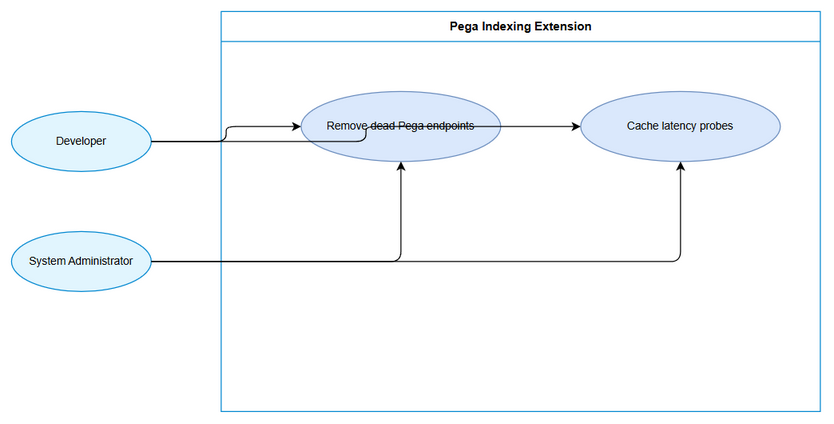
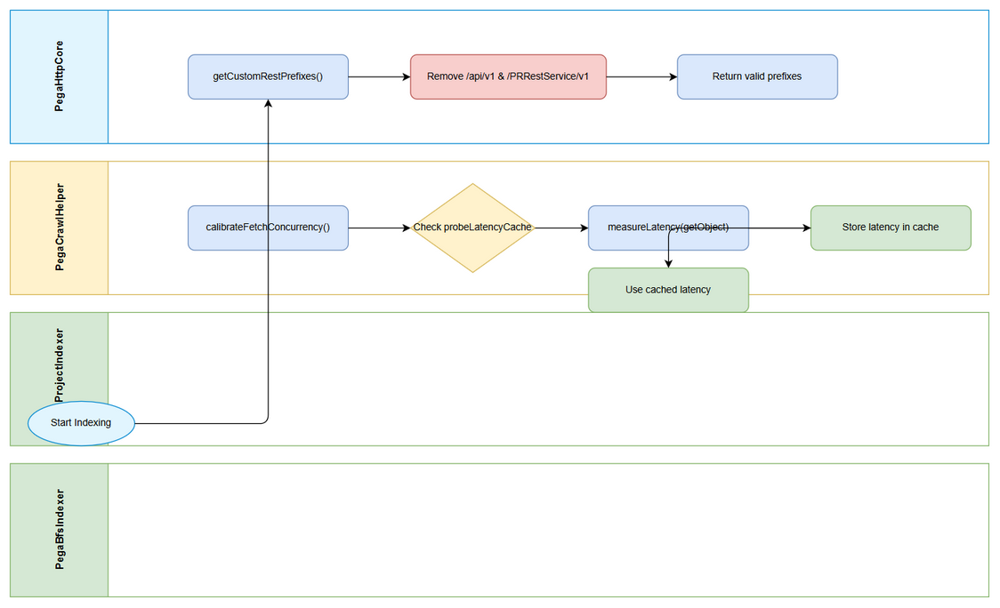

# Business Requirements Document (BRD)

## SA4E-354 — Pega performance improvements – remove dead endpoints and latency probe caching

---

## Document Information

| Field | Value |
|-------|-------|
| Jira Ticket | SA4E-354 |
| Title | Pega performance improvements – remove dead endpoints and latency probe caching |
| Author | BA Agent |
| Version | 1.1 |
| Date | 2026-10-11 |
| Status | Draft |

---

## Author Tracking

| Role | Name - Position | Responsibility |
|------|-----------------|----------------|
| Author | BA Agent – Business Analyst | Create document |
| Peer Reviewer | Duc Nguyen Minh – Reporter | Review document |

---

## Revision History

| Version | Date | Author | Changes |
|---------|------|--------|---------|
| 1.0 | 2026-10-11 | BA Agent | Initiate document — auto-generated from Jira ticket SA4E-354 and linked tickets |
| 1.1 | 2026-10-11 | BA Agent | Spec correction per BA adjudication: empty prefix list → fail-loud error (no warn+fallback) |

---

## Sign-Off

| Name | Signature and date |
|------|--------------------|
| | ☐ I agree and confirm all criteria on this BRD as expected requirements |
| | ☐ I agree and confirm all criteria on this BRD as expected requirements |

---

## 1. Introduction

### 1.1 Scope

Performance improvements for Pega indexing pipelines in the SDLC Agents 4 Enterprise extension. The change removes dead Pega REST endpoints that never exist on Pega Academy (instance 8b99ujcj) from the prefix resolution logic, eliminating permanent 404 probes in rules/query paths. Additionally, latency probe results are cached per operator ID to avoid duplicate `calibrateFetchConcurrency` probes across `PegaProjectIndexer` and `PegaBfsIndexer` pipelines, reducing redundant rules/query calls.

### 1.2 Out of Scope

- Changes to Pega Academy server configuration or endpoint definitions.
- Functional changes to indexing accuracy or data extraction logic.
- UI modifications beyond existing extension services.

### 1.3 Preliminary Requirement

- Extension codebase accessible: `extension/src/services/pega/PegaHttpCore.ts` and `extension/src/services/PegaCrawlHelper.ts`.
- Access to Pega Academy (8b99ujcj) for validation of 404 behavior.
- No additional preliminary requirements identified.

---

## 2. Business Requirements

### 2.1 High Level Process Map

The extension indexes Pega rules via REST queries. During index initialization, `PegaHttpCore.getCustomRestPrefixes()` supplies REST base prefixes that are probed for each query. Dead prefixes cause permanent 404 probes. Concurrently, both indexer pipelines independently calibrate fetch concurrency by measuring latency per operator, causing duplicate probes.

*[Edit in draw.io](diagrams/use-case.drawio)*

*[Edit in draw.io](diagrams/business-flow.drawio)*

### 2.2 List of User Stories / Use Cases

| # | Story / Use Case / Epic | Priority | Source Ticket |
|---|-------------------------|----------|---------------|
| 1 | As a Developer, I want dead Pega REST endpoints removed from getCustomRestPrefixes so that indexing pipelines do not issue permanent 404 probes | MUST HAVE | SA4E-354 |
| 2 | As a System Administrator, I want latency probe results cached per operator ID so that duplicate calibrateFetchConcurrency probes are avoided across pipelines | MUST HAVE | SA4E-354 |

---

### 2.3 Details of User Stories

---

#### Business Flow

**Step 1:** Indexing pipeline starts and requests REST prefixes via `PegaHttpCore.getCustomRestPrefixes()`.

**Step 2:** Prefix list is filtered to remove endpoints that do not exist on Pega Academy.

**Step 3:** Indexer invokes `PegaCrawlHelper.calibrateFetchConcurrency()` for the operator.

**Step 4:** Helper checks `probeLatencyCache` for existing latency measurement for operator ID.

**Step 5:** If cache miss, measure latency via `measureLatency(getObject)`; store result in cache.

**Step 6:** If cache hit, reuse cached latency value and skip duplicate rules/query call.

**Step 7:** Indexing proceeds with calibrated concurrency without redundant probes.

> **Note:** Previously, SSA@TGB operator incurred 16 duplicate rules/query calls due to independent probes from both indexer pipelines.

---

#### STORY 1: Remove dead Pega endpoints from prefix resolution

> As a Developer, I want dead Pega REST endpoints removed from getCustomRestPrefixes so that indexing pipelines do not issue permanent 404 probes

**Requirement Details:**

1. Remove `${base}/api/v1` and `${base}/PRRestService/v1` from `getCustomRestPrefixes()` method in `extension/src/services/pega/PegaHttpCore.ts`.
2. Ensure returned prefix list contains only valid endpoints for Pega Academy (8b99ujcj).
3. Eliminate permanent 404 probes in rules/query path caused by non-existent endpoints.

**Data Fields (if applicable):**

| Field | Type | Required | Description | Example |
|-------|------|----------|-------------|---------|
| base | string | Yes | Pega base URL | https://8b99ujcj.pega.com |
| prefix | string | Yes | REST prefix path | /prweb/api/... |

**Acceptance Criteria:**

1. Dead endpoints removed from `getCustomRestPrefixes()`.
2. No 404 probes issued for `/api/v1` and `/PRRestService/v1` on Pega Academy.
3. SDLC documents created: BRD, FSD, TDD as per conventions.

**UI Specifications (if applicable):**

N/A

**Validation Rules (if applicable):**

- Prefix list must not contain `/api/v1` or `/PRRestService/v1`.

**Error Handling (if applicable):**

- Empty prefix list is an internal error condition (unreachable at runtime — the resolver always returns the two valid CodeIntelligence prefixes). If it ever occurs, consumers fail loud with a clear error and logging — no silent fallback (BA adjudication 2026-10-11, UT-11).

---

#### STORY 2: Cache latency probes per operator

> As a System Administrator, I want latency probe results cached per operator ID so that duplicate calibrateFetchConcurrency probes are avoided across pipelines

**Requirement Details:**

1. Add `probeLatencyCache Map<string,number>` to `PegaCrawlHelper.ts` to cache measured latency per operator ID.
2. First call to `calibrateFetchConcurrency()` measures latency via `measureLatency(getObject)` and populates cache.
3. Subsequent calls reuse cached latency for same operator ID, logging "Latency probe cached".
4. Avoids duplicate rules/query calls across `PegaProjectIndexer` and `PegaBfsIndexer` pipelines.

**Data Fields (if applicable):**

| Field | Type | Required | Description | Example |
|-------|------|----------|-------------|---------|
| operatorId | string | Yes | Pega operator identifier | SSA@TGB |
| latencyMs | number | Yes | Measured latency in ms | 120 |

**Acceptance Criteria:**

1. `probeLatencyCache` implemented and populated on first probe.
2. Subsequent pipeline runs reuse cached latency (log shows "Latency probe cached").
3. Duplicate rules/query calls reduced for same operator, e.g., previously 16 calls for SSA@TGB reduced.
4. Memory ingestion completed.

**UI Specifications (if applicable):**

N/A

**Validation Rules (if applicable):**

- Cache key must be operator ID string, case-sensitive.

**Error Handling (if applicable):**

- If latency measurement fails, cache entry not created and probe retried next time.

---

## 3. Dependencies

| Dependency | Type | Related Ticket | Description |
|------------|------|----------------|-------------|
| Pega Academy 8b99ujcj | External | N/A | Target Pega environment where endpoints do not exist |
| Extension services | System | SA4E-354 | PegaHttpCore and PegaCrawlHelper modules |

---

## 4. Stakeholders

| Role | Name / Team | Responsibility | Source |
|------|-------------|----------------|--------|
| Reporter | Duc Nguyen Minh | Requirements owner | SA4E-354 |
| Developer | BA Agent | Document author | SA4E-354 |

---

## 5. Risks and Assumptions

### 5.1 Risks

| Risk | Impact | Likelihood | Mitigation |
|------|--------|------------|------------|
| Cache staleness if latency changes | Medium | Low | Cache can be invalidated on config change; monitor latency drift |
| Removal of endpoints may affect other environments | Medium | Low | Validate prefix list per environment; keep environment-specific config |

### 5.2 Assumptions

- Pega Academy instance 8b99ujcj will not introduce `/api/v1` or `/PRRestService/v1` in future.
- Latency per operator is stable within a single indexing session.
- Both indexer pipelines share same `PegaCrawlHelper` instance or static cache.

---

## 6. Non-Functional Requirements

| Category | Requirement | Details |
|----------|-------------|---------|
| Performance | Reduce duplicate rules/query calls | Previously 16 calls for SSA@TGB, target reduction to 1 per session |
| Performance | Eliminate permanent 404 probes | Remove dead endpoints from prefix list |
| Security | No impact | No changes to authentication or data access |
| Scalability | Cache bounded per operator | Map size grows with number of operators, acceptable for current scale |
| Availability | No downtime | Changes are code-only, no service restart required |

---

## 7. Related Tickets

| Ticket Key | Summary | Status | Type | Relationship |
|------------|---------|--------|------|--------------|
| SA4E-354 | Pega performance improvements – remove dead endpoints and latency probe caching | To Do | Task | Main ticket |

---

## 8. Appendix

### Glossary

| Term | Definition |
|------|------------|
| probeLatencyCache | Map storing measured latency per operator ID |
| calibrateFetchConcurrency | Function to measure latency and set optimal concurrency |
| getCustomRestPrefixes | Method returning custom REST base prefixes for Pega queries |

### Reference Documents

| Document | Link / Location |
|----------|-----------------|
| Jira Ticket | SA4E-354 |
| Source file | extension/src/services/pega/PegaHttpCore.ts |
| Source file | extension/src/services/PegaCrawlHelper.ts |

### Diagram Index

| # | Diagram | Image | Source (editable) |
|---|---------|-------|-------------------|
| 1 | Use Case Diagram | [use-case.png](diagrams/use-case.png) | [use-case.drawio](diagrams/use-case.drawio) |
| 2 | Business Flow | [business-flow.png](diagrams/business-flow.png) | [business-flow.drawio](diagrams/business-flow.drawio) |
