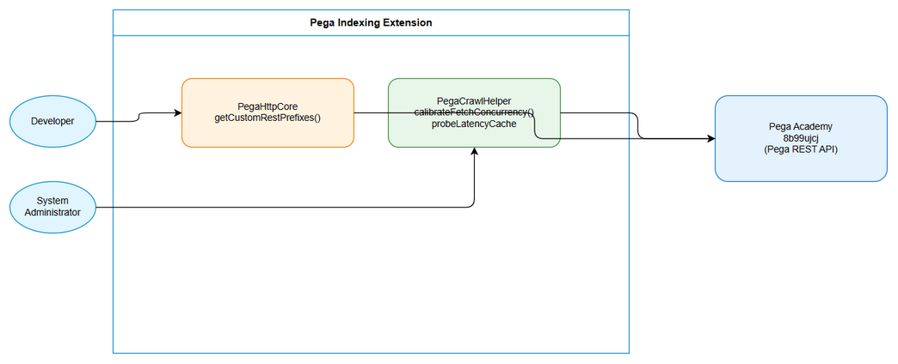
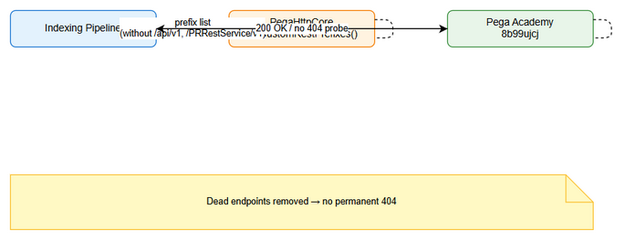
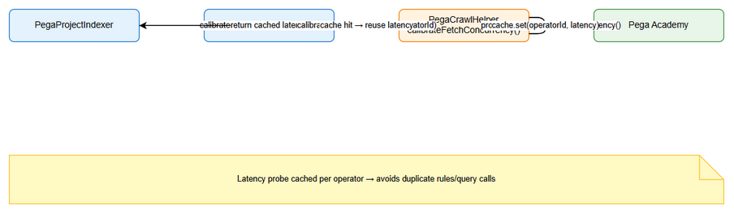

# Functional Specification Document (FSD)

## SDLC Agents 4 Enterprise Pega Indexing — SA4E-354: Pega performance improvements – remove dead endpoints and latency probe caching

---

## Document Information

| Field | Value |
|-------|-------|
| Jira Ticket | SA4E-354 |
| Title | Pega performance improvements – remove dead endpoints and latency probe caching |
| Author | BA Agent |
| Version | 1.1 |
| Date | 2026-10-11 |
| Status | Draft |
| Related BRD | documents/SA4E-354/BRD.md |

---

## Revision History

| Version | Date | Author | Changes |
|---------|------|--------|---------|
| 1.0 | 2026-10-11 | BA Agent | Initiate document — auto-generated from BRD and Jira tickets |
| 1.1 | 2026-10-11 | BA Agent | Spec correction per BA adjudication: UC-01 AF-1/EF-1 + §6.1 + §9.1 — empty prefix list → fail-loud error (no warn+fallback) |

---

## 1. Introduction

### 1.1 Purpose
This FSD specifies the functional behavior required to improve Pega indexing pipeline performance in the SDLC Agents 4 Enterprise extension by removing dead Pega REST endpoints from prefix resolution and caching latency probe results per operator ID. It translates BRD business requirements into detailed use cases, business rules, data specifications, and integration contracts for implementation.

### 1.2 Scope
Derived from BRD SA4E-354:
- Remove `${base}/api/v1` and `${base}/PRRestService/v1` from `PegaHttpCore.getCustomRestPrefixes()` to eliminate permanent 404 probes on Pega Academy 8b99ujcj.
- Add `probeLatencyCache Map<string,number>` to `PegaCrawlHelper` to cache `calibrateFetchConcurrency` results per operator ID, avoiding duplicate `measureLatency` calls across `PegaProjectIndexer` and `PegaBfsIndexer`.
- No changes to Pega Academy server configuration, indexing accuracy, or UI beyond existing extension services.

### 1.3 Definitions & Acronyms

| Term | Definition |
|------|------------|
| probeLatencyCache | Map storing measured latency per operator ID in `PegaCrawlHelper` |
| calibrateFetchConcurrency | Function to measure latency and compute optimal fetch concurrency |
| getCustomRestPrefixes | Method in `PegaHttpCore` returning custom REST base prefixes for Pega queries |
| PegaHttpCore | Shared HTTP primitives + credential/endpoint resolution class |
| PegaCrawlHelper | Parallel fetch strategies helper for Pega rule crawling |

### 1.4 References

| Document | Location |
|----------|----------|
| BRD | documents/SA4E-354/BRD.md |
| Source file | extension/src/services/pega/PegaHttpCore.ts |
| Source file | extension/src/services/PegaCrawlHelper.ts |
| Code Intelligence | .analysis/code-intelligence/project-structure.md |

---

## 2. System Overview

### 2.1 System Context Diagram

*[Edit in draw.io](diagrams/system-context.drawio)*

The extension indexes Pega rules via REST queries. `PegaHttpCore` supplies REST base prefixes that are probed for each query. `PegaCrawlHelper` calibrates fetch concurrency by measuring latency per operator. Both components interact with Pega Academy 8b99ujcj. Developers benefit from removal of dead endpoints; System Administrators benefit from reduced duplicate probes.

### 2.2 System Architecture

**Components:**
- `extension/src/services/pega/PegaHttpCore` — `getCustomRestPrefixes()` returns candidate REST prefixes; `activePrefix` state is shared across clients.
- `extension/src/services/PegaCrawlHelper` — exports `calibrateFetchConcurrency()`, `fetchRulesInParallel()`, `saveRuleFile()`. Holds module-level `probeLatencyCache Map<string,number>` and `FETCH_CONCURRENCY` state.
- `extension/src/services/PegaProjectIndexer` — imports `calibrateFetchConcurrency` and `fetchRulesInParallel`.
- `extension/src/services/PegaBfsIndexer` — imports `calibrateFetchConcurrency` and `saveRuleFile`.
- External: Pega Academy instance 8b99ujcj REST API (`/api/CodeIntelligence/v1`, `/PRRestService/CodeIntelligence/v1`).

Pattern: Shared state via singleton-like core; facade pattern for crawl helper.

---

## 3. Functional Requirements

### 3.1 Feature: Remove dead Pega endpoints from prefix resolution

**Source:** BRD Story 1 – As a Developer, I want dead Pega REST endpoints removed from getCustomRestPrefixes so that indexing pipelines do not issue permanent 404 probes

#### 3.1.1 Description
Modify `PegaHttpCore.getCustomRestPrefixes()` to filter out non-existent endpoints `/api/v1` and `/PRRestService/v1` for Pega Academy 8b99ujcj, preventing permanent 404 probes in rules/query path.

#### 3.1.2 Use Case

**Use Case ID:** UC-01
**Actor:** Developer
**Preconditions:** Extension is configured with Pega endpoint 8b99ujcj; `PegaHttpCore` instance exists.
**Postconditions:** Prefix list contains only valid endpoints; no 404 probes issued for dead endpoints.

**Main Flow:**

| Step | Actor | System | Description |
|------|-------|--------|-------------|
| 1 | Developer | | Starts indexing pipeline |
| 2 | | PegaHttpCore | `getCustomRestPrefixes()` builds prefix list |
| 3 | | PegaHttpCore | Filters out `${base}/api/v1` and `${base}/PRRestService/v1` |
| 4 | | Indexing Pipeline | Uses prefix list for rules/query calls |
| 5 | | Pega Academy | Returns 200 for valid prefixes, no 404 for removed prefixes |

**Alternative Flows:**

| ID | Condition | Steps |
|----|-----------|-------|
| AF-1 | Prefix list becomes empty after filtering | Internal error condition — consumer throws fail-loud with clear log; no fallback (BA adjudication 2026-10-11) |

**Exception Flows:**

| ID | Condition | Steps |
|----|-----------|-------|
| EF-1 | Prefix resolution returns empty list | Internal error — fail-loud throw with clear log; NO silent fallback (spec-corrected per BA adjudication 2026-10-11, see STC UT-11) |

#### 3.1.3 Business Rules

| Rule ID | Rule | Source |
|---------|------|--------|
| BR-01 | `getCustomRestPrefixes()` must not return `${base}/api/v1` or `${base}/PRRestService/v1` | BRD §2.3 Story 1 Validation |
| BR-02 | Prefix list must contain only valid endpoints for Pega Academy 8b99ujcj | BRD §2.3 Story 1 Requirement 2 |

#### 3.1.4 Data Specifications

**Input Data:**

| Field | Type | Required | Validation | Description |
|-------|------|----------|------------|-------------|
| base | string | Y | Must be valid URL | Pega base URL |
| prefix | string | Y | Must not be `/api/v1` or `/PRRestService/v1` | REST prefix path |

**Output Data:**

| Field | Type | Description |
|-------|------|-------------|
| prefixes | string[] | Filtered list of REST prefixes |

#### 3.1.5 UI Specifications
N/A – service layer change only.

#### 3.1.6 API Contract (Functional View)
**Endpoint:** N/A – internal method
**Purpose:** Provide valid REST prefixes for Pega queries
**Business Error Scenarios:**
| Scenario | User Message | Trigger Condition |
|----------|-------------|-------------------|
| No valid prefixes | Fail-loud error thrown | Unreachable at runtime — resolver always returns 2 valid prefixes |

---

### 3.2 Feature: Cache latency probes per operator ID

**Source:** BRD Story 2 – As a System Administrator, I want latency probe results cached per operator ID so that duplicate calibrateFetchConcurrency probes are avoided across pipelines

#### 3.2.1 Description
Add `probeLatencyCache Map<string,number>` to `PegaCrawlHelper` to cache measured latency per operator ID. First call measures latency via `measureLatency(getObject)`; subsequent calls reuse cached value.

#### 3.2.2 Use Case

**Use Case ID:** UC-02
**Actor:** System Administrator
**Preconditions:** Operator ID configured; `PegaCrawlHelper.calibrateFetchConcurrency` is invoked by indexer pipelines.
**Postconditions:** Latency measured once per operator per session; duplicate rules/query calls avoided.

**Main Flow:**

| Step | Actor | System | Description |
|------|-------|--------|-------------|
| 1 | System | PegaProjectIndexer | Calls `calibrateFetchConcurrency()` |
| 2 | | PegaCrawlHelper | Checks `probeLatencyCache` for operatorId |
| 3 | | PegaCrawlHelper | Cache miss → calls `measureLatency` |
| 4 | | Pega Academy | Returns latency measurement |
| 5 | | PegaCrawlHelper | Stores latency in cache |
| 6 | PegaBfsIndexer | Calls `calibrateFetchConcurrency()` for same operator |
| 7 | | PegaCrawlHelper | Cache hit → returns cached latency, logs "Latency probe cached" |
| 8 | | Indexing Pipeline | Proceeds with calibrated concurrency |

**Alternative Flows:**

| ID | Condition | Steps |
|----|-----------|-------|
| AF-1 | Cache hit | Skip measurement, reuse cached latency |
| AF-2 | Latency measurement fails | Do not populate cache, return default concurrency |

**Exception Flows:**

| ID | Condition | Steps |
|----|-----------|-------|
| EF-1 | Operator ID not configured | Skip probe, use default concurrency |
| EF-2 | `measureLatency` throws | Log warning, use default concurrency |

#### 3.2.3 Business Rules

| Rule ID | Rule | Source |
|---------|------|--------|
| BR-03 | Cache key must be operator ID string, case-sensitive | BRD §2.3 Story 2 Validation |
| BR-04 | Subsequent calls for same operator must reuse cached latency | BRD §2.3 Story 2 Requirement 3 |
| BR-05 | Cache must be populated only on successful measurement | BRD §2.3 Story 2 Error Handling |

#### 3.2.4 Data Specifications

**Input Data:**

| Field | Type | Required | Validation | Description |
|-------|------|----------|------------|-------------|
| operatorId | string | Y | Non-empty | Pega operator identifier |
| latencyMs | number | Y | >0 | Measured latency in ms |

**Output Data:**

| Field | Type | Description |
|-------|------|-------------|
| FETCH_CONCURRENCY | number | Computed optimal concurrency |

#### 3.2.5 UI Specifications
N/A

#### 3.2.6 API Contract (Functional View)
**Endpoint:** Internal `calibrateFetchConcurrency(pegaClient, totalItems, log)`
**Purpose:** Measure or retrieve cached latency and compute concurrency
**Business Error Scenarios:**
| Scenario | User Message | Trigger Condition |
|----------|-------------|-------------------|
| Probe failed | Warning logged | `measureLatency` throws |
| No operator configured | Info logged | `getConfiguredUsername()` empty |

---

## 4. Data Model

> Note: No persistent data model changes; caching is in-memory per session.

### 4.1 Entity Relationship Diagram
No ER changes.

### 4.2 Logical Entities
In-memory cache:

| Attribute | Type | Required | Business Rule | Description |
|-----------|------|----------|---------------|-------------|
| operatorId | string | Y | BR-03 | Cache key |
| latencyMs | number | Y | BR-04 | Cached latency |

---

## 5. Integration Specifications

### 5.1 External System: Pega Academy 8b99ujcj

| Attribute | Value |
|-----------|-------|
| Purpose | Source of Pega rules for indexing |
| Direction | Outbound |
| Data Format | JSON |
| Frequency | On-demand during indexing |

**Data Exchange:**
| Our Data | External Data | Direction | Business Rule |
|----------|--------------|-----------|---------------|
| REST prefix list | 200/404 response | Send/Receive | BR-01 |
| Operator ID | Latency measurement | Send/Receive | BR-03 |

---

## 6. Processing Logic

### 6.1 Prefix Filtering Process

**Trigger:** Indexing pipeline start
**Input:** Base Pega URL
**Output:** Filtered prefix list

**Processing Steps:**
| Step | Description | Error Handling |
|------|-------------|----------------|
| 1 | Build candidate prefixes | N/A |
| 2 | Remove `/api/v1` and `/PRRestService/v1` | Empty list after removal = internal error → fail loud (no fallback) |
| 3 | Return filtered list | Exactly 2 valid CodeIntelligence prefixes |

**Activity Diagram:**

### 6.2 Latency Cache Process

**Trigger:** `calibrateFetchConcurrency` invocation
**Input:** operatorId
**Output:** latencyMs

**Processing Steps:**
| Step | Description | Error Handling |
|------|-------------|----------------|
| 1 | Check `probeLatencyCache` | N/A |
| 2 | If miss, measure latency | On failure, do not cache |
| 3 | Store in cache | N/A |
| 4 | Compute concurrency | Use default if measurement fails |

**Activity Diagram:**

---

## 7. Security Requirements

### 7.1 Authentication & Authorization
No changes to authentication. `PegaHttpCore.getAuthHeader()` remains unchanged.

### 7.2 Data Sensitivity Classification
Operator ID is internal; latency values are non-sensitive.

### 7.3 Audit Trail
Log entries for cache hit/miss and prefix filtering.

---

## 8. Non-Functional Requirements

| Category | Business Requirement | Acceptance Criteria |
|----------|---------------------|---------------------|
| Performance | Reduce duplicate rules/query calls | Previously 16 calls for SSA@TGB, target reduction to 1 per session |
| Performance | Eliminate permanent 404 probes | No 404 for `/api/v1` and `/PRRestService/v1` |
| Availability | No downtime | Code-only change |

---

## 9. Error Handling (User-Facing)

### 9.1 Error Scenarios

| Scenario | Severity | User Message | Expected Behavior |
|----------|----------|-------------|-------------------|
| Prefix list empty | Error | Logged + thrown | Fail-loud — no silent fallback (BA adjudication 2026-10-11) |
| Latency probe failed | Warning | Logged | Use default concurrency |
| Cache miss with no operator | Info | Logged | Skip probe |

---

## 10. Testing Considerations

### 10.1 Test Scenarios

| ID | Scenario | Input | Expected Output | Priority |
|----|----------|-------|-----------------|----------|
| TC-01 | Dead endpoints removed | Base URL 8b99ujcj | Prefix list without `/api/v1` | High |
| TC-02 | No 404 probes | Indexing start | No 404 logs for dead endpoints | High |
| TC-03 | Cache first probe | Operator SSA@TGB | Latency measured and cached | High |
| TC-04 | Cache hit reuse | Second pipeline call | Log "Latency probe cached" | High |
| TC-05 | Duplicate calls reduced | Two indexers | Rules/query calls reduced | High |

---

## 11. Appendix

### Diagrams

| Diagram | File |
|---------|------|
| System Context | [system-context.png](diagrams/system-context.png) |
| Sequence Remove Dead Endpoints | [sequence-remove-dead.png](diagrams/sequence-remove-dead.png) |
| Sequence Cache Latency | [sequence-cache-latency.png](diagrams/sequence-cache-latency.png) |
| State Diagram Latency Cache | [state-diagram.png](diagrams/state-diagram.png) |

### Change Log from BRD
FSD adds functional details for `probeLatencyCache` implementation, use cases, business rules BR-01 to BR-05, and processing logic diagrams. No deviation from BRD scope.

