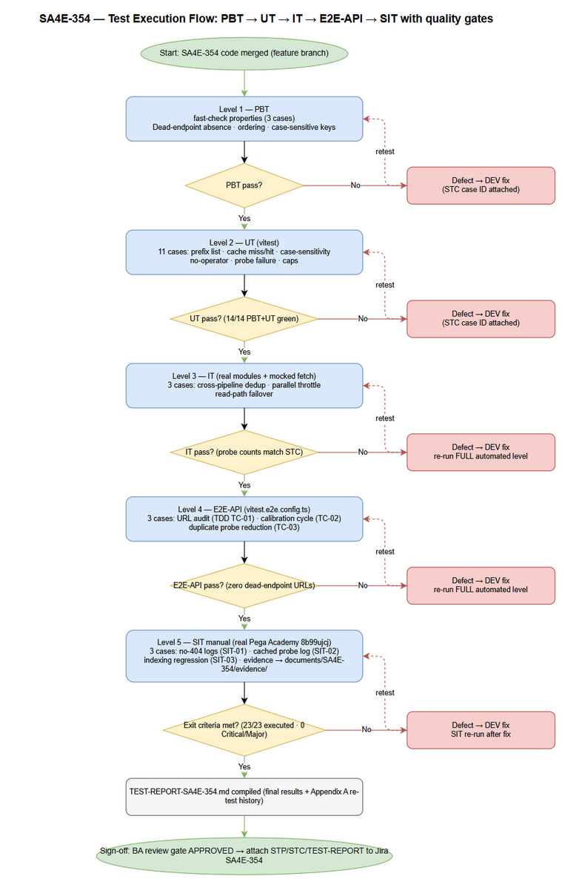
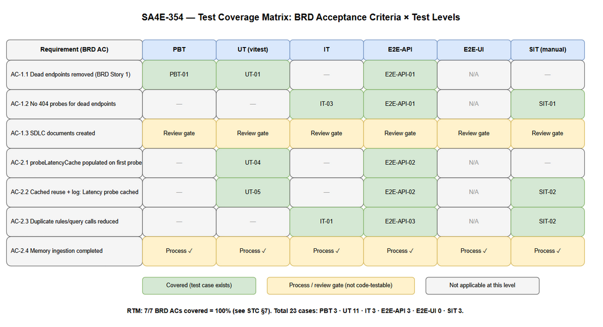

# Software Test Plan (STP)

## SDLC Agents 4 Enterprise — SA4E-354: Pega performance improvements – remove dead endpoints and latency probe caching

---

## Document Information

| Field | Value |
|-------|-------|
| Jira Ticket | SA4E-354 |
| Title | Pega performance improvements – remove dead endpoints and latency probe caching |
| Author | QA Agent |
| Version | 1.0 |
| Date | 2026-10-11 |
| Status | Draft |
| Related BRD | documents/SA4E-354/BRD.md |
| Related FSD | documents/SA4E-354/FSD.md |
| Related TDD | documents/SA4E-354/TDD.md |

---

## Author Tracking

| Role | Name - Position | Responsibility |
|------|-----------------|----------------|
| Author | QA Agent – QA Engineer | Create document |
| Peer Reviewer | Duc Nguyen Minh – Reporter / BA Agent | Review document |

---

## Revision History

| Version | Date | Author | Changes |
|---------|------|--------|---------|
| 1.0 | 2026-10-11 | QA Agent | Initiate document — auto-generated from BRD, FSD, and TDD |

---

## Sign-Off

| Name | Signature and date |
|------|--------------------|
| | ☐ I agree and confirm the test plan in this STP |
| | ☐ I agree and confirm the test plan in this STP |

---

## 1. Introduction

### 1.1 Purpose

This Software Test Plan (STP) defines the test strategy, scope, environment, schedule, and defect management for **SA4E-354**, a performance improvement in the SDLC Agents 4 Enterprise VS Code extension. The change under test consists of two service-layer modifications:

1. **Dead endpoint removal** — `PegaHttpCore.getCustomRestPrefixes()` (`extension/src/services/pega/PegaHttpCore.ts`) no longer returns `${base}/api/v1` and `${base}/PRRestService/v1`, which do not exist on Pega Academy (instance `8b99ujcj`), eliminating permanent 404 probes in the rules/query path.
2. **Latency probe caching** — `PegaCrawlHelper` (`extension/src/services/PegaCrawlHelper.ts`) introduces a module-level `probeLatencyCache Map<string, number>` so that `calibrateFetchConcurrency()` measures latency via `measureLatency()` only once per operator ID; subsequent calls from `PegaProjectIndexer` and `PegaBfsIndexer` reuse the cached value and log `🎯 Latency probe cached for {operatorId}`.

This plan verifies that both changes meet the acceptance criteria in BRD §2.3, the use cases/business rules in FSD §3.1–3.2, and the technical design and E2E test architecture in TDD §3, §8, and §11.

### 1.2 Test Objectives

- **O1** — Verify `getCustomRestPrefixes()` returns only valid CodeIntelligence prefixes and never contains `/api/v1` or `/PRRestService/v1` for any base URL (AC 1.1, BR-01, BR-02).
- **O2** — Verify no 404 probes are issued for dead endpoints on the rules/query path, at mocked-integration level and on the real Pega Academy instance (AC 1.2).
- **O3** — Verify `probeLatencyCache` is populated on the first successful probe and reused on subsequent calls, with the exact log line `Latency probe cached for {operatorId}` (AC 2.1, AC 2.2, BR-04, BR-05).
- **O4** — Verify duplicate `calibrateFetchConcurrency` probes are eliminated across `PegaProjectIndexer` and `PegaBfsIndexer` pipelines (AC 2.3, TDD §8.1: previously 16 duplicate calls for `SSA@TGB`, target 1 probe per session).
- **O5** — Verify error-handling behavior per FSD §9: no operator configured → skip probe with default concurrency; `measureLatency` failure → default concurrency and cache NOT populated (BR-05).
- **O6** — Verify non-functional bounds from TDD §8.3: cached probe reuse adds no additional network call (proxy for "< 1 ms cached probe" target); concurrency output remains within `maxServerConnections = 15` and `totalItems` caps.
- **O7** — Ensure zero regression in the existing prefix failover and read-path behavior (`activePrefix` promotion, rules/instance fallback across prefixes).

### 1.3 References

| Document | Location |
|----------|----------|
| BRD | documents/SA4E-354/BRD.md |
| FSD | documents/SA4E-354/FSD.md |
| TDD | documents/SA4E-354/TDD.md |
| Source (dead endpoints) | extension/src/services/pega/PegaHttpCore.ts |
| Source (latency cache) | extension/src/services/PegaCrawlHelper.ts |
| Consumers | extension/src/services/PegaProjectIndexer.ts, extension/src/services/PegaBfsIndexer.ts |
| Test templates | documents/templates/STP-TEMPLATE.md, documents/templates/STC-TEMPLATE.md |

> Note: BRD/FSD/TDD currently exist as Markdown in the repository. DOCX exports are attached to Jira by the SM when required.

---

## 2. Test Strategy

### 2.1 Test Levels

SA4E-354 is a service-layer change inside a VS Code extension (TypeScript + Vitest). There is no HTTP API surface and no UI change (TDD §1.2, FSD §3.1.5/§3.2.5 = N/A), so the level mix is automation-heavy with a small manual SIT slice for real-instance validation.

**STP Test Levels Table (MANDATORY):**

| Level | Scope | Automation | Tools |
|-------|-------|------------|-------|
| PBT | Correctness properties over prefix list (dead-endpoint absence, prefix closure, activePrefix ordering) and cache-key case sensitivity, with randomly generated inputs | ✅ Automated | fast-check + vitest |
| UT | Unit tests for `getCustomRestPrefixes()` and `calibrateFetchConcurrency()` — happy path, cache hit/miss, case sensitivity, no-operator, probe failure, concurrency bounds | ✅ Automated | vitest (extension/src/\_\_tests\_\_/) |
| IT | In-process integration with real modules: cross-pipeline shared cache, `fetchRulesInParallel` honoring calibrated concurrency, real read-path prefix failover via `PegaRuleReadClient` | ✅ Automated | vitest + mocked global fetch (real PegaHttpCore/PegaCrawlHelper/concurrency-tuner) |
| E2E-API | Full-stack service path: PegaHttpClient → PegaHttpCore → read clients → PegaCrawlHelper against a stubbed Pega Academy HTTP surface; URL audit, calibration cycle, probe-count reduction | ✅ Automated | vitest + fetch mock (`vitest.e2e.config.ts`) |
| E2E-UI | Browser/UI automation | ⛔ N/A — 0 cases | Playwright (not applicable) |
| SIT | Manual exploratory validation against real Pega Academy 8b99ujcj: 404 absence in Output channel logs, cached-probe log line, duplicate-call reduction, indexing regression | ❌ Manual | VS Code extension host + Output channel |

**Level objectives for this ticket:**

| Level | Objective (SA4E-354 specific) |
|-------|-------------------------------|
| PBT | Prove invariants that must hold for *any* base URL / operator ID, not just `8b99ujcj.pega.com` and `SSA@TGB` |
| UT | Lock the exact prefix list contents and every branch of `calibrateFetchConcurrency` (miss/hit/empty-operator/throw/bounds) |
| IT | Prove the module-level cache is shared across both indexer call sites and that calibrated concurrency actually throttles parallel fetches |
| E2E-API | Prove the end-to-end rules/query path never emits a request to a dead endpoint and the second pipeline run issues zero additional probe calls (TDD §11.2 TC-01/TC-02/TC-03) |
| E2E-UI | Not applicable — no UI changes in scope |
| SIT | Prove the improvements are observable on the real Pega Academy instance (the only place true 404 elimination and the 16→reduced duplicate-call reduction can be observed) |

### 2.2 Test Types

| Type | Description | Applicable |
|------|-------------|------------|
| Functional Testing | Verify UC-01/UC-02 main flows and FSD §10 scenarios TC-01…TC-05 | Yes |
| Regression Testing | Prefix failover, `activePrefix` promotion, read-path behavior unchanged (SA4E-350 semantics preserved) | Yes |
| Performance Testing | NFR bounds: concurrency caps (15 / totalItems), zero extra network call on cache hit; timing asserted via invocation counts (not wall-clock) to avoid flakiness | Yes (bounded) |
| Security Testing | No auth changes (TDD §7); operator ID used only as cache key — verified not leaked in error paths | Minimal |
| Usability Testing | N/A — no UI | No |
| Compatibility Testing | Node 20 LTS + VS Code 1.99+ extension host only | Minimal |

### 2.3 Test Approach

- **Automation-first, risk-based.** The two highest risks are (a) a dead endpoint sneaking back into the prefix list and (b) the cache failing to deduplicate across pipelines. These get property-based (PBT), unit (UT), integration (IT), and E2E-API coverage simultaneously.
- **Module-state isolation.** `probeLatencyCache` is a module-level `Map` with no reset API. Every UT/IT/E2E-API test that imports `PegaCrawlHelper` MUST isolate state via `vi.resetModules()` + dynamic `await import("../services/PegaCrawlHelper")` inside the test (or a fresh module registry per test file). Tests that intentionally verify cross-call persistence must sequence calls within one isolated registry.
- **Mock boundary.** For UT/IT/E2E-API, the Pega Academy HTTP surface is stubbed by mocking `global.fetch` (established repo pattern, e.g. `pega-codeintel-discovery.test.ts`). Real modules (`PegaHttpCore`, `PegaCrawlHelper`, `concurrency-tuner`, read clients) are exercised — mocking is limited to `vscode` config/secrets and the network, never to the units under test.
- **Timing assertions.** TDD §8.3 performance targets (first probe < 2 s, cached probe < 1 ms) are asserted via *invocation-count proxies* (e.g., "second call issues 0 HTTP probe requests") instead of wall-clock timing to keep CI deterministic.
- **Manual slice.** Only behaviors that require the real Pega Academy instance or human log inspection remain manual (SIT-01…SIT-03).

### 2.4 Entry Criteria

| Level | Entry Criteria |
|-------|---------------|
| PBT/UT | Code compiled (`npm run compile` passes); `fast-check` available as dev dependency (repo already contains `*.pbt.test.ts` files); target modules merged on feature branch |
| IT | UT level green for `PegaHttpCore` prefix tests; `vi.resetModules()` isolation pattern agreed with DEV |
| E2E-API | IT level green; `vitest.e2e.config.ts` includes new e2e test glob |
| E2E-UI | N/A |
| SIT | All automated levels green; extension packaged/loaded in VS Code; credentials for Pega Academy `8b99ujcj` available; `sdlcAgents.pegaEndpoint` = `https://8b99ujcj.pega.com/prweb` and `sdlcAgents.pegaUsername` = `SSA@TGB` configured |

### 2.5 Exit Criteria

| Level | Exit Criteria |
|-------|--------------|
| PBT/UT | 100% of PBT/UT cases pass (14/14); no known flaky property (100 fast-check runs stable) |
| IT | 100% of IT cases pass (3/3); probe-invocation counts match STC expected values |
| E2E-API | 100% of E2E-API cases pass (3/3); URL audit shows zero dead-endpoint requests |
| E2E-UI | N/A |
| SIT | 3/3 SIT cases executed on real instance; 0 Critical, 0 Major defects open; Output-channel evidence captured under `documents/SA4E-354/evidence/` |
| Overall | RTM coverage 100%; `npm test` (full suite) green — no regression in existing tests |

### 2.6 E2E Automation Coverage — SIT → E2E Classification

| SIT Scenario Type | Classified As | Reason |
|-------------------|---------------|--------|
| Prefix list content assertions | **UT + PBT** (automated) | Pure function, deterministic |
| Dead-endpoint 404 elimination in rules/query path | **E2E-API-01** (automated URL audit) | Deterministic with fetch mock; real-instance check kept as SIT-01 only for confidence |
| Latency cache first-probe / cached-reuse + log line | **UT-04/UT-05 + E2E-API-02** (automated) | Log string and invocation counts fully assertable |
| Duplicate probe reduction across 2 pipelines | **IT-01 + E2E-API-03** (automated) | Both indexer call sites are in-process; count assertions deterministic |
| Error handling (no operator / probe failure) | **UT-07/UT-08** (automated) | Branch logic |
| Real-instance 404 log absence, real log line ordering, real duplicate-call reduction on `SSA@TGB`, overall indexing regression | **SIT-01…SIT-03** (manual) | Requires real Pega Academy `8b99ujcj` and human reading of the VS Code Output channel |

**Result: manual SIT reduced to 3 cases (13.0% of 23 total); 87.0% automated.**

### 2.7 Test Execution Flow


*[Edit in draw.io](diagrams/test-execution-flow.drawio)*

---

## 3. Test Scope

### 3.1 Features In Scope

| # | Feature / Story | Priority | FSD Reference | Test Type |
|---|----------------|----------|---------------|-----------|
| 1 | UC-01 — Remove dead Pega endpoints from prefix resolution (`/api/v1`, `/PRRestService/v1`) | High | FSD 3.1 (BR-01, BR-02; AF-1/EF-1 empty-list fallback) | PBT, UT, IT, E2E-API, SIT |
| 2 | UC-02 — Cache latency probes per operator ID (`probeLatencyCache`) | High | FSD 3.2 (BR-03, BR-04, BR-05; AF-1/AF-2, EF-1/EF-2) | PBT, UT, IT, E2E-API, SIT |
| 3 | Duplicate probe reduction across `PegaProjectIndexer` + `PegaBfsIndexer` | High | FSD 3.2.2, TDD 8.1 | IT, E2E-API, SIT |
| 4 | Error handling per FSD §9 (no operator, probe failure, empty prefix list) | Medium | FSD 9.1, TDD 5.5 | UT |
| 5 | NFR bounds — concurrency caps, zero-network cached probe (TDD §8.3) | Medium | FSD 8, TDD 8.3 | UT, E2E-API |
| 6 | Regression — prefix failover + `activePrefix` promotion in read path (SA4E-350 semantics) | High | FSD 2.2, TDD 3.2 | UT, IT, E2E-API, SIT |
| 7 | FSD §10 scenarios TC-01…TC-05 mapping | High | FSD 10.1 | Mapped to PBT/UT/IT/E2E-API/SIT IDs — see RTM |

### 3.2 Features Out of Scope

| # | Feature | Reason |
|---|---------|--------|
| 1 | Pega Academy server configuration / endpoint definitions | BRD §1.2 — server side is read-only for this ticket |
| 2 | UI / webview / command palette changes | BRD §1.2, TDD §1.2 — no UI changes; FSD §3.1.5, §3.2.5 = N/A |
| 3 | Indexing accuracy / data extraction logic | BRD §1.2 — behavior-preserving change (verified only as SIT-03 regression, not re-validated feature-by-feature) |
| 4 | Authentication (`getAuthHeader`), workspace trust, HTTPS enforcement internals | TDD §7 — unchanged by SA4E-354; only invoked as dependencies |
| 5 | `fetchWithRetry` backoff internals | Unchanged; covered indirectly |
| 6 | Cache persistence across extension sessions | TDD §12 Open Question #1 — design is session-scoped; persistence explicitly not tested |
| 7 | Other Pega clients' business logic (write client, hierarchy resolver, ruleset resolver) | Not modified; only their consumption of `getCustomRestPrefixes()` is exercised |

### 3.3 Test Coverage Overview


*[Edit in draw.io](diagrams/test-coverage.drawio)*

### 3.4 Test Cases Summary (MANDATORY)

| Level | Count | Automated | Manual |
|-------|-------|-----------|--------|
| PBT | 3 | 3 | 0 |
| UT | 11 | 11 | 0 |
| IT | 3 | 3 | 0 |
| E2E-API | 3 | 3 | 0 |
| E2E-UI | 0 | 0 | 0 |
| SIT | 3 | 0 | 3 |
| **Total** | **23** | **20 (87.0%)** | **3 (13.0%)** |

---

## 4. Test Environment

### 4.1 Environment Requirements

| Environment | URL | Database | Purpose |
|-------------|-----|----------|---------|
| Dev/Test (automated) | In-process (vitest); stubbed Pega via mocked `global.fetch` | None (in-memory cache only) | PBT, UT, IT, E2E-API |
| SIT (manual) | `https://8b99ujcj.pega.com/prweb` (Pega Academy) | None | SIT-01…SIT-03 |
| Runtime | Node.js 20.x, VS Code 1.99+ extension host | — | All levels |

**Toolchain:** `npm test` → `vitest run` (unit/integration); `npm run test:e2e` → `vitest run --config vitest.e2e.config.ts`; `npm run compile` for type check.

### 4.2 Browser / Device Requirements

| Browser | Version | OS | Required |
|---------|---------|-----|----------|
| N/A — VS Code extension host | VS Code ≥ 1.99 | Windows (dev machines) | Yes (replaces browser) |
| Playwright browser | — | — | No (E2E-UI out of scope) |

### 4.3 Test Data Requirements

| Data Type | Description | Source | Preparation |
|-----------|-------------|--------|-------------|
| Base URLs | `https://8b99ujcj.pega.com/prweb`, `http://localhost:8080/prweb/` (default config + trailing slash), HTTPS-enforced variants | testdata/pre-seeded-data.csv | Loaded as config stubs (`vi.mock("vscode")`) |
| Operator IDs | `SSA@TGB` (main), `ssa@tgb` (case-sensitivity negative), `""` (no operator) | testdata/pre-seeded-data.csv | Config stub `pegaUsername` |
| Prefixes | 2 valid (`/api/CodeIntelligence/v1`, `/PRRestService/CodeIntelligence/v1`), 2 dead (`/api/v1`, `/PRRestService/v1`) | testdata/pre-seeded-data.csv | Assertion constants |
| Scenario matrices | Per-test-case inputs + expected probe counts + expected log fragments | testdata/prefix-resolution-testdata.csv, testdata/latency-cache-testdata.csv | Referenced by each STC case |
| Pega Academy credentials | Basic-auth username/password for SIT | VS Code SecretStorage (manual entry) | QA configures before SIT |

**CSV note for UT/IT:** UT/IT levels use in-code mocks (`vi.mock`, fetch stubs); no separate executable data files are required. The CSVs under `testdata/` are the single source of truth for inputs/expected values used to author those tests (traceability per system test-data policy).

### 4.4 External Dependencies

| System | Dependency | Mock/Stub Available |
|--------|-----------|---------------------|
| Pega Academy 8b99ujcj REST | Latency probe (`DATA-ADMIN-OPERATOR-ID` via CodeIntelligence prefixes), rules/query | Yes for automated levels — `vi.stubGlobal("fetch", fetchMock)` with scripted 200/404/500 responses; No for SIT (real instance required) |
| VS Code API | `workspace.getConfiguration`, `SecretStorage` | Yes — `vi.mock("vscode", ...)` (repo pattern) |

---

## 5. Test Schedule

| Phase | Start Date | End Date | Duration | Milestone |
|-------|-----------|----------|----------|-----------|
| Test Planning (STP + STC) | 2026-10-11 | 2026-10-11 | 0.5 d | STP + STC approved (BA review gate) |
| Test Data Preparation | 2026-10-11 | 2026-10-11 | 0.5 d | testdata/*.csv reviewed |
| Automated Execution (PBT/UT/IT/E2E-API) | 2026-10-12 | 2026-10-12 | 0.5 d | 20/20 automated green |
| Defect Fix & Retest | 2026-10-13 | 2026-10-14 | 2 d | All Critical/Major fixed |
| SIT Execution (manual, real instance) | 2026-10-14 | 2026-10-14 | 0.5 d | SIT sign-off + evidence |
| UAT / Review sign-off | 2026-10-15 | 2026-10-15 | 0.5 d | TEST-REPORT approved |

> Dates are estimates aligned with a single-sprint ticket; SM adjusts per sprint cadence.

---

## 6. Resources & Responsibilities

| Role | Name | Responsibility |
|------|------|---------------|
| Test Lead | QA Agent | STP/STC authorship, execution coordination, TEST-REPORT |
| QA Engineer | QA Agent | Test case design, automated + manual execution, defect reporting |
| BA | BA Agent | Acceptance-criteria clarification, STC business-coverage review gate |
| Developer | DEV Agent | Bug fixing, UT/PBT implementation in `extension/src/__tests__/` |
| DevOps | DevOps Agent | CI wiring for `npm test` / `test:e2e` if needed |
| Reporter | Duc Nguyen Minh | Business validation of SIT results on Pega Academy |

---

## 7. Risk & Mitigation

| # | Risk | Impact | Likelihood | Mitigation |
|---|------|--------|------------|------------|
| 1 | Module-level `probeLatencyCache` leaks state between tests → false cache hits | High | High | Mandate `vi.resetModules()` + dynamic import per test (STC §8.1 pattern); forbid static top-level import of `PegaCrawlHelper` in cache tests |
| 2 | Wall-clock latency assertions flaky in CI | Medium | High | Assert via invocation counts / HTTP-call counts, never raw ms (see STC UT-04, E2E-API-02) |
| 3 | fast-check property generates pathological base URLs (non-URL strings) → false failures | Medium | Medium | Constrain generators to valid `https?://host[:port]/path` shapes (STC PBT-01 preconditions) |
| 4 | Real Pega Academy `8b99ujcj` unavailable/slow during SIT window | High | Low | SIT window has fallback slot next day; automated levels already prove logic — SIT is confidence-only |
| 5 | Dead-endpoint removal breaks other Pega environments that *do* have `/api/v1` | Medium | Low | BRD §5.1 mitigation: prefix list validated per environment; SIT-03 regression covers read path; rollback per TDD §10.3 |
| 6 | Cache staleness if network latency changes mid-session | Low | Low | Accepted per BRD §5.1 (session-scoped); documented as out of scope |
| 7 | FSD EF-1 (empty-prefix warn+fallback) contradicts actual fail-loud behavior — spec written before code evidence (found by UT-11) | Medium | Medium | BA adjudicated 2026-10-11 as spec correction (FSD/TDD/BRD EF-1 update routed via SM); UT-11 revised to fail-loud expectation; NOT a code defect |

---

## 8. Defect Management

### 8.1 Severity Levels

| Severity | Definition | Example (SA4E-354 context) |
|----------|-----------|-----------------------------|
| Critical | Indexing pipeline broken, data loss, crash of extension host | `calibrateFetchConcurrency` throws uncaught → indexing aborts |
| Major | Feature not working, workaround exists | Dead endpoint still probed → 404 spam returns; cache never hits → duplicates persist; FSD EF-1 fallback missing |
| Minor | Functional deviation with easy workaround / log-only issue | Cache-hit log line text deviates from spec (`Latency probe cached for {operatorId}`) |
| Trivial | Cosmetic | Emoji/log formatting mismatch |

### 8.2 Priority Levels

| Priority | Definition | SLA (Fix Time) |
|----------|-----------|----------------|
| P1 | Must fix immediately | 4 hours |
| P2 | Must fix before release | 1 business day |
| P3 | Should fix if time permits | 3 business days |
| P4 | Nice to fix, can defer | Next release |

### 8.3 Defect Lifecycle

```
New → Open → In Progress → Fixed → Ready for Retest → Verified → Closed
                                                     → Reopened → In Progress
```

**Escalation rule:** any Critical/Major defect found at IT or above sends the ticket back to DEV Agent with the failing STC case ID attached; QA re-runs the full automated level (not only the failing case) after fix.

---

## 9. Test Metrics & Reporting

### 9.1 Metrics

| Metric | Formula | Target |
|--------|---------|--------|
| Test Execution Rate | Executed / Total × 100% | 100% (23/23) |
| Pass Rate | Passed / Executed × 100% | ≥ 95% |
| RTM Coverage | Covered requirements / Total requirements × 100% | 100% |
| Defect Density | Defects / Test Cases | ≤ 0.1 |
| Critical Defect Count | Count of Critical severity | 0 |
| Defect Fix Rate | Fixed / Total Defects × 100% | ≥ 90% |
| Automation Rate | Automated cases / Total × 100% | ≥ 85% (planned: 87.0%) |

### 9.2 Reporting Schedule

| Report | Frequency | Audience |
|--------|-----------|----------|
| Automated run summary (vitest output) | Every `npm test` / CI run | DEV + QA |
| Defect Summary | Daily during fix window | DEV + SM |
| TEST-REPORT (TEST-REPORT-SA4E-354.md, template-based) | End of execution | SM, Reporter, BA |

---

## 10. Appendix

### Glossary

| Term | Definition |
|------|------------|
| SIT | System Integration Testing (manual, real instance) |
| UAT | User Acceptance Testing |
| STP / STC | Software Test Plan / Software Test Cases |
| PBT | Property-Based Testing (fast-check) |
| probeLatencyCache | Module-level `Map<string, number>` in PegaCrawlHelper caching measured latency per operator ID |
| Dead endpoint | REST prefix that does not exist on Pega Academy (`/api/v1`, `/PRRestService/v1`) |
| activePrefix | Prefix locked in on PegaHttpCore after first successful call; promoted to first position |

### Assumptions

- A1 — `fast-check` is available in the extension dev dependencies (repo already ships `*.pbt.test.ts` files); if absent, DEV adds it as devDependency before implementing PBT cases.
- A2 — Latency per operator is stable within a session (BRD §5.2); tests may therefore assert single-probe semantics.
- A3 — Both indexer pipelines share the same module instance of `PegaCrawlHelper` at runtime (BRD §5.2); IT-01 validates this assumption.
- A4 — Automated levels never require network access; only SIT does.
- A5 — DOCX/XLSX exports of STP/STC are produced after the BA review gate verdict = APPROVED (SM-triggered), then attached to Jira SA4E-354.

### Test Data Files

| File | Covers |
|------|--------|
| testdata/pre-seeded-data.csv | Baseline config: base URLs, operator IDs, valid/dead prefixes, constants |
| testdata/prefix-resolution-testdata.csv | PBT-01…02, UT-01…03, UT-11, IT-03, E2E-API-01, SIT-01, SIT-03 |
| testdata/latency-cache-testdata.csv | PBT-03, UT-04…UT-10, IT-01, IT-02, E2E-API-02, E2E-API-03, SIT-02 |

### E2E-UI Justification

E2E-UI (Playwright) has **0 cases** for SA4E-354: the change touches only extension service-layer modules (`PegaHttpCore`, `PegaCrawlHelper`); FSD §3.1.5 and §3.2.5 declare UI specifications N/A, and TDD §1.2 places UI modifications out of scope. Any future UI-facing behavior would be added under a separate ticket.
