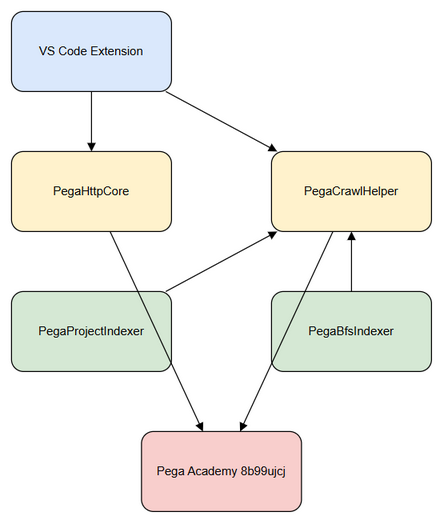
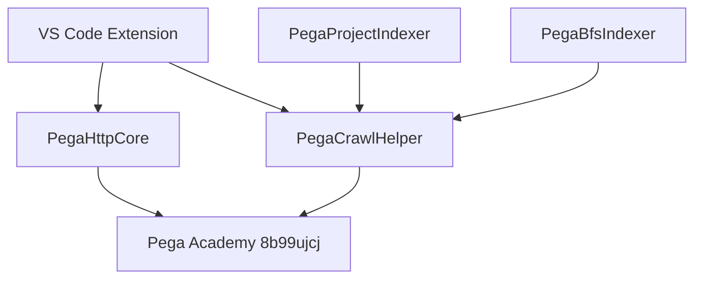
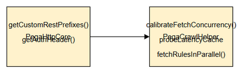
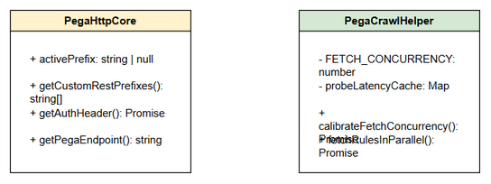
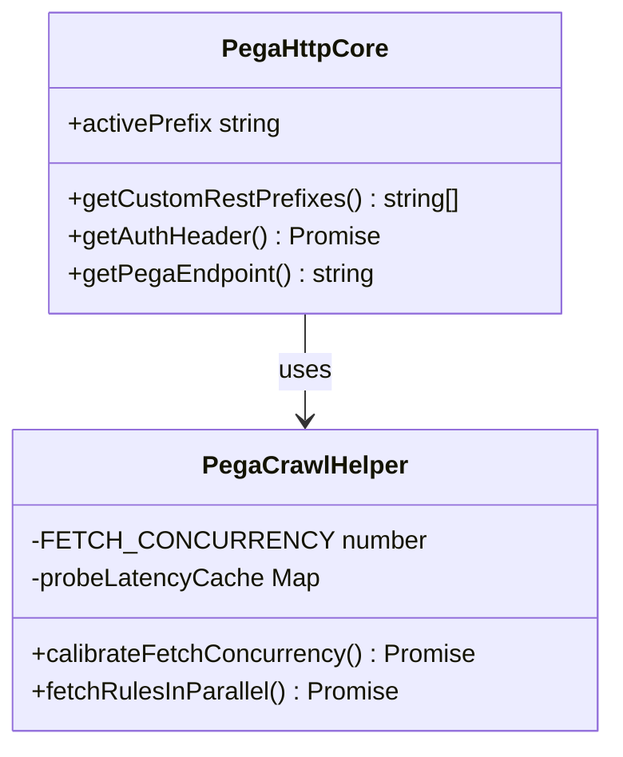
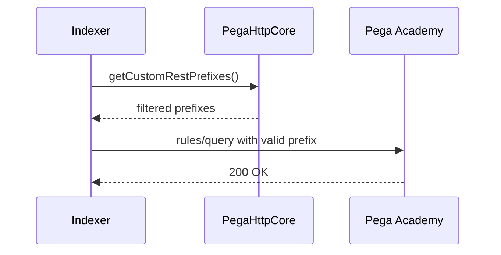
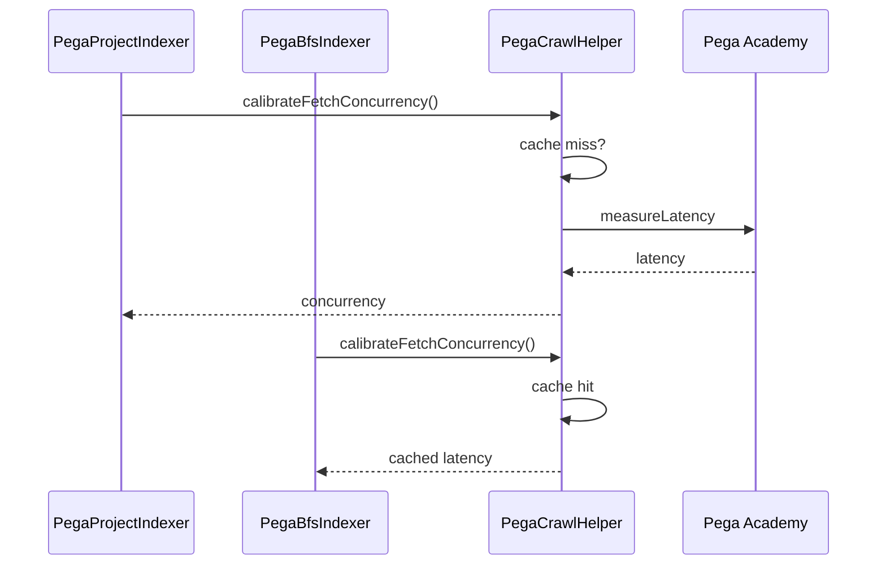

# Technical Design Document (TDD)

## SDLC Agents 4 Enterprise — SA4E-354: Pega performance improvements – remove dead endpoints and latency probe caching

---

## Document Information

| Field | Value |
|-------|-------|
| Jira Ticket | SA4E-354 |
| Title | Pega performance improvements – remove dead endpoints and latency probe caching |
| Author | SA Agent |
| Version | 1.1 |
| Date | 2026-10-11 |
| Status | Draft |
| Related BRD | documents/SA4E-354/BRD.md |
| Related FSD | documents/SA4E-354/FSD.md |

---

## Author Tracking

| Role | Name - Position | Responsibility |
|------|-----------------|----------------|
| Author | SA Agent – Solution Architect | Create document |
| Peer Reviewer | Duc Nguyen Minh – Reporter | Review document |

---

## Revision History

| Version | Date | Author | Changes |
|---------|------|--------|---------|
| 1.0 | 2026-10-11 | SA Agent | Initiate document — auto-generated from BRD and FSD |
| 1.1 | 2026-10-11 | SA Agent | Spec correction per BA adjudication: §3.2 + §5.5 + §9.1 — empty prefix list → fail-loud error (no warn+fallback) |

---

## Sign-Off

| Name | Signature and date |
|------|--------------------|
| | ☐ I agree and confirm the technical design in this TDD |
| | ☐ I agree and confirm the technical design in this TDD |

---

## 1. Introduction

### 1.1 Purpose
This TDD specifies the technical implementation for Pega indexing pipeline performance improvements in the SDLC Agents 4 Enterprise VS Code extension. The design removes dead Pega REST endpoints from prefix resolution to eliminate permanent 404 probes, and introduces per-operator latency probe caching to avoid duplicate `calibrateFetchConcurrency` measurements across `PegaProjectIndexer` and `PegaBfsIndexer` pipelines.

### 1.2 Scope
Technical scope covers:
- `extension/src/services/pega/PegaHttpCore.ts` — `getCustomRestPrefixes()` modification
- `extension/src/services/PegaCrawlHelper.ts` — `probeLatencyCache` introduction and `calibrateFetchConcurrency` update
- Shared state between indexer pipelines
- Logging and observability for cache hits/misses

Out of scope: Pega Academy server configuration, functional indexing accuracy changes, UI modifications.

### 1.3 Technology Stack

| Layer | Technology | Version |
|-------|-----------|---------|
| Language | TypeScript | 5.x |
| Framework | VS Code Extension API | 1.99+ |
| Runtime | Node.js | 20.x |
| HTTP Client | fetch (global patched) | native |
| Build Tool | npm / esbuild |  |
| Container | N/A – VS Code Extension |  |

### 1.4 Design Principles
- Performance first: eliminate wasteful 404 probes and duplicate latency measurements
- Least change: modify only prefix list and add in-memory cache, preserve existing behavior
- Observability: log cache hits/misses and prefix filtering decisions
- SOLID: single responsibility for HTTP core vs crawl helper

### 1.5 Constraints
- No database migration required
- Cache must be in-memory per extension session
- Must remain compatible with Pega Academy 8b99ujcj instance
- No breaking changes to existing `PegaHttpClient` consumers

### 1.6 References
| Document | Location |
|----------|----------|
| BRD | documents/SA4E-354/BRD.md |
| FSD | documents/SA4E-354/FSD.md |
| Source | extension/src/services/pega/PegaHttpCore.ts |
| Source | extension/src/services/PegaCrawlHelper.ts |

---

## 2. System Architecture

### 2.1 Architecture Overview

High-level architecture shows VS Code Extension orchestrating Pega indexing via `PegaHttpCore` for endpoint resolution and `PegaCrawlHelper` for concurrency calibration, both targeting Pega Academy.


*[Edit in draw.io](diagrams/architecture.drawio)*



### 2.2 Component Diagram


*[Edit in draw.io](diagrams/component.drawio)*

| Component | Responsibility | Technology |
|-----------|---------------|------------|
| PegaHttpCore | Endpoint resolution, auth header, retry logic, activePrefix state | TypeScript class |
| PegaCrawlHelper | Parallel fetch strategies, concurrency calibration, latency caching | TypeScript module |
| PegaProjectIndexer | Project-based indexing pipeline | TypeScript service |
| PegaBfsIndexer | BFS indexing pipeline | TypeScript service |

### 2.3 Deployment Architecture
Extension runs inside VS Code host process. No separate deployment artifact. Changes ship via VS Code Marketplace update to extension package.

### 2.4 Communication Patterns

| From | To | Protocol | Pattern | Description |
|------|----|----------|---------|-------------|
| PegaHttpCore | Pega Academy | HTTPS REST | Sync | Rules/query calls using filtered prefixes |
| PegaCrawlHelper | Pega Academy | HTTPS REST | Sync | Latency probe via getObject |
| PegaProjectIndexer | PegaCrawlHelper | In-process | Sync | calibrateFetchConcurrency call |
| PegaBfsIndexer | PegaCrawlHelper | In-process | Sync | calibrateFetchConcurrency call |

---

## 3. API Design

### 3.1 API Overview
Internal methods only; no external HTTP API surface changes.

| # | Method | Class | Description | Source |
|---|--------|-------|-------------|--------|
| 1 | getCustomRestPrefixes() | PegaHttpCore | Returns filtered REST prefix list | UC-01 |
| 2 | calibrateFetchConcurrency() | PegaCrawlHelper | Measures or reuses cached latency | UC-02 |

### 3.2 API: getCustomRestPrefixes

**Implements:** UC-01, BR-01, BR-02

| Attribute | Value |
|-----------|-------|
| Method | N/A – internal method |
| Path | N/A |
| Auth | Inherited from PegaHttpCore.getAuthHeader |
| Rate Limit | N/A |

**Behavior:**
- Builds base URL via `getPegaEndpoint()`
- Returns `["${base}/api/CodeIntelligence/v1", "${base}/PRRestService/CodeIntelligence/v1"]`
- Dead endpoints `${base}/api/v1` and `${base}/PRRestService/v1` were removed per SA4E-354 implementation
- `activePrefix` is prepended on first successful call to preserve discovered prefix

**Error Responses:**
| Scenario | Severity | Log Message |
|----------|----------|-------------|
| Prefix list empty after filtering | Error | Unreachable at runtime — resolver always returns 2 valid CodeIntelligence prefixes. Consumers fail loud (throw with clear log); no fallback (BA adjudication 2026-10-11) |

### 3.3 API: calibrateFetchConcurrency

**Implements:** UC-02, BR-03, BR-04, BR-05

| Attribute | Value |
|-----------|-------|
| Signature | `calibrateFetchConcurrency(pegaClient, totalItems, log): Promise<number>` |
| Auth | Uses configured operator via pegaClient.getConfiguredUsername() |
| Cache | In-memory Map<string,number> probeLatencyCache |

**Request Data:**
- `operatorId`: string from pegaClient.getConfiguredUsername()
- `totalItems`: number

**Logic:**
1. Retrieve `probeOperatorId`
2. Check `probeLatencyCache.get(probeOperatorId)`
3. Cache miss → `measureLatency(() => pegaClient.getObject(...))` with 2 attempts
4. Store latency in cache
5. Compute `FETCH_CONCURRENCY` via `computeOptimalConcurrency`
6. Cache hit → log "Latency probe cached for {operatorId}"

**Error Responses:**
| Scenario | Severity | Log Message |
|----------|----------|-------------|
| No operator configured | Info | Skip probe, use default |
| measureLatency throws | Warning | Use default FETCH_CONCURRENCY |

---

## 4. Database Design

No persistent database changes. Caching is in-memory per extension session.

### 4.1 Cache Data Model

| Attribute | Type | Description |
|-----------|------|-------------|
| operatorId | string | Cache key, case-sensitive |
| latencyMs | number | Measured latency in ms |

### 4.2 Lifecycle
Cache lives for extension session lifetime. No eviction policy; acceptable given operator count is low.

---

## 5. Class / Module Design

### 5.1 Package Structure

```
extension/src/services/
├── pega/
│   └── PegaHttpCore.ts          # HTTP primitives + prefix resolution
├── PegaCrawlHelper.ts           # Parallel fetch + latency cache
├── PegaProjectIndexer.ts        # Consumer of helper
├── PegaBfsIndexer.ts            # Consumer of helper
└── concurrency-tuner.ts         # computeOptimalConcurrency, measureLatency
```

### 5.2 Key Interfaces

```typescript
export class PegaHttpCore {
  public activePrefix: string | null = null;
  getCustomRestPrefixes(): string[];
  async getAuthHeader(): Promise<string>;
  getPegaEndpoint(): string;
}

export async function calibrateFetchConcurrency(
  pegaClient: PegaHttpClient,
  totalItems: number,
  log: LogFn
): Promise<number>
```

### 5.3 Class Diagram


*[Edit in draw.io](diagrams/class-diagram.drawio)*



### 5.4 Design Patterns

| Pattern | Where Used | Rationale |
|---------|-----------|-----------|
| Facade | PegaHttpCore | Centralizes HTTP primitives and prefix state |
| Module-level Singleton State | probeLatencyCache | Shared cache across indexer pipelines without DI |
| Strategy | computeOptimalConcurrency | Pluggable concurrency calculation |

### 5.5 Error Handling

| Exception | Handling |
|-----------|----------|
| Empty prefix list | Internal error — fail loud | Throw with clear log; NO silent fallback (spec-corrected per BA adjudication 2026-10-11, STC UT-11) |
| Latency measurement failure | Log warning, use default FETCH_CONCURRENCY |
| Cache miss with no operator | Skip probe, use default |

---

## 6. Integration Design

### 6.1 External System: Pega Academy 8b99ujcj

| Attribute | Value |
|-----------|-------|
| Protocol | HTTPS REST |
| Endpoint | https://8b99ujcj.pega.com/prweb |
| Authentication | Basic Auth via getAuthHeader |
| Timeout | Inherited from fetchWithRetry |
| Retry Policy | Exponential backoff on 502/503/504, max 2 retries |

**Sequence: Prefix Filtering**



**Sequence: Latency Cache**



---

## 7. Security Design

- No authentication changes: `getAuthHeader()` unchanged, workspace trust enforced via `assertWorkspaceTrusted`
- Operator ID used only as cache key, not sensitive
- HTTPS enforced via `enforcePegaEndpointHttps`
- No new data exposure

---

## 8. Performance & Scalability

### 8.1 Caching Strategy

| Cache | What | TTL | Eviction | Technology |
|-------|------|-----|----------|------------|
| probeLatencyCache | Latency per operator | Session | Manual / process exit | In-memory Map |

Impact: Reduces duplicate `rules/query` probes. Previously SSA@TGB incurred 16 duplicate calls; target 1 per session.

### 8.2 Connection Pooling
Fetch concurrency tuned per latency measurement. Max server connections capped at 15 via `computeOptimalConcurrency`.

### 8.3 Performance Targets

| Operation | Target |
|-----------|--------|
| Prefix resolution | < 5ms |
| Latency probe first call | < 2s |
| Latency probe cached | < 1ms |

---

## 9. Monitoring & Observability

### 9.1 Logging

| Log Event | Level | Fields |
|-----------|-------|--------|
| Latency probe measured | INFO | operatorId, latencyMs |
| Latency probe cached | INFO | operatorId |
| Dead endpoint removed | INFO | prefix list |
| Consumer error on empty prefix list | ERROR | insKey, base URL (fail-loud, no fallback) |

### 9.2 Metrics
- `probe_latency_cache_hits` counter
- `probe_latency_cache_misses` counter
- `prefix_filter_dead_endpoints_removed` counter

---

## 10. Deployment Considerations

### 10.1 Environment Configuration
Prefix list is environment-agnostic but dead endpoints removal applies only to Pega Academy. No config changes required.

### 10.2 Feature Flags
None required.

### 10.3 Rollback Strategy
Revert `getCustomRestPrefixes()` to previous list and remove `probeLatencyCache` initialization. Changes are code-only, no migration.

---

## 11. E2E Test Architecture

### 11.1 Framework & Language
- Framework: Vitest for E2E-API tests, Playwright for E2E-UI (if applicable)
- Language: TypeScript
- Test location: `extension/tests/`

### 11.2 Test Design for SA4E-354
- **Test TC-01 Dead endpoints removal**: Verify `getCustomRestPrefixes()` does not contain `/api/v1` or `/PRRestService/v1`
- **Test TC-02 Latency cache hit**: First call measures latency, second call logs "Latency probe cached"
- **Test TC-03 Duplicate probe reduction**: Simulate two indexer calls, assert `measureLatency` invoked once

---

## 12. Appendix

### Glossary
| Term | Definition |
|------|------------|
| probeLatencyCache | Map<string,number> caching measured latency per operator ID |
| calibrateFetchConcurrency | Function to measure latency and compute optimal concurrency |
| getCustomRestPrefixes | Returns filtered REST base prefixes for Pega queries |

### Open Questions
| # | Question | Status |
|---|----------|--------|
| 1 | Should cache be persisted across sessions? | Open – current design session-scoped |

---

## ⛔ MANDATORY: Diagram Requirements

All diagrams referenced exist as draw.io + PNG.

| Diagram | File |
|---------|------|
| Architecture | diagrams/architecture.drawio + .png |
| Component | diagrams/component.drawio + .png |
| Class | diagrams/class-diagram.drawio + .png |

