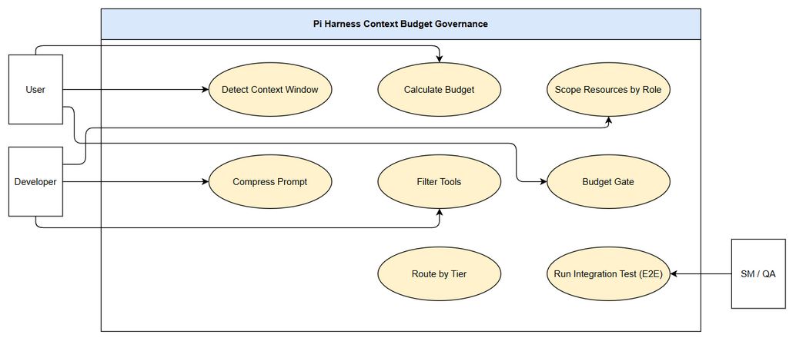
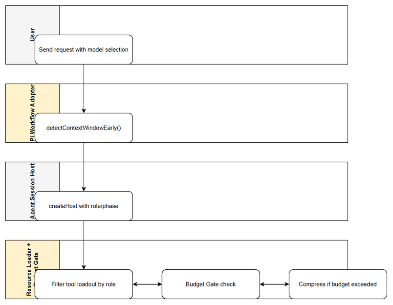

# Business Requirements Document (BRD)

## SA4E-355 — Implement Context Budget Governance for Pi Harness

---

## Document Information

| Field | Value |
|-------|-------|
| Jira Ticket | SA4E-355 |
| Title | Implement Context Budget Governance for Pi Harness |
| Author | BA Agent |
| Version | 1.0 |
| Date | 2026-10-11 |
| Status | Draft |

---

## Author Tracking

| Role | Name - Position | Responsibility |
|------|-----------------|----------------|
| Author | BA Agent – Business Analyst | Create document |
| Peer Reviewer | TBD – Reviewer | Review document |

---

## Revision History

| Version | Date | Author | Changes |
|---------|------|--------|---------|
| 1.0 | 2026-10-11 | BA Agent | Initiate document — auto-generated from Jira ticket SA4E-355 and IMPLEMENTATION-GUIDE.md |

---

## Sign-Off

| Name | Signature and date |
|------|--------------------|
| | ☐ I agree and confirm all criteria on this BRD as expected requirements |
| | ☐ I agree and confirm all criteria on this BRD as expected requirements |

---

## 1. Introduction

### 1.1 Scope

Implement Context Budget Governance for Pi Harness to eliminate `exceed_context_size_error` when using small context models (~32k tokens) such as qwen. The solution wires existing but unused mechanisms — Context Budget Calculator, Prompt Compressor, Role Scope Filter, Model Tiering, Session Compactor — into the session creation flow of `pi-agent-session-host.ts` and `pi-workflow-adapter.ts`. 

Scope includes:
- Detect real `n_ctx` from provider/model registry and resolve Context Budget single source of truth
- Scope static context (`.kiro/steering/*.md`, AGENTS.md, skills) by role/phase with budget cap
- Conditional compression of AGENTS.md + steering preserving security lines via `NON_STRIPPABLE_RE`
- Role-aware tool loadout filtering with schema token cap
- Budget Gate before session send with actionable error `PI_CONTEXT_BUDGET_EXCEEDED`
- Model tiering behavior adjustment for small/medium/large context windows
- Integration tests and manual E2E for qwen 32k

### 1.2 Out of Scope

- No changes to LangGraph engine (`extension/out/langgraph/**`) — Pi harness only
- No new compression/budget/tier/role-filter algorithms — wire existing mechanisms only
- No model switching/automatic model change — only behavior adjustment per chosen model
- No production secrets modification, no infrastructure changes
- No UI redesign beyond existing context usage indicator

### 1.3 Preliminary Requirement

- `extension/src/pi-agent/context-budget.ts`, `prompt-compressor.ts`, `role-scope.ts`, `model-tier.ts`, `model-router.ts`, `agent-configurator.ts` already exist with tests
- Pi Harness SDK exposes `DefaultResourceLoaderOptions` hooks: `skillsOverride`, `agentsFilesOverride`, `systemPromptOverride`, `appendSystemPromptOverride`
- `openai-provider.detectContextWindow()` returns `meta.n_ctx`
- Code standards: file ≤200 lines, function ≤20 lines, SOLID, TSDoc, no swallowed exceptions

---

## 2. Business Requirements

### 2.1 High Level Process Map

User selects model → Pi Workflow Adapter detects context window early → Agent Session Host creates session → Context Budget Resolver computes budget from n_ctx → Resource Loader applies role/phase scoping, conditional compression, tool filtering → Budget Gate validates total static tokens against budget → If exceeds, escalate compression/drop tools or emit actionable error → Session created with overrides → Turn executes without `exceed_context_size_error`.

*[Edit in draw.io](diagrams/use-case.drawio)*

*[Edit in draw.io](diagrams/business-flow.drawio)*

### 2.2 List of User Stories / Use Cases

| # | Story / Use Case / Epic | Priority | Source Ticket |
|---|-------------------------|----------|---------------|
| 1 | As a Pi Harness user, I want the system to detect actual n_ctx of the selected model so that context budget is calculated correctly and avoids 400 errors | MUST HAVE | SA4E-355 |
| 2 | As a user, I want static context scoped by role and phase so that only relevant steering/skills are loaded | MUST HAVE | SA4E-355 |
| 3 | As a developer, I want AGENTS.md and steering compressed conditionally when budget is exceeded while preserving security directives | MUST HAVE | SA4E-355 |
| 4 | As a user, I want tool schemas filtered by role and capped by budget so prompt stays within limits | MUST HAVE | SA4E-355 |
| 5 | As a user, I want a budget gate to block oversized prompts and return actionable error instead of 400 exceed_context_size_error | MUST HAVE | SA4E-355 |
| 6 | As a user, I want model tiering to automatically adjust compression and loadout based on context window size | SHOULD HAVE | SA4E-355 |

---

### 2.3 Details of User Stories

---

#### Business Flow

**Step 1:** User selects model in UI and sends first turn.

**Step 2:** `pi-workflow-adapter.ts` calls `detectContextWindowEarly()` to obtain `n_ctx` from provider.

**Step 3:** `pi-agent-session-host.ts:createHost()` resolves Context Budget via `ContextBudgetResolver`.

**Step 4:** Role and phase extracted from `PipelineState` passed to `SessionHostOptions`.

**Step 5:** `DefaultResourceLoader` instantiated with overrides: `skillsOverride` using `RoleScopeFilter`, `appendSystemPromptOverride` using `scopedSteering`.

**Step 6:** `agentsFilesOverride` applies `compressPrompt()` if static budget exceeded or tier is small.

**Step 7:** Tool loadout built by `getSessionToolLoadout()` role-aware, schema tokens estimated and capped.

**Step 8:** `BudgetCalculator` + `ThresholdGate` measure total static tokens.

**Step 9:** If static > staticBudget, escalate: enable compression → drop low-priority steering → reduce tool loadout.

**Step 10:** If still exceeds, emit `PI_CONTEXT_BUDGET_EXCEEDED` error without calling provider.

**Step 11:** Session created and turn executed successfully.

> **Note:** All mechanisms must be wired, not rewritten. Fallback safe: unknown role → keep all skills; detect fail → ModelRegistry → default 8192, never 0/unbounded.

---

#### STORY 1: Detect Real Context Window for Budget Calculation

> As a Pi Harness user, I want the system to detect actual n_ctx of the selected model so that context budget is calculated correctly and avoids 400 errors

**Requirement Details:**
1. Resolve n_ctx via fallback chain: `provider.getDetectedContextWindow()` → `ModelRegistry.get(modelId)?.contextWindow` → default 8192.
2. Compute ContextBudget with `safetyMargin = ceil(nCtx * 0.08)`, `usable = nCtx - reserveOutput - safetyMargin`, `staticBudget ≈ 70% usable`, `historyBudget ≈ 30% usable`.
3. Add `qwen` entry to ModelRegistry with contextWindow 32768.

**Data Fields:**
| Field | Type | Required | Description | Example |
|-------|------|----------|-------------|---------|
| nCtx | number | Yes | Detected context window | 32768 |
| reserveOutput | number | Yes | Output reserve | 2048 |
| safetyMargin | number | Yes | CJK/Vietnamese safety | 2621 |
| staticBudget | number | Yes | Budget for steering/tools | 17000 |
| historyBudget | number | Yes | Budget for history | 7300 |

**Acceptance Criteria:**
1. Given qwen 32768 detected, resolver returns correct staticBudget/historyBudget per formula.
2. When detection fails, registry value used.
3. When registry miss, default 8192 returned, never 0.
4. Safety margin 8% applied.
5. Unit test passes for 8192, 32768, 128000 cases.

**Validation Rules:**
- nCtx > 0
- reserveOutput < nCtx
- safetyMargin >= 0

**Error Handling:**
- Detect fail → fallback to registry
- Registry miss → default 8192, log warning

---

#### STORY 2: Role and Phase Scoping for Static Context

> As a user, I want static context scoped by role and phase so that only relevant steering/skills are loaded

**Requirement Details:**
1. Pass role/phase from PipelineState to `createHost`.
2. `skillsOverride` filters skills via `RoleScopeFilter.filterSkills(role, base.skills)`.
3. `appendSystemPromptOverride` applies `scopedSteering()` mapping phase → required steering files, cap by staticBudget, drop low priority, keep security lines via `NON_STRIPPABLE_RE`.
4. Unknown role → `isAllowed()` returns true.

**Acceptance Criteria:**
1. Role BA → only skills with tokens ba/brd/fsd/requirement/specification retained.
2. Unknown role → all skills kept, no regression.
3. Steering exceeding cap → low-priority files dropped, security lines survive.
4. Phase requirements → only phase-1-requirements + shared-* loaded.

**UI Specifications:**
| No. | Name | Type | Required | Description |
|-----|------|------|----------|-------------|
| 1 | Context Usage Indicator | Label | No | Shows static tokens vs budget |

**Validation Rules:**
- Role string non-empty
- Phase valid enum

---

#### STORY 3: Conditional Prompt Compression

> As a developer, I want AGENTS.md and steering compressed conditionally when budget is exceeded while preserving security directives

**Requirement Details:**
1. `agentsFilesOverride` maps each file content via `compressPrompt()` when `shouldCompress` true.
2. `shouldCompress` true when static tokens > staticBudget or tier small/compressed.
3. Compression uses `prompt-compressor.ts` with `NON_STRIPPABLE_RE` preservation.
4. Large model with surplus budget → no compression.

**Acceptance Criteria:**
1. AGENTS.md with comments/examples compressed smaller; security lines survive.
2. Budget surplus → content untouched.
3. Integration test shows token reduction for 32k model.

**Error Handling:**
- Compression failure → fallback to original content, log error

---

#### STORY 4: Role-Aware Tool Loadout Filtering

> As a user, I want tool schemas filtered by role and capped by budget so prompt stays within limits

**Requirement Details:**
1. `getSessionToolLoadout()` role-aware, always keep core file tools + `find_tools`/`execute_dynamic_tool`.
2. BA/SA exclude git/deploy tools; DEV/DevOps include them.
3. MCP tools schema tokens estimated and capped against staticBudget.
4. Missing tools discovered via `find_tools` + `execute_dynamic_tool`.

**Acceptance Criteria:**
1. Role BA → loadout excludes deploy tools, includes core + find_tools.
2. Role DEV → includes git/build tools.
3. Total tool schema tokens ≤ cap.
4. Schema cap enforced before session send.

---

#### STORY 5: Budget Gate with Actionable Error

> As a user, I want a budget gate to block oversized prompts and return actionable error instead of 400 exceed_context_size_error

**Requirement Details:**
1. `detectContextWindowEarly()` runs before `createHost`.
2. After assembling static context, `BudgetCalculator` + `ThresholdGate` measure total.
3. Escalation order: enable compression → drop steering → reduce tools → emit error.
4. Error message: `PI_CONTEXT_BUDGET_EXCEEDED: static context {N} tokens vượt budget {M} cho model n_ctx={K}. Giảm steering/tools hoặc dùng model context lớn hơn.`

**Acceptance Criteria:**
1. Static exceeds budget → escalation executed in order.
2. Absolute exceed → `PI_CONTEXT_BUDGET_EXCEEDED` emitted, provider not called.
3. Detect runs before gate.
4. Manual demo with n_ctx=8k shows actionable error.

---

#### STORY 6: Model Tiering

> As a user, I want model tiering to automatically adjust compression and loadout based on context window size

**Requirement Details:**
1. Wire `detectModelTier` + `classifyTier` with threshold `SMALL_CONTEXT_WINDOW_THRESHOLD=16384`.
2. Small ≤16384 → compressed + max role scope + min loadout.
3. Medium → moderate compression/loadout.
4. Large ≥128k → no compression, full loadout.
5. Budget resolver receives tier for mode selection.

**Acceptance Criteria:**
1. 8192 → small mode active.
2. 32768 → medium/small per threshold.
3. 128000 → large mode, no compression.
4. Same codebase works for all three sizes without tràn.

---

## 3. Dependencies

| Dependency | Type | Related Ticket | Description |
|------------|------|----------------|-------------|
| Pi Harness SDK DefaultResourceLoaderOptions | System | N/A | Hooks for skillsOverride, agentsFilesOverride, systemPromptOverride |
| context-budget.ts | System | N/A | BudgetCalculator, ThresholdGate |
| prompt-compressor.ts | System | N/A | compressPrompt with NON_STRIPPABLE_RE |
| role-scope.ts | System | N/A | RoleScopeFilter, ROLE_SKILL_IDS |
| model-tier.ts/model-router.ts | System | N/A | detectModelTier, classifyTier |
| ModelRegistry | System | N/A | Must contain qwen entry |
| openai-provider.detectContextWindow | System | N/A | Provides meta.n_ctx |

---

## 4. Stakeholders

| Role | Name / Team | Responsibility | Source |
|------|-------------|----------------|--------|
| BA | BA Agent | Define requirements | SA4E-355 |
| Dev | Dev Team | Wire mechanisms in pi-agent-session-host | IMPLEMENTATION-GUIDE |
| SA | Solution Architect | Review TDD | SA4E-355 |
| QA | QA Team | Test budget gate and tiering | SA4E-355 |

---

## 5. Risks and Assumptions

### 5.1 Risks

| Risk | Impact | Likelihood | Mitigation |
|------|--------|------------|------------|
| detectContextWindow returns 0 | High | Medium | Fallback chain to registry → default 8192, never 0 |
| Compression removes security directive | High | Low | `NON_STRIPPABLE_RE` enforced, tests verify |
| Role filter too aggressive | Medium | Medium | Unknown role → allow all, regression tests |
| Tool schema estimation inaccurate | Medium | Medium | Conservative safety margin 8%, cap enforcement |

### 5.2 Assumptions

- Existing modules have tests and are bug-free
- `createHost` receives role/phase via PipelineState
- ModelRegistry can be extended without breaking change
- UI context usage indicator already exists

---

## 6. Non-Functional Requirements

| Category | Requirement | Details |
|----------|-------------|---------|
| Performance | Budget calculation | <50ms per session creation |
| Security | Preserve security directives | `NON_STRIPPABLE_RE` must survive compression |
| Scalability | Context size scale | Works for 8k, 32k, 128k+ models |
| Availability | No regression | SM full pipeline retains essential tools |
| Maintainability | Code standards | File ≤200 lines, function ≤20 lines, SOLID, TSDoc |

---

## 7. Related Tickets

| Ticket Key | Summary | Status | Type | Relationship |
|------------|---------|--------|------|--------------|
| SA4E-355 | Implement Context Budget Governance for Pi Harness | Draft | Story | Main ticket |
| N/A | IMPLEMENTATION-GUIDE.md | Reference | Documentation | Source requirements |

---

## 8. Appendix

### Glossary

| Term | Definition |
|------|------------|
| n_ctx | Model context window size in tokens |
| staticBudget | Token budget reserved for system/steering/tools |
| RoleScopeFilter | Filters skills/steering by role/phase |
| Budget Gate | Validation preventing prompt exceed |

### Reference Documents

| Document | Link / Location |
|----------|-----------------|
| Implementation Guide | documents/context-budget-governance/IMPLEMENTATION-GUIDE.md |
| BRD Template | documents/templates/BRD-TEMPLATE.md |
