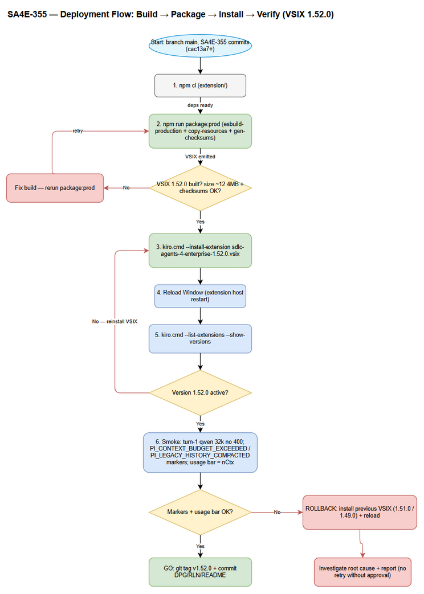
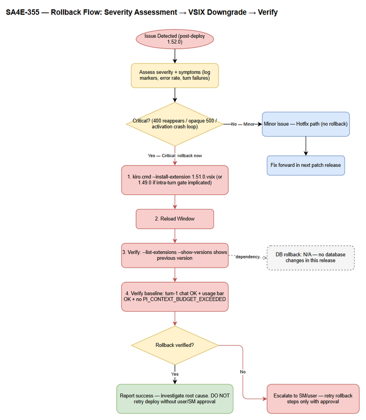

# Deployment Guide (DPG)

## SDLC Agents for Enterprise — SA4E-355: Context Budget Governance for Pi Harness

---

## Document Information

| Field | Value |
|-------|-------|
| Jira Ticket | SA4E-355 |
| Title | Context Budget Governance for Pi Harness |
| Author | DevOps Agent |
| Version | 1.0 |
| Date | 2026-10-14 |
| Status | Approved (UAT PASSED 2026-10-13) |
| Related TDD | documents/SA4E-355/TDD.md (v1.3) |
| Release Version | 1.52.0 |

---

## Revision History

| Version | Date | Author | Changes |
|---------|------|--------|---------|
| 1.0 | 2026-10-14 | DevOps Agent | Initiate document — auto-generated from TDD v1.3 and UAT evidence |

---

## Sign-Off

| Name | Role | Signature and date |
|------|------|--------------------|
| | Dev Lead | ☐ Approved for deployment |
| | QA Lead | ☑ Testing completed (Phase 6 PASS + UAT PASSED 2026-10-13) |
| | Ops Lead | ☐ Infrastructure ready |

---

## 1. Overview

### 1.1 Feature Summary

Context Budget Governance makes the Pi harness runnable on small-context models (qwen 32k) and scalable to the real n_ctx of any selected model — eliminating the turn-1 `exceed_context_size_error` (HTTP 400). The implementation WIREs existing, tested mechanisms (BudgetCalculator, ThresholdGate, compressPrompt, RoleScopeFilter, model tiering) into session creation through a single resolver module and scoped-steering helper, with 3-gate enforcement (turn-start gate, per-request intra-turn gate, REJECT claim), auto-split (auto-chunk + incremental steering + lean loadout), and user-message pin in transcript compaction. Wire-only design (BR-11): no new algorithms.

UAT PASSED on 2026-10-13 with extension 1.52.0 (bug-fix chain #1–#3 applied).

### 1.2 Deployment Scope

| Item | Type | Description |
|------|------|-------------|
| VSIX extension 1.52.0 | Modified | sdlc-agents-4-enterprise-1.52.0.vsix (~12.4 MB / 13,050,832 bytes) — governance wiring, new resolver modules, log markers |
| Backend server | Unchanged | No backend changes in this release |
| Database | Unchanged | No schema/migration changes (extension-only release) |
| Configuration | Unchanged (optional) | No mandatory config changes; runtime settings `.code-intel/settings.json` auto-managed; optional llama-server n_ctx reporting |

### 1.3 Target Environments

| Environment | Target | Deploy Order | Approval Required |
|-------------|--------|-------------|-------------------|
| DEV | Developer workstations (Kiro) | 1st | No |
| SIT | Tester Kiro installs | 2nd | No (manual SIT visual-only pending — see RLN §4) |
| UAT | User Kiro install | 3rd | QA Sign-off — ✅ PASSED 2026-10-13 |
| PROD | All-user Kiro distribution (tagged VSIX v1.52.0) | 4th | Tag v1.52.0 on main after sanity pass |

---

## 2. Prerequisites

### 2.1 Infrastructure

| Requirement | Status | Notes |
|-------------|--------|-------|
| Kiro IDE ≥ 1.2 installed | Ready | Desktop IDE with `kiro.cmd` on PATH |
| Node.js (LTS) + npm for build | Ready | Required only on the build machine |
| llama-server (optional) | Ready | Only for local-model verification; must report model context (`meta.n_ctx`) |
| Extension build workspace | Ready | `extension/` with dependencies installed (`npm ci`) |

### 2.2 Software Dependencies

| Dependency | Version | Status |
|-----------|---------|--------|
| Kiro | ≥ 1.2 | Installed |
| Node.js | LTS (v20+) | Installed |
| VSIX artifact | 1.52.0 | Built — `extension/sdlc-agents-4-enterprise-1.52.0.vsix` |
| Previous VSIX (rollback) | 1.49.0 / 1.51.0 | Kept in `extension/` |

### 2.3 Access Requirements

| Access | Type | Who Needs It |
|--------|------|-------------|
| Build machine (repo checkout, branch main) | Local | DevOps |
| `kiro.cmd` CLI install rights | Local admin/user | DevOps |
| Git push rights for tag `v1.52.0` | origin remote | DevOps |

### 2.4 Backup Requirements

- [x] Previous VSIX artifacts retained: `extension/sdlc-agents-4-enterprise-1.49.0.vsix`, `extension/sdlc-agents-4-enterprise-1.51.0.vsix`
- [x] Previous git tag available (v1.5.0) for source-level rollback
- Database backup: N/A — no database changes in this release

---

## 3. Pre-Deployment Checklist

| # | Item | Responsible | Status |
|---|------|-------------|--------|
| 1 | Code on branch main (all SA4E-355 commits: 9cd5c5a → cac13a7) | Developer | ☑ |
| 2 | All unit/integration tests passed — full suite 285 files / 2,748 tests GREEN (post bug #3 + transcript-compaction tests) | Developer + QA | ☑ |
| 3 | `tsc` clean (extension + e2e) | Developer | ☑ |
| 4 | Governance regression 148/148 PASS | QA | ☑ |
| 5 | SIT/UAT sign-off obtained — UAT PASSED 2026-10-13 (ext 1.52.0, bug-fix chain #1–#3) | QA + User | ☑ |
| 6 | Database backup completed | DBA | N/A — no DB changes |
| 7 | VSIX built: `npm run package:prod` → ~12.4 MB (13,050,832 bytes) | DevOps | ☑ |
| 8 | Checksums regenerated (vsce runs `gen-checksums` via `vscode:prepublish`) | DevOps | ☑ |
| 9 | Previous VSIX kept for rollback (1.49.0 / 1.51.0) | DevOps | ☑ |
| 10 | Rollback plan reviewed | Team | ☑ |
| 11 | Deployment window confirmed | PM | ☑ |

---

## 4. Database Migration

**N/A** — SA4E-355 is an extension-only release. No database schema changes, no migrations, no data backfill. Rollback of the database is not required (see Section 8).

---

## 5. Application Deployment

### 5.1 Deployment Flow

*[Edit in draw.io](diagrams/deployment-flow.drawio)*

### 5.2 Deployment Steps

| Step | Action | Command | Verification |
|------|--------|---------|-------------|
| 1 | Checkout main + confirm clean SA4E-355 state | `git checkout main && git pull origin main` | `git log --oneline -1` contains SA4E-355 commits |
| 2 | Install build dependencies | `cd extension && npm ci` | npm exits 0 |
| 3 | Build + package production VSIX | `npm run package:prod` | `extension/sdlc-agents-4-enterprise-1.52.0.vsix` created, size ≈ 12.4 MB; `vscode:prepublish` auto-runs esbuild-production + copy-resources + gen-checksums |
| 4 | Verify artifact + checksums | `Get-Item extension/*.vsix` + checksum file diff | Size ≈ 13,050,832 bytes; checksums file regenerated |
| 5 | Install into Kiro | `kiro.cmd --install-extension extension/sdlc-agents-4-enterprise-1.52.0.vsix` | CLI reports "successfully installed" |
| 6 | Reload Kiro window | Developer menu → **Reload Window** (or restart Kiro) | Extension host restarts without errors |
| 7 | Verify installed version | `kiro.cmd --list-extensions --show-versions` | `sdlc-agents-4-enterprise-1.52.0` listed |
| 8 | Health check (log markers + usage bar) | See Section 7 | PI_* markers emitted; usage bar shows resolved nCtx budget |

### 5.3 Docker Deployment

N/A — desktop IDE extension deployment. No containers involved.

---

## 6. Configuration Changes

### 6.1 New Environment Variables

None required. All budget behavior derives from the resolved model context window at runtime (BR-01 fallback chain).

### 6.2 Application Properties Changes

| Property/Source | Old Value | New Value | File |
|-----------------|-----------|-----------|------|
| n_ctx source of truth | static registry only | provider `meta.n_ctx` → ModelRegistry → default 8192 (3-level chain) | runtime — `context-budget-resolver.ts` |
| Runtime settings | N/A | `.code-intel/settings.json` auto-managed by extension (mcpUrl, pid, version) | workspace runtime settings |

### 6.3 Feature Flags

None — governance is always-on in 1.52.0 (no opt-in flag; legacy chat path is also governed as of bug fix #1).

### 6.4 Optional External Model Setup

| Setting | Value | When |
|---------|-------|------|
| llama-server context reporting | start with `--ctx-size 32768` (or per model) so `meta.n_ctx` is reported | Only for local-model verification (qwen 32k E2E) |
| Model selection | any model; tiering auto-classifies small (<16,384) / medium / large (≥128,000) | Always |

---

## 7. Post-Deployment Verification

### 7.1 Health Checks

| Check | Command/Signal | Expected Result | Timeout |
|-------|---------------|-----------------|---------|
| Extension active | `kiro.cmd --list-extensions --show-versions` | `sdlc-agents-4-enterprise-1.52.0` present | 30s |
| Extension host clean | Kiro → Output → extension host logs | No activation errors | 30s |
| Session assembly | Start a chat session in Pi harness | Turn 1 completes without `exceed_context_size_error` (400) | 60s |

### 7.2 Smoke Tests

| # | Scenario | Steps | Expected Result |
|---|----------|-------|-----------------|
| 1 | Turn-1 on small-context model (qwen 32k) | Select qwen in UI → send "Hãy review source code" | No `exceed_context_size_error`; turn 1 + first tool call complete; usage bar reflects the real nCtx budget |
| 2 | Oversized-request gate | Assemble a request exceeding usable budget (or run governance regression suite) | `chat:error` with `PI_CONTEXT_BUDGET_EXCEEDED` message; provider NOT called (BR-09) |
| 3 | Legacy path governance | Send chat via legacy (non-Pi) path with heavy steering | Auto-chunk (medium tier) + history-aware chunking applied; no 400 |

### 7.3 Log Verification

| Log Marker | Level | Expected | Meaning |
|------------|-------|----------|---------|
| `PI_CONTEXT_DETECT_FALLBACK` | warn | Only when provider `meta.n_ctx` absent | Fell back to ModelRegistry (AF-1) |
| `PI_CONTEXT_DETECT_DEFAULT` | warn | Only when registry miss | Defaulted to 8192 (AF-2) |
| `PI_TOOL_SCHEMA_CAP` | warn | On heavy tool loadouts | Schema tokens capped at min set |
| `PI_CONTEXT_BUDGET_EXCEEDED` | error | Only on gate REJECT | Static context over budget — actionable message shown, provider not called |
| `PI_LEGACY_HISTORY_COMPACTED` | info | On intra-turn compaction | History compacted to fit usable budget (`{modelId, nCtx, usable, historyMessages, totalTokens}`) |
| `PI_TRANSCRIPT_COMPACTED_NO_USER_QUERY` | warn | Defensive only | Compacted transcript has no user message — visible instead of opaque provider 500 |

### 7.4 Monitoring Dashboard

- [ ] Usage bar (UI) shows the resolved nCtx budget matching the selected model
- [ ] No unexpected `exceed_context_size_error` (HTTP 400) occurrences in logs after upgrade
- [ ] No opaque HTTP 500 from provider chat-template on compacted transcripts
- [ ] Full suite remains green: 285 files / 2,748 tests (pre-deploy baseline)

---

## 8. Rollback Plan

### 8.1 Rollback Flow

*[Edit in draw.io](diagrams/rollback-flow.drawio)*

### 8.2 Rollback Decision Criteria

| Condition | Action |
|-----------|--------|
| Turn-1 `exceed_context_size_error` reappears after upgrade | Immediate rollback |
| Opaque provider 500 on compacted transcripts (user-message pin regression) | Immediate rollback |
| Extension activation failure / extension host crash loop | Immediate rollback |
| Usage bar shows wrong budget (cosmetic, correct behavior otherwise) | Hotfix — no rollback |
| Minor UI issue | Hotfix — no rollback |

### 8.3 Rollback Steps

| Step | Action | Command | Verification |
|------|--------|---------|-------------|
| 1 | Install previous VSIX (downgrade replaces in place) | `kiro.cmd --install-extension extension/sdlc-agents-4-enterprise-1.51.0.vsix` (or 1.49.0) | CLI reports "successfully installed" |
| 2 | Reload Kiro window | **Reload Window** | Extension host restarts clean |
| 3 | Verify rolled-back version | `kiro.cmd --list-extensions --show-versions` | Version shows 1.51.0 (or 1.49.0) |
| 4 | Verify baseline behavior | Turn-1 chat + usage bar | No activation errors; baseline (pre-governance) behavior |
| 5 | Database rollback | N/A | — |

> Note: 1.51.0 already contains bug fixes #1 and #2 (legacy-path governance + intra-turn gate). Prefer 1.51.0 as rollback target; use 1.49.0 only if the intra-turn gate itself is implicated.

### 8.4 Rollback Time Estimate

| Action | Estimated Time |
|--------|---------------|
| VSIX downgrade install | 1 minute |
| Window reload | 1 minute |
| Verification | 5 minutes |
| **Total** | **~7 minutes** |

---

## 9. Environment-Specific Notes

### 9.1 DEV

- Build from `main` at/after commit `cac13a7` (bump 1.52.0).
- Optional llama-server for governance verification: start with `--ctx-size 32768` so `meta.n_ctx` is reported (first link of BR-01 chain).
- Run `npm test` in `extension/` before packaging: baseline 285 files / 2,748 tests.

### 9.2 SIT

- Manual SIT (visual/UX-only) pending — does not block logic verification (see RLN §4).
- Install same VSIX; no environment-specific configuration.

### 9.3 UAT

- ✅ **PASSED 2026-10-13** — user confirmed ext 1.52.0 with bug-fix chain #1–#3 (legacy-path governance, intra-turn streamFn gate, user-message pin).
- Journey evidence: 400 (`exceed_context_size_error`) → 500 (chat-template) → PASS.

### 9.4 PROD

- **Deployment Window:** after git tag `v1.52.0` on main + sanity pass
- **Approval Required From:** Dev Lead + QA Lead (UAT sign-off obtained)
- **Distribution:** tagged VSIX `sdlc-agents-4-enterprise-1.52.0.vsix`
- **Communication Plan:** notify users to reload window after upgrade; note the actionable `PI_CONTEXT_BUDGET_EXCEEDED` message replaces the raw 400 error
- **On-Call Contact:** DevOps Agent (this session) / SM via RUN-LOG.md

---

## 10. Appendix

### Key Log Marker Reference (TDD §13)

| Marker | Event |
|--------|-------|
| `PI_CONTEXT_BUDGET_EXCEEDED` | Gate REJECT — static context over budget; provider not called (BR-09) |
| `PI_LEGACY_HISTORY_COMPACTED` | Intra-turn gate compaction completed |
| `PI_TRANSCRIPT_COMPACTED_NO_USER_QUERY` | Defensive warn — userless compacted transcript |
| `PI_CONTEXT_DETECT_FALLBACK` / `PI_CONTEXT_DETECT_DEFAULT` | n_ctx fallback chain degraded |

### Related Tickets

| Ticket | Summary | Relationship |
|--------|---------|-------------|
| SA4E-355 | Context Budget Governance for Pi Harness | Main ticket |
| SA4E-357 | UAT bugs (fix chain #1–#3) | Related bug |
| SA4E-360 | Multi-Resolution Context Supply (P1) | Successor |

### Diagram Index

| # | Diagram | Image | Source (editable) |
|---|---------|-------|-------------------|
| 1 | Deployment Flow | [deployment-flow.png](diagrams/deployment-flow.png) | [deployment-flow.drawio](diagrams/deployment-flow.drawio) |
| 2 | Rollback Flow | [rollback-flow.png](diagrams/rollback-flow.png) | [rollback-flow.drawio](diagrams/rollback-flow.drawio) |

---

*End of Deployment Guide — SA4E-355, v1.0 — Release 1.52.0*
