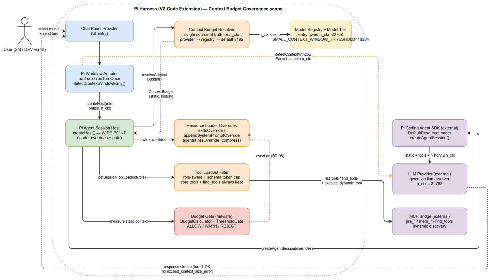
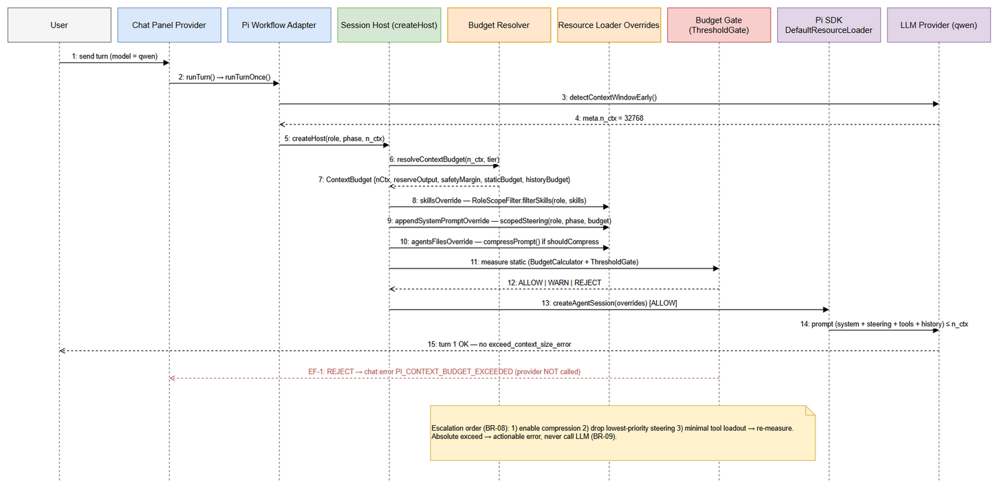
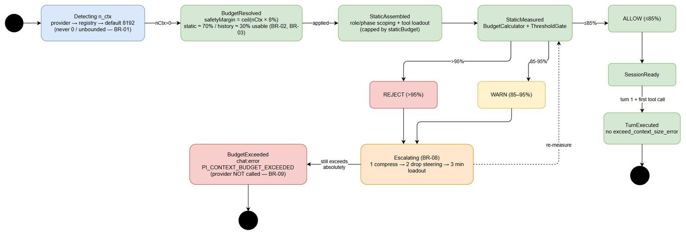

# Functional Specification Document (FSD)

## Pi Harness — SA4E-355: Context Budget Governance for Pi Harness

---

## Document Information

| Field | Value |
|-------|-------|
| Jira Ticket | SA4E-355 |
| Title | Implement Context Budget Governance for Pi Harness |
| Author | BA Agent |
| Version | 1.0 |
| Date | 2026-10-11 |
| Status | Draft |
| Related BRD | documents/SA4E-355/BRD.md |
| Input Guide | documents/context-budget-governance/IMPLEMENTATION-GUIDE.md |

---

## Revision History

| Version | Date | Author | Changes |
|---------|------|--------|---------|
| 1.0 | 2026-10-11 | BA Agent | Initiate document — derived from BRD.md and IMPLEMENTATION-GUIDE.md; data specifications verified against actual code interfaces (extension/src/pi-agent/**, extension/src/mcp/context-budget.ts) |

---

## Executive Summary / Objective

The Pi Harness pipeline currently fails on turn 1 with `400 exceed_context_size_error` (e.g., request 67,468 tokens vs n_ctx 65,536) when running on small-context LLMs, because the SDK `DefaultResourceLoader` loads the full static context (steering + AGENTS.md ~40–60k tokens) and all tool schemas without any budget cap, and the detected `n_ctx` is never used to constrain the prompt.

**Objective:** make the pipeline runnable on small-context models (~32k tokens, e.g., qwen) and scalable to the actual `n_ctx` of whatever model the user selects — by **wiring the existing, already-tested mechanisms** (ContextBudget Calculator, Prompt Compressor, RoleScopeFilter, Model Tiering, ThresholdGate) into the session creation flow. **No new workarounds are created; the supreme principle is WIRE existing mechanisms, do not invent new ones.**

Success means: turn 1 + first tool call complete on a 32k model without `exceed_context_size_error`; oversized static context is blocked before the provider is called with an actionable error instead of a raw 400.

---

## 1. Introduction

### 1.1 Purpose

This FSD specifies HOW Context Budget Governance works functionally:

- Resolving the real model context window (`n_ctx`) as a single source of truth and computing a `ContextBudget` that scales with it.
- Trimming static context (skills, `.kiro/steering/*.md`, AGENTS.md) by role/phase under the static budget.
- Compressing AGENTS.md and steering conditionally, always preserving security directives.
- Filtering tool schemas by role with a token cap, always keeping core tools plus dynamic discovery tools.
- A fail-safe Budget Gate that blocks oversized prompts before any provider call.
- Model tiering that adapts compression/scope/loadout to the model's context size (8k / 32k / 128k).
- Integration tests and a manual E2E check proving the 32k qwen scenario.

### 1.2 Scope

Inherited from BRD §1.1 (SA4E-355). Technical scope clarifications:

- **Engine under change:** Pi harness only — `extension/src/pi-workflow/**` and `extension/src/pi-agent/**`. The LangGraph engine (`extension/out/langgraph/**`) does not run and MUST NOT be touched.
- **Wire point:** `DefaultResourceLoaderOptions` hooks (`skillsOverride`, `agentsFilesOverride`, `systemPromptOverride`, `appendSystemPromptOverride`) inside `pi-agent-session-host.ts:createHost()`, plus a budget gate around session assembly.
- **Re-use only:** `BudgetCalculator`/`ThresholdGate`, `compressPrompt()`, `RoleScopeFilter`, `detectModelTier`/`classifyTier` already exist with tests. Writing a new compressor/budget/tier/role-filter is prohibited.
- **No automatic model switching** — only behavior adapts to the model the user already chose.

Out of scope (from BRD §1.2): LangGraph changes, new algorithms, model auto-switching, production secrets/infrastructure changes, UI redesign beyond the existing context usage indicator.

### 1.3 Definitions & Acronyms

| Term | Definition |
|------|------------|
| n_ctx | Model context window size in tokens (e.g., 32768 for qwen) |
| ContextBudget | Computed budget structure for one session: {nCtx, reserveOutput, safetyMargin, staticBudget, historyBudget} |
| staticBudget | Token budget reserved for system prompt + steering + AGENTS.md + tool schemas (~70% of usable) |
| historyBudget | Token budget reserved for conversation history (~30% of usable) |
| safetyMargin | Buffer = ceil(nCtx × 8%) compensating chars/4 under-estimation for CJK/Vietnamese text |
| Budget Gate | Fail-safe decision point (BudgetCalculator + ThresholdGate) before any provider call |
| Tier | Model class by context window: small (≤16,384), medium, large (≥128k) |
| WIRE POINT | `createHost()` in `pi-agent-session-host.ts` — where SDK loader overrides are injected |
| NON_STRIPPABLE_RE | Regex that keeps security-relevant lines alive during compression (SEC-326-04) |
| Fail-open (role) | Unknown role → allow all skills/tools, to avoid accidental loss of capability |
| Static context | Everything assembled before the first user message: system prompt, steering, AGENTS.md, skills, tool schemas |

### 1.4 References

| Document | Location |
|----------|----------|
| BRD | documents/SA4E-355/BRD.md |
| Implementation Guide (requirement source) | documents/context-budget-governance/IMPLEMENTATION-GUIDE.md |
| FSD Template | documents/templates/FSD-TEMPLATE.md |
| SDK loader options (read-only contract) | node_modules/@earendil-works/pi-coding-agent/dist/core/resource-loader.d.ts |
| Code standards | .opencode skills `code-standards` (file ≤200 lines, function ≤20 lines, SOLID, TSDoc) |

---

## 2. System Overview

### 2.1 System Context


*[Edit in draw.io](diagrams/system-context.drawio)*

The user selects a model (e.g., qwen) in the Chat Panel and sends a turn. The Pi Workflow Adapter detects the model's real `n_ctx` **before** creating the session (`detectContextWindowEarly()` → provider `meta.n_ctx`). The Pi Agent Session Host (`createHost()`) resolves a `ContextBudget` from that `n_ctx` (via the Budget Resolver with fallback chain provider → ModelRegistry → default 8192), wires the SDK `DefaultResourceLoaderOptions` overrides (role/phase-scoped skills and steering, conditionally compressed AGENTS.md, role-aware capped tool loadout), and validates the assembled static context through the Budget Gate. Only when the gate allows does the host call the SDK `createAgentSession()`, which sends a prompt guaranteed to fit within `n_ctx`. The MCP Bridge remains reachable at runtime through `find_tools` / `execute_dynamic_tool` instead of preloading every MCP tool schema.

### 2.2 System Architecture

All changes are in the VS Code extension (Pi harness). Component map with verified locations:

| Component | File | Status |
|-----------|------|--------|
| Chat Panel Provider (UI entry) | `extension/src/chat-panel-provider.ts` | Exists; unchanged |
| Pi Workflow Adapter (turn orchestration, early n_ctx detection) | `extension/src/pi-workflow/pi-workflow-adapter.ts` | Exists; ensure detection runs before createHost |
| Pi Agent Session Host (**WIRE POINT**) | `extension/src/pi-workflow/pi-agent-session-host.ts` | Exists; wire overrides + gate |
| Context Budget Resolver (new, single source of truth for n_ctx) | `extension/src/pi-agent/context-budget-resolver.ts` (or extend existing budget module if ≤200 lines) | To create (thin composition only) |
| BudgetCalculator / ThresholdGate | `extension/src/mcp/context-budget.ts` | **Exists with tests** — reuse as-is |
| RoleScopeFilter + ROLE_SKILL_IDS | `extension/src/pi-agent/role-scope.ts` | **Exists with tests** — wire via skillsOverride |
| compressPrompt / NON_STRIPPABLE_RE / estimateTokenCount | `extension/src/pi-agent/prompt-compressor.ts` | **Exists with tests** — wire via agentsFilesOverride + scopedSteering |
| scopedSteering helper (phase → steering files, priority drop, cap) | new small module under `extension/src/pi-agent/` | To create (composition of existing filter + compressor) |
| detectModelTier / ModelRouter.classifyTier / SMALL_CONTEXT_WINDOW_THRESHOLD | `extension/src/pi-agent/model-tier.ts`, `model-router.ts` | **Exists with tests** — wire into resolver/loadout |
| ModelRegistry (+ `qwen` entry) | `extension/src/pi-agent/model-registry.ts` | Exists; add entry |
| Provider context-window detection (`meta.n_ctx`) | `extension/src/mcp/providers/openai-provider.ts` | Exists; call earlier, do not change logic |
| Session Compactor (post-turn history) | `extension/src/pi-agent/session-compactor.ts` | Exists; already partially wired at chat-panel level |

> **Verified note (differs from guide):** `BudgetCalculator` and `ThresholdGate` live in `extension/src/mcp/context-budget.ts` (not `pi-agent/context-budget.ts` as stated in IMPLEMENTATION-GUIDE §0.6). Consumers already import from there (`session-configurator.ts`, `session-compactor.ts`). The FSD and implementation follow the verified location.

Turn-level interaction across these components:


*[Edit in draw.io](diagrams/sequence.drawio)*

---

## 3. Functional Requirements

Seven use cases map 1:1 to the seven tasks in IMPLEMENTATION-GUIDE §2 and to BRD stories 1–6 plus E2E verification. Business rules BR-01..BR-16 are consolidated in §3.8.

### 3.0 Business Rule Index (consolidated — details in §3.1–§3.8)

| ID | Short name | Defined in |
|----|-----------|------------|
| BR-01 | n_ctx > 0, never unbounded | UC-01 |
| BR-02 | safetyMargin = ceil(nCtx × 8%) | UC-01 |
| BR-03 | static 70% / history 30% of usable | UC-01 |
| BR-04 | Compress only when over budget or tier small/compressed | UC-03 |
| BR-05 | Security lines survive compression | UC-02, UC-03 |
| BR-06 | Core tools + find_tools/execute_dynamic_tool always kept | UC-04 |
| BR-07 | Unknown role → allow all (fail-open) | UC-02, UC-04 |
| BR-08 | Escalation order: compress → drop steering → min loadout | UC-05 |
| BR-09 | Absolute exceed → actionable error, no provider call | UC-05 |
| BR-10 | No automatic model switching | UC-06 |
| BR-11 | Wire-only: reuse existing mechanisms, no new algorithms | All |
| BR-12 | Detect n_ctx BEFORE createHost assembles static | UC-05 |
| BR-13 | Gate thresholds: REJECT >95%, WARN >85% | UC-05 |
| BR-14 | Registry entries: integer contextWindow > 0; add qwen 32768 | UC-01 |
| BR-15 | Compression is non-worsening (max ratio 0.6; keep original otherwise) | UC-03 |
| BR-16 | Tier behavior mapping small/medium/large | UC-06 |

---

## 3.1 Feature: Context Budget Resolution (UC-01)

**Source:** BRD STORY 1 (SA4E-355); IMPLEMENTATION-GUIDE Task 1.

### 3.1.1 Description

A single resolver computes the authoritative `ContextBudget` from the model actually running. It must scale with the real `n_ctx` and must never return an unbounded (0/undefined) budget — an unbounded budget is the root cause of the 400 overflow.

### 3.1.2 Use Case

**Use Case ID:** UC-01
**Actor:** Pi Workflow Adapter / Session Host (on behalf of the user)
**Preconditions:** User selected a model; a turn is starting; provider may or may not expose `meta.n_ctx`; `qwen` entry exists in ModelRegistry (BR-14).
**Postconditions:** A `ContextBudget` with `nCtx > 0` is available to the session host; budget breakdown is logged for the demo (`{nCtx, reserveOutput, safetyMargin, staticBudget, historyBudget}`).

**Main Flow:**

| Step | Actor | System | Description |
|------|-------|--------|-------------|
| 1 | Adapter | | Starts turn; calls `detectContextWindowEarly()` before any session assembly (BR-12) |
| 2 | | Budget Resolver | Takes detected `n_ctx` from provider (`meta.n_ctx`) as first choice |
| 3 | | Budget Resolver | If detection failed, reads `ModelRegistry.get(modelId)?.contextWindow` |
| 4 | | Budget Resolver | If registry misses too, uses safe default **8192** (never 0 — BR-01) |
| 5 | | Budget Resolver | Computes `safetyMargin = ceil(nCtx × 0.08)` (BR-02) |
| 6 | | Budget Resolver | Computes `usable = nCtx − reserveOutput − safetyMargin`; `staticBudget ≈ 70%` and `historyBudget ≈ 30%` of usable (BR-03; tier may adjust the split per UC-06) |
| 7 | | Session Host | Receives `ContextBudget`; logs breakdown; passes budget into loader overrides |

**Alternative Flows:**

| ID | Condition | Steps |
|----|-----------|-------|
| AF-1 | Provider detection fails (no `meta.n_ctx`) | Step 3: registry value used; warning logged (`PI_CONTEXT_DETECT_FALLBACK`) |
| AF-2 | Model not in registry | Step 4: default 8192 used; warning logged (`PI_CONTEXT_DETECT_DEFAULT`) |
| AF-3 | Tier known (UC-06) | Step 6: tier selects budget mode (e.g., static-leaning split for small tier) |

**Exception Flows:**

| ID | Condition | Steps |
|----|-----------|-------|
| EF-1 | Detected/registry value ≤ 0 or non-finite | Treated as invalid → next fallback in chain; final guarantee 8192; never propagate 0 |
| EF-2 | `usable ≤ 0` after reserves (tiny model) | Clamp usable to a minimal positive floor; gate will almost certainly REJECT with actionable error (UC-05) |

### 3.1.3 Business Rules

| Rule ID | Rule | Source |
|---------|------|--------|
| BR-01 | `nCtx` MUST be > 0. Fallback chain: provider detection → ModelRegistry → default 8192. Never 0/unbounded. | BRD STORY 1; Guide Task 1.3 |
| BR-02 | `safetyMargin = ceil(nCtx × 0.08)` — compensates chars/4 under-estimation for Vietnamese/CJK. | Guide Task 1.4 |
| BR-03 | `usable = nCtx − reserveOutput − safetyMargin`; `staticBudget ≈ 70%` usable, `historyBudget ≈ 30%` usable (tier-adjustable). | Guide Task 1.4 |
| BR-14 | ModelRegistry entries require integer `contextWindow > 0` and `maxOutput ≤ contextWindow` (existing `ModelRegistry.validate`). New entry: `{ modelId: 'qwen', contextWindow: 32768, maxOutput: 2048, costPer1k: 0, speed: 'medium', thinkingMap: { low: 256, medium: 512, high: 1024 } }`. | Guide Task 1.5; verified `model-registry.ts` |

### 3.1.4 Data Specifications

**Output Data — interface `ContextBudget`** (new model file under `extension/src/pi-agent/models/`):

| Field | Type | Required | Validation | Description |
|-------|------|----------|------------|-------------|
| nCtx | number | Yes | > 0, integer (BR-01) | Real context window of the running model |
| reserveOutput | number | Yes | > 0, < nCtx | Reserved for model output (from registry maxOutput, min floor 2000 per `MIN_RESERVE_TOKENS`) |
| safetyMargin | number | Yes | ≥ 0 | ceil(nCtx × 8%) buffer (BR-02) |
| staticBudget | number | Yes | > 0, ≤ usable | Budget for steering + AGENTS.md + tool schemas (BR-03) |
| historyBudget | number | Yes | > 0, ≤ usable | Budget for conversation history (BR-03) |

**Worked examples (BR-02/BR-03 applied):**

| Model n_ctx | reserveOutput | safetyMargin (8%) | usable | staticBudget (70%) | historyBudget (30%) |
|-------------|---------------|-------------------|--------|--------------------|---------------------|
| 8,192 | 2,048 | 656 | 5,488 | 3,841 | 1,647 |
| 32,768 (qwen) | 2,048 | 2,622 | 28,098 | 19,668 | 8,430 |
| 128,000 | 16,384 | 10,240 | 101,376 | 70,963 | 30,413 |

**Supporting types (verified in code):** `ContextBudgetInputs {systemPromptChars?, toolSchemaTokens?, retrievalTokens?, historyTokens?, reserveTokens?}`, `BudgetResult {estimatedTokens, usagePercent, reserveTokens, conservative}`, `ThresholdResult {decision: 'ALLOW'|'WARN'|'REJECT', message}`, constants `CHARS_PER_TOKEN=4`, `MIN_RESERVE_TOKENS=2000`, `REJECT_THRESHOLD_PERCENT=95`, `WARN_THRESHOLD_PERCENT=85`.

### 3.1.5 UI Specifications

| No. | Element | Type | Required | Behavior | Validation |
|-----|---------|------|----------|----------|------------|
| 1 | Context Usage Indicator (existing) | Label | No | Reflects measured tokens vs budget once resolver output is available | Shows static + history usage against `staticBudget`/`historyBudget` |

### 3.1.6 API Contract (Functional View) — module `context-budget-resolver`

> Functional contract only; technical details in TDD.

**Endpoint:** `resolveContextBudget(input): ContextBudget` (in-process module, `extension/src/pi-agent/context-budget-resolver.ts`)
**Purpose:** Single source of truth for n_ctx-derived budgets, consumed by session host, loader overrides, tool loadout, and gate.

**Input Parameters:**

| Parameter | Type | Required | Business Rule | Description |
|-----------|------|----------|---------------|-------------|
| modelId | string | Yes | BR-14 | Selected model identifier |
| nCtxDetected | number | No | BR-01 | `meta.n_ctx` from provider when available |
| tier | 'small' | 'medium' | 'large' | null | No | BR-16 | From UC-06; selects budget mode |
| reserveOutput | number | No | BR-01 | Override for output reserve; default from registry maxOutput (floor 2000) |

**Output Data:**

| Field | Type | Description |
|-------|------|-------------|
| ContextBudget | object | See §3.1.4; guarantee `nCtx > 0` |

**Business Error Scenarios:**

| Scenario | User Message | Trigger Condition |
|----------|-------------|-------------------|
| Detection failed | none (transparent) — warning log `PI_CONTEXT_DETECT_FALLBACK` | Provider returns no `meta.n_ctx` (AF-1) |
| Registry miss | none (transparent) — warning log `PI_CONTEXT_DETECT_DEFAULT` | modelId not in registry (AF-2) |
| Invalid n_ctx ≤ 0 | none — fallback chain continues; final default 8192 | Non-positive/non-finite value (EF-1) |

---

## 3.2 Feature: Role-Scoped Static Trimming — Skills / Steering (UC-02)

**Source:** BRD STORY 2 (SA4E-355); IMPLEMENTATION-GUIDE Task 2.

### 3.2.1 Description

Static context is cut by role/phase at session creation: skills are filtered through the existing `RoleScopeFilter`, and steering files are selected per phase, prioritized, and capped by `budget.staticBudget`. Security lines always survive trimming.

### 3.2.2 Use Case

**Use Case ID:** UC-02
**Actor:** Session Host (via `DefaultResourceLoaderOptions` overrides)
**Preconditions:** `ContextBudget` resolved (UC-01); role + phase extracted from `PipelineState` (available through `executeTurn(state, chatInput, role, ...)`) and passed into `SessionHostOptions`.
**Postconditions:** Loader receives role-scoped skills and capped, prioritized steering; unknown role never loses skills; security lines intact.

**Main Flow:**

| Step | Actor | System | Description |
|------|-------|--------|-------------|
| 1 | Adapter | | Passes `role`/`phase` from `PipelineState` into `createHost()` |
| 2 | | Session Host | Wires `skillsOverride: (base) => ({ ...base, skills: new RoleScopeFilter().filterSkills(role, base.skills) })` |
| 3 | | Session Host | Wires `appendSystemPromptOverride: (base) => scopedSteering(base, role, phase, budget)` |
| 4 | | scopedSteering helper | Maps `phase → required steering files` (e.g., phase requirements → `phase-1-requirements` + `shared-*` only; phases 2–7 not loaded) |
| 5 | | scopedSteering helper | Orders steering by priority; measures tokens (`estimateTokenCount`); drops lowest-priority files until total ≤ `staticBudget` share |
| 6 | | scopedSteering helper | Lines matching `NON_STRIPPABLE_RE` are never dropped (BR-05) |
| 7 | | SDK loader | Assembles system prompt with scoped skills + steering |

**Alternative Flows:**

| ID | Condition | Steps |
|----|-----------|-------|
| AF-1 | Role unknown (not in `ROLE_SKILL_IDS`) | `isAllowed()` returns true for all skills — nothing is lost (BR-07, fail-open) |
| AF-2 | Phase missing/unmapped | Load `shared-*` steering only; log info |
| AF-3 | Steering total under cap | No drops; files passed through unmodified |

**Exception Flows:**

| ID | Condition | Steps |
|----|-----------|-------|
| EF-1 | Filter/override throws | Catch at createHost level → fall back to base skills/steering (fail-open), log error; never crash the turn |

### 3.2.3 Business Rules

| Rule ID | Rule | Source |
|---------|------|--------|
| BR-05 | Lines matching `NON_STRIPPABLE_RE` (security / warning / never / do not / important at line start) survive any trimming or compression. | Guide Task 2.3; verified `prompt-compressor.ts` (SEC-326-04) |
| BR-07 | Unknown role → allow all skills/tools (fail-open), no regression. | Guide Task 2.4; verified `RoleScopeFilter.isAllowed` |
| BR-11 | Wire-only: use existing `RoleScopeFilter`/`ROLE_SKILL_IDS`; no new filtering algorithm. | Guide §0.6, §5 |

### 3.2.4 Data Specifications

**Input Data — `SkillRef`** (verified):

| Field | Type | Required | Validation | Description |
|-------|------|----------|------------|-------------|
| id | string | Yes | non-empty | Skill identifier (tokens matched case-insensitively on `-_.` + space segments) |
| phase | string | No | valid phase or absent | Optional phase tag |

**Role → skill token allowlist** (verified `ROLE_SKILL_IDS`):

| Role | Tokens |
|------|--------|
| SM | sm, brd, sprint, backlog, coordination |
| BA | ba, brd, fsd, requirement, specification |
| SA | sa, tdd, design, architecture, discrepancy |
| DEV | dev, code, implement, build |
| QA | qa, test, quality, stp, stc |
| DevOps | devops, deploy, release, pipeline, ci, cd |
| UI | ui, ux, wireframe |
| Security | security, pentest, vulnerability |

**Phase → steering mapping (initial, adjustable by config):**

| Phase | Steering files loaded |
|-------|----------------------|
| requirements | phase-1-requirements, shared-* |
| specification | phase-2-specification, shared-* |
| design | phase-3-design, shared-* |
| test-planning | phase-4-test-planning, shared-* |
| implementation | phase-5-implementation, shared-* |
| testing | phase-6-testing, shared-* |
| deployment | phase-7-deployment, shared-* |
| unknown/none | shared-* only |

**Output Data:** scoped skill list (subset, same order), scoped steering string ≤ static steering share of `staticBudget`.

### 3.2.5 UI Specifications

| No. | Element | Type | Required | Behavior | Validation |
|-----|---------|------|----------|----------|------------|
| 1 | Context Usage Indicator | Label | No | Static tokens visibly drop for scoped roles (BA vs SM demo) | n/a |

### 3.2.6 API Contract (Functional View) — module `role-scope` + helper `scoped-steering`

**Endpoint:** `RoleScopeFilter.filterSkills(role: string, skills: SkillRef[]): SkillRef[]` (existing, verified)
**Purpose:** Keep only skills whose id tokens match the role allowlist; unknown role → all allowed.

**Endpoint:** `scopedSteering(base: string[], role: string, phase: string, budget: ContextBudget): string[]` (new helper module, ≤200 lines, composition of existing filter + compressor + estimator)
**Purpose:** Phase-aware steering selection, priority drop to cap, security-line preservation.

**Input Parameters (scopedSteering):**

| Parameter | Type | Required | Business Rule | Description |
|-----------|------|----------|---------------|-------------|
| base | string[] | Yes | — | Base steering/appendSystemPrompt entries from SDK loader |
| role | string | Yes | BR-07 | Pipeline role (may be unknown) |
| phase | string | No | mapping table §3.2.4 | Pipeline phase |
| budget | ContextBudget | Yes | BR-03 | Provides staticBudget cap |

**Output Data:** string[] — scoped steering entries within cap; security lines intact (BR-05).

**Business Error Scenarios:**

| Scenario | User Message | Trigger Condition |
|----------|-------------|-------------------|
| Scope failure | none — fail-open to base content, error logged | Exception inside override (EF-1) |

---

## 3.3 Feature: Conditional Compression of AGENTS.md / Steering (UC-03)

**Source:** BRD STORY 3 (SA4E-355); IMPLEMENTATION-GUIDE Task 3.

### 3.3.1 Description

AGENTS.md and steering are compressed with the existing `compressPrompt()` **only when needed**: when measured static context exceeds `staticBudget`, or the model tier is small/compressed. Models with surplus budget keep full-fidelity content.

### 3.3.2 Use Case

**Use Case ID:** UC-03
**Actor:** Session Host (via `agentsFilesOverride` and inside `scopedSteering`)
**Preconditions:** `ContextBudget` resolved (UC-01); tier known or derivable (UC-06); AGENTS.md/steering loaded by SDK loader.
**Postconditions:** Compressed content within budget target, security lines preserved; no compression when not needed.

**Main Flow:**

| Step | Actor | System | Description |
|------|-------|--------|-------------|
| 1 | | Session Host | Measures static tokens (AGENTS.md + steering + system + tool schemas) via `estimateTokenCount` / `BudgetCalculator.estimateTokens` |
| 2 | | Session Host | Decides `shouldCompress = (measuredStatic > budget.staticBudget) OR (tier ∈ {small, compressed})` (BR-04) |
| 3 | | Session Host | Wires `agentsFilesOverride: (base) => ({ agentsFiles: base.agentsFiles.map(f => ({ ...f, content: shouldCompress ? compressPrompt(f.content) : f.content })) })` |
| 4 | | prompt-compressor | `compressPrompt` strips HTML comments, fenced `example` blocks, example sections, boilerplate lines (tip/note/hint/see also), collapses whitespace — but keeps `NON_STRIPPABLE_RE` lines (BR-05) |
| 5 | | prompt-compressor | If compressed ≥ original length or empty → returns original (BR-15, non-worsening) |
| 6 | | Session Host | Applies same conditional compression to steering inside `scopedSteering` (UC-02 step 5) |

**Alternative Flows:**

| ID | Condition | Steps |
|----|-----------|-------|
| AF-1 | Budget surplus + tier large/medium | `compressPrompt` is NOT called; content passes through byte-identical |
| AF-2 | Small tier (≤16,384) | Compression forced regardless of measured value (BR-04) |

**Exception Flows:**

| ID | Condition | Steps |
|----|-----------|-------|
| EF-1 | Compression throws | `compressPrompt` already returns the original template on error (verified try/catch); caller logs error and continues with original content |

### 3.3.3 Business Rules

| Rule ID | Rule | Source |
|---------|------|--------|
| BR-04 | Compress only when measured static > staticBudget OR tier is small/compressed. Never compress when budget has surplus. | Guide Task 3.2; BRD STORY 3 |
| BR-05 | Security lines (`NON_STRIPPABLE_RE`) survive compression. | Verified `prompt-compressor.ts` |
| BR-15 | Compression is non-worsening: `COMPRESSION_MAX_RATIO = 0.6`; if result ≥ original or empty, keep original. | Verified `prompt-compressor.ts` |

### 3.3.4 Data Specifications

**Input Data:**

| Field | Type | Required | Validation | Description |
|-------|------|----------|------------|-------------|
| agentsFiles | Array<{path, content}> | Yes | content non-empty string | From SDK base (AGENTS.md etc.) |
| measuredStatic | number | Yes | ≥ 0 | Sum of estimated tokens for system + steering + AGENTS.md + tool schemas |
| budget.staticBudget | number | Yes | > 0 | From UC-01 |
| tier | 'small' | 'medium' | 'large' | null | No | BR-16 | From UC-06 |

**Output Data:**

| Field | Type | Description |
|-------|------|-------------|
| agentsFiles[].content | string | Compressed or original content (non-worsening) |
| steering (scoped) | string[] | Conditionally compressed entries |

**Verified compression constants:** `COMPRESSION_MAX_RATIO = 0.6`; `NON_STRIPPABLE_RE = /^\s*[-*]?\s*(security|warning|never|do not|important)\b/i`.

### 3.3.5 UI Specifications

| No. | Element | Type | Required | Behavior | Validation |
|-----|---------|------|----------|----------|------------|
| 1 | Context Usage Indicator | Label | No | On qwen 32k, AGENTS.md + steering token share visibly drops X% after compression demo | n/a |

### 3.3.6 API Contract (Functional View) — module `prompt-compressor`

**Endpoint:** `compressPrompt(template: string): string` (existing, verified)
**Purpose:** Deterministic, security-preserving prompt size reduction.

**Input Parameters:**

| Parameter | Type | Required | Business Rule | Description |
|-----------|------|----------|---------------|-------------|
| template | string | Yes | — | Original file content (AGENTS.md, steering entry) |

**Output Data:**

| Field | Type | Description |
|-------|------|-------------|
| content | string | Compressed content; original returned if compression worsens or fails (BR-15, EF-1) |

**Business Error Scenarios:**

| Scenario | User Message | Trigger Condition |
|----------|-------------|-------------------|
| Compression failure | none — original content used, error logged | Any exception inside compressPrompt (EF-1) |

---

## 3.4 Feature: Tool Loadout Filtering by Role + Schema Cap (UC-04)

**Source:** BRD STORY 4 (SA4E-355); IMPLEMENTATION-GUIDE Task 4.

### 3.4.1 Description

Tool schemas are a major token sink (root cause #2). The tool loadout becomes role-aware with a hard token cap; missing tools are discovered at runtime via `find_tools` + `execute_dynamic_tool` instead of preloading every schema.

### 3.4.2 Use Case

**Use Case ID:** UC-04
**Actor:** Session Host
**Preconditions:** Role known from `PipelineState`; `ContextBudget` resolved; MCP tool list available via `mcpBridge.listTools()`.
**Postconditions:** Loadout contains only role-relevant tools; total schema tokens ≤ cap; core + dynamic discovery tools always present.

**Main Flow:**

| Step | Actor | System | Description |
|------|-------|--------|-------------|
| 1 | | Session Host | Extends `getSessionToolLoadout()` to be role-aware: role → required tool group (table §3.4.4) |
| 2 | | Session Host | Always includes core file tools (`read/write/edit/grep/find/ls/shell`) + `find_tools` + `execute_dynamic_tool` (BR-06) |
| 3 | | Session Host | Excludes out-of-role tools (e.g., BA/SA do not get git/deploy; DEV/DevOps do) |
| 4 | | Session Host | For MCP tools (`jira_*`, `mem_*`, ...): prioritizes by current phase, estimates schema tokens (`estimateTokenCount`/`estimateToolSchemaTokens`), trims from lowest priority until total ≤ cap |
| 5 | | Session Host | Deducts tool schema tokens from `staticBudget` accounting before gate measurement (UC-05) |

**Alternative Flows:**

| ID | Condition | Steps |
|----|-----------|-------|
| AF-1 | Agent needs a tool absent from loadout | Agent calls `find_tools` → `execute_dynamic_tool` at runtime (no preloaded schema) — matches the `tool-usage-dynamic` pattern |
| AF-2 | Role unknown | Loadout keeps core + discovery + a permissive default set (BR-07 fail-open) |

**Exception Flows:**

| ID | Condition | Steps |
|----|-----------|-------|
| EF-1 | Cap cannot be met even with min set | Keep non-negotiable core + discovery tools; gate escalation (UC-05) handles the remainder; log `PI_TOOL_SCHEMA_CAP` |

### 3.4.3 Business Rules

| Rule ID | Rule | Source |
|---------|------|--------|
| BR-06 | Core file tools + `find_tools` + `execute_dynamic_tool` are NEVER removed from the loadout. | Guide Task 4.1 |
| BR-07 | Unknown role → fail-open default loadout (no accidental tool loss). | Guide Task 2.4 (fallback principle) |
| BR-11 | Wire-only: reuse existing loadout/estimation helpers; no new algorithm. | Guide §0.6 |

### 3.4.4 Data Specifications

**Role → tool group mapping (functional mapping; exact IDs verified at implementation):**

| Role | Tool groups in loadout |
|------|------------------------|
| BA / SA | Core + discovery (`find_tools`, `execute_dynamic_tool`) + phase docs tools; NO git/deploy |
| DEV | Core + discovery + git/build tools |
| DevOps | Core + discovery + git/build/deploy/pipeline tools |
| QA | Core + discovery + test tooling |
| SM | Core + discovery + jira_* + coordination tools (full pipeline regression set) |
| unknown | Core + discovery + permissive default (fail-open) |

**Input/Output Data:**

| Field | Type | Required | Validation | Description |
|-------|------|----------|------------|-------------|
| role | string | Yes | non-empty (may be unknown) | Pipeline role |
| phase | string | No | valid phase or absent | Used for MCP tool prioritization |
| schemaTokenCap | number | Yes | > 0, ≤ staticBudget | Derived from UC-01 budget |
| loadout | Array<{name, schema}> | Output | — | Filtered, capped tool list |
| loadoutSchemaTokens | number | Output | ≤ schemaTokenCap | Sum of estimated schema tokens |

### 3.4.5 UI Specifications

| No. | Element | Type | Required | Behavior | Validation |
|-----|---------|------|----------|----------|------------|
| 1 | Context Usage Indicator | Label | No | SM vs DEV sessions show different tool schema shares | n/a |

### 3.4.6 API Contract (Functional View) — tool loadout

**Endpoint:** `getSessionToolLoadout(role, phase, budget): { loadout: ToolRef[]; schemaTokens: number }` (extended, in `pi-agent-session-host.ts` scope)
**Purpose:** Role-aware, budget-capped tool schema assembly.

**Input Parameters:**

| Parameter | Type | Required | Business Rule | Description |
|-----------|------|----------|---------------|-------------|
| role | string | Yes | BR-06, BR-07 | Pipeline role |
| phase | string | No | — | MCP priority |
| budget | ContextBudget | Yes | BR-03 | Cap source |

**Output Data:** filtered loadout + measured schema tokens.

**Business Error Scenarios:**

| Scenario | User Message | Trigger Condition |
|----------|-------------|-------------------|
| Schema cap exceeded at min set | none directly — logged `PI_TOOL_SCHEMA_CAP`; gate decides | EF-1 |

---

## 3.5 Feature: Budget Gate Fail-Safe (UC-05)

**Source:** BRD STORY 5 (SA4E-355); IMPLEMENTATION-GUIDE Task 5.

### 3.5.1 Description

A hard gate guarantees an oversized prompt is never sent: after assembling static context, total tokens are measured with `BudgetCalculator` and evaluated by `ThresholdGate`; over-budget situations escalate in a fixed order and, if absolutely unresolvable, surface an actionable `chat:error` instead of a raw 400 from the provider.

### 3.5.2 Use Case

**Use Case ID:** UC-05
**Actor:** Session Host
**Preconditions:** `detectContextWindowEarly()` has run BEFORE session assembly (BR-12); static context assembled (UC-01..04 outputs).
**Postconditions:** Either an allowed session (≤ thresholds) or an actionable error — never a provider 400 `exceed_context_size_error`.

**Main Flow:**

| Step | Actor | System | Description |
|------|-------|--------|-------------|
| 1 | Adapter | | Runs `detectContextWindowEarly()` before `createHost()` assembles static context (BR-12) |
| 2 | | Session Host | Assembles static: system + scoped steering + AGENTS.md + tool schemas |
| 3 | | Budget Gate | `BudgetCalculator.calculateBudget(contextWindow, inputs)` → `BudgetResult.usagePercent` |
| 4 | | Budget Gate | `ThresholdGate.evaluate(usagePercent)` → ALLOW (≤85%) / WARN (>85%) / REJECT (>95%) (BR-13) |
| 5 | | Session Host | ALLOW → proceed to `createAgentSession(overrides)` |
| 6 | | Session Host | WARN → proceed but surface warning on usage indicator/log |

**Alternative Flows:**

| ID | Condition | Steps |
|----|-----------|-------|
| AF-1 | WARN (85–95%) | Session proceeds with warning surfaced; compactor attention on history |
| AF-2 | Escalation succeeds | After any escalation step (below), re-measure returns ≤ 100% → continue as ALLOW/WARN |

**Exception Flows (escalation ladder — BR-08, then BR-09):**

| ID | Condition | Steps |
|----|-----------|-------|
| EF-1 | static > staticBudget | Escalate in fixed order: (1) enable tier compression (UC-03) → (2) drop lowest-priority steering (UC-02) → (3) reduce tool loadout to minimal (UC-04); re-measure after each step |
| EF-2 | Still exceeds absolutely (>95% or > n_ctx) | Emit `chat:error` **without calling the provider**: `PI_CONTEXT_BUDGET_EXCEEDED: static context {N} tokens vượt budget {M} cho model n_ctx={K}. Giảm steering/tools hoặc dùng model context lớn hơn.` |

### 3.5.3 Business Rules

| Rule ID | Rule | Source |
|---------|------|--------|
| BR-08 | Escalation order is fixed: compression → drop lowest-priority steering → minimal tool loadout → re-measure. | Guide Task 5.3 |
| BR-09 | Absolute exceed → actionable `chat:error` `PI_CONTEXT_BUDGET_EXCEEDED`; provider is NEVER called with an oversized prompt. | Guide Task 5.4 |
| BR-12 | `detectContextWindowEarly()` runs BEFORE `createHost()` assembles static context. | Guide Task 5.1 |
| BR-13 | Thresholds: REJECT > 95%, WARN > 85%, else ALLOW (verified `REJECT_THRESHOLD_PERCENT`/`WARN_THRESHOLD_PERCENT`). | Verified `context-budget.ts` |

### 3.5.4 Data Specifications

**Input Data (gate):**

| Field | Type | Required | Validation | Description |
|-------|------|----------|------------|-------------|
| contextWindow | number | Yes | > 0 (BR-01) | Resolved n_ctx |
| systemPromptChars | number | No | ≥ 0 | chars; tokens = ceil(chars/4) |
| toolSchemaTokens | number | No | ≥ 0 | From UC-04 |
| retrievalTokens | number | No | ≥ 0 | Optional retrieval share |
| historyTokens | number | No | ≥ 0 | Turn 1 ≈ 0 |
| reserveTokens | number | No | ≥ `MIN_RESERVE_TOKENS` (2000); smaller values are forced up | Output reserve |

**Output Data:** `BudgetResult {estimatedTokens, usagePercent, reserveTokens, conservative}`; `ThresholdResult {decision, message}`; on EF-2 an emitted `chat:error` with the exact message template.

### 3.5.5 UI Specifications

| No. | Element | Type | Required | Behavior | Validation |
|-----|---------|------|----------|----------|------------|
| 1 | Error banner (chat:error) | Message | Yes | Shows `PI_CONTEXT_BUDGET_EXCEEDED` text with N/M/K values filled | Message must be actionable (reduce steering/tools or larger model) |
| 2 | Context Usage Indicator | Label | No | Reflects measured usage % vs thresholds 85/95 | n/a |

### 3.5.6 API Contract (Functional View) — Budget Gate

**Endpoint:** `BudgetCalculator.calculateBudget(contextWindow: number, inputs?: ContextBudgetInputs): BudgetResult` + `ThresholdGate.evaluate(usagePercent: number): ThresholdResult` (existing, verified — reuse as-is)
**Purpose:** Deterministic measurement and decision; fail-safe before provider call.

**Business Error Scenarios:**

| Scenario | User Message | Trigger Condition |
|----------|-------------|-------------------|
| Absolute exceed | `PI_CONTEXT_BUDGET_EXCEEDED: static context {N} tokens vượt budget {M} cho model n_ctx={K}. Giảm steering/tools hoặc dùng model context lớn hơn.` | usagePercent > 95% persists after escalation (EF-2) |
| Conservative inputs | none (flag `conservative=true` in result; log) | Invalid/negative input fields coerced to fallbacks |

---

## 3.6 Feature: Model Tiering (UC-06)

**Source:** BRD STORY 6 (SA4E-355); IMPLEMENTATION-GUIDE Task 6.

### 3.6.1 Description

Behavior adapts to the model's context size through the existing tiering utilities: `detectModelTier(modelId)` (name-pattern based: small/medium/large) and `ModelRouter.classifyTier` with `SMALL_CONTEXT_WINDOW_THRESHOLD = 16384` (window-based). Tiering selects compression mode, role-scope aggressiveness, tool loadout width, and the budget split. The system NEVER switches the user's model (BR-10).

### 3.6.2 Use Case

**Use Case ID:** UC-06
**Actor:** Budget Resolver / Session Host
**Preconditions:** Model selected; context window known (UC-01).
**Postconditions:** Tier-consistent behavior for 8k / 32k / 128k on the same codebase; no tràn.

**Main Flow:**

| Step | Actor | System | Description |
|------|-------|--------|-------------|
| 1 | | Session Host | Wires `detectModelTier(modelId)` and window-based classification (threshold 16,384) |
| 2 | | Budget Resolver | Receives tier → selects mode (table §3.6.4); may adjust static/history split (BR-03 note) |
| 3 | | Session Host | small → forced compressed variant + maximum role scoping + minimal loadout |
| 4 | | Session Host | medium → compression on-demand (only when over budget), standard scoping/loadout |
| 5 | | Session Host | large (≥128k) → no compression, full loadout |

**Alternative Flows:**

| ID | Condition | Steps |
|----|-----------|-------|
| AF-1 | `detectModelTier` returns null (unknown model name) | Window-based classification decides: ≤16,384 → small behaviors; else standard |
| AF-2 | Tier boundary (e.g., 32,768) | Window-based rule: > 16,384 → not small; medium behavior per mapping |

**Exception Flows:**

| ID | Condition | Steps |
|----|-----------|-------|
| EF-1 | Context window unknown | UC-01 default 8192 → treated as small tier behaviors (safe side) |

### 3.6.3 Business Rules

| Rule ID | Rule | Source |
|---------|------|--------|
| BR-10 | NEVER auto-switch models — only compression/scope/loadout adapt to the chosen model's context size. | Guide Task 6.4 |
| BR-16 | Tier mapping: small (≤16,384) = forced compression + max scoping + minimal loadout; medium = on-demand compression + standard; large (≥128k) = no compression + full loadout. | Guide Task 6.2; BRD STORY 6 |
| BR-11 | Reuse `detectModelTier`/`classifyTier`; no new tiering logic. | Guide §0.6 |

### 3.6.4 Data Specifications

| Tier | Context window | Compression | Role scope | Tool loadout | Budget split (default) |
|------|----------------|-------------|------------|--------------|------------------------|
| small | ≤ 16,384 | forced compressed variant | maximum scoping | minimal (core + discovery) | static-leaning (tools/steering minimal) |
| medium | > 16,384 and < 128,000 | on-demand (only if over budget) | standard role scope | standard | 70/30 usable |
| large | ≥ 128,000 | none | standard | full | 70/30 usable, no trimming pressure |

**Verified tier utilities:** `detectModelTier(modelId): ModelTier | null` (`model-tier.ts`); `ModelRouter.classifyTier(registry, modelId)` → window-based with `SMALL_CONTEXT_WINDOW_THRESHOLD = 16384` (`model-router.ts`).

> **Open Item OI-1:** `detectModelTier` yields 3 tiers by name patterns while `classifyTier` is binary (small/large by window). TDD must define the single tier source of truth (recommendation: window-based primary, name-based as hint). See §11 Open Issues.

### 3.6.5 UI Specifications

| No. | Element | Type | Required | Behavior | Validation |
|-----|---------|------|----------|----------|------------|
| 1 | Context Usage Indicator | Label | No | Same codebase: switch 8k/32k/128k → compression + loadout adjust, no tràn (demo) | n/a |

### 3.6.6 API Contract (Functional View) — module `model-tier`

**Endpoint:** `detectModelTier(modelId: string): ModelTier | null`; `ModelRouter.classifyTier(registry, modelId)` (existing, verified — wire only)
**Purpose:** Select behavior mode from model identity/window.

**Business Error Scenarios:**

| Scenario | User Message | Trigger Condition |
|----------|-------------|-------------------|
| Unknown model id | none — window classification fallback (AF-1) | `detectModelTier` → null |

---

## 3.7 Feature: Integration Test Harness + Manual E2E qwen 32k (UC-07)

**Source:** IMPLEMENTATION-GUIDE Task 7; BRD AC (STORY 1–6).

### 3.7.1 Description

Proof of end-to-end behavior: automated integration tests across three context sizes (8,192 / 32,768 / 128,000), a regression test that the SM full pipeline keeps essential tools, and a manual E2E checklist on a real qwen 32k server.

### 3.7.2 Use Case

**Use Case ID:** UC-07
**Actor:** QA / Developer (verification)
**Preconditions:** UC-01..06 implemented; vitest configured (`vitest.config.ts`).
**Postconditions:** `npm test` green; manual E2E pass criteria met; temp test files cleaned.

**Main Flow:**

| Step | Actor | System | Description |
|------|-------|--------|-------------|
| 1 | QA/Dev | | Integration test `__tests__/context-governance.integration.test.ts`: simulate n_ctx ∈ {8192, 32768, 128000} |
| 2 | | Test harness | Assert total prompt (static + tool schemas + 1 user message) < budget for each size |
| 3 | QA/Dev | | Regression test: role=SM full pipeline does NOT lose essential tools |
| 4 | QA/Dev | | Manual E2E: configure qwen local n_ctx=32768 (or 65536) via llama-server; select qwen in UI; send "Hãy review source code" |
| 5 | | Pi Harness | PASS = no `exceed_context_size_error`; usage bar reflects reality; turn 1 + first tool call complete |
| 6 | QA/Dev | | Clean up any temp files created during tests |

**Alternative Flows:**

| ID | Condition | Steps |
|----|-----------|-------|
| AF-1 | llama-server configured with 65,536 | Same checklist; budget scales automatically (UC-01) |

**Exception Flows:**

| ID | Condition | Steps |
|----|-----------|-------|
| EF-1 | E2E still tràn | Diagnose order: detection ran before createHost? → gate logs escalation? → resolver used 8192 fallback? Fix root cause; no workarounds |
| EF-2 | Integration assertion fails at any size | Fix wiring per failing size; re-run; keep `npm test` green per task (NFR-2) |

### 3.7.3 Business Rules

| Rule ID | Rule | Source |
|---------|------|--------|
| BR-01 | All three sizes resolve budgets with nCtx > 0 (never 0/unbounded). | UC-01 |
| BR-08/09 | Gate + escalation + actionable error verified in integration flow. | UC-05 |
| NFR-2 | `npm test` green after EVERY task; no task lands red. | Guide §2 preamble, §3 |

### 3.7.4 Data Specifications

| Field | Type | Required | Validation | Description |
|-------|------|----------|------------|-------------|
| simulated n_ctx | number | Yes | ∈ {8192, 32768, 128000} | Integration sizes |
| totalPromptTokens | number | Output | < budget for size | static + tools + 1 user message |
| essentialToolsPresent | boolean | Output | true for SM regression | Core + discovery + coordination set |

### 3.7.5 UI Specifications (Manual E2E checklist)

| No. | Element | Type | Required | Behavior | Validation |
|-----|---------|------|----------|----------|------------|
| 1 | Model selector | UI control | Yes | qwen selected | Provider = llama-server local |
| 2 | Chat input | UI control | Yes | Send "Hãy review source code" | Turn 1 executes |
| 3 | Context usage bar | Label | Yes | Reflects real usage | No overflow red state on turn 1 |

### 3.7.6 API Contract (Functional View) — test harness

**Endpoint:** vitest suites `__tests__/context-budget-resolver.test.ts`, `__tests__/context-governance.integration.test.ts` (new) + existing `context-budget.test.ts`, `role-scope.test.ts`, `model-tier.test.ts`
**Purpose:** Automated proof + regression protection.

**Business Error Scenarios:**

| Scenario | User Message | Trigger Condition |
|----------|-------------|-------------------|
| Test red | task blocked — fix before proceeding | Any assertion failure (NFR-2 gate) |

---

## 3.8 Consolidated Business Rules

| Rule ID | Rule | Source | Verified against code |
|---------|------|--------|----------------------|
| BR-01 | n_ctx MUST be > 0 — never 0/unbounded. Fallback chain: provider `meta.n_ctx` → `ModelRegistry.get(modelId)?.contextWindow` → default 8192. | BRD STORY 1; Guide Task 1 | `BudgetCalculator.calculateBudget` treats contextWindow ≤ 0 as usage 100%; `ModelRegistry.validate` requires integer > 0 |
| BR-02 | `safetyMargin = ceil(nCtx × 0.08)` — bù under-estimation chars/4 cho CJK/Vietnamese. | Guide Task 1.4 | — (new resolver) |
| BR-03 | `usable = nCtx − reserveOutput − safetyMargin`; `staticBudget ≈ 70%` usable, `historyBudget ≈ 30%` usable (tier-adjustable per BR-16). | Guide Task 1.4 | — (new resolver) |
| BR-04 | Compression only when measured static > staticBudget OR tier ∈ {small, compressed}; never when budget surplus. | Guide Task 3.2 | `CompressedVariant.withinBudget`, `COMPRESSION_MAX_RATIO` |
| BR-05 | Lines matching `NON_STRIPPABLE_RE` survive trimming/compression. | Guide Task 2.3; SEC-326-04 | `NON_STRIPPABLE_RE` enforced in `stripBoilerplateLines` |
| BR-06 | Core file tools + `find_tools` + `execute_dynamic_tool` always kept in loadout. | Guide Task 4.1 | tool-usage-dynamic pattern |
| BR-07 | Unknown role → allow all skills/tools (fail-open). | Guide Task 2.4 | `RoleScopeFilter.isAllowed` returns true for unknown role |
| BR-08 | Escalation order fixed: (1) tier compression → (2) drop lowest-priority steering → (3) minimal tool loadout → re-measure. | Guide Task 5.3 | — (wire) |
| BR-09 | Absolute exceed → `chat:error` `PI_CONTEXT_BUDGET_EXCEEDED`; provider never called. | Guide Task 5.4 | replaces 400 `exceed_context_size_error` |
| BR-10 | No automatic model switching — behavior adapts to the selected model only. | Guide Task 6.4 | — |
| BR-11 | Wire-only: reuse `BudgetCalculator`/`ThresholdGate`/`compressPrompt`/`RoleScopeFilter`/`detectModelTier`/`classifyTier`; writing new algorithms is prohibited. | Guide §0.6, §5 | modules verified present with tests |
| BR-12 | `detectContextWindowEarly()` runs BEFORE `createHost()` assembles static context. | Guide Task 5.1 | `pi-workflow-adapter.ts` has `detectContextWindowEarly()` |
| BR-13 | Gate thresholds: REJECT > 95%, WARN > 85%, else ALLOW. | Verified `context-budget.ts` | `REJECT_THRESHOLD_PERCENT=95`, `WARN_THRESHOLD_PERCENT=85` |
| BR-14 | Registry entries: integer `contextWindow > 0`, `maxOutput ≤ contextWindow`; add `qwen` entry (n_ctx 32768, maxOutput 2048, thinkingMap low/med/high = 256/512/1024). | Guide Task 1.5 | `ModelRegistry.validate`; `DEFAULT_MODEL_REGISTRY_ENTRIES` |
| BR-15 | Compression non-worsening: max ratio 0.6; result ≥ original or empty → keep original. | Verified `prompt-compressor.ts` | `compressPrompt` + `COMPRESSION_MAX_RATIO` |
| BR-16 | Tier behavior mapping: small (≤16,384) / medium / large (≥128k) per §3.6.4. | Guide Task 6.2 | `SMALL_CONTEXT_WINDOW_THRESHOLD=16384` |

---

## 4. Data Model

> Logical model only (no DB). All state is in-memory per session; persistence is out of scope.

### 4.1 Entity Relationship Diagram

Not applicable — no persistent entities. Runtime relationships are captured in §4.2 and the component relationships in the System Context diagram (§2.1).

### 4.2 Logical Entities

#### Entity: ContextBudget (new model, `extension/src/pi-agent/models/ContextBudget.ts`)

| Attribute | Type | Required | Business Rule | Description |
|-----------|------|----------|---------------|-------------|
| nCtx | number | Yes | BR-01 | Real model context window |
| reserveOutput | number | Yes | BR-01, ≥ 2000 floor | Output reserve |
| safetyMargin | number | Yes | BR-02 | ceil(nCtx × 8%) |
| staticBudget | number | Yes | BR-03 | Budget for steering + AGENTS.md + tools |
| historyBudget | number | Yes | BR-03 | Budget for conversation history |

#### Entity: ModelRegistryEntry (verified `model-registry.ts` — extend, not replace)

| Attribute | Type | Required | Business Rule | Description |
|-----------|------|----------|---------------|-------------|
| modelId | string | Yes | unique, non-empty | e.g., `qwen` |
| contextWindow | number | Yes | BR-14, integer > 0 | 32768 for qwen |
| maxOutput | number | Yes | > 0, ≤ contextWindow | 2048 for qwen |
| costPer1k | number | No | ≥ 0 | 0 for local qwen |
| speed | 'slow' | 'medium' | 'fast' | No | — | medium |
| thinkingMap | {low, medium, high} | Yes | each > 0, ≤ maxOutput | 256 / 512 / 1024 |

**New entry to add to `DEFAULT_MODEL_REGISTRY_ENTRIES`:**

```ts
{ modelId: 'qwen', contextWindow: 32768, maxOutput: 2048, costPer1k: 0, speed: 'medium', thinkingMap: { low: 256, medium: 512, high: 1024 } }
```

Note: the registry already contains `qwen2.5-coder` (32,768) — the plain `qwen` id is added as the generic fallback per the guide.

#### Entity: SkillRef (verified `role-scope.ts`)

| Attribute | Type | Required | Business Rule | Description |
|-----------|------|----------|---------------|-------------|
| id | string | Yes | token-matched on `-_.` + space segments | Skill identifier |
| phase | string | No | — | Optional phase tag |

#### Entity: BudgetResult / ThresholdResult (verified `mcp/context-budget.ts`)

| Attribute | Type | Required | Business Rule | Description |
|-----------|------|----------|---------------|-------------|
| estimatedTokens | number | Yes | ≥ 0 | Measured estimate |
| usagePercent | number | Yes | 0–100 (100 when window ≤ 0) | Feeds ThresholdGate (BR-13) |
| reserveTokens | number | Yes | ≥ 2000 | Enforced output reserve |
| conservative | boolean | Yes | — | True when inputs coerced |
| decision | 'ALLOW' | 'WARN' | 'REJECT' | Yes | BR-13 | Gate decision |
| message | string | Yes | — | Human-readable gate message |

**Relationships:**

| From Entity | To Entity | Cardinality | Description |
|-------------|-----------|-------------|-------------|
| ModelRegistryEntry | ContextBudget | 1 : 0..1 | Registry window feeds resolver when provider detection fails (BR-01) |
| ContextBudget | BudgetResult | 1 : N | Budget provides caps; gate produces measured results per assembly |
| RoleScopeFilter | SkillRef | 1 : N | Filters skills by role (BR-07) |
| ThresholdResult | Session lifecycle | 1 : 1 | ALLOW → SessionReady; REJECT → BudgetExceeded (state diagram §6.1) |

---

## 5. Integration Specifications

> Business view of module contracts; signatures verified from source, technical detail in TDD.

### 5.1 Module: context-budget-resolver (NEW — thin composition)

| Attribute | Value |
|-----------|-------|
| Purpose | Single source of truth for n_ctx-derived `ContextBudget` (UC-01) |
| Direction | Inbound (adapter/host) → outbound (loader, loadout, gate) |
| Data Format | In-process TypeScript objects (no I/O) |
| Frequency | Once per session creation |

**Data Exchange:**

| Our Data | External Data | Direction | Business Rule |
|----------|--------------|-----------|---------------|
| nCtxDetected | provider `meta.n_ctx` (`openai-provider.detectContextWindow`) | Receive | BR-01, BR-12 |
| contextWindow | `ModelRegistryEntry.contextWindow` | Receive | BR-14 |
| tier | `detectModelTier` / `classifyTier` result | Receive | BR-16 |
| ContextBudget | — | Provide | BR-02, BR-03 |

### 5.2 Module: role-scope (EXISTING — wire via SDK hooks)

| Attribute | Value |
|-----------|-------|
| Purpose | Role/phase scoping of skills and steering (UC-02) |
| Direction | Inbound (`PipelineState` role/phase) → SDK `skillsOverride` / `appendSystemPromptOverride` |
| Data Format | `SkillRef[]`, `string[]` |
| Frequency | Once per session creation |

**Data Exchange:**

| Our Data | External Data | Direction | Business Rule |
|----------|--------------|-----------|---------------|
| role, phase | `PipelineState` fields | Receive | BR-07 |
| scoped skills | SDK base.skills | Transform | BR-06, BR-07 |
| scoped steering | SDK base appendSystemPrompt | Transform | BR-05, BR-03 (cap) |

### 5.3 Module: prompt-compressor (EXISTING — wire via `agentsFilesOverride`)

| Attribute | Value |
|-----------|-------|
| Purpose | Conditional, security-preserving compression (UC-03) |
| Direction | Inbound (agents files, steering strings) → outbound (compressed content) |
| Data Format | strings |
| Frequency | On assembly when `shouldCompress` |

**Data Exchange:**

| Our Data | External Data | Direction | Business Rule |
|----------|--------------|-----------|---------------|
| shouldCompress flag | measuredStatic vs staticBudget; tier | Compute | BR-04 |
| content | `agentsFiles[].content` | Transform | BR-05, BR-15 |

### 5.4 Module: model-tier (EXISTING — wire into resolver/loadout)

| Attribute | Value |
|-----------|-------|
| Purpose | Behavior mode per context size (UC-06) |
| Direction | Inbound (modelId, contextWindow) → outbound (tier) |
| Data Format | enum |
| Frequency | Once per session creation |

**Data Exchange:**

| Our Data | External Data | Direction | Business Rule |
|----------|--------------|-----------|---------------|
| tier | `detectModelTier(modelId)`, `ModelRouter.classifyTier` | Receive | BR-16, BR-10 |
| mode | resolver / loadout / compressor | Provide | BR-04, BR-08 |

### 5.5 SDK Hooks: Pi Coding Agent `DefaultResourceLoaderOptions` (EXTERNAL CONTRACT — read-only)

| Hook | Wired by | Business function |
|------|----------|-------------------|
| skillsOverride | Session Host | Role-scoped skills (UC-02) |
| appendSystemPromptOverride | Session Host | Scoped, capped steering (UC-02) |
| agentsFilesOverride | Session Host | Conditional compression (UC-03) |
| systemPromptOverride | (optional) | Reserved — no change required |
| noContextFiles / noSkills | (optional) | Reserved for minimal-mode extremes |

### 5.6 Provider: openai-provider `detectContextWindow()` (EXTERNAL — call earlier, no logic change)

| Attribute | Value |
|-----------|-------|
| Purpose | Supply real `meta.n_ctx` (UC-01, BR-12) |
| Direction | Inbound to resolver |
| Frequency | Early in `runTurnOnce`, before `createHost` |

---

## 6. Processing Logic

### 6.1 Turn-1 Context Governance Pipeline

**Trigger:** User sends the first turn of a session with any model (worst case: small-context qwen).
**Schedule:** Event-driven (per turn; governance state resolved once per session creation).
**Input:** model selection, `PipelineState` (role, phase), SDK base resources (steering, AGENTS.md, skills), MCP tool list.
**Output:** Created session within budget OR actionable `chat:error` (never a raw 400).

**Processing Steps:**

| Step | Description | Error Handling |
|------|-------------|----------------|
| 1 | `runTurnOnce` starts; `detectContextWindowEarly()` obtains `meta.n_ctx` BEFORE assembly (BR-12) | Detection failure → resolver fallback chain (BR-01) |
| 2 | `createHost()` calls `resolveContextBudget({modelId, nCtxDetected, tier, reserveOutput})` | Registry miss → default 8192 + warning log |
| 3 | Budget breakdown logged: `{nCtx, reserveOutput, safetyMargin, staticBudget, historyBudget}` | — |
| 4 | Loader overrides applied: skills filtered by `RoleScopeFilter` (BR-06/07); steering scoped by phase + capped (BR-03/05) | Override exception → fail-open to base content + error log |
| 5 | AGENTS.md + steering compressed iff `shouldCompress` (BR-04); security lines preserved (BR-05) | Compression failure → original content (BR-15) |
| 6 | Tool loadout built role-aware with schema cap (BR-06) | Cap unreachable at min set → log `PI_TOOL_SCHEMA_CAP`, gate decides |
| 7 | Gate: `BudgetCalculator.calculateBudget` + `ThresholdGate.evaluate` (BR-13) | — |
| 8 | If over: escalation ladder — compress → drop steering → min loadout → re-measure (BR-08) | Each step re-measures; loop bounded by ladder length |
| 9 | If still > 95% / > n_ctx: emit `chat:error` `PI_CONTEXT_BUDGET_EXCEEDED`, NO provider call (BR-09) | Turn ends with actionable error |
| 10 | ALLOW/WARN → `createAgentSession(overrides)`; turn executes; first tool call works | Provider 400 would now indicate a genuine defect (root-cause fix, not workaround) |

**Budget lifecycle state machine:**


*[Edit in draw.io](diagrams/state.drawio)*

### 6.2 Escalation Procedure (BR-08 detail)

| Order | Action | Module | Re-measure |
|-------|--------|--------|------------|
| 1 | Enable tier compression (small tier forces this proactively) | prompt-compressor via agentsFilesOverride + scopedSteering | Yes |
| 2 | Drop lowest-priority steering files until within steering share | scoped-steering helper | Yes |
| 3 | Reduce tool loadout to minimal (core + discovery only) | tool loadout filter | Yes |
| 4 | Emit actionable error — no further degradation of security lines ever happens | Budget Gate | — |

---

## 7. Security Requirements

> Business-level security requirements; technical detail in TDD §7.

### 7.1 Access & Authorization

| Role | Permissions | Features |
|------|-------------|----------|
| All pipeline roles (SM, BA, SA, DEV, QA, DevOps, UI, Security) | Use governed sessions | Role-scoped skills/tools per §3.2/§3.4 |
| Unknown/unlisted role | Fail-open full capability | Prevents accidental capability loss (BR-07) — acceptable for an internal IDE extension |

### 7.2 Security Directive Preservation (critical)

| Data Type | Classification | Business Requirement |
|-----------|---------------|---------------------|
| Security lines in steering/AGENTS.md (`security|warning|never|do not|important` prefixed) | Restricted | MUST survive trimming AND compression — enforced by `NON_STRIPPABLE_RE` (BR-05, SEC-326-04). A lost "never exfiltrate secrets" directive is a security regression, not a token saving. |
| Error messages | Internal | Must contain only counts (`{N}`, `{M}`, `{K}`) and remediation advice — never file contents, config, or secrets |
| Production config / secrets | Restricted | No modification, no commits (guide §3 safety) |

### 7.3 Audit Trail

| Event | Logged Fields | Retention | Business Reason |
|-------|--------------|-----------|-----------------|
| Budget resolved | nCtx, reserveOutput, safetyMargin, staticBudget, historyBudget, source (provider/registry/default) | Session log | Traceability of budget source (BR-01 demo) |
| Gate decision | usagePercent, decision, escalation steps applied | Session log | Explainability instead of silent 400s |
| Compression applied | file, before/after token estimate, ratio | Session log | Verify non-worsening + security preservation (BR-15) |
| Loadout built | role, tool count, schema tokens vs cap | Session log | Verify BR-06 cap |

---

## 8. Non-Functional Requirements

> Business-level targets; technical strategy in TDD §8–§9.

| Category | Business Requirement | Acceptance Criteria |
|----------|---------------------|---------------------|
| Performance | Budget resolution + gate adds negligible latency to session creation | < 50 ms per session creation (BRD NFR) |
| Quality gates | `npm test` (vitest) green after EVERY task; `tsc` build passes before continuing | CI/local gate per task — no red increment lands (Guide §2, §3) |
| Maintainability | Code standards: file ≤ 200 lines, function ≤ 20 lines, SOLID, TSDoc on public API, no swallowed exceptions | Code review + existing standards (code-standards) |
| Scalability | Same codebase scales across 8k / 32k / 128k models — behavior adjusts, no overflow | Integration tests pass for all three sizes (UC-07) |
| Reliability | No regression: SM full pipeline retains essential tools; unknown role keeps capabilities | Regression test TC-15; BR-07 tests |
| Security | Security directives never lost; fail-safe never calls provider with oversized prompt | TC-09/TC-12; BR-05/BR-09 |
| Observability | Budget breakdown + gate decisions logged and demoable | Demo logs for qwen 32k (Task 1/5 demos) |
| Portability of fix | Fix = wiring existing mechanisms only; no new workarounds | Diff review shows composition, not new algorithms (BR-11) |

---

## 9. Error Handling (User-Facing)

> User-facing scenarios; logging specs in TDD §9.

### 9.1 Error Scenarios

| Scenario | Severity | User Message | Expected Behavior |
|----------|----------|-------------|-------------------|
| Absolute budget exceed (static > 95% after full escalation) | Critical | `PI_CONTEXT_BUDGET_EXCEEDED: static context {N} tokens vượt budget {M} cho model n_ctx={K}. Giảm steering/tools hoặc dùng model context lớn hơn.` | `chat:error` emitted; provider NOT called; user remediates (reduce steering/tools or pick larger-context model) |
| Provider detection failed | Info (log only) | none — transparent | Registry fallback (AF-1 UC-01); turn proceeds |
| Registry miss | Info (log only) | none — transparent | Default 8192 (safe side); turn proceeds, gate still protects |
| Compression failure | Warning (log only) | none — content unchanged | Original content used (BR-15); gate re-measures |
| Tool schema cap unreachable at minimal set | Warning (log only) | none directly | `PI_TOOL_SCHEMA_CAP` logged; gate escalation continues (EF-1 UC-04) |
| Gate WARN (85–95%) | Info | Usage warning on indicator/log | Session proceeds; history compaction attention (AF-1 UC-05) |
| Legacy 400 `exceed_context_size_error` after this feature | Critical (defect) | Raw provider error | Must be treated as a genuine bug — the gate should have caught it first (root-cause discipline, no-workaround rule) |

### 9.2 Notification Requirements

| Event | Who is Notified | Channel | Timing |
|-------|-----------------|---------|--------|
| PI_CONTEXT_BUDGET_EXCEEDED | End user (chat) + developer (log) | `chat:error` in Chat Panel + extension log | Immediate |
| Fallbacks (registry/default 8192) | Developer | Extension log | Immediate |
| Escalation ladder steps | Developer | Extension log (step + effect) | Immediate |

---

## 10. Testing Considerations

### 10.1 Test Scenarios

| ID | Scenario | Input | Expected Output | Priority |
|----|----------|-------|-----------------|----------|
| TC-01 | Resolver formula at 32k | n_ctx=32768 detected (qwen) | staticBudget=19,668; historyBudget=8,430; safetyMargin=2,622 | High |
| TC-02 | Detect fail → registry | no meta.n_ctx; modelId=qwen | contextWindow 32,768 used; warning logged | High |
| TC-03 | Registry miss → default | unknown modelId | nCtx=8192; NEVER 0/unbounded (BR-01) | High |
| TC-04 | Safety margin 8% | n_ctx=8192 | safetyMargin=656 | High |
| TC-05 | BA skills scoping | role=BA | only skills with tokens ba/brd/fsd/requirement/specification | High |
| TC-06 | Unknown role fail-open | role="intern-x" | all skills kept (BR-07) | High |
| TC-07 | Steering over cap | large steering, small budget | low-priority dropped; security lines survive (BR-05) | High |
| TC-08 | Phase mapping | phase=requirements | only phase-1-requirements + shared-* loaded | Medium |
| TC-09 | Compression conditional | measured > budget OR small tier | compressed smaller; security lines intact (BR-04/05) | High |
| TC-10 | No compression on surplus | large model, under budget | `compressPrompt` NOT called; content identical | High |
| TC-11 | Tool loadout per role | role=BA / role=DEV | BA: no deploy tools, has core+find_tools; DEV: has git/build (BR-06) | High |
| TC-12 | Schema cap | many MCP tools | total schema tokens ≤ cap; lowest priority dropped first | Medium |
| TC-13 | Gate escalation order | static over budget | compress → drop steering → min tools, in order (BR-08) | High |
| TC-14 | Gate REJECT fail-safe | forced 8k + huge steering, escalation insufficient | `PI_CONTEXT_BUDGET_EXCEEDED` emitted; provider NOT called (BR-09) | High |
| TC-15 | SM regression | role=SM full pipeline | essential tools present; no capability loss | High |
| TC-16 | Tier behaviors | 8192 / 32768 / 128000 | small: compressed+min; 32k: per threshold; 128k: no compression, full loadout (BR-16) | High |
| TC-17 | Integration 3 sizes | simulated n_ctx set | total prompt < budget for each size (UC-07) | High |
| TC-18 | Manual E2E qwen 32k | llama-server + UI | no `exceed_context_size_error`; usage bar correct; turn 1 + first tool call OK | High |

---

## 11. Appendix

### Diagrams

| Diagram | File |
|---------|------|
| System Context | [system-context.png](diagrams/system-context.png) — [source](diagrams/system-context.drawio) |
| Sequence — Turn 1 Governance | [sequence.png](diagrams/sequence.png) — [source](diagrams/sequence.drawio) |
| State — Context Budget Lifecycle | [state.png](diagrams/state.png) — [source](diagrams/state.drawio) |

### Assumptions

| # | Assumption | Impact if wrong |
|---|-----------|-----------------|
| A-1 | Existing modules (`BudgetCalculator`, `ThresholdGate`, `compressPrompt`, `RoleScopeFilter`, `detectModelTier`, `classifyTier`) are tested and bug-free | Escalation/gate behavior unreliable — add tests if defects found (fix root cause in those modules) |
| A-2 | `createHost` can receive role/phase from `PipelineState` via `SessionHostOptions` | Scoping cannot start — extend options structurally (no hack) |
| A-3 | Extending `DEFAULT_MODEL_REGISTRY_ENTRIES` with `qwen` is non-breaking | Low — additive constant |
| A-4 | SDK `DefaultResourceLoaderOptions` override signatures are stable as per `resource-loader.d.ts` | Rewiring needed — contract verified before coding (guide §5.4) |
| A-5 | UI context usage indicator already exists | Indicator-only items become optional |
| A-6 | `estimateTokenCount` (chars/4) precision is acceptable with 8% margin | Adjust safetyMargin constant via single change (BR-02) |

### Open Issues

| # | Issue | Owner / Phase |
|---|-------|---------------|
| OI-1 | Tier source of truth: `detectModelTier` (name-based, small/medium/large) vs `ModelRouter.classifyTier` (window-based, binary small/large with threshold 16,384). FSD recommends window-based primary + name-based hint; TDD must fix this. | SA (TDD) |
| OI-2 | `reserveOutput` source per model: registry `maxOutput` vs fixed default; floor `MIN_RESERVE_TOKENS=2000` applies. TDD to confirm per-model resolution order. | SA (TDD) |
| OI-3 | Medium-tier budget split adjustment ratio (guide defers to Task 6) — quantified values needed. | SA (TDD) |
| OI-4 | Availability/precision of `estimateToolSchemaTokens` for MCP JSON schemas — verify actual signature before wiring. | DEV |
| OI-5 | `documents/SA4E-355/STATUS.json` currently contains malformed JSON (escaped quotes) — out of BA scope; SM to repair for pipeline tracking. | SM |
| OI-6 | Behavior at 32,768 vs threshold 16,384: BRD says "medium/small per threshold" — FSD resolves: window > 16,384 → NOT small → medium behaviors (AF-2 UC-06). Confirm with PO if stricter small treatment desired at 32k. | PO / SA |

### Glossary (additional)

| Term | Definition |
|------|------------|
| FAIL-OPEN | Deliberate policy: unknown role/phase keeps capabilities to avoid silent capability loss |
| ESCALATION LADDER | Fixed degradation order (compress → drop steering → min loadout) before emitting an error |
| WIRE-ONLY | Implementation restricted to connecting existing tested modules at defined hook points |
| chars/4 | Token estimation heuristic; motivates the 8% safety margin for Vietnamese/CJK |

### Change Log from BRD (deviations / clarifications)

| # | Deviation / Clarification | Reason |
|---|---------------------------|--------|
| 1 | `BudgetCalculator`/`ThresholdGate` location corrected to `extension/src/mcp/context-budget.ts` (guide said `pi-agent/context-budget.ts`) | Verified in source; consumers already import from there |
| 2 | BRD example safetyMargin 2,621 for 32k → FSD uses 2,622 (`ceil(32768 × 0.08) = ceil(2621.44)`) | Formula (ceil) is authoritative; BRD number was illustrative |
| 3 | Worked budgets: 32k → static 19,668 / history 8,430 (sums exactly to usable 28,098) | Deterministic split application of BR-03 |
| 4 | `classifyTier` currently binary (small/large); 3-tier behavior achieved by combining `detectModelTier` (name) with window threshold — reconciliation deferred to TDD (OI-1) | Verified source behavior |
| 5 | BRD STORY 6 "32768 → medium/small per threshold" resolved to medium behaviors (window > 16,384) | Deterministic rule; see OI-6 |

---

*End of FSD — SA4E-355 v1.0. Traceability: UC-01..07 ↔ BRD Stories 1–6 + E2E; BR-01..16 ↔ Guide Tasks 1–7; diagrams embedded in §2.1, §2.2, §6.1.*
