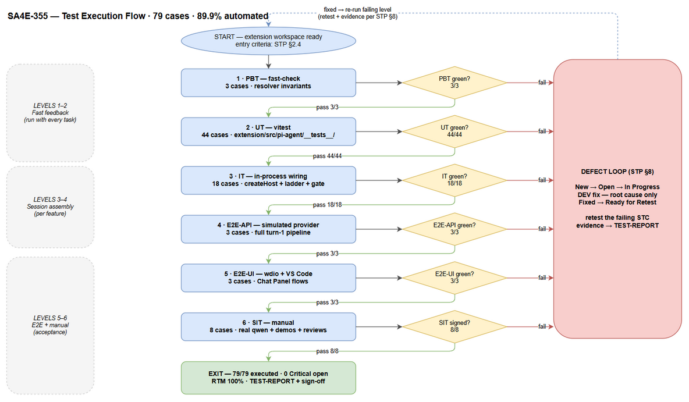
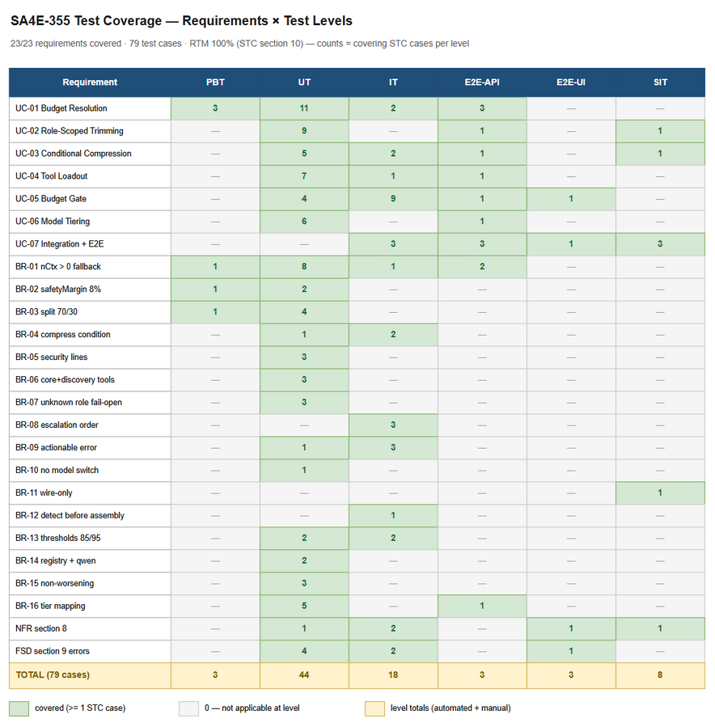

# Software Test Plan (STP)

## Pi Harness — SA4E-355: Context Budget Governance for Pi Harness

---

## Document Information

| Field | Value |
|-------|-------|
| Jira Ticket | SA4E-355 |
| Title | Implement Context Budget Governance for Pi Harness |
| Author | QA Agent |
| Version | 1.0 |
| Date | 2026-10-12 |
| Status | Draft |
| Related BRD | documents/SA4E-355/BRD.md |
| Related FSD | documents/SA4E-355/FSD.md (v1.0) |
| Related TDD | documents/SA4E-355/TDD.md (v1.1) |
| Input Guide | documents/context-budget-governance/IMPLEMENTATION-GUIDE.md |

---

## Author Tracking

| Role | Name - Position | Responsibility |
|------|-----------------|----------------|
| Author | QA Agent – QA Engineer | Create document |
| Peer Reviewer | BA Agent – Business Analyst | Business-coverage review (Review Gate) |

---

## Revision History

| Version | Date | Author | Changes |
|---------|------|--------|---------|
| 1.0 | 2026-10-12 | QA Agent | Initiate document — generated from FSD v1.0, TDD v1.1 and IMPLEMENTATION-GUIDE; 79 test cases across 6 levels (PBT/UT/IT/E2E-API/E2E-UI/SIT); RTM coverage 100% |

---

## Sign-Off

| Name | Signature and date |
|------|--------------------|
| | ☐ I agree and confirm the test plan in this STP |
| | ☐ I agree and confirm the test plan in this STP |

---

## 1. Introduction

### 1.1 Purpose

This STP defines the test strategy for SA4E-355 — wiring **Context Budget Governance** into the Pi harness session-creation flow (extension/src/pi-agent/** and extension/src/pi-workflow/**). The feature makes the pipeline runnable on small-context models (qwen, n_ctx = 32,768) and scalable to the real n_ctx of any selected model, eliminating the turn-1 400 exceed_context_size_error by: resolving a ContextBudget (UC-01), role-scoping static context (UC-02), conditional compression (UC-03), role-aware tool loadout with schema cap (UC-04), a fail-safe Budget Gate (UC-05), model tiering (UC-06), and integration + E2E proof (UC-07).

The implementation is **wire-only** (BR-11): existing, already-tested mechanisms are connected at the createHost() wire point. Testing therefore focuses on wiring correctness, exact budget formulas, fail-safe/fail-open semantics, security-line preservation, and the three-size scalability proof — not on re-testing the existing algorithms in isolation.

### 1.2 Test Objectives

1. Verify UC-01..UC-07 are implemented exactly per FSD §3.1–§3.7 (main, alternative and exception flows).
2. Enforce business rules BR-01..BR-16 (FSD §3.8) with deterministic, data-driven assertions using the verified constants: CHARS_PER_TOKEN = 4, WARN_THRESHOLD_PERCENT = 85, REJECT_THRESHOLD_PERCENT = 95, COMPRESSION_MAX_RATIO = 0.6, SMALL_CONTEXT_WINDOW_THRESHOLD = 16384, MIN_RESERVE_TOKENS = 2000, safetyMargin = ceil(nCtx × 0.08), static 70% / history 30% split, default n_ctx 8192.
3. Prove turn 1 + first tool call complete on qwen 32k with NO exceed_context_size_error; oversized static context is blocked by the gate with the actionable PI_CONTEXT_BUDGET_EXCEEDED error instead of a raw provider 400 (BR-09).
4. Verify non-functional targets (FSD §8): budget resolution + gate adds < 50 ms per session creation; npm test green after every task (NFR-2); security lines survive all trimming/compression (BR-05); error hygiene (no file contents/secrets in errors).
5. Protect regressions: existing suites stay green; SM full pipeline keeps essential tools; unknown role never loses capability (BR-07); no automatic model switching (BR-10).

### 1.3 References

| Document | Location |
|----------|----------|
| BRD | documents/SA4E-355/BRD.md |
| FSD (authoritative requirements) | documents/SA4E-355/FSD.md |
| TDD v1.1 (module design, pseudocode, constants) | documents/SA4E-355/TDD.md |
| Implementation Guide (7 tasks, test-first) | documents/context-budget-governance/IMPLEMENTATION-GUIDE.md |
| STC (detailed test cases) | documents/SA4E-355/STC.md |
| Test data | documents/SA4E-355/testdata/*.csv |

---

## 2. Test Strategy

### 2.1 Test Levels

| Level | Scope | Automation | Tools |
|-------|-------|------------|-------|
| PBT | Correctness properties of budget formulas, fallback chain invariants and compression non-worsening over random inputs | Automated | fast-check 4.9 + vitest |
| UT | Unit/edge cases per module: resolver, ModelRegistry, RoleScopeFilter, scopedSteering, compressPrompt, model-tier/model-router, BudgetCalculator/ThresholdGate | Automated | vitest (extension/src/pi-agent/__tests__/) |
| IT | In-process composition through createHost(): SDK loader overrides, role-aware loadout, gate + escalation ladder, 3-size governance assembly, SM regression | Automated | vitest — context-governance.integration.test.ts |
| E2E-API | Full turn-1 pipeline through the real provider layer against a simulated OpenAI-compatible/llama-server HTTP endpoint (real meta.n_ctx detection path) | Automated | vitest + in-test mock HTTP server |
| E2E-UI | VS Code extension UI: select model → send turn → usage indicator / error banner assertions | Automated | WebdriverIO 9 + wdio-vscode-service + Serenity-JS/Cucumber (e2e/ workspace) |
| SIT | Manual exploratory + real-llama-server qwen 32k E2E checklist, visual demos, wire-only diff review | Manual | VS Code + llama-server |

> **Level mapping note (VS Code extension context):** this feature has no REST API surface. "E2E-API" exercises the real provider HTTP contract end-to-end — openai-provider.detectContextWindow() parsing meta.n_ctx from a simulated OpenAI-compatible server, then the full adapter → createHost() → gate → createAgentSession() flow. "E2E-UI" launches the real extension in VS Code via wdio-vscode-service. The real qwen llama-server run remains a manual SIT checklist (STC-720/721) because it requires real model weights.

### 2.2 Test Types

| Type | Description | Applicable |
|------|-------------|------------|
| Functional | UC-01..UC-07 flows; BR-01..BR-16 enforcement | Yes |
| Regression | Existing suites, SM full pipeline, session compactor, legacy fallback path | Yes |
| Performance | Budget resolution + gate latency < 50 ms (FSD §8) | Yes |
| Security | Security-line preservation (BR-05, SEC-326-04), error hygiene (TDD §7), fail-safe gate (BR-09) | Yes |
| UI/UX | Context usage indicator, chat:error banner rendering | Yes |
| Compatibility | Same codebase across model context sizes 8k / 32k / 128k (UC-07) | Yes |

### 2.3 Test Approach

- **Automation-first:** 71/79 cases (89.9%) are automated; manual SIT is minimized to what genuinely needs human judgment — the real-qwen E2E, visual usage-bar demos, and the wire-only diff review (BR-11).
- **Test-first per task:** each IMPLEMENTATION-GUIDE task (T1–T7) lands with its tests green (NFR-2); suites are co-developed with the tasks, never after.
- **Data-driven:** deterministic fixtures come from documents/SA4E-355/testdata/*.csv (budget tables, gate boundary matrix, role fixtures, compression corpus, escalation scenarios, tier boundaries).
- **Boundary-value analysis:** gate thresholds 85/95 (exact boundaries 85.0 / 85.01 / 95.0 / 95.01), tier threshold 16,384 (16,384 vs 16,385), large tier 128,000 (127,999 vs 128,000), reserve floor 2,000, tiny-model usable clamp (n_ctx = 2048 and n_ctx = 1).
- **Property-based (fast-check):** BR-02 formula, BR-03 split invariants and the BR-01 never-0 invariant verified over randomized domains.
- **Exact-value verification:** worked examples asserted digit-for-digit — qwen 32k → safetyMargin 2,622, staticBudget 19,668, historyBudget 8,430; 8k → 656; 128k → 10,240 (TDD §3.2; ceil(32768 × 0.08) = ceil(2621.44) = 2622 supersedes the BRD's illustrative 2,621).
- **Traceability:** every case maps to UC/BR (STC §10 RTM); FSD §10.1 scenarios TC-01..TC-18 are fully covered (STP §10.2).

### 2.4 Entry Criteria

| Level | Entry Criteria |
|-------|---------------|
| PBT / UT | Task code compiles (tsc -p ./ green); target module exists; vitest configured (extension/vitest.config.ts) |
| IT | T1–T4 wired (resolver, loader overrides, loadout); existing suites green |
| E2E-API | T1–T6 complete; IT green; simulated OpenAI-compatible server fixture available |
| E2E-UI | Extension builds (npm run esbuild); e2e workspace deps installed; simulated server up |
| SIT | E2E-UI green; llama-server + qwen weights available (STC-720/721); checklist approved by QA lead |

### 2.5 Exit Criteria

| Level | Exit Criteria |
|-------|--------------|
| PBT / UT | 100% executed, 100% pass; 0 Critical/Major defects open |
| IT | 100% executed; escalation ladder order + gate fail-safe proven; 0 Critical open |
| E2E-API / E2E-UI | 100% executed; zero exceed_context_size_error occurrences across all runs |
| SIT | Manual checklist signed; 0 Critical; ≤ 2 Major with documented workarounds |
| Overall | 79/79 executed; pass rate ≥ 95%; RTM 100%; npm test green at repo root; TEST-REPORT-SA4E-355.csv completed with evidence |

### 2.6 Test Cases Summary

| Level | Count | Automated | Manual |
|-------|-------|-----------|--------|
| PBT | 3 | 3 | 0 |
| UT | 44 | 44 | 0 |
| IT | 18 | 18 | 0 |
| E2E-API | 3 | 3 | 0 |
| E2E-UI | 3 | 3 | 0 |
| SIT | 8 | 0 | 8 |
| **Total** | **79** | **71 (89.9%)** | **8 (10.1%)** |

**SIT → E2E automation rationale:** deterministic flows (resolver formulas, registry, role filters, gate decisions, loadout sets, full turn-1 pipeline) are fully automated at UT/IT/E2E levels. Only the real-model E2E (qwen weights via llama-server), visual demos (usage bar states, per-role token share deltas) and the human diff review (BR-11 wire-only) remain manual.

### 2.7 Test Execution Flow

*[Edit in draw.io](diagrams/test-execution-flow.drawio)*
---

## 3. Test Scope

### 3.1 Features In Scope

| # | Feature / Story | Priority | FSD Reference | Levels |
|---|----------------|----------|---------------|--------|
| 1 | Context Budget Resolution — 3-level fallback chain (detected → registry → default 8192), safetyMargin 8%, 70/30 split, qwen registry entry | High | UC-01, BR-01/02/03/14 (§3.1) | PBT, UT, IT, E2E-API |
| 2 | Role-Scoped Static Trimming — skills filter, scoped steering + phase map, priority drop, fail-open | High | UC-02, BR-05/07/11 (§3.2) | UT, IT, E2E-API, E2E-UI, SIT |
| 3 | Conditional Compression — only when over-budget or small tier; NON_STRIPPABLE_RE survival; non-worsening | High | UC-03, BR-04/05/15 (§3.3) | UT, IT, SIT |
| 4 | Tool Loadout — role-aware groups, schema token cap, core + find_tools/execute_dynamic_tool always kept | High | UC-04, BR-06/07 (§3.4) | UT, IT, E2E-API |
| 5 | Budget Gate — ALLOW ≤85% / WARN >85% / REJECT >95%, fixed escalation ladder, actionable error, no provider call | High | UC-05, BR-08/09/12/13 (§3.5) | UT, IT, E2E-API, E2E-UI |
| 6 | Model Tiering — threshold 16,384, small/medium/large behavior mapping, no auto-switch | High | UC-06, BR-10/16 (§3.6) | UT, IT, SIT |
| 7 | Integration harness + manual E2E qwen 32k — 3 sizes, SM regression, "Hãy review source code" | High | UC-07 (§3.7) | IT, E2E-API, E2E-UI, SIT |
| 8 | NFR — performance < 50 ms, quality gates (npm test green per task), error hygiene, observability logs | Medium | FSD §8, §9; TDD §9 | UT, IT, SIT |

### 3.2 Features Out of Scope

| # | Feature | Reason |
|---|---------|--------|
| 1 | LangGraph engine (extension/out/langgraph/**) | Engine does not run; MUST NOT be touched (FSD §1.2, Guide §5.1) |
| 2 | New compression / budget / tier / role-filter algorithms | BR-11 wire-only; existing modules are reused as-is (A-1) |
| 3 | Automatic model switching | BR-10 — only behavior adapts |
| 4 | UI redesign beyond the existing context usage indicator | FSD §1.2 out of scope |
| 5 | Production secrets / infrastructure changes | FSD §1.2 out of scope |
| 6 | Database / persistence | No DB in design (FSD §4, TDD §4) |
| 7 | SDK DefaultResourceLoaderOptions contract changes | Read-only external contract (A-4) |

### 3.3 Requirements Coverage Overview

*[Edit in draw.io](diagrams/test-coverage.drawio)*

---

## 4. Test Environment

### 4.1 Environment Requirements

| Environment | Location | Data | Purpose |
|-------------|----------|------|---------|
| Local dev (extension workspace) | extension/ | in-process fixtures; no DB | PBT, UT, IT |
| Simulated provider | in-test OpenAI-compatible HTTP server serving meta.n_ctx | fixture metadata per scenario | E2E-API |
| VS Code + extension host | launched by wdio-vscode-service from e2e/ | workspace fixture with steering corpus | E2E-UI |
| Real qwen via llama-server | local llama-server (n_ctx = 32768 / 65536) | real qwen weights | SIT manual E2E (STC-720/721) |

**Commands (verified from package.json):**

| Action | Command |
|--------|---------|
| Extension tests (PBT/UT/IT/E2E-API) | cd extension && npm test (vitest run) |
| All workspaces | npm test (repo root) |
| Type-check / compile | cd extension && npm run compile (tsc -p ./) |
| Bundle for UI E2E | cd extension && npm run esbuild |
| UI E2E | npm run test:e2e --prefix e2e (wdio run wdio.conf.ts) |

**Test source root:** extension/src/pi-agent/__tests__/. New suites: context-budget-resolver.test.ts, context-budget-resolver.pbt.test.ts, scoped-steering.test.ts, tool-loadout.test.ts, context-governance.integration.test.ts, context-governance.e2e.test.ts. Existing suites must stay green: role-scope.test.ts, prompt-compressor.test.ts, model-tier.test.ts, model-router.test.ts, model-registry.test.ts, context-budget.test.ts, session-configurator.budget.test.ts, session-compactor.test.ts, agent-configurator*.test.ts.

### 4.2 Tooling

| Tool | Version | Used For |
|------|---------|----------|
| vitest | 4.1.8 | UT / IT / E2E-API runner |
| fast-check | 4.9.0 | PBT properties |
| sinon | 17.0.1 | spies — compressPrompt NOT called on surplus, provider NOT called after REJECT, detectContextWindowEarly ordering |
| WebdriverIO + wdio-vscode-service + Serenity-JS/Cucumber | 9.x / 8.x / 3.x | E2E-UI (e2e/ workspace, Gherkin features under e2e/features/) |
| llama-server (qwen) | local | SIT manual E2E only |
| Draw.io | — | STP diagrams (no Mermaid) |

### 4.3 Test Data Requirements

| Data Type | Description | Source | Preparation |
|-----------|-------------|--------|-------------|
| Budget tables | n_ctx ∈ {8192, 16384, 32768, 65536, 128000} with exact expected budgets | testdata/budget-resolution-testdata.csv | Pre-computed from TDD §3.2 formulas |
| Gate boundary matrix | inputs hitting exactly 85.0 / 85.01 / 95.0 / 95.01% | testdata/gate-threshold-testdata.csv | Derived from verified BudgetCalculator formula |
| Role fixtures | skills per role; unknown role fail-open | testdata/role-scope-testdata.csv | Aligned with ROLE_SKILL_IDS (role-scope.ts) |
| Loadout fixtures | tools per role + schema-cap scenarios | testdata/tool-loadout-testdata.csv | FSD §3.4.4 mapping |
| Compression corpus | compressible / dense / security-line / empty samples | testdata/compression-testdata.csv | Aligned with prompt-compressor.ts |
| Escalation scenarios | static sizes forcing ladder steps 1–3 and absolute REJECT (incl. original incident 67,468 vs 65,536) | testdata/escalation-testdata.csv | Guide Task 5 |
| Tier boundaries | 16,384 / 16,385 / 127,999 / 128,000 → tier behaviors | testdata/tiering-testdata.csv | OI-1 decision (window-based primary) |
| Registry baseline | DEFAULT_MODEL_REGISTRY_ENTRIES + new qwen entry | testdata/pre-seeded-data.csv | model-registry.ts + BR-14 |
| Full case inventory | all 79 STC IDs with level, requirement, data references | testdata/test-case-inventory.csv | This STP / STC |

### 4.4 External Dependencies

| System | Dependency | Mock/Stub Available |
|--------|-----------|---------------------|
| @earendil-works/pi-coding-agent SDK | DefaultResourceLoaderOptions hooks, createAgentSession | No — read-only contract; signatures verified at implementation (A-4) |
| OpenAI-compatible provider endpoint | meta.n_ctx detection (openai-provider.detectContextWindow) | Yes — simulated HTTP server (automated); llama-server for SIT |
| MCP tools (jira_*, mem_*, …) | schema sizes for loadout cap | Yes — fixture schema list with token estimates (OI-4: exact estimator signature confirmed by DEV at T4) |

---

## 5. Test Schedule

| Phase | Start | End | Duration | Milestone |
|-------|-------|-----|----------|-----------|
| Test planning + BA review gate | 2026-10-12 | 2026-10-13 | 2 d | STP + STC approved |
| Test data + fixtures | 2026-10-13 | 2026-10-14 | 1 d | testdata CSVs + workspace fixtures ready |
| PBT + UT (with T1–T4) | 2026-10-14 | 2026-10-16 | 3 d | 47/47 green |
| IT (with T5–T6) | 2026-10-16 | 2026-10-17 | 2 d | 18/18 green; ladder proven |
| E2E-API + E2E-UI (with T7) | 2026-10-17 | 2026-10-19 | 2 d | 6/6 green; zero overflow |
| SIT manual + real qwen E2E | 2026-10-19 | 2026-10-21 | 2 d | Checklist signed (STC-720/721) |
| Defect fix & retest | continuous | 2026-10-21 | — | 0 Critical / 0 Major open |
| Test report + sign-off | 2026-10-21 | 2026-10-22 | 1 d | TEST-REPORT, RTM 100% |

---

## 6. Resources & Responsibilities

| Role | Name | Responsibility |
|------|------|----------------|
| Test Lead | QA Agent | Test planning, strategy, RTM, coordination |
| QA Engineer | QA Agent | Case design, automated suites, SIT execution, defect reporting |
| BA | BA Agent | Business-coverage review gate (UC/BR coverage, expected-result semantics) |
| Developer | DEV Agent | T1–T7 test-first implementation, bug fixes (root cause only) |
| SA | SA Agent | TDD clarifications (OI-1..OI-4) |
| Scrum Master | SM Agent | Orchestration, Jira updates, status tracking |

---

## 7. Risk & Mitigation

| # | Risk | Impact | Likelihood | Mitigation |
|---|------|--------|------------|------------|
| 1 | llama-server / qwen weights unavailable for manual E2E | High (blocks STC-720/721 only) | Medium | Governance logic fully proven by E2E-API against simulated server; manual window scheduled separately; 65,536 variant optional (AF-1) |
| 2 | SDK hook signature drift vs resource-loader.d.ts (A-4) | High | Low | Verify signatures before wiring (Guide §5.4); E2E-API catches contract breaks |
| 3 | OI-4: estimateToolSchemaTokens signature unverified | Medium (STC-019/204 data) | Medium | DEV confirms estimator at T4 kickoff; cap values in CSV adjustable via single constant |
| 4 | E2E-UI flakiness (wdio-vscode-service timing) | Medium | Medium | Retry policy; visual assertions also covered by manual SIT (STC-502..504) as fallback |
| 5 | Existing suites reveal defects in reused modules (A-1 wrong) | High | Low | NFR-2 — fix before proceeding; defects in existing modules fixed at root cause, never bypassed |
| 6 | STATUS.json malformed (OI-5) blocks pipeline tracking | Low | High | SM repairs file; QA tracks execution independently via TEST-REPORT CSV |
| 7 | safetyMargin 2,621 (BRD illustration) vs 2,622 (ceil rule) confusion | Low | Low | TDD v1.1 Change Log #2 is authoritative: ceil(32768 × 0.08) = 2,622; STC asserts 2,622 |
| 8 | Vietnamese/CJK text under-estimation beyond chars/4 + 8% margin | Medium | Low | BR-02 margin verified by PBT over formula; real-text validation happens in manual E2E (STC-720) with usage-bar observation |
---

## 8. Defect Management

### 8.1 Severity Levels

| Severity | Definition | Example (SA4E-355) |
|----------|-----------|-------------------|
| Critical | Provider called with oversized prompt; security directive lost; turn-1 overflow still possible | BR-09 violation (raw 400 exceed_context_size_error); BR-05 violation (security line stripped) |
| Major | Budget / gate / tier decision wrong; capability lost for a known role | safetyMargin 2,621 instead of 2,622 at 32k; REJECT at 95.0%; BA loadout missing find_tools |
| Minor | Log / warning code missing or wrong format; indicator slightly inaccurate | PI_CONTEXT_DETECT_FALLBACK not logged on registry fallback |
| Trivial | Message wording, documentation | Typo in Vietnamese error text |

### 8.2 Priority Levels

| Priority | Definition | SLA (Fix Time) |
|----------|-----------|----------------|
| P1 | Blocks turn-1 success or violates BR-05 / BR-09 | 4 hours |
| P2 | Wrong budget / gate / tier behavior; must fix before release | 1 business day |
| P3 | Logging / indicator issues | 3 business days |
| P4 | Cosmetic | Next release |

### 8.3 Defect Lifecycle

New → Open → In Progress → Fixed → Ready for Retest → Verified → Closed (→ Reopened → In Progress)

Every defect is retested against the FAILING STC case; verified cases update TEST-REPORT-SA4E-355.csv (Status, Actual_Result, Evidence_Path, Defect_ID). A legacy provider 400 exceed_context_size_error observed after this feature is ALWAYS a Critical defect (FSD §9.1) — root-cause fix only, no workarounds.

---

## 9. Test Metrics & Reporting

### 9.1 Metrics

| Metric | Formula | Target |
|--------|---------|--------|
| Test Execution Rate | Executed / 79 × 100% | 100% |
| Pass Rate | Passed / Executed × 100% | ≥ 95% |
| Automation Rate | Automated / 79 × 100% | 89.9% (by design) |
| RTM Coverage | Covered requirements / 23 × 100% | 100% |
| Critical Defect Count | Count of Critical severity | 0 |
| Defect Density | Defects / Test Cases | ≤ 0.1 |
| Performance (STC-600) | resolve + gate latency | < 50 ms per session creation |

### 9.2 Reporting

| Report | Frequency | Audience |
|--------|-----------|----------|
| Per-level execution status (TEST-REPORT CSV) | After each suite run | Project team |
| Defect summary | Daily during execution | DEV + SM |
| Test completion report (TEST-REPORT.md) | At exit (Phase 6) | All stakeholders |

---

## 10. Requirements Traceability Matrix (RTM)

### 10.1 Requirements → Test Cases

| Requirement | Source | Test Cases | Coverage |
|-------------|--------|------------|----------|
| UC-01 Context Budget Resolution | FSD §3.1 | STC-001, STC-002, STC-003, STC-004, STC-005, STC-100, STC-101, STC-200, STC-201, STC-300, STC-301, STC-302, STC-400, STC-404, STC-016, STC-111, STC-700, STC-701, STC-702 | ✅ |
| UC-02 Role-Scoped Static Trimming | FSD §3.2 | STC-006, STC-007, STC-018, STC-102, STC-103, STC-104, STC-202, STC-303, STC-305, STC-503, STC-700 | ✅ |
| UC-03 Conditional Compression | FSD §3.3 | STC-008, STC-105, STC-106, STC-203, STC-303, STC-312, STC-405, STC-504, STC-700 | ✅ |
| UC-04 Tool Loadout Filtering | FSD §3.4 | STC-009, STC-010, STC-019, STC-107, STC-108, STC-204, STC-304, STC-017, STC-700 | ✅ |
| UC-05 Budget Gate Fail-Safe | FSD §3.5 | STC-011, STC-012, STC-110, STC-205, STC-206, STC-207, STC-306, STC-307, STC-309, STC-310, STC-401, STC-402, STC-403, STC-501, STC-700 | ✅ |
| UC-06 Model Tiering | FSD §3.6 | STC-013, STC-014, STC-015, STC-109, STC-308, STC-313, STC-702 | ✅ |
| UC-07 Integration + Manual E2E | FSD §3.7 | STC-016, STC-017, STC-111, STC-700, STC-701, STC-702, STC-703, STC-720, STC-721, STC-502 | ✅ |
| BR-01 n_ctx > 0 — fallback chain, never unbounded | FSD §3.8 | STC-001, STC-100, STC-101, STC-200, STC-201, STC-300, STC-400, STC-403, STC-404, STC-016, STC-700, STC-701 | ✅ |
| BR-02 safetyMargin = ceil(nCtx × 8%) | FSD §3.8 | STC-001, STC-003, STC-301 | ✅ |
| BR-03 usable = nCtx − reserve − safety; static 70% / history 30% | FSD §3.8 | STC-001, STC-004, STC-018, STC-104, STC-302 | ✅ |
| BR-04 Compress only when over-budget or small/compressed tier | FSD §3.8 | STC-008, STC-105, STC-106 | ✅ |
| BR-05 NON_STRIPPABLE_RE lines survive trimming + compression | FSD §3.8 | STC-008, STC-018, STC-303 | ✅ |
| BR-06 Core tools + find_tools/execute_dynamic_tool always kept | FSD §3.8 | STC-009, STC-010, STC-304 | ✅ |
| BR-07 Unknown role → fail-open (allow all) | FSD §3.8 | STC-102, STC-108, STC-305 | ✅ |
| BR-08 Escalation order fixed: compress → drop steering → min loadout | FSD §3.8 | STC-110, STC-205, STC-306 | ✅ |
| BR-09 Absolute exceed → actionable error; provider NEVER called | FSD §3.8 | STC-201, STC-206, STC-207, STC-307 | ✅ |
| BR-10 No automatic model switching | FSD §3.8 | STC-308 | ✅ |
| BR-11 Wire-only — reuse existing mechanisms | FSD §3.8 | STC-314 | ✅ |
| BR-12 detectContextWindowEarly() before assembly | FSD §3.8 | STC-309 | ✅ |
| BR-13 Gate thresholds: REJECT > 95%, WARN > 85% | FSD §3.8 | STC-011, STC-012, STC-310, STC-401 | ✅ |
| BR-14 Registry validation + qwen entry (32768/2048) | FSD §3.8 | STC-005, STC-311 | ✅ |
| BR-15 Non-worsening compression (max ratio 0.6) | FSD §3.8 | STC-203, STC-312, STC-405 | ✅ |
| BR-16 Tier behavior mapping small / medium / large | FSD §3.8 | STC-013, STC-014, STC-015, STC-109, STC-313, STC-702 | ✅ |
| NFR §8 (performance, quality gates, security, observability) | FSD §8 | STC-500, STC-600, STC-601, STC-602, STC-603 | ✅ |
| Error scenarios (§9.1) + notifications (§9.2) | FSD §9 | STC-012, STC-100, STC-101, STC-203, STC-204, STC-206, STC-501 | ✅ |

### 10.2 FSD §10.1 Scenario Coverage (TC-01..TC-18)

| FSD TC | Scenario | STC |
|--------|----------|-----|
| TC-01 | Resolver formula at 32k | STC-001 |
| TC-02 | Detect fail → registry | STC-100 |
| TC-03 | Registry miss → default 8192 | STC-101 |
| TC-04 | Safety margin 8% | STC-003 |
| TC-05 | BA skills scoping | STC-006 |
| TC-06 | Unknown role fail-open | STC-102 |
| TC-07 | Steering over cap | STC-018 |
| TC-08 | Phase mapping | STC-007 |
| TC-09 | Compression conditional | STC-008 |
| TC-10 | No compression on surplus | STC-105 |
| TC-11 | Tool loadout per role | STC-009, STC-010 |
| TC-12 | Schema cap | STC-019, STC-204 |
| TC-13 | Gate escalation order | STC-205 |
| TC-14 | Gate REJECT fail-safe | STC-206 |
| TC-15 | SM regression | STC-017 |
| TC-16 | Tier behaviors | STC-013, STC-014, STC-015, STC-313 |
| TC-17 | Integration 3 sizes | STC-016, STC-702 |
| TC-18 | Manual E2E qwen 32k | STC-720, STC-703 |

### 10.3 Coverage Summary

| Category | Total | Covered | Coverage % |
|----------|-------|---------|------------|
| Use Cases (UC-01..UC-07) | 7 | 7 | 100% |
| Business Rules (BR-01..BR-16) | 16 | 16 | 100% |
| NFR + Error Scenarios (FSD §8, §9) | 2 | 2 | 100% |
| FSD §10.1 Scenarios (TC-01..TC-18) | 18 | 18 | 100% |
| **Overall requirements** | **23** | **23** | **100%** |

---

## 11. Appendix

### 11.1 Glossary

| Term | Definition |
|------|------------|
| n_ctx | Model context window size in tokens (32,768 for qwen) |
| ContextBudget | {nCtx, reserveOutput, safetyMargin, staticBudget, historyBudget} — computed once per session creation |
| staticBudget / historyBudget | ~70% / ~30% of usable tokens — static: system prompt + steering + AGENTS.md + tool schemas; history: conversation |
| safetyMargin | ceil(nCtx × 8%) buffer compensating chars/4 under-estimation for CJK/Vietnamese (BR-02) |
| Budget Gate | BudgetCalculator + ThresholdGate decision point before any provider call (ALLOW ≤85%, WARN >85%, REJECT >95%) |
| Escalation ladder | Fixed order: (1) tier compression → (2) drop lowest-priority steering → (3) minimal tool loadout → (4) actionable error (BR-08) |
| WIRE POINT | createHost() in pi-agent-session-host.ts — where SDK DefaultResourceLoaderOptions overrides are injected |
| NON_STRIPPABLE_RE | /^\s*[-*]?\s*(security|warning|never|do not|important)\b/i — security lines never stripped (SEC-326-04) |
| Fail-open (role) | Unknown role → allow all skills/tools to avoid accidental capability loss (BR-07) |
| Fail-safe (gate) | Oversized prompt → blocked + actionable error, provider never called (BR-09) |
| PBT / UT / IT / E2E-API / E2E-UI / SIT | Property-Based / Unit / Integration / API-E2E / UI-E2E / System Integration (manual) test levels |

### 11.2 Test Artifacts Index

| File | Content |
|------|---------|
| STC.md | 79 detailed test cases + RTM |
| diagrams/test-coverage.drawio / .png | Requirements × levels coverage matrix |
| diagrams/test-execution-flow.drawio / .png | Execution pipeline with entry/exit criteria + defect loops |
| testdata/*.csv | 9 data files (see §4.3) |
| TEST-REPORT-SA4E-355.csv | Execution tracker — 79 rows pre-filled, Status = NOT_RUN |
| evidence/ | Screenshots / logs captured during execution |

### 11.3 Assumptions

- FSD assumptions A-1..A-6 apply (existing modules tested and bug-free; role/phase reachable from PipelineState; qwen entry non-breaking; SDK hook signatures stable; usage indicator exists; chars/4 precision acceptable with 8% margin).
- TDD v1.1 decisions are authoritative: OI-1 window-based tier primary (name-based hint), OI-2 reserveOutput = override → registry maxOutput → floor 2,000, OI-3 medium keeps 70/30 split.
- Test dates assume a 2026-10-12 start; schedule shifts do not change scope.

---

*End of STP — SA4E-355 v1.0. Traceability: UC-01..UC-07 + BR-01..BR-16 → §10.1 (100%).*
