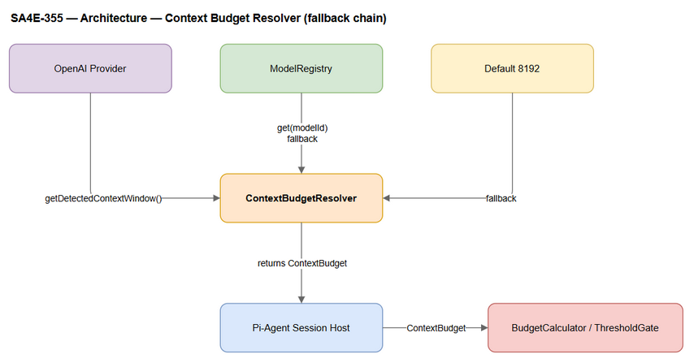
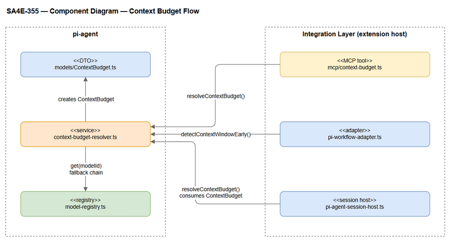
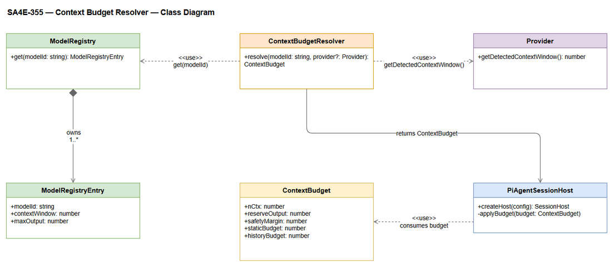

# Technical Design Document (TDD)

## SA4E-355 — Implement Context Budget Governance for Pi Harness

---

## Document Information

| Field | Value |
|-------|-------|
| Jira Ticket | SA4E-355 |
| Title | Implement Context Budget Governance for Pi Harness |
| Author | SA Agent |
| Version | 1.3 |
| Date | 2026-10-13 |
| Status | Draft |
| Related BRD | BRD-v1-SA4E-355.md |
| Related FSD | FSD v1.0 — documents/SA4E-355/FSD.md |

---

## Author Tracking

| Role | Name - Position | Responsibility |
|------|-----------------|----------------|
| Author | SA Agent – Solution Architect | Create document |
| Peer Reviewer | TBD – Reviewer | Review document |

---

## Revision History

| Version | Date | Author | Changes |
|---------|------|--------|---------|
| 1.0 | 2026-10-11 | SA Agent | Initial TDD (Task 1 scope, written pre-FSD) |
| 1.1 | 2026-10-11 | SA Agent | Reconciled with FSD v1.0: full 7-module scope (UC-01..UC-07); corrected BudgetCalculator/ThresholdGate location to `extension/src/mcp/context-budget.ts`; removed all Mermaid blocks (Draw.io-only rule); resolved OI-1..OI-3; added BR-01..BR-16 traceability and Diagram Index |
| 1.2 | 2026-10-13 | SA Agent | Added §13 Intra-Turn Request Governance appendix (UAT bug #2, TA review condition #1): third governance execution point in `Agent.streamFn` — per-request measure → compact → REJECT (commit `70a0a90`, verified against code); documented the `streamFn`-throw deviation (SDK `handleRunFailure`); no new diagrams (appendix-only) |
| 1.3 | 2026-10-13 | SA Agent | Pin newest user message in compaction + REJECT→COMPACT for incompressible tool units (UAT bug #3, commit `c11f461`, TA condition): §13.2/§13.3 replace "newest non-system unit is NEVER dropped" with the pin rule (`userReserveTokens` — raw → compressed → kept over-budget so the BR-09 gate REJECTs); tool units droppable atomically incl. the newest; anti-livelock backstop documented (`TurnBudgetGuard`, pi-provider.ts L399/424/436 — identical tool+args signature ×4 → steer, persistent → abort); §13.7 adds `PI_TRANSCRIPT_COMPACTED_NO_USER_QUERY` warn (defensive post-check); §13.5 module sizes + test counts refreshed (transcript-compaction.ts 139→200 lines; direct 29 / integration 19 tests; full suite 285 files / 2,748 tests) |

---

## Sign-Off

| Name | Signature and date |
|------|--------------------|
| | ☐ I agree and confirm the technical design in this TDD |
| | ☐ I agree and confirm the technical design in this TDD |

---

## 1. Introduction

### 1.1 Purpose

Design the technical wiring that makes the Pi harness runnable on small-context models (qwen 32k) and scalable to the real n_ctx of any selected model — eliminating the turn-1 `exceed_context_size_error` (400). The design WIREs existing, tested mechanisms (BudgetCalculator, ThresholdGate, compressPrompt, RoleScopeFilter, model tiering) into session creation through one new resolver module and one new scoped-steering helper. **Wire-only (BR-11): no new algorithms.** Implements FSD UC-01..UC-07 and business rules BR-01..BR-16 (FSD §3.0, §3.8).

### 1.2 Scope

Technical scope — `extension/src/pi-agent/**` and `extension/src/pi-workflow/**` only; LangGraph engine (`extension/out/langgraph/**`) is untouched.

| # | Module | Type | FSD UC |
|---|--------|------|--------|
| 1 | context-budget-resolver — single source of truth for n_ctx | NEW (thin composition) | UC-01 |
| 2 | role-scope + scoped-steering helper | existing + NEW helper | UC-02 |
| 3 | prompt-compressor — conditional compression | existing, wire only | UC-03 |
| 4 | tool loadout — role-aware with schema cap | extend existing | UC-04 |
| 5 | budget gate — BudgetCalculator + ThresholdGate | existing, wire only | UC-05 |
| 6 | model-tier — behavior modes per context size | existing, wire only | UC-06 |
| 7 | integration tests + manual E2E qwen 32k | NEW tests | UC-07 |

Out of scope (BRD §1.2, FSD §1.2): compression/role-filter/tiering algorithms, model auto-switching (BR-10), UI redesign, LangGraph changes, production infrastructure.

### 1.3 Technology Stack

| Layer | Technology | Version |
|-------|-----------|---------|
| Language | TypeScript | 5.x |
| Framework | Pi Harness SDK @earendil-works/pi-coding-agent | latest |
| Test | Vitest (npm / tsc build) | — |

### 1.4 Design Principles

- Wire-only: reuse existing tested mechanisms; writing new compressor/budget/tier/role-filter algorithms is prohibited (BR-11)
- Fail-safe: n_ctx > 0 always (BR-01); the provider is NEVER called with an oversized prompt (BR-09)
- Fail-open for unknown role/phase (BR-07); security lines are never stripped (BR-05)
- SOLID single responsibility; file ≤ 200 lines, function ≤ 20 lines, TSDoc on public API

### 1.5 Constraints

- **Verified code location:** `BudgetCalculator` / `ThresholdGate` live in `extension/src/mcp/context-budget.ts` — NOT `pi-agent/context-budget.ts` as stated in IMPLEMENTATION-GUIDE §0.6; existing consumers (`session-configurator.ts`, `session-compactor.ts`) already import from there (FSD Change Log #1)
- Do not modify the LangGraph engine; wire existing mechanisms only
- SDK `DefaultResourceLoaderOptions` is a read-only external contract (`resource-loader.d.ts`, assumption A-4)

### 1.6 References

| Document | Location |
|----------|----------|
| BRD | documents/SA4E-355/BRD.md |
| FSD (authoritative requirements) | documents/SA4E-355/FSD.md |
| Implementation Guide (original requirement source) | documents/context-budget-governance/IMPLEMENTATION-GUIDE.md |

---

## 2. System Architecture

### 2.1 Architecture Overview

The resolver sits between early Provider detection and the Session Host. `detectContextWindowEarly()` runs BEFORE any session assembly (BR-12); the resolver resolves n_ctx via the fallback chain provider `meta.n_ctx` → ModelRegistry → default 8192 (never 0 — BR-01) and computes `ContextBudget`, which feeds the SDK loader overrides, the tool loadout, and the Budget Gate.



*[Edit in draw.io](diagrams/architecture.drawio)*

### 2.2 Component Diagram



*[Edit in draw.io](diagrams/component.drawio)*

| Component | File (verified) | Status | Responsibility |
|-----------|-----------------|--------|----------------|
| ContextBudgetResolver + ContextBudget model | `extension/src/pi-agent/context-budget-resolver.ts`, `models/ContextBudget.ts` | NEW (thin) | Fallback chain + ContextBudget computation (UC-01) |
| scopedSteering helper | `extension/src/pi-agent/scoped-steering.ts` | NEW (thin) | Phase → steering map, priority drop to staticBudget cap (UC-02) |
| BudgetCalculator / ThresholdGate | `extension/src/mcp/context-budget.ts` | Existing + tests — reuse | Measure usage %, decide ALLOW/WARN/REJECT (BR-13) |
| RoleScopeFilter + ROLE_SKILL_IDS | `extension/src/pi-agent/role-scope.ts` | Existing + tests — wire | Role-scoped skills (BR-06/07) |
| compressPrompt / NON_STRIPPABLE_RE / estimateTokenCount | `extension/src/pi-agent/prompt-compressor.ts` | Existing + tests — wire | Conditional, security-preserving compression (BR-04/05/15) |
| Tier utilities + ModelRegistry | `model-tier.ts`, `model-router.ts`, `model-registry.ts` (under pi-agent) | Existing + tests — wire; add qwen entry | Window-based tier primary, name-based hint (BR-16, OI-1); registry fallback (BR-14) |
| Pi Agent Session Host (WIRE POINT) | `extension/src/pi-workflow/pi-agent-session-host.ts` | Existing — wire | createHost(): overrides + loadout + gate |
| n_ctx detection: adapter ordering + provider meta.n_ctx | `extension/src/pi-workflow/pi-workflow-adapter.ts`, `extension/src/mcp/providers/openai-provider.ts` | Existing — call earlier, no logic change | detectContextWindowEarly() before createHost (BR-12) |

### 2.3 Communication Patterns

All interactions are in-process, synchronous, no I/O. Deployment unchanged: VS Code extension host, no new infrastructure (see §10).

| From | To | Description |
|------|----|-------------|
| pi-workflow-adapter.runTurnOnce | detectContextWindowEarly() | Early n_ctx detection BEFORE assembly (BR-12) |
| createHost() | resolveContextBudget() | {modelId, nCtxDetected, tier, reserveOutput} → ContextBudget |
| createHost() | SDK loader hooks (skillsOverride / appendSystemPromptOverride / agentsFilesOverride) | Scoped + compressed static context |
| Budget Gate | BudgetCalculator.calculateBudget + ThresholdGate.evaluate | usagePercent → ALLOW / WARN / REJECT (BR-13) |
| Session Host | SDK createAgentSession() | Only after ALLOW / WARN; never after REJECT (BR-09) |

---

## 3. API Design

### 3.1 API Overview

Internal in-process module contracts (no HTTP). Seven contracts map 1:1 to FSD §3.1.6–§3.7.6:

| # | Contract | Signature | Status | FSD |
|---|----------|-----------|--------|-----|
| 1 | context-budget-resolver | resolveContextBudget(input): ContextBudget | NEW | §3.1.6 |
| 2 | role-scope + scoped-steering | RoleScopeFilter.filterSkills(role, skills); scopedSteering(base, role, phase, budget) | existing + NEW helper | §3.2.6 |
| 3 | prompt-compressor | compressPrompt(template): string | existing | §3.3.6 |
| 4 | tool loadout | getSessionToolLoadout(role, phase, budget) | extend | §3.4.6 |
| 5 | budget gate | BudgetCalculator.calculateBudget(contextWindow, inputs); ThresholdGate.evaluate(usagePercent) | existing | §3.5.6 |
| 6 | model-tier | detectModelTier(modelId); ModelRouter.classifyTier(registry, modelId) | existing | §3.6.6 |
| 7 | integration test | vitest suites (resolver + governance) | NEW tests | §3.7.6 |

### 3.2 API: resolveContextBudget (UC-01) — fallback chain

**Implements:** UC-01; BR-01, BR-02, BR-03, BR-14.

Fallback chain (provider → registry → 8192):

| Order | Source | Valid condition | On failure |
|-------|--------|-----------------|------------|
| 1 | Provider `meta.n_ctx` (via detectContextWindowEarly) | finite number > 0 | → step 2, log `PI_CONTEXT_DETECT_FALLBACK` (AF-1) |
| 2 | `ModelRegistry.get(modelId).contextWindow` | entry exists, integer > 0 (BR-14) | → step 3, log `PI_CONTEXT_DETECT_DEFAULT` (AF-2) |
| 3 | Default 8192 | terminal guarantee — ALWAYS valid | never 0 (BR-01) |

Resolution pseudocode:

```text
resolveContextBudget(input):
  nCtx          = firstPositive(input.nCtxDetected,                 # 1. provider meta.n_ctx
                     registry.get(input.modelId)?.contextWindow,   # 2. registry (BR-14)
                     8192)                                         # 3. terminal default (BR-01)
  safetyMargin  = ceil(nCtx * 0.08)                                # BR-02
  reserveOutput = max(input.reserveOutput
                     ?? registry.get(input.modelId)?.maxOutput
                     ?? MIN_RESERVE_TOKENS,                         # 2000 (OI-2)
                     MIN_RESERVE_TOKENS)
  usable        = max(nCtx - reserveOutput - safetyMargin, 1)      # tiny-model floor (EF-2)
  staticBudget  = floor(usable * 0.70)                             # BR-03
  historyBudget = usable - staticBudget                             # remainder; sums exactly to usable
  return { nCtx, reserveOutput, safetyMargin, staticBudget, historyBudget }
```

Worked examples (deterministic application of BR-02/BR-03):

| n_ctx | reserveOutput | safetyMargin = ceil(n × 8%) | usable | staticBudget (70%) | historyBudget (30%) |
|-------|---------------|------------------------------|--------|--------------------|---------------------|
| 8,192 | 2,048 | 656 | 5,488 | 3,841 | 1,647 |
| 32,768 (qwen) | 2,048 | 2,622 | 28,098 | 19,668 | 8,430 |
| 128,000 | 16,384 | 10,240 | 101,376 | 70,963 | 30,413 |

> safetyMargin at 32k = ceil(32768 × 0.08) = ceil(2621.44) = **2622** — the BRD's illustrative 2,621 is superseded by the ceil formula (FSD Change Log #2).

**Input:**

| Parameter | Type | Required | Description |
|-----------|------|----------|-------------|
| modelId | string | Yes | Selected model identifier, e.g. `qwen` (BR-14) |
| nCtxDetected | number | No | `meta.n_ctx` from provider when available |
| tier | 'small' / 'medium' / 'large' / null | No | From UC-06; selects budget mode (OI-1) |
| reserveOutput | number | No | Override; default registry maxOutput, floor 2000 (OI-2) |

**Return — ContextBudget (qwen worked example):**

```json
{
  "nCtx": 32768,
  "reserveOutput": 2048,
  "safetyMargin": 2622,
  "staticBudget": 19668,
  "historyBudget": 8430
}
```

**Error handling (fallbacks — never throws for missing data):**

| Condition | Handling |
|-----------|----------|
| Provider detection fails / no meta.n_ctx | Registry fallback; log `PI_CONTEXT_DETECT_FALLBACK` |
| Registry miss | Default 8192; log `PI_CONTEXT_DETECT_DEFAULT` |
| Any nCtx ≤ 0 / non-finite in the chain | Skip to next source; terminal default 8192; never 0 (EF-1) |
| usable ≤ 0 after reserves (tiny model) | Clamp usable to minimal positive floor; gate will REJECT with actionable error (EF-2) |

### 3.3 API: filterSkills + scopedSteering (UC-02)

**Implements:** BR-03, BR-05, BR-07, BR-11.

| Signature | Status |
|-----------|--------|
| RoleScopeFilter.filterSkills(role: string, skills: SkillRef[]): SkillRef[] | existing — verified role-scope.ts |
| scopedSteering(base: string[], role: string, phase: string, budget: ContextBudget): string[] | NEW helper, ≤ 200 lines |

Design: phase → steering map (requirements → phase-1-requirements + shared-*; … ; unknown/none → shared-* only — FSD §3.2.4); order by priority; estimate tokens via `estimateTokenCount`; drop lowest-priority entries until ≤ static steering share of `staticBudget`; lines matching `NON_STRIPPABLE_RE` are never dropped (BR-05). Unknown role → base unchanged (fail-open, BR-07). Any exception inside an override → fail-open to base content + error log (EF-1 UC-02).

### 3.4 API: compressPrompt (UC-03)

**Implements:** BR-04, BR-05, BR-15.

The session host computes `shouldCompress = (measuredStatic > budget.staticBudget) OR (tier ∈ {small, compressed})` (BR-04) and wires `agentsFilesOverride` accordingly. `compressPrompt` (existing, verified): strips HTML comments, fenced example blocks, example sections, boilerplate lines (tip/note/hint/see-also), collapses whitespace — keeps `NON_STRIPPABLE_RE` lines (BR-05); `COMPRESSION_MAX_RATIO = 0.6` — result ≥ original or empty → returns original (non-worsening, BR-15). Surplus budget + medium/large tier → `compressPrompt` NOT called; content byte-identical (AF-1 UC-03).

### 3.5 API: getSessionToolLoadout (UC-04)

**Implements:** BR-06, BR-07.

Extend existing `getSessionToolLoadout(workspaceRoot)` (pi-agent-session-host.ts) to accept `(role, phase, budget)`:

- ALWAYS keep core file tools (read/write/edit/grep/find/ls/shell) + `find_tools` + `execute_dynamic_tool` (BR-06)
- Role → tool group mapping per FSD §3.4.4 (BA/SA: no git/deploy; DEV: git/build; DevOps: + deploy/pipeline; QA: test tooling; SM: full coordination set; unknown: permissive default — BR-07)
- MCP tools prioritized by phase; schema tokens estimated (`estimateTokenCount` on serialized schema — exact estimator per OI-4); trimmed lowest-priority first until ≤ `schemaTokenCap`
- Loadout schema tokens deducted from `staticBudget` accounting before gate measurement; cap unreachable even at min set → keep core + discovery, log `PI_TOOL_SCHEMA_CAP`, gate decides (EF-1 UC-04)

### 3.6 API: Budget Gate (UC-05)

**Implements:** BR-08, BR-09, BR-12, BR-13.

Existing, reused as-is from `extension/src/mcp/context-budget.ts`:

- `BudgetCalculator.calculateBudget(contextWindow, inputs?): BudgetResult` — estimatedTokens, usagePercent (window ≤ 0 → 100%), reserveTokens, conservative
- `ThresholdGate.evaluate(usagePercent): ThresholdResult` — REJECT > 95%, WARN > 85%, else ALLOW (BR-13; verified constants: REJECT_THRESHOLD_PERCENT=95, WARN_THRESHOLD_PERCENT=85, CHARS_PER_TOKEN=4, MIN_RESERVE_TOKENS=2000)

Escalation ladder (BR-08 — fixed order, re-measure after each step):

| Order | Action | Module | Re-measure |
|-------|--------|--------|------------|
| 1 | Enable tier compression (small tier forces proactively) | prompt-compressor (agentsFilesOverride + scopedSteering) | Yes |
| 2 | Drop lowest-priority steering until within steering share | scoped-steering helper | Yes |
| 3 | Reduce tool loadout to minimal (core + discovery only) | tool loadout filter | Yes |
| 4 | Emit actionable error — no further degradation | Budget Gate | — |

On persisting > 95% (or > n_ctx) after step 3: emit `chat:error` — `PI_CONTEXT_BUDGET_EXCEEDED: static context {N} tokens vượt budget {M} cho model n_ctx={K}. Giảm steering/tools hoặc dùng model context lớn hơn.` — provider NOT called (BR-09).

### 3.7 API: model tier (UC-06)

**Implements:** BR-10, BR-16.

Existing utilities, wired only: `detectModelTier(modelId): ModelTier | null` (name-pattern small/medium/large, model-tier.ts) and `ModelRouter.classifyTier` (window-based, `SMALL_CONTEXT_WINDOW_THRESHOLD = 16384`, model-router.ts). Tier selects compression mode, scoping aggressiveness, loadout width, budget split (FSD §3.6.4). NEVER switches the user's model (BR-10). Tier source-of-truth decision → §11 OI-1: window-based primary, name-based hint; 32,768 → NOT small → medium behaviors.

### 3.8 API: test harness (UC-07)

| Suite | Content |
|-------|---------|
| `__tests__/context-budget-resolver.test.ts` (NEW) | Unit: formulas at 32k (safetyMargin 2622, static 19,668, history 8,430) and 8k (656); fallback chain; default 8192; never 0 |
| `__tests__/context-governance.integration.test.ts` (NEW) | n_ctx ∈ {8192, 32768, 128000}: total prompt (static + tool schemas + 1 user message) < budget per size; gate + escalation verified; role=SM regression keeps essential tools |
| existing suites | `context-budget.test.ts`, `role-scope.test.ts`, `model-tier.test.ts`, `prompt-compressor.test.ts` stay green (NFR-2) |

Manual E2E (FSD §3.7.5): llama-server qwen n_ctx=32768, select qwen in UI, send "Hãy review source code" → no `exceed_context_size_error`; turn 1 + first tool call complete; usage bar reflects reality.

---

## 4. Database Design

No database. All state is in-memory per session; `ModelRegistry` is a static in-memory Map (`DEFAULT_MODEL_REGISTRY_ENTRIES`). Persistence is out of scope (FSD §4). No DDL, no migrations.

## 5. Class / Module Design

### 5.1 Package Structure

```text
extension/src/
├── mcp/
│   └── context-budget.ts            # existing — BudgetCalculator, ThresholdGate (VERIFIED location)
├── pi-agent/
│   ├── models/
│   │   └── ContextBudget.ts         # NEW — ContextBudget interface
│   ├── context-budget-resolver.ts   # NEW — resolveContextBudget (thin composition)
│   ├── scoped-steering.ts           # NEW — phase map, priority drop, cap
│   ├── role-scope.ts                # existing — RoleScopeFilter, ROLE_SKILL_IDS
│   ├── prompt-compressor.ts         # existing — compressPrompt, NON_STRIPPABLE_RE, estimateTokenCount
│   ├── model-tier.ts, model-router.ts  # existing — detectModelTier, preferredVariantForTier, classifyTier
│   └── model-registry.ts           # existing — add qwen entry to DEFAULT_MODEL_REGISTRY_ENTRIES
└── pi-workflow/
    ├── pi-agent-session-host.ts     # wire overrides + loadout + gate (WIRE POINT)
    └── pi-workflow-adapter.ts       # ensure detectContextWindowEarly() precedes createHost
```

### 5.2 Key Interfaces

```typescript
export interface ContextBudget {              // NEW — models/ContextBudget.ts (FSD §3.1.4)
  nCtx: number;              // > 0 always (BR-01)
  reserveOutput: number;     // >= MIN_RESERVE_TOKENS (2000)
  safetyMargin: number;      // ceil(nCtx * 0.08) (BR-02)
  staticBudget: number;      // ~70% of usable (BR-03)
  historyBudget: number;     // ~30% of usable (BR-03)
}

export interface ResolveContextBudgetInput {   // NEW — resolver input (FSD §3.1.6)
  modelId: string;
  nCtxDetected?: number;
  tier?: 'small' | 'medium' | 'large' | null;
  reserveOutput?: number;
}
```

`ModelRegistryEntry` (existing, verified model-registry.ts): `{ modelId, contextWindow, maxOutput, costPer1k?, speed?, thinkingMap }`; `ModelRegistry.validate` enforces integer contextWindow > 0, 0 < maxOutput ≤ contextWindow, thinkingMap values ≤ maxOutput (BR-14).

New registry entry (BR-14; `qwen2.5-coder` 32768/1024 already exists — plain `qwen` is the generic fallback): `{ modelId: 'qwen', contextWindow: 32768, maxOutput: 2048, costPer1k: 0, speed: 'medium', thinkingMap: { low: 256, medium: 512, high: 1024 } }`.

### 5.3 Design Patterns

| Pattern | Where Used | Rationale |
|---------|-----------|-----------|
| Strategy / Chain of Responsibility | Resolver fallback chain | provider → registry → default 8192 (BR-01) |
| Decorator (SDK hook overrides) | createHost() loader options | Wrap base resources without replacing the SDK loader |
| Guard clause | Budget Gate | Fail-safe decision BEFORE provider call (BR-09) |
| Fail-open fallback | scopedSteering, loadout, filterSkills | Unknown role/exception never loses capability (BR-07) |

### 5.4 Class Relationships



*[Edit in draw.io](diagrams/class-diagram.drawio)*

`resolveContextBudget` composes provider-detected n_ctx, `ModelRegistry`, and tier inputs → `ContextBudget`. `scopedSteering` composes `RoleScopeFilter` + `compressPrompt` + `BudgetCalculator.estimateTokens`. The Session Host consumes `ContextBudget` to cap `scopedSteering`, the tool loadout, and the gate measurement (`BudgetCalculator` + `ThresholdGate`).

### 5.5 Error Handling Strategy

| Condition | Mechanism | Rule |
|-----------|-----------|------|
| nCtx invalid/missing | Fallback chain | Terminal default 8192; never 0 (BR-01) |
| Override throws in createHost | try/catch per override | Fail-open to base content + error log (EF-1 UC-02) |
| compressPrompt throws | Existing try/catch in module | Returns original template (BR-15) |
| Gate REJECT after full ladder | `chat:error` PI_CONTEXT_BUDGET_EXCEEDED | Provider NOT called (BR-09) |
| Legacy 400 `exceed_context_size_error` after feature | Treated as genuine defect | Root-cause fix, no workaround (FSD §9.1) |

## 6. Integration Design

### 6.1 Wire Point: createHost() — DefaultResourceLoaderOptions hooks (FSD §5.5)

| Hook | Wired content | UC |
|------|---------------|----|
| skillsOverride | RoleScopeFilter.filterSkills(role, base.skills) | UC-02 |
| appendSystemPromptOverride | scopedSteering(base, role, phase, budget) | UC-02 |
| agentsFilesOverride | Conditional compressPrompt(f.content) when shouldCompress | UC-03 |
| systemPromptOverride / noContextFiles / noSkills | Reserved — no change required | — |

`role`/`phase` flow from `PipelineState` via `executeTurn(state, chatInput, role, ...)` into `SessionHostOptions` (assumption A-2; structural extension, no hack).

### 6.2 Turn-1 Sequence (ordering per BR-12)

1. `runTurnOnce` → `detectContextWindowEarly()` obtains `meta.n_ctx` BEFORE assembly
2. `createHost()` → `resolveContextBudget({modelId, nCtxDetected, tier, reserveOutput})`; log breakdown `{nCtx, reserveOutput, safetyMargin, staticBudget, historyBudget}` + source (provider/registry/default)
3. Apply overrides: scoped skills (BR-06/07), scoped steering (BR-03/05), conditional compression (BR-04/15), role-aware loadout with schema cap (BR-06)
4. Gate: `BudgetCalculator.calculateBudget` + `ThresholdGate.evaluate` (BR-13)
5. REJECT → escalation ladder (§3.6); still > 95% → `chat:error`, NO provider call (BR-09)
6. ALLOW/WARN → `createAgentSession(overrides)`; turn executes; first tool call works; a provider 400 would now indicate a genuine defect

### 6.3 External Contracts

| Contract | Owner | Stability note |
|----------|-------|----------------|
| `DefaultResourceLoaderOptions` (@earendil-works/pi-coding-agent) | SDK — read-only | Verify override signatures at implementation (A-4) |
| `openai-provider.detectContextWindow()` → `meta.n_ctx` | extension — call earlier, no logic change | Existing |
| MCP tools at runtime | `find_tools` / `execute_dynamic_tool` discovery (tool-usage-dynamic pattern) | Existing |

## 7. Security Design

- Authentication/authorization: N/A — internal IDE extension; no PII processed
- **Security directive preservation (BR-05, SEC-326-04):** lines matching `NON_STRIPPABLE_RE = /^\s*[-*]?\s*(security|warning|never|do not|important)\b/i` survive ALL trimming and compression — enforced in `prompt-compressor` (verified) and in scopedSteering drop logic
- Error hygiene: `chat:error` and logs carry only counts {N}/{M}/{K} and remediation advice — never file contents, config, or secrets
- Input validation: modelId non-empty; nCtx finite > 0 (else fallback); reserveOutput ≥ MIN_RESERVE_TOKENS; registry entries gated by `ModelRegistry.validate` (BR-14)
- Fail-open applies ONLY to role/phase scoping — the gate itself is fail-safe (BR-09)

## 8. Performance & Scalability

- Budget resolution + gate: in-process, synchronous, no I/O — < 50 ms per session creation (BRD NFR)
- ModelRegistry lookup is O(1); no caching required (resolution runs once per session)
- Scales across 8k / 32k / 128k by design (BR-16); integration tests prove all three sizes (UC-07)
- Token estimation stays chars/4 (`CHARS_PER_TOKEN = 4`); the 8% safety margin covers CJK/Vietnamese under-estimation (BR-02)

## 9. Monitoring & Observability

| Event | Code / fields | Level |
|-------|---------------|-------|
| Budget resolved | breakdown {nCtx, reserveOutput, safetyMargin, staticBudget, historyBudget} + source | info |
| Provider detection failed | `PI_CONTEXT_DETECT_FALLBACK` | warn |
| Registry miss → default 8192 | `PI_CONTEXT_DETECT_DEFAULT` | warn |
| Schema cap unreachable at min set | `PI_TOOL_SCHEMA_CAP` | warn |
| Gate REJECT after escalation | `PI_CONTEXT_BUDGET_EXCEEDED` (chat:error + log) | error |
| Escalation ladder steps | step + effect (re-measured usage %) | info |
| Compression applied | file, before/after token estimate, ratio | info |

Budget breakdown and gate decisions are demoable in the extension log (qwen 32k demos, FSD §8 Observability).

## 10. Deployment

No infrastructure change: extension rebuild via `tsc`; `npm test` green per task (NFR-2). Rollback = revert the extension commit; no data migration, no feature flags required.

## 11. Design Decisions (FSD Open Items owned by TDD)

| OI | Decision | Rationale |
|----|----------|-----------|
| OI-1 tier source of truth | **Window-based primary**: `classifyTier` with `SMALL_CONTEXT_WINDOW_THRESHOLD = 16384` decides small vs not-small; `detectModelTier` (name patterns) is only a hint when window is unknown. 32,768 → NOT small → medium behaviors (BR-16; also resolves OI-6) | Deterministic on the real constraint (n_ctx), not model naming; matches FSD AF-2 UC-06 |
| OI-2 reserveOutput source | explicit override → registry `maxOutput` → `MIN_RESERVE_TOKENS` (2000); always floored at `MIN_RESERVE_TOKENS` | Per-model accuracy with a safe floor; reuses the existing constant (qwen → 2048) |
| OI-3 medium-tier split | Medium keeps the default 70/30 split (BR-03); only small tier uses static-leaning split (BR-16) | No quantified requirement to deviate; deterministic default |
| OI-4 schema token estimator | DEV verifies exact estimator signature before loadout wiring; design assumes `estimateTokenCount` on the serialized schema | Flagged by FSD; owned by DEV |

## 12. Requirements Traceability — BR-01..BR-16 → TDD

| Rule | Requirement (FSD §3.8) | TDD section(s) |
|------|------------------------|----------------|
| BR-01 | n_ctx > 0; fallback chain; never 0 | §3.2, §5.5 |
| BR-02 | safetyMargin = ceil(nCtx × 8%) | §3.2 |
| BR-03 | usable split 70/30 | §3.2, §11 (OI-3) |
| BR-04 | Conditional compression only | §3.4 |
| BR-05 | Security lines survive | §3.3, §7 |
| BR-06 | Core + discovery tools always kept | §3.5 |
| BR-07 | Unknown role fail-open | §3.3, §3.5, §7 |
| BR-08 | Fixed escalation ladder | §3.6, §6.2 |
| BR-09 | Actionable error, no provider call | §3.6, §5.5, §9 |
| BR-10 | No model auto-switching | §3.7, §11 |
| BR-11 | Wire-only, no new algorithms | §1.1, §1.4, §2.2 |
| BR-12 | Detect n_ctx before assembly | §2.3, §3.2, §6.2 |
| BR-13 | Gate thresholds 85/95 | §3.6 |
| BR-14 | Registry validation + qwen entry | §3.2, §5.2 |
| BR-15 | Non-worsening compression (ratio 0.6) | §3.4 |
| BR-16 | Tier behavior mapping | §3.7, §11 (OI-1) |

> **v1.2 note:** the intra-turn request gate (§13) re-enforces BR-01, BR-02, BR-09 and UC-03 at a THIRD governance execution point — every Agent-loop LLM request. The mapping above is unchanged.

## Implementation Checklist (7 tasks)

- [ ] T1 — `models/ContextBudget.ts` + `context-budget-resolver.ts` (fallback chain, BR-01/02/03 formulas) + qwen registry entry (BR-14); unit tests for 32k / fallback / default 8192 / never 0
- [ ] T2 — Wire `skillsOverride` + `appendSystemPromptOverride`; create `scoped-steering.ts` (UC-02)
- [ ] T3 — Wire `agentsFilesOverride` with conditional compression (UC-03)
- [ ] T4 — Role-aware `getSessionToolLoadout` with schema cap (UC-04)
- [ ] T5 — Gate in `createHost` + escalation ladder + `PI_CONTEXT_BUDGET_EXCEEDED` (UC-05)
- [ ] T6 — Wire tier utilities per OI-1 decision (UC-06)
- [ ] T7 — `__tests__/context-budget-resolver.test.ts` + `__tests__/context-governance.integration.test.ts` + manual E2E qwen 32k (UC-07)
- [ ] Every task — file ≤ 200 lines, function ≤ 20 lines, TSDoc, `npm test` green (NFR-2)

## 13. Intra-Turn Request Governance (UAT-Driven Addition)

> **v1.2 appendix — added per TA review condition #1 (UAT bug #2).** All content below describes SHIPPED code (commit `70a0a90` — "fix UAT bug 2: per-request intra-turn budget gate in Agent streamFn"), verified against the codebase. No new diagrams; this appendix is text-only by design.
> **v1.3 update — TA review condition (UAT bug #3):** the compaction rules in §13.2/§13.3 were updated to commit `c11f461` — "fix UAT bug 3 - pin newest user message in transcript compaction (llama-server Jinja template validity)"; §13.5 sizes/test counts and §13.7 observability refreshed accordingly.

### 13.1 Problem — the Turn-Start Gate Cannot See Intra-Turn Growth

TDD v1.0/v1.1 described governance at TWO execution points: the turn-start gate (legacy chat path via `governLegacyTurn`, §6.2, and session path via the `createHost` budget gate, §3.6) and the session budget gate with its escalation ladder (§3.6). Both measure ONCE, at turn assembly time.

The pi-ai Agent loop, however, executes ONE turn as **N LLM requests**: every loop iteration appends tool results to the transcript before issuing the next request. Tool results accumulate:

| Evidence (UAT bug #2) | Value |
|-----------------------|-------|
| Estimated request tokens at turn start | 4,245 |
| Estimated request tokens after intra-turn tool results accumulated | 76,349 |
| Model n_ctx | 65,536 |
| Result | raw provider 400 `exceed_context_size_error` — the exact failure class this feature was mandated to eliminate (§1.1) |

A turn-start gate structurally cannot see this growth. **After v1.2 the harness has THREE governance execution points:**

| # | Execution point | Trigger | Gate flow | TDD ref |
|---|-----------------|---------|-----------|---------|
| 1 | Turn start — legacy chat path | `governLegacyTurn` before any provider call | measure → auto-chunk → compact → REJECT | §6.2 |
| 2 | Turn start — session path | `createHost` budget gate before `createAgentSession` | measure → escalation ladder (BR-08) → REJECT | §3.6 |
| 3 (**NEW v1.2**) | EVERY intra-turn LLM request | `Agent.streamFn` → `streamWithBudgetGate` | measure → compact transcript → REJECT | §13 |

### 13.2 Third Execution Point — `Agent.streamFn` (Per-Request Gate)

The ONLY interception point that sees every intra-turn request is the Agent's `streamFn` — pi-agent-core invokes it for EVERY LLM request with the full normalized transcript (`TranscriptContext.messages`) immediately before the provider call.

**Gate flow per request — `governIntraTurnRequest` (`intra-turn-budget-gate.ts`):**

1. **Resolve budget** — `resolveContextBudget` (BR-01 chain) + `usableTokensOf` (BR-02 math); same chain as the turn-start gates
2. **Measure** — `measureIntraTurnRequest` REUSES `measureLegacyTurnTokens` accounting: replayed system prompt (parity constant included, via `getCurrentSystemPrompt`), tool declarations replayed from system messages (via `getCurrentTools` → OI-4 `estimateToolSchemaTokens`), every non-system message flattened (chars/4, BR-02)
3. **PASS-THROUGH** — `totalTokens ≤ usable` → messages returned unchanged
4. **COMPACT** — over budget → `compactTranscriptToFit` (§13.3) with `historyBudget = usable − (systemTokens + toolSchemaTokens)` → re-measure
5. **REJECT (BR-09)** — compacted total still > usable. The PINNED newest user unit is kept even OVER-BUDGET when it cannot fit compressed (`userReserveTokens` = 0), so a persisting overflow always means the user query itself does not fit → `throw PiContextBudgetExceededError` → the provider NEVER sees an oversized request. Tool units — including the newest — are droppable atomically instead (§13.3)

> **v1.3 — REJECT→COMPACT decision (UAT bug #3, commit `c11f461`):** under v1.2, one huge incompressible tool unit forced a whole-request REJECT (the "newest non-system unit is NEVER dropped" rule). In practice that was strictly WORSE: the turn died at the gate although a compacted `[system, user]` transcript would have been respondable — and the UAT-observed outcome of the old behavior was a provider 500 (llama-server Jinja `No user query found`). v1.3 inverts the rule: the newest USER message is pinned with a reserved budget, tool units are droppable atomically (even the newest), and REJECT fires only when the pinned user query itself cannot fit (§13.3). The anti-infinite-loop concern of the old rule is covered by the `TurnBudgetGuard` backstop (§13.3) — see the ⛔ constraint there before re-introducing the old rule.

**Wiring (verified):**

| Wire point | File | What it does |
|-----------|------|--------------|
| `streamFn: (model, context, options) => this.streamWithBudgetGate(...)` at `Agent` construction | `pi-provider.ts` | Wraps every Agent-loop LLM request; delegates `models.streamSimple` with the gated (possibly compacted) messages; the Agent's transcript is never mutated |
| `setDetectedContextWindow(nCtx?)` | `pi-provider.ts` (+ optional contract in `pi-provider-types.ts`) | Stores the probe-detected window (`meta.n_ctx` — the FIRST link of the BR-01 chain); the gate resolves `detectedContextWindow ?? getModelContextWindow()` so EVERY request measures against the SAME budget chain as the turn-start gate; pass `undefined` to clear (fail-open chain re-resolves per request) |
| `setDetectedContextWindow?.(probe ?? runtimeWindow)` before `governLegacyTurn` | `pi-workflow-adapter.ts` | Pushes the resolved window from the adapter into the provider each turn — one BR-01 top link shared by both gates |

### 13.3 Transcript Compaction Mechanics (Wire-Safe)

`compactTranscriptToFit` (`transcript-compaction.ts`) is the boundary wiring that applies the existing mechanisms to a `Message[]` transcript without breaking the provider wire contract:

| Rule | Rationale |
|------|-----------|
| Trim-oldest-first at TOOL-UNIT granularity — an assistant `toolCall` message plus the `toolResult` messages following it are ATOMIC | Separating a call/result pair makes the provider 400 on the orphaned pairing — the very error class this gate prevents |
| System messages PINNED (always kept) | The system role carries the replayed prompt + tool declarations — the fixed part of every request |
| A unit that does not fit raw is kept with its text/thinking COMPRESSED via `compressPrompt` (UC-03; non-worsening BR-15) | `toolCall` blocks stay intact for id pairing |
| The NEWEST USER unit is PINNED — budget reserved up-front (`userReserveTokens`: raw size when it fits the whole budget, else compressed size, else 0) and kept raw → compressed → OVER-BUDGET, NEVER dropped | A transcript without a user query is not respondable: the provider's chat template fails on it (UAT bug #3 — llama-server Jinja `No user query found` 500). Keeping it over-budget by design means the caller's BR-09 gate REJECTS — the gate stays the fail-safe, never the compactor |
| Tool units are droppable ATOMICALLY — INCLUDING the NEWEST tool unit (**v1.3; replaces the v1.2 "newest non-system unit is NEVER dropped" rule**) | One huge incompressible tool unit is now DROPPED — the kept `[system, user]` transcript stays respondable and the turn survives — instead of REJECTing the whole request (REJECT→COMPACT decision, §13.2). The v1.2 anti-infinite-loop rationale is superseded by the `TurnBudgetGuard` backstop below |
| Input transcript NEVER mutated | Returns a new array; the delegated context is a new object only when compaction changed the messages |

**Anti-livelock backstop (v1.3 — pre-existing, verified `pi-provider.ts` L399/L424/L436):** the pi-ai Agent loop is a `while(true)` with NO iteration cap. The loop-livelock concern that motivated the v1.2 "never drop the newest unit" rule is covered — independently of compaction — by `TurnBudgetGuard`: an identical tool+args signature repeated `maxSameToolRepeats` times (default **4**, `DEFAULT_MAX_SAME_TOOL_REPEATS` in `turn-budget-guard.ts`) triggers a steer correction; persistent repetition aborts the run. Dropping tool units (including the newest) therefore cannot livelock the loop. **⛔ Constraint: nobody may "fix back" the old never-drop rule without re-evaluating this backstop.**

### 13.4 Reuse Mapping — Wire-Only (BR-11)

| Reused mechanism | Source (verified) | Role in the gate |
|------------------|-------------------|------------------|
| `resolveContextBudget` | `pi-agent/context-budget-resolver.ts` | BR-01 chain: probe `meta.n_ctx` → runtime registry → static registry → default 8192 |
| `usableTokensOf` | `pi-agent/models/ContextBudget.ts` | BR-02 math: `usable = nCtx − reserveOutput − safetyMargin` |
| `measureLegacyTurnTokens` | `pi-workflow/legacy-turn-governance.ts` | Same measurement accounting as the turn-start gate (system + tools + history, chars/4) |
| `compressPrompt` / `estimateTokenCount` | `pi-agent/prompt-compressor.ts` | UC-03 unit compression (BR-05 security lines, BR-15 non-worsening preserved) |
| `estimateToolSchemaTokens` | `pi-agent/tool-schema-tokens.ts` | OI-4 tool schema estimate |
| `PiContextBudgetExceededError` | `pi-agent/budget-gate.ts` | BR-09 REJECT semantics — same error class and actionable message as the turn-start gates (label `'request'`) |

**BR-11 scope note:** no new compression/budget/tier/role-filter algorithm. The only new logic is transcript grouping for wire-safe trimming (tool-unit atomicity) — boundary wiring required to apply the existing mechanisms to a `Message[]` transcript instead of a flat string prompt.

### 13.5 New & Modified Modules (commits `70a0a90`, `c11f461` — sizes/test counts refreshed in v1.3)

| File | Size | Change | Responsibility |
|------|------|--------|----------------|
| `extension/src/pi-workflow/intra-turn-budget-gate.ts` | 136 lines NEW | `governIntraTurnRequest`, `measureIntraTurnRequest` | Per-request gate: measure → compact → REJECT |
| `extension/src/pi-workflow/transcript-compaction.ts` | 200 lines (139 at `70a0a90` → 200 at `c11f461`) | `compactTranscriptToFit`, `flattenContent`, `userReserveTokens`, `warnIfNoUserQuery` | Wire-safe compaction (tool-unit trim, pinned system + pinned newest user with reserved budget, compress-fit, no-user-query defensive post-check) |
| `extension/src/pi-workflow/pi-provider.ts` | +51 lines | `streamWithBudgetGate` wrapper, `streamFn` wiring at `Agent` construction, `setDetectedContextWindow` | Gate EVERY Agent-loop request; share the detected window |
| `extension/src/pi-workflow/pi-provider-types.ts` | +7 lines | `setDetectedContextWindow?(nCtx?)` | Optional provider contract |
| `extension/src/pi-workflow/pi-workflow-adapter.ts` | +4 lines | Push detected window to the provider before the turn-start gate | Same BR-01 top link for both gates |
| `__tests__/transcript-compaction.test.ts` | 443 lines NEW (v1.3) | 29 direct tests | Tool-unit atomicity, pinned system, compression fallback (UC-03), pinned newest user (bug 3), pass-through/immutability, no-user-query warn |
| `__tests__/intra-turn-budget-gate.test.ts` | 283 lines, 15 tests | Unit tests | PASS-THROUGH / COMPACT / REJECT (BR-09), immutability, observability, BR-01 chain (unknown model → registry → default) |
| `__tests__/pi-provider-intra-turn-gate.test.ts` | 174 lines, 4 tests | Wiring tests | `streamFn` delegation; `setDetectedContextWindow` wins over / falls back to the registry window |
| `__tests__/adapter-legacy-governance.test.ts` | +15 lines | Regression | Adapter pushes the detected window |

Test inventory at v1.3: **29 direct** compaction tests + **19 integration** (15 gate unit + 4 provider wiring); full extension suite recorded at **285 test files / 2,748 tests** (commit `c11f461`).

### 13.6 Known Deviation — REJECT Throws from `streamFn`

- pi-agent-core documents `streamFn` as a delegation point that RETURNS a stream; LLM failures normally come back as a message with `stopReason: 'error'`, and callers should not expect `streamFn` to throw.
- The intra-turn gate deliberately deviates: REJECT (BR-09) is implemented as `throw PiContextBudgetExceededError` from inside `streamFn`.
- **Verified against SDK behavior** (pi-agent-core `dist/agent.js`): `Agent.runWithLifecycle` wraps the whole run; a throw from the loop (including from `streamFn`) is caught and routed to `Agent.handleRunFailure(error, aborted)` — which emits a failed assistant message (`stopReason: 'error'`, `errorMessage = error.message`) followed by `message_end` / `turn_end` / `agent_end`. The extension event mapper surfaces it as `chat:error` — the actionable `PI_CONTEXT_BUDGET_EXCEEDED` message instead of the provider's raw 400. The provider is NEVER called.
- **Accepted deviation** — verified, covered by tests (`intra-turn-budget-gate.test.ts` asserts the throw), and documented here per TA review condition.

### 13.7 Observability

One new event in v1.3 — otherwise the gate emits the SAME events as the turn-start gate (§9 table unchanged):

| Event | Emitted from | Level | Shape |
|-------|--------------|-------|-------|
| `PI_LEGACY_HISTORY_COMPACTED` | intra-turn gate after compaction (`logCompaction`) | info | `{modelId, nCtx, usable, historyMessages, totalTokens}` — same shape as the turn-start gate |
| `PI_CONTEXT_BUDGET_EXCEEDED` | `rejectIfUnfitting`, immediately before the throw | error | `{totalTokens, usable, nCtx}` — same event as §9 |
| `PI_TRANSCRIPT_COMPACTED_NO_USER_QUERY` (**NEW v1.3**) | `warnIfNoUserQuery` — defensive post-check after compaction (`transcript-compaction.ts`) | warn | `{outputMessages}` — the compacted transcript contains NO user message (exotic userless transcript). Warn-only, never crashes: a userless request would make the provider's chat template 500 (UAT bug #3) — this event makes such a transcript visible in logs instead of surfacing as an opaque provider error |

## Appendix

### Glossary

| Term | Definition |
|------|------------|
| n_ctx | Model context window size in tokens (32,768 for qwen) |
| staticBudget / historyBudget | ~70% / ~30% of usable — static: system prompt + steering + AGENTS.md + tools; history: conversation history |
| safetyMargin | ceil(nCtx × 8%) buffer covering chars/4 under-estimation for CJK/Vietnamese |
| FAIL-OPEN | Unknown role/phase keeps capabilities (BR-07) |
| ESCALATION LADDER | compress → drop steering → min loadout → error (BR-08) |
| TOOL-UNIT | Atomic trim unit in transcript compaction (§13.3): an assistant toolCall message + the toolResult messages following it |

### Diagram Index

| Diagram | Image | Editable source |
|---------|-------|-----------------|
| Architecture | [architecture.png](diagrams/architecture.png) | [architecture.drawio](diagrams/architecture.drawio) |
| Component | [component.png](diagrams/component.png) | [component.drawio](diagrams/component.drawio) |
| Class Diagram | [class-diagram.png](diagrams/class-diagram.png) | [class-diagram.drawio](diagrams/class-diagram.drawio) |

Shared with the FSD (not re-embedded here): [sequence.png](diagrams/sequence.png), [state.png](diagrams/state.png), [system-context.png](diagrams/system-context.png).

---

*End of TDD — SA4E-355 v1.3. Traceability: UC-01..UC-07 → §3.2–§3.8; BR-01..BR-16 → §12; intra-turn governance addition (UAT bug #2) → §13; compaction pin rule + REJECT→COMPACT (UAT bug #3) → §13.2–§13.3.*
