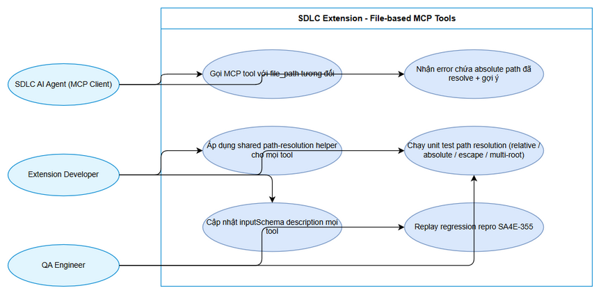
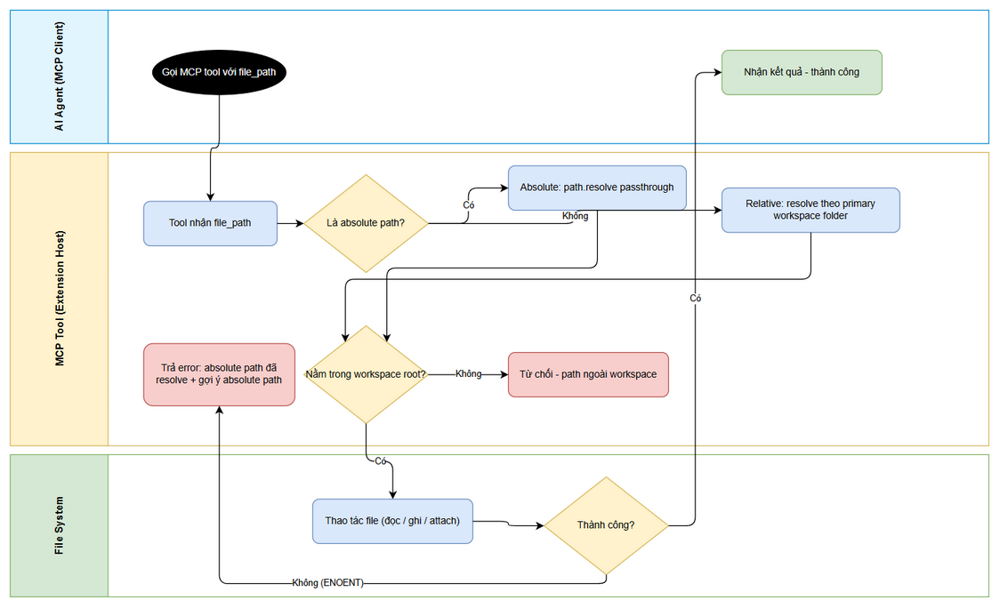

# Business Requirements Document (BRD)

## SA4E-356 — [Bug] MCP tools: relative file_path resolves against process CWD (Kiro install dir) instead of workspace root

---

## Document Information

| Field | Value |
|-------|-------|
| Jira Ticket | SA4E-356 |
| Title | [Bug] MCP tools: relative file_path resolves against process CWD (Kiro install dir) instead of workspace root |
| Author | BA Agent |
| Version | 1.0.2 |
| Date | 2026-10-12 |
| Status | Draft |
| Priority | High |
| Labels | bug, extension, mcp, path-resolution |
| Reporter | Duc Nguyen Minh |

---

## Author Tracking

| Role | Name - Position | Responsibility |
|------|-----------------|----------------|
| Author | BA Agent – Business Analyst | Tạo tài liệu |
| Peer Reviewer | Duc Nguyen Minh – Reporter / Requirements Owner | Rà soát và xác nhận tài liệu |

---

## Revision History

| Version | Date | Author | Changes |
|---------|------|--------|---------|
| 1.0 | 2026-10-12 | BA Agent | Khởi tạo tài liệu — tự động sinh từ Jira ticket SA4E-356 (bug được phát hiện khi thực hiện epic SA4E-355, tham chiếu KB lesson-learned #501) |
| 1.0.1 | 2026-10-12 | BA Agent | Ghi chú bổ sung §1.5 (BA ack cho DISC-1 trong SA DISCREPANCY report — FSD v1.2): behavior change có chủ đích ở nhánh fallback không-mở-workspace của shared helper (bỏ containment — absolute path ngoài `process.cwd()` được cho phép, error vẫn ghi rõ gốc fallback) được approve trong scope ticket như hệ quả trực tiếp của AC-1/AC-3. Không thay đổi cấu trúc hay nội dung yêu cầu. |
| 1.0.2 | 2026-10-12 | BA Agent | Ghi chú bổ sung §1.5 (BA ack cho N-BA2 trong TDD v1.2 §15.6 — FSD v1.3): behavior change thứ 2 ở nhánh fallback không-mở-workspace (BR-06b — relative path bị từ chối fail-loud `PATH_NO_WORKSPACE`, chỉ absolute passthrough) được approve trong scope ticket như hệ quả trực tiếp của AC-1/AC-3 + yêu cầu bảo mật SEC-02. Chỉ thêm ghi chú như v1.0.1, không thay đổi cấu trúc hay nội dung yêu cầu. |

---

## Sign-Off

| Name | Signature and date |
|------|--------------------|
| | ☐ Tôi đồng ý và xác nhận toàn bộ tiêu chí trong BRD này là yêu cầu kỳ vọng |
| | ☐ Tôi đồng ý và xác nhận toàn bộ tiêu chí trong BRD này là yêu cầu kỳ vọng |

---

## 1. Introduction

### 1.1 Problem Statement — Tuyên bố vấn đề

**Triệu chứng:** Khi AI agent (MCP client) gọi extension MCP tool nhận tham số `file_path` với đường dẫn **tương đối** (relative), tool resolve đường dẫn theo process CWD của MCP server — vốn là **thư mục cài Kiro** (`C:\Users\ASUS\AppData\Local\Programs\Kiro`) — thay vì workspace root của project đang mở. Kết quả: mọi file-based call với relative path fail với lỗi `ENOENT` (no such file or directory).

**Các bước tái hiện (đã verify 2026-10-11, trong phạm vi epic SA4E-355):**

```
Bước 1: Gọi jira_attach_file(issue_key="SA4E-355", file_path="documents/SA4E-355/FSD.md")
Bước 2: Kết quả — ENOENT: no such file or directory, open
        'C:\Users\ASUS\AppData\Local\Programs\Kiro\documents\SA4E-355\FSD.md'
Bước 3: Gọi lại với absolute path 'C:\projects\kiro\SDLC-Agents-4-Enterprise\documents\SA4E-355\FSD.md'
        → thành công (18/18 files)
```

**Business Impact — Ảnh hưởng nghiệp vụ (High):**

1. Agent tin theo tool description ("relative to workspace") nhưng runtime resolve theo process CWD → fail **toàn bộ** file-based MCP calls với relative path, buộc phải retry bằng absolute path — tốn thêm lượt gọi (token + latency) cho **mỗi** file operation.
2. Trong pipeline SDLC multi-agent (BA / SA / QA / DEV / DevOps), mỗi phase thực hiện hàng chục file-based calls (ingest BRD/FSD, export PNG, attach Jira...) → chi phí nhân lên và làm gián đoạn pipeline tự động ở mức autonomy L3.
3. Lỗi gây hiểu nhầm nghiêm trọng: agent có thể kết luận "file không tồn tại" trong khi file có thật — dẫn đến quyết định nghiệp vụ sai (ví dụ: QA bỏ qua kiểm tra artifact vì cho rằng artifact chưa được tạo).

**Bằng chứng bổ sung quan sát được trong phiên tạo BRD này (2026-10-12):**

- `stream_write_file` — tool đã resolve đúng theo workspace — lại **từ chối absolute path** `C:\projects\...` với lỗi "Path rejected: outside workspace", trong khi workspace folder fsPath mà extension trả về là `c:\projects\...` (drive letter viết thường). Nguyên nhân: containment check dùng `startsWith` **phân biệt hoa/thường**. Đây là bằng chứng cho thấy path comparison trong helper hiện tại chưa an toàn trên Windows (xem Risk R-1 và Story 1, test T6).

### 1.2 Root Cause — Nguyên nhân gốc (mức business)

MCP server wrapper chạy **trong Kiro extension host process**, nên `process.cwd()` của MCP server trỏ vào thư mục cài Kiro chứ không phải workspace. Các tool implementation hiện truyền `file_path` nguyên vẹn nhận từ agent thẳng vào `fs.*` — ví dụ `jira_attach_file` gọi `resolve(file_path)` không có đối số gốc (tức resolve theo `process.cwd()`), `embed_image` đọc trực tiếp `fs.readFileSync(filePath)`.

Ở góc độ nghiệp vụ, đây là **sự phá vỡ contract giữa tool và agent**: inputSchema / tool description hứa hẹn path "relative to workspace", nhưng runtime resolve theo một gốc đường dẫn khác (process CWD) mà agent không biết và không kiểm soát được. Một tool duy nhất (`stream_write_file`) đã implement đúng — resolve theo `vscode.workspace.workspaceFolders[0]` (primary workspace folder), fallback `process.cwd()`, absolute passthrough, chặn escape ngoài workspace root — nhưng logic này chưa được tách thành shared helper để tái sử dụng cho các tool còn lại.

### 1.3 Business Objectives — Mục tiêu nghiệp vụ

| # | Mục tiêu | Đo lường / Verification |
|---|---------|------------------------|
| BO-1 | File-based MCP calls với relative path thành công ngay lần đầu | Replay repro SA4E-355 attach thành công bằng relative path (AC-5) |
| BO-2 | Hành vi path resolution nhất quán trên 100% tool nhận file_path | Mọi tool trong audit list (mục 1.4) dùng chung một helper (AC-1, AC-3) |
| BO-3 | Lỗi (nếu còn) fail-loud và tự-sửa được: error chứa absolute path đã resolve + gợi ý | AC-2 |
| BO-4 | Contract tool-agent minh bạch: inputSchema description nêu rõ rule resolution | AC-4 |
| BO-5 | An toàn: chặn path escape (đọc/ghi file ngoài workspace root qua `../`) | Unit test T3 (AC-3) |

### 1.4 Scope — Phạm vi (audit danh sách tools)

Audit **TẤT CẢ** MCP tools nhận tham số `file_path`:

| # | Tool | Trạng thái | Vị trí code (extension repo) |
|---|------|-----------|------------------------------|
| 1 | `jira_attach_file` | 🔴 Đã confirm lỗi (repro SA4E-355) | `extension/src/mcp/atlassian/jira-attachment-tools.ts` — `resolve(file_path)` không gốc |
| 2 | `embed_image` | 🔴 Cần audit (code hiện đọc path trực tiếp) | `extension/src/backend-local-tools.ts` — `fs.readFileSync(filePath)` |
| 3 | `drawio_export_png` | 🔴 Cần audit | `extension/src/backend-local-tools.ts` (module drawio) |
| 4 | `drawio_auto_layout` | 🔴 Cần audit | `extension/src/backend-local-tools.ts` (module drawio) |
| 5 | `mem_ingest_file` | 🔴 Cần audit | `extension/src/backend-local-tools.ts` |
| 6 | `sandbox_run` | 🔴 Cần audit | `extension/src` (module sandbox) |
| 7 | `confluence_add_attachment` | 🔴 Cần audit | `extension/src/mcp/atlassian/` |
| 8 | `stream_write_file` | 🟢 Đã resolve ĐÚNG — pattern tham chiếu | `extension/src/backend-local-tools.ts` dòng 113–149 (`handleStreamWriteFile`) |

**Hướng fix:** tách path-resolution logic từ `handleStreamWriteFile` thành **shared helper** (resolve relative theo primary workspace folder; không mở workspace thì fallback `process.cwd()`; absolute passthrough; chặn escape ngoài workspace root) và áp dụng cho mọi tool còn lại trong bảng trên.

### 1.5 Out of Scope — Ngoài phạm vi

- Không thay đổi MCP tool signature / protocol (chỉ thay đổi resolution behavior nội bộ + description).
- Không sửa các tool KHÔNG nhận `file_path`.
- Không thay đổi hành vi resolution tổng thể của `stream_write_file` (đã đúng — chỉ dùng làm pattern tham chiếu). Lỗi case-sensitive quan sát được ở containment check (mục 1.1) được xử lý trong shared helper mới; việc refactor `stream_write_file` để dùng helper nằm trong scope, nhưng hành vi resolve tổng thể không đổi.
- *(Ghi chú v1.0.1 — BA ack cho DISC-1, 2026-10-12)* Ngoại lệ có chủ đích của dòng trên, đã được approve trong scope ticket: ở nhánh **không mở workspace** (fallback `process.cwd()` — edge case hiếm), shared helper theo FSD §6.3 / TDD v1.0 **không áp containment check** — absolute path ngoài `process.cwd()` hiện bị `stream_write_file` chặn ("Path rejected") sẽ được cho phép; error khi thao tác fail vẫn ghi rõ gốc fallback (AC-1). Behavior change này là hệ quả trực tiếp của AC-1/AC-3 (boundary theo thư mục cài Kiro là vô nghĩa về security và đang chặn oan path hợp lệ — xem FSD §6.3 Note DISC-1). Hành vi resolution tổng thể ở nhánh chính (có workspace) giữ nguyên.
- *(Ghi chú v1.0.2 — BA ack cho N-BA2/BR-06b, 2026-10-12)* Behavior change thứ 2 ở cùng nhánh fallback, đã được approve trong scope ticket: ở nhánh **không mở workspace**, shared helper theo FSD v1.3 §6.3 (Note BR-06b) / TDD v1.2 (SEC-02, AD-16) **từ chối relative path fail-loud** (`PATH_NO_WORKSPACE` — "no workspace open — use an absolute path inside the intended folder or open a workspace"); chỉ absolute path được passthrough (DISC-1 giữ nguyên). Behavior change này là hệ quả trực tiếp của AC-1/AC-3 (relative resolve vào thư mục cài Kiro vừa vô nghĩa vừa nguy hiểm — pollute install dir / EACCES) + yêu cầu bảo mật SEC-02 — xem FSD §6.3 Note BR-06b. Như v1.0.1, chỉ ghi nhận tại đây; hành vi resolution tổng thể ở nhánh chính (có workspace) giữ nguyên.
- Không xây dựng UI mới.
- Các MCP server chạy ngoài extension host process (child orchestrator): nếu audit phát hiện tool nằm ngoài extension host, ticket này chỉ ghi nhận kết quả audit; việc fix tool đó tách thành ticket riêng nếu cần.

### 1.6 Preliminary Requirements — Yêu cầu tiền đề

- Codebase extension truy cập được tại `extension/src/` (branch main).
- `vscode.workspace.workspaceFolders` API khả dụng trong extension host (đã verify qua `handleStreamWriteFile` đang chạy đúng).
- Môi trường regression: epic SA4E-355 với docs tại `documents/SA4E-355/` (đã tồn tại — dùng cho AC-5).
- Unit test framework (vitest) sẵn sàng trong extension repo.

---

## 2. Business Requirements

### 2.1 High Level Process Map

Quy trình nghiệp vụ cho một file-based MCP call **sau khi fix**: AI agent gọi tool với `file_path` (relative hoặc absolute) → shared helper chuẩn hóa path theo workspace root → kiểm tra an toàn (escape) → tool thực hiện thao tác file → trả kết quả. Nếu file không tồn tại, tool trả error chứa absolute path ĐÃ resolve kèm gợi ý, để agent tự sửa trong đúng 1 lượt retry.

Sơ đồ use case (actors và capabilities của hệ thống):


*[Edit in draw.io](diagrams/use-case.drawio)*

Sơ đồ luồng nghiệp vụ chi tiết (swimlane 3 bên: AI Agent — MCP Tool trong Extension Host — File System):


*[Edit in draw.io](diagrams/business-flow.drawio)*

### 2.2 List of User Stories

| # | Story / Use Case | Priority | Source Ticket |
|---|------------------|----------|---------------|
| 1 | As an SDLC AI Agent (MCP client), I want mọi file-based MCP tool resolve relative `file_path` theo workspace root so that lượt gọi với đường dẫn tương đối thành công ngay lần đầu, không phải retry bằng absolute path | MUST HAVE | SA4E-356 (AC-1) |
| 2 | As an SDLC AI Agent (MCP client), I want error khi file không tồn tại phải in absolute path ĐÃ resolve kèm gợi ý dùng absolute path so that tôi tự sửa lỗi trong đúng 1 lượt retry | MUST HAVE | SA4E-356 (AC-2) |
| 3 | As an Extension Developer, I want path-resolution logic từ `handleStreamWriteFile` được tách thành shared helper có unit test đầy đủ so that mọi tool dùng chung một hành vi nhất quán, đã kiểm chứng | MUST HAVE | SA4E-356 (AC-1, AC-3) |
| 4 | As an SDLC AI Agent (MCP client), I want inputSchema description của mọi tool nêu rõ rule path resolution so that tôi biết chính xác cách `file_path` được interpret và tin tưởng dùng relative path | MUST HAVE | SA4E-356 (AC-4) |
| 5 | As a QA Engineer, I want replay đúng repro gốc trên epic SA4E-355 với relative path so that fix được xác minh chống lại kịch bản lỗi ban đầu | MUST HAVE | SA4E-356 (AC-5) |

---

### 2.3 Details of User Stories

---

#### Business Flow

**Step 1:** AI agent (MCP client — các SDLC agent BA / SA / QA / DEV / DevOps) gọi một file-based MCP tool (ví dụ `jira_attach_file`) với tham số `file_path` (relative, ví dụ `documents/SA4E-355/FSD.md`).

**Step 2:** Tool (trong extension host) nhận `file_path` và truyền qua shared path-resolution helper.

**Step 3:** Helper kiểm tra: nếu là absolute path → passthrough (`path.resolve(rawPath)`). Nếu là relative path → resolve theo **primary workspace folder** (`vscode.workspace.workspaceFolders[0].uri.fsPath`); nếu không mở workspace → fallback `process.cwd()` và phải ghi rõ gốc fallback trong error message khi thất bại.

**Step 4:** Helper kiểm tra an toàn: normalized path phải nằm trong workspace root (so sánh case-insensitive trên Windows). Path escape (`../` ra ngoài workspace root, hoặc absolute path trỏ ra ngoài workspace root) → bị chặn với error rõ ràng.

**Step 5:** Tool thực hiện thao tác file với resolved absolute path (đọc / ghi / attach / export...).

**Step 6:** Nếu thao tác fail (ví dụ file không tồn tại) → tool trả error chứa: (a) absolute path ĐÃ resolve, (b) gốc resolve đã dùng (workspace root hay `process.cwd()` fallback), (c) gợi ý dùng absolute path.

**Step 7:** Agent nhận kết quả: thành công ngay lần gọi đầu (không cần retry), hoặc tự sửa bằng đúng 1 lượt retry theo gợi ý trong error.

> **Note:** Trước fix, Step 3 resolve theo process CWD (thư mục cài Kiro) → ENOENT tại Step 5, và error tại Step 6 không cho biết path đã resolve sai gốc → agent phải đoán mò. Sau fix, toàn bộ file-based calls dùng được relative path đúng như tool description đã hứa.

---

#### STORY 1: Path resolution theo workspace root cho mọi file-based MCP tool

> As an SDLC AI Agent (MCP client), I want mọi file-based MCP tool resolve relative `file_path` theo workspace root so that lượt gọi với đường dẫn tương đối thành công ngay lần đầu, không phải retry bằng absolute path.

**Requirement Details:**

1. Audit toàn bộ MCP tools nhận `file_path` theo bảng mục 1.4: `jira_attach_file`, `embed_image`, `drawio_export_png`, `drawio_auto_layout`, `mem_ingest_file`, `sandbox_run`, `confluence_add_attachment`.
2. Relative path phải resolve theo **primary workspace folder** (`vscode.workspace.workspaceFolders[0].uri.fsPath`) — đúng pattern `handleStreamWriteFile` (extension/src/backend-local-tools.ts dòng 113–149).
3. Multi-root workspace: deterministic — luôn dùng primary workspace folder (folder đầu tiên); rule này phải được ghi rõ trong inputSchema description (Story 4).
4. Không mở workspace: fallback `process.cwd()` — khi thao tác fail, error phải nêu rõ path đã resolve theo fallback root nào.
5. Absolute path: passthrough không đổi (backward compatibility — repro SA4E-355 đã thành công 18/18 với absolute path).
6. Containment check (chặn escape) phải so sánh **case-insensitive trên Windows** — quan sát thực tế 2026-10-12: workspace folder fsPath trả về `c:\projects\...` (drive thường) trong khi absolute path caller dùng `C:\projects\...` → path hợp lệ bị reject oan với check `startsWith` phân biệt hoa/thường.

**Data Fields:**

| Field | Type | Required | Description | Example |
|-------|------|----------|-------------|---------|
| file_path | string | Yes | Đường dẫn do agent truyền (relative hoặc absolute) | `documents/SA4E-355/FSD.md` |
| workspace_root | string (computed) | No | Primary workspace folder làm gốc resolve | `C:\projects\kiro\SDLC-Agents-4-Enterprise` |
| resolved_path | string (computed) | No | Absolute path sau resolve — dùng cho mọi fs.* call và error message | `C:\projects\kiro\SDLC-Agents-4-Enterprise\documents\SA4E-355\FSD.md` |

**Acceptance Criteria:**

1. **(AC-1)** Mọi tool nhận `file_path` resolve relative path theo workspace root — không còn resolve theo process CWD (thư mục cài Kiro).
2. **(AC-1)** Multi-root workspace: dùng primary workspace folder; nếu không xác định được workspace (không mở folder) → hành vi fallback được ghi rõ trong error message khi fail.

**UI Specifications:** N/A (backend tool behavior — không có UI).

**Validation Rules:**

- Relative path `documents/SA4E-355/FSD.md` phải resolve thành `<workspace_root>\documents\SA4E-355\FSD.md`.
- Absolute path phải passthrough nguyên vẹn (kể cả drive letter viết hoa hoặc viết thường).
- Tool signature (tên tool, tên tham số, required) không đổi.

**Error Handling:**

- Không mở workspace và thao tác fail: error nêu rõ "resolved against process.cwd() fallback = <path>" để agent chẩn đoán chính xác.

---

#### STORY 2: Error message tự-sửa (self-correcting error)

> As an SDLC AI Agent (MCP client), I want error khi file không tồn tại phải in absolute path ĐÃ resolve kèm gợi ý dùng absolute path so that tôi tự sửa lỗi trong đúng 1 lượt retry.

**Requirement Details:**

1. Mọi error do file không tồn tại (ENOENT) hoặc path bị chặn phải chứa: (a) **absolute path ĐÃ resolve** (không phải raw path agent truyền vào), (b) gốc resolve đã dùng, (c) gợi ý action tiếp theo.
2. Format gợi ý: dùng absolute path nằm trong workspace root, hoặc kiểm tra lại đường dẫn tương đối tính từ workspace root.
3. Error phải fail-loud (`isError: true`) — không nuốt lỗi âm thầm.

**Acceptance Criteria:**

1. **(AC-2)** Error khi file không tồn tại in absolute path ĐÃ resolve + gợi ý dùng absolute path.

**UI Specifications:** N/A

**Validation Rules:**

- Unit test assert error message chứa chuỗi absolute path đầy đủ đã resolve.

**Error Handling:**

- ENOENT: "File not found: <resolved_absolute_path>. Resolved against <workspace_root | process.cwd() fallback>. Gợi ý: dùng absolute path (nằm trong workspace root) hoặc kiểm tra lại đường dẫn tương đối tính từ workspace root."
- Path escape bị chặn: "Path rejected: <raw_path> resolves to <resolved_path> — outside workspace root <workspace_root>."

---

#### STORY 3: Shared path-resolution helper + unit tests

> As an Extension Developer, I want path-resolution logic từ `handleStreamWriteFile` được tách thành shared helper có unit test đầy đủ so that mọi tool dùng chung một hành vi nhất quán, đã kiểm chứng.

**Requirement Details:**

1. Tách logic resolve từ `handleStreamWriteFile` (extension/src/backend-local-tools.ts dòng 113–149) thành shared helper (ví dụ `resolveWorkspacePath(rawPath)`), tái sử dụng cho mọi tool trong bảng audit mục 1.4.
2. Unit tests (vitest) bắt buộc cho các case:

| # | Test case | Kỳ vọng |
|---|-----------|---------|
| T1 | Relative path | Resolve thành `<workspace_root>\<relative>` |
| T2 | Absolute path | Passthrough (`path.resolve(rawPath)`) |
| T3 | `../` escape ra ngoài workspace root | Bị chặn — error "outside workspace" |
| T4 | Multi-root workspace (2+ folders) | Dùng primary folder (folder đầu tiên) |
| T5 | Không mở workspace | Fallback `process.cwd()` — hành vi ghi rõ trong error khi fail |
| T6 | Drive letter hoa/thường khác nhau (`C:\` vs `c:\`) | Path hợp lệ KHÔNG bị reject (case-insensitive trên Windows) |

3. Mỗi tool trong audit list có tối thiểu 1 integration test: gọi tool với relative path trỏ tới file thật trong workspace.

**Acceptance Criteria:**

1. **(AC-3)** Unit tests cho path resolution pass: relative, absolute, `../` escape bị chặn, multi-root.

**UI Specifications:** N/A

**Validation Rules:**

- Shared helper là single source of truth — không tool nào tự gọi `resolve(file_path)` / `fs.*` với raw path chưa resolve.

**Error Handling:**

- Helper trả error có cấu trúc (isError + message chứa resolved path) — tool phải forward nguyên vẹn, không nuốt lỗi.

---

#### STORY 4: Cập nhật inputSchema description

> As an SDLC AI Agent (MCP client), I want inputSchema description của mọi tool nêu rõ rule path resolution so that tôi biết chính xác cách `file_path` được interpret và tin tưởng dùng relative path.

**Requirement Details:**

1. Mọi tool trong audit list cập nhật `inputSchema.properties.file_path.description` với rule chuẩn, ví dụ: "Relative paths resolve against the primary workspace folder; absolute paths pass through; paths outside the workspace root are rejected."
2. Các tham số đường dẫn khác (`output_path` nếu có) áp dụng cùng rule.
3. Không đổi type / required của schema — chỉ enrich description.

**Acceptance Criteria:**

1. **(AC-4)** InputSchema description của 100% tool trong audit list nêu rõ rule resolution.

**UI Specifications:** N/A

**Validation Rules:**

- Có unit test / scan assert mọi tool nhận `file_path` đều có description chứa rule resolution (từ khóa "workspace").

**Error Handling:** N/A

---

#### STORY 5: Regression — replay repro gốc trên SA4E-355

> As a QA Engineer, I want replay đúng repro gốc trên epic SA4E-355 với relative path so that fix được xác minh chống lại kịch bản lỗi ban đầu.

**Requirement Details:**

1. Replay đúng repro: `jira_attach_file(issue_key="SA4E-355", file_path="documents/SA4E-355/FSD.md")` — với relative path, KHÔNG dùng absolute path.
2. Kỳ vọng: attach thành công (trước đây ENOENT; absolute path từng thành công 18/18 files).
3. Mở rộng regression: mỗi tool khác trong audit list tối thiểu 1 call với relative path trỏ tới file thật trong workspace (ví dụ `embed_image`, `mem_ingest_file`, `drawio_export_png`).

**Acceptance Criteria:**

1. **(AC-5)** Repro trên SA4E-355 với relative path → attach thành công (18/18 files như absolute path).

**UI Specifications:** N/A

**Validation Rules:**

- Regression phải chạy trên extension host thật (Kiro), không chỉ unit test với mock.

**Error Handling:**

- Nếu regression fail → ticket không được close; quay lại audit helper và các tool liên quan.

---

## 3. Dependencies

| Dependency | Type | Related Ticket | Description |
|------------|------|----------------|-------------|
| Epic SA4E-355 | Epic | SA4E-355 | Bug được phát hiện khi thực hiện epic; môi trường regression (docs tại documents/SA4E-355/) và KB lesson-learned #501 đến từ epic này |
| Kiro Extension Host | Infrastructure | N/A | `vscode.workspace` API — nguồn primary workspace folder cho path resolution |
| Extension repo (branch main) | System | SA4E-356 | `extension/src/backend-local-tools.ts`, `extension/src/mcp/atlassian/jira-attachment-tools.ts` và các module tool khác |
| KB lesson-learned #501 | External | SA4E-355 | Ghi nhận bug + workaround (dùng absolute path) — tham chiếu cho BA / DEV / QA |
| vitest test framework | System | N/A | Chạy unit tests path resolution (AC-3) |

---

## 4. Stakeholders

| Role | Name / Team | Responsibility | Source |
|------|-------------|----------------|--------|
| Reporter | Duc Nguyen Minh | Requirements owner — báo cáo bug, verify fix | SA4E-356 |
| BA Agent | BA Agent | Tác giả BRD — phân tích requirement | SA4E-356 |
| DEV Agent (Extension Developer) | DEV team | Implement shared helper + áp dụng cho tools + unit tests | SA4E-356 (Story 1, 3, 4) |
| QA Agent | QA team | Regression replay SA4E-355 (AC-5), review test coverage | SA4E-356 (Story 5) |
| SDLC Pipeline Agents (end users) | BA / SA / QA / DEV / DevOps agents | Người dùng trực tiếp của các file-based MCP tools — hưởng lợi từ fix | SA4E-355, SA4E-356 |

---

## 5. Risks and Assumptions

### 5.1 Risks

| # | Risk | Impact | Likelihood | Mitigation |
|---|------|--------|------------|------------|
| R-1 | Containment check case-sensitive trên Windows: workspace fsPath có thể trả drive letter thường (`c:\`) trong khi caller dùng `C:\` → absolute path hợp lệ bị reject oan (ĐÃ quan sát thực tế 2026-10-12 khi tạo BRD này) | High | High | Shared helper so sánh case-insensitive trên Windows; unit test T6 bắt buộc (Story 3) |
| R-2 | Một số tool chạy ngoài extension host (child MCP server) không truy cập được `vscode.workspace` → không áp dụng được helper | Medium | Medium | Audit xác định vị trí process của từng tool; tool ngoài extension host → tách ticket follow-up |
| R-3 | Multi-root workspace: agent muốn file ở folder thứ 2+ nhưng helper luôn dùng primary folder | Medium | Medium | Error message khi fail gợi ý absolute path; rule "primary folder" ghi rõ trong inputSchema (AC-4) |
| R-4 | Chặn escape có thể từ chối use case hợp lệ (absolute path ra ngoài workspace root, ví dụ temp dir) | Medium | Low | Giữ nhất quán với `stream_write_file` (đã chặn từ trước); nếu cần ngoại lệ → ticket riêng kèm security review |
| R-5 | Fix thay đổi hành vi các caller đang workaround bằng absolute path | Low | Low | Absolute path passthrough không đổi — backward compatible |
| R-6 | Chicken-and-egg: chính các tool drawio_* / mem_ingest_file dùng để sản xuất tài liệu cho ticket này đang bị bug | Medium | High | Workaround tạm (absolute path) theo lưu ý của SM; sau khi AC-5 đạt thì không còn cần |

### 5.2 Assumptions

- Extension host luôn có `vscode.workspace.workspaceFolders` khi agent làm việc trong project đang mở.
- "Primary workspace folder" = folder đầu tiên trong `workspaceFolders` (convention VS Code / Kiro) — đúng như `handleStreamWriteFile` đang dùng.
- Tất cả tool trong audit list chạy trong extension host process (cần confirm khi audit — xem R-2).
- `stream_write_file` là pattern tham chiếu ổn định cho resolution logic (riêng containment check cần sửa case-insensitive — R-1).
- Agent (MCP client) đọc inputSchema description trước khi gọi tool (giả định của MCP protocol).

---

## 6. Non-Functional Requirements

| Category | Requirement | Details |
|----------|-------------|---------|
| Security | Path escape prevention | `../` escape và absolute path ra ngoài workspace root bị chặn — chống arbitrary file read/write qua MCP tool (attack surface của LLM agent) |
| Security | Fail-loud errors | Không nuốt lỗi âm thầm; mọi failure trả isError + message actionable |
| Backward Compatibility | Absolute path vẫn hoạt động | Passthrough không đổi — repro SA4E-355 absolute path (18/18) không bị break |
| Backward Compatibility | Tool signature không đổi | Không thêm param bắt buộc; caller hiện tại không phải sửa cách gọi |
| Compatibility | Multi-root workspace | Deterministic: luôn primary workspace folder; rule được ghi trong description + error message |
| Compatibility | Windows case-insensitivity | So sánh path case-insensitive trên Windows (drive letter hoa/thường) — chống reject oan path hợp lệ |
| Performance | Không tăng đáng kể độ trễ | Path resolution là string operation (path.resolve / normalize) — không thêm I/O |
| Performance | Giảm tổng lượt gọi của pipeline | Loại bỏ retry-to-absolute-path cho mỗi file operation (hiệu quả nghiệp vụ) |
| Reliability | Nhất quán 100% tool | Single shared helper — không có tool nào "quên" resolve |

---

## 7. Related Tickets

| Ticket Key | Summary | Status | Type | Relationship |
|------------|---------|--------|------|--------------|
| SA4E-356 | [Bug] MCP tools: relative file_path resolves against process CWD (Kiro install dir) instead of workspace root | In Progress | Bug | Main ticket |
| SA4E-355 | Implement Context Budget Governance for Pi Harness | In Progress | Epic | Epic chứa — bug được phát hiện khi thực hiện epic; môi trường regression cho AC-5 |

---

## 8. Appendix

### Glossary

| Term | Definition |
|------|------------|
| MCP Tool | Hàm nghiệp vụ do extension MCP server expose cho AI agent gọi qua Model Context Protocol (ví dụ: `jira_attach_file`, `embed_image`, `mem_ingest_file`). Tool có inputSchema (JSON) và trả về text/result. |
| Workspace Root | Thư mục gốc của project đang mở trong Kiro / VS Code (`vscode.workspace.workspaceFolders`) — gốc chuẩn để resolve relative `file_path` trong SA4E extension. |
| Primary Workspace Folder | Folder đầu tiên trong `vscode.workspace.workspaceFolders` — được chọn deterministic làm gốc resolve trong multi-root workspace (pattern `handleStreamWriteFile`). |
| Extension Host | Process riêng của Kiro / VS Code chạy extension code, nơi MCP server wrapper chạy; `process.cwd()` của nó trỏ vào thư mục cài Kiro — nguồn gốc của bug SA4E-356. |
| Path Resolution | Quy trình chuẩn hóa `file_path` do agent truyền (relative / absolute) thành absolute path cuối cùng trước khi gọi `fs.*`: absolute passthrough, relative resolve theo primary workspace folder, escape bị chặn. |
| Path Escape | Relative path dùng `../` (hoặc absolute path) trỏ ra ngoài workspace root — bị chặn để chống arbitrary file read/write qua MCP tool. |
| Process CWD | Working directory của process MCP server (extension host) — hiện là thư mục cài Kiro, KHÔNG phải workspace root; là gốc resolve sai gây ENOENT trong bug SA4E-356. |
| ENOENT | Mã lỗi Node.js fs ("no such file or directory") — triệu chứng khi tool resolve path sai gốc (process CWD thay vì workspace root). |

### Reference Documents

| Document | Link / Location |
|----------|-----------------|
| Jira Ticket | SA4E-356 |
| Epic SA4E-355 docs (môi trường regression) | documents/SA4E-355/ (BRD.md, FSD.md, TDD.md) |
| Pattern tham chiếu (resolve đúng) | extension/src/backend-local-tools.ts — `handleStreamWriteFile` (dòng 113–149) |
| Tool bị lỗi confirmed | extension/src/mcp/atlassian/jira-attachment-tools.ts — `jira_attach_file` |
| KB lesson-learned | KB entry #501 (nguồn SA4E-355) — same bug + workaround absolute path |

### Diagram Index

| # | Diagram | Image | Source (editable) |
|---|---------|-------|-------------------|
| 1 | Use Case Diagram | [use-case.png](diagrams/use-case.png) | [use-case.drawio](diagrams/use-case.drawio) |
| 2 | Business Flow (Swimlane) | [business-flow.png](diagrams/business-flow.png) | [business-flow.drawio](diagrams/business-flow.drawio) |
