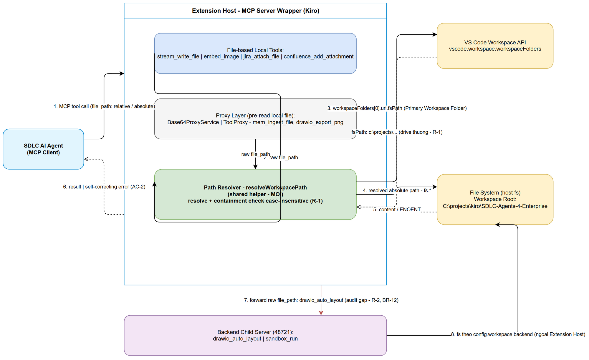
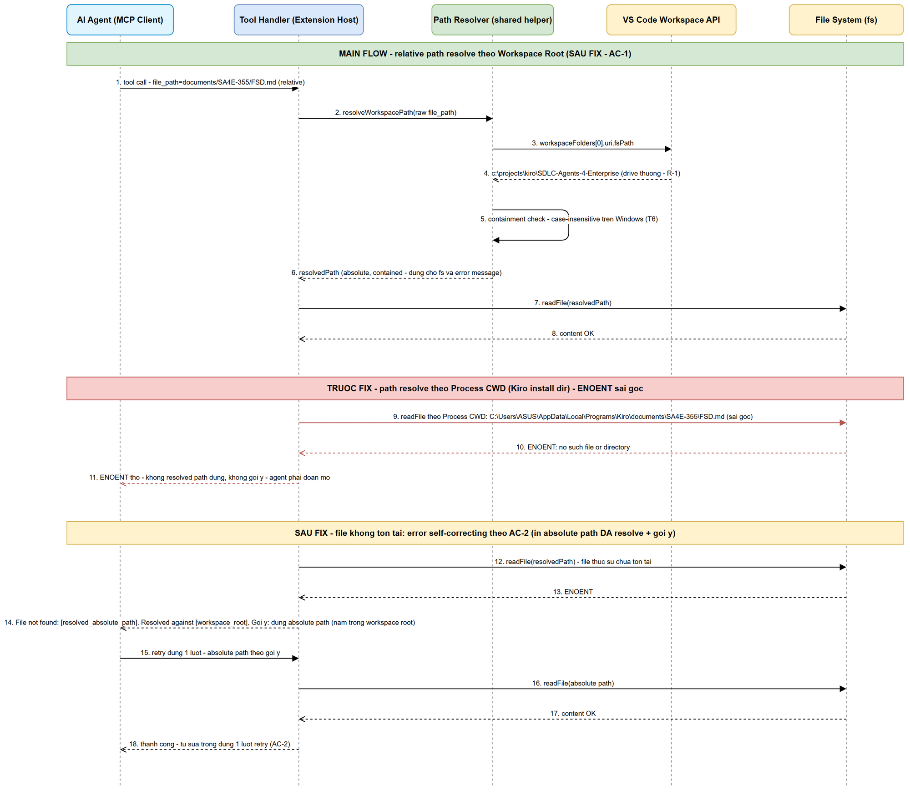
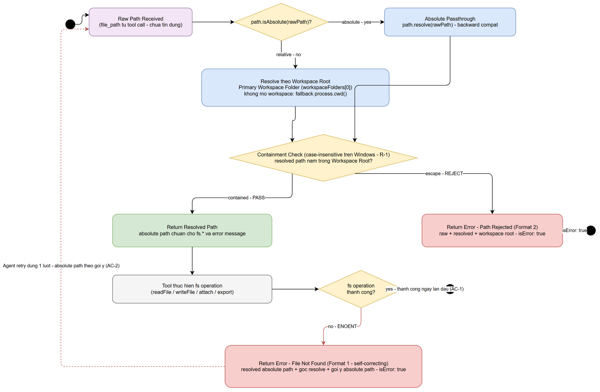

# Functional Specification Document (FSD)

## SA4E — SA4E-356: [Bug] MCP tools: relative file_path resolves against process CWD (Kiro install dir) instead of workspace root

---

## Document Information

| Field | Value |
|-------|-------|
| Jira Ticket | SA4E-356 |
| Title | [Bug] MCP tools: relative file_path resolves against process CWD (Kiro install dir) instead of workspace root |
| Author | BA Agent (v1.0) + TA Agent (v1.1 technical enrichment) + BA Agent (v1.2 — SA discrepancy fixes) + BA Agent (v1.3 — TDD v1.2 security sync) |
| Version | 1.3 (TDD v1.2 Security Review sync — N-BA1: §5.5 row 2 SEC-01 clarify; N-BA2: BR-06b ack; N-BA3: codes + Format 3 + N-9) |
| Date | 2026-10-12 |
| Status | Revised — TDD v1.2 notes N-BA1..N-BA3 đã sync theo SA TDD v1.2 §15.6; chờ SA re-review |
| Priority | High |
| Labels | bug, extension, mcp, path-resolution |
| Related BRD | documents/SA4E-356/BRD.md |

---

## Revision History

| Version | Date | Author | Changes |
|---------|------|--------|---------|
| 1.0 | 2026-10-12 | BA Agent | Initiate draft — business sections: Functional Requirements (FR-01..FR-11), Use Cases (UC-01..UC-05), Business Rules (BR-01..BR-12), bảng audit 8 tools (data specs), error handling theo AC-2, traceability matrix AC ↔ FR ↔ UC, 3 diagram (system-context, sequence, state). Kết quả audit code mở rộng từ BRD scope table. Chờ TA enrich API contracts + technical depth (xem §11.3). |
| 1.1 | 2026-10-12 | TA Agent | TA enrichment: API contract kỹ thuật của shared helper (§3.1.6 — TS signature, module placement, vscode injection pattern), bổ sung Alternative/Exception flows cho UC-01..05, integration specs chi tiết (§5.5–5.6), pseudocode path resolution + case-insensitive containment (§6.3–6.5), schema rewrite merge rule (§3.2.2), error envelope codes (§9.3), NFR quantified (§8), architecture decisions cho 6 gaps §11.3 (đặc biệt gap #3 — drawio_auto_layout: error-message fix in-scope + follow-up ticket theo hướng proxy-route), open issues (§11.5). Đã verify lại 100% bảng audit §3.1.4 trực tiếp từ source code. |
| 1.2 | 2026-10-12 | BA Agent | Feedback loop iter 1 — fix theo SA DISCREPANCY.md v1 (thiết kế KHÔNG đổi — SA giữ nguyên theo TDD v1.0). **DISC-1 (Medium)**: §6.3 — bỏ claim sai "giữ hành vi hiện tại line 131" (fact verify: dòng 124 `workspaceRoot ?? process.cwd()` chạy TRƯỚC dòng 131 check → containment hiện tại LUÔN áp kể cả nhánh fallback); ghi nhận behavior change có chủ đích ở nhánh `cwd_fallback` (không containment) + BA ack approved trong scope (hệ quả trực tiếp AC-1/AC-3) — xem §6.3 Note DISC-1; đồng bộ FR-05, FR-06, BR-05, T5 (§10.1), audit row 1 (§3.1.4), wiring row 1 (§5.5); BRD §1.5 thêm ghi chú (BRD v1.0.1). **DISC-2 (Low)**: M-2 (§3.2.2) — description `output_path` bổ sung nhánh `.out` của `resolveOutputPath` (non-.drawio input → nối thêm `.out`) cho khớp code 100% (Base64ProxyService.ts:183–184); làm rõ default `<name>-embedded.md` của embed_image (static schema) trong bảng description baseline. |
| 1.3 | 2026-10-12 | BA Agent | TDD v1.2 Security Review sync (theo TDD §15.6 notes N-BA1..N-BA3; thiết kế do SA chốt trong TDD v1.2 — BA chỉ clarify/ack/đồng bộ, KHÔNG đổi thiết kế). **N-BA1 (SEC-01):** §5.5 row 2 — sửa câu "Image refs KHÔNG qua helper (giữ hành vi hiện có)" (mô tả lỗ hổng như tính năng) thành spec containment từng image ref: mỗi ref sau `path.resolve(baseDir, decodeURI(src))` PHẢI qua `isPathWithinRoot(root, abs)` — ngoài root → `skipped++`, giữ nguyên `match` (fail-closed, KHÔNG throw) — theo TDD v1.2 §5.4.1/AD-15. **N-BA2 (SEC-02):** thêm business rule **BR-06b** — khi `rootSource === "cwd_fallback"`, relative path bị từ chối fail-loud (`PATH_NO_WORKSPACE`), chỉ absolute passthrough (DISC-1 giữ nguyên) — behavior change thứ 2 ở nhánh fallback, BA ack approved trong scope (hệ quả AC-1/AC-3 + SEC-02 — xem §6.3 Note BR-06b); đồng bộ FR-05, FR-06, UC-01 AF-1, §3.1.6.1, §6.1 Step 3, traceability AC-1, T5/T5b (§10.1); BRD §1.5 thêm ghi chú (BRD v1.0.2). **N-BA3:** đồng bộ codes SA-added `PATH_INVALID` (NUL byte, Step 1) + `PATH_NO_WORKSPACE` (Step 2b) và **Format 3** vào §9.2/§9.3 (chỉ thêm — Format 1/2 không đổi, theo E-2), NFR mới **N-9** (payload limits 10 MB content / 25 MB pre-read) vào §8.1. |

---

## 1. Introduction

### 1.1 Purpose

FSD này đặc tả hành vi chức năng của việc sửa bug SA4E-356: chuẩn hóa **Path Resolution** cho toàn bộ MCP Tool nhận tham số đường dẫn trong SA4E extension, thông qua một **shared helper duy nhất** (Path Resolver) thay cho 4 điểm resolve rải rác hiện nay. Tài liệu dịch BRD v1 (AC-1..AC-5) thành các yêu cầu chức năng chi tiết (FR), use case với luồng chính/biện thể/ngoại lệ (UC), business rules (BR), bảng audit hiện trạng từng tool, và format error message tự-sửa theo AC-2.

**Vấn đề nghiệp vụ being solved:** AI agent (MCP client) gọi extension MCP Tool với đường dẫn tương đối (relative) → tool resolve theo Process CWD (thư mục cài Kiro) thay vì Workspace Root → lỗi ENOENT, buộc retry bằng absolute path cho MỌI file operation — phá vỡ contract tool-agent và làm gián đoạn pipeline SDLC ở mức autonomy L3.

### 1.2 Scope

**In scope** (theo BRD §1.4, đã audit code chi tiết — xem bảng audit §3.1.4):

1. Xây dựng shared path-resolution helper (Path Resolver) — hợp nhất logic resolve từ 3 điểm hiện có trong Extension Host (`handleStreamWriteFile`, `ToolProxy.resolveWorkspacePath`, `Base64ProxyService.resolvePath`) + sửa containment check case-insensitive (R-1).
2. Áp dụng helper cho 6 tool chạy trong Extension Host: `stream_write_file` (refactor, hành vi tổng thể không đổi), `embed_image`, `jira_attach_file`, `confluence_add_attachment`, `mem_ingest_file` (2 đường gọi), `drawio_export_png` (qua Base64ProxyService).
3. Chuẩn hóa error message tự-sửa theo AC-2 (Format 1 / Format 2 / Format 3 no-workspace — xem §9).
4. Enrich inputSchema description cho 100% tool trong audit list (AC-4).
5. Unit tests T1–T6 + integration test mỗi tool + regression replay repro SA4E-355 (AC-3, AC-5).

**Out of scope** (theo BRD §1.5):

- `drawio_auto_layout`: tool resolve phía backend child server (ngoài Extension Host) — kết quả audit ghi nhận tại §3.1.4; việc fix tách ticket riêng theo BRD R-2 (trừ yêu cầu tối thiểu: error message phải fail-loud và đúng ngữ nghĩa).
- `sandbox_run`: kết luận audit — path là sandbox-internal, không bị ảnh hưởng (§3.1.4).
- Không thay đổi MCP tool signature / protocol; không sửa tool không nhận `file_path`; không xây UI mới.

### 1.3 Definitions & Acronyms

| Term | Definition |
|------|------------|
| MCP Tool | Hàm nghiệp vụ do extension MCP server expose cho AI agent gọi qua Model Context Protocol (ví dụ: `jira_attach_file`, `embed_image`, `mem_ingest_file`). Tool có inputSchema (JSON) và trả về text/result. |
| Workspace Root | Thư mục gốc của project đang mở trong Kiro / VS Code (`vscode.workspace.workspaceFolders`) — gốc chuẩn để resolve relative `file_path` trong SA4E extension. |
| Primary Workspace Folder | Folder đầu tiên trong `vscode.workspace.workspaceFolders` — được chọn deterministic làm gốc resolve trong multi-root workspace (pattern `handleStreamWriteFile`). |
| Extension Host | Process riêng của Kiro / VS Code chạy extension code, nơi MCP server wrapper chạy; `process.cwd()` của nó trỏ vào thư mục cài Kiro — nguồn gốc của bug SA4E-356. |
| Path Resolution | Quy trình chuẩn hóa `file_path` do agent truyền (relative / absolute) thành absolute path cuối cùng trước khi gọi `fs.*`: absolute passthrough, relative resolve theo Primary Workspace Folder, escape bị chặn. |
| Path Escape | Relative path dùng `../` (hoặc absolute path) trỏ ra ngoài Workspace Root — bị chặn để chống arbitrary file read/write qua MCP tool. |
| Process CWD | Working directory của process MCP server (Extension Host) — hiện là thư mục cài Kiro, KHÔNG phải Workspace Root; là gốc resolve sai gây ENOENT trong bug SA4E-356. |
| ENOENT | Mã lỗi Node.js fs ("no such file or directory") — triệu chứng khi tool resolve path sai gốc (Process CWD thay vì Workspace Root). |

### 1.4 References

| Document | Location |
|----------|----------|
| BRD SA4E-356 (v1.0.2) | documents/SA4E-356/BRD.md (KB entry #510) |
| Jira ticket | SA4E-356 (Bug, Priority High) — epic SA4E-355 |
| KB lesson-learned | KB entry #501 (SA4E-355) — same bug + workaround absolute path |
| Pattern tham chiếu (resolve đúng) | extension/src/backend-local-tools.ts — `handleStreamWriteFile` (dòng 113–149) |
| Tool bị lỗi confirmed | extension/src/mcp/atlassian/jira-attachment-tools.ts — `jira_attach_file` (dòng 21) |
| Audit code chi tiết | Xem §3.1.4 — bảng audit 8 tools với vị trí code đã verify 2026-10-12 |
| Môi trường regression | documents/SA4E-355/ (BRD.md, FSD.md, TDD.md) |

---

## 2. System Overview

### 2.1 System Context Diagram



*[Edit in draw.io](diagrams/system-context.drawio)*

AI Agent (MCP client) gọi extension MCP Tool với tham số `file_path` (relative hoặc absolute) qua MCP protocol. Tool chạy trong **Extension Host** (MCP server wrapper) hoặc được forward xuống **Backend Child Server**. Sau fix, mọi tool trong Extension Host phải đưa raw path qua **Path Resolver** (shared helper mới) trước khi chạm File System. Path Resolver lấy Primary Workspace Folder từ **VS Code Workspace API** (`vscode.workspace.workspaceFolders[0].uri.fsPath`), thực hiện containment check case-insensitive, và chỉ trả về resolved absolute path nằm trong Workspace Root. Tool ngoài Extension Host (`drawio_auto_layout`, `sandbox_run`) được đánh dấu là audit gap — xử lý theo BR-12.

### 2.2 System Architecture (hiện trạng — 4 điểm resolve rải rác)

Kiến trúc hiện tại: **LLM → Extension (MCP wrapper, port 9181) → Backend (child server, port 48721)**. Path resolution đang bị phân mảnh tại 4 điểm, không điểm nào đầy đủ:

| # | Điểm resolve | Vị trí code (verified 2026-10-12) | Hành vi | Thiếu sót |
|---|--------------|-----------------------------------|---------|-----------|
| 1 | `handleStreamWriteFile` | extension/src/backend-local-tools.ts:113–149 | Workspace Root → fallback Process CWD; absolute passthrough; containment check | Containment dùng `startsWith` **phân biệt hoa/thường** (R-1: từ chối `C:\` khi fsPath là `c:\`); logic gắn cứng trong tool, không tái sử dụng |
| 2 | `ToolProxy.resolveWorkspacePath` | extension/src/proxy/ToolProxy.ts:62–66 | Absolute passthrough; relative → Primary Workspace Folder; không mở workspace → trả raw path | Chỉ áp cho `mem_ingest_file` (đường chat); KHÔNG có containment check |
| 3 | `Base64ProxyService.resolvePath` | extension/src/services/Base64ProxyService.ts:135–138 | Absolute passthrough; relative → `workspaceRoot ?? process.cwd()` | KHÔNG có containment check; phụ thuộc constructor nhận workspaceRoot (được truyền tại remote-backend-client.ts:62) |
| 4 | `resolveFilePath` (backend) | backend/src/engine/tools/drawio-tool.ts:59–71 | Relative theo `config.workspace` của backend; containment case-sensitive → trả `null` | Chạy NGOÀI Extension Host; error "file_path is required" sai ngữ nghĩa (không phân biệt path escape với missing param) |

Ngoài ra 3 tool **không resolve gì** và truyền raw path thẳng vào `fs.*` (resolve ngầm theo Process CWD): `embed_image`, `jira_attach_file`, `confluence_add_attachment`.

**Hướng fix theo FSD:** hợp nhất điểm 1 + 2 + 3 thành **một shared helper** (Path Resolver —FR-01) với containment check case-insensitive (FR-04); áp cho 6 tool Extension Host; điểm 4 xử lý theo BR-12 (audit record + follow-up ticket).

<!-- TA enrichment -->
> **TA Note (verified 2026-10-12):** Tồn tại **bản duplicate thứ 5 của resolve logic** ngoài 4 điểm trên: backend cũng tự đăng ký `stream_write_file` riêng tại `backend/src/engine/tools/code-intel-handlers.ts:106–119` (`handleStreamWriteFile(args, workspace, projectId)` — resolve theo `config.workspace` backend qua `resolveWithinWorkspace`). Với caller đi qua Extension Host, bản extension-local (LOCAL_TOOL_REGISTRY) **thắng** vì `WrapperServer.routeToolCall` (extension/src/services/WrapperServer.ts:235) check `isLocalTool(name)` trước khi forward xuống backend — nên bug không phát sinh từ bản backend này. **DEV không được "fix" bản backend trong ticket này** (BR-12: ngoài Extension Host) — nhưng PHẢI biết nó tồn tại để: (1) code scan NFR "không còn `resolve(file_path)` một đối số" sẽ vẫn match trong `backend/` — chỉ scan `extension/src/`; (2) tránh sửa nhầm file. Ghi nhận consolidation bản duplicate này tại §11.5 Open Issues.

---

## 3. Functional Requirements

### 3.1 Feature: Shared Path-Resolution Helper (Path Resolver)

**Source:** BRD Story 1, 3 — AC-1, AC-3

#### 3.1.1 Description

Xây dựng một shared helper duy nhất — `resolveWorkspacePath(rawPath)` — tách từ pattern của `handleStreamWriteFile` (backend-local-tools.ts:113–149), với pipeline: (1) nhận raw path từ tool call; (2) kiểm tra absolute → passthrough, relative → resolve theo Primary Workspace Folder (fallback Process CWD khi không mở workspace); (3) containment check case-insensitive trên Windows — chặn Path Escape; (4) trả resolved absolute path HOẶC error có cấu trúc theo AC-2. Mọi MCP Tool nhận `file_path` trong Extension Host PHẢI gọi helper này trước mọi thao tác `fs.*`; không tool nào được tự resolve raw path.

<!-- TA enrichment — FR definitions -->
> **TA Note:** FR-01..FR-08 được tham chiếu trong traceability matrix §3.4 và các use case nhưng draft v1.0 chưa có bảng định nghĩa riêng. TA bổ sung bảng dưới để DEV/QA trace không bị đứt gãy (source: nội dung UC-01..05 + BR-01..08 + technical contract §3.1.6.1). SA verify lại numbering khi review.

**Functional Requirements FR-01..FR-08 (Feature 3.1 — Path Resolver):**

| FR | Requirement | Source | Verify |
|----|-------------|--------|--------|
| FR-01 | Tồn tại **một shared helper** `resolveWorkspacePath` (module `extension/src/services/PathResolver.ts` — §3.1.6.1) là điểm Path Resolution duy nhất trong Extension Host; logic resolve KHÔNG còn viết inline trong tool handler | BR-01, AC-1, AC-3 | T1..T8 + code scan N-8 |
| FR-02 | Relative path resolve theo **Primary Workspace Folder** (`workspaceFolders[0].uri.fsPath`) — đọc mỗi call, không cache | BR-02, AC-1 | T1, T4, T7 |
| FR-03 | Absolute path **passthrough** `path.resolve(rawPath)` — vị trí không đổi (backward compat) | BR-03, AC-1 | T2, REG-2 |
| FR-04 | Containment check so sánh **case-insensitive trên win32** (fold chỉ khi `process.platform === "win32"` — §6.3); macOS/Linux case-sensitive | BR-04, R-1 | T6, T3b |
| FR-05 | Containment áp cho **MỌI resolved path khi có workspace root** (`rootSource = workspace`) — kể cả absolute passthrough; escape (`../` ra ngoài hoặc absolute ngoài root) → Format 2, fail-loud, không fallback. Nhánh `cwd_fallback` (không mở workspace): KHÔNG áp containment — behavior change được approve trong scope (xem §6.3 Note DISC-1); relative ở nhánh này bị từ chối riêng theo BR-06b (`PATH_NO_WORKSPACE`, Format 3) | BR-05, BR-06b, AC-3 | T3, T3b, T5b, T8 |
| FR-06 | Không mở workspace → fallback `process.cwd()`, `rootSource = cwd_fallback`; KHÔNG áp containment ở nhánh này (behavior change được approve — xem §6.3 Note DISC-1); relative path ở nhánh này bị từ chối fail-loud `PATH_NO_WORKSPACE` (BR-06b — behavior change thứ 2 được approve, xem §6.3 Note BR-06b), chỉ absolute passthrough; error khi fail PHẢI ghi rõ "process.cwd() fallback = [path]" | BR-06, BR-06b, AC-1 | T5, T5b |
| FR-07 | Multi-root workspace: **luôn Primary Workspace Folder** — deterministic; rule ghi trong inputSchema description (FR-09) + error khi fail | BR-07, R-3, AC-1 | T4, SCAN-01 |
| FR-08 | Mọi error fail-loud chứa: (a) resolved absolute path, (b) gốc resolve đã dùng, (c) gợi ý action — kèm error code prefix (§9.3); tool forward nguyên vẹn | BR-08, AC-2 | TC-ERR-01, TC-ERR-02 |

#### 3.1.2 Use Cases

---

**Use Case ID:** UC-01
**Tên:** Tool nhận relative path — resolve theo Workspace Root
**Actor:** SDLC AI Agent (MCP client)
**Preconditions:** Workspace đang mở trong Kiro (có `workspaceFolders`); agent gọi một MCP Tool nhận `file_path` với đường dẫn tương đối (ví dụ `documents/SA4E-355/FSD.md`).
**Postconditions:** Tool thao tác file tại absolute path nằm trong Workspace Root; agent nhận kết quả ngay lần gọi đầu — KHÔNG cần retry bằng absolute path.

**Main Flow:**

| Step | Actor | System | Description |
|------|-------|--------|-------------|
| 1 | AI Agent | | Gọi tool với `file_path` relative (ví dụ `jira_attach_file(issue_key="SA4E-355", file_path="documents/SA4E-355/FSD.md")`) |
| 2 | | Tool Handler | Nhận raw `file_path`, truyền qua shared helper `resolveWorkspacePath(rawPath)` |
| 3 | | Path Resolver | Lấy Primary Workspace Folder từ VS Code Workspace API (`workspaceFolders[0].uri.fsPath`) |
| 4 | | Path Resolver | Resolve: `path.resolve(workspaceRoot, rawPath)` → absolute path |
| 5 | | Path Resolver | Containment check case-insensitive (xem UC-03) → PASS |
| 6 | | Tool Handler | Thực hiện thao tác file (`readFile` / `writeFile` / attach) với resolved path |
| 7 | | Tool Handler | Trả kết quả thành công cho agent (isError: false) |

**Alternative Flows:**

| ID | Condition | Steps |
|----|-----------|-------|
| AF-1 | Không mở workspace (`workspaceFolders` rỗng/undefined) | Helper fallback gốc resolve theo Process CWD (`process.cwd()`). Relative path ở nhánh này bị từ chối fail-loud `PATH_NO_WORKSPACE` (BR-06b — chỉ absolute passthrough). Khi thao tác file thất bại, error PHẢI ghi rõ "Resolved against process.cwd() fallback = [path]" để agent chẩn đoán chính xác gốc resolve (FR-06). |
| AF-2 | Workspace thay đổi giữa phiên (đổi folder / multi-root reorder) | Helper đọc Primary Workspace Folder **mỗi lần gọi** (không cache stale) — resolved path luôn theo workspace hiện tại. |

**Exception Flows:**

| ID | Condition | Steps |
|----|-----------|-------|
| EF-1 | File không tồn tại tại resolved path (ENOENT) | Tool trả error theo Format 1 (UC-04) — chứa resolved absolute path + gốc resolve + gợi ý. Agent tự sửa trong đúng 1 lượt retry. |
| EF-2 | Helper từ chối path (containment fail) | Tool forward nguyên vẹn error Format 2 (UC-03) — không nuốt lỗi, không thử resolve khác. |
| EF-3 | `file_path` rỗng / chỉ whitespace / không phải string | Helper trả `PATH_EMPTY` fail-loud TRƯỚC khi resolve (§9.3) — tool forward, KHÔNG được default thành `""` rồi resolve về workspace root (chống thao tác "vô tình" đọc/ghi tại root). Áp cho MỌI UC (kể cả UC-02, UC-03). |
| EF-4 | Symlink / junction / subst drive bên trong workspace trỏ ra ngoài root (realpath escape) | **Accepted limitation (TA, §11.5-OI2):** containment check là string-compare trên resolved lexical path, KHÔNG gọi `fs.realpathSync` (giữ NFR "không thêm I/O"). Symlink trỏ ra ngoài workspace sẽ LỘT QUA được containment check. Đánh đổi được chấp nhận trong ticket này (giữ nguyên hành vi `stream_write_file` hiện tại); follow-up security review nếu cần dùng realpath (kèm NFR perf mới). |

---

**Use Case ID:** UC-02
**Tên:** Tool nhận absolute path — passthrough (backward compatibility)
**Actor:** SDLC AI Agent (MCP client)
**Preconditions:** Agent gọi tool với `file_path` absolute (ví dụ `C:\projects\kiro\SDLC-Agents-4-Enterprise\documents\SA4E-355\FSD.md`).
**Postconditions:** Tool thao tác file tại đúng absolute path caller truyền — hành vi giống hệt trước fix (repro SA4E-355 từng thành công 18/18 với absolute path).

**Main Flow:**

| Step | Actor | System | Description |
|------|-------|--------|-------------|
| 1 | AI Agent | | Gọi tool với `file_path` absolute |
| 2 | | Path Resolver | `path.isAbsolute(rawPath)` → true → passthrough: `path.resolve(rawPath)` (chuẩn hóa, không đổi vị trí) |
| 3 | | Path Resolver | Containment check case-insensitive → absolute path nằm trong Workspace Root → PASS |
| 4 | | Tool Handler | Thao tác file tại resolved path → trả kết quả |

**Alternative Flows:**

| ID | Condition | Steps |
|----|-----------|-------|
| AF-1 | Drive letter viết thường (`c:\projects\...`) hoặc viết hoa (`C:\projects\...`) khác với casing của Workspace Root fsPath | Containment check so sánh **case-insensitive trên Windows** → path hợp lệ KHÔNG bị reject oan (FR-04, R-1, T6). Đây là bug đã quan sát thực tế 2026-10-12: `stream_write_file` từ chối `C:\projects\...` vì fsPath là `c:\projects\...`. |

**Exception Flows:**

| ID | Condition | Steps |
|----|-----------|-------|
| EF-1 | Absolute path trỏ ra ngoài Workspace Root | Bị chặn — error Format 2 (UC-03). Backward compat: hành vi này đã tồn tại ở `stream_write_file` từ trước (BRD R-4, R-5); use case hợp lệ ngoài workspace (temp dir) nếu cần → ticket riêng kèm security review. |
| EF-2 | `file_path` rỗng / không phải string | `PATH_EMPTY` fail-loud trước khi check `isAbsolute` (xem UC-01 EF-3). |
| EF-3 | Absolute path dùng forward slash trên Windows (`C:/projects/...`) hoặc trailing slash/dot (`C:\projects\...\.`) | `path.resolve(rawPath)` normalize separator + dot-segments — vị trí KHÔNG đổi, chỉ đổi representation → containment pass như thường (passthrough backward compat giữ nguyên). |

---

**Use Case ID:** UC-03
**Tên:** Path Escape bị chặn (containment check)
**Actor:** SDLC AI Agent (MCP client) — bao gồm cả kịch bản lỗi dụng (prompt-injected agent)
**Preconditions:** Agent gọi tool với path chứa `../` vượt ra ngoài Workspace Root, hoặc absolute path ngoài Workspace Root.
**Postconditions:** Tool KHÔNG chạm file ngoài Workspace Root; agent nhận error fail-loud có cấu trúc; không có partial write/read.

**Main Flow:**

| Step | Actor | System | Description |
|------|-------|--------|-------------|
| 1 | AI Agent | | Gọi tool với `file_path` chứa escape (ví dụ `../../../Windows/System32/config`) |
| 2 | | Path Resolver | Normalize + resolve → absolute path vượt ra ngoài Workspace Root |
| 3 | | Path Resolver | Containment check case-insensitive → FAIL |
| 4 | | Path Resolver | Trả error **Format 2**: `Path rejected: [raw_path] resolves to [resolved_path] — outside workspace root [workspace_root].` |
| 5 | | Tool Handler | Forward error nguyên vẹn (isError: true) — KHÔNG fallback, KHÔNG nuốt lỗi |

**Alternative Flows:**

| ID | Condition | Steps |
|----|-----------|-------|
| AF-1 | Absolute path ngoài Workspace Root (không qua `../`) | Cùng bị chặn như Main Flow — containment áp cho MỌI resolved path, kể cả absolute passthrough (FR-05). |
| AF-2 | UNC path (`\\server\share\file.drawio`) trên Windows | `path.isAbsolute` → true → passthrough → containment fail (workspace root là drive-letter path, UNC không bao giờ nằm trong nó) → Format 2 fail-loud — **đúng**: UNC path không thuộc workspace. Trường hợp workspace root CHÍNH LÀ UNC folder: so sánh UNC cũng case-insensitive trên win32 (Windows UNC case-insensitive) — cùng hàm `isPathWithinRoot` (§6.3), không cần nhánh riêng. |

**Exception Flows:**

| ID | Condition | Steps |
|----|-----------|-------|
| EF-1 | So sánh path trên Windows với casing khác nhau (drive hoa/thường, tên folder hoa/thường) | So sánh case-insensitive trên Windows — tránh reject oan path hợp lệ (đây chính là R-1; NGƯỢC lại không được mở lỏng để cho path escape thật sự vượt qua). |
| EF-2 | Path "anh em họ" — cùng tiền tố chuỗi nhưng KHÔNG nằm trong root (ví dụ root `c:\projects\ws`, path `c:\projects\ws-evil\x.md`) | Containment check PHẢI so sánh với root **có trailing separator** (`root + path.sep`) hoặc bằng tuyệt đối — KHÔNG được `startsWith(root)` trần (bug prefix-collision). Đã có trong pattern hiện tại (`normalize(workspaceRoot + path.sep)`, backend-local-tools.ts:132) — helper giữ nguyên rule này (§6.3 `isPathWithinRoot`). Unit test boundary bắt buộc (§10.1 T3b). |

---

**Use Case ID:** UC-04
**Tên:** File không tồn tại — error message tự-sửa (self-correcting)
**Actor:** SDLC AI Agent (MCP client)
**Preconditions:** Tool được gọi với path resolve THÀNH CÔNG theo UC-01/UC-02 nhưng file thực sự chưa tồn tại (ví dụ artifact chưa được tạo).
**Postconditions:** Agent biết chính xác absolute path đã resolve + gốc resolve; tự sửa trong đúng 1 lượt retry hoặc dừng có căn cứ.

**Main Flow:**

| Step | Actor | System | Description |
|------|-------|--------|-------------|
| 1 | AI Agent | | Gọi tool với relative path — file chưa tồn tại |
| 2 | | Path Resolver | Resolve thành công theo UC-01 → resolved absolute path trong Workspace Root |
| 3 | | Tool Handler | `fs` thao tác → ENOENT |
| 4 | | Tool Handler | Trả error **Format 1** (isError: true): `File not found: [resolved_absolute_path]. Resolved against [workspace_root]. Gợi ý: dùng absolute path (nằm trong workspace root) hoặc kiểm tra lại đường dẫn tương đối tính từ workspace root.` |
| 5 | AI Agent | | Đọc error → biết path resolve ĐÚNG gốc rồi, file thật sự chưa có → retry đúng 1 lần với absolute path (hoặc tạo file nếu nghiệp vụ cho phép) |
| 6 | | Tool Handler | Lần retry thành công → trả kết quả |

**Alternative Flows:**

| ID | Condition | Steps |
|----|-----------|-------|
| AF-1 | Sau 1 lượt retry file vẫn không tồn tại | Agent dừng và báo cho user — KHÔNG retry vô hạn. Error đã đủ thông tin để kết luận "file chưa được tạo" (không còn nhầm lẫn "path resolve sai gốc" như trước fix). |

**Exception Flows:**

| ID | Condition | Steps |
|----|-----------|-------|
| EF-1 | Lỗi fs khác (EACCES, EISDIR, EMFILE...) | Tool forward error gốc kèm resolved absolute path: `Failed [operation] [resolved_absolute_path]: [err.message]` — vẫn in resolved path để agent chẩn đoán (tinh thần AC-2). |
| EF-2 | Không mở workspace + thao tác fail (AF-1 của UC-01) | Error ghi rõ gốc fallback: `... Resolved against process.cwd() fallback = [path]. Gợi ý: mở workspace hoặc dùng absolute path trong workspace root.` |

**So sánh trước / sau fix (trùng repro SA4E-355):**

| | Trước fix | Sau fix |
|--|-----------|---------|
| Resolve gốc | Process CWD (`C:\Users\ASUS\AppData\Local\Programs\Kiro`) — sai | Workspace Root (`c:\projects\kiro\SDLC-Agents-4-Enterprise`) — đúng |
| Error message | `ENOENT: no such file or directory, open 'C:\Users\...\Kiro\documents\SA4E-355\FSD.md'` — absolute path sai gốc, KHÔNG gợi ý → agent tưởng file không tồn tại / đoán mò | `File not found: c:\projects\...\documents\SA4E-355\FSD.md. Resolved against workspace root c:\projects\.... Gợi ý: dùng absolute path...` — resolved path đúng gốc + gợi ý |
| Số lượt gọi | ≥ 2 (fail + retry absolute) | 1 (thành công ngay) hoặc 2 (ENOENT thật + 1 retry theo gợi ý) |

---

**Use Case ID:** UC-05
**Tên:** Multi-root workspace — Primary Workspace Folder deterministic
**Actor:** SDLC AI Agent (MCP client)
**Preconditions:** Kiro mở multi-root workspace với 2+ folders (ví dụ: folder 1 = `SDLC-Agents-4-Enterprise`, folder 2 = `another-project`).
**Postconditions:** Mọi relative path resolve deterministic theo folder đầu tiên (Primary Workspace Folder); rule được ghi rõ trong inputSchema description (AC-4) để agent biết trước hành vi.

**Main Flow:**

| Step | Actor | System | Description |
|------|-------|--------|-------------|
| 1 | AI Agent | | Đọc inputSchema description của tool — thấy rule "Relative paths resolve against the primary workspace folder" (FR-09) |
| 2 | AI Agent | | Gọi tool với relative path tính từ Primary Workspace Folder |
| 3 | | Path Resolver | `workspaceFolders[0].uri.fsPath` → resolve → containment → PASS |
| 4 | | Tool Handler | Thao tác file thành công tại folder đầu tiên |

**Alternative Flows:**

| ID | Condition | Steps |
|----|-----------|-------|
| AF-1 | File nằm ở folder thứ 2+ (agent tính path từ folder khác) | Resolve theo folder 1 → ENOENT → error Format 1 có resolved path + gợi ý → agent đổi sang absolute path trỏ đúng folder trong 1 lượt retry (FR-07, BR-07). |

**Exception Flows:**

| ID | Condition | Steps |
|----|-----------|-------|
| EF-1 | Multi-root nhưng KHÔNG có folder nào mở được / list rỗng | Xử lý như UC-01 AF-1 (fallback Process CWD + error ghi rõ gốc). |
| EF-2 | `workspaceFolders[0]` tồn tại nhưng đọc `uri.fsPath` throw (folder bị remove giữa session, URI không phải file-scheme — ví dụ untitled/virtual workspace) | Helper bọc việc đọc root trong try/catch (giữ nguyên pattern `handleStreamWriteFile` hiện tại, backend-local-tools.ts:121–123) → coi như không có workspace → fallback Process CWD, `rootSource = cwd_fallback` (BR-06). KHÔNG crash tool, KHÔNG resolve theo root rác. |

#### 3.1.3 Business Rules

| Rule ID | Rule | Source |
|---------|------|--------|
| BR-01 | **Single source of truth:** shared helper `resolveWorkspacePath` là điểm Path Resolution duy nhất trong Extension Host. KHÔNG tool nào được tự gọi `resolve(file_path)` một đối số hoặc truyền raw path thẳng vào `fs.*`. | BRD Story 3 Validation |
| BR-02 | Relative path resolve theo **Primary Workspace Folder** (`vscode.workspace.workspaceFolders[0].uri.fsPath`). | BRD Story 1 Req 2 |
| BR-03 | Absolute path **passthrough nguyên vẹn**: `path.resolve(rawPath)` — không đổi vị trí; giữ backward compatibility (repro SA4E-355 absolute 18/18). | BRD Story 1 Req 5 |
| BR-04 | Containment check so sánh **case-insensitive trên Windows** — resolved path hợp lệ với drive letter hoa/thường khác casing của Workspace Root fsPath KHÔNG bị reject oan (bug R-1 đã quan sát thực tế 2026-10-12). | BRD Story 1 Req 6, Risk R-1, Test T6 |
| BR-05 | **Path Escape bị chặn**: resolved path phải nằm trong Workspace Root; escape (`../` ra ngoài hoặc absolute ngoài root) → error Format 2, fail-loud, không fallback. (Áp khi workspace root xác định; nhánh `cwd_fallback` không containment — behavior change được approve, xem §6.3 Note DISC-1.) | BRD Story 1 Req 4, Test T3 |
| BR-06 | Không mở workspace → fallback **Process CWD** (`process.cwd()`); khi thao tác fail, error PHẢI ghi rõ "process.cwd() fallback = [path]". | BRD Story 1 Req 4, Test T5 |
| BR-06b | **Không mở workspace + relative path → từ chối fail-loud** (`PATH_NO_WORKSPACE`, Format 3 — xem §9.2): khi `rootSource === "cwd_fallback"` và raw path là relative → helper trả error NGAY, không resolve vào thư mục cài Kiro; chỉ absolute path được passthrough (không containment — DISC-1 giữ nguyên). Behavior change thứ 2 ở nhánh fallback sau DISC-1 (TDD v1.2 SEC-02/AD-16) — BA ack approved trong scope (hệ quả AC-1/AC-3 + SEC-02, xem §6.3 Note BR-06b). | TDD v1.2 §3.2 Step 2b, Tests T5, T5b |
| BR-07 | Multi-root workspace: **luôn dùng Primary Workspace Folder** (folder đầu tiên) — deterministic; rule ghi trong inputSchema description + error message khi fail. | BRD Story 1 Req 3, Risk R-3, Test T4 |
| BR-08 | Mọi error fail-loud (`isError: true`) PHẢI chứa: (a) absolute path ĐÃ resolve, (b) gốc resolve đã dùng (workspace root / process.cwd() fallback), (c) gợi ý action tiếp theo. Không nuốt lỗi âm thầm. | BRD Story 2 |
| BR-09 | Tool signature KHÔNG đổi (tên tool, tên tham số, required, type) — chỉ thay đổi resolution behavior nội bộ + description enrich. | BRD Out-of-scope |
| BR-10 | 100% tool trong audit list có `file_path.description` nêu rõ rule resolution (chuẩn hóa qua shared text, chứa từ khóa "workspace"). | BRD Story 4, AC-4 |
| BR-11 | Các tham số đường dẫn khác (`output_path` nếu có) áp **cùng rule resolution** với `file_path`. | BRD Story 4 Req 2 |
| BR-12 | Tool resolve ngoài Extension Host (`drawio_auto_layout` — backend child server; `sandbox_run` — sandbox-internal): kết quả audit ghi nhận trong FSD; việc fix tách ticket riêng; tối thiểu error message phải đúng ngữ nghĩa (không báo "file_path is required" cho path bị containment reject). | BRD Out-of-scope, Risk R-2 |

#### 3.1.4 Data Specifications

**Input Data của Path Resolver (helper):**

| Field | Type | Required | Validation | Description |
|-------|------|----------|------------|-------------|
| raw_path | string | Yes | Non-empty string; trim trước xử lý | Đường dẫn do agent truyền qua tool call (relative hoặc absolute). Ví dụ: `documents/SA4E-355/FSD.md` |
| workspace_root | string (computed) | No | Lấy từ `vscode.workspace.workspaceFolders[0].uri.fsPath` tại thời điểm gọi | Primary Workspace Folder — gốc resolve cho relative path |
| fallback_root | string (computed) | No | `process.cwd()` | Gốc fallback khi không mở workspace — PHẢI được ghi rõ trong error khi fail |

**Output Data của Path Resolver (helper):**

| Field | Type | Description |
|-------|------|-------------|
| resolved_path | string | Absolute path sau resolve — dùng cho MỌI `fs.*` call và error message (AC-2) |
| root_source | enum: `workspace` / `cwd_fallback` | Gốc resolve đã dùng — bắt buộc đưa vào error message khi fail |
| error | structured error (optional) | Format 1 (file not found / thao tác fail), Format 2 (path rejected) hoặc Format 3 (no-workspace relative rejected, BR-06b) — xem §9 |

**Bảng audit đầy đủ — MCP tools nhận tham số đường dẫn** (mở rộng từ BRD §1.4 scope table; vị trí code đã verify trực tiếp 2026-10-12):

| # | Tool | Tham số nhận path | Điểm truy cập file system (verified) | Hành vi resolve hiện tại | Trạng thái | Hành động fix theo FSD |
|---|------|-------------------|--------------------------------------|---------------------------|-----------|--------------------------|
| 1 | `stream_write_file` | `file_path` (+ `content`, `mode`) | extension/src/backend-local-tools.ts:113–149 — `fs.writeFileSync`/`appendFileSync` trong Extension Host | Resolve ĐÚNG pattern: `workspaceFolders[0]` → fallback `process.cwd()`; absolute passthrough; containment check bằng `startsWith` | 🟡 Pattern tham chiếu — NHƯNG containment **phân biệt hoa/thường** (R-1): từ chối `C:\projects\...` khi fsPath là `c:\projects\...` | Refactor dùng shared helper; containment case-insensitive (FR-04); hành vi resolve tổng thể KHÔNG đổi (BRD out-of-scope) — ngoại lệ duy nhất: nhánh `cwd_fallback` bỏ containment (behavior change được approve — xem §6.3 Note DISC-1) |
| 2 | `embed_image` | `file_path`, `output_path` | extension/src/backend-local-tools.ts:160–175 — `fs.readFileSync(filePath)` với **raw path** trong Extension Host | KHÔNG resolve — raw path truyền thẳng `fs.*` → fs hiểu theo Process CWD (Kiro install dir) | 🔴 Bug — relative path ENOENT | Áp shared helper cho cả `file_path` và `output_path` (BR-11) |
| 3 | `jira_attach_file` | `issue_key`, `file_path` | extension/src/mcp/atlassian/jira-attachment-tools.ts:21 — `readFile(resolve(file_path))` | `path.resolve(file_path)` **một đối số** → resolve theo Process CWD | 🔴 Bug CONFIRMED — repro SA4E-355: ENOENT `'C:\Users\ASUS\AppData\Local\Programs\Kiro\documents\SA4E-355\FSD.md'` | Áp shared helper; error Format 1 khi ENOENT |
| 4 | `confluence_add_attachment` | `page_id`, `file_path` | extension/src/mcp/atlassian/confluence-content-tools.ts:25 — `readFile(rs(file_path))` | `path.resolve(file_path)` một đối số → Process CWD (cùng pattern `jira_attach_file`) | 🔴 Bug (same-pattern, xác định qua audit code) | Áp shared helper; error Format 1 khi ENOENT |
| 5 | `mem_ingest_file` | `file_path` (+ `type`, `scope`) | **2 đường gọi:** (a) Chat: extension/src/proxy/ToolProxy.ts:42–50 — pre-read `fs.readFileSync` rồi gửi content + absolute path; (b) MCP wrapper: extension/src/services/Base64ProxyService.ts:64–77 — đọc file → `content_base64` (schema backend có `content_base64`: backend/src/modules/memory/tool-definitions.ts:9) | (a) `ToolProxy.resolveWorkspacePath` (ToolProxy.ts:62–66): absolute passthrough; relative → Primary Workspace Folder; không mở workspace → raw path. (b) `Base64ProxyService.resolvePath` (135–138): relative → `workspaceRoot ?? process.cwd()` | 🟡 Partial fix — resolve theo workspace root đã hoạt động (D2 regression test: extension/src/proxy/__tests__/tool-proxy.test.ts:76) nhưng KHÔNG có containment check; 2 đường trùng logic | Thay cả 2 đường bằng shared helper (thêm containment + error format mới); giữ hành vi pre-read content |
| 6 | `drawio_export_png` | `file_path`, `output_path` (schema do proxy rewrite thêm) | Extension proxy: Base64ProxyService.proxyInput (services/Base64ProxyService.ts:64–77) đọc file → `content_base64`; backend handler backend/src/engine/tools/drawio-export-png.ts chỉ render (`file_path` "reference only") | `resolvePath` (Base64ProxyService.ts:135–138): absolute passthrough; relative → `this.workspaceRoot ?? process.cwd()`; workspaceRoot được truyền từ RemoteBackendClient (extension/src/remote-backend-client.ts:62) | 🟡 Hoạt động khi workspaceRoot hợp lệ (wrapper-server test có case relative); thiếu containment check; nếu workspaceRoot undefined → fallback Process CWD (lỗi tiềm ẩn) | Áp shared helper trong `resolvePath` cho cả input lẫn `output_path`; verify workspaceRoot truyền đúng lifecycle |
| 7 | `drawio_auto_layout` | `file_path` (+ `algorithm`, `spacing`, `direction`) | **Backend process**: backend/src/engine/tools/drawio-tool.ts:34–50 — `fs` đọc trực tiếp phía backend child server (schema KHÔNG có `content_base64` → Base64Proxy KHÔNG chặn → raw `file_path` được forward xuống backend) | `resolveFilePath` (drawio-tool.ts:59–71): relative → `path.resolve(workspace, ...)` theo `config.workspace` backend; absolute passthrough; containment `startsWith` **case-sensitive** → trả `null` → handler trả `"file_path is required"` — sai ngữ nghĩa | 🔴 Bug — observed 2026-10-12: fail "file_path is required" với mọi biến thể path; resolve theo `config.workspace` backend (ngoài Extension Host) | Theo BR-12 / BRD R-2: ghi nhận audit; fix backend-side tách ticket riêng. **Tối thiểu trong ticket này:** sửa error message phân biệt "path null do escape" với "thiếu tham số" (đúng tinh thần AC-2) |
| 8 | `sandbox_run` | `file` (bắt buộc) (+ `runtime`, `sessionId`, `args`) | KHÔNG đọc file host — backend/src/modules/sandbox/tools/tool-handlers.ts:92–108: build command (`buildRunCommand`) rồi `manager.execute(sessionId, command)` chạy TRONG sandbox session | `file` là path **bên trong sandbox** (inputSchema: "Path to the file inside the sandbox") — không phải workspace-relative trên host | ⚪ KHÔNG bị ảnh hưởng (audit conclusion) | Không cần fix trong ticket này — ghi nhận audit theo BR-12 |

> **Ghi chú audit:** Toàn bộ vị trí dòng ở trên được verify trực tiếp từ source code branch main ngày 2026-10-12. Bảng này là căn cứ bắt buộc cho DEV khi implement và cho QA khi sinh integration test (mỗi tool 1 call relative path — FR-10, AC-5).

#### 3.1.5 UI Specifications

N/A — backend tool behavior, không có UI (theo BRD: không xây UI mới).

#### 3.1.6 API Contract (Functional View)

> **Note:** Đây là functional view của shared helper (business contract). Technical details (TS function signature, module placement, return type cụ thể, cách inject vscode API trong unit test) do **TA enrich** và **SA (TDD)** quy định.

**Contract:** `resolveWorkspacePath(rawPath)` — internal shared helper (không phải MCP endpoint)
**Purpose:** Chuẩn hóa Path Resolution cho mọi MCP Tool nhận đường dẫn trong Extension Host.

**Input Parameters:**

| Parameter | Type | Required | Business Rule | Description |
|-----------|------|----------|---------------|-------------|
| rawPath | string | Y | BR-02, BR-03 | Đường dẫn raw từ tool call (relative / absolute) |

**Output Data:**

| Field | Type | Description |
|-------|------|-------------|
| resolvedPath | string | Absolute path sau resolve + containment pass — dùng cho mọi `fs.*` |
| rootSource | enum | `workspace` hoặc `cwd_fallback` — gốc resolve đã dùng |
| error | structured | Format 1 / Format 2 / Format 3 (BR-06b, xem §9) khi fail — tool forward nguyên vẹn |

**Business Error Scenarios:**

| Scenario | User Message | Trigger Condition |
|----------|-------------|-------------------|
| Path escape | Format 2: `Path rejected: [raw] resolves to [resolved] — outside workspace root [root].` | Containment fail (BR-05) |
| Không mở workspace + relative path | Format 3: `PATH_NO_WORKSPACE: no workspace open — use an absolute path inside the intended folder or open a workspace. (got relative '[raw]', fallback root [root])` | Helper Step 2b — từ chối relative khi `cwd_fallback` (BR-06b) |
| Không xác định được gốc resolve hợp lệ | Format 2 variant — ghi rõ không mở workspace | `workspaceFolders` rỗng và `process.cwd()` là gốc fallback (BR-06) |

<!-- TA enrichment — Technical API Contract (gap §11.3-1) -->

#### 3.1.6.1 Technical Contract — Shared Helper (TA)

**[Implements: BR-01, BR-02, BR-03, BR-04, BR-05, BR-06, BR-06b (v1.3, TDD SEC-02), FR-01, FR-04, FR-05, FR-06]**

**Module placement — quyết định:**

| Attribute | Value | Rationale |
|-----------|-------|-----------|
| File mới | `extension/src/services/PathResolver.ts` | (1) **SRP**: `backend-local-tools.ts` là local-tool execution layer — nhét helper vào sẽ tạo god-module; (2) **Dependency direction**: `Base64ProxyService` + `ToolProxy` cần helper mà KHÔNG phải kéo theo `LOCAL_TOOL_REGISTRY`; (3) **Tránh circular import**: `jira-attachment-tools.ts` đã import `registerLocalTool` từ `backend-local-tools` — thêm dependency ngược từ backend-local-tools sang các tool module là dấu hiệu thiết kế sai; (4) convention: services layer (`services/Base64ProxyService.ts`, `services/WrapperServer.ts`, `services/WorkspaceScopeResolver.ts`) là nơi cho shared logic đã extract theo SRP — audit comment ngay đầu backend-local-tools.ts:5 xác nhận pattern "Base64 proxy logic has been extracted to services/Base64ProxyService.ts following SRP". |
| KHÔNG share từ backend-local-tools | — | Helper phải import được từ: backend-local-tools, mcp/atlassian/*, proxy/ToolProxy, services/Base64ProxyService — đặt ở services/ là điểm giao cắt không tạo chu trình. |
| vscode-free design | Helper KHÔNG static-import `vscode` | Giữ `Base64ProxyService` vscode-free như hiện tại (file chỉ import `fs` + `path`) — provider pattern cho phép test không cần vscode mock. Default provider tự lazy-require (xem dưới). |

**TypeScript signatures (complete — DEV implement trực tiếp từ đây):**

```typescript
// extension/src/services/PathResolver.ts

/** Nguồn gốc resolve đã dùng — bắt buộc đưa vào error message khi fail (BR-08). */
export type PathRootSource = "workspace" | "cwd_fallback";

/** Provider trả về workspace root TẠI THỜI ĐIỂM GỌI — không cache (UC-01 AF-2). */
export type WorkspaceRootProvider = () => string | undefined;

/** Machine-readable error codes (§9.3) — prefix `CODE:` trong message. */
export type PathResolutionCode =
  | "PATH_EMPTY"                        // rawPath rỗng / không phải string (UC-01 EF-3)
  | "PATH_INVALID"                      // v1.3 (TDD SEC-05): rawPath chứa NUL byte — fail-loud TRƯỚC resolve
  | "PATH_NO_WORKSPACE"                 // v1.3 (BR-06b, TDD SEC-02): relative khi rootSource cwd_fallback
  | "PATH_REJECTED_OUTSIDE_WORKSPACE";  // containment fail (BR-05, UC-03)

export interface PathResolutionOk {
  ok: true;
  /** Absolute path sau resolve + containment pass — dùng cho MỌI fs.* call. */
  resolvedPath: string;
  /** Gốc resolve đã dùng (BR-06). */
  rootSource: PathRootSource;
  /** Workspace root HOẶC process.cwd() — đưa vào error message khi fail (BR-08). */
  rootPath: string;
}

export interface PathResolutionErr {
  ok: false;
  /** Error code (§9.3) — agent parse tin cậy. */
  code: PathResolutionCode;
  /** Message text hoàn chỉnh Format 2 (§9.2) — tool forward NGUYÊN VẸN cho agent. */
  message: string;
  rawPath: string;
  /** Best-effort resolved path (đưa vào message + audit log §7.3). */
  resolvedPath: string;
  rootSource: PathRootSource | null;
  rootPath: string;
}

/** Discriminated union — caller MUST check `.ok` trước khi đọc field khác. */
export type PathResolutionResult = PathResolutionOk | PathResolutionErr;

/**
 * Resolve raw path từ tool call theo BR-02/BR-03/BR-06, kèm containment
 * check case-insensitive trên Windows (BR-04/BR-05). Pure string operation —
 * KHÔNG I/O, KHÔNG throw (mọi failure trả PathResolutionErr).
 *
 * @param rawPath  Giá trị raw của file_path/output_path từ tool args.
 * @param opts.rootProvider  Optional — override nguồn workspace root.
 *   - Không truyền: default provider = lazy require('vscode') đọc
 *     workspaceFolders[0].uri.fsPath mỗi call (UC-01 AF-2 — không cache).
 *   - Truyền (Base64ProxyService/ToolProxy/test): provider được gọi mỗi
 *     call; trả undefined → fallback process.cwd() + rootSource = cwd_fallback.
 */
export function resolveWorkspacePath(
  rawPath: unknown,
  opts?: { rootProvider?: WorkspaceRootProvider },
): PathResolutionResult;

/**
 * Containment check tách riêng — export để unit test boundary (T3, T3b, T6)
 * mà không phải đi qua full pipeline. Case-insensitive trên win32 (R-1),
 * case-sensitive trên posix (§11.3-2 resolution). So sánh root CÓ trailing
 * separator (chống prefix-collision — UC-03 EF-2).
 */
export function isPathWithinRoot(root: string, candidate: string): boolean;

/** Default root provider — lazy require, giữ pattern backend-local-tools.ts:14-15. */
export function defaultWorkspaceRootProvider(): string | undefined;
```

**Default provider — vscode injection pattern (testability, không hardcode vscode import):**

```typescript
// Trong PathResolver.ts — GIỮ NGUYÊN pattern đã proven ở backend-local-tools.ts:14-15:
// Lazy require trong try/catch → module load được trong mọi context (test runner,
// vitest alias) mà KHÔNG crash khi vscode unavailable.
let vscode: any;
try { vscode = require("vscode"); } catch { /* stay undefined — fallback cwd */ }

export function defaultWorkspaceRootProvider(): string | undefined {
  try {
    return vscode?.workspace?.workspaceFolders?.[0]?.uri?.fsPath; // đọc MỖI call — không cache
  } catch {
    return undefined; // UC-05 EF-2: fsPath throw → coi như không mở workspace
  }
}
```

> **Tại sao pattern này testable:** `extension/vitest.config.ts:7` có alias `vscode → src/test/mocks/vscode.ts` — cả `import "vscode"` lẫn `require("vscode")` đều resolve về mock; test mutate trực tiếp `vscode.workspace.workspaceFolders` (pattern đã proven ở `extension/src/proxy/__tests__/tool-proxy.test.ts:76-97` — D2 regression test). Với helper, unit test có **2 mức**:
> 1. **Pure-function test (khuyến nghị cho T1–T6):** inject `rootProvider: () => "C:\\fake-ws"` — không phụ thuộc vscode mock, không cần alias, chạy được ở mọi môi trường CI.
> 2. **Integration-style test:** không inject — đi qua default provider + vscode mock (verify wiring default chain, T5 dùng cách này: set mock `workspaceFolders = undefined`).

**Gọi helper từ tool handler — pattern chuẩn (mọi tool áp giống nhau):**

```typescript
// Pattern tích hợp trong tool handler (ví dụ jira_attach_file):
import { resolveWorkspacePath } from "../../services/PathResolver";

const resolution = resolveWorkspacePath(args.file_path); // (1) resolve TRƯỚC
if (!resolution.ok) {
  return toErrorResult(new Error(resolution.message)); // (2) forward NGUYÊN VẸN — không wrap thêm
}
// (3) chỉ từ đây mới được chạm fs.* — với resolution.resolvedPath:
const fileBuffer = await readFile(resolution.resolvedPath);
// (4) fs error (ENOENT/EACCES/...) → tool wrap theo Format 1 (§9.2) chứa
//     resolution.resolvedPath + resolution.rootPath + gợi ý — KHÔNG để lỗi fs thô rò ra.
```

**Contract rules (bắt buộc khi implement):**

| # | Rule | Verify bằng |
|---|------|-------------|
| C-1 | Helper KHÔNG bao giờ throw — mọi failure là `PathResolutionErr` (kể cả vscode require fail, fsPath throw) | Unit test: gọi với mọi input lỗi → không exception |
| C-2 | Helper KHÔNG thực hiện I/O (không `fs.*`, không `realpath`) — pure string ops | Code review + NFR §8 |
| C-3 | `opts.rootProvider` được gọi **mỗi lần** `resolveWorkspacePath` chạy — không cache kết quả provider (UC-01 AF-2) | Unit test: đổi mock root giữa 2 call → kết quả đổi theo |
| C-4 | Tool handler KHÔNG được dùng `rawPath` cho `fs.*` sau khi gọi helper — chỉ dùng `resolvedPath` (BR-01) | Code scan trong review (§8 Reliability) |
| C-5 | Tool handler KHÔNG sửa/rewrite `resolution.message` trước khi trả agent — forward nguyên vẹn (BR-08) | INT-test assert message khớp template §9.2 |
| C-6 | Khi `!resolution.ok` tool PHẢI return ngay (isError: true) — không thử resolve cách khác, không fallback (fail-loud) | TC-ERR-02 |

**Return-type mapping sang BA logical entity (§4.2):** `PathResolutionOk.resolvedPath` → `resolvedPath`; `PathResolutionOk.rootSource` → `rootSource`; `PathResolutionErr` → `error` (bao gồm code + message Format 2). Logical entity của BA giữ nguyên — TS types là hiện thực kỹ thuật của nó.

---

### 3.2 Feature: Tool Integration & Schema Transparency

**Source:** BRD Story 1, 4 — AC-1, AC-4

#### 3.2.1 Description

Sau khi shared helper sẵn sàng, áp dụng cho từng tool theo bảng audit §3.1.4 (cột "Hành động fix") và enrich inputSchema description để contract tool-agent minh bạch: agent đọc description là biết chính xác cách `file_path` được interpret mà không phải trial-and-error.

#### 3.2.2 Functional Requirements — tích hợp tool

| FR | Requirement | Audit row | AC |
|----|-------------|-----------|-----|
| FR-09 | inputSchema `file_path.description` của 100% tool trong audit list (tool #1–#6) nêu rõ rule chuẩn: *"Relative paths resolve against the primary workspace folder; absolute paths pass through; paths outside the workspace root are rejected."* (hoặc tương đương, chứa từ khóa "workspace"). `output_path` áp cùng rule (BR-11). KHÔNG đổi type / required. | Tất cả | AC-4 |

**Bảng description chuẩn áp cho từng tool (baseline — TA có thể chỉnh wording):**

| Tool | Param | Description mới (yêu cầu nội dung) |
|------|-------|-----------------------------------|
| `stream_write_file` | `file_path` | Rule chuẩn + "creates parent dirs" (giữ description hiện có) |
| `embed_image` | `file_path`, `output_path` | Rule chuẩn cho cả hai param; `output_path` giữ thêm thông tin default hiện có: `Defaults to <name>-embedded.md` (derived từ resolved `file_path` — xem §5.5 row 2) |
| `jira_attach_file` | `file_path` | Rule chuẩn |
| `confluence_add_attachment` | `file_path` | Rule chuẩn |
| `mem_ingest_file` | `file_path` | Rule chuẩn (áp cho cả 2 đường gọi — schema rewrite của Base64Proxy phải giữ description) |
| `drawio_export_png` | `file_path`, `output_path` | Rule chuẩn (schema do proxy rewrite thêm — description phải khớp rule thật) |

> ⚠️ Lưu ý: `Base64ProxyService.rewriteSchemasForLlm` hiện chèn description generic "Local file path to read" cho `file_path` khi rewrite schema (Base64ProxyService.ts:163–165) — sau fix, description được chèn phải là rule chuẩn (AC-4 áp cả cho schema rewrite path, không chỉ tool tĩnh).

<!-- TA enrichment — Schema Rewrite Merge Spec (gap §11.3-5) -->

**TA Spec — merge description trên rewrite path (verifier: TA, code audited 2026-10-12):**

Hành vi hiện tại của `rewriteSingleSchema` (Base64ProxyService.ts:153–176) có **2 lỗ hổng AC-4** đã verify từ schema backend thực tế:

| Tool (backend schema) | `file_path` trong schema backend | Hành vi rewrite hiện tại | Hậu quả |
|------------------------|----------------------------------|---------------------------|---------|
| `mem_ingest_file` (backend/src/modules/memory/tool-definitions.ts:9) | `{ type: 'string' }` — **KHÔNG có description** | `if (!props.file_path)` = false → **giữ nguyên, không thêm description** | Agent thấy `file_path` không description → không biết rule resolution (AC-4 fail trên đường MCP wrapper) |
| `drawio_export_png` (backend/src/engine/tools/drawio-export-png.ts:21) | `{ type: 'string', description: 'Original file path (reference only)' }` | `file_path` đã tồn tại → **giữ description "reference only" sai sự thật** | Sau rewrite, `file_path` là tham số THẬT (proxy đọc file từ nó) — description "reference only" khiến agent bỏ qua tham số hoặc gọi sai |

**Merge rule (thay thế logic hiện tại — DEV implement từ đây):**

| # | Rule | Kết quả mong đợi |
|---|------|------------------|
| M-1 | Trên rewrite path, `file_path` description **luôn được ghi đè** bằng rule chuẩn (FR-09 text), bất kể đã tồn tại hay chưa — KHÔNG chỉ add-if-missing như hiện tại | 100% tool sau rewrite có description chuẩn (AC-4 cả đường rewrite) |
| M-2 | `output_path` (khi proxy thêm — drawio_export_png): description = rule chuẩn + suffix derived behavior: `"Relative paths resolve against the primary workspace folder; absolute paths pass through; paths outside the workspace root are rejected. Defaults to <file_path> with extension swapped (.drawio→.png; non-.drawio inputs get .out appended)."` — suffix phải khớp 100% CẢ HAI nhánh derived của `resolveOutputPath` (Base64ProxyService.ts:183–184): `.drawio` → hoán đổi đuôi thành `.png`; input không phải `.drawio` → nối thêm `.out` (DISC-2 fix v1.2) | FR-09 + BR-11 áp cho output param |
| M-3 | KHÔNG đụng đến: type, các property khác, required-array manipulation (giữ nguyên logic hiện tại: remove `content_base64` khỏi props+required, add `file_path` vào required) | BR-09 — tool signature không đổi |
| M-4 | Rule text đặt làm **shared constant** trong `PathResolver.ts` (export `FILE_PATH_SCHEMA_DESCRIPTION`) — cả tool tĩnh (backend-local-tools, atlassian tools) lẫn rewrite path import cùng một constant — chống drift giữa 2 đường | SCAN-01 pass cho cả 2 nguồn schema |

```typescript
// Trong PathResolver.ts — shared constant (M-4):
export const FILE_PATH_SCHEMA_DESCRIPTION =
  "Relative paths resolve against the primary workspace folder; absolute paths " +
  "pass through; paths outside the workspace root are rejected.";

// Trong Base64ProxyService.rewriteSingleSchema — thay block add-if-missing (M-1):
if (isInput) {
  delete props.content_base64;
  props.file_path = {
    type: "string",
    description: FILE_PATH_SCHEMA_DESCRIPTION, // LUÔN ghi đè — kể cả khi đã tồn tại
  };
  // ... required-array logic giữ nguyên như hiện tại
}
if (isOutput && !props.output_path) {
  props.output_path = {
    type: "string",
    description: FILE_PATH_SCHEMA_DESCRIPTION + " Defaults to <file_path> with extension swapped (.drawio→.png; non-.drawio inputs get .out appended).", // DISC-2 v1.2: khớp cả 2 nhánh resolveOutputPath
  };
}
```

> **Lưu ý AC-4 verification (SCAN-01):** scan phải duyệt schema **sau rewrite** (đường MCP wrapper: `getToolsRewritten` / `rewriteFindToolsResponse` — WrapperServer.ts:226–230, 266–281) VÀ schema tĩnh của local tools (`getLocalToolDefinitions` / `getVisibleLocalToolDefinitions`). Đường `execute_dynamic_tool` → `find_tools` response cũng đi qua `rewriteFindToolsResponse` — được cover bởi cùng merge rule.

#### 3.2.3 Use Case Coverage

Use case chính của feature này nằm trong UC-05 Step 1 (agent đọc schema trước khi gọi) và được verify bằng scan test (xem §10 — schema scan assert mọi tool nhận `file_path` đều có description chứa "workspace").

---

### 3.3 Feature: Regression & Verification

**Source:** BRD Story 5 — AC-5

#### 3.3.1 Functional Requirements — verification

| FR | Requirement | AC |
|----|-------------|-----|
| FR-10 | Unit tests T1–T6 (bảng dưới) cho shared helper PASS trên vitest; mỗi tool #1–#6 trong audit list có tối thiểu 1 integration test: gọi tool với relative path trỏ tới file thật trong workspace. | AC-3 |
| FR-11 | Regression replay đúng repro gốc: `jira_attach_file(issue_key="SA4E-355", file_path="documents/SA4E-355/FSD.md")` với relative path (KHÔNG absolute) → attach thành công như kết quả absolute 18/18 trước đó. Chạy trên extension host thật (Kiro), không chỉ mock. Nếu regression fail → ticket KHÔNG được close (BRD Story 5 Error Handling). | AC-5 |

---

### 3.4 Traceability Matrix — AC ↔ FR ↔ UC ↔ BR

| AC (BRD) | Mô tả | FR | UC | BR | Test (§10) |
|----------|-------|----|----|----|------------|
| AC-1 | Mọi tool nhận `file_path` resolve relative theo Workspace Root; multi-root/fallback được ghi rõ | FR-01, FR-02, FR-03, FR-06, FR-07 | UC-01, UC-02, UC-05 | BR-02, BR-03, BR-06, BR-06b, BR-07 | T1, T2, T4, T5, T5b + INT-1..INT-6 |
| AC-2 | Error in absolute path ĐÃ resolve + gợi ý absolute path | FR-08 | UC-04 | BR-08 | TC-ERR-01, TC-ERR-02 (assert chuỗi resolved path trong message) |
| AC-3 | Shared helper + unit tests (relative / absolute / escape blocked / multi-root / case-insensitive) | FR-01, FR-04, FR-05, FR-10 | UC-03 | BR-01, BR-04, BR-05 | T3, T6 + INT |
| AC-4 | InputSchema description 100% tool nêu rule resolution | FR-09 | UC-05 (Step 1) | BR-09, BR-10, BR-11 | SCAN-01 (schema scan) |
| AC-5 | Replay repro SA4E-355 với relative path → attach thành công | FR-11 | — (xem §10 REG-1) | — | REG-1 |

<!-- TA enrichment -->
> **TA Note (v1.1) — mở rộng test coverage cho traceability:** AC-1 thêm **T7** (provider no-cache — UC-01 AF-2); AC-3 thêm **T3b** (boundary prefix-collision — UC-03 EF-2) và **T8** (UNC/empty/non-string — UC-01 EF-3, UC-02 EF-2, UC-03 AF-2); AC-2 giờ assert cả error code prefix §9.3 (`PATH_REJECTED_OUTSIDE_WORKSPACE:` / `FILE_NOT_FOUND:`). SCAN-01 (AC-4) phải quét CẢ hai nguồn schema: tool tĩnh (`getLocalToolDefinitions`) và schema sau rewrite (`rewriteSchemasForLlm` — §3.2.2 TA Spec), kể cả đường `find_tools` response (WrapperServer.ts:266–281).

---

## 4. Data Model

> **Note:** Bug fix này KHÔNG thay đổi persistent data model (không có DB schema change). Logical entity duy nhất là kết quả Path Resolution.

### 4.1 Entity Relationship Diagram

N/A — không có entity quan hệ mới. Xem state machine của Path Resolution tại §6.2 (diagrams/state.png).

### 4.2 Logical Entities

#### Entity: PathResolutionResult (output của shared helper)

| Attribute | Type | Required | Business Rule | Description |
|-----------|------|----------|---------------|-------------|
| resolvedPath | string | Y | BR-02, BR-03 | Absolute path sau resolve + containment pass |
| rootSource | enum: `workspace` / `cwd_fallback` | Y | BR-06, BR-08 | Gốc resolve đã dùng — đưa vào error message khi fail |
| error | structured error | N | BR-05, BR-06b, BR-08 | Format 1 (file not found / fs fail), Format 2 (path rejected) hoặc Format 3 (no-workspace, BR-06b); chứa rawPath + resolvedPath + root + suggestion |

<!-- TA enrichment -->
> **TA Note (§4.2 → §3.1.6.1 mapping):** Logical entity trên được hiện thực bằng discriminated union `PathResolutionResult` (§3.1.6.1): trường hợp thành công (`ok: true`) tương ứng entity không có `error`; trường hợp thất bại (`ok: false`) tương ứng entity có `error` — trong đó `error.message` mang Format 2 text hoàn chỉnh, `error.code` mang machine-readable code (§9.3), `error.rawPath`/`error.resolvedPath`/`error.rootPath` tương ứng các trường template §9.2. **Format 1 KHÔNG phải output của helper** — nó là error wrap phía tool handler khi `fs.*` fail sau resolve thành công (vì helper không I/O — contract rule C-2); do đó entity `PathResolutionResult` chỉ sinh Format 2, còn Format 1 sinh tại tool layer với dữ liệu `resolvedPath`/`rootPath` lấy từ `PathResolutionOk`. Data model của BA nhất quán — không cần sửa.

**Relationships:** PathResolutionResult sinh ra theo request (1 tool call : 1 PathResolutionResult) — không persist.

---

## 5. Integration Specifications

> **Note:** Business view. Technical details (timeout, retry, cấu hình) — TA/SA bổ sung trong TDD.

### 5.1 VS Code Workspace API (inbound)

| Attribute | Value |
|-----------|-------|
| Purpose | Nguồn Primary Workspace Folder (`vscode.workspace.workspaceFolders[0].uri.fsPath`) cho Path Resolution |
| Direction | Inbound (extension đọc API) |
| Data Format | `vscode.WorkspaceFolder.uri.fsPath` (string) |
| Frequency | Mỗi tool call nhận path (real-time, không cache — UC-01 AF-2) |

**Data Exchange:**

| Our Data | External Data | Direction | Business Rule |
|----------|--------------|-----------|---------------|
| raw_path (relative) | workspace root fsPath | Receive | BR-02 — resolve `path.resolve(root, rawPath)` |
| — | fsPath casing (`c:\...` vs `C:\...`) | Receive | BR-04 — containment so sánh case-insensitive (R-1) |

### 5.2 File System (host fs — outbound)

| Attribute | Value |
|-----------|-------|
| Purpose | Thao tác file thật (read/write/attach/export) tại resolved absolute path |
| Direction | Outbound (`fs.readFileSync`, `fs.writeFileSync`, `fs.promises.readFile`...) |
| Data Format | Binary/text stream |
| Frequency | Mỗi file-based tool call |

**Data Exchange:**

| Our Data | External Data | Direction | Business Rule |
|----------|--------------|-----------|---------------|
| resolvedPath (absolute, contained) | file content / ENOENT | Send/Receive | BR-01 — chỉ `fs.*` với resolved path từ helper |
| resolvedPath | fs error (EACCES, EISDIR...) | Receive | BR-08 — error forward kèm resolvedPath (UC-04 EF-1) |

### 5.3 Backend Child Server (port 48721 — forwarding path)

| Attribute | Value |
|-----------|-------|
| Purpose | Extension forward tool call xuống backend (`drawio_export_png`, `drawio_auto_layout`, `mem_ingest_file`, `sandbox_run`...) |
| Direction | Outbound (HTTP JSON-RPC) |
| Data Format | JSON (tool args) |
| Frequency | Real-time per tool call |

**Data Exchange & known gaps:**

| Our Data | External Data | Direction | Business Rule |
|----------|--------------|-----------|---------------|
| `content_base64` (pre-read bởi Base64Proxy) + resolvedPath | tool args backend | Send | Tools có `content_base64` trong schema (`drawio_export_png`, `mem_ingest_file`) — extension đọc file bằng helper rồi gửi content |
| raw `file_path` (KHÔNG qua helper) | tool args backend | Send | ⚠️ `drawio_auto_layout` — schema không có `content_base64` nên KHÔNG được proxy chặn → backend tự resolve theo `config.workspace` (audit gap — BR-12, fix tách ticket) |
| sandbox command | sandbox-internal file path | Send | `sandbox_run` — path bên trong sandbox, không liên quan Workspace Root (audit row #8) |

### 5.4 Atlassian REST (Jira / Confluence)

| Attribute | Value |
|-----------|-------|
| Purpose | Upload file sau khi đọc local file (`jira_attach_file` → `POST /rest/api/2/issue/{key}/attachments`; `confluence_add_attachment` → `POST /wiki/rest/api/content/{pageId}/child/attachment`) |
| Direction | Outbound (multipart/form-data) |
| Data Format | FormData (blob + filename từ resolvedPath basename) |
| Frequency | On-demand |

**Data Exchange:**

| Our Data | External Data | Direction | Business Rule |
|----------|--------------|-----------|---------------|
| file buffer (từ resolvedPath) + basename(resolvedPath) | attachment trên issue/page | Send | BR-01 — buffer phải đọc từ resolved path của helper, không phải raw path |

<!-- TA enrichment — Integration Requirements chi tiết (gaps §11.3-1, §11.3-4) -->

### 5.5 Tool Integration Matrix (TA) — helper wiring vào từng call site

**[Implements: FR-01..FR-09 — tham chiếu audit rows §3.1.4]** Mọi vị trí dưới đây đã verify trực tiếp từ source 2026-10-12. `RP` = rootProvider mode.

| # | Tool / call site | File : dòng | Thay đổi wiring cụ thể | RP | Ghi chú kỹ thuật |
|---|-----------------|-------------|--------------------------|----|------------------|
| 1 | `stream_write_file` | backend-local-tools.ts:113–149 | **Refactor**: thay block lines 120–137 (resolve + containment inline) bằng `resolveWorkspacePath(rawPath)`. Giữ nguyên: `ensureDir(path.dirname(resolvedPath))`, write/append logic, success message format. Message "Path rejected..." cũ (line 135) được thay bằng Format 2 đầy đủ từ helper (intentional — AC-2). | default | Hành vi resolve tổng thể KHÔNG đổi (BRD out-of-scope) — ngoại lệ: nhánh `cwd_fallback` bỏ containment (behavior change được approve — xem §6.3 Note DISC-1). INT-1 regression bắt buộc. `args.path` fallback (line 114) giữ nguyên. |
| 2 | `embed_image` | backend-local-tools.ts:160–175 | **Thêm resolve**: (a) `resolveWorkspacePath(args.file_path)` trước `fs.readFileSync`; (b) `output_path` (nếu agent truyền) resolve qua helper; nếu không truyền → `defaultEmbeddedPath(RESOLVED file_path)` — derived từ resolved path nên tự động nằm trong workspace; (c) **quan trọng**: `embedMarkdownImages(content, path.dirname(filePath))` (line 168) phải nhận `path.dirname(resolution.resolvedPath)` — image refs bên trong markdown sẽ resolve đúng baseDir tuyệt đối (hiện tại baseDir là relative → image embed cũng broken). | default | Image refs bên trong markdown (``) PHẢI qua containment **từng ref** (v1.3, TDD SEC-01/AD-15 — clarify N-BA1): `embedMarkdownImages(markdown, baseDir, root)` với signature MỚI thêm `root = resolution.rootPath`; mỗi ref sau `path.resolve(baseDir, decodeURI(src))` phải qua `isPathWithinRoot(root, abs)` — ref ngoài root → `skipped++`, giữ nguyên `match` (fail-closed, KHÔNG throw). Câu ghi v1.2 "KHÔNG qua helper (giữ hành vi hiện có)" là mô tả lỗ hổng SEC-01, không phải tính năng — đã fact-correct tại đây. |
| 3 | `jira_attach_file` | jira-attachment-tools.ts:19–31 | **Thêm resolve**: thay `resolve(file_path)` (line 21, một đối số) bằng helper; error → `toErrorResult` NGAY, không gọi HTTP. `readFile(resolution.resolvedPath)` → buffer → basename từ resolvedPath. | default | Repro gốc SA4E-355 — REG-1/REG-2. Là async handler (`fs/promises`) — helper sync, dùng được trực tiếp. |
| 4 | `confluence_add_attachment` | confluence-content-tools.ts:18–32 | **Thêm resolve**: thay `rs(a.file_path)` (line 25) bằng helper; error → return NGAY (trước khi build FormData). | default | Same-pattern với #3 (audit xác nhận). |
| 5a | `mem_ingest_file` — Chat path | proxy/ToolProxy.ts:42–50, 62–66 | **Thay method riêng**: xóa `ToolProxy.resolveWorkspacePath` (lines 62–66 — private method, chỉ dùng nội bộ) → gọi shared helper thay thế trong block `callTool` (line 43). Giữ hành vi pre-read: `newArgs.content = fs.readFileSync(resolution.resolvedPath, "utf-8")` + `newArgs.file_path = resolution.resolvedPath` (backend dedup theo absolute path). **Thêm containment** (hiện chưa có): escape bị chặn theo BR-05. Error wrap: giữ pattern "Wrapper Error: Cannot read local file ..." nhưng message phải chứa resolved path (đã có) — bổ sung rootSource khi fail theo BR-08. | default | D2 regression test (tool-proxy.test.ts:76–97) PHẢI vẫn pass — nó mutate vscode mock `workspaceFolders`, default provider đọc cùng mock → tương thích. |
| 5b | `mem_ingest_file` — MCP wrapper path | services/Base64ProxyService.ts:64–77 (`proxyInput`) | **Delegate `resolvePath`** (xem §5.6) — helper xử cả resolve + containment. Read fail (line 73–74) giữ throw `Failed to read file ${resolvedPath}: ${err.message}` — WrapperServer catch → MCP error result (verify error envelope không thành HTTP 500 — §5.7). | injected (constructor) | Backend schema có sẵn `content_base64` (tool-definitions.ts:9) → proxy tự kích hoạt — KHÔNG đổi detection. |
| 6a | `drawio_export_png` — input | services/Base64ProxyService.ts:64–77 (cùng `proxyInput` với 5b) | Cùng delegation §5.6. | injected (constructor) | |
| 6b | `drawio_export_png` — output | services/Base64ProxyService.ts:178–185 (`resolveOutputPath`) | `resolveOutputPath` gọi `this.resolvePath` cho `args.output_path` (line 179) VÀ derived path từ `file_path` (line 182) — sau delegation, cả 2 đường đều có containment. Derived `.drawio→.png` (line 183) tự động nằm trong workspace vì derived từ resolved input. | injected (constructor) | |
| 6c | `drawio_export_png` — execute_dynamic_tool nested path | services/WrapperServer.ts:246–260 (`handleDynamic`) | `proxyInput` được áp cho innerArgs của nested tool — không cần thay đổi riêng; delegation trong Base64ProxyService tự cover đường này. | injected (constructor) | verify bằng INT-6 variant: gọi qua `execute_dynamic_tool(drawio_export_png, ...)`. |
| 7 | `drawio_auto_layout` | backend/src/engine/tools/drawio-tool.ts:34–71 | **Out of scope cho resolve** (BR-12). **In scope (minimal, per §1.2):** sửa error disambiguation tại line 36 — hiện `if (!filePath) return error('file_path is required')` gộp 3 trường hợp. Tách: (a) thiếu tham số → `'file_path is required'`; (b) path null do containment fail → `'Path rejected: <raw> resolves outside the backend workspace <workspace>. Hint: send content-based tools via the extension proxy, or align backend workspace config.'`; (c) KHÔNG đổi resolve behavior. | N/A (backend) | Chi tiết quyết định kiến trúc: §11.3-3 + §11.5-OI1. |
| 8 | `sandbox_run` | backend/src/modules/sandbox/tools/tool-handlers.ts:92–108 | Không thay đổi (audit conclusion giữ nguyên — `file` là sandbox-internal path, `manager.execute` chạy trong session). | N/A | |

**Thứ tự thao tác bắt buộc trong mọi handler (integration invariant):** `resolve helper` → `check .ok` (fail → return error NGAY, không gọi dịch vụ ngoài)` → `fs.* với resolvedPath` → `wrap fs error theo Format 1`. Với tool gọi HTTP (Jira/Confluence): KHÔNG BAO GIỜ gửi HTTP request khi resolve fail — attachment upload là thao tác có side-effect ngoài, phải fail TRƯỚC khi chạm mạng.

### 5.6 workspaceRoot Lifecycle — Base64ProxyService (TA decision, gap §11.3-4)

**Vấn đề (verified):** `RemoteBackendClient` nhận `workspaceFolder` **một lần tại activation** (extension.ts:104 `getWorkspaceRoot()` → :210 `new McpServerManager(workspaceRoot, ...)`) → :62 `new Base64ProxyService(workspaceFolder)`. Nếu user đổi/add workspace folders giữa session (không restart extension), `Base64ProxyService` resolve theo root cũ — vi phạm UC-01 AF-2.

**Quyết định (SA confirm trong TDD):** giữ `Base64ProxyService` **vscode-free** (chỉ import fs + path — như hiện tại), thay lifecycle bằng **provider injection backward-compatible**:

```typescript
// Base64ProxyService.ts — constructor mở rộng (không break existing tests):
constructor(private readonly workspaceRoot?: string | WorkspaceRootProvider) {}

// provider nội bộ — gọi MỖI call (không cache):
private resolveRoot(): string | undefined {
  return typeof this.workspaceRoot === "function"
    ? this.workspaceRoot()        // provider mode — live read
    : this.workspaceRoot;         // string mode — back-compat (tests hiện có truyền string)
}

// resolvePath delegate toàn bộ cho shared helper (thay implementation lines 135–138):
private resolvePath(filePath: string): string {
  const r = resolveWorkspacePath(filePath, { rootProvider: () => this.resolveRoot() });
  if (!r.ok) throw new PathResolverError(r.message); // proxyInput catch → wrap tool error
  return r.resolvedPath;
}
```

```typescript
// remote-backend-client.ts:62 — RemoteBackendClient truyền LIVE provider
// (file này đã static-import vscode từ line 7 — không thêm dependency mới):
this.base64Proxy = new Base64ProxyService(
  () => vscode.workspace.workspaceFolders?.[0]?.uri.fsPath ?? workspaceFolder,
);
```

**Ưu tiên root chain trong production:** live `vscode.workspace` đọc mỗi call → fallback activation-captured `workspaceFolder` (khi vscode API unavailable) → helper tự fallback `process.cwd()` khi cả hai undefined (BR-06). **Existing tests không vỡ:** wrapper-server.helpers.ts:60 truyền string TMP_DIR → string mode → hành vi như cũ.

**Alternatives đã cân nhắc:** (a) listen `onDidChangeWorkspaceFolders` cập nhật state — từ chối: thêm event plumbing + state mutation, phức tạp hơn provider; (b) bỏ constructor param, luôn đọc live — từ chối: break 3 file test hiện truyền string (`wrapper-server.helpers.ts`, `remote-backend-health.test.ts`), và mất khả năng test Base64ProxyService không cần vscode mock.

### 5.7 Retry & Error Policy per integration point (TA)

| Integration point | Retry policy | Timeout | Error handling khi fail |
|-------------------|--------------|---------|--------------------------|
| VS Code Workspace API (read root) | Không retry — đọc mỗi call, fail → fallback chain (§5.6) | N/A (in-memory) | Try/catch quanh `workspaceFolders[0].uri.fsPath` (UC-05 EF-2) → fallback Process CWD, `rootSource = cwd_fallback` |
| Host fs (`readFile`/`writeFileSync`...) | **Không retry** — fs error là deterministic (ENOENT/EACCES/EISDIR), retry không giúp | Theo tool hiện có (không đổi) | Tool catch → wrap Format 1 (§9.2) chứa resolvedPath + rootPath + gợi ý; `isError: true` |
| `Base64ProxyService.proxyInput` read fail | Không retry | N/A | Throw `PathResolverError` → WrapperServer handler phải catch và trả **MCP tool error result** (`isError: true`, message Format 1) — KHÔNG để thành HTTP 500 / JSON-RPC internal error (fail-loud nhưng vẫn là tool-level error để agent đọc được) |
| Backend child server (forward tool call) | Giữ hiện trạng WrapperServer (không thêm retry trong ticket này) | Giữ hiện trạng | Giữ hiện trạng — ngoài scope |
| Atlassian REST (upload attachment) | Giữ hiện trạng `AtlassianHttpClient` (không thêm retry) | Giữ hiện trạng | `toErrorResult` giữ nguyên; **điểm mới**: resolve fail → return TRƯỚC khi gọi HTTP (§5.5 invariant) — không còn trường hợp ENOENT phát sinh SAU khi đã tạo request |
| Backend `drawio_auto_layout` (minimal fix) | N/A | N/A | Error disambiguation (§5.5 row 7) — backend tự trả JSON error string; không retry |

---

## 6. Processing Logic

### 6.1 Path Resolution Pipeline (cho mọi file-based tool call sau fix)

**Trigger:** MCP tool call nhận tham số đường dẫn (`file_path` / `output_path`)
**Input:** raw path (relative hoặc absolute) + Primary Workspace Folder (hoặc Process CWD fallback)
**Output:** resolved absolute path (thao tác file) HOẶC structured error (Format 1 / Format 2)

**Processing Steps:**

| Step | Description | Error Handling |
|------|-------------|----------------|
| 1 | Tool handler nhận raw `file_path` → gọi shared helper (BR-01 — không tool nào tự resolve) | Tool vi phạm pattern → code review reject (dev standard) |
| 2 | Helper trim + kiểm tra `path.isAbsolute(rawPath)` | Empty/invalid path → fail-loud structured error |
| 3 | Absolute → passthrough `path.resolve(rawPath)`; relative → `path.resolve(PrimaryWorkspaceFolder, rawPath)`; không mở workspace → fallback `process.cwd()` (BR-06) — relative ở nhánh fallback bị từ chối `PATH_NO_WORKSPACE` trước khi resolve (BR-06b, Format 3) | — |
| 4 | Containment check: resolved path phải nằm trong Workspace Root, so sánh **case-insensitive trên Windows** (BR-04, R-1) | Fail → **Format 2** error; KHÔNG fallback, KHÔNG nuốt lỗi |
| 5 | Trả resolvedPath + rootSource cho tool → tool thực hiện `fs.*` tại resolvedPath | — |
| 6 | `fs` throw (ENOENT / EACCES / ...) → tool wrap error **Format 1** (chứa resolvedPath + rootSource + gợi ý), `isError: true` (BR-08) | Agent tự sửa trong đúng 1 lượt retry theo gợi ý (UC-04) |

**Sequence Diagram — luồng gọi tool với relative path (success + ENOENT trước/sau fix):**



*[Edit in draw.io](diagrams/sequence.drawio)*

### 6.2 Path Resolution State Machine

**Trigger:** mỗi raw path đi vào helper
**States:** xem state diagram dưới — mô tả vòng đời của một path từ lúc nhận raw đến khi return resolved/error (kèm retry loop của agent theo AC-2).



*[Edit in draw.io](diagrams/state.drawio)*

| State | Ý nghĩa business |
|-------|------------------|
| Raw Path Received | Path raw từ tool call — chưa tin tưởng, chưa dùng được cho `fs.*` |
| Resolve theo Workspace Root | Relative path được gắn vào Primary Workspace Folder (fallback Process CWD) |
| Absolute Passthrough | Absolute path chuẩn hóa — không đổi vị trí (backward compat) |
| Containment Check | Cổng an toàn: so sánh case-insensitive với Workspace Root — quyết định pass/reject |
| Return Resolved Path | Đầu ra hợp lệ duy nhất cho `fs.*` — absolute, nằm trong workspace |
| Return Error — Path Rejected | Format 2 — path escape bị chặn, fail-loud |
| Return Error — No Workspace | Format 3 — relative path khi không mở workspace bị từ chối (`PATH_NO_WORKSPACE`, BR-06b); agent dùng absolute path hoặc mở workspace rồi retry |
| Return Error — File Not Found | Format 1 — resolve đúng nhưng file chưa tồn tại; agent retry đúng 1 lượt theo gợi ý (self-correcting loop về Raw Path Received với absolute path) |

<!-- TA enrichment — Pseudocode (gaps §11.3-2, §11.3-6) -->

### 6.3 Pseudocode — resolveWorkspacePath + isPathWithinRoot (TA)

**[Implements: BR-02, BR-03, BR-04, BR-05, BR-06 — UC-01..UC-05]**

```typescript
// extension/src/services/PathResolver.ts — reference pseudocode (TypeScript thật)

export function resolveWorkspacePath(
  rawPath: unknown,
  opts?: { rootProvider?: WorkspaceRootProvider },
): PathResolutionResult {
  // ── Bước 1: Validate input (UC-01 EF-3) ─────────────────────────────
  if (typeof rawPath !== "string" || rawPath.trim() === "") {
    return err("PATH_EMPTY", "'file_path' must be a non-empty string.", "", "", null, "");
  }
  const trimmed = rawPath.trim();

  // ── Bước 2: Xác định root + rootSource (BR-02, BR-06) ────────────────
  // Provider được gọi MỖI call — không cache (UC-01 AF-2, contract C-3).
  const provider = opts?.rootProvider ?? defaultWorkspaceRootProvider;
  let rootPath: string | undefined;
  let rootSource: PathRootSource;
  try {
    rootPath = provider();
  } catch { rootPath = undefined; }          // provider throw → coi như không có root
  if (rootPath && rootPath.trim() !== "") {
    rootSource = "workspace";
  } else {
    rootPath = process.cwd();                 // BR-06 fallback
    rootSource = "cwd_fallback";
  }

  // ── Bước 3: Resolve (BR-02, BR-03) ─────────────────────────────────
  // path.resolve tự normalize: separators (fwd/bwd slash), dot-segments (./..),
  // trailing slash — không cần normalize riêng (UC-02 EF-3).
  const resolvedPath = path.isAbsolute(trimmed)
    ? path.resolve(trimmed)                    // absolute passthrough (BR-03)
    : path.resolve(rootPath, trimmed);         // relative theo root (BR-02)

  // ── Bước 4: Containment check (BR-04, BR-05) ────────────────────────
  if (rootSource === "workspace" && !isPathWithinRoot(rootPath, resolvedPath)) {
    return err(
      "PATH_REJECTED_OUTSIDE_WORKSPACE",
      `Path rejected: ${trimmed} resolves to ${resolvedPath} — ` +
      `outside workspace root ${rootPath}.`,
      trimmed, resolvedPath, rootSource, rootPath,
    );                                        // Format 2 — §9.2 (fail-loud, không fallback)
  }
  // CHÚ Ý (DISC-1 — fact corrected v1.2): rootSource === "cwd_fallback" →
  // KHÔNG containment — đây là INTENTIONAL BEHAVIOR CHANGE so với
  // handleStreamWriteFile hiện tại, KHÔNG phải "giữ hành vi hiện tại".
  // Fact đã verify 2026-10-12 (backend-local-tools.ts:113–149): dòng 124
  // `workspaceRoot = workspaceRoot ?? process.cwd()` fallback TRƯỚC dòng 131
  // `if (workspaceRoot)` → containment hiện tại LUÔN áp, kể cả khi không mở
  // workspace (root = process.cwd() = thư mục cài Kiro). Xem Note DISC-1
  // dưới đây để biết rationale + BA ack.
  // v1.3 (BR-06b, TDD v1.2 SEC-02): relative ở nhánh cwd_fallback bị từ chối
  // PATH_NO_WORKSPACE (Format 3, §9.2) TRƯỚC Step 3 — chỉ absolute đi tiếp
  // xuống Step 3 (không containment). Xem Note BR-06b + TDD §3.2 Step 2b.

  // ── Bước 5: Trả kết quả ─────────────────────────────────────────────
  return { ok: true, resolvedPath, rootSource, rootPath };
}
```

```typescript
// Containment — chi tiết case-insensitive cross-platform (gap §11.3-2 resolution):

export function isPathWithinRoot(root: string, candidate: string): boolean {
  // Boundary rule (UC-03 EF-2): so sánh root CÓ trailing separator —
  // chặn prefix-collision ("c:\ws-evil" không nằm trong root "c:\ws").
  const sep = path.sep;
  const rootNorm = path.normalize(root);
  const rootWithSep = rootNorm.endsWith(sep) ? rootNorm : rootNorm + sep;
  const candNorm = path.normalize(candidate);

  // Case folding — CHỈ trên Windows (BR-04: "case-insensitive TRÊN WINDOWS"):
  //  - win32: NTFS + drive letter case-insensitive → toLowerCase() cả 2 vế
  //    (fix R-1: fsPath "c:\..." vs caller "C:\..."); UNC path (\\server\share)
  //    cũng case-insensitive trên Windows → cùng nhánh, không xử lý riêng.
  //  - macOS: FS thường case-insensitive-nhưng-case-preserving; tuy nhiên BR
  //    chỉ định fold trên Windows. macOS/Linux so sánh case-sensitive — đánh đổi:
  //    reject-nhầm (an toàn) > cho-lọt (không an toàn). Risk ghi §11.5-OI3.
  const fold = (p: string): string =>
    process.platform === "win32" ? p.toLowerCase() : p;

  return fold(candNorm).startsWith(fold(rootWithSep))
      || fold(candNorm) === fold(rootNorm);   // chính workspace root cũng hợp lệ
}
```

> **Note DISC-1 (v1.2 — fact correction + behavior-change ack):** Nhánh `cwd_fallback` bỏ containment là **intentional behavior change**, KHÔNG phải "giữ hành vi hiện tại" như note v1.1 đã ghi sai. **Fact về code hiện tại** (verify 2026-10-12, `extension/src/backend-local-tools.ts:113–149`): dòng 124 `workspaceRoot = workspaceRoot ?? process.cwd()` fallback **trước** dòng 131 `if (workspaceRoot)` → sau dòng 124, `workspaceRoot` luôn truthy → containment của `handleStreamWriteFile` hiện tại **LUÔN áp**, kể cả khi không mở workspace — với root = `process.cwd()` (thư mục cài Kiro). Hệ quả của thiết kế mới cho nhánh không-mở-workspace (edge case hiếm): absolute path ngoài `process.cwd()` hiện bị reject (`"Path rejected: ... is outside workspace."`) → sau fix **được chấp nhận**; mọi thao tác fail vẫn trả error ghi rõ `process.cwd() fallback = [path]` (BR-06, FR-06).
>
> **Rationale giữ thiết kế** (SA confirm trong TDD v1.0 §3.2 Step 4 + §8.2): boundary theo `process.cwd()` của Extension Host (= thư mục cài Kiro) không phải security boundary có ý nghĩa — root ngẫu nhiên theo install location; nó đang chặn oan absolute path hợp lệ; fail-loud error kèm `rootSource` đủ cho agent chẩn đoán gốc resolve.
>
> **BA ack (approved trong scope ticket):** Behavior change này là hệ quả trực tiếp của AC-1 (resolution chuẩn hóa + fallback được ghi rõ) và AC-3 (shared helper với containment có chủ đích theo workspace root thật) → **được approve trong phạm vi SA4E-356**, không vi phạm BRD §1.5 "hành vi resolve tổng thể không đổi" (điều đó áp cho nhánh chính có workspace — giữ nguyên). QA: T5 assert hành vi MỚI (không containment khi `cwd_fallback`), không regression-test hành vi cũ ở nhánh này. Đã ghi chú bổ sung tại BRD §1.5 (BRD v1.0.1).
>
> **Note BR-06b (v1.3 — behavior-change ack thứ 2 ở nhánh fallback, TDD v1.2 SEC-02/AD-16):** Trên nền DISC-1 (bỏ containment khi `cwd_fallback`), SA phát hiện bỏ containment vẫn để lại 2 rủi ro — (i) relative resolve vào thư mục cài Kiro (ghi pollute install dir / EACCES khó hiểu), (ii) absolute không giới hạn trong trạng thái kém-tin-cậy-nhất. Rule mới **BR-06b:** khi `rootSource === "cwd_fallback"`, **relative path bị từ chối fail-loud** (`PATH_NO_WORKSPACE` — Format 3, xem §9.2), chỉ absolute passthrough (DISC-1 giữ nguyên). Đây là **behavior change thứ 2 ở nhánh fallback**: relative khi không mở workspace từ "resolve vào Kiro install dir" → "từ chối `PATH_NO_WORKSPACE`".
>
> **Rationale (SA, TDD v1.2 §8.2 item 2):** không-workspace là trạng thái hiếm + kém tin cậy nhất; relative lúc này vốn vô nghĩa (không có root đáng tin để tính); absolute là lối thoát duy nhất có chủ đích.
>
> **BA ack (approved trong scope ticket):** Behavior change này là hệ quả trực tiếp của AC-1/AC-3 (boundary theo thư mục cài Kiro vô nghĩa về security) + yêu cầu bảo mật SEC-02 → **được approve trong phạm vi SA4E-356** như DISC-1. Nếu BA từ chối, SA sẽ ghi explicit risk-acceptance thay vì im lặng (TDD §15.6 N-BA2) — BA đã ack nên không cần. QA: T5 cập nhật + T5b mới assert hành vi MỚI (§10.1). Đã ghi chú bổ sung tại BRD §1.5 (BRD v1.0.2).

> **Tại sao không dùng `fs.realpathSync`:** (1) NFR §8 — resolution phải là string-only, không thêm I/O; (2) realpath fail khi file chưa tồn tại (tool ghi file MỚI — `stream_write_file` mode write) — làm hỏng use case chính; (3) symlink escape được ghi nhận accepted limitation tại UC-01 EF-4 + §11.5-OI2.

### 6.4 Pseudocode — Error wrap Format 1 tại tool handler (TA)

**[Implements: BR-08, AC-2 — UC-04]**

```typescript
// Pattern wrap fs error sau resolve thành công (mọi tool handler):
try {
  const buf = await readFile(resolution.resolvedPath); // fs.* chỉ với resolvedPath (C-4)
  // ... nghiệp vụ tool ...
} catch (err: any) {
  const code = err?.code === "ENOENT" ? "FILE_NOT_FOUND" : "FS_ERROR"; // §9.3
  const rootPhrase = resolution.rootSource === "workspace"
    ? `workspace root ${resolution.rootPath}`
    : `process.cwd() fallback = ${resolution.rootPath}`;
  const text = err?.code === "ENOENT"
    ? `${code}: File not found: ${resolution.resolvedPath}. Resolved against ${rootPhrase}. `
      + `Gợi ý: dùng absolute path (nằm trong workspace root) hoặc kiểm tra lại `
      + `đường dẫn tương đối tính từ workspace root.`
    : `${code}: Failed ${operation} ${resolution.resolvedPath}: ${err.message}`; // UC-04 EF-1
  return { isError: true, content: [{ type: "text", text }] };
}
```

### 6.5 Pseudocode — drawio_auto_layout error disambiguation (backend, minimal in-scope fix)

**[Implements: BR-12, §9.1 row 5 — gap §11.3-3 minimal piece]**

```typescript
// backend/src/engine/tools/drawio-tool.ts — thay line 36 hiện tại:
//   const filePath = resolveFilePath(args.file_path, workspace);
//   if (!filePath) return error('file_path is required');   // ← gộp 2 ngữ nghĩa

const filePath = resolveFilePath(args.file_path, workspace);
if (!filePath) {
  // (a) Thật sự thiếu tham số / rỗng:
  if (typeof args.file_path !== "string" || args.file_path.trim() === "") {
    return error("file_path is required");
  }
  // (b) Path bị reject do escape hoặc lệch workspace backend — đúng ngữ nghĩa (AC-2 spirit):
  const resolved = path.resolve(workspace, String(args.file_path));
  return error(
    `Path rejected: ${args.file_path} resolves to ${resolved} — outside backend ` +
    `workspace ${workspace}. Hint: use a path inside the backend workspace, or ` +
    `route file-content tools through the extension proxy.`
  );
}
// KHÔNG đổi resolveFilePath hay bất kỳ hành vi resolve nào (BR-12).
```

---

## 7. Security Requirements

### 7.1 Authentication & Authorization

Không thay đổi authentication/authorization hiện có. Đối tượng sử dụng: SDLC AI Agents (MCP clients) gọi tool trong phiên Kiro đã xác thực. Không thêm role mới, không thêm UI.

### 7.2 Data Sensitivity Classification

| Data Type | Classification | Business Requirement |
|-----------|---------------|---------------------|
| File trong Workspace Root | Internal | MCP tool chỉ được đọc/ghi TRONG Workspace Root sau fix (trước fix: `jira_attach_file` với absolute path tùy ý đọc được file ngoài workspace — lỗ hổng được đóng bởi containment check) |
| Path ra ngoài Workspace Root (Path Escape) | Restricted | Bị chặn bởi containment check — chống arbitrary file read/write qua MCP tool (attack surface của LLM agent — prompt injection có thể ép agent đọc `../` nhạy cảm) |
| Resolved path trong error message | Internal | Error gửi về agent trong phiên đã xác thực — in resolved path đầy đủ để self-correcting (trade-off chấp nhận, nhất quán với `stream_write_file` hiện tại) |

### 7.3 Audit Trail

| Event | Logged Fields | Retention | Business Reason |
|-------|--------------|-----------|-----------------|
| Path rejected (containment fail) | rawPath, resolvedPath, workspaceRoot, tool name | Theo extension log hiện tại | Bằng chứng truy vết hành vi path escape / debug rule so sánh |
| Resolve fallback (không mở workspace) | fallbackRoot (`process.cwd()`), tool name | Theo extension log hiện tại | Chẩn đoán ENOENT khi agent làm việc không mở folder |
| Tool call fail (ENOENT sau resolve đúng) | resolvedPath, rootSource | Theo extension log hiện tại | Xác minh error Format 1 chứa đúng thông tin (AC-2) |

---

## 8. Non-Functional Requirements

| Category | Business Requirement | Acceptance Criteria |
|----------|---------------------|---------------------|
| Security — Path Escape Prevention | `../` escape và absolute path ngoài Workspace Root bị chặn ở 100% tool trong audit list (hiện chỉ `stream_write_file` chặn) | T3 pass; không tool nào trong audit list đọc/ghi được file ngoài workspace bằng relative lẫn absolute |
| Security — Fail-loud | Không nuốt lỗi âm thầm; mọi failure trả isError + message actionable | Không path nào im lặng return empty/false khi fail |
| Backward Compatibility — Absolute path | Passthrough không đổi; repro SA4E-355 absolute 18/18 không bị break | T2 pass + REG-1 absolute control case pass |
| Backward Compatibility — Tool signature | Không thêm param bắt buộc; caller hiện tại không phải sửa cách gọi | Diff inputSchema: chỉ description thay đổi |
| Compatibility — Multi-root | Deterministic: luôn Primary Workspace Folder; rule ghi trong description + error | T4 pass; description chứa rule |
| Compatibility — Windows case-insensitivity | So sánh path case-insensitive trên Windows (drive hoa/thường) — chống reject oan | T6 pass — `C:\` và `c:\` cùng được chấp nhận khi trỏ vào workspace |
| Performance | Path Resolution là string operation (`path.resolve` / normalize) — không thêm I/O | Không tăng độ trễ đáng kể mỗi tool call (human-imperceptible) |
| Performance — Pipeline efficiency | Loại bỏ retry-to-absolute-path cho mỗi file operation | File-based call với relative path thành công ngay lần đầu (AC-5 replay) |
| Reliability — Nhất quán 100% tool | Single shared helper — không có tool nào "quên" resolve (BR-01) | Code scan: không còn `resolve(file_path)` một đối số / raw path vào `fs.*` trong các tool audit |

<!-- TA enrichment — Quantified NFR targets -->

### 8.1 Quantified Targets (TA)

| # | Category | Quantified target | Cách đo |
|---|----------|------------------|---------|
| N-1 | Performance — Path Resolution latency | p95 < 0.1 ms, p99 < 1 ms per call (pure string ops — `path.resolve` + normalize + 2 string compare; không I/O, không syscall mới) | Micro-benchmark 10.000 lượt resolve trong vitest (`path.resolve` đơn lệnh ~1–10 µs); assert tổng overhead < 5% thời gian của 1 fs call đi kèm |
| N-2 | Performance — Extension activation | Không tăng > 50 ms so với baseline (helper lazy-load, không import module nặng mới — chỉ `path` có sẵn) | So sánh activation time trước/sau bằng extension host profiling |
| N-3 | Security — Escape prevention | **0 escape leak** trên corpus test tối thiểu: `../` chuỗi dài, prefix-collision (`root-evil`), mixed separators (`..\../`), dot-segments (`a/./../..`), drive-letter casing, UNC path, trailing separator, empty string | T3 + T3b (boundary corpus §10.1) — 100% corpus bị chặn hoặc PATH_EMPTY, 0 path ngoài root đi tới `fs.*` |
| N-4 | Backward compat — Absolute path | REG-2 pass; 100% absolute-path call hiện có giữ nguyên vị trí resolve (path.resolve chỉ đổi representation, không đổi vị trí) | INT-1..INT-6 mỗi tool + REG-2 |
| N-5 | Backward compat — Tool signature | Diff inputSchema tool #1–#6 trước/sau: CHỈ description thay đổi (so sánh JSON deep-diff trừ description) | SCAN-01 mở rộng: assert không có key/type/required nào bị add-remove ngoài description |
| N-6 | Self-correcting errors (AC-2) | Error → agent self-heal trong **≤ 1 retry** (không có lượt gọi thứ 3 cho cùng một file operation) | Đo trong regression replay REG-1: đếm tool call trên 18 files ≤ 36 (1 success/retry mỗi file) |
| N-7 | Test suite | PathResolver coverage ≥ 95% statements/branches; existing suite pass 100%; tổng runtime tăng < 10% | `vitest --coverage` trên module mới; so sánh CI runtime trước/sau |
| N-8 | Consistency (BR-01) | Code scan `extension/src/`: 0 match pattern `resolve\(file_path\)|resolve\(args\.file_path\)|resolve\(a\.file_path\)` một đối số; 0 `fs\.(read|write|append)File\w*\(file_path` raw trong các tool audit | Grep trong quality gate; loại trừ: test files, `backend/` (ngoài scope — §2.2 TA Note), PathResolver.ts chính nó |
| N-9 (v1.3, SA-added — TDD SEC-07/AD-21) | Payload limits fail-loud (chống self-DoS cục bộ: disk-fill, block event-loop, OOM base64 +33% — kênh loopback-only, số là policy do SA chốt) | `stream_write_file` content (string) > **10 MB** → `FS_ERROR: payload too large` TRƯỚC khi resolve; `proxyInput` pre-read file > **25 MB** → `PathResolverError(FS_ERROR: file too large...)` kèm gợi ý | T-size: content 10 MB+1 byte bị từ chối; file 25 MB+1 byte pre-read bị từ chối kèm gợi ý |

---

## 9. Error Handling (User-Facing)

> "User" ở đây là AI Agent (MCP client) — người tiêu thụ error message và tự sửa theo gợi ý. Technical logging specs — TDD §9.

### 9.1 Error Scenarios

| Scenario | Severity | User Message (format) | Expected Behavior |
|----------|----------|----------------------|-------------------|
| File không tồn tại (ENOENT) sau resolve đúng | Error | **Format 1:** `File not found: [resolved_absolute_path]. Resolved against [workspace_root | process.cwd() fallback = [path]]. Gợi ý: dùng absolute path (nằm trong workspace root) hoặc kiểm tra lại đường dẫn tương đối tính từ workspace root.` | Agent đọc resolved path + gốc resolve → biết path resolve ĐÚNG, file thật sự chưa có → retry 1 lần bằng absolute path hoặc dừng có căn cứ (UC-04) |
| Path Escape bị chặn | Error | **Format 2:** `Path rejected: [raw_path] resolves to [resolved_path] — outside workspace root [workspace_root].` | Agent hiểu path vượt workspace → sửa path nằm trong workspace; KHÔNG retry vô hạn với biến thể escape khác |
| Không mở workspace + thao tác fail | Error | Format 1 variant: `... Resolved against process.cwd() fallback = [path]. Gợi ý: mở workspace hoặc dùng absolute path trong workspace root.` | Agent biết gốc fallback là gì → báo user mở workspace hoặc dùng absolute path |
| Không mở workspace + relative path (BR-06b, v1.3) | Error | **Format 3:** `PATH_NO_WORKSPACE: no workspace open — use an absolute path inside the intended folder or open a workspace. (got relative '[raw_path]', fallback root [path])` | Agent hiểu relative vô nghĩa khi không có workspace → retry bằng absolute path hoặc mở workspace (UC-01 AF-1) |
| Lỗi fs khác (EACCES, EISDIR...) | Error | `Failed [operation] [resolved_absolute_path]: [err.message]` (giữ pattern `stream_write_file` hiện tại — có resolved path) | Agent chẩn đoán theo resolved path (UC-04 EF-1) |
| `drawio_auto_layout` trả "file_path is required" khi path bị containment reject (HIỆN TRẠNG — trước follow-up fix) | Error | ⚠️ Known gap — message sai ngữ nghĩa (gộp "missing param" với "path escape/invalid") | Ghi nhận trong audit (BR-12); follow-up ticket bắt buộc phân biệt 2 trường hợp này |

<!-- TA enrichment -->
> **TA Note (v1.1):** Cột "Expected Behavior" ở row cuối cần cập nhật trạng thái sau enrich: **minimal error disambiguation là IN-SCOPE của ticket này** (per §1.2 "trừ yêu cầu tối thiểu: error message phải fail-loud và đúng ngữ nghĩa" + audit row #7 action + §6.5 pseudocode) — tức sau khi DEV implement §6.5, row này không còn là "HIỆN TRẠNG" mà chuyển sang: message trả về đúng ngữ nghĩa cho cả (a) thiếu param và (b) path bị reject; chỉ **hành vi resolve** của `drawio_auto_layout` vẫn là known gap chờ follow-up ticket (OI-1). Tool signature KHÔNG đổi.

### 9.2 Error Message Templates (chuẩn hóa cho DEV/QA)

| Template | Áp cho | Ví dụ cụ thể |
|----------|--------|--------------|
| Format 1 — ENOENT | Mọi tool khi `fs` trả ENOENT sau resolve đúng | `File not found: c:\projects\kiro\SDLC-Agents-4-Enterprise\documents\SA4E-355\FSD.md. Resolved against workspace root c:\projects\kiro\SDLC-Agents-4-Enterprise. Gợi ý: dùng absolute path (nằm trong workspace root) hoặc kiểm tra lại đường dẫn tương đối tính từ workspace root.` |
| Format 1 — fallback variant | Không mở workspace | `File not found: C:\Users\ASUS\AppData\Local\Programs\Kiro\docs\x.md. Resolved against process.cwd() fallback = C:\Users\ASUS\AppData\Local\Programs\Kiro. Gợi ý: mở workspace hoặc dùng absolute path trong workspace root.` |
| Format 2 — Path rejected | Containment fail | `Path rejected: ..\..\secrets.env resolves to c:\secrets.env — outside workspace root c:\projects\kiro\SDLC-Agents-4-Enterprise.` |
| Format 3 — No workspace (v1.3, BR-06b) | Helper Step 2b: relative khi `rootSource = cwd_fallback` (fail-loud, không resolve) | `PATH_NO_WORKSPACE: no workspace open — use an absolute path inside the intended folder or open a workspace. (got relative 'docs/x.md', fallback root C:\Users\ASUS\AppData\Local\Programs\Kiro)` |

> **QA assert bắt buộc (AC-2):** unit test phải assert error message chứa chuỗi absolute path đầy đủ ĐÃ resolve (không phải raw path) — dùng regex/`toContain` trên resolved path thật.

<!-- TA enrichment — Error Envelope Codes (gap §11.3-6) -->

### 9.3 Error Envelope Codes (TA)

**Quyết định: CÓ mã hóa error codes song song message text** — prefix `CODE: ` đứng trước human-readable text (Format 1/2/3 giữ nguyên phần sau). LLM agent parse prefix tin cậy hơn parse tự nhiên ngữ; và prefix-code **đã là convention hiện có của codebase** — `jira-attachment-tools.ts:63,72,93–94` dùng `VALIDATION_ERROR:` / `NOT_FOUND:` / `FORBIDDEN:`, backend sandbox dùng `err('INVALID_ARGUMENT', ...)` (tool-handlers.ts:96–106). Ticket này chuẩn hóa cùng convention cho path errors — KHÔNG phát minh format mới.

| Code | Sinh tại đâu | Format áp vào | Ví dụ |
|------|--------------|----------------|-------|
| `PATH_EMPTY` | Helper (`resolveWorkspacePath`) | Prefix cho error validation | `PATH_EMPTY: 'file_path' must be a non-empty string.` |
| `PATH_INVALID` (v1.3, TDD SEC-05) | Helper — Step 1 (NUL byte fail-loud TRƯỚC resolve) | Prefix cho error validation | `PATH_INVALID: 'file_path' contains invalid characters (NUL byte).` |
| `PATH_NO_WORKSPACE` (v1.3, BR-06b — TDD SEC-02) | Helper — Step 2b (relative khi `cwd_fallback`) | Prefix cho **Format 3** | `PATH_NO_WORKSPACE: no workspace open — use an absolute path inside the intended folder or open a workspace. (got relative 'docs/x.md', fallback root C:\Users\...\Kiro)` |
| `PATH_REJECTED_OUTSIDE_WORKSPACE` | Helper (containment fail) | Prefix cho **Format 2** | `PATH_REJECTED_OUTSIDE_WORKSPACE: Path rejected: ..\..\secrets.env resolves to c:\secrets.env — outside workspace root c:\projects\kiro\SDLC-Agents-4-Enterprise.` |
| `FILE_NOT_FOUND` | Tool handler (fs ENOENT sau resolve đúng) | Prefix cho **Format 1** | `FILE_NOT_FOUND: File not found: c:\...\FSD.md. Resolved against workspace root c:\.... Gợi ý: dùng absolute path (nằm trong workspace root) hoặc kiểm tra lại đường dẫn tương đối tính từ workspace root.` |
| `FS_ERROR` | Tool handler (fs error khác: EACCES, EISDIR, EMFILE...) | Prefix cho Format 1 variant (UC-04 EF-1) | `FS_ERROR: Failed read c:\...\x.md: EACCES: permission denied` |

**Rules:**

| # | Rule |
|---|------|
| E-1 | Mỗi error message chỉ 1 code prefix, đứng đầu chuỗi: `CODE: <text>`. Tool KHÔNG strip code khi forward (forward nguyên vẹn — C-5). |
| E-2 | Codes là **stable contract** cho agent: không đổi tên trong patch releases; thêm code mới thay vì tái định nghĩa (agent có thể pattern-match). |
| E-3 | Template §9.2 được hiểu là phần text SAU prefix — QA assert vừa `toContain(code + ":")` vừa `toContain(resolvedPath)` (TC-ERR-01/02 cập nhật tương ứng). |
| E-4 | Message cũ `"Path rejected: ${rawPath} is outside workspace."` (backend-local-tools.ts:135) được thay bằng Format 2 đầy đủ kèm prefix — intentional breaking-of-text-only (AC-2 định nghĩa format đích; BR-09 chỉ khóa tool signature, không khóa error text). |

---

## 10. Testing Considerations

### 10.1 Unit Tests — Shared Helper (AC-3)

| ID | Scenario | Input | Expected Output | Priority |
|----|----------|-------|-----------------|----------|
| T1 | Relative path resolve theo workspace root | `documents/SA4E-355/FSD.md` + mock workspaceFolders[0] | Resolved = `[workspace_root]\documents\SA4E-355\FSD.md`; rootSource = workspace | High |
| T2 | Absolute path passthrough | `C:\projects\...\FSD.md` | Resolved = `path.resolve(rawPath)` — vị trí không đổi; rootSource không dùng cho resolve nhưng containment pass | High |
| T3 | `../` escape ra ngoài workspace root | `..\..\outside.txt` | Bị chặn — error Format 2 chứa raw + resolved + workspace root | High |
| T4 | Multi-root workspace (2+ folders) | 2 folders; relative path | Resolved theo folder ĐẦU TIÊN (Primary Workspace Folder) — deterministic | High |
| T5 | Không mở workspace | workspaceFolders = undefined/empty | Fallback `process.cwd()`, rootSource = `cwd_fallback`; **containment KHÔNG áp** — assert absolute path ngoài `process.cwd()` vẫn pass (hành vi MỚI theo thiết kế, KHÔNG regression-test hành vi cũ — xem §6.3 Note DISC-1); **relative → `ok:false` code `PATH_NO_WORKSPACE`** (behavior change thứ 2, BR-06b — xem §6.3 Note BR-06b); error khi fail ghi rõ "process.cwd() fallback = [path]" / NO_WORKSPACE message | High |
| T5b (v1.3, BR-06b) | BR-06b phân biệt relative/absolute khi fallback | Không mở workspace: `docs/y.md` (relative) + absolute path trong `process.cwd()` | Relative → `PATH_NO_WORKSPACE` fail-loud (message chứa gợi ý "open a workspace"); absolute → `ok:true` passthrough (DISC-1 giữ nguyên) | High |
| T6 | Drive letter hoa/thường khác nhau (R-1) | Caller dùng `C:\projects\...`, fsPath workspace là `c:\projects\...` (và ngược lại) | Path hợp lệ KHÔNG bị reject — containment case-insensitive pass | High |
<!-- TA enrichment -->
| T3b | **Boundary — prefix-collision** (UC-03 EF-2) | Root `C:\fake-ws`; path `C:\fake-ws-evil\x.md` (cùng tiền tố chuỗi, khác thư mục) | Bị chặn Format 2 — chứng minh so sánh có trailing separator, KHÔNG phải `startsWith(root)` trần | High |
| T7 | **Provider injection + no-cache** (C-3, UC-01 AF-2) | Inject `rootProvider` trả root A trong call 1, đổi trả root B trong call 2; cùng rawPath | Call 1 resolve theo A, call 2 resolve theo B — provider được gọi mỗi lần, không cache | High |
| T8 | **UNC + empty + non-string** (UC-02/UC-03) | `\\server\share\x.md` (root là drive-letter); `""`, `"   "`; `null`, `123` | UNC → Format 2 reject; empty/whitespace → `PATH_EMPTY:`; non-string → `PATH_EMPTY:` — không throw (C-1) | High |

### 10.2 Integration Tests — mỗi tool 1 call với relative path (AC-5 mở rộng)

| ID | Scenario | Input | Expected Output | Priority |
|----|----------|-------|-----------------|----------|
| INT-1 | `stream_write_file` refactor regression | file_path relative + content | Ghi file đúng chỗ (giữ hành vi cũ); absolute path C:/c: casing đều pass (T6 spirit) | High |
| INT-2 | `embed_image` relative | `file_path` relative trỏ markdown thật trong workspace | Embedded output tạo tại `output_path` resolve đúng (hoặc default `-embedded.md` cạnh file gốc) | High |
| INT-3 | `jira_attach_file` relative (repro gốc) | `documents/SA4E-355/FSD.md` | Đọc file từ workspace root → attach thành công (không ENOENT Kiro dir) | High |
| INT-4 | `confluence_add_attachment` relative | file trong workspace | Attach thành công từ resolved path | Medium |
| INT-5 | `mem_ingest_file` relative — CẢ 2 đường gọi | Chat path (ToolProxy) + MCP wrapper path (Base64Proxy) | Cả 2 đường resolve đúng + containment pass; D2 regression test cũ vẫn pass | High |
| INT-6 | `drawio_export_png` relative | `file_path` relative trỏ .drawio thật | Pre-read qua helper → content_base64 → PNG xuất ra output đúng | High |
| TC-ERR-01 | ENOENT message chứa resolved path | relative path trỏ file CHƯA tồn tại | Error Format 1 — assert chứa resolved absolute path + "Resolved against" + "Gợi ý" | High |
| TC-ERR-02 | Path rejected message | `../` escape | Error Format 2 — assert chứa raw + resolved + workspace root; isError: true | High |
| SCAN-01 | Schema description scan | Duyệt tool list | 100% tool nhận `file_path` (audit #1–#6) có description chứa "workspace" (AC-4) | Medium |

### 10.3 Regression — AC-5 (bắt buộc trên extension host thật)

| ID | Scenario | Input | Expected Output | Priority |
|----|----------|-------|-----------------|----------|
| REG-1 | Replay repro gốc SA4E-355 | `jira_attach_file(issue_key="SA4E-355", file_path="documents/SA4E-355/FSD.md")` — relative, KHÔNG absolute | Attach thành công — tương đương kết quả absolute path 18/18 trước fix | High |
| REG-2 | Control — absolute path vẫn pass | Cùng call với absolute path | Thành công (backward compat không break) | High |

<!-- TA enrichment — Technical Test Notes -->

### 10.4 Technical Test Notes (TA)

**Test environment facts (verified từ config/test hiện có — DEV/QA không phải đoán):**

| # | Fact | Nguồn | Áp dụng |
|---|------|-------|---------|
| 1 | vitest alias `vscode` → `extension/src/test/mocks/vscode.ts` — mock có sẵn `workspace.workspaceFolders = [{ uri: Uri.file("/test-workspace"), ... }]` (mock mặc định có workspace!) | `extension/vitest.config.ts:7`; `src/test/mocks/vscode.ts:182–191` | Test T5 (không mở workspace) PHẢI set mock `workspaceFolders = undefined` rồi RESTORE — nếu không, default provider luôn thấy "/test-workspace" → test fallback không chạy đúng nhánh |
| 2 | Pattern mutate-mock-then-restore đã proven: `const prevFolders = vscode.workspace.workspaceFolders; ... = [fake]; ... finally { restore }` | `extension/src/proxy/__tests__/tool-proxy.test.ts:76–97` (D2 test) | T1, T4, T5, T6 khi test default provider; T7 KHÔNG cần mock (inject provider thuần) |
| 3 | `wrapper-server.helpers.ts:58–60` dựng `new Base64ProxyService(TMP_DIR)` — string mode | `extension/src/__tests__/wrapper-server.helpers.ts` | Sau fix vẫn pass không đổi (string mode back-compat — §5.6). Test mới cho provider mode: `new Base64ProxyService(() => TMP_DIR)` — cả 2 phải cho kết quả giống nhau |
| 4 | INT-5 (2 đường mem_ingest_file): đường Chat test qua `ToolProxy` (http client mock, real fs trên tmpdir — pattern test `callTool resolves relative...`); đường MCP wrapper test qua `WrapperServer.routeToolCall`/`handleDynamic` với real Base64ProxyService (pattern `wrapper-server.test.ts`) | tool-proxy.test.ts:64–97; wrapper-server.test.ts:186 | QA sinh STC theo 2 đường — KHÔNG gộp thành 1 |
| 5 | INT-6 cần `.drawio` thật + backend render — integration test của extension chỉ verify tới "content_base64 được điền đúng từ resolved path" (mock restCallTool capture args); render thật thuộc backend test `backend/src/engine/tools/__tests__/drawio-tool.test.ts` | wrapper-server.test.ts pattern line 186 | Giữ giới hạn — không kéo backend render vào extension CI |
| 6 | REG-1/REG-2 chạy trên Kiro extension host thật (AC-5) — không mock vscode | BRD Story 5 | QA manual-run checklist + Jira evidence (screenshot attachment id) |
| 7 | N-5 (signature diff): sinh snapshot inputSchema của tool #1–#6 TRƯỚC fix (chạy `tools/list` + `find_tools`), diff SAU fix — chỉ description được phép khác | §8.1 N-5 | Làm 1 lần trong regression, đính kèm test report |

**Coverage target (N-7):** `extension/src/services/PathResolver.ts` ≥ 95% statements + branches. Test file đề xuất: `extension/src/services/__tests__/path-resolver.test.ts` (theo convention `__tests__` cùng cấp module — pattern của `services/`, `proxy/__tests__/`).

---

## 11. Appendix

### 11.1 Diagram Index

| # | Diagram | Image | Source (editable) |
|---|---------|-------|-------------------|
| 1 | System Context (SA4E-356) | [system-context.png](diagrams/system-context.png) | [system-context.drawio](diagrams/system-context.drawio) |
| 2 | Sequence — Path Resolution Flow (success + ENOENT trước/sau fix) | [sequence.png](diagrams/sequence.png) | [sequence.drawio](diagrams/sequence.drawio) |
| 3 | State — Path Resolution State Machine | [state.png](diagrams/state.png) | [state.drawio](diagrams/state.drawio) |
| 4 | Use Case Diagram (từ BRD) | [use-case.png](diagrams/use-case.png) | [use-case.drawio](diagrams/use-case.drawio) |
| 5 | Business Flow Swimlane (từ BRD) | [business-flow.png](diagrams/business-flow.png) | [business-flow.drawio](diagrams/business-flow.drawio) |

### 11.2 Glossary

Xem BRD SA4E-356 §8 — Glossary 8 terms: MCP Tool, Workspace Root, Primary Workspace Folder, Extension Host, Path Resolution, Path Escape, Process CWD, ENOENT (định nghĩa đầy đủ tại §1.3 tài liệu này).

### 11.3 TA Enrichment Notes (đã enrich ở v1.1)

Các mục sau đây **chưa có trong FSD draft này** — thuộc trách nhiệm TA enrich (technical depth) trước khi SA review:

1. **API contract kỹ thuật của shared helper:** TS function signature, module placement (đề xuất `extension/src/services/` hoặc shared utils), return type cụ thể (union / discriminated result), cách inject `vscode` API cho testability (pattern `require('vscode')` hiện dùng ở backend-local-tools.ts:14–15).
2. **Chi tiết case-insensitive comparison:** cách triển khai cross-platform (`path.win32` vs `path.posix` semantics, dùng `toLowerCase()` chỉ trên Windows hay mọi platform — macOS case-preserving, Linux case-sensitive). Ảnh hưởng của UNC path.
3. **Quyết định kiến trúc cho `drawio_auto_layout`** (audit row #7): (a) fix backend-side `resolveFilePath` + truyền workspace chính xác xuống backend, (b) route qua extension proxy như `drawio_export_png` (thêm `content_base64` vào schema backend), hay (c) chỉ sửa error message trong ticket này và tách ticket backend-fix. TA cần đánh giá + đề xuất; quyết định final thuộc SA.
4. **workspaceRoot lifecycle cho Base64ProxyService:** hiện truyền 1 lần lúc `new RemoteBackendClient(workspaceFolder)` — có nên re-resolve per-call từ `vscode.workspace` để tránh stale khi đổi workspace folder (UC-01 AF-2).
5. **Schema rewrite path:** đảm bảo `Base64ProxyService.rewriteSchemasForLlm` chèn description rule chuẩn (§3.2.2 lưu ý) — cần spec chi tiết cách merge description với schema gốc.
6. **Error envelope chuẩn hóa:** có nên mã hóa error codes (vd `PATH_REJECTED`, `FILE_NOT_FOUND`) song song message text để agent parse tin cậy — đề xuất cho TA.

<!-- TA enrichment — Resolution status v1.1 -->

**Trạng thái enrich v1.1 — toàn bộ 6 gaps đã được xử lý:**

| Gap | Trạng thái | Quyết định / Spec location |
|-----|-----------|---------------------------|
| #1 — API contract helper | ✅ RESOLVED | §3.1.6.1: TS signature đầy đủ (discriminated union `PathResolutionResult`), module placement = **file mới `extension/src/services/PathResolver.ts`** (rationale SRP/dependency/circular-import), vscode injection = lazy `require('vscode')` trong try/catch + per-call `rootProvider` option; 2 mức testability. Contract rules C-1..C-6. |
| #2 — Case-insensitive comparison | ✅ RESOLVED | §6.3 `isPathWithinRoot`: fold case **chỉ trên `process.platform === "win32"`** (drive letter + folder name + UNC đều case-insensitive trên Windows — một nhánh xử lý hết); macOS/Linux so sánh case-sensitive (đánh đổi reject-nhậm > cho-lọt — risk ghi OI3); boundary so sánh root có trailing separator (chống prefix-collision — UC-03 EF-2); KHÔNG dùng realpath (UC-01 EF-4 accepted limitation). |
| #3 — Kiến trúc `drawio_auto_layout` | ✅ DECIDED (SA confirm trong TDD) | **Chọn phương án (c) — minimal error-message fix trong ticket này + follow-up ticket theo hướng (b).** Phân tích 3 phương án: (a) *backend-fix + truyền workspace xuống backend* — từ chối: backend chạy process riêng với `config.workspace` riêng (backend/src/index.ts:72); khi backend REMOTE (`RemoteBackendClient` hỗ trợ `https://remote.server` — remote-backend-health.test.ts:108), workspace của extension KHÔNG BAO GIỜ truyền được sang — fix này không tổng quát, và root cause thực tế có thể là config.workspace backend lệch hoàn toàn (observed: fail với MỌI biến thể path). (b) *proxy-route như `drawio_export_png`* — là **hướng đúng cho follow-up**: schema backend thêm `content_base64`, handler trả `output_base64`, `Base64ProxyService` tự kích hoạt input/output proxy (đường này ĐÃ proven với `drawio_export_png`), backend trở thành pure function content-in/content-out — không tin path host, work với remote backend. Nhưng yêu cầu refactor `handleApply` (hiện write file in-place, drawio-tool.ts:46) → quá lớn cho bug ticket này, không chặn AC-1..AC-5. (c) *error message + follow-up* — chấp nhận: trong ticket này chỉ fix error disambiguation (§6.5 — ~10 dòng, backend drawio-tool.ts:36, vẫn nằm trong giới hạn "tối thiểu error message đúng ngữ nghĩa" của §1.2/BR-12); follow-up ticket riêng theo hướng (b) — SA viết TDD follow-up. |
| #4 — workspaceRoot lifecycle | ✅ DECIDED (SA confirm trong TDD) | §5.6: constructor `Base64ProxyService` mở rộng nhận `string | WorkspaceRootProvider` (back-compat — tests hiện truyền string không vỡ); `RemoteBackendClient` truyền **live provider** `() => vscode.workspace.workspaceFolders?.[0]?.uri.fsPath ?? workspaceFolder` — đọc mỗi call, không stale (UC-01 AF-2). Base64ProxyService giữ vscode-free. |
| #5 — Schema rewrite merge | ✅ RESOLVED | §3.2.2 TA Spec: audit found 2 lỗ hổng thực tế (mem_ingest_file `file_path` không có description — tool-definitions.ts:9; drawio_export_png description "reference only" sai sự thật — drawio-export-png.ts:21). Merge rules M-1..M-4: **luôn ghi đè** description bằng shared constant `FILE_PATH_SCHEMA_DESCRIPTION` (không add-if-missing), required/type logic giữ nguyên. |
| #6 — Error envelope codes | ✅ RESOLVED (+ v1.3 ext: thêm `PATH_INVALID`, `PATH_NO_WORKSPACE`/Format 3 — E-2) | §9.3: CÓ codes — prefix `CODE: ` trước Format 1/2 text; 4 codes: `PATH_EMPTY`, `PATH_REJECTED_OUTSIDE_WORKSPACE` (helper) + `FILE_NOT_FOUND`, `FS_ERROR` (tool wrap); align convention `NOT_FOUND:`/`VALIDATION_ERROR:`/`FORBIDDEN:` có sẵn trong jira-attachment-tools.ts; rules E-1..E-4. |

### 11.4 Change Log from BRD

| # | Điểm khác/clarify so với BRD v1 | Lý do |
|---|--------------------------------|-------|
| 1 | Bảng audit §3.1.4 mở rộng significantly so với BRD §1.4: xác định chính xác vị trí code từng tool, phát hiện `mem_ingest_file` có **2 đường gọi** (ToolProxy chat path + Base64ProxyService MCP wrapper path) — BRD chỉ liệt kê 1 | Kết quả audit code chi tiết 2026-10-12 (nhiệm vụ của FSD theo yêu cầu SM) |
| 2 | Phát hiện mới (ngoài BRD): `Base64ProxyService.rewriteSchemasForLlm` chèn description generic cho `file_path` khi rewrite schema — AC-4 phải áp cả cho đường schema rewrite này (§3.2.2 lưu ý) | Audit code |
| 3 | Phát hiện mới: `drawio_auto_layout` fail "file_path is required" là do `resolveFilePath` backend trả `null` khi containment case-sensitive fail (hoặc workspace backend lệch casing) — error message gộp nhầm "invalid/escaping path" với "missing param" (§3.1.4 row #7, §9.1) | Audit code + observed session 2026-10-12 |
| 4 | BRD Risk R-6 (chicken-and-egg: chính các tool bị bug dùng để sản xuất tài liệu) đã được xác nhận trong phiên tạo FSD này — workaround theo SM: dùng absolute path cho embed_image/drawio_*/mem_ingest_file; drawio_auto_layout hỏng hoàn toàn session này, layout diagram verify thủ công | Observed 2026-10-12 |
| 5 | Bổ sung UC-02 AF-1 (drive letter casing) làm use case riêng thay vì chỉ là unit test T6 — vì đây là bug đã quan sát thực tế ảnh hưởng trực tiếp agent (stream_write_file reject absolute path hợp lệ) | Nâng tầm R-1 thành hành vi chức năng cần spec |
| 6 (v1.3) | Đồng bộ TDD v1.2 Security Review (notes N-BA1..N-BA3): (a) §5.5 row 2 fact-correct SEC-01 — image refs qua containment từng ref (fail-closed skip), không còn "giữ hành vi hiện có"; (b) BR-06b mới — relative khi `cwd_fallback` bị từ chối `PATH_NO_WORKSPACE` (behavior change thứ 2, BA ack — §6.3 Note BR-06b); (c) codes SA-added `PATH_INVALID`/`PATH_NO_WORKSPACE` + Format 3 vào §9 (E-2: chỉ thêm, Format 1/2 không đổi) + NFR N-9 (payload 10 MB/25 MB) vào §8.1 | SA chốt thiết kế trong TDD v1.2 (SEC-01/02/05/07); BA chỉ clarify/ack/đồng bộ |

<!-- TA enrichment — Open Issues -->

### 11.5 Open Issues (TA — v1.1)

| ID | Issue | Impact | Owner | Target date | Ghi chú / Hành động đề xuất |
|----|-------|--------|-------|-------------|------------------------------|
| OI-1 | **Follow-up ticket: fix `drawio_auto_layout` theo hướng proxy-route** (gap #3 — phương án b): thêm `content_base64` vào schema backend + refactor `handleApply` trả `output_base64` thay vì write in-place; extension proxy tự kích hoạt (pattern `drawio_export_png` proven). Kèm: align `config.workspace` backend khi chạy local. | Tool continue fail với mọi path cho tới khi follow-up ship (BRD R-2) — KHÔNG chặn AC-1..AC-5 của ticket này | SM (tạo ticket) + SA (TDD follow-up) + DEV (implement follow-up) | **Trước khi close SA4E-356** (tối thiểu: ticket đã được tạo và link ngược); implement trong sprint kế tiếp | Đề xuất tên ticket: "[Bug] drawio_auto_layout: backend resolve against backend config.workspace — convert to content-proxy pattern". Link 2 chiều với SA4E-356 |
| OI-2 | **Symlink/junction realpath escape** — string containment không phát hiện symlink trong workspace trỏ ra ngoài root (UC-01 EF-4 accepted limitation) | Low (attack cần symlink đã tồn tại trong workspace — agent không tạo được symlink qua các tool trong audit) | security-agent (đánh giá trong phase 3.7/5.7 của ticket có liên quan) + SA | Theo OI-1 / security review kế tiếp | Nếu quyết định dùng `fs.realpathSync`: phải kèm NFR perf mới (I/O mỗi call) + xử lý case file-chưa-tồn-tại (realpath ENOENT) — không làm trong ticket này |
| OI-3 | **macOS case-sensitivity trade-off**: containment so sánh case-sensitive trên macOS/Linux (mục đích an toàn) — có thể reject oan path hợp lệ khác casing trên macOS (FS case-insensitive) | Low (đội dùng Windows primary — bug gốc reproduce trên Windows; macOS users có thể gặp nếu path casing khác fsPath) | SA (đánh giá trong TDD review) | TDD review của SA4E-356 | Chỉ mở rộng fold-case cho macOS nếu có evidence reject-oan thực tế; giữ nguyên spec hiện tại cho Linux |
| OI-4 | **Backend `stream_write_file` duplicate** (backend/src/engine/tools/code-intel-handlers.ts:106–119) — bị shadow bởi extension-local version với mọi caller Extension Host; 2 bản logic resolve riêng biệt dễ drift | Low (hiện không gây bug — local version thắng) | SA + DEV (follow-up cleanup) | Follow-up sau SA4E-356 | Đề xuất follow-up: gỡ bản backend hoặc cho backend dùng `resolveWithinWorkspace` chuẩn hóa chung — ngoài scope BR-12 |
| OI-5 | **mem_ingest_file 2 đường gọi** (ToolProxy chat + Base64Proxy wrapper) — sau fix cả 2 đều dùng shared helper nhưng vẫn là 2 code paths riêng (pre-read text vs base64) | Low (duplication được kiểm soát — cùng helper, khác encode) | SA | TDD review của SA4E-356 | Không gộp trong ticket này (tool signature/behavior 2 đường khác nhau — text vs base64 là contract của từng đường); cân nhắc consolidation sau |
| OI-6 | **Error envelope codes (`CODE: ` prefix) chưa đồng bộ cho các tool ngoài audit** (pega_*, ide_*, download_attachment...) — hiện chỉ path-related errors chuẩn hóa | Low (progressive rollout) | SA (tổng thể error convention) + DEV khi chạm tool | Theo sprint kế tiếp | KHÔNG chặn ticket này; ghi để tránh mỗi ticket phát minh convention riêng |
| OI-7 | **Bảng audit §3.1.4 và §5.5 cần re-verify trước khi DEV start** nếu có merge lớn vào `main` giữa thời điểm FSD viết (2026-10-12) và implement | Medium nếu line-drift (vị trí dòng thay đổi) | DEV (tự verify khi bắt đầu) + QA (khi sinh STC) | Trước DEV start | Line references là "verified at 2026-10-12" — DEV re-grep symbol name (không phụ thuộc dòng) khi implement |

> **Lưu ý môi trường:** phiên tạo FSD v1.0 + enrich v1.1 (2026-10-12) code-intel MCP server đang degraded — toàn bộ audit/reference trong tài liệu này được verify **trực tiếp bằng read/grep source** (không qua code-intelligence index). `.analysis/code-intelligence/` không tồn tại tại thời điểm verify — technical context được chuẩn hóa trực tiếp từ `extension/src/`, `backend/src/`, `extension/vitest.config.ts`, và test files.
