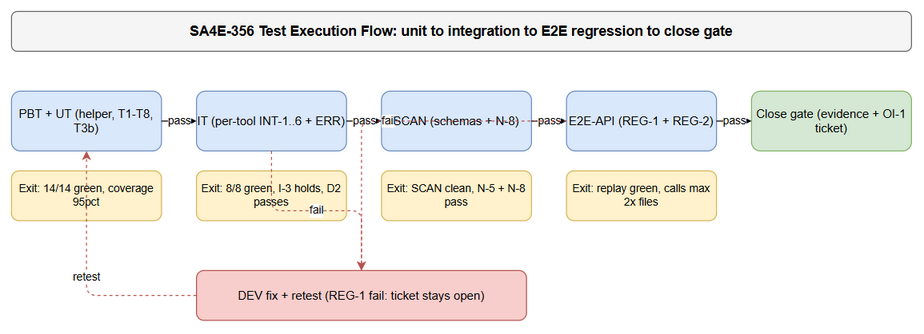
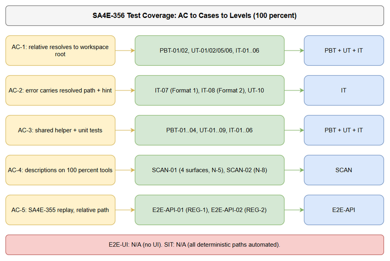

# Software Test Plan (STP)

## SDLC-Agents-4-Enterprise — SA4E-356: [Bug] MCP tools: relative file_path resolves against process CWD instead of workspace root

---

## Document Information

| Field | Value |
|-------|-------|
| Jira Ticket | SA4E-356 |
| Title | [Bug] MCP tools: relative file_path resolves against process CWD (Kiro install dir) instead of workspace root |
| Author | QA Agent |
| Version | 1.1 |
| Date | 2026-10-12 |
| Status | Draft |
| Related BRD | documents/SA4E-356/BRD.md (v1.0.1) |
| Related FSD | documents/SA4E-356/FSD.md (v1.2) |
| Related TDD | documents/SA4E-356/TDD.md (v1.2) |
| Related DISCREPANCY | documents/SA4E-356/DISCREPANCY.md (v2 — all RESOLVED) |

---

## Author Tracking

| Role | Name - Position | Responsibility |
|------|-----------------|----------------|
| Author | QA Agent – QA Engineer | Create STP/STC, test data, diagrams |
| Peer Reviewer | BA Agent – Business Analyst | Review business coverage (STC) |
| Approver | SM Agent – Scrum Master | Final approval |

---

## Revision History

| Version | Date | Author | Changes |
|---------|------|--------|---------|
| 1.0 | 2026-10-12 | QA Agent | Initiate STP for bugfix SA4E-356 — risk-based plan, 6 flexible levels (PBT/UT/IT/E2E-API/E2E-UI/SIT) + SCAN, RTM trace AC-1..AC-5 ↔ FR ↔ tests |
| 1.1 | 2026-10-12 | QA Agent | Targeted delta for TDD v1.2 security fixes (SEC-01..08): scope +BR-06b/SEC-01/03/04/05/07/08/N-9/SQ-1; counts 26→33 (UT 10→15, IT 8→10); +§4.4 evidence-redact procedure (N-QA5); +R-9 (BR-06b ack); RTM 100% kept |

---

## Sign-Off

| Name | Signature and date |
|------|--------------------|
| | ☐ I agree and confirm the test plan in this STP |
| | ☐ I agree and confirm the test plan in this STP |

---

## 1. Introduction

### 1.1 Purpose

This Test Plan defines the strategy, scope, and approach for verifying the bug fix for SA4E-356. The bug: file-based MCP tools in the SA4E extension resolve a relative `file_path` against the MCP server process CWD (the Kiro install directory, e.g. `C:\Users\ASUS\AppData\Local\Programs\Kiro`) instead of the workspace root, causing every relative-path call to fail with `ENOENT`.

The fix (TDD v1.2) introduces a single shared helper — `resolveWorkspacePath(rawPath)` in `extension/src/services/PathResolver.ts` — and applies it to all 6 in-scope Extension Host tools (`stream_write_file`, `embed_image`, `jira_attach_file`, `confluence_add_attachment`, `mem_ingest_file` via 2 paths, `drawio_export_png`), with case-insensitive containment on Windows (fixing observed risk R-1), structured self-correcting errors (Format 1/2 with `CODE:` prefix), enriched inputSchema descriptions (AC-4), and a minimal error-disambiguation fix for backend `drawio_auto_layout` (BR-12, ~10 lines, resolve behavior unchanged).

TDD v1.2 (Security Review follow-up, verdict PASS WITH FIXES) adds: rule BR-06b (relative rejected with `PATH_NO_WORKSPACE` when no workspace is open), per-image-ref containment in `embed_image` (SEC-01), a parent-dir realpath guard at handler layer (SEC-03, tested as conditional-skip SQ-1), win32 fold in the backend `resolveFilePath` (SEC-04), `PATH_INVALID` plus log sanitize (SEC-05), payload caps 10/25 MB (N-9, SEC-07), and the `Wrapper Error:` chat marker plus `args.path` alias documentation (SEC-08).

### 1.2 Test Objectives

- Verify every file-based MCP tool resolves relative `file_path` against the primary workspace folder on the first call (AC-1, BO-1).
- Verify absolute-path passthrough is unchanged (backward compatibility with the SA4E-355 absolute-path workaround, 18/18 files) (AC-1, R-5).
- Verify path escape (`../` outside root, absolute outside root, UNC outside root, prefix-collision) is blocked fail-loud (AC-3, BO-5).
- Verify the NEW approved fallback behavior: with no workspace open (`cwd_fallback`), containment does NOT apply — absolute paths outside `process.cwd()` pass (DISC-1 resolved, BRD v1.0.1 §1.5; do NOT regression-test the old blocking behavior on this branch).
- Verify Windows case-insensitive containment (drive-letter `C:\` vs `c:\` no longer false-rejects) (R-1, T6).
- Verify self-correcting errors: every failure carries the resolved absolute path + resolve root + hint, with a stable `CODE:` prefix (AC-2).
- Verify 100% of audited tools expose the resolution rule in `file_path.description`, on both static schemas and the proxy rewrite path (AC-4, SCAN-01).
- Verify the original repro replays green with a relative path on a real extension host (AC-5, REG-1/REG-2).
- Verify zero regressions: existing suite (incl. D2 tool-proxy test, wrapper-server string-mode tests), single source of truth (N-8 scan), coverage ≥ 95% on the new module (N-7).
- Verify BR-06b: relative path with no workspace open fails loud with `PATH_NO_WORKSPACE` (Format 3); absolute paths still pass on `cwd_fallback` (AC-1; UT-06 corrected + UT-11).
- Verify SEC-01/03/04/05/07: inner image refs outside root skipped fail-closed (UT-13/IT-09); symlink guard blocks escape and passes internal links with graceful skip when symlink creation is unavailable (IT-10 SQ-1); backend `C:`/`c:` casing passes (UT-15); NUL → `PATH_INVALID` with sanitized log echo (UT-12); payload caps 10 MB / 25 MB enforced fail-loud (UT-14, N-9).
- Verify chat-path errors carry the `Wrapper Error:` marker ahead of the helper `CODE:` (IT-05, N-QA4); evidence attached to Jira redacts OS usernames in paths (procedure §4.4, N-QA5).

### 1.3 References

| Document | Location |
|----------|----------|
| BRD SA4E-356 v1.0.1 | documents/SA4E-356/BRD.md |
| FSD SA4E-356 v1.2 | documents/SA4E-356/FSD.md |
| TDD SA4E-356 v1.2 | documents/SA4E-356/TDD.md |
| Discrepancy report v2 (DISC-1/DISC-2 RESOLVED) | documents/SA4E-356/DISCREPANCY.md |
| Regression environment (epic docs) | documents/SA4E-355/ (BRD.md, FSD.md, TDD.md) |
| Reference pattern (correct resolve) | extension/src/backend-local-tools.ts — `handleStreamWriteFile` (113–149) |
| Confirmed buggy tool | extension/src/mcp/atlassian/jira-attachment-tools.ts — `jira_attach_file` (line 21) |
| Format reference (previous ticket, same extension type) | documents/SA4E-350/STP.md, STC.md, testdata/*.csv |
| STC (this ticket) | documents/SA4E-356/STC.md |
| Test data | documents/SA4E-356/testdata/*.csv |

---

## 2. Test Strategy

### 2.1 Test Levels (6 Levels, Applied Flexibly for a TypeScript Extension Bugfix)

| Level | Scope | Automation | Tools |
|-------|-------|------------|-------|
| PBT | Correctness properties of path resolution (absolute passthrough, idempotence, containment monotonicity, win32-only case-fold) with randomized inputs | Automated | fast-check (vitest) |
| UT | Unit tests T1–T8 + T3b + v1.2 deltas (T5b/BR-06b, T8-ext/PATH_INVALID, T-SEC01, T-size/N-9, backend casing) for `resolveWorkspacePath` / `isPathWithinRoot` / `embedMarkdownImages` + backend error branches | Automated | vitest |
| IT | Per-tool integration: each audited tool called with a relative path against a real tmpdir workspace; error-format assertions; proxy/chat wiring | Automated | vitest + real fs tmpdir + vscode mock |
| E2E-API | MCP tool-call end-to-end through the extension host path (REG-1 relative replay of the SA4E-355 repro + REG-2 absolute control) | Automated where harness allows, manual on real Kiro host for the close gate | vitest + extension host / Kiro + Jira evidence |
| E2E-UI | Browser UI E2E (Playwright) | N/A — see justification below | — |
| SIT | Manual exploratory / edge cases only | N/A (minimal) — see justification below | — |
| SCAN | Static/schema scans: SCAN-01 description audit (4 schema surfaces) + SCAN-02 consistency scan (N-8) | Automated | vitest + grep |

**E2E-UI — N/A justification:** this ticket is a backend/extension bug fix with zero UI surface (BRD Story 1–5 UI Specifications: N/A; FSD §3.1.5: N/A). No screen, dialog, or visual element changes. There is nothing a browser test could assert. UI-level verification would be pure overhead with zero signal.

**SIT (manual exploratory) — N/A justification:** all deterministic behavior (CRUD-equivalent file ops, validation, auth-neutral error paths, status-free resolution) is automated at UT/IT/E2E-API/SCAN levels. The only human-gated step is the REG-1/REG-2 replay on the real Kiro extension host, which is classified as E2E-API (close gate) rather than exploratory SIT: its steps and expected results are fully deterministic (attach succeeds, call count ≤ 36 for 18 files). No visual/UX/timing judgment is required anywhere in this ticket. Residual exploratory risk (e.g. symlink escape OI-2, macOS casing OI-3) is explicitly recorded as accepted limitations with follow-ups, not SIT scope.


*[Edit in draw.io](diagrams/test-execution-flow.drawio) — PNG export DEFERRED (MCP degraded session; SM to export after restore)*

### 2.2 Test Types

| Type | Description | Applicable |
|------|-------------|------------|
| Functional Testing | Verify resolution behavior per FSD UC-01..UC-05 (main/alternative/exception flows) | Yes |
| Business Rule Validation | Exercise every BR-01..BR-12 | Yes |
| Boundary & Negative Testing | Prefix-collision, casing, UNC, empty/non-string, long `../` chains, mixed separators | Yes |
| Security Testing | Escape prevention (N-3 corpus, 0 leak), fail-loud, HTTP never sent on resolve-fail (I-3) | Yes |
| Regression Testing | Existing suite 100% pass; INT-1 refactor regression; REG-1/REG-2 close gate; OI-4 backend duplicate untouched | Yes |
| Performance Testing | N-1 micro-benchmark (p95 < 0.1 ms, overhead < 5% of one fs call); N-2 activation ≤ +50 ms | Yes (lightweight) |
| Compatibility Testing | Windows case-insensitivity (T6); multi-root deterministic primary folder (T4); no-workspace fallback (T5 new behavior) | Yes |
| Usability Testing | N/A — no UI (see E2E-UI justification) | No |

### 2.3 Test Approach

**Risk-based prioritization:**

- **P1 (Critical):** Core fix — relative resolves to workspace (UT-01/IT-01..IT-06), escape blocked (UT-03/UT-04), no-workspace relative rejected per BR-06b (UT-06/UT-11), inner-ref containment (UT-13/IT-09), repro replay (E2E-API-01/02). A P1 failure blocks the ticket (BRD Story 5: REG-1 fail → ticket does NOT close).
- **P2 (High):** R-1 case-insensitivity (UT-07), error contracts Format 1/2/3 + codes + chat marker (IT-07/IT-08/IT-05, UT-11/UT-12), payload caps (UT-14, N-9), backend casing (UT-15), symlink guard (IT-10), schema transparency (SCAN-01), consistency scan (SCAN-02), backend disambiguation (UT-10).
- **P3 (Medium):** Properties (PBT-01..04), provider no-cache (UT-08), UNC/empty/non-string (UT-09), multi-root (UT-05), fallback new behavior (UT-06), NFR benchmarks (N-1/N-2/N-7).

**Automation first:** 33 of 33 cases automated (vitest); the E2E-API close gate additionally requires one manual confirmation run on the real Kiro host with Jira evidence (same deterministic steps). SQ-1 (IT-10) is automated with a documented graceful-skip branch, not manual SIT.

**Implementation order follows TDD §12:** helper + unit tests first (zero risk, no callers) → per-call-site refactor with gates → schemas → backend 10 lines → REG replay last.

### 2.4 Entry Criteria

| Level | Entry Criteria |
|-------|----------------|
| PBT | `PathResolver.ts` compiles (`tsc`); fast-check available in extension repo |
| UT | `PathResolver.ts` + test file `services/__tests__/path-resolver.test.ts` committed; vitest alias `vscode → src/test/mocks/vscode.ts` verified |
| IT | T1–T8+T3b+T5b/T8-ext/T-SEC01/T-size/backend-casing green; tmpdir workspace fixture ready; vscode mock mutate-restore pattern confirmed (D2 pattern) |
| E2E-API | All UT+IT+SCAN green; real Kiro host with workspace open; SA4E-355 docs present; Jira access for attachment evidence |
| SCAN | Refactored schemas committed; pre-fix inputSchema snapshot captured (for N-5 diff) |
| Close gate | REG-1 + REG-2 pass; N-8 scan 0 matches; full existing suite 100% pass; coverage ≥ 95% on new module |

### 2.5 Exit Criteria

| Level | Exit Criteria |
|-------|---------------|
| PBT | 4/4 properties hold over randomized corpus (no counterexample shrunk to a leak) |
| UT | 15/15 pass (T1–T8, T3b, T5b, T8-ext, T-SEC01, T-size, backend disambiguation + backend casing); coverage `PathResolver.ts` ≥ 95% statements+branches (N-7) |
| IT | 10/10 pass (INT-1..INT-6 + INT-2-ext + SQ-1); resolve-fail never triggers HTTP (I-3) or fs side-effects; D2 regression still passes; SQ-1 skip logged if symlink creation unavailable |
| E2E-API | REG-1 relative replay attaches successfully; REG-2 absolute control passes; call count ≤ 36 for 18 files (N-6) |
| SCAN | SCAN-01: 100% audited tools carry "workspace" rule on all 4 schema surfaces; N-5 diff shows description-only changes. SCAN-02: 0 forbidden patterns in `extension/src/` |
| Ticket close | All exit criteria above + full suite green + follow-up ticket for OI-1 (`drawio_auto_layout` proxy-route) created and cross-linked (TDD §8.3 constraint) |

### 2.6 E2E Automation Coverage Classification

| Scenario Type | Classify As | Rationale |
|--------------|-------------|-----------|
| Relative path resolves per tool (6 tools + 2 mem_ingest_file paths) | IT (INT-1..INT-6) | Real fs on tmpdir; deterministic without network |
| `../` escape / prefix-collision / UNC rejection | UT (T3/T3b/T8) + IT-08 | Pure string check at helper level; tool-level forward assert |
| ENOENT error carries resolved path + root + hint + code | IT-07 | fs-level failure wrap, deterministic |
| Case-insensitive containment (R-1) | UT-07 | String compare; Windows-gated assert |
| No-workspace fallback, NEW behavior (no containment on cwd_fallback) | UT-06 | vscode mock `workspaceFolders = undefined`; asserts `ok:true` outside cwd |
| Schema descriptions on 4 surfaces (incl. rewriteSchemasForLlm + find_tools response) | SCAN-01 | Static scan, no runtime needed |
| Single-arg `resolve(file_path)` / raw `fs.*` remnants | SCAN-02 | Grep scan over `extension/src/` |
| Replay repro `jira_attach_file(SA4E-355, relative)` | E2E-API-01 | Real extension host + real Jira; close gate |
| Absolute-path control replay | E2E-API-02 | Backward-compat proof (N-4) |
| Visual/layout verification | N/A (no UI in scope) | Nothing to see — no E2E-UI/SIT |
| Symlink realpath escape (OI-2), macOS casing (OI-3) | N/A — accepted limitations (OI-2 now conditional + SQ-1 guard test) | Documented follow-ups, not test scope; SQ-1 runs automated |
| Relative with no workspace → `PATH_NO_WORKSPACE` (Format 3) | UT-11 (T5b) + UT-06 (incl. A1 `[]` variant) | Helper-level, deterministic |
| NUL byte → `PATH_INVALID`; CRLF sanitized in message/log echo | UT-12 (T8-ext) | String check + sanitize assert |
| Malicious markdown refs outside root skipped fail-closed | UT-13 (unit fn) + IT-09 (tool-level spy) | Red-before-fix attacker test |
| Oversize content (10 MB) / pre-read file (25 MB) rejected | UT-14 (T-size) | Runtime-generated fixtures, boundary ±1 |
| Backend `C:`/`c:` casing passes | UT-15 | Backend unit, no resolve change |
| Symlink escape blocked; creation-unavailable → graceful skip | IT-10 (SQ-1) | Conditional-skip automated, NOT SIT |
| Chat resolve-fail carries `Wrapper Error:` + helper `CODE:` | IT-05 ext (N-QA4) | Text-prefix assert |
| Username redaction in Jira evidence | Procedure (§4.4, N-QA5) | Manual checklist, not an automated case |

### 2.7 Test Cases Summary

| Level | Count | Automated | Manual |
|-------|-------|-----------|--------|
| PBT | 4 | 4 | 0 |
| UT | 15 | 15 | 0 |
| IT | 10 | 10 | 0 |
| E2E-API | 2 | 2 (plus 1 manual confirmation run on real host for the close gate) | 0 |
| E2E-UI | 0 | 0 (N/A — no UI surface, see §2.1) | 0 |
| SIT | 0 | 0 (N/A — no exploratory scope, see §2.1) | 0 |
| SCAN | 2 | 2 | 0 |
| **Total** | **33** | **33 (100%)** | **0 (0%)** |

---

## 3. Test Scope


*[Edit in draw.io](diagrams/test-coverage.drawio) — PNG export DEFERRED (MCP degraded session; SM to export after restore)*

### 3.1 Features In Scope

| # | Feature / Story | Priority | FSD Reference | Test Type |
|---|----------------|----------|---------------|-----------|
| 1 | Relative path resolves to workspace root for all file-based tools (Story 1) | High | UC-01, BR-02, FR-02 | UT-01, IT-01..IT-06 |
| 2 | Absolute passthrough unchanged (Story 1, backward compat) | High | UC-02, BR-03, FR-03 | UT-02, PBT-01, E2E-API-02 |
| 3 | Escape blocked fail-loud incl. boundary prefix-collision (Story 1/3) | High | UC-03, BR-05, FR-05 | UT-03, UT-04, PBT-03, IT-08 |
| 4 | Self-correcting errors Format 1/2 + CODE: prefix (Story 2) | High | UC-04, BR-08, FR-08 | IT-07, IT-08, UT-10 (backend half) |
| 5 | Shared helper as single source of truth (Story 3) | High | BR-01, FR-01, C-1..C-6 | UT-01..UT-09, PBT-01..04, SCAN-02 |
| 6 | Case-insensitive containment on Windows (R-1) | High | UC-02 AF-1, BR-04, FR-04 | UT-07, PBT-04, IT-01 |
| 7 | Multi-root deterministic primary folder (Story 1) | High | UC-05, BR-07, FR-07 | UT-05 |
| 8 | No-workspace fallback with NEW behavior (no containment on cwd_fallback) (DISC-1) | High | UC-01 AF-1, BR-06, FR-06 | UT-06 |
| 9 | InputSchema descriptions on 100% audited tools incl. rewrite path (Story 4) | Medium | FR-09, BR-10, BR-11 | SCAN-01 |
| 10 | Regression replay of SA4E-355 repro with relative path (Story 5) | High | FR-11, UC-01 | E2E-API-01, E2E-API-02 |
| 11 | Provider injection + per-call no-cache (UC-01 AF-2) | Medium | C-3, FR-02 | UT-08, PBT-02 |
| 12 | UNC / empty / non-string inputs fail-loud, never throw (C-1) | Medium | UC-01 EF-3, UC-02 EF-2, UC-03 AF-2 | UT-09 |
| 13 | Backend drawio_auto_layout error disambiguation (BR-12 minimal) | Medium | FSD §6.5, TDD §7.4 | UT-10 |
| 14 | NFR gates: latency (N-1), signature stability (N-5), coverage (N-7), consistency (N-8) | Medium | FSD §8.1 | PBT/UT bench note, SCAN-01 (N-5), SCAN-02 (N-8) |
| 15 | No-workspace relative rejected (BR-06b, Format 3) | High | BR-06b, FR-06 | UT-06 (A1 variant), UT-11 |
| 16 | Inner image-ref containment + NUL sanitize + payload caps + backend casing + chat marker (SEC-01/04/05/07/08) | High | TDD §5.4.1/§5.7/§7.4/§10.1, N-9 | UT-12, UT-13, UT-14, UT-15, IT-05, IT-09 |
| 17 | Symlink guard with graceful skip (SEC-03, SQ-1) | Medium | UC-01 EF-4, OI-2 | IT-10 |

### 3.2 Features Out of Scope

| # | Feature | Reason |
|---|---------|--------|
| 1 | `drawio_auto_layout` resolve behavior (backend `resolveFilePath`) | BR-12 — separate follow-up ticket (OI-1); only error-message disambiguation in scope |
| 2 | `sandbox_run` (`file` param) | Audit conclusion: sandbox-internal path, unaffected (FSD §3.1.4 row 8) |
| 3 | Backend `stream_write_file` duplicate (`code-intel-handlers.ts:106–119`) | Shadowed by extension-local version; cleanup follow-up (OI-4); N-8 scan excludes `backend/` |
| 4 | MCP tool signature / protocol changes | BR-09 — descriptions only |
| 5 | Symlink/junction realpath escape (full realpath) | Accepted CONDITIONALLY (AD-17): handler parent-dir guard + SQ-1 doc test (IT-10) in scope; full-realpath hardening stays security-review follow-up (OI-2) |
| 6 | macOS case-fold extension | OI-3 — only with real-world reject evidence |
| 7 | Any UI (E2E-UI) / manual exploratory (SIT) | No UI surface; all deterministic paths automated (see §2.1) |
| 8 | Tools outside the audit list (pega_*, ide_*, devtools…) | Error-code rollout is progressive (OI-6) |

---

## 4. Test Environment

### 4.1 Environment Requirements

| Environment | Root / URL | Purpose |
|-------------|-----------|---------|
| Extension host dev (Kiro/VS Code) | Workspace `C:\projects\kiro\SDLC-Agents-4-Enterprise` | UT/IT via vitest with vscode mock; manual REG confirmation |
| CI (vitest) | `extension/vitest.config.ts` (alias `vscode → src/test/mocks/vscode.ts`, `fileParallelism: false`, `retry: 2`) | Automated PBT/UT/IT/SCAN; coverage gate N-7 |
| Real Kiro host (close gate) | Workspace open + SA4E-355 docs present | E2E-API-01/02 replay with Jira evidence |
| Tmpdir fixture (IT) | OS tmpdir as fake workspace (mutate vscode mock, restore in `finally`) | INT-1..INT-6 real-fs isolation |

### 4.2 Test Data Requirements

| Data Type | Description | Source | Preparation |
|-----------|-------------|--------|-------------|
| Unit path corpus | Relative/absolute/escape/casing/multi-root/fallback/UNC/empty samples | `testdata/path-resolution.csv` | Static CSV; injected root providers |
| Boundary escape corpus (N-3, extended N-QA2) | Long `../` chains, prefix-collision, mixed separators, dot-segments, trailing sep, drive casing, UNC + quirks (trailing-dot/space, 8.3, `\\?` both sides, drive-relative, forward-slash) | `testdata/boundary-corpus.csv` | Static CSV; 0-leak assert; quirks fail-closed with clear log |
| Per-tool integration rows | 6 tools × relative/absolute/error variants | `testdata/integration-tools.csv` | Static CSV; real files in tmpdir |
| Error-format expectations | Format 1/2 templates + CODE: prefixes per FSD §9.2–§9.3 | `testdata/error-format.csv` | Static CSV; `toContain` asserts |
| Schema scan expectations | 6 tools × 4 surfaces, "workspace" keyword + M-2 `.out` suffix | `testdata/schema-scan.csv` | Static CSV; snapshot diff for N-5 |
| Regression replay rows | REG-1 relative + REG-2 absolute on SA4E-355 docs | `testdata/regression-replay.csv` | Real workspace files; Jira evidence (redacted per §4.4) |
| Payload fixtures (UT-14) | 10 MB+1 content, 25 MB+1 pre-read file (runtime-generated, deleted after) | `testdata/integration-tools.csv` rows UT-14 | Generate in test, never commit |
| Symlink fixtures (IT-10) | `link-out` (→ outside) + `link-in` (→ in-root); skip with reason if creation EPERM | `testdata/integration-tools.csv` rows IT-10 | Runtime tmpdir; junction fallback on Windows |
| Property seeds | Minimal seed corpus per PBT property | `testdata/property-seeds.csv` | Static CSV; fast-check arbitraries extend them |

### 4.3 External Dependencies

| System | Dependency | Mock/Stub Available |
|--------|-----------|---------------------|
| VS Code Workspace API | `workspaceFolders[0].uri.fsPath` per call | Yes — `src/test/mocks/vscode.ts` (default has workspace; T5 sets `undefined` + restores) |
| Host fs | Real files for INT (tmpdir) | Yes — tmpdir fixture; no production files touched |
| Atlassian REST (Jira/Confluence upload) | `AtlassianHttpClient.request` | Yes — mocked in IT-03/IT-04 (capture FormData, assert no call on resolve-fail per I-3); real only in E2E-API-01 |
| Backend child server (:48721) | drawio/mem_ingest forwarding | Yes — `restCallTool` mock captures args (INT-5/INT-6); resolve behavior of `drawio_auto_layout` untouched |
| Jira SA4E-355 (E2E-API) | Issue + attachment API | No mock at E2E level — real call with evidence |

---

### 4.4 Evidence Redaction Procedure (N-QA5 — manual checklist, not an automated case)

Before attaching REG-1/REG-2 evidence (screenshots, logs, attachment IDs) to Jira: (1) redact OS usernames in every path (`C:\Users\<name>` → `C:\Users\<redacted>`); (2) never forward raw extension-log fields (`rawPath`/`resolvedPath`/`rootPath`) into Jira/Confluence comments — attach only the redacted evidence plus the `CODE:` prefix; (3) SM verifies redaction at the close gate before ticket close.

## 5. Test Schedule

| Phase | Duration | Milestone |
|-------|----------|-----------|
| Test Planning | 1 day | STP + STC approved (BA review per Review Gate) |
| Test Data Preparation | 0.5 day | 7 CSVs committed under `documents/SA4E-356/testdata/` |
| PBT + UT Execution (TDD steps 1–2) | 1 day | 14/14 green; coverage ≥ 95% (N-7) |
| IT + SCAN Execution (TDD steps 3–8) | 2 days | 10/10 green; N-8 scan clean; D2 + string-mode suites green |
| Backend disambiguation + full suite (TDD step 9) | 0.5 day | Backend 2-branch test green; whole suite 100% pass |
| E2E-API Regression on real host (TDD step 10) | 1 day | REG-1 + REG-2 green with Jira evidence; call count ≤ 36/18 (N-6) |
| Defect Fix & Retest | As needed | All P1/P2 fixed; REG-1 fail → ticket stays open |
| Close gate | — | OI-1 follow-up ticket created + cross-linked |

---

## 6. Resources & Responsibilities

| Role | Name | Responsibility |
|------|------|---------------|
| Test Lead | QA Agent | Test planning, STP/STC creation, data + diagrams, quality gates |
| QA Engineer | QA Agent | Test design per TDD §11, execution, defect reporting |
| Developer | Dev Agent | Implement per TDD §12 checklist order; keep gates green per commit |
| BA | BA Agent | Business coverage review of STC (mandatory Review Gate, max 2 iterations) |
| SM | SM Agent | Orchestration, PNG export after MCP restore, KB ingest, Jira transitions |

**Tools:** vitest (+ fast-check for PBT), vscode mock alias, tmpdir fixtures, grep scans (N-8), draw.io XML (hand-authored, validated manually), CSV test data.

---

## 7. Risk & Mitigation

| # | Risk | Impact | Likelihood | Mitigation |
|---|------|--------|------------|------------|
| R-1 | Case-sensitive containment false-rejects valid Windows paths (OBSERVED 2026-10-12) | High | High | UT-07 + PBT-04 + IT-01 casing variants; fold both sides on win32 only |
| R-2 | Some tools run outside extension host (no `vscode.workspace`) | Medium | Medium | Audit done (FSD §3.1.4): only `drawio_auto_layout`/`sandbox_run` out; BR-12 handling + OI-1 follow-up |
| R-3 | Multi-root: agent means folder 2+ but helper uses primary | Medium | Medium | UT-05 + Format 1 hint steering to absolute path; rule in every description (SCAN-01) |
| R-4 | Containment blocks legitimate outside-workspace use (temp dir) | Medium | Low | Consistent with pre-existing `stream_write_file` behavior; separate ticket + security review if exception needed |
| R-5 | Absolute-path workarounds break | Low | Low | Passthrough unchanged — E2E-API-02 + PBT-01 guard it |
| R-6 | Chicken-and-egg: doc tooling itself hit by the bug | Medium | High | Absolute-path workaround until AC-5; verified during FSD session |
| R-7 | T5 asserts NEW fallback behavior; engineer may "fix" it back to old blocking | High | Medium | UT-06 explicitly asserts `ok:true` outside cwd + cites DISC-1/BA-ack; STC marks old behavior as must-NOT-assert |
| R-8 | Line-number drift between FSD-verify (2026-10-12) and DEV start | Medium | Medium | DEV re-greps by symbol name (OI-7); SCAN-02 is symbol-based, not line-based |
| R-9 | BR-06b is a second fallback behavior change (needs BA ack N-BA2); engineer may implement v1.0 semantics (relative → cwd) | High | Medium | UT-06 asserts `PATH_NO_WORKSPACE` + cites TDD §3.2 Step 2b; STC defect-seed note 6; BA ack tracked as N-BA2 |

---

## 8. Defect Management

### 8.1 Severity Levels

| Severity | Definition | Example |
|----------|-----------|---------|
| Critical | Core fix broken: relative still resolves to Kiro dir; escape leaks to fs; REG-1 fails | `jira_attach_file` relative → ENOENT Kiro path after fix; malicious markdown image ref read outside root (SEC-01 bypass); relative-no-workspace resolving into install dir (BR-06b missing) |
| Major | Contract broken: error lacks resolved path/code; description missing "workspace"; HTTP sent on resolve-fail | Format 1 without `FILE_NOT_FOUND:`; I-3 violated |
| Minor | Edge mishandled: UNC message wording, `.out` suffix text, non-string `String()` rendering | M-2 suffix missing `.out` branch |
| Trivial | Test naming/style, CSV description typos | ID/testdata label mismatch |

### 8.2 Priority Levels

| Priority | Definition | SLA (Fix Time) |
|----------|-----------|----------------|
| P1 | Must fix immediately (blocks close gate) | 4 hours |
| P2 | Must fix before release | 1 business day |
| P3 | Should fix if time permits | 3 business days |
| P4 | Nice to fix, can defer | Next release / follow-up ticket |

### 8.3 Defect Lifecycle

```
New → Open → In Progress → Fixed → Ready for Retest → Verified → Closed
                                                      → Reopened → In Progress
```

**Ticket-specific rule:** E2E-API-01 (REG-1) FAIL → ticket does NOT close; back to audit of helper + wiring (BRD Story 5).

---

## 9. Test Metrics & Reporting

### 9.1 Metrics

| Metric | Formula | Target |
|--------|---------|--------|
| Test Execution Rate | Executed / Total × 100% | 100% (33/33) |
| Pass Rate | Passed / Executed × 100% | 100% (bugfix close gate) |
| AC Coverage | ACs covered / 5 × 100% | 100% |
| FR Coverage | FRs covered / 11 × 100% | 100% |
| BR Coverage | BRs covered / 13 × 100% (+BR-06b) | 100% |
| Module Coverage (new) | Statements+Branches on `PathResolver.ts` | ≥ 95% (N-7) |
| Escape Leakage (N-3, extended quirks) | Leaks / corpus size | 0 |
| Payload Cap Enforcement (N-9) | UT-14 pass (exact-boundary pass, +1-byte reject, both caps) | 100% |
| Agent Retries (N-6) | Tool calls / files in REG-1 | ≤ 2.0 |
| Critical Defect Count | Count of Critical severity | 0 |
| Defect Fix Rate | Fixed / Total Defects × 100% | 100% |

### 9.2 Reporting Schedule

| Report | Frequency | Audience |
|--------|-----------|----------|
| Test Status (per level gate) | Per TDD §12 step | Dev + SM |
| Defect Summary | On failure | Dev team |
| Test Completion Report | End of testing | All stakeholders |
| BA Review Verdict | After STC submit (max 2 iterations) | QA + SM |

---

## 10. Appendix

### Requirements Traceability — AC ↔ FR ↔ Tests (summary; full RTM in STC §10)

| AC (BRD) | Description | FR | Test Cases | Coverage |
|----------|-------------|----|------------|----------|
| AC-1 | Relative → workspace root; multi-root/fallback documented (+BR-06b reject, SEC-01/07) | FR-01, FR-02, FR-03, FR-06, FR-07 | PBT-01/02, UT-01/02/05/06/11/13/14, IT-01..IT-06, IT-09 | ✅ |
| AC-2 | Error carries resolved path + hint (+Format 3, chat marker, sanitize, backend casing) | FR-08 | IT-07, IT-08, IT-05 (marker), UT-10/11/12/15 | ✅ |
| AC-3 | Shared helper + unit tests (relative/absolute/escape/multi-root/case) | FR-01, FR-04, FR-05, FR-10 | PBT-01..04, UT-01..09, UT-11/12/13/15, IT-01..06, IT-09/10 | ✅ |
| AC-4 | Descriptions on 100% audited tools | FR-09 | SCAN-01 | ✅ |
| AC-5 | SA4E-355 replay with relative path | FR-11 | E2E-API-01, E2E-API-02 | ✅ |

**Coverage: 5/5 ACs, 11/11 FRs, 13/13 BRs (+BR-06b), 5/5 UCs, 6/6 codes (+PATH_INVALID, +PATH_NO_WORKSPACE) — 100%.** (Full matrix with UC/BR/code rows: STC §10.)

### Diagram Index

| # | Diagram | Image | Source (editable) |
|---|---------|-------|-------------------|
| 1 | Test Coverage (AC/FR → cases → levels) | [test-coverage.png](diagrams/test-coverage.png) | [test-coverage.drawio](diagrams/test-coverage.drawio) |
| 2 | Test Execution Flow (unit → integration → e2e regression → close gate) | [test-execution-flow.png](diagrams/test-execution-flow.png) | [test-execution-flow.drawio](diagrams/test-execution-flow.drawio) |

> **Note (MCP degraded):** `.drawio` files are hand-authored and manually validated (balanced tags, no `mxfile` wrapper, every edge carries an `mxGeometry` child, no HTML named entities). PNG export DEFERRED — SM to export after code-intel MCP restore.

### Glossary

| Term | Definition |
|------|------------|
| Path Resolver | New shared helper `resolveWorkspacePath` — single source of truth for resolution in the Extension Host |
| cwd_fallback | Resolve branch with no workspace open: root = `process.cwd()`, no containment (NEW approved behavior, DISC-1) |
| Format 1 / Format 2 | ENOENT wrap (tool layer) / containment rejection (helper layer) per FSD §9.2, each with a `CODE:` prefix per §9.3 |
| SCAN | Static/schema scan level (description audit + consistency grep) |
| Close gate | REG-1 + REG-2 green on the real host + all quality gates (N-5/N-7/N-8) + OI-1 follow-up ticket created |
| BR-06b | New v1.2 rule: relative path rejected with `PATH_NO_WORKSPACE` when no workspace is open (Format 3) |
| Format 3 | No-workspace rejection message (`PATH_NO_WORKSPACE:` + got-relative + fallback root + open-a-workspace hint) |
| SQ-1 | Conditional symlink-guard doc test (blocks escape, passes internal links, skips gracefully when symlink creation is unavailable) |

### Assumptions

- Primary workspace folder = `workspaceFolders[0]` (VS Code/Kiro convention, matches `handleStreamWriteFile`).
- Extension host `process.cwd()` = Kiro install dir (root cause, unchangeable).
- Agent reads `file_path.description` before calling (MCP protocol assumption).
- `stream_write_file` overall behavior on the workspace branch is unchanged (only the `cwd_fallback` branch intentionally changes per BA ack).
