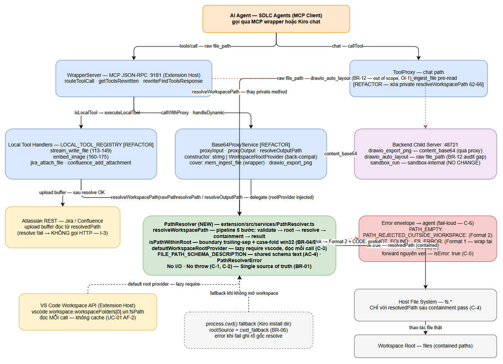
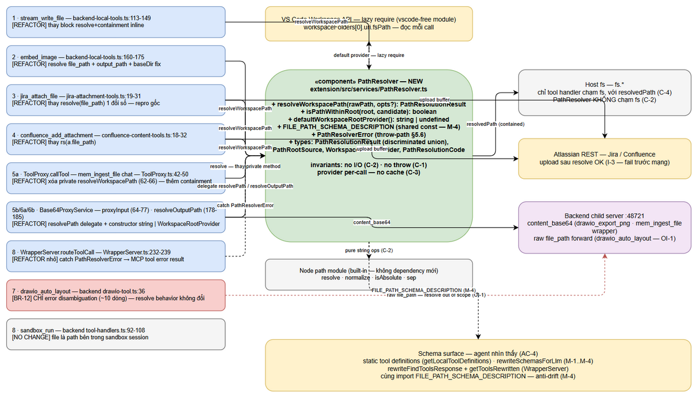
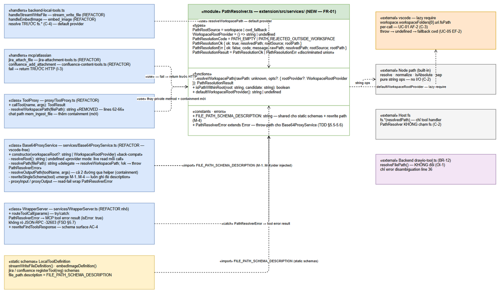

# Technical Design Document (TDD)

## SA4E-356 — [Bug] MCP tools: relative file_path resolves against process CWD (Kiro install dir) instead of workspace root

---

## Document Information

| Field | Value |
|-------|-------|
| Jira Ticket | SA4E-356 |
| Title | [Bug] MCP tools: relative file_path resolves against process CWD (Kiro install dir) instead of workspace root |
| Author | SA Agent |
| Version | 1.2 |
| Date | 2026-10-12 |
| Status | Draft |
| Priority | High |
| Related BRD | documents/SA4E-356/BRD.md (v1.0.1 — BA ack DISC-1) |
| Related FSD | documents/SA4E-356/FSD.md (v1.2 — DISC-1/DISC-2 fixed) |

---

## Author Tracking

| Role | Name - Position | Responsibility |
|------|-----------------|----------------|
| Author | SA Agent – Solution Architect | Create document |
| Peer Reviewer | Duc Nguyen Minh – Reporter / Requirements Owner | Review document |

---

## Revision History

| Version | Date | Author | Changes |
|---------|------|--------|---------|
| 1.0 | 2026-10-12 | SA Agent | Khởi tạo TDD từ BRD v1.0 + FSD v1.1. Toàn bộ vị trí code trong FSD §3.1.4 (audit 8 tools) + §5.5 (integration matrix 8 call sites) đã được SA verify lại trực tiếp từ source (read/grep — MCP degraded session, không dùng code-intelligence index). Confirm 10 architecture decisions của TA (§15.1); cụ thể hóa 2 điểm FSD để ngỏ: validation order trong `handleStreamWriteFile` (§5.4 row 1) và WrapperServer error envelope cho PathResolverError (§5.6). Phát hiện 1 discrepancy (DISC-1 — containment nhánh cwd_fallback, xem DISCREPANCY.md). |
| 1.1 | 2026-10-12 | SA Agent | Feedback loop iter 1 — sync theo FSD v1.2 (BA fix DISC-1/DISC-2) + BRD v1.0.1. **Thiết kế KHÔNG đổi** — SA đã confirm giữ nguyên thiết kế từ v1.0. Targeted edits: (1) §3.5 M-2 sync text mới — description `output_path` cover cả nhánh `.out` của `resolveOutputPath` (Base64ProxyService.ts:183–184) theo FSD v1.2 §3.2.2 M-2 (DISC-2 RESOLVED); (2) §8.2 + AD-5 cập nhật DISC-1 → RESOLVED (BA ack trong BRD v1.0.1 §1.5; FSD v1.2 §6.3 fact-corrected Note DISC-1 — behavior change nhánh `cwd_fallback` được approve trong scope); (3) §11.3/§11.4 T5 expected behavior sync hành vi MỚI — containment KHÔNG áp khi `cwd_fallback`, assert absolute path ngoài `process.cwd()` vẫn pass (FSD v1.2 §10.1 T5); (4) OI-8 → RESOLVED; metadata references FSD v1.2/BRD v1.0.1. |
| 1.2 | 2026-10-12 | SA Agent | Security Design Review follow-up (SECURITY-REVIEW.md — verdict PASS WITH FIXES, 0 Critical). **Targeted edits, KHÔNG viết lại.** (1) **SEC-01 (Medium):** §5.4 row 2 — `embedMarkdownImages(markdown, baseDir, root)` + containment từng image ref (fail-closed skip, AD-15) + test spec T-SEC01; note cho BA clarify FSD §5.5 row 2 (§15.6 N-BA1). (2) **SEC-02 (Medium):** rule mới BR-06b — từ chối relative khi `cwd_fallback` (`PATH_NO_WORKSPACE`, AD-16) — §3.2 (type + Step 2b), §5.2, §5.9, §7.1, §8.2 item 2, §11.3/§11.4 (T5 update + T5b mới); behavior change thứ 2 ở nhánh fallback — note cho BA ack (§15.6 N-BA2). (3) **SEC-03 (Medium):** chấp nhận có điều kiện + parent-dir realpath guard ở handler layer (AD-17) — §1.4/§1.5 (làm rõ C-2), §3.3, §3.7, §6.5 (I-7), §8.1, §8.3, §11.5 (SQ-1). (4) **SEC-04..08 (Low):** backend fold win32 (§5.4 row 10, §7.4, AD-18); `PATH_INVALID` + sanitize log (SEC-05: §3.2 Step 1, §5.2, §5.9, §7.1, §10.1, T8 ext, AD-19); corpus quirks note cho QA (SEC-06: §8.3, §9 N-3, §11.4, AD-20); payload limits 10 MB/25 MB (SEC-07: §5.4 row 1, §5.5, §8.4, §9 N-9, AD-21); chat marker `Wrapper Error:` + alias `args.path` document (SEC-08: §5.4 rows 1–2, §5.7, AD-22). (5) **OI-1:** follow-up ticket draft (§15.7, AD-23). (6) Notes tập hợp cho BA/QA (§15.6). FSD/BRD/STP/STC KHÔNG sửa trong version này. |

---

## Sign-Off

| Name | Signature and date |
|------|--------------------|
| | ☐ Tôi đồng ý và xác nhận toàn bộ thiết kế kỹ thuật trong TDD này |
| | ☐ Tôi đồng ý và xác nhận toàn bộ thiết kế kỹ thuật trong TDD này |

---

## 1. Introduction

> **Scope Boundary:** TDD này đặc tả CÁCH implement yêu cầu trong FSD v1.2. Không lặp lại functional requirements, business rules, use cases — tham chiếu FSD. Tài liệu tập trung: module design, wiring từng call site, error envelope, security containment, test architecture, thứ tự implement, rollback.

### 1.1 Purpose

Thiết kế kỹ thuật cho bug fix SA4E-356: chuẩn hóa **Path Resolution** cho toàn bộ MCP tool nhận tham số đường dẫn trong SA4E extension, thông qua **một shared helper duy nhất** — `PathResolver` (`extension/src/services/PathResolver.ts`). Thiết kế đóng 5 vấn đề:

1. **Root cause chính:** relative `file_path` resolve theo Process CWD (thư mục cài Kiro) thay vì Workspace Root → ENOENT (audit row #2–#4).
2. **Phân mảnh:** hiện có **5 bản resolve logic rải rác** (4 điểm extension + 1 bản backend duplicate bị shadow — FSD §2.2 TA Note), không điểm nào đầy đủ.
3. **R-1 case-sensitivity:** containment check `startsWith` phân biệt hoa/thường → từ chối oan absolute path hợp lệ trên Windows (`C:\` vs `c:\`).
4. **AC-4 contract mờ:** inputSchema description không nêu rule resolution (kể cả 2 lỗ hổng trên schema rewrite path — FSD §3.2.2).
5. **AC-2 error không tự-sửa:** error không chứa resolved path + gốc resolve + gợi ý; `drawio_auto_layout` trả "file_path is required" sai ngữ nghĩa.

### 1.2 Scope — Technical Scope

| # | Item | Type | File (verified 2026-10-12) | FSD ref |
|---|------|------|---------------------------|---------|
| 1 | PathResolver module + types + `FILE_PATH_SCHEMA_DESCRIPTION` + `PathResolverError` | **NEW** | `extension/src/services/PathResolver.ts` | §3.1.6.1, §6.3 |
| 2 | Unit tests T1–T8 + T3b | **NEW** | `extension/src/services/__tests__/path-resolver.test.ts` | §10.1 |
| 3 | `stream_write_file` refactor (resolve + containment → helper) | REFACTOR | `backend-local-tools.ts:113–149` | §5.5 row 1 |
| 4 | `embed_image` thêm resolve (file_path + output_path + baseDir) | REFACTOR | `backend-local-tools.ts:160–175` | §5.5 row 2 |
| 5 | `jira_attach_file` thay `resolve(file_path)` 1 đối số | REFACTOR | `mcp/atlassian/jira-attachment-tools.ts:19–31` | §5.5 row 3 |
| 6 | `confluence_add_attachment` thay `rs(a.file_path)` | REFACTOR | `mcp/atlassian/confluence-content-tools.ts:18–32` | §5.5 row 4 |
| 7 | `mem_ingest_file` chat path + xóa private method | REFACTOR | `proxy/ToolProxy.ts:42–50, 62–66` | §5.5 row 5a |
| 8 | `mem_ingest_file`/`drawio_export_png` wrapper path — delegate `resolvePath`/`resolveOutputPath` + constructor `string \| WorkspaceRootProvider` | REFACTOR | `services/Base64ProxyService.ts:32, 64–77, 135–138, 178–185` | §5.5 rows 5b, 6a, 6b; §5.6 |
| 9 | Live root provider wiring | REFACTOR (1 dòng) | `remote-backend-client.ts:62` | §5.6 |
| 10 | PathResolverError → MCP tool error result (không rò thành JSON-RPC -32603) | REFACTOR (nhỏ) | `services/WrapperServer.ts:232–239` | §5.7 |
| 11 | Schema descriptions: tool tĩnh (#1–#5) + rewrite merge M-1..M-4 | REFACTOR | `backend-local-tools.ts:82–111`, `jira-attachment-tools.ts:15–18`, `confluence-content-tools.ts:18–21`, `Base64ProxyService.ts:153–176` | §3.2.2, FR-09 |
| 12 | `drawio_auto_layout` error disambiguation (~10 dòng, KHÔNG đổi resolve) | REFACTOR (backend) | `backend/src/engine/tools/drawio-tool.ts:36` | §6.5, BR-12 |
| 13 | Integration tests INT-1..INT-6, TC-ERR-01/02, SCAN-01 | NEW/EXTEND | xem §11.2 | §10.2 |

**Out of scope** (FSD §1.2, BR-12): backend resolve logic (`drawio_auto_layout` resolve behavior, bản duplicate `code-intel-handlers.ts:106–119`); `sandbox_run` (không đổi — audit row #8); tool signature/protocol (BR-09); UI; các tool ngoài audit list (pega_\*, ide_\*, devtools...).

### 1.3 Technology Stack

| Layer | Technology | Version |
|-------|-----------|---------|
| Language | TypeScript (extension) | 5.x — theo `extension/` hiện có |
| Runtime | Node.js `fs` / `path` (built-in) | theo extension host |
| Extension API | VS Code / Kiro Extension Host (`vscode.workspace`) | built-in |
| Test | Vitest (`extension/vitest.config.ts`) | hiện có |
| Backend (chạm duy nhất 10 dòng) | TypeScript + pino | hiện có |

**KHÔNG thêm dependency mới** — toàn bộ thiết kế dùng `fs`/`path` built-in.

### 1.4 Design Principles

- **Single source of truth (BR-01):** `resolveWorkspacePath` là điểm Path Resolution duy nhất trong Extension Host. Không tool nào tự resolve raw path.
- **Fail-loud, no fallback (C-6, BR-08):** mọi failure là structured error (`isError: true`); tool forward nguyên vẹn, không thử resolve cách khác.
- **Backward compatibility (BR-03, BR-09):** absolute passthrough không đổi vị trí; tool signature không đổi; `Base64ProxyService` constructor backward-compatible (string mode giữ nguyên cho 3 file test hiện có).
- **Pure string resolution — no I/O (C-2, N-1):** helper không `fs.*`, không `realpath` — resolution không thêm syscall, không fail khi file chưa tồn tại. (v1.2, AD-17: control bù symlink là **parent-dir realpath guard ở handler layer** — §3.7 step 3.5 — KHÔNG trong helper; C-2 giữ nguyên.)
- **Testability 2 mức (FSD §3.1.6.1):** provider injection (pure-function test, không cần vscode mock) + default provider qua vscode mock (integration-style test).
- **Minimal blast radius:** backend chỉ chạm ~10 dòng error message (BR-12); mọi thay đổi còn lại nằm trong `extension/src/`.

### 1.5 Constraints

- **Vị trí code đã verify 2026-10-12** (SA re-verify trực tiếp bằng read/grep — toàn bộ khớp FSD §3.1.4/§5.5; line references có thể drift nếu có merge vào main trước DEV start — DEV re-grep theo symbol name, OI-7).
- **BR-12:** KHÔNG sửa resolve logic phía backend child server (trừ error disambiguation §6.5). Bản backend duplicate `handleStreamWriteFile` (`code-intel-handlers.ts:106–119`) bị shadow bởi extension-local — KHÔNG sửa, tránh sửa nhầm.
- **BR-09:** không đổi tool name, param name, type, required. Chỉ description được enrich (N-5 verify bằng deep-diff).
- **`Base64ProxyService` + `PathResolver` giữ vscode-free** (chỉ import `fs` + `path`): vscode được lazy-require trong try/catch (pattern đã proven tại `backend-local-tools.ts:14–15`).
- **N-8 scan chỉ áp `extension/src/`** — loại trừ `backend/` (bản duplicate backend vẫn match pattern), test files, và chính `PathResolver.ts`.
- **OI-2:** KHÔNG dùng `fs.realpathSync` trong containment helper (string-compare trên lexical path). v1.2 (AD-17, SEC-03): handler layer được phép **parent-dir realpath guard** (realpath `path.dirname`, KHÔNG realpath file — không break ghi file mới) — xem §3.7 step 3.5 + §8.3.
- **MCP degraded (session hiện tại):** PNG export cho 3 diagram mới bị defer — SM export sau khi MCP restore (xem §15.3).

### 1.6 References

| Document | Location |
|----------|----------|
| BRD SA4E-356 v1.0.1 | documents/SA4E-356/BRD.md |
| FSD SA4E-356 v1.2 (authoritative requirements) | documents/SA4E-356/FSD.md |
| TDD tham chiếu (format) + môi trường regression | documents/SA4E-355/TDD.md, documents/SA4E-355/ |
| KB lesson-learned #501 (bug gốc + workaround absolute path) | KB — nguồn SA4E-355 |
| Pattern tham chiếu resolve đúng | extension/src/backend-local-tools.ts — `handleStreamWriteFile` (113–149) |
| Discrepancy report SA | documents/SA4E-356/DISCREPANCY.md |

---

## 2. System Architecture

### 2.1 Architecture Overview

MCP server wrapper chạy **trong Kiro Extension Host process** — vì vậy `process.cwd()` của nó trỏ vào thư mục cài Kiro (`C:\Users\ASUS\AppData\Local\Programs\Kiro`), không phải workspace root. Đây là root cause của bug.

**Kiến trúc tổng thể:** `LLM → Extension (MCP wrapper, :9181) → Backend child server (:48721)`. Tool call vào WrapperServer qua 3 đường execution:

1. **Local tools** (`routeToolCall` → `isLocalTool(name)` → `executeLocalTool`): `stream_write_file`, `embed_image`, `jira_attach_file`, `confluence_add_attachment` (hidden, đăng ký qua `registerLocalTool`).
2. **Proxy path** (`callWithProxy` / `handleDynamic` → `Base64ProxyService.proxyInput`/`proxyOutput`): `mem_ingest_file` (MCP wrapper), `drawio_export_png` — extension pre-read file → gửi `content_base64` xuống backend.
3. **Chat path** (`ToolProxy.callTool`): `mem_ingest_file` qua chat interface — pre-read file content rồi gửi kèm absolute path.

**Sau fix**, `PathResolver` (module mới, `extension/src/services/PathResolver.ts`) là **layer bắt buộc** giữa mọi tool handler và File System: handler nhận raw `file_path` từ agent → gọi `resolveWorkspacePath(rawPath)` → chỉ khi `ok: true` mới được chạm `fs.*` với `resolvedPath`. PathResolver đọc Primary Workspace Folder từ VS Code Workspace API **mỗi call** (không cache — UC-01 AF-2), fallback `process.cwd()` khi không mở workspace (BR-06), thực hiện containment check case-insensitive trên win32 (BR-04/BR-05), và trả về `PathResolutionResult` (discriminated union). Schema surface (`getLocalToolDefinitions` + `rewriteSchemasForLlm` + `rewriteFindToolsResponse`) dùng chung constant `FILE_PATH_SCHEMA_DESCRIPTION` để contract với agent minh bạch (AC-4).

Tool ngoài Extension Host: `drawio_auto_layout` (backend tự resolve theo `config.workspace` riêng — raw `file_path` forward xuống vì schema không có `content_base64`) và `sandbox_run` (path sandbox-internal) — đánh dấu audit gap, xử lý theo BR-12 (chỉ error disambiguation cho `drawio_auto_layout` trong ticket này).



*[Edit in draw.io](diagrams/architecture.drawio)*

**Điểm khác trước/sau fix (tầng Path Resolution):**

| | Trước fix (4+1 điểm resolve rải rác) | Sau fix (1 helper duy nhất) |
|--|--------------------------------------|----------------------------|
| Relative path | `handleStreamWriteFile` đúng; `ToolProxy`/`Base64ProxyService` partial; `embed_image`/`jira`/`confluence` raw → Process CWD (ENOENT) | 100% tool resolve theo Primary Workspace Folder (FR-02) |
| Absolute path | Passthrough; `stream_write_file` containment case-sensitive (R-1 reject oan) | Passthrough + containment case-insensitive win32 (FR-03, FR-04) |
| Containment | Chỉ `stream_write_file` có (case-sensitive); 2/4 điểm resolve còn lại KHÔNG có; backend có bản riêng | Áp cho MỌI resolved path khi rootSource = workspace (FR-05) |
| Fallback không mở workspace | `process.cwd()` im lặng | `process.cwd()` + `rootSource = cwd_fallback` ghi rõ trong error (FR-06); **v1.2 (BR-06b): relative bị từ chối `PATH_NO_WORKSPACE`, chỉ absolute passthrough** |
| Error | fs error thô / sai ngữ nghĩa | Format 1/2 + `CODE:` prefix, resolved path + gốc resolve + gợi ý (FR-08, §9.3) |

### 2.2 Component Diagram



*[Edit in draw.io](diagrams/component.drawio)*

| Component | File (verified) | Status | Responsibility |
|-----------|-----------------|--------|----------------|
| **PathResolver** | `extension/src/services/PathResolver.ts` | **NEW** | Single source of truth: `resolveWorkspacePath` (5 bước), `isPathWithinRoot` (containment case-insensitive win32), `defaultWorkspaceRootProvider` (lazy require vscode, đọc mỗi call), `FILE_PATH_SCHEMA_DESCRIPTION` (shared text AC-4), `PathResolverError` (dùng bởi Base64ProxyService delegation) |
| LOCAL_TOOL_REGISTRY handlers | `extension/src/backend-local-tools.ts` | REFACTOR | `handleStreamWriteFile` (113–149): thay block resolve+containment inline bằng helper; `handleEmbedImage` (160–175): thêm resolve cho `file_path`/`output_path` + baseDir resolved |
| Atlassian tool handlers | `extension/src/mcp/atlassian/jira-attachment-tools.ts`, `confluence-content-tools.ts` | REFACTOR | Thay `resolve(file_path)` 1 đối số bằng helper; resolve fail → return TRƯỚC khi gọi HTTP (§6.5 invariant) |
| ToolProxy (chat path) | `extension/src/proxy/ToolProxy.ts` | REFACTOR | `callTool` block mem_ingest_file: thay private `resolveWorkspacePath` (62–66, xóa) bằng shared helper + containment mới; giữ pre-read content |
| Base64ProxyService (wrapper path) | `extension/src/services/Base64ProxyService.ts` | REFACTOR | `resolvePath`/`resolveOutputPath` delegate cho helper; constructor nhận `string \| WorkspaceRootProvider` (back-compat); `rewriteSingleSchema` merge description M-1..M-4 |
| WrapperServer | `extension/src/services/WrapperServer.ts` | REFACTOR (nhỏ) | `routeToolCall` catch `PathResolverError` → MCP tool error result (isError: true) — không rò thành JSON-RPC -32603 (FSD §5.7) |
| Schema surface | `getLocalToolDefinitions` + `Base64ProxyService.rewriteSchemasForLlm` + `WrapperServer.rewriteFindToolsResponse` (266–281) | REFACTOR | Mọi schema agent thấy (tools/list, find_tools, execute_dynamic_tool→find_tools) có description rule chuẩn — import cùng constant |
| VS Code Workspace API | `vscode.workspace.workspaceFolders[0].uri.fsPath` | Read-only | Nguồn Primary Workspace Folder — lazy require, đọc mỗi call |
| Backend child server | `backend/src/engine/tools/drawio-tool.ts` | REFACTOR (~10 dòng, BR-12) | Chỉ error disambiguation tại line 36; resolve behavior KHÔNG đổi (OI-1 follow-up) |
| `sandbox_run` | `backend/src/modules/sandbox/tools/tool-handlers.ts` | NO CHANGE | Path sandbox-internal — không liên quan Workspace Root (audit row #8) |

### 2.3 Deployment Architecture

**Topology KHÔNG đổi.** Không có service/container/config mới. Thay đổi thuần code trong extension host + 10 dòng backend:

- **Kiro Extension Host process** (một process): WrapperServer MCP endpoint `:9181` (bind 127.0.0.1), toàn bộ local tool handlers, `PathResolver` mới, `Base64ProxyService`, `ToolProxy`. `process.cwd()` của process này = thư mục cài Kiro — nguồn root cause, không thay đổi được.
- **Backend child server** `:48721` (process riêng, `config.workspace` riêng — `backend/src/index.ts:72`): chỉ nhận thay đổi error disambiguation trong `drawio-tool.ts`. Khi backend REMOTE (`RemoteBackendClient` hỗ trợ remote URL), workspace của extension không bao giờ truyền được sang — lý do OI-1 chọn hướng proxy-route cho follow-up.
- **Outbound:** Atlassian REST (Jira/Confluence attachments — multipart), không thay đổi.

Tham chiếu topology tổng thể: FSD §2.1 `diagrams/system-context.png`. Không cần deployment diagram riêng cho ticket này vì không thay đổi hạ tầng.

### 2.4 Communication Patterns

| From | To | Protocol | Pattern | Description |
|------|----|----------|---------|-------------|
| AI Agent (MCP client) | WrapperServer `:9181` | MCP JSON-RPC over HTTP | Sync | `tools/call` với raw `file_path`; `tools/list`/`find_tools` nhận schema đã rewrite (AC-4 surface) |
| AI Agent (Chat) | ToolProxy | in-process (chat handler) | Sync | `callTool("mem_ingest_file")` — pre-read content |
| Tool handler | PathResolver | in-process function call | Sync, pure | `resolveWorkspacePath(rawPath)` — string ops, no I/O, no throw (C-1, C-2) |
| PathResolver | VS Code Workspace API | in-memory read | Sync, per-call | `workspaceFolders[0].uri.fsPath` — đọc mỗi call, không cache (C-3) |
| PathResolver | `process.cwd()` | in-memory read | Sync, fallback | Khi không có workspace (BR-06) — `rootSource = cwd_fallback` |
| Tool handler | Host fs (`fs.*`) | Node fs | Sync/Async | CHỈ với `resolvedPath` sau containment pass (C-4) |
| Base64ProxyService | Backend child server `:48721` | REST JSON | Sync | Tool args kèm `content_base64` (drawio_export_png, mem_ingest_file wrapper path) |
| WrapperServer | Backend child server | REST JSON | Sync | Raw `file_path` forward — chỉ còn `drawio_auto_layout` (audit gap BR-12, OI-1) |
| jira/confluence handler | Atlassian REST | HTTPS multipart | Sync | Upload buffer đọc từ `resolvedPath` — resolve fail → KHÔNG gọi HTTP (§6.5 invariant) |

---

## 3. Module Contract Design (PathResolver — Internal API)

> Ticket này KHÔNG thêm/sửa HTTP endpoint. Contract dưới đây là internal TypeScript module API — hiện thực kỹ thuật của FSD §3.1.6 (functional contract) + §3.1.6.1 (technical contract TA). **SA confirm toàn bộ signature; bổ sung `PathResolverError`** (cần cho delegation throw-path tại Base64ProxyService — FSD §5.6 đã tham chiếu nhưng chưa định nghĩa type).

### 3.1 Contract Overview

| # | Export | Kind | Consumer | FSD |
|---|--------|------|----------|-----|
| 1 | `resolveWorkspacePath(rawPath, opts?)` | function | 8 call sites (§5.4) | §3.1.6.1, §6.3 |
| 2 | `isPathWithinRoot(root, candidate)` | function | Unit tests T3/T3b/T6 (boundary) + internal | §6.3 |
| 3 | `defaultWorkspaceRootProvider()` | function | Internal default; T5 qua vscode mock | §3.1.6.1 |
| 4 | `FILE_PATH_SCHEMA_DESCRIPTION` | const string | Static schemas + `rewriteSingleSchema` (M-4) | §3.2.2 |
| 5 | `PathResolverError` | class (extends Error) | `Base64ProxyService.resolvePath` throw-path → WrapperServer catch | §5.6, §5.7 |
| 6 | Types: `PathRootSource`, `WorkspaceRootProvider`, `PathResolutionCode`, `PathResolutionOk`, `PathResolutionErr`, `PathResolutionResult` | types | Callers + tests | §3.1.6.1 |

### 3.2 `resolveWorkspacePath()` — discriminated union result

**[Implements: BR-01..BR-06, BR-06b (v1.2, SEC-02), FR-01..FR-06 — UC-01, UC-02, UC-03, UC-05]**

```typescript
// extension/src/services/PathResolver.ts — SA-confirm signature (FSD §3.1.6.1)

/** Nguồn gốc resolve đã dùng — bắt buộc đưa vào error message khi fail (BR-08). */
export type PathRootSource = "workspace" | "cwd_fallback";

/** Provider trả về workspace root TẠI THỜI ĐIỂM GỌI — không cache (UC-01 AF-2). */
export type WorkspaceRootProvider = () => string | undefined;

/** Machine-readable error codes (§9.3 / TDD §7.1) — prefix `CODE:` trong message. */
export type PathResolutionCode =
  | "PATH_EMPTY"                        // rawPath rỗng / không phải string (UC-01 EF-3)
  | "PATH_INVALID"                      // v1.2 (SEC-05): chứa NUL byte (fail-loud trước resolve)
  | "PATH_NO_WORKSPACE"                 // v1.2 (SEC-02, BR-06b): relative khi rootSource cwd_fallback
  | "PATH_REJECTED_OUTSIDE_WORKSPACE";  // containment fail (BR-05, UC-03)

export interface PathResolutionOk {
  ok: true;
  resolvedPath: string;   // Absolute path sau resolve + containment pass — dùng cho MỌI fs.* call
  rootSource: PathRootSource;
  rootPath: string;       // Workspace root HOẶC process.cwd() — đưa vào error message khi fail (BR-08)
}

export interface PathResolutionErr {
  ok: false;
  code: PathResolutionCode;
  message: string;        // Message hoàn chỉnh kèm CODE: prefix — tool forward NGUYÊN VẸN (C-5)
  rawPath: string;
  resolvedPath: string;   // Best-effort resolved path (audit log §8.5)
  rootSource: PathRootSource | null;
  rootPath: string;
}

/** Discriminated union — caller MUST check `.ok` trước khi đọc field khác. */
export type PathResolutionResult = PathResolutionOk | PathResolutionErr;

export function resolveWorkspacePath(
  rawPath: unknown,
  opts?: { rootProvider?: WorkspaceRootProvider },
): PathResolutionResult;
```

**Pipeline 5 bước (SA confirm pseudocode FSD §6.3):**

| Step | Thao tác | Business rule | Error path |
|------|----------|---------------|------------|
| 1 | Validate: `typeof rawPath !== "string" \|\| rawPath.trim() === ""` → `PATH_EMPTY`; `rawPath.includes("\0")` → `PATH_INVALID` (v1.2, SEC-05 — NUL fail-loud TRƯỚC resolve; message/log sanitize `\r\n\0` → `?`, §10.1) | UC-01 EF-3 — fail-loud TRƯỚC khi resolve; chống resolve `""` về workspace root | `PATH_EMPTY: 'file_path' must be a non-empty string.` / `PATH_INVALID: 'file_path' contains invalid characters (NUL byte).` |
| 2 | Xác định root: gọi `opts.rootProvider ?? defaultWorkspaceRootProvider` MỖI call (C-3); provider throw → coi như không có root (UC-05 EF-2); có root → `rootSource = "workspace"`, không → `process.cwd()` + `rootSource = "cwd_fallback"` | BR-02, BR-06 | — |
| 2b | **v1.2 (SEC-02, BR-06b):** nếu `rootSource === "cwd_fallback"` && `!path.isAbsolute(trimmed)` → `PATH_NO_WORKSPACE` fail-loud NGAY (không resolve vào Kiro install dir). Absolute → cho passthrough xuống Step 3 (không containment — DISC-1 giữ nguyên, nhưng warn + audit §8.5) | BR-06b — trạng thái không-workspace là kém-tin-cậy-nhất: relative vào install dir vừa vô nghĩa vừa nguy hiểm (pollute/EACCES); agent không có lý do đọc file nhạy cảm ngoài project lúc này | `PATH_NO_WORKSPACE: no workspace open — use an absolute path inside the intended folder or open a workspace.` (`rootSource: "cwd_fallback"`, `rootPath: process.cwd()`, `resolvedPath: ""`) |
| 3 | Resolve: `path.isAbsolute(trimmed) ? path.resolve(trimmed) : path.resolve(rootPath, trimmed)`. `path.resolve` tự normalize separator + dot-segments + trailing slash (UC-02 EF-3) — không normalize riêng | BR-03 passthrough, BR-02 relative | — |
| 4 | Containment: `rootSource === "workspace" && !isPathWithinRoot(rootPath, resolvedPath)` → `PATH_REJECTED_OUTSIDE_WORKSPACE` với Format 2 đầy đủ. **KHÔNG containment khi `cwd_fallback`** (SA decision — xem §8.2 + DISC-1) | BR-04, BR-05 | Format 2, fail-loud, không fallback |
| 5 | Trả `{ ok: true, resolvedPath, rootSource, rootPath }` | — | — |

**Lưu ý design quan trọng (SA):** `path_resolution` KHÔNG trim `resolvedPath` thêm sau `path.resolve` (đã canonical); `trimmed` (raw sau trim) được đưa vào Format 2 làm `rawPath` hiển thị.

### 3.3 `isPathWithinRoot()` — containment check

**[Implements: BR-04, BR-05, FR-04, FR-05 — UC-03, R-1]**

```typescript
export function isPathWithinRoot(root: string, candidate: string): boolean;
```

Hai rule bắt buộc (SA confirm FSD §6.3):

1. **Boundary rule (UC-03 EF-2 — prefix-collision):** so sánh root **CÓ trailing separator**: `rootNorm.endsWith(sep) ? rootNorm : rootNorm + sep`. `c:\ws-evil\x.md` KHÔNG nằm trong root `c:\ws` — test T3b bắt buộc. Giữ nguyên pattern đã proven tại `backend-local-tools.ts:132` (`normalize(workspaceRoot + path.sep)`).
2. **Case-fold rule (R-1):** `fold = (p) => process.platform === "win32" ? p.toLowerCase() : p` — áp CHO CẢ HAI vế, cho cả `startsWith` lẫn equality. Windows: drive letter + NTFS + UNC đều case-insensitive → một nhánh xử lý hết. macOS/Linux: so sánh case-sensitive (đánh đổi reject-nhầm > cho-lọt — OI-3).

```typescript
// Reference implementation (SA-confirm, DEV copy vào module):
export function isPathWithinRoot(root: string, candidate: string): boolean {
  const sep = path.sep;
  const rootNorm = path.normalize(root);
  const rootWithSep = rootNorm.endsWith(sep) ? rootNorm : rootNorm + sep; // UC-03 EF-2
  const candNorm = path.normalize(candidate);
  const fold = (p: string): string =>
    process.platform === "win32" ? p.toLowerCase() : p;                // BR-04
  return fold(candNorm).startsWith(fold(rootWithSep))
      || fold(candNorm) === fold(rootNorm); // chính workspace root cũng hợp lệ
}
```

> **Tại sao KHÔNG dùng `fs.realpathSync` trong helper:** (1) C-2/N-1 — không thêm I/O; (2) realpath fail khi file chưa tồn tại — làm hỏng use case ghi file MỚI (`stream_write_file` mode write); (3) symlink escape là accepted limitation có điều kiện (OI-2, UC-01 EF-4) — control bù ở **handler layer**, xem §3.7 step 3.5 + §8.3 (v1.2, AD-17, SEC-03).

> **v1.2 (SEC-03) — cách đọc §3.3 cùng guard:** `isPathWithinRoot` vẫn là lexical check (không đổi signature/hành vi). Mọi resolved path pass Step 4 còn qua **parent-dir realpath re-check ở handler** (§3.7 step 3.5) trước khi chạm `fs.*` — hai lớp: lexical (helper, pure) + FS-thật (handler, 1 syscall). Nếu SA tương lai quyết định không giữ guard thì phải ghi explicit risk-acceptance có chữ ký owner (§8.3) — không "accept" miệng.

### 3.4 `defaultWorkspaceRootProvider()` + `PathResolverError`

```typescript
// vscode-free module — lazy require (pattern proven backend-local-tools.ts:14–15):
let vscode: any;
try { vscode = require("vscode"); } catch { /* stay undefined — fallback cwd */ }

export function defaultWorkspaceRootProvider(): string | undefined {
  try {
    return vscode?.workspace?.workspaceFolders?.[0]?.uri?.fsPath; // đọc MỖI call — không cache
  } catch {
    return undefined; // UC-05 EF-2: fsPath throw → coi như không mở workspace
  }
}

/** Throw-path dùng bởi Base64ProxyService.resolvePath khi helper trả !ok (TDD §5.5). */
export class PathResolverError extends Error {
  constructor(message: string) {
    super(message);
    this.name = "PathResolverError";
  }
}
```

`PathResolverError.message` mang nguyên văn `PathResolutionErr.message` (đã có `CODE:` prefix) — WrapperServer catch và trả tool error result, KHÔNG append thêm gì (C-5).

### 3.5 `FILE_PATH_SCHEMA_DESCRIPTION` — schema merge rules (AC-4)

```typescript
// Shared constant (M-4) — import bởi CẢ static schemas lẫn rewrite path — chống drift:
export const FILE_PATH_SCHEMA_DESCRIPTION =
  "Relative paths resolve against the primary workspace folder; absolute paths " +
  "pass through; paths outside the workspace root are rejected.";
```

**Merge rules trên rewrite path (`Base64ProxyService.rewriteSingleSchema` — SA confirm M-1..M-4):**

| # | Rule | Kết quả |
|---|------|---------|
| M-1 | `file_path` description **LUÔN ghi đè** bằng `FILE_PATH_SCHEMA_DESCRIPTION` — kể cả khi đã tồn tại (thay block add-if-missing hiện tại 163–165; khắc phục 2 lỗ hổng: `mem_ingest_file` không có description — `tool-definitions.ts:9`; `drawio_export_png` description "reference only" sai sự thật — `drawio-export-png.ts:21`) | 100% tool sau rewrite có description chuẩn |
| M-2 | `output_path` (proxy thêm cho drawio_export_png): description = `FILE_PATH_SCHEMA_DESCRIPTION + " Defaults to <file_path> with extension swapped (.drawio→.png; non-.drawio inputs get .out appended)."` — suffix khớp 100% CẢ HAI nhánh derived của `resolveOutputPath` (`Base64ProxyService.ts:183–184`): `.drawio` → hoán đổi đuôi thành `.png`; non-`.drawio` → nối thêm `.out` *(sync FSD v1.2 §3.2.2 M-2 — DISC-2 RESOLVED)* | FR-09 + BR-11 |
| M-3 | KHÔNG đụng: type, property khác, required-array manipulation (giữ nguyên logic: remove `content_base64` khỏi props+required, add `file_path` vào required) | BR-09 |
| M-4 | Rule text là shared constant trong `PathResolver.ts` — 2 nguồn schema import cùng constant | SCAN-01 pass cả 2 nguồn |

Áp cho **static schemas** của tool #1–#5 (stream_write_file, embed_image, jira_attach_file, confluence_add_attachment + output_path của embed_image); tool #6 (drawio_export_png) + mem_ingest_file được cover qua rewrite path; đường `find_tools` response (`WrapperServer.rewriteFindToolsResponse` 266–281) đi qua cùng `rewriteSchemasForLlm` — tự cover.

**Chi tiết per-tool (SA cụ thể hóa FSD §3.2.2 baseline — preserve existing info, không phát minh thêm):**

| Tool | Param | Description mới |
|------|-------|-----------------|
| `stream_write_file` | `file_path` | `FILE_PATH_SCHEMA_DESCRIPTION` (tool-level description giữ nguyên câu "creates parent dirs") |
| `embed_image` | `file_path` | `FILE_PATH_SCHEMA_DESCRIPTION` |
| `embed_image` | `output_path` | `FILE_PATH_SCHEMA_DESCRIPTION + " Defaults to <file_path> with '-embedded' inserted before the extension."` (giữ thông tin default hiện có) |
| `jira_attach_file` | `file_path` | `FILE_PATH_SCHEMA_DESCRIPTION` (hiện không có description) |
| `confluence_add_attachment` | `file_path` | `FILE_PATH_SCHEMA_DESCRIPTION` (hiện không có description) |

### 3.6 Contract Rules C-1..C-6 (bắt buộc khi implement)

| # | Rule | Verify bằng |
|---|------|-------------|
| C-1 | Helper KHÔNG bao giờ throw — mọi failure là `PathResolutionErr` (kể cả vscode require fail, fsPath throw, provider throw) | Unit test: mọi input lỗi → không exception (T8) |
| C-2 | Helper KHÔNG thực hiện I/O (không `fs.*`, không realpath) — pure string ops | Code review + N-1 |
| C-3 | `opts.rootProvider` được gọi **mỗi lần** — không cache kết quả (UC-01 AF-2) | T7: đổi mock root giữa 2 call → kết quả đổi |
| C-4 | Tool handler KHÔNG dùng `rawPath` cho `fs.*` sau khi gọi helper — chỉ `resolvedPath` (BR-01) | N-8 code scan trong review |
| C-5 | Tool handler KHÔNG sửa/rewrite `resolution.message` trước khi trả agent — forward nguyên vẹn (BR-08) | INT assert message khớp template §7.2 |
| C-6 | Khi `!resolution.ok` tool PHẢI return ngay (`isError: true`) — không thử resolve khác, không fallback | TC-ERR-02 |

### 3.7 Tool-handler integration pattern (chuẩn cho MỌI call site)

```typescript
// Pattern tích hợp bắt buộc (ví dụ jira_attach_file — các tool áp giống nhau):
import { resolveWorkspacePath, isPathWithinRoot } from "../../services/PathResolver";
import * as fs from "fs";
import * as path from "path";

// (1) resolve TRƯỚC — trước mọi fs.*, trước mọi HTTP call
const resolution = resolveWorkspacePath(args.file_path);
// (2) fail → forward NGUYÊN VẸN, return NGAY (C-5, C-6)
if (!resolution.ok) {
  return toErrorResult(new Error(resolution.message));
}
// (3) chỉ từ đây mới được chạm fs.* — với resolution.resolvedPath (C-4)
// (3.5) v1.2 (SEC-03, AD-17, I-7) — symlink/junction guard (handler layer, 1 syscall):
//       realpath PARENT (không realpath file → không break ghi file mới).
//       Cho write: ensureDir(dirname) TRƯỚC rồi mới realpath (parent luôn tồn tại).
if (resolution.rootSource === "workspace") {
  const parentDir = path.dirname(resolution.resolvedPath);
  let realParent: string;
  try {
    realParent = fs.realpathSync(parentDir);   // parent tồn tại (read) / vừa ensureDir (write)
  } catch (err: any) {
    return toErrorResult(new Error(
      `FS_ERROR: Failed to resolve parent dir ${parentDir}: ${err.message}`));
  }
  const realCandidate = path.join(realParent, path.basename(resolution.resolvedPath));
  if (!isPathWithinRoot(resolution.rootPath, realCandidate)) {
    return toErrorResult(new Error(
      `PATH_REJECTED_OUTSIDE_WORKSPACE: Path rejected: ${String(args.file_path)} resolves outside ` +
      `workspace root ${resolution.rootPath} via symlink/junction.`));
  }
}
const fileBuffer = await readFile(resolution.resolvedPath);
// (4) fs error → wrap Format 1 chứa resolvedPath + rootPath + gợi ý (§7.2) — không để fs error thô rò ra
```

---

## 4. Database Design

**N/A — không có thay đổi persistent data model.** Logical entity duy nhất là `PathResolutionResult` (FSD §4.2) — ephemeral, 1 tool call : 1 result, không persist, không DB schema change, không migration. Bỏ qua toàn bộ DDL/index/migration sections của template.

---

## 5. Class / Module Design

### 5.1 Package Structure (thay đổi trong `extension/src/`)

```
extension/src/
├── backend-local-tools.ts                 # REFACTOR: handleStreamWriteFile (113–149),
│                                          #   handleEmbedImage (160–175), 2 definitions (82–111)
├── services/
│   ├── PathResolver.ts                    # ★ NEW — single source of truth (FR-01)
│   ├── __tests__/
│   │   └── path-resolver.test.ts          # ★ NEW — T1..T8 + T3b (unit, N-7 ≥95%)
│   ├── Base64ProxyService.ts              # REFACTOR: constructor, resolvePath, resolveOutputPath,
│   │                                      #   rewriteSingleSchema (M-1..M-4)
│   └── WrapperServer.ts                   # REFACTOR: routeToolCall catch PathResolverError
├── proxy/
│   ├── ToolProxy.ts                       # REFACTOR: callTool block mem_ingest_file; XÓA private
│   │                                      #   resolveWorkspacePath (62–66)
│   └── __tests__/
│       └── tool-proxy.test.ts             # EXTEND: INT-5 chat path (D2 regression giữ nguyên)
├── mcp/atlassian/
│   ├── jira-attachment-tools.ts           # REFACTOR: handler jira_attach_file (19–31) + schema
│   ├── confluence-content-tools.ts        # REFACTOR: handler (18–32) + schema
│   └── __tests__/
│       └── attachment-tools.test.ts       # ★ NEW: INT-3, INT-4, TC-ERR (mock AtlassianHttpClient)
├── remote-backend-client.ts               # REFACTOR (1 dòng): live provider cho Base64ProxyService
└── __tests__/
    ├── backend-local-tools.test.ts        # ★ NEW: INT-1, INT-2 (local tools, real fs tmpdir)
    ├── wrapper-server.test.ts             # EXTEND: INT-5 wrapper path, INT-6, PathResolverError envelope
    ├── wrapper-server.helpers.ts          # (không đổi — string mode back-compat pass)
    └── schema-description-scan.test.ts    # ★ NEW: SCAN-01 (static + rewrite + find_tools surface)

backend/src/engine/tools/
└── drawio-tool.ts                         # REFACTOR (~10 dòng): error disambiguation line 36 (BR-12)
```

### 5.2 `PathResolver.ts` — Reference Implementation (DEV implement trực tiếp)

```typescript
/**
 * PathResolver — Single source of truth for workspace path resolution
 * in the Extension Host (SA4E-356, FSD §3.1.6.1).
 *
 * Pipeline: validate → root (per-call) → resolve → containment → result.
 * Pure string operations — NO I/O, NEVER throws (C-1, C-2).
 */
import * as path from "path";

// ── Types (xem §3.2) ────────────────────────────────────────────────
export type PathRootSource = "workspace" | "cwd_fallback";
export type WorkspaceRootProvider = () => string | undefined;
// v1.2: thêm PATH_INVALID (SEC-05) + PATH_NO_WORKSPACE (SEC-02, BR-06b) — E-2 (thêm, không đổi tên cũ)
export type PathResolutionCode =
  | "PATH_EMPTY" | "PATH_INVALID" | "PATH_NO_WORKSPACE" | "PATH_REJECTED_OUTSIDE_WORKSPACE";
export interface PathResolutionOk { ok: true; resolvedPath: string; rootSource: PathRootSource; rootPath: string; }
export interface PathResolutionErr { ok: false; code: PathResolutionCode; message: string; rawPath: string; resolvedPath: string; rootSource: PathRootSource | null; rootPath: string; }
export type PathResolutionResult = PathResolutionOk | PathResolutionErr;

// ── Shared schema text (M-4 — anti-drift giữa static + rewrite path) ─
export const FILE_PATH_SCHEMA_DESCRIPTION =
  "Relative paths resolve against the primary workspace folder; absolute paths " +
  "pass through; paths outside the workspace root are rejected.";

// ── vscode lazy-require (pattern proven backend-local-tools.ts:14–15) ─
let vscode: any;
try { vscode = require("vscode"); } catch { /* stay undefined — fallback cwd */ }

export function defaultWorkspaceRootProvider(): string | undefined {
  try {
    return vscode?.workspace?.workspaceFolders?.[0]?.uri?.fsPath; // per-call, no cache
  } catch {
    return undefined; // UC-05 EF-2
  }
}

// ── Throw-path error type (Base64ProxyService delegation — TDD §5.5) ─
export class PathResolverError extends Error {
  constructor(message: string) { super(message); this.name = "PathResolverError"; }
}

// ── Core API ─────────────────────────────────────────────────────────
export function resolveWorkspacePath(
  rawPath: unknown,
  opts?: { rootProvider?: WorkspaceRootProvider },
): PathResolutionResult {
  // Step 1 — validate (UC-01 EF-3): fail-loud TRƯỚC khi resolve.
  if (typeof rawPath !== "string" || rawPath.trim() === "") {
    return {
      ok: false, code: "PATH_EMPTY",
      message: "PATH_EMPTY: 'file_path' must be a non-empty string.",
      rawPath: typeof rawPath === "string" ? rawPath : String(rawPath ?? ""),
      resolvedPath: "", rootSource: null, rootPath: "",
    };
  }
  // v1.2 (SEC-05, AD-19): NUL byte → PATH_INVALID (path.resolve giữ NUL, fs.* ném
  // TypeError không CODE: prefix — vi phạm E-1 nếu không chặn ở đây).
  if (rawPath.includes("\0")) {
    return {
      ok: false, code: "PATH_INVALID",
      message: "PATH_INVALID: 'file_path' contains invalid characters (NUL byte).",
      rawPath: rawPath.replace(/[\r\n\0]/g, "?"), // sanitize — chống log forging (§10.1)
      resolvedPath: "", rootSource: null, rootPath: "",
    };
  }
  const trimmed = rawPath.trim();

  // Step 2 — root + rootSource (BR-02, BR-06; provider per-call — C-3).
  const provider = opts?.rootProvider ?? defaultWorkspaceRootProvider;
  let rootPath: string | undefined;
  try { rootPath = provider(); } catch { rootPath = undefined; }
  let rootSource: PathRootSource;
  if (rootPath && rootPath.trim() !== "") {
    rootSource = "workspace";
  } else {
    rootPath = process.cwd();   // BR-06 fallback
    rootSource = "cwd_fallback";
  }

  // Step 2b — v1.2 (SEC-02, BR-06b, AD-16): từ chối relative khi cwd_fallback.
  if (rootSource === "cwd_fallback" && !path.isAbsolute(trimmed)) {
    return {
      ok: false, code: "PATH_NO_WORKSPACE",
      message:
        "PATH_NO_WORKSPACE: no workspace open — use an absolute path inside the " +
        `intended folder or open a workspace. (got relative '${trimmed.replace(/[\r\n\0]/g, "?")}', ` +
        `fallback root ${rootPath})`,
      rawPath: trimmed.replace(/[\r\n\0]/g, "?"), resolvedPath: "",
      rootSource, rootPath,
    };
  }

  // Step 3 — resolve (BR-02, BR-03; path.resolve tự normalize — UC-02 EF-3).
  const resolvedPath = path.isAbsolute(trimmed)
    ? path.resolve(trimmed)            // absolute passthrough (BR-03)
    : path.resolve(rootPath, trimmed); // relative → root (BR-02)

  // Step 4 — containment (BR-04, BR-05) — CHỈ khi root là workspace thật.
  // SA NOTE (DISC-1 — RESOLVED): KHÔNG containment khi cwd_fallback —
  // intentional behavior change, BA acked (BRD v1.0.1 §1.5) —
  // xem TDD §8.2 + FSD v1.2 §6.3 Note DISC-1.
  if (rootSource === "workspace" && !isPathWithinRoot(rootPath, resolvedPath)) {
    return {
      ok: false, code: "PATH_REJECTED_OUTSIDE_WORKSPACE",
      message:
        `PATH_REJECTED_OUTSIDE_WORKSPACE: Path rejected: ${trimmed} resolves to ` +
        `${resolvedPath} — outside workspace root ${rootPath}.`,
      rawPath: trimmed, resolvedPath, rootSource, rootPath,
    };
  }

  // Step 5 — success.
  return { ok: true, resolvedPath, rootSource, rootPath };
}

// ── Containment (xem §3.3) ───────────────────────────────────────────
export function isPathWithinRoot(root: string, candidate: string): boolean {
  const sep = path.sep;
  const rootNorm = path.normalize(root);
  const rootWithSep = rootNorm.endsWith(sep) ? rootNorm : rootNorm + sep; // UC-03 EF-2
  const candNorm = path.normalize(candidate);
  const fold = (p: string): string =>
    process.platform === "win32" ? p.toLowerCase() : p;                // BR-04
  return fold(candNorm).startsWith(fold(rootWithSep))
      || fold(candNorm) === fold(rootNorm);
}
```

### 5.3 Class Diagram



*[Edit in draw.io](diagrams/class-diagram.drawio)*

**Giải thích:**

- `PathResolver.ts` là **module function-based** (không class — stateless, match convention `services/` hiện có). Nhóm: 3 public functions + 1 constant + 1 error class + 6 types (discriminated union `PathResolutionResult` làm trung tâm).
- **Consumers → dependency direction (không có circular import):** `backend-local-tools.ts`, `mcp/atlassian/*`, `proxy/ToolProxy.ts`, `services/Base64ProxyService.ts` đều import từ `services/PathResolver.ts`. Ngược lại PathResolver KHÔNG import từ bất kỳ consumer nào (chỉ `path` + lazy `vscode`) — thỏa rationale placement của FSD §3.1.6.1 (SRP + tránh chu trình qua `LOCAL_TOOL_REGISTRY`).
- `ToolProxy.resolveWorkspacePath` (private, 62–66) **bị XÓA** — thay bằng shared helper (giảm 1 bản duplicate).
- `Base64ProxyService` giữ **vscode-free**: constructor nhận `string | WorkspaceRootProvider` (union type — back-compat); `resolveRoot()` gọi provider mỗi call; `resolvePath()` delegate toàn bộ cho helper.

### 5.4 File-by-File Changes — Implementation Table (checklist chi tiết)

> Thứ tự wiring bắt buộc trong MỌI handler (integration invariant — FSD §5.5): **resolve → check `.ok` (fail → return NGAY, không gọi dịch vụ ngoài) → `fs.*` với `resolvedPath` → wrap fs error Format 1.**

| # | File : dòng (verified) | Thay đổi cụ thể | Test verify |
|---|------------------------|-----------------|-------------|
| 1 | `backend-local-tools.ts` — `handleStreamWriteFile` (113–149) | **Refactor:** (a) validation line 117–118: giữ check `typeof content !== "string"`; **bỏ check `!rawPath`** — PathResolver là single validation point cho path (EF-3 "áp cho mọi UC"; error text cho path rỗng đổi sang `PATH_EMPTY:` — intentional theo tinh thần E-4); (a2) **v1.2 (SEC-07, AD-21):** `content` (string) > **10 MB** (Buffer.byteLength) → fail-loud `FS_ERROR: payload too large (limit 10 MB)` TRƯỚC khi resolve (chống disk-fill + block event-loop; policy do SA chốt); (b) thay block 120–137 (đọc vscode root + fallback + resolve + containment `startsWith`) bằng `resolveWorkspacePath(rawPath)` theo pattern §3.7 (kèm guard 3.5 → I-7); (c) giữ nguyên: `args.path` fallback (114) — **v1.2 (SEC-08b, AD-22): SA quyết GIỮ alias, document explicit** (không xóa — callers ngoài schema có thể dùng; không đưa vào schema — BR-09 minimal): cả hai alias đều qua helper sau fix nên không bypass; validation sanitize `[\r\n\0]→?` áp cho giá trị alias đã chọn; `ensureDir(path.dirname(resolvedPath))` — **v1.2:** ensureDir TRƯỚC guard 3.5 (parent tồn tại để realpath), write/append logic, success message (`Wrote file:` / `Appended to:`); (d) catch fs error → wrap Format 1 (§7.2 — hiện đã có `Failed to write ${resolvedPath}` → chuẩn hóa thêm `FS_ERROR:` prefix + rootPhrase); (e) definition 82–96: `file_path.description` = `FILE_PATH_SCHEMA_DESCRIPTION` | INT-1, TC-ERR-01; v1.2: T5b (BR-06b), T-size (10 MB), SQ-1 (guard) |
| 2 | `backend-local-tools.ts` — `handleEmbedImage` (160–175) + `embedMarkdownImages` (182–192) | **Thêm resolve + v1.2 (SEC-01, AD-15) inner-ref containment (chi tiết §5.4.1):** (a) `resolveWorkspacePath(args.file_path)` (chấp nhận cả alias `args.path` — AD-22, document explicit) trước `fs.readFileSync`; fail → return error nguyên vẹn NGAY; (b) `output_path`: nếu agent truyền → resolve qua helper (BR-11); nếu không → `defaultEmbeddedPath(resolution.resolvedPath)` — derived từ resolved path nên tự nằm trong workspace; output write đi qua guard 3.5 (I-7); (c) **baseDir fix:** `embedMarkdownImages(content, path.dirname(resolution.resolvedPath), resolution.rootPath)` — signature MỚI thêm `root: string`; (c2) **SEC-01 (bypass thật sự, bắt buộc):** mỗi image ref sau `path.resolve(baseDir, decodeURI(src))` phải qua `isPathWithinRoot(root, abs)` — ngoài root → `skipped++`, giữ nguyên `match` (fail-closed, KHÔNG throw); (d) catch fs → Format 1 (`FS_ERROR:` / `FILE_NOT_FOUND:`); (e) definition 98–111: cả 2 param description = rule chuẩn (§3.5). **Note cho BA (N-BA1, §15.6):** FSD §5.5 row 2 cần clarify — SA KHÔNG sửa FSD. | INT-2, TC-ERR-01; v1.2: **T-SEC01**, SQ-1 |
| 3 | `jira-attachment-tools.ts` — `jira_attach_file` (19–31) | **Thêm resolve:** thay `resolve(file_path)` (line 21, một đối số — root cause repro SA4E-355) bằng helper; fail → `toErrorResult` NGAY **trước khi gọi HTTP**; `readFile(resolution.resolvedPath)` → `basename(resolution.resolvedPath)`; catch fs → Format 1. Schema (15–18): thêm `file_path.description` = rule chuẩn | INT-3 (= REG-1 pre-check), TC-ERR-01/02 |
| 4 | `confluence-content-tools.ts` — `confluence_add_attachment` (18–32) | **Thêm resolve:** thay `rs(a.file_path)` (line 25) bằng helper; fail → return NGAY (trước khi build FormData); đọc buffer từ `resolution.resolvedPath`. Schema (18–21): thêm `file_path.description` = rule chuẩn | INT-4 |
| 5 | `proxy/ToolProxy.ts` — `callTool` block mem_ingest_file (42–50) + private method (62–66) | **Thay method riêng bằng shared helper:** (a) gọi `resolveWorkspacePath(args.file_path)`; fail → return `Wrapper Error` payload chứa `resolution.message` (forward nguyên văn text có CODE: prefix — message cũ "Cannot read local file" chỉ còn cho fs-read fail, bổ sung rootPhrase theo BR-08); (b) giữ pre-read: `newArgs.content = fs.readFileSync(resolution.resolvedPath, "utf-8")`, `newArgs.file_path = resolution.resolvedPath` (backend dedup theo absolute path); (c) **XÓA** private `resolveWorkspacePath` (62–66); (d) containment mới: escape giờ bị chặn (hiện chưa có — audit row #5) | INT-5 chat path, T3 (containment mới qua helper), D2 regression phải pass |
| 6 | `services/Base64ProxyService.ts` — constructor (32) + `proxyInput` (64–77) + `resolvePath` (135–138) + `resolveOutputPath` (178–185) | **Delegate toàn bộ cho helper + lifecycle provider:** (a) constructor: `constructor(private readonly workspaceRoot?: string \| WorkspaceRootProvider) {}`; (b) thêm `private resolveRoot(): string \| undefined` — function mode → gọi mỗi call; string mode → trả nguyên (back-compat — 3 file test hiện truyền string không vỡ); (c) `resolvePath(filePath)` → `const r = resolveWorkspacePath(filePath, { rootProvider: () => this.resolveRoot() }); if (!r.ok) throw new PathResolverError(r.message); return r.resolvedPath;`; (d) read-fail trong `proxyInput` (73–74): giữ throw `Failed to read file ${resolvedPath}: ${err.message}` (WrapperServer catch — giờ thành tool error result, §5.6); (e) `resolveOutputPath` giữ logic derived nhưng cả 2 đường (output_path explicit + derived từ file_path) giờ đều đi qua helper → có containment | INT-5 wrapper path, INT-6, wrapper-server.helpers vẫn pass (string mode) |
| 7 | `remote-backend-client.ts` — line 62 | **1 dòng — live provider (FSD §5.6):** `this.base64Proxy = new Base64ProxyService(() => vscode.workspace.workspaceFolders?.[0]?.uri.fsPath ?? workspaceFolder);` (file đã static-import vscode từ line 7 — không thêm dependency). Root chain production: live vscode read → activation-captured `workspaceFolder` → helper tự fallback `process.cwd()` | Wrapper tests provider mode mới: `new Base64ProxyService(() => TMP_DIR)` cho kết quả giống string mode |
| 8 | `services/WrapperServer.ts` — `routeToolCall` (232–239) | **Error envelope cho path errors:** bọc body `routeToolCall` trong try/catch: `catch (err) { if (err instanceof PathResolverError) return { isError: true, content: [{ type: "text", text: err.message }] }; throw err; }` — PathResolverError thành MCP **tool error result** (agent đọc được Format 1/2 đầy đủ), KHÔNG rò thành JSON-RPC -32603 internal error (FSD §5.7). Các error khác (backend HTTP fail...) giữ hành vi hiện tại — ngoài scope | Wrapper-server test: proxyInput throw → response là tool result isError, không phải protocol error |
| 9 | Schema rewrite — `Base64ProxyService.rewriteSingleSchema` (153–176) | **Merge rules M-1..M-4 (§3.5):** thay block `if (!props.file_path)` (163–165) bằng **luôn ghi đè** `props.file_path = { type: "string", description: FILE_PATH_SCHEMA_DESCRIPTION }`; `output_path` thêm theo M-2. Required-array logic giữ nguyên (M-3) | SCAN-01 (schema sau rewrite), N-5 deep-diff |
| 10 | `backend/src/engine/tools/drawio-tool.ts` — `handleDrawioLayout` line 36 + `resolveFilePath` (59–71) | **Error disambiguation ONLY (BR-12 — ~10 dòng, KHÔNG đổi resolve behavior) + v1.2 (SEC-04, AD-18) fold win32:** (a) tách `if (!filePath)` thành thiếu/rỗng param → `error('file_path is required')` vs path-bị-reject → error pseudocode §7.4 (xem TDD §7.4); (b) **SEC-04:** áp cùng `fold` win32 trong `resolveFilePath` (dòng 68) — copy logic `isPathWithinRoot` (hoặc export helper dùng chung nếu backend import được, nếu không duplicate có comment cross-ref `extension/src/services/PathResolver.ts`): `const fold = (p: string) => process.platform === "win32" ? p.toLowerCase() : p;` rồi so sánh `fold(canonical).startsWith(fold(normalizedWorkspace + sep)) \|\| fold(canonical) === fold(normalizedWorkspace)` — fix reject-oan khi caller casing (`C:`) khác backend `config.workspace` (`c:`); chỉ 2 dòng, không đổi semantics khác | Backend unit test 2 nhánh error + v1.2 test casing `C:`/`c:` pass |
| 11 | `sandbox_run` — `tool-handlers.ts` (92–108) | **KHÔNG thay đổi** (audit row #8 — path sandbox-internal) | N/A |

### 5.4.1 SEC-01 — `embedMarkdownImages` Reference Implementation (v1.2, AD-15)

```typescript
// extension/src/backend-local-tools.ts — v1.2 (SEC-01):
import { resolveWorkspacePath, isPathWithinRoot } from "./services/PathResolver";

function embedMarkdownImages(
  markdown: string,
  baseDir: string,
  root: string,          // workspaceRoot đã resolve (resolution.rootPath) — caller truyền vào
): { output: string; embedded: number; skipped: number } {
  let embedded = 0, skipped = 0;
  const output = markdown.replace(MD_IMAGE_RE, (match, alt, src, title) => {
    if (/^(https?:|data:)/i.test(src)) { skipped++; return match; }
    let abs: string;
    try {
      abs = path.resolve(baseDir, decodeURI(src));
    } catch { skipped++; return match; }   // URIError với `%` malformed — fail-loud gián tiếp
    // SEC-01: containment TỪNG ref — ngoài root → skip fail-closed, giữ nguyên match (KHÔNG throw)
    if (!isPathWithinRoot(root, abs)) { skipped++; return match; }
    const dataUri = imageToDataUri(abs);
    if (!dataUri) { skipped++; return match; }
    embedded++;
    return ``;
  });
  return { output, embedded, skipped };
}
```

**Test spec T-SEC01** (unit, `backend-local-tools.test.ts` hoặc test mới — DEV chọn file, QA trace): markdown chứa ``-style ref + ``-style absolute ngoài root (mock root = tmpdir workspace) → assert `embedded === 0`, output giữ nguyên cả hai ref; ref trong root (`./img/a.png` tồn tại) → `embedded === 1`. Kẻ tấn công (markdown độc hại) phải đỏ trước fix, xanh sau fix.

### 5.5 `Base64ProxyService` — workspaceRoot Lifecycle Design (SA confirm FSD §5.6)

**Vấn đề:** `RemoteBackendClient` nhận `workspaceFolder` MỘT lần tại activation (`extension.ts:104` → `:210` → `remote-backend-client.ts:62`) — user đổi/add workspace folders giữa session → resolve theo root cũ (vi phạm UC-01 AF-2).

**Giải pháp — provider injection backward-compatible (SA CONFIRM):**

```typescript
// Base64ProxyService.ts
import { resolveWorkspacePath, PathResolverError, WorkspaceRootProvider } from "./PathResolver";

export class Base64ProxyService {
  // Back-compat: string mode (3 file test hiện có) vẫn hoạt động; provider mode = live read
  constructor(private readonly workspaceRoot?: string | WorkspaceRootProvider) {}

  private resolveRoot(): string | undefined {
    return typeof this.workspaceRoot === "function"
      ? this.workspaceRoot()     // provider mode — live read mỗi call (UC-01 AF-2)
      : this.workspaceRoot;     // string mode — back-compat
  }

  private resolvePath(filePath: string): string {
    const r = resolveWorkspacePath(filePath, { rootProvider: () => this.resolveRoot() });
    if (!r.ok) throw new PathResolverError(r.message); // WrapperServer catch → tool error result
    return r.resolvedPath;
  }
}
```

**Root chain trong production:** live `vscode.workspace` (đọc mỗi call) → activation-captured `workspaceFolder` (khi vscode API unavailable trong provider) → `process.cwd()` (helper tự fallback khi cả hai undefined — BR-06).

**v1.2 (SEC-07, AD-21) — pre-read size cap:** `proxyInput` trước `fs.readFileSync(resolvedPath)` kiểm tra `fs.statSync(resolvedPath).size > 25 * 1024 * 1024` → throw `PathResolverError("FS_ERROR: file too large for proxy pre-read (limit 25 MB): ${resolvedPath} — attach a smaller file or read a slice.")` (chung catch point §5.6; tránh OOM base64 +33%). File > 25 MB nhưng ≤ policy khác: agent tự xử lý slice — không silent.

**Alternatives đã từ chối (SA xác nhận phân tích TA):** (a) `onDidChangeWorkspaceFolders` event plumbing — phức tạp hơn provider, thêm state mutation; (b) bỏ constructor param — break 3 file test hiện truyền string (`wrapper-server.helpers.ts:60`, `remote-backend-health.test.ts`), mất khả năng test không cần vscode mock.

### 5.6 `WrapperServer` — Path Error Envelope (SA cụ thể hóa FSD §5.7)

Hiện tại: `Base64ProxyService.proxyInput` throw → `handleMcp` catch (line 196–199) → `sendError(-32603)` = **JSON-RPC protocol error** — agent nhận internal error thay vì tool error actionable. Sau fix:

```typescript
// WrapperServer.ts — routeToolCall (232–239) sau khi thêm catch:
async routeToolCall(params: any): Promise<any> {
  try {
    const name = params.name as string;
    const args = (params.arguments || {}) as Record<string, unknown>;
    if (isLocalTool(name)) return executeLocalTool(name, args);
    if (name === "find_tools") return this.handleFindTools(args);
    if (name === "execute_dynamic_tool") return this.handleDynamic(args);
    return this.callWithProxy(name, args);
  } catch (err: any) {
    if (err instanceof PathResolverError) {
      // Path resolution fail → MCP TOOL error result (agent đọc được Format 1/2 + CODE: prefix)
      return { isError: true, content: [{ type: "text", text: err.message }] };
    }
    throw err; // các error khác giữ hành vi hiện tại (out of scope)
  }
}
```

`proxyInput` read-fail (`Failed to read file ...`) hiện cũng throw Error thường — theo FSD §5.7 row 3, error này cũng phải thành tool error result. SA quyết định: **wrap read-fail throw trong `proxyInput` thành `PathResolverError`** luôn (chung đường catch, message giữ `FS_ERROR:`-style text + resolved path) — 1 catch point, không phân nhánh.

### 5.7 `ToolProxy` — Chat Path Refactor

```typescript
// proxy/ToolProxy.ts — callTool block mem_ingest_file sau refactor:
import { resolveWorkspacePath } from "../services/PathResolver";

const newArgs = { ...args };
if (name === "mem_ingest_file" && typeof args.file_path === "string") {
  const resolution = resolveWorkspacePath(args.file_path);
  if (!resolution.ok) {
    // v1.2 (SEC-08a, AD-22): prefix `Wrapper Error:` BẮT BUỘC — chat ToolResult không có
    // isError field (verify `proxy/HttpClient.ts:20–22`) nên consumer chỉ phân biệt được bằng marker.
    // CODE: prefix bên trong giữ nguyên (C-5 — không strip).
    return { content: [{ type: "text", text: `Wrapper Error: ${resolution.message}` }] };
  }
  try {
    newArgs.content = fs.readFileSync(resolution.resolvedPath, "utf-8");
    newArgs.file_path = resolution.resolvedPath; // backend dedup theo absolute path
  } catch (err: any) {
    return { content: [{ type: "text", text:
      `Wrapper Error: FS_ERROR: Failed to read ${resolution.resolvedPath} (resolved against ` +
      `${resolution.rootSource === "workspace" ? "workspace root " + resolution.rootPath
        : "process.cwd() fallback = " + resolution.rootPath}): ${String(err.message).replace(/[\r\n\0]/g, "?")}` }] };
  }
}
// XÓA private resolveWorkspacePath (62–66) — shared helper thay thế + có containment mới
```

Lưu ý: chat path trả `{ content }` không có `isError` (giữ shape `ToolResult` hiện tại của chat — `proxy/HttpClient.ts:20–22` KHÔNG có field `isError`, thêm field là đổi contract ngoài scope — AD-22; `Wrapper Error:` prefix là marker phân biệt duy nhất). **Chat consumer PHẢI coi text khởi đầu bằng `Wrapper Error:` là failure** (v1.2, SEC-08a). Message chuẩn hóa theo envelope codes (CODE: prefix giữ nguyên bên trong marker).

### 5.8 Design Patterns

| Pattern | Where Used | Rationale |
|---------|-----------|-----------|
| **Discriminated union (Result pattern)** | `PathResolutionResult` | Caller buộc check `.ok` trước khi đọc fields (type narrowing) — không thể quên xử lý error path; thay cho exception-based flow tại hot path (C-1 không throw) |
| **Provider injection (Strategy)** | `WorkspaceRootProvider` — default (lazy vscode) \| injected (Base64ProxyService/ToolProxy/test) | Testability 2 mức: pure-function test không cần vscode mock (T1–T7); live-read mỗi call chống stale (UC-01 AF-2); vscode-free consumers |
| **Shared constant (DRY)** | `FILE_PATH_SCHEMA_DESCRIPTION` | Chống drift description giữa static schemas và rewrite path (M-4) — 1 nguồn, 2 consumer |
| **Registry (existing — OCP)** | `LOCAL_TOOL_REGISTRY` | Không đổi — refactor handler trong registry entries, không thêm tool mới |
| **Lazy require (module pattern)** | `vscode` trong PathResolver | Module load được trong mọi context (test runner, vitest alias) mà không crash khi vscode unavailable — pattern proven `backend-local-tools.ts:14–15` |
| **Delegation + throw-path adapter** | `Base64ProxyService.resolvePath` → helper → `PathResolverError` | Proxy service giữ interface sync-throw hiện có (`proxyInput` throw Error), helper giữ contract no-throw — adapter tại chỗ duy nhất |

### 5.9 Error Handling Strategy (module-level)

| Exception / Error | Sinh tại | Bắt tại | Shape trả agent |
|--------------------|----------|---------|-----------------|
| `PathResolutionErr` (PATH_EMPTY / PATH_INVALID / PATH_NO_WORKSPACE / PATH_REJECTED_OUTSIDE_WORKSPACE) | Helper (Step 1, 2b, 4) | Tool handler check `.ok` → return NGAY | `{ isError: true, content: [{ text: message }] }` — message có `CODE:` prefix |
| `PathResolverError` (chứa message helper HOẶC read-fail wrap) | `Base64ProxyService.resolvePath`/`proxyInput` (throw-path) | `WrapperServer.routeToolCall` catch (§5.6) | MCP tool error result — KHÔNG phải JSON-RPC -32603 |
| fs error (ENOENT/EACCES/EISDIR...) sau resolve OK | Tool handler try/catch | Tại chỗ — wrap Format 1 | `{ isError: true, ... }` với `FILE_NOT_FOUND:`/`FS_ERROR:` prefix + resolvedPath + rootPhrase + gợi ý |
| Provider throw (vscode fsPath throw, test edge) | `defaultWorkspaceRootProvider` / injected provider | Helper Step 2 try/catch → fallback cwd | Không leak — `rootSource = cwd_fallback` |

---

## 6. Sequence Design (tham chiếu FSD §3.1.6 flows)

> Sequence diagram tổng (success + ENOENT trước/sau fix) đã có từ FSD — không tạo mới:  *[Edit in draw.io](diagrams/sequence.drawio)*. State machine:  *[Edit in draw.io](diagrams/state.drawio)*. Section này mô tả sequence kỹ thuật từng flow + invariants tại các call site.

### 6.1 Flow UC-01 — Relative path thành công (sau fix)

```
AI Agent          Tool Handler        PathResolver        vscode API         fs
   |--tools/call--->|                     |                  |                |
   |  file_path="documents/SA4E-355/FSD.md"                  |                |
   |                |--resolveWorkspacePath-->|             |                |
   |                |                     |--workspaceFolders[0].uri.fsPath-->|  (per-call, no cache)
   |                |                     |<--root------------|                |
   |                |                     |--path.resolve(root, raw)           |
   |                |                     |--isPathWithinRoot (fold win32)    |
   |                |<--{ok:true, resolvedPath, rootSource:"workspace"}--|    |
   |                |--readFile(resolvedPath)----------------- - - - - - - --->|
   |                |<--buffer------------ - - - - - - - - - - - - - - - - - ->|
   |<--{isError:false}--|                  |                  |                |
```

Kết quả: **thành công ngay lần gọi đầu** — không cần retry absolute path (BO-1). So với trước fix: resolve theo Process CWD → ENOENT tại bước `readFile`.

### 6.2 Flow UC-02 — Absolute passthrough

Cùng sequence, khác tại PathResolver Step 3: `path.isAbsolute(trimmed)` → `path.resolve(trimmed)` (chuẩn hóa separator/dot-segments — UC-02 EF-3, vị trí KHÔNG đổi) → containment (vẫn áp — FR-05). Drive letter `C:\` caller vs `c:\` fsPath → case-fold win32 pass (UC-02 AF-1, fix R-1).

### 6.3 Flow UC-03 — Containment fail (Format 2, fail-loud)

```
AI Agent                    Tool Handler                     PathResolver
   |--tools/call------------->|                                  |
   |  file_path="..\..\secrets.env"                               |
   |                          |--resolveWorkspacePath------------>|
   |                          |                     (resolve → c:\secrets.env)
   |                          |                     (isPathWithinRoot → FALSE)
   |                          |<--{ok:false, code:PATH_REJECTED_OUTSIDE_WORKSPACE,
   |                          |     message:"PATH_REJECTED_OUTSIDE_WORKSPACE: Path
   |                          |      rejected: ..\..\secrets.env resolves to
   |                          |      c:\secrets.env — outside workspace root
   |                          |      c:\projects\kiro\SDLC-Agents-4-Enterprise."}--|
   |<--{isError:true}---------|  (forward NGUYÊN VẸN — C-5, C-6; KHÔNG chạm fs;
   |                          |   với jira/confluence: KHÔNG gọi HTTP — invariant)
```

### 6.4 Flow UC-04 — ENOENT sau resolve đúng (Format 1, sinh tại TOOL layer)

Resolve thành công (UC-01) → `fs.*` trả ENOENT → **tool handler** catch → wrap Format 1. **Điểm sinh Format 1 là tool layer, KHÔNG phải helper** (helper no-I/O — C-2; FSD §4.2 TA Note). Message chứa: resolved absolute path + rootPhrase (workspace root / process.cwd() fallback) + gợi ý → agent retry đúng 1 lần (N-6).

### 6.5 Integration Invariants (bắt buộc mọi call site)

| # | Invariant | Áp cho |
|---|-----------|--------|
| I-1 | Thứ tự: `resolve` → `check .ok` → `fs.*` → `wrap Format 1`. KHÔNG đảo | Mọi handler #1–#6 |
| I-2 | Resolve fail → return NGAY, `isError: true`. KHÔNG fallback, KHÔNG thử resolve khác (C-6) | Mọi handler |
| I-3 | Tool có side-effect ngoài (HTTP upload Jira/Confluence): resolve fail → **KHÔNG BAO GIỜ gửi HTTP request** — fail TRƯỚC khi chạm mạng (FSD §5.5) | #3, #4 |
| I-4 | `fs.*` chỉ nhận `resolvedPath` — không bao giờ nhận raw path (C-4, BR-01) | Mọi handler |
| I-5 | `resolution.message` forward nguyên vẹn — không strip `CODE:` prefix, không wrap thêm (C-5, E-1) | Mọi handler + WrapperServer catch |
| I-6 | Provider (root) được gọi mỗi `resolveWorkspacePath` call — không cache (C-3) | PathResolver + mọi consumer |
| I-7 (v1.2, SEC-03, AD-17) | Symlink guard: sau resolve OK (rootSource workspace), realpath `path.dirname(resolvedPath)` + re-check `isPathWithinRoot` TRƯỚC `fs.*` (§3.7 step 3.5). Cho write: `ensureDir` trước rồi mới realpath | Mọi handler chạm fs (#1–#6: write/read/pre-read) |

---

## 7. Error Handling Design

### 7.1 Error Envelope Codes — generation points (SA confirm FSD §9.3)

| Code | Sinh tại (layer / file) | Trigger | Format áp vào |
|------|--------------------------|---------|---------------|
| `PATH_EMPTY` | Helper — `PathResolver.ts` Step 1 | rawPath rỗng / whitespace / non-string (UC-01 EF-3) | `PATH_EMPTY: 'file_path' must be a non-empty string.` |
| `PATH_INVALID` (v1.2, SEC-05, AD-19) | Helper — Step 1 | rawPath chứa NUL byte (`\0`) — chặn trước resolve để không rò `TypeError` không prefix (E-1); `\r\n` sanitize `?` trong message/log (§10.1) | `PATH_INVALID: 'file_path' contains invalid characters (NUL byte).` |
| `PATH_NO_WORKSPACE` (v1.2, SEC-02, BR-06b, AD-16) | Helper — Step 2b | `rootSource === cwd_fallback` + relative path — từ chối fail-loud, không resolve vào Kiro install dir | `PATH_NO_WORKSPACE: no workspace open — use an absolute path inside the intended folder or open a workspace. ...` |
| `PATH_REJECTED_OUTSIDE_WORKSPACE` | Helper — Step 4 (containment fail) | `../` escape; absolute ngoài root; UNC ngoài root; prefix-collision | Format 2 (prefix + template §7.2) |
| `FILE_NOT_FOUND` | **Tool handler** — catch fs ENOENT sau resolve OK | File thật sự chưa tồn tại (UC-04) | Format 1 |
| `FS_ERROR` | **Tool handler** — catch fs error khác | EACCES, EISDIR, EMFILE... (UC-04 EF-1) | Format 1 variant: `FS_ERROR: Failed {operation} {resolvedPath}: {err.message}` |

**Convention alignment:** prefix-code `CODE: ` là convention có sẵn của codebase (`VALIDATION_ERROR:` / `NOT_FOUND:` / `FORBIDDEN:` tại `jira-attachment-tools.ts:63,72,93–94`; `err('INVALID_ARGUMENT')` backend sandbox) — ticket chuẩn hóa cho path errors, KHÔNG phát minh format mới (E-1..E-4).

### 7.2 Message Templates (SA confirm nguyên văn FSD §9.2)

| Template | Text | Ví dụ |
|----------|------|-------|
| **Format 1 — ENOENT** | `{FILE_NOT_FOUND}: File not found: {resolvedPath}. Resolved against workspace root {rootPath}. Gợi ý: dùng absolute path (nằm trong workspace root) hoặc kiểm tra lại đường dẫn tương đối tính từ workspace root.` | `FILE_NOT_FOUND: File not found: c:\projects\kiro\SDLC-Agents-4-Enterprise\documents\SA4E-355\FSD.md. Resolved against workspace root c:\projects\kiro\SDLC-Agents-4-Enterprise. Gợi ý: ...` |
| **Format 1 — fallback variant** (không mở workspace) | `... Resolved against process.cwd() fallback = {rootPath}. Gợi ý: mở workspace hoặc dùng absolute path trong workspace root.` | `FILE_NOT_FOUND: File not found: C:\Users\ASUS\AppData\Local\Programs\Kiro\docs\x.md. Resolved against process.cwd() fallback = C:\Users\...\Kiro. Gợi ý: ...` |
| **Format 2 — Path rejected** | `{PATH_REJECTED_OUTSIDE_WORKSPACE}: Path rejected: {rawPath} resolves to {resolvedPath} — outside workspace root {rootPath}.` | `PATH_REJECTED_OUTSIDE_WORKSPACE: Path rejected: ..\..\secrets.env resolves to c:\secrets.env — outside workspace root c:\projects\kiro\SDLC-Agents-4-Enterprise.` |
| **Format 3 — No workspace (v1.2, BR-06b)** | `{PATH_NO_WORKSPACE}: no workspace open — use an absolute path inside the intended folder or open a workspace. (got relative '{rawPath}', fallback root {rootPath})` | `PATH_NO_WORKSPACE: no workspace open — use an absolute path inside the intended folder or open a workspace. (got relative 'docs/x.md', fallback root C:\Users\...\Kiro)` |

**QA assert bắt buộc (AC-2):** `toContain(code + ":")` VÀ `toContain(resolvedPath)` — resolved path thật, không phải raw path (E-3).

### 7.3 Error Flow theo call-site type

| Call-site type | Resolve fail (helper) | fs fail sau resolve OK | Ví dụ |
|----------------|----------------------|------------------------|--------|
| Local tool handler (sync — stream_write_file, embed_image) | return `{ isError: true, content: [{ text: resolution.message }] }` NGAY | catch → wrap Format 1 | §3.7 pattern |
| Local async tool (jira_attach_file, confluence_add_attachment — qua `registerTool` try/catch wrapper) | return `toErrorResult(new Error(resolution.message))` — KHÔNG gọi HTTP (I-3) | catch → `toErrorResult` với Format 1 text | §5.4 rows 3–4 |
| ToolProxy chat path | return `{ content: [{ text: resolution.message }] }` (chat ToolResult shape — không có isError field, giữ pattern "Wrapper Error" hiện có) | catch → `FS_ERROR:` text + resolvedPath + rootPhrase (§5.7) | §5.7 |
| Base64ProxyService wrapper path | `resolvePath` throw `PathResolverError(message)` → **WrapperServer.routeToolCall catch** → MCP tool error result (§5.6) | `proxyInput` throw `PathResolverError("FS_ERROR: Failed to read ...")` → cùng catch point | §5.5, §5.6 |

### 7.4 `drawio_auto_layout` — Backend Error Disambiguation (BR-12, ~10 dòng)

```typescript
// backend/src/engine/tools/drawio-tool.ts — thay line 36 hiện tại:
//   const filePath = resolveFilePath(args.file_path, workspace);
//   if (!filePath) return error('file_path is required');   // ← gộp 2 ngữ nghĩa

const filePath = resolveFilePath(args.file_path, workspace);
if (!filePath) {
  // (a) Thật sự thiếu tham số / rỗng:
  if (typeof args.file_path !== 'string' || args.file_path.trim() === '') {
    return error('file_path is required');
  }
  // (b) Path bị reject do escape hoặc lệch backend workspace — đúng ngữ nghĩa (tinh thần AC-2):
  const resolved = path.resolve(workspace, String(args.file_path));
  return error(
    `Path rejected: ${args.file_path} resolves to ${resolved} — outside backend ` +
    `workspace ${workspace}. Hint: use a path inside the backend workspace, or ` +
    `route file-content tools through the extension proxy.`
  );
}
// v1.2 (SEC-04, AD-18): KHÔNG đổi resolve behavior hay boundary (BR-12, OI-1) — NGOẠI TRỪ
// fold win32 2 dòng trong `resolveFilePath` (§5.4 row 10) để message (b) có ngữ nghĩa đúng.
```

### 7.5 Error Rules (SA confirm E-1..E-4)

| # | Rule |
|---|------|
| E-1 | Mỗi error message chỉ 1 code prefix, đứng đầu chuỗi: `CODE: <text>`. Tool KHÔNG strip code khi forward (C-5) |
| E-2 | Codes là stable contract cho agent: không đổi tên trong patch releases; thêm code mới thay vì tái định nghĩa |
| E-3 | Template §7.2 là phần text SAU prefix — QA assert cả hai (code + resolvedPath) |
| E-4 | Message cũ `"Path rejected: ${rawPath} is outside workspace."` (backend-local-tools.ts:135) thay bằng Format 2 đầy đủ kèm prefix — **intentional** breaking-of-text-only (BR-09 chỉ khóa tool signature, không khóa error text). Tương tự: error text cho case thiếu `file_path` ở `stream_write_file` đổi sang `PATH_EMPTY:` (§5.4 row 1a) |

---

## 8. Security Design

### 8.1 Threat Model

**Attacker surface:** LLM agent (MCP client) — có thể bị prompt injection ép gọi tool với path độc hại. Trước fix, `jira_attach_file`/`confluence_add_attachment`/`embed_image` nhận raw path → **arbitrary file read** (absolute path bất kỳ đọc file ngoài workspace, upload lên Jira/Confluence — exfiltration channel) và `stream_write_file` đã có containment nhưng case-sensitive. Sau fix: mọi resolved path bị giới hạn trong Workspace Root (FSD §7.2 — lỗ hổng "đọc file ngoài workspace bằng absolute path tùy ý" được đóng bởi containment).

| Threat | Vector | Mitigation |
|--------|--------|-----------|
| Arbitrary file read (exfiltration) | `file_path="../../secrets.env"` hoặc absolute ngoài root → upload qua jira/confluence | Containment check FR-05 — chặn TRƯỚC fs, TRƯỚC HTTP (I-3) |
| Arbitrary file write | `stream_write_file` với escape (đã có containment — giữ + fix case) | Containment case-insensitive FR-04 |
| Path prefix-collision bypass | root `c:\ws`, path `c:\ws-evil\x.md` — `startsWith(root)` trần sẽ cho pass | Boundary rule — root có trailing separator (T3b) |
| Casing bypass trên Windows | root `c:\projects`, path `C:\Windows\...` — fold khác nhau để né so sánh | Case-fold win32 áp CẢ HAI vế (T6) — fold chỉ làm chặt hơn với escape, không mở lỏng |
| Empty-path abuse | `file_path=""` → resolve về workspace root → đọc/ghi "vô tình" tại root | `PATH_EMPTY` fail-loud TRƯỚC resolve (UC-01 EF-3); v1.2: NUL → `PATH_INVALID` + sanitize log (SEC-05, §10.1) |
| Inner image-ref bypass (v1.2, SEC-01 — bypass thật sự) | Markdown độc hại chứa `` / absolute ngoài root → `embedMarkdownImages` đọc ngoài workspace, nhúng base64 vào output trong workspace → exfil qua `mem_ingest_file`+attach | Per-ref containment `isPathWithinRoot(root, abs)` — ngoài root `skipped++`, giữ `match` (fail-closed, §5.4.1, T-SEC01) |
| Untrusted-state file access (v1.2, SEC-02) | Không mở workspace: relative resolve vào Kiro install dir (ghi pollute/EACCES); absolute không giới hạn đọc `.ssh/`.env` rồi exfil — đúng lúc không có boundary nào | BR-06b: từ chối relative khi `cwd_fallback` (`PATH_NO_WORKSPACE`); absolute passthrough + warn/audit (§8.5) |
| Symlink/junction escape | Symlink trong workspace trỏ ra ngoài root | **Chấp nhận có điều kiện + guard (v1.2, I-7)** — xem §8.3 |

### 8.2 Containment Check Design (SA decisions)

1. **Áp cho MỌI resolved path khi `rootSource === "workspace"`** — kể cả absolute passthrough (FR-05). Unc path: `path.isAbsolute` → passthrough → containment fail với drive-letter root → Format 2 fail-loud (đúng — UNC không thuộc workspace). Workspace root CHÍNH LÀ UNC folder: cùng hàm `isPathWithinRoot`, fold win32 áp cho UNC (Windows UNC case-insensitive) — không nhánh riêng (UC-03 AF-2).
2. **KHÔNG containment khi `rootSource === "cwd_fallback"`** — SA **CONFIRM** thiết kế FSD §6.3 với rationale: `process.cwd()` (thư mục cài Kiro) không phải boundary bảo mật có ý nghĩa; hành vi hiện tại đang containment theo nó và **gây chặn oan** absolute path hợp lệ khi không mở workspace. **DISC-1 — RESOLVED (verify 2026-10-12):** FSD v1.1 từng viện dẫn "giữ hành vi `handleStreamWriteFile` line 131" là **không chính xác về fact** (line 124 fallback `process.cwd()` TRƯỚC line 131 check nên containment hiện tại LUÔN áp kể cả nhánh fallback). Đã được xử lý đầy đủ trong feedback loop iter 1: (a) **TA fact-correct** §6.3 pseudocode comment + Note DISC-1 (FSD v1.2) — bỏ claim sai, ghi rõ đây là intentional behavior change; (b) **BA ack approved trong scope** (BRD v1.0.1 §1.5) — behavior change là hệ quả trực tiếp của AC-1/AC-3; hành vi "tổng thể" của `stream_write_file` chỉ giữ ở nhánh chính có workspace; nhánh fallback thay đổi theo hướng có lợi (absolute path ngoài `process.cwd()` từ chối → cho phép); (c) đồng bộ FR-05/FR-06/BR-05/T5/audit row 1/wiring row 1 trong FSD v1.2. Error khi fail ở nhánh fallback vẫn ghi rõ gốc resolve (BR-06, FR-06). Thiết kế TDD KHÔNG đổi.

   **v1.2 (SEC-02, AD-16, BR-06b) — behavior change thứ 2 ở nhánh fallback (đi xa hơn DISC-1):** bỏ containment vẫn để lại 2 rủi ro — (i) relative resolve vào Kiro install dir (`stream_write_file` ghi pollute install dir / EACCES khó hiểu), (ii) absolute không giới hạn trong trạng thái kém-tin-cậy-nhất. Rule mới **BR-06b:** khi `rootSource === "cwd_fallback"`, **từ chối relative path fail-loud** (`PATH_NO_WORKSPACE` — §3.2 Step 2b, test T5b), chỉ cho absolute passthrough (DISC-1 giữ nguyên) + `warn` + audit (§8.5 giữ). Rationale: không-workspace là trạng thái hiếm + kém tin cậy nhất; relative lúc này vốn vô nghĩa (không có root đáng tin để tính); absolute là lối thoát duy nhất có chủ đích. **Note cho BA (N-BA2, §15.6):** đây là behavior change thứ 2 ở nhánh fallback sau DISC-1 — cần BA ack (SA KHÔNG sửa BRD/FSD).
3. **Case-fold chỉ trên `process.platform === "win32"`** — macOS/Linux so sánh case-sensitive; đánh đổi reject-nhầm > cho-lọt (OI-3 — chỉ mở rộng fold cho macOS khi có evidence reject-oan thực tế).
4. **Fail-loud principle:** containment fail → Format 2, KHÔNG fallback root khác, KHÔNG nuốt lỗi (C-6). Không có trạng thái "âm thầm đổi path".

### 8.3 Accepted Limitations (SA ghi nhận — không fix trong ticket này)

| Limitation | Lý do chấp nhận | Follow-up |
|------------|-----------------|-----------|
| **Symlink/junction/subst escape (OI-2, UC-01 EF-4) — v1.2 CHẤP NHẬN CÓ ĐIỀU KIỆN (SEC-03, AD-17)** | (1) Attack model được document: attacker KHÔNG cần tạo symlink (agent không tạo được qua tool audit) — chỉ cần symlink/junction **có sẵn** trong workspace (`node_modules/.bin/*`, monorepo symlinks, `subst` drives, repo clone có symlink) — `stream_write_file` ghi xuyên junction = ghi ra ngoài root; đọc xuyên symlink rồi upload Jira = exfil ngoài-root. Likelihood thấp, impact arbitrary read/write → giữ Medium, không "accept" miệng. (2) **Control bù (bắt buộc, rẻ tiền — 1 syscall, không vi phạm C-2/N-1 đáng kể):** handler guard §3.7 step 3.5 (I-7) — sau resolve OK, `fs.realpathSync(path.dirname(resolvedPath))` (cho write: `ensureDir` trước) + re-check `isPathWithinRoot` — realpath parent, KHÔNG realpath file → không break ghi file mới. (3) QA test doc SQ-1 (§11.5): symlink trong tmpdir trỏ ra ngoài → assert bị chặn. (4) Follow-up realpath toàn phần khi có NFR perf mới — giữ OI-2. Nếu implement tương lai quyết định bỏ guard → explicit risk-acceptance có chữ ký owner. | OI-2 giữ cho realpath toàn phần; security-agent đánh giá trong security review (đã xong — SECURITY-REVIEW.md PASS WITH FIXES); QA SQ-1 |
| **Windows filename quirks ngoài corpus N-3 (v1.2, SEC-06, AD-20 — không fix code)** | `path.normalize` KHÔNG strip trailing dots/spaces, không expand 8.3 short names (`PROJEC~1`), prefix `\\?\` làm containment fail-closed (reject-oan, không cho-lọt). Phân tích security-agent (SA đồng ý): escape vẫn cần `../`/absolute nên quirks đơn lẻ không tự traverse — không phải bypass trực tiếp; khoảng mù là claim N-3 "0 escape leak" trong khi corpus thiếu biến thể Windows thực tế. Xử lý: QA/DEV mở rộng boundary corpus N-3/T3b/T8 (trailing-dot/space, 8.3-style, `\\?\` cả hai phía, drive-relative `C:foo`, forward-slash `C:/...`) — kỳ vọng: escape bị chặn, non-escape quirks fail-closed có log rõ (chấp nhận reject-oan có document, không silent). Xem §9 N-3 + §11.4 + note cho QA (N-QA2, §15.6). | QA (corpus) + DEV + SA (ghi nhận tại OI-3) |
| **macOS case-sensitivity (OI-3)** | BR-04 chỉ định fold trên Windows; macOS FS case-insensitive-nhưng-case-preserving → có thể reject oan path khác casing | SA giữ nguyên spec; mở rộng khi có evidence |
| **Backend `drawio_auto_layout` (OI-1)** | Backend tự resolve theo `config.workspace` riêng, không tin được path host; remote backend không bao giờ nhận workspace extension | Follow-up ticket theo hướng proxy-route (thêm `content_base64` + refactor `handleApply` trả `output_base64`) — SM tạo ticket, SA viết TDD follow-up. Ràng buộc close SA4E-356: ticket đã tạo + link ngược |

### 8.4 Fail-Loud Principles (thiết kế chống silent failure)

- `PATH_EMPTY` **trước** khi resolve — chống thao tác "vô tình" tại root (UC-01 EF-3).
- Helper không throw (C-1) nhưng cũng KHÔNG trả `ok:true` cho input xấu — mọi path failure là structured error.
- Tool không được default thay thế path (ví dụ KHÔNG default `file_path` thành `output_path` cũ) — miss param là error, không phải guess.
- `Base64ProxyService.proxyOutput` giữ hành vi hiện tại: parse/write fail → return raw result + `console.warn` (tránh silent data loss — out of scope, ghi nhận).
- **v1.2 (SEC-07, AD-21) — payload fail-loud (policy số do SA chốt):** `stream_write_file content` > **10 MB** → `FS_ERROR: payload too large` trước resolve (§5.4 row 1); `proxyInput` pre-read file > **25 MB** → `PathResolverError(FS_ERROR: file too large...)` (§5.5). Kênh loopback-only nên đây là chống self-DoS cục bộ (disk-fill, block event-loop, OOM base64 +33%), không phải remote DoS — số là policy, DEV implement 3 dòng/điểm + test T-size (§11.4).

### 8.5 Audit Logging (công cụ hiện có — không thêm infra)

| Event | Level | Fields | Destination | FSD |
|-------|-------|--------|-------------|-----|
| Containment fail (Path rejected) | warn | rawPath, resolvedPath, rootPath, tool name | `console.warn` + extension log hiện có | §7.3 row 1 |
| Resolve fallback (không mở workspace) | warn | fallbackRoot (`process.cwd()`), tool name | `console.warn` + extension log | §7.3 row 2 |
| Tool call fail (ENOENT sau resolve đúng) | error | resolvedPath, rootSource | Extension log / OutputChannel hiện có | §7.3 row 3 |

Log point duy nhất mới: **không thêm** — các handler đã có try/catch; SA chỉ yêu cầu log trong catch block của tool handler (1 dòng `console.warn`) + WrapperServer catch (đã có `outputChannel.appendLine` pattern — FSD §7.3 "theo extension log hiện tại").

---

## 9. Performance & NFR Design (N-1..N-9 → biện pháp kỹ thuật; N-9 SA-added v1.2)

| # | NFR (FSD §8.1) | Biện pháp kỹ thuật trong TDD | Verify |
|---|----------------|-------------------------------|---------|
| N-1 | Path Resolution p95 < 0.1 ms, p99 < 1 ms | Pure string ops: 1× `path.isAbsolute` + 1× `path.resolve` + 2× `path.normalize` + 2× `startsWith`/`equals` (fold inline). Không I/O, không syscall, không regex | Micro-benchmark 10.000 resolve trong vitest; assert overhead < 5% thời gian của 1 fs call đi kèm |
| N-2 | Activation không tăng > 50 ms | Module import chỉ kéo `path` (built-in); `require("vscode")` lazy trong try/catch — KHÔNG thực thi lúc import; không module nặng mới | Extension host profiling trước/sau |
| N-3 | 0 escape leak trên corpus test | Corpus unit test: `../` chuỗi dài, prefix-collision (`root-evil`), mixed separators (`..\../`), dot-segments (`a/./../..`), drive-letter casing, UNC, trailing separator, empty string — 100% bị chặn hoặc PATH_EMPTY. **v1.2 (SEC-06, AD-20):** corpus mở rộng thêm trailing-dot/space, 8.3-style, `\\?\` cả hai phía, drive-relative `C:foo`, forward-slash absolute — escape bị chặn, non-escape quirks fail-closed có log rõ (xem §8.3 + §11.4) | T3, T3b, T8 + boundary corpus (mở rộng) |
| N-4 | Absolute path giữ nguyên vị trí resolve | `path.resolve(rawPath)` chỉ đổi representation (separator, dot-segments) — vị trí không đổi (UC-02 EF-3) | T2, INT-1..INT-6, REG-2 |
| N-5 | Tool signature chỉ đổi description | Schema definitions edit description only; M-3 cấm đụng type/required; snapshot inputSchema tool #1–#6 TRƯỚC fix (tools/list + find_tools) → deep-diff SAU fix | SCAN-01 mở rộng + snapshot diff đính test report |
| N-6 | Error → agent self-heal ≤ 1 retry | Format 1/2 đầy đủ thông tin (resolved path + gốc resolve + gợi ý); I-3 fail trước HTTP; E-2 stable codes | Đếm tool call trong REG-1: 18 files ≤ 36 calls |
| N-7 | PathResolver coverage ≥ 95% statements/branches; existing suite pass 100%; tổng runtime tăng < 10% | Test file `path-resolver.test.ts` theo bảng T1–T8 + T3b (§11.4); pure-function tests chạy nhanh (không I/O — trừ vài case tmpdir); fileParallelism đã false (config hiện có) | `vitest --coverage` trên module mới; so sánh CI runtime |
| N-8 | Code scan: 0 `resolve(file_path)` 1 đối số, 0 raw `fs.*` với file_path trong audit tools | Refactor bảng §5.4 xóa toàn bộ; scan grep trong quality gate — scope `extension/src/`, exclude: test files, `backend/` (bản duplicate bị shadow — §2.2 TA Note), chính `PathResolver.ts` | Grep trong DEV quality gate + QA review |
| N-9 (v1.2, SA-added, SEC-07, AD-21) | Payload limits fail-loud (chống self-DoS cục bộ: disk-fill, block event-loop, OOM base64) | `stream_write_file content` > 10 MB → `FS_ERROR: payload too large` trước resolve; `proxyInput` pre-read file > 25 MB → `PathResolverError(FS_ERROR: file too large...)`. Số là policy do SA chốt (loopback-only — không phải remote DoS) | T-size: content 10 MB+1 byte bị từ chối; file 25 MB+1 byte pre-read bị từ chối kèm gợi ý |

**Lưu ý N-8 patterns scan (QA/DEV dùng):** `resolve(file_path)`, `resolve(args.file_path)`, `resolve(a.file_path)`, `fs.(read|write|append)File\w*(file_path` — 0 match trong audit tool handlers sau refactor.

---

## 10. Monitoring & Observability

### 10.1 Logging Standards

Không thêm logging infrastructure — dùng pattern hiện có của extension (`console.warn` cho non-fatal + `vscode.OutputChannel.appendLine` qua deps):

| Log Event | Level | Fields | Destination |
|-----------|-------|--------|-------------|
| Path rejected (containment fail) | warn | `[PathResolver] raw, resolved, root` + tool name (tại handler catch) | console + extension log |
| cwd_fallback used | warn | `[PathResolver] no workspace — fallback root` | console |
| ENOENT sau resolve đúng | warn | `[tool] resolvedPath, rootSource` | console |
| WrapperServer PathResolverError catch | error | `outputChannel.appendLine` (pattern line 197 hiện có) | OutputChannel |

**v1.2 (SEC-05, AD-19) — log sanitize bắt buộc:** mọi giá trị path đưa vào message/log line phải qua `.replace(/[\r\n\0]/g, "?")` TRƯỚC khi interpolate (chống log forging — `\r\n` chèn dòng log giả vào extension log). Áp cho: `PathResolutionErr.message`/`rawPath` echo, `console.warn` tại handler catch, `outputChannel.appendLine`, chat `Wrapper Error:` text (§5.7). Helper đã sanitize `rawPath` cho 2 code mới (§5.2); DEV rà soát các điểm echo `args.file_path` còn lại (backend §7.4 message (b) cũng sanitize).

### 10.2 Metrics

Không thêm metrics endpoint/counter mới (bug fix thuần code; không hạ tầng monitoring nào đo được "path resolve sai" trừ khi error surfaces). Điểm quan sát chính là **error rate của file-based tool calls trong regression REG-1** (N-6: call count ≤ 2× file count).

### 10.3 Health Checks

Không đổi — `/health` của WrapperServer (`{"status":"ok","mode":"wrapper"}`) và backend health check giữ nguyên. PathResolver không phải service riêng, không có health check mới.

---

## 11. Test Architecture

### 11.1 Framework & Conventions

- **Framework:** Vitest — `extension/vitest.config.ts` hiện có: alias `vscode → src/test/mocks/vscode.ts` (line 7), include `src/**/__tests__/**/*.test.ts`, `fileParallelism: false`, `retry: 2`.
- **Ngôn ngữ test:** TypeScript (match extension).
- **Convention:** `__tests__/` folder cùng cấp module (pattern `proxy/__tests__/`, `services/__tests__/` mới).
- **Facts đã verify (FSD §10.4 — SA re-confirm từ config/test thật):** vscode mock mặc định CÓ workspace (`workspaceFolders = [{ uri: Uri.file("/test-workspace"), ... }]` — `src/test/mocks/vscode.ts:182–191`) → T5 bắt buộc set `workspaceFolders = undefined` rồi RESTORE trong `finally`.

### 11.2 Test Files Layout

| File | Status | Nội dung |
|------|--------|----------|
| `extension/src/services/__tests__/path-resolver.test.ts` | **NEW** | Unit T1–T8 + T3b + boundary corpus (N-3) + coverage N-7 |
| `extension/src/__tests__/backend-local-tools.test.ts` | **NEW** | INT-1 (stream_write_file), INT-2 (embed_image) — real fs trên tmpdir, mutate vscode mock cho workspace |
| `extension/src/mcp/atlassian/__tests__/attachment-tools.test.ts` | **NEW** | INT-3, INT-4 — mock `AtlassianHttpClient.request`, real fs tmpdir; TC-ERR-01/02 cho pattern HTTP |
| `extension/src/proxy/__tests__/tool-proxy.test.ts` | **EXTEND** | INT-5 chat path (giữ nguyên D2 regression test 76–97 — phải vẫn pass); thêm case containment block + error envelope |
| `extension/src/__tests__/wrapper-server.test.ts` | **EXTEND** | INT-5 wrapper path (Base64Proxy real + restCallTool mock), INT-6 (content_base64 được điền từ resolved path), PathResolverError → tool error result (không phải -32603) |
| `extension/src/__tests__/schema-description-scan.test.ts` | **NEW** | SCAN-01: duyệt (a) `getLocalToolDefinitions()`, (b) `getVisibleLocalToolDefinitions()`, (c) `rewriteSchemasForLlm(TOOL_SCHEMAS backend-style)`, (d) `rewriteFindToolsResponse` output — 100% tool có `file_path` chứa "workspace" trong description; N-5: diff schema chỉ description |
| `backend/src/engine/tools/__tests__/drawio-tool.test.ts` | **EXTEND** | Error disambiguation 2 nhánh (thiếu param vs path rejected) |
| Regression REG-1/REG-2 | Manual (QA) | Extension host thật (Kiro) — checklist + Jira evidence, không automatable trong CI (FSD §10.4 fact 6) |

### 11.3 Mock vscode Pattern — 2 mức testability (FSD §3.1.6.1)

**Mức 1 — Pure-function (khuyến nghị cho T1–T4, T3b, T6, T7, T8):** inject `rootProvider` — không phụ thuộc vscode mock, chạy mọi CI:

```typescript
const r = resolveWorkspacePath("documents/x.md", { rootProvider: () => "C:\\fake-ws" });
expect(r.ok).toBe(true);
// T7 — no-cache: provider đếm call count; đổi giá trị trả giữa 2 call
let n = 0; const provider = () => (++n === 1 ? "C:\\wsA" : "C:\\wsB");
```

**Mức 2 — Default provider qua vscode mock (T5 + wiring tests):** không inject — default provider lazy-require vscode → alias trỏ mock; pattern mutate-then-restore đã proven tại `tool-proxy.test.ts:76–97`:

```typescript
const vscode = await import("vscode");
const prevFolders = vscode.workspace.workspaceFolders;
(vscode.workspace as any).workspaceFolders = undefined;      // T5: không mở workspace
try {
  const r = resolveWorkspacePath("x.md");                     // qua default provider
  // v1.2 (SEC-02, BR-06b): relative khi cwd_fallback BỊ TỪ CHỐI (đổi so với v1.1):
  expect(r.ok).toBe(false);                                   // code PATH_NO_WORKSPACE
  if (!r.ok) expect(r.code).toBe("PATH_NO_WORKSPACE");
  // T5 — hành vi DISC-1 (giữ nguyên): containment KHÔNG áp cho absolute khi
  // cwd_fallback → absolute path ngoài process.cwd() vẫn PASS:
  const abs = resolveWorkspacePath("D:\\elsewhere\\x.md");
  expect(abs.ok).toBe(true);                                   // ok:true — KHÔNG bị reject
  // T5b (v1.2, BR-06b): relative khác + absolute trong cwd đều phân biệt đúng:
  const rel2 = resolveWorkspacePath("docs/y.md");
  expect(rel2.ok).toBe(false);
  const absInCwd = resolveWorkspacePath(require("path").resolve("z.md"));
  expect(absInCwd.ok).toBe(true);                             // absolute luôn passthrough
} finally {
  (vscode.workspace as any).workspaceFolders = prevFolders;   // RESTORE — bắt buộc
}
```

**Base64ProxyService 2 mode (TDD §5.5):** string mode (`new Base64ProxyService(TMP_DIR)` — `wrapper-server.helpers.ts:60` giữ nguyên, phải pass) và provider mode (`new Base64ProxyService(() => TMP_DIR)` — test mới) cho cùng kết quả.

### 11.4 Unit Tests — Shared Helper (T1–T8 + T3b)

| ID | Scenario | Approach | Expected |
|----|----------|----------|----------|
| T1 | Relative resolve theo workspace root | Mức 1 (inject root) | `resolvedPath = path.resolve(root, raw)`; `rootSource = "workspace"` |
| T2 | Absolute passthrough | Mức 1 | `resolvedPath = path.resolve(raw)` — vị trí không đổi; containment pass |
| T3 | `../` escape bị chặn | Mức 1 | `ok:false`, code `PATH_REJECTED_OUTSIDE_WORKSPACE`, message chứa raw + resolved + root (Format 2) |
| **T3b** | Boundary prefix-collision: root `C:\fake-ws`, path `C:\fake-ws-evil\x.md` | Mức 1 | Bị chặn — chứng minh so sánh có trailing separator |
| T4 | Multi-root: dùng folder ĐẦU TIÊN | Mức 2 (mock 2 folders) | Resolve theo `workspaceFolders[0]` |
| T5 | Không mở workspace | Mức 2 (mock `workspaceFolders = undefined` + RESTORE) | Fallback `process.cwd()`; `rootSource = "cwd_fallback"`; **v1.2 (BR-06b): relative → `ok:false` code `PATH_NO_WORKSPACE`** (đổi so với v1.1 — behavior change thứ 2, cần BA ack N-BA2); absolute ngoài `process.cwd()` vẫn `ok:true` (DISC-1 giữ); error khi fail ghi rõ "process.cwd() fallback = [path]" / NO_WORKSPACE message |
| T5b (v1.2, SEC-02) | BR-06b phân biệt relative/absolute khi fallback | Mức 2 (không workspace) | `docs/y.md` → `PATH_NO_WORKSPACE`; absolute trong cwd → `ok:true`; message chứa gợi ý "open a workspace" |
| T6 | Drive letter hoa/thường (R-1) | Mức 1: root `c:\projects\ws`, path `C:\PROJECTS\WS\file.md` (và đảo) | Pass — case-fold win32. Chạy điều kiện `process.platform === "win32"` (CI Windows); trên posix assert case-sensitive reject |
| T7 | Provider no-cache (C-3) | Mức 1: provider đổi giá trị giữa 2 call | Call 1 theo root A, call 2 theo root B; provider call-count = 2 |
| T8 | UNC + empty + non-string + NUL/CRLF (C-1; v1.2 SEC-05 ext) | Mức 1: `\\server\share\x.md` (root drive-letter) → Format 2; `""`, `"   "` → `PATH_EMPTY`; `null`, `123` → `PATH_EMPTY` — KHÔNG throw; `"a\0b"`, `"..\x00.."` → `PATH_INVALID`; `"file\r\nINJECTED"` → resolve bình thường nhưng message/log sanitize `?` (assert không chứa `\r`/`\n` thô) | Đúng code từng case; 0 exception |
| T-SEC01 (v1.2, SEC-01) | Inner image-ref containment | Unit `embedMarkdownImages(md, baseDir, root)` với root = tmpdir workspace: ref `../../../../etc/passwd`-style + absolute ngoài root + ref trong root tồn tại | `embedded === 1` (chỉ ref trong root), 2 ref ngoài → `skipped`, output giữ nguyên ref ngoài |
| T-size (v1.2, SEC-07) | Payload limits | `stream_write_file` content 10 MB+1 byte → `FS_ERROR: payload too large`; `proxyInput` file 25 MB+1 byte → `PathResolverError` kèm gợi ý | Fail-loud trước write/read; boundary 10 MB/25 MB đúng pass |

Boundary corpus (N-3) gộp vào T3/T3b/T8: mixed separators (`..\../`), dot-segments (`a/./../..`), trailing separator, chuỗi `../` dài. **v1.2 (SEC-06, AD-20) mở rộng:** trailing-dot/space (`secret.`, `dir ..`), 8.3-style (`PROJEC~1`), `\\?\C:\...` cả hai phía (root có/không prefix), drive-relative (`C:foo`), forward-slash absolute (`C:/...`) — kỳ vọng: escape bị chặn, non-escape quirks fail-closed có log rõ (note cho QA N-QA2, §15.6).

### 11.5 Integration Tests (mỗi tool ≥1 relative-path call — FR-10)

| ID | Scenario | Pattern test | Expected |
|----|----------|--------------|----------|
| INT-1 | `stream_write_file` refactor regression | `backend-local-tools.test.ts` — real fs tmpdir làm workspace (mutate mock); relative + absolute (casing `C:`/`c:`) | Ghi file đúng chỗ; hành vi cũ giữ (INT-1 = regression); absolute pass mọi casing |
| INT-2 | `embed_image` relative | Same pattern; markdown thật + image thật trong tmpdir | Output tại `output_path` resolve đúng hoặc default `-embedded.md` CẠNH FILE GỐC; image refs được embed (baseDir fix xác nhận qua data URI trong output). **v1.2 (SEC-01):** thêm markdown độc hại (ref `../` ra ngoài tmpdir + absolute ngoài root) → assert refs ngoài KHÔNG bị embed (giữ nguyên text), refs trong vẫn embed — cùng kỳ vọng T-SEC01 ở mức integration |
| SQ-1 (v1.2, SEC-03) | Symlink/junction guard doc test (QA) | Tmpdir workspace chứa symlink/junction trỏ ra ngoài (skip gracefully nếu OS/user không cho tạo symlink — ghi nhận, không fail suite): (a) read qua symlink → bị chặn `PATH_REJECTED_OUTSIDE_WORKSPACE` (guard 3.5); (b) write qua symlink-dir → bị chặn; (c) symlink trong root trỏ file trong root → pass bình thường (không break use-case hợp lệ `node_modules/.bin`) | Guard chặn đúng escape, không chặn oan link nội bộ |
| INT-3 | `jira_attach_file` relative (repro gốc) | `attachment-tools.test.ts` — mock `client.request` capture FormData; real fs tmpdir | Đọc từ workspace root → attach thành công; KHÔNG ENOENT Kiro dir |
| INT-4 | `confluence_add_attachment` relative | Same pattern INT-3 | Attach từ resolved path |
| INT-5 | `mem_ingest_file` — CẢ 2 đường | Chat: `tool-proxy.test.ts` pattern (http client mock + real fs); Wrapper: `wrapper-server.test.ts` pattern (Base64Proxy real + restCallTool mock capture args) | Cả 2 đường resolve đúng + containment; D2 regression cũ vẫn pass |
| INT-6 | `drawio_export_png` relative | Wrapper pattern + `.drawio` thật trong tmpdir; mock restCallTool capture | `content_base64` được điền từ resolved path; `output_path` proxy hoạt động; variant qua `execute_dynamic_tool` (handleDynamic path 6c) |
| TC-ERR-01 | ENOENT message chứa resolved path | relative path trỏ file chưa tồn tại | Format 1 — assert `toContain("FILE_NOT_FOUND:")` + resolved path thật + "Resolved against" + "Gợi ý" |
| TC-ERR-02 | Path rejected message | `../` escape qua tool call | Format 2 — assert code + raw + resolved + root; `isError: true` (hoặc chat shape); KHÔNG có HTTP call / fs call side-effect |
| SCAN-01 | Schema description scan | Duyệt 4 nguồn schema (§11.2) | 100% tool #1–#6 có description chứa "workspace" (AC-4) |

### 11.6 Regression — REG-1/REG-2 (AC-5 — extension host thật, QA manual)

| ID | Scenario | Steps (QA checklist) | Expected |
|----|----------|----------------------|----------|
| REG-1 | Replay repro gốc SA4E-355 | Trên Kiro thật (workspace mở): `jira_attach_file(issue_key="SA4E-355", file_path="documents/SA4E-355/FSD.md")` — relative, KHÔNG absolute → kiểm tra attachment trên issue | Attach thành công (tương đương absolute 18/18 trước fix); đếm tổng tool call ≤ 36 cho 18 files (N-6); evidence: attachment ID + screenshot vào Jira |
| REG-2 | Control — absolute path vẫn pass | Cùng call với absolute path | Thành công — backward compat không break (N-4) |

Nếu REG-1 fail → ticket KHÔNG close; quay lại audit helper + tool liên quan (BRD Story 5).

### 11.7 Coverage Targets

- `PathResolver.ts`: **≥ 95% statements + branches** (N-7) — đo bằng `vitest --coverage` scoped module.
- Existing suite: **pass 100%** (không được break: D2 tool-proxy test, wrapper-server tests string mode, remote-backend-health).
- Tổng runtime tăng < 10% (pure-function tests nhanh; chỉ INT dùng tmpdir).

---

## 12. Implementation Checklist (thứ tự bắt buộc — DEV thực hiện theo)

> Nguyên tắc: **helper + unit tests TRƯỚC** (zero risk — module mới chưa có caller) → refactor từng call site độc lập (mỗi bước test pass + commit) → schema descriptions → backend 10 dòng → regression cuối. **v1.2:** deltas Security Review đánh dấu `[SEC-0x]` trong từng step — DEV implement cả phần gốc + delta cùng commit (không tách commit riêng cho SEC fixes).

| Step | Item | Files | Test gate (pass trước khi qua bước sau) | Commit |
|------|------|-------|------------------------------------------|---------|
| 1 | Tạo `PathResolver.ts` đầy đủ (types + `FILE_PATH_SCHEMA_DESCRIPTION` + `defaultWorkspaceRootProvider` + `PathResolverError` + `resolveWorkspacePath` + `isPathWithinRoot` — copy reference §5.2) **[SEC-02/05: kèm `PATH_NO_WORKSPACE` (Step 2b, BR-06b) + `PATH_INVALID` (Step 1 NUL) + sanitize `[\r\n\0]→?`]** | `services/PathResolver.ts` | Compile pass (`tsc`) — chưa có caller | C1 |
| 2 | Unit tests T1–T8 + T3b + boundary corpus **[+ T5b (BR-06b), T8 ext (NUL/CRLF), corpus quirks SEC-06]** | `services/__tests__/path-resolver.test.ts` | Tất cả T pass; coverage module ≥ 95% (N-7) | C2 |
| 3 | Refactor `stream_write_file` (§5.4 row 1) — validation order + helper thay block 120–137 + Format 1 wrap **[SEC-07: content 10 MB cap; I-7 guard 3.5 sau ensureDir; T-size]** | `backend-local-tools.ts` | INT-1 pass (mới) + TC-ERR-01; `Wrote file:` success text giữ nguyên | C3 |
| 4 | Thêm resolve `jira_attach_file` + `confluence_add_attachment` (rows 3–4) — HIGH business value (repro gốc) **[+ I-7 guard 3.5 cho cả hai read]** | `jira-attachment-tools.ts`, `confluence-content-tools.ts` | INT-3, INT-4, TC-ERR-02 pass; HTTP KHÔNG được gọi khi resolve fail (I-3) | C4 |
| 5 | Thêm resolve `embed_image` + baseDir fix (row 2) **[SEC-01: signature 3 tham số + per-ref containment §5.4.1; T-SEC01; INT-2 ext]** | `backend-local-tools.ts` | INT-2 pass — output `-embedded.md` cạnh file gốc; data URI trong output | C5 |
| 6 | `Base64ProxyService` lifecycle + delegation (rows 6, 9): constructor union, `resolveRoot`, `resolvePath` delegate, `resolveOutputPath` qua helper; `remote-backend-client.ts:62` live provider; `WrapperServer.routeToolCall` catch `PathResolverError` (row 8); `proxyInput` read-fail wrap `PathResolverError` (§5.6) **[SEC-07: pre-read 25 MB cap; I-7 guard cho proxyInput read + proxyOutput write]** | `Base64ProxyService.ts`, `remote-backend-client.ts`, `WrapperServer.ts` | Wrapper-server suite (string mode back-compat) pass; provider-mode test mới pass; INT-5 wrapper, INT-6 pass; PathResolverError → tool error result (không -32603) | C6 |
| 7 | `ToolProxy` chat path (row 5): thay private method bằng helper + containment; xóa method 62–66 **[SEC-08a: `Wrapper Error:` prefix cho cả resolve-fail; I-7 guard cho pre-read]** | `proxy/ToolProxy.ts` | D2 regression (76–97) pass; containment case mới pass | C7 |
| 8 | Schema descriptions: static 5 tools (§3.5) + rewrite merge M-1..M-4 (row 9); import constant `FILE_PATH_SCHEMA_DESCRIPTION` | `backend-local-tools.ts` (2 definitions), `jira-attachment-tools.ts`, `confluence-content-tools.ts`, `Base64ProxyService.ts` (rewriteSingleSchema) | SCAN-01 pass 4 nguồn; N-5 snapshot diff: chỉ description khác | C8 |
| 9 | Backend `drawio-tool.ts` error disambiguation (~10 dòng, row 10) **[SEC-04: + fold win32 2 dòng trong `resolveFilePath`; test casing `C:`/`c:`]** | `backend/src/engine/tools/drawio-tool.ts` | Backend test 2 nhánh error + casing pass; resolve behavior KHÔNG đổi (trừ fold compare) | C9 |
| 10 | Full regression: REG-1 + REG-2 trên extension host thật (QA) + N-8 code scan + N-1 micro-benchmark (optional) **[+ SQ-1 symlink doc test (SEC-03); corpus quirks N-3 mở rộng (SEC-06)]** | — | REG-1 attach thành công relative; REG-2 absolute pass; N-6 call count ≤ 36/18 files; N-8 scan 0 match | Close gate |

**Điểm dừng nếu bị chặn:** nếu REG-1 fail tại step 10 → KHÔNG close ticket (BRD Story 5) → quay lại audit helper + tool liên quan. OI-7: nếu có merge lớn vào main giữa FSD-verify (2026-10-12) và implement — DEV re-grep theo symbol name (không tin line numbers).

---

## 13. Rollback Plan

**Đặc điểm thay đổi:** thuần code (1 module mới + 8 call site refactor + schemas + 10 dòng backend), KHÔNG DB, KHÔNG protocol/config/infra → rollback = git revert.

| Scenario | Hành động | Lưu ý |
|----------|-----------|-------|
| Rollback toàn bộ | `git revert` C1–C9 (hoặc revert merge commit) | Không có data/config cần dọn |
| Rollback từng phần (call site lỗi) | Revert commit tương ứng (C3–C7 độc lập từng file/nhóm file) | C6: revert `remote-backend-client.ts:62` wiring TRƯỚC khi revert `Base64ProxyService` (tránh constructor/provider mismatch giữa 2 file nếu revert riêng lẻ) |
| Rollback PathResolver module (C1–C2) | Revert C1–C2 — module standalone, không caller | CHỈ an toàn khi đã revert hết C3–C7 (call sites quay về resolve cũ) |
| Rollback schema changes (C8) | Revert C8 — description-only, zero runtime risk | Agent chỉ mất thông tin rule — hành vi không đổi |
| Rollback backend 10 dòng (C9) | Revert C9 — file backend duy nhất được chạm | Không ảnh hưởng extension |
| Lưu ý E-4 | Error text change (`Path rejected` mới, `PATH_EMPTY:`) đi kèm C3/C8 — revert cùng commit tương ứng | Không rollback được "một nửa" error text |

**Không cần rollback plan phức tạp hơn:** không feature flag (thay đổi nhỏ, single-purpose), không dual-write, không migration. Trước khi revert, kiểm tra `stream_write_file` absolute-path callers (SA4E-355 workaround absolute path) vẫn hoạt động ở bản cũ — luôn đúng vì absolute passthrough không đổi ở cả 2 bản.

---

## 14. Traceability Matrix — TDD ↔ FSD ↔ AC ↔ Test

| TDD section | FSD section | AC | FR/BR | Test |
|-------------|-------------|----|-------|------|
| §3.2 resolveWorkspacePath (5 bước) | §3.1.6.1, §6.3 | AC-1, AC-3 | FR-01..FR-06, BR-01..BR-06 | T1–T8, T3b |
| §3.3 isPathWithinRoot (boundary + fold) | §6.3 | AC-3 | FR-04, FR-05, BR-04, BR-05 | T3, T3b, T6, T8 (UNC) |
| §3.5 FILE_PATH_SCHEMA_DESCRIPTION + M-1..M-4 | §3.2.2 | AC-4 | FR-09, BR-10, BR-11 | SCAN-01, N-5 |
| §3.6 Contract rules C-1..C-6 | §3.1.6.1 | AC-1, AC-2 | BR-01, BR-08 | T7 (C-3), TC-ERR-02 (C-6), N-8 (C-4), review (C-2, C-5) |
| §5.4 rows 1–2 (stream_write_file, embed_image) | §5.5 rows 1–2 | AC-1 | FR-02, FR-04, BR-11 | INT-1, INT-2, TC-ERR-01 |
| §5.4 rows 3–4 (jira, confluence) | §5.5 rows 3–4 | AC-1, AC-2 | BR-02, BR-08, I-3 | INT-3, INT-4, REG-1 |
| §5.4 rows 5–8 + §5.5–§5.7 (mem_ingest_file 2 đường, drawio_export_png, Base64Proxy lifecycle, WrapperServer envelope) | §5.5 rows 5a–6c, §5.6, §5.7 | AC-1 | FR-02, BR-06, UC-01 AF-2 | INT-5, INT-6, D2 regression |
| §6 Sequence + invariants | §3.1.6 (UC-01..05 flows), §6.1 | AC-1, AC-2 | BR-05, BR-08 | TC-ERR-01/02 |
| §7 Error envelope + Format 1/2 + disambiguation | §9.1–§9.3, §6.4–§6.5 | AC-2 | FR-08, BR-08, BR-12 | TC-ERR-01/02, backend test |
| §8 Security (containment, escape, fail-loud, limitations) | §7.1–§7.3 | AC-3 (BO-5) | BR-04, BR-05, FR-04, FR-05 | T3, T3b, T6, N-3 corpus |
| §9 NFR N-1..N-8 | §8, §8.1 | (NFR) | — | N-1 bench, N-5 diff, N-7 coverage, N-8 scan |
| §11 Test Architecture | §10.1–§10.4 | AC-3, AC-5 | FR-10, FR-11 | Toàn bộ T/INT/SCAN/REG |
| §3.2 Step 1/2b + §5.2 + §7.1 (v1.2, SEC-02/05) | — (SA-added codes) | AC-1, AC-2 | BR-06b (mới), E-1, E-2 | T5 (update), T5b (mới), T8 ext |
| §5.4.1 + §5.4 row 2 (v1.2, SEC-01) | §5.5 row 2 (cần BA clarify — N-BA1) | AC-1 | BR-01, BR-02 | T-SEC01, INT-2 ext |
| §3.7 step 3.5 + I-7 + §8.3 (v1.2, SEC-03) | UC-01 EF-4, OI-2 | AC-3 | BR-05 (defense in depth) | SQ-1 |
| §5.4 row 10 + §7.4 (v1.2, SEC-04) | — | AC-2 | BR-12 (mở rộng 2 dòng) | Backend casing test |
| §5.4 row 1 + §5.5 + §8.4 + §9 N-9 (v1.2, SEC-07) | — (SA policy) | (NFR) | — | T-size |
| §5.7 + §5.4 rows 1–2 alias doc (v1.2, SEC-08) | §5.7 (chat shape) | AC-2 | BR-09 (giữ) | INT-5 chat ext (marker assert) |
| §12 Checklist | §5.5 (thứ tự) | AC-1..AC-5 | — | Quality gates từng step |
| §13 Rollback | (SA-specific) | — | — | — |

**AC coverage check:** AC-1 → §3.2/§5.4/INT-1..6; AC-2 → §7/TC-ERR-01/02; AC-3 → §3.3/T1–T8; AC-4 → §3.5/SCAN-01; AC-5 → §11.6/REG-1/REG-2. **Không AC nào thiếu thiết kế.**

---

## 15. Appendix

### 15.1 SA Architecture Decisions (confirm/chỉnh từ FSD v1.1 — re-verify iter 1 vs FSD v1.2: không quyết định nào thay đổi)

| # | Decision (FSD source) | SA status | Ghi chú |
|---|----------------------|-----------|---------|
| AD-1 | Module placement: file mới `extension/src/services/PathResolver.ts` — KHÔNG share từ backend-local-tools (SRP + dependency direction + tránh circular import) | ✅ **CONFIRM** | Verify: `services/` là convention cho shared logic đã extract theo SRP (comment `backend-local-tools.ts:5`); `WorkspaceScopeResolver.ts` cùng folder |
| AD-2 | Return type: discriminated union `PathResolutionResult` (không throw, không null) | ✅ **CONFIRM** | Match Result pattern; type narrowing bắt buộc check `.ok` |
| AD-3 | vscode injection: lazy `require("vscode")` try/catch + per-call `rootProvider` option — 2 mức testability | ✅ **CONFIRM** | Pattern proven `backend-local-tools.ts:14–15`; alias `vitest.config.ts:7` cover cả require lẫn import |
| AD-4 | Case-fold containment CHỈ trên `process.platform === "win32"`; macOS/Linux case-sensitive | ✅ **CONFIRM** | OI-3 giữ nguyên — chỉ mở rộng khi có evidence reject-oan macOS |
| AD-5 | KHÔNG containment khi `rootSource === "cwd_fallback"` | ✅ **CONFIRM — DISC-1 RESOLVED** | Thiết kế đúng, giữ nguyên. FSD v1.1 ghi chú "giữ hành vi hiện tại" sai fact → DISC-1; đã resolve trong feedback loop iter 1 (verify 2026-10-12): TA fact-correct §6.3 + Note DISC-1 (FSD v1.2); BA ack behavior change approved trong scope (BRD v1.0.1 §1.5) |
| AD-6 | `drawio_auto_layout`: phương án (c) — error disambiguation ~10 dòng trong ticket này + follow-up ticket theo hướng proxy-route (b) | ✅ **CONFIRM** | OI-1 — SM tạo follow-up ticket trước khi close SA4E-356; backend test cho 2 nhánh error |
| AD-7 | `Base64ProxyService` constructor `string \| WorkspaceRootProvider` (back-compat) + `RemoteBackendClient` truyền live provider | ✅ **CONFIRM** | 3 file test string mode không vỡ (verify `wrapper-server.helpers.ts:60`) |
| AD-8 | Schema merge M-1: **luôn ghi đè** `file_path` description (không add-if-missing) | ✅ **CONFIRM** | Khắc phục 2 lỗ hổng verified: `mem_ingest_file` (no description), `drawio_export_png` ("reference only" sai) |
| AD-9 | Error envelope codes `CODE: ` prefix (4 codes) — align convention có sẵn | ✅ **CONFIRM** | E-1..E-4 giữ nguyên |
| AD-10 | Containment boundary: root có trailing separator (chống prefix-collision) | ✅ **CONFIRM** | Giữ pattern proven `backend-local-tools.ts:132`; T3b bắt buộc |
| AD-11 | *(SA bổ sung)* `PathResolverError` class — định nghĩa type cho throw-path FSD §5.6/§5.7 (FSD tham chiếu nhưng chưa định nghĩa) | ➕ **SA-ADDED** | §3.4, §5.5, §5.6 |
| AD-12 | *(SA bổ sung)* `handleStreamWriteFile` validation order: bỏ check `!rawPath` line 117, PathResolver là single validation point cho path (EF-3 "áp mọi UC") — error text case thiếu file_path đổi sang `PATH_EMPTY:` (intentional theo E-4) | ➕ **SA-ADDED** | §5.4 row 1 — FSD để ngỏ (chỉ nói thay block 120–137) |
| AD-13 | *(SA bổ sung)* `WrapperServer.routeToolCall` catch `PathResolverError` → tool error result; `proxyInput` read-fail cũng wrap `PathResolverError` (1 catch point) | ➕ **SA-ADDED** | §5.6 — FSD §5.7 yêu cầu outcome, SA chỉ định vị trí catch cụ thể |
| AD-14 | *(SA bổ sung)* embed_image `output_path` default description preserve existing info (`-embedded` suffix) — FSD baseline chỉ nói "rule chuẩn cho cả hai param" | ➕ **SA-ADDED** | §3.5 — preserve-existing-info, không phát minh requirement mới |
| AD-15 (v1.2) | **SEC-01 fix:** `embedMarkdownImages(markdown, baseDir, root)` — signature thêm `root`; containment từng image ref, ngoài root → `skipped++` + giữ `match` (fail-closed, không throw) + test T-SEC01 | ➕ **SA-ADDED (Security Review)** | §5.4 row 2, §5.4.1, §8.1, §11.4/§11.5. Không sửa FSD — note N-BA1 cho BA clarify FSD §5.5 row 2 |
| AD-16 (v1.2) | **SEC-02 fix — rule mới BR-06b:** relative khi `rootSource === cwd_fallback` → `PATH_NO_WORKSPACE` fail-loud; chỉ absolute passthrough (không containment — DISC-1 giữ) + warn/audit. Behavior change thứ 2 ở nhánh fallback — cần BA ack (N-BA2) | ➕ **SA-ADDED (Security Review)** | §3.2 Step 2b, §5.2, §5.9, §7.1, §8.2 item 2, §11.3/§11.4 (T5 update + T5b) |
| AD-17 (v1.2) | **SEC-03 chấp nhận có điều kiện + guard:** helper giữ pure (C-2 không đổi); handler layer thêm parent-dir realpath re-check (§3.7 step 3.5, I-7) — 1 syscall, realpath parent không realpath file; giữ OI-2 cho realpath toàn phần; bỏ guard trong tương lai cần risk-acceptance ký tên | ➕ **SA-ADDED (Security Review)** | §1.4/§1.5, §3.3, §3.7, §6.5, §8.1, §8.3, §11.5 SQ-1, §12 C3–C7 |
| AD-18 (v1.2) | **SEC-04 fix:** backend `resolveFilePath` áp fold win32 2 dòng (copy/compare logic `isPathWithinRoot`, cross-ref comment) — SA confirm ở mức TDD, DEV implement cùng C9, không cần TDD riêng | ➕ **SA-ADDED (Security Review)** | §5.4 row 10, §7.4 |
| AD-19 (v1.2) | **SEC-05 fix — SA chọn code mới `PATH_INVALID`** (thay vì tái dùng `PATH_EMPTY`): NUL là input "non-empty nhưng invalid" — dùng lại message `must be a non-empty string` sẽ gây hiểu nhầm; code mới tuân E-2 (thêm, không đổi tên cũ). Sanitize `[\r\n\0]→?` cho mọi path echo vào message/log (chống log forging) | ➕ **SA-ADDED (Security Review)** | §3.2 Step 1, §5.2, §5.9, §7.1, §10.1, §11.4 T8 ext |
| AD-20 (v1.2) | **SEC-06 — không fix code, mở rộng corpus:** quirks đơn lẻ không tự traverse (cần `../`/absolute) nên không phải bypass; fail-closed hiện tại là đúng hướng. SA ghi nhận + giao QA/DEV mở rộng corpus N-3/T3b/T8 (note N-QA2) — chấp nhận reject-oan có document, không silent | ➕ **SA-ADDED (Security Review)** | §8.3, §9 N-3, §11.4, §15.6 |
| AD-21 (v1.2) | **SEC-07 policy số do SA chốt:** `content` > 10 MB → từ chối; pre-read > 25 MB → từ chối. Căn cứ: loopback-only (self-DoS, không remote); base64 +33% nên pre-read cap > content cap; số tròn dễ nhớ/implement (`10 * 1024 * 1024`, `25 * 1024 * 1024`); NFR mới N-9 | ➕ **SA-ADDED (Security Review)** | §5.4 row 1, §5.5, §8.4, §9 N-9, §11.4 T-size |
| AD-22 (v1.2) | **SEC-08a:** chat error prefix `Wrapper Error:` bắt buộc cho cả resolve-fail (mở rộng từ fs-fail); KHÔNG thêm `isError` — `ToolResult` (`proxy/HttpClient.ts:20–22`) không có field này, thêm là đổi contract ngoài scope; consumer PHẢI coi prefix là failure. **SEC-08b:** GIỮ alias `args.path` + document explicit (không xóa — callers ngoài schema có thể dùng; không đưa vào schema — BR-09 minimal); cả hai alias qua helper nên không bypass | ➕ **SA-ADDED (Security Review)** | §5.4 rows 1–2, §5.7, §11.5 INT-5 |
| AD-23 (v1.2) | **OI-1 follow-up ticket:** scope = proxy-route refactor `drawio_auto_layout` (`content_base64` → `output_base64`, `handleApply` write in-place → trả content) + security review riêng cho bề mặt mới (containment `output_path` ngay từ TDD follow-up) — draft tại §15.7, SM tạo Jira | ➕ **SA-ADDED (Security Review §4.2.5)** | §8.3 OI-1, §15.7 |

### 15.2 Open Issues (kế thừa FSD §11.5 — trạng thái sau TDD)

| ID | Issue | SA status trong TDD này |
|----|-------|--------------------------|
| OI-1 | Follow-up ticket: `drawio_auto_layout` proxy-route fix | **v1.2:** ticket draft tại TDD §15.7 (AD-23) — SM tạo Jira follow-up + link ngược trước khi close SA4E-356; follow-up cần security review riêng (§4.2.5 Security Review) |
| OI-2 | Symlink realpath escape — accepted limitation | **v1.2:** chuyển thành **chấp nhận có điều kiện + guard handler** (AD-17) — TDD §3.7 step 3.5, I-7, §8.3, SQ-1; OI-2 giữ cho realpath toàn phần tương lai |
| OI-3 | macOS case-sensitivity trade-off | TDD §8.2.3 confirm giữ nguyên; mở rộng khi có evidence |
| OI-4 | Backend `stream_write_file` duplicate (code-intel-handlers.ts:106–119) | Ghi nhận; KHÔNG sửa (BR-12); N-8 scan loại trừ `backend/`; follow-up cleanup riêng |
| OI-5 | mem_ingest_file 2 đường gọi (text vs base64) | Giữ 2 code paths — cùng helper, khác encode (contract từng đường); consolidation cân nhắc sau |
| OI-6 | Error envelope codes chưa đồng bộ tool ngoài audit | Out of scope; ghi nhận để mỗi ticket không phát minh convention riêng |
| OI-7 | Re-verify bảng audit trước DEV start nếu merge lớn | TDD §12 step 10 + §1.5 ghi chú: DEV re-grep theo symbol name |
| OI-8 *(SA)* | M-2 description cho `output_path` chưa cover nhánh `+.out` (resolveOutputPath line 183–184 cho non-.drawio input) | **RESOLVED (verify 2026-10-12)** — DISC-2: FSD v1.2 §3.2.2 M-2 đã cập nhật text cover cả 2 nhánh (`"(.drawio→.png; non-.drawio inputs get .out appended)"`); TDD §3.5 M-2 synced tại TDD v1.1 |

### 15.3 Diagram Index

| # | Diagram | Image | Source | Status |
|---|---------|-------|--------|--------|
| 1 | Architecture Overview (mới cho TDD) | [architecture.png](diagrams/architecture.png) | [architecture.drawio](diagrams/architecture.drawio) | ✅ .drawio created — **PNG export DEFERRED** (MCP degraded session; SM export sau restore) |
| 2 | Component Diagram (mới cho TDD) | [component.png](diagrams/component.png) | [component.drawio](diagrams/component.drawio) | ✅ .drawio created — PNG deferred |
| 3 | Class Diagram (mới cho TDD) | [class-diagram.png](diagrams/class-diagram.png) | [class-diagram.drawio](diagrams/class-diagram.drawio) | ✅ .drawio created — PNG deferred |
| 4 | Sequence — Path Resolution Flow | [sequence.png](diagrams/sequence.png) | [sequence.drawio](diagrams/sequence.drawio) | Có sẵn từ FSD (tham chiếu §6) |
| 5 | State — Path Resolution | [state.png](diagrams/state.png) | [state.drawio](diagrams/state.drawio) | Có sẵn từ FSD |
| 6 | System Context | [system-context.png](diagrams/system-context.png) | [system-context.drawio](diagrams/system-context.drawio) | Có sẵn từ FSD (tham chiếu §2.3) |
| 7 | Use Case (BRD) | [use-case.png](diagrams/use-case.png) | [use-case.drawio](diagrams/use-case.drawio) | Có sẵn từ BRD |
| 8 | Business Flow Swimlane (BRD) | [business-flow.png](diagrams/business-flow.png) | [business-flow.drawio](diagrams/business-flow.drawio) | Có sẵn từ BRD |

> **Ghi chú PNG (MCP degraded):** 3 diagram mới (rows 1–3) hiện chỉ có `.drawio` XML (đã validate thủ công: tag cân bằng, không `<mxfile>` wrapper, edge có `<mxGeometry>` con). SM chạy export PNG sau khi code-intel MCP restore: draw.io CLI hoặc `drawio_export_png` MCP tool cho từng file.

### 15.4 Glossary

Xem BRD SA4E-356 §8 (8 terms: MCP Tool, Workspace Root, Primary Workspace Folder, Extension Host, Path Resolution, Path Escape, Process CWD, ENOENT) và FSD §1.3 — định nghĩa trùng nhau, TDD không lặp lại.

**Thuật ngữ mới v1.2 (Security Review):** `cwd_fallback` (rootSource khi không mở workspace), BR-06b (từ chối relative khi fallback), fail-closed skip (giữ `match`, `skipped++`), parent-dir realpath guard (I-7), `PATH_INVALID` / `PATH_NO_WORKSPACE` (codes mới, §7.1).

### 15.5 Verification Notes (phiên tạo TDD + feedback loop iter 1)

- Toàn bộ vị trí code trong FSD §3.1.4 (audit 8 tools) + §5.5 (8 call sites) + §10.4 (7 test facts) đã được SA **verify lại trực tiếp bằng read/grep** ngày 2026-10-12 (MCP degraded — không dùng code-intelligence index): 100% khớp, line references chính xác tại thời điểm verify.
- Discrepancy report v1: 1 discrepancy (DISC-1 — containment nhánh cwd_fallback, Medium) + 1 minor (DISC-2 — M-2 description `.out`, Low): xem `documents/SA4E-356/DISCREPANCY.md`.
- **Re-review iter 1 (2026-10-12, TDD v1.1):** DISC-1 và DISC-2 đều **RESOLVED** trong FSD v1.2 + BRD v1.0.1 — chi tiết verdict từng item xem DISCREPANCY.md §Resolution Status. Thiết kế TDD KHÔNG đổi; các tham chiếu FSD đã sync v1.2. Không discrepancy mới.
- **Security Design Review (2026-10-12, TDD v1.2):** `documents/SA4E-356/SECURITY-REVIEW.md` — verdict **PASS WITH FIXES** (0 Critical/High, 3 Medium, 5 Low, 2 Info — không block Phase 4). SA verify thêm: `proxy/HttpClient.ts:20–22` (`ToolResult` không có `isError` → AD-22 prefix-only), `WrapperServer.ts` loopback bind (INFO-02 context). Điều kiện Phase 5 = SEC-01/02/03 đã vào TDD v1.2 (DEV không tự fix bypass bằng workaround — `no-workaround-rule`).
- KB ingest của TDD bị defer theo chỉ định SM (MCP degraded) — SM ingest sau khi restore.

### 15.6 Notes cho BA / QA (v1.2 — spec đổi ảnh hưởng docs của họ; SA KHÔNG sửa BRD/FSD/STP/STC)

**Cho BA (cần ack / clarify trong BRD/FSD — ngoài scope SA):**

| ID | Nội dung | TDD ref | Hành động đề xuất cho BA |
|----|----------|---------|--------------------------|
| N-BA1 | FSD §5.5 row 2 câu "Image refs KHÔNG qua helper (giữ hành vi hiện có)" mô tả một **lỗ hổng (SEC-01)**, không phải tính năng giữ nguyên | §5.4 row 2, §5.4.1, AD-15 | Clarify FSD §5.5 row 2 thành spec containment từng ref (fail-closed skip); cập nhật test T tương ứng trong FSD §10.1 nếu có |
| N-BA2 | **BR-06b là behavior change thứ 2 ở nhánh `cwd_fallback`** (sau DISC-1): relative khi không mở workspace từ "resolve vào Kiro install dir" → "từ chối `PATH_NO_WORKSPACE`" | §3.2 Step 2b, §8.2 item 2, AD-16 | Ack trong BRD (ghi chú §1.5 như DISC-1) + đồng bộ FSD (BR-06, FR-06, T5/T5b §10.1); nếu BA từ chối → SA ghi explicit risk-acceptance thay vì im lặng |
| N-BA3 | Codes mới `PATH_INVALID` / `PATH_NO_WORKSPACE` + NFR mới N-9 (payload 10 MB/25 MB) là SA-added (E-2 cho phép thêm code; số là policy) | §7.1, §9 N-9, AD-19/21 | Đồng bộ vào FSD §9 (error codes) + BRD nếu có liệt kê codes; nếu BA muốn số khác cho limits → báo SA trước Phase 5 (DEV implement theo TDD) |

**Cho QA (ảnh hưởng STC/corpus/evidence — SA KHÔNG sửa STP/STC):**

| ID | Nội dung | TDD ref | Hành động đề xuất cho QA |
|----|----------|---------|--------------------------|
| N-QA1 | Tests mới/dev-owned: T5b, T8 ext (NUL/CRLF), T-SEC01, T-size, INT-2 ext (SEC-01), backend casing test (SEC-04) — DEV implement; QA trace trong STC | §11.4, §11.5, §12 | Thêm STC rows tương ứng; T-SEC01/SQ-1 phải đỏ-trước-fix theo review §4.1 (kẻ tấn công) |
| N-QA2 | Corpus N-3 mở rộng (SEC-06): trailing-dot/space, 8.3-style, `\\?\` hai phía, drive-relative, forward-slash absolute — kỳ vọng fail-closed có log, không silent | §8.3, §9 N-3, §11.4, AD-20 | Mở rộng boundary corpus CSV + T3b/T8 cases; document reject-oan (nếu có) thay vì fail suite |
| N-QA3 | SQ-1 symlink doc test: skip gracefully nếu OS/user không cho tạo symlink (ghi nhận, không fail suite) | §11.5, AD-17 | Chạy trên Windows dev machine (junction fallback nếu symlink cần quyền); evidence vào test report |
| N-QA4 | Chat-path error assert thêm marker `Wrapper Error:` prefix (SEC-08a) — INT-5 chat ext | §5.7, AD-22 | Assert prefix trong STC chat-path cases |
| N-QA5 | INFO-01: evidence REG-1 đính Jira che username trong path (redact); không forward extension log fields (`rawPath`/`resolvedPath`/`rootPath`) lên Jira/Confluence | §8.5, §10.1 | Redact trước khi attach evidence |

### 15.7 Follow-up Ticket Draft — OI-1 (v1.2, AD-23; SM tạo Jira)

> SM dùng draft dưới đây để tạo Jira follow-up + link ngược vào SA4E-356 trước khi close (ràng buộc close, §8.3 OI-1). SA viết TDD follow-up sau khi ticket tạo.

| Field | Draft |
|-------|-------|
| **Title** | [Tech-debt] `drawio_auto_layout`: proxy-route refactor — `content_base64` → `output_base64`, `handleApply` write in-place → trả content |
| **Type** | Task (follow-up của SA4E-356 — Bug) |
| **Scope** | (1) Thêm `content_base64` input cho `drawio_auto_layout` để extension pre-read + resolve + containment `file_path` ở host (đóng audit gap BR-12: backend tự resolve theo `config.workspace` riêng, remote backend không nhận workspace extension); (2) refactor `handleApply` (write in-place theo path đã `resolveFilePath`) → trả `output_base64` để extension ghi qua `resolveOutputPath` đã containment; (3) error message generic khi backend remote (INFO-01: không lộ server path cho client) |
| **Security** | Follow-up phải qua **security review riêng** (Security Review §4.2.5): bề mặt mới (`content_base64` input + `output_base64` → write) cần containment cho `output_path` ngay từ TDD follow-up; tái kiểm tra fold win32 (SEC-04) sau refactor |
| **Link** | Blocks/relates SA4E-356 (link ngược bắt buộc trước khi close SA4E-356); tham chiếu TDD SA4E-356 §8.3 OI-1 + SECURITY-REVIEW.md §4.2.5 |
| **Acceptance (dự kiến)** | Relative `file_path` cho `drawio_auto_layout` resolve đúng workspace qua proxy; không còn forward raw path xuống backend; tests + security review pass |

---

*— Hết TDD SA4E-356 v1.2 —*
