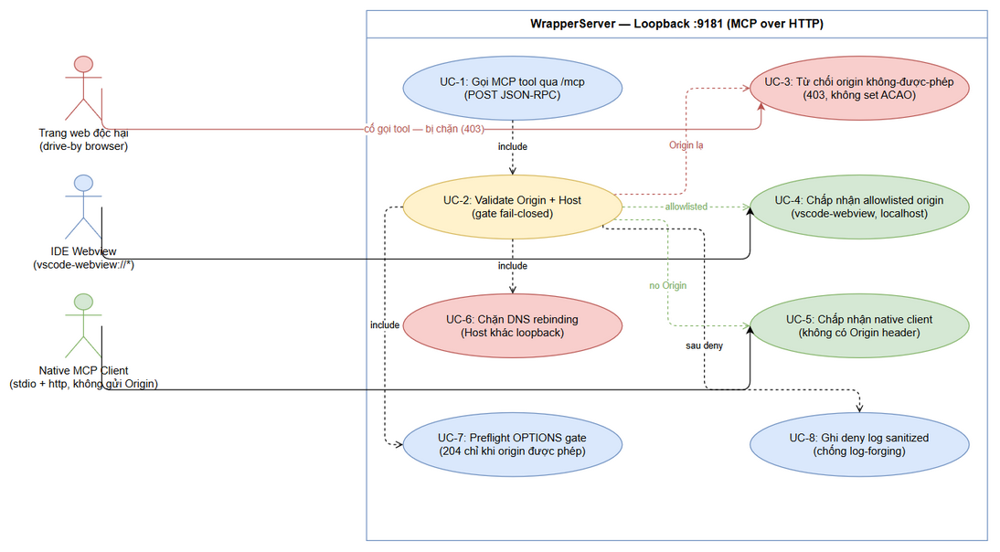
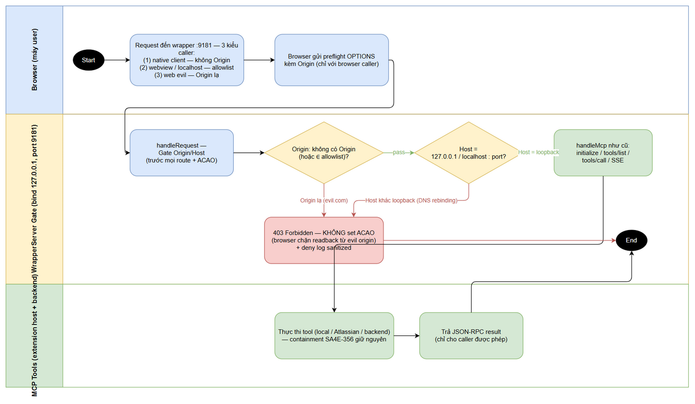

# Business Requirements Document (BRD)

## SA4E-358 — [Follow-up SA4E-356/SA-01] CORS * + no authN trên loopback :9181 — Origin/Host validation

---

## Document Information

| Field | Value |
|-------|-------|
| Jira Ticket | SA4E-358 |
| Title | [Follow-up SA4E-356/SA-01] CORS * + no authN trên loopback :9181 — Origin/Host validation |
| Author | BA Agent |
| Version | 1.0 |
| Date | 2026-10-13 |
| Status | Draft |
| Issue Type | Task |
| Priority | Medium |
| Labels | cors, follow-up, hardening, loopback, security |
| Reporter / Creator | Duc Nguyen Minh |
| Project | SA4E — SDLC Agents 4 Enterprise |

---

## Author Tracking

| Role | Name - Position | Responsibility |
|------|-----------------|----------------|
| Author | BA Agent – Business Analyst | Tạo tài liệu — phân tích threat model + phạm vi |
| Peer Reviewer | Duc Nguyen Minh – Reporter / Requirements Owner | Rà soát và xác nhận tài liệu |
| Security Reviewer | Security Agent | Xác nhận scope giải pháp phù hợp finding SA-01 (AC-3) |

---

## Revision History

| Version | Date | Author | Changes |
|---------|------|--------|---------|
| 1.0 | 2026-10-13 | BA Agent | Khởi tạo tài liệu — tự động sinh từ Jira ticket SA4E-358 + SECURITY-ASSESSMENT.md SA4E-356 finding SA-01 (Medium, pre-existing) + PENTEST-REPORT.md SA4E-356 (live-confirmed) + xác minh code WrapperServer.ts trên main |

---

## Sign-Off

| Name | Signature and date |
|------|--------------------|
| | ☐ Tôi đồng ý và xác nhận toàn bộ tiêu chí trong BRD này là yêu cầu kỳ vọng |
| | ☐ Tôi đồng ý và xác nhận toàn bộ tiêu chí trong BRD này là yêu cầu kỳ vọng |

---

## 1. Introduction

### 1.1 Problem Statement — Threat Model (ai tấn công, qua đâu, hậu quả)

**Nguồn:** SECURITY-ASSESSMENT.md SA4E-356 (Phase 5.7) — finding **SA-01**, severity **Medium**, **PRE-EXISTING** (không nằm trong diff commit bb17b39). Pentest Phase 6.3 của SA4E-356 đã **live-confirmed** trên server :9181 thật: response header `Access-Control-Allow-Origin: *`, preflight OPTIONS trả 204, kênh SSE GET /mcp không có authentication.

#### 1.1.1 Ai tấn công (Attacker)

| Attacker | Mô tả | Khả năng |
|----------|-------|----------|
| Trang web độc hại (drive-by) | Bất kỳ tab/iframe/quảng cáo nào trong browser của user trên cùng máy — không cần cài đặt gì, chỉ cần user visit một trang | Gửi cross-origin request đến loopback từ JavaScript trong trang; **luôn** kèm header `Origin` do browser kiểm soát |
| Attacker DNS rebinding | Domain attacker cấu hình DNS trỏ về 127.0.0.1 sau khi user truy cập | Request xuất hiện same-origin (đi qua hostname attacker) nhưng thực chất chạm wrapper loopback |
| Web content điều khiển agent (prompt injection) | Nội dung web được agent đọc (web fetch, attachment) chứa chỉ thị độc | Không tự gọi được HTTP, nhưng thúc đẩy chuỗi attack khi kết hợp 2 vector trên |

**Không nằm trong threat model:** malware cục bộ đã có quyền user (đọc memory/file trực tiếp — vượt phạm vi), user độc hại trên chính máy (giả định design review SA4E-356), attacker từ mạng remote (wrapper bind 127.0.0.1 — đã xác minh `WrapperServer.ts:98`).

#### 1.1.2 Qua đâu (Attack Vector) — hiện trạng đã xác minh trên main

MCP wrapper server chạy trong extension host, listen loopback (mặc định port 9181, configurable), expose MCP JSON-RPC qua HTTP:

| # | Hiện trạng code (WrapperServer.ts, verified 2026-10-13) | Hệ quả security |
|---|----------------------------------------------------------|-----------------|
| 1 | Dòng 126: `res.setHeader("Access-Control-Allow-Origin", "*")` — trả cho MỌI response | Browser cho phép JavaScript của **bất kỳ origin nào** đọc được response body |
| 2 | Dòng 127-128: Allow-Methods GET/POST/OPTIONS, Allow-Headers Content-Type | Preflight của method POST + header Content-Type luôn được thông qua |
| 3 | Dòng 129: `OPTIONS → 204` **vô điều kiện** | Preflight từ web origin độc hại pass 100% |
| 4 | Dòng 156-201 (`handleMcp` POST): initialize / ping / tools/list / tools/call — **không có token/auth check nào** | Bất kỳ process/request nào chạm được loopback đều gọi được toàn bộ MCP tools |
| 5 | Dòng 207-225 (`handleMcpGet` SSE): GET /mcp mở stream — không auth | Kênh server-initiated messages mở cho ai kịp kết nối |
| 6 | Dòng 98: `srv.listen(requestedPort, "127.0.0.1")` — **đã bind đúng 127.0.0.1** | Chặn attacker remote từ mạng — nhưng KHÔNG chặn browser trên cùng máy (browser chạy localhost) |

**Chuỗi tấn công drive-by (đã live-confirmed Phase 6.3):**

```
User visit trang độc hại (evil.com)
  → JS trong trang: fetch("http://127.0.0.1:9181/mcp", {method:"POST", body: JSON-RPC tools/call})
  → Browser gửi preflight OPTIONS (Origin: https://evil.com) → wrapper trả 204 + ACAO *  → PASS
  → Browser gửi POST thật → wrapper thực thi tool → trả result
  → Nhờ ACAO *, browser CHO PHÉP evil.com ĐỌC response body
```

#### 1.1.3 Hậu quả (Business Impact — Medium)

1. **Đọc cúp dữ liệu Atlassian (cross-origin readback):** các tool Jira/Confluence dùng session/credential của user extension-side; attacker page đọc thẳng kết quả `jira_get_issue`, `jira_get_attachments`, `confluence_get_comments`... trong chính context của user.
2. **Trigger side-effect qua local tools:** gọi `stream_write_file` (ghi file **trong** workspace), `jira_attach_file` (upload file workspace lên Jira của user), `drawio_export_png`... — containment mới của SA4E-356 đã chặn đọc/ghi **ngoài** workspace, nhưng (a) readback Atlassian-data và (b) side-effect trong-workspace vẫn mở.
3. **Prompt injection từ web content driving local tools:** nội dung web độc hại có thể được thiết kế để thúc đẩy việc gọi tools — kết hợp với vector HTTP mở, chuỗi attack hoàn chỉnh từ "user visit 1 trang" đến "dữ liệu bị lấy/sửa".
4. **Điều kiện kích hoạt chỉ là:** user mở extension (wrapper đang listen) + visit 1 trang web — không cần thao tác gì thêm.

#### 1.1.4 Phân loại lỗi

| Chuẩn | Mã |
|-------|-----|
| CWE-942 | Permissive Cross-domain Policy with Untrusted Domains |
| CWE-346 | Origin Validation Error |
| CWE-350 | Reliance on Reverse DNS Resolution for a Security-Critical Decision (DNS rebinding variant) |
| OWASP 2021 | A01 Broken Access Control · A05 Security Misconfiguration |

### 1.2 Root Cause — Nguyên nhân gốc (mức business)

Wrapper server được thiết kế cho kịch bản "local MCP client tin tưởng" (design review Phase 3.7 SA4E-356 đánh giá "attacker remote không chạm được loopback") — nhưng **đã bỏ sót kịch bản drive-by-qua-browser**: browser trên cùng máy là một "remote client" hợp lệ về mặt mạng (loopback) nhưng KHÔNG đáng tin về mặt origin.

Cụ thể, khi bổ sung CORS support cho webview/client, server trả `Access-Control-Allow-Origin: *` **một cách vô điều kiện** cho mọi request (kể cả 404, kể cả preflight) và không bao giờ kiểm tra:

1. **Header `Origin`** — request từ đâu (browser luôn gửi Origin cho cross-origin request và không thể giả mạo từ JavaScript);
2. **Header `Host`** — request có thực sự nhắm vào loopback hay không (DNS rebinding làm Host là domain attacker).

Do đó ranh giới tin cậy thực tế của server hiện tại = "mọi thứ chạy trên máy user", thay vì "các MCP client hợp lệ của extension".

### 1.3 Business Objectives — Mục tiêu nghiệp vụ

| # | Mục tiêu | Đo lường / Verification |
|---|----------|-------------------------|
| BO-1 | Đóng kênh cross-origin readback: browser của origin không-được-phép KHÔNG đọc được response từ wrapper | Request có Origin ngoài allowlist → HTTP 403 + response KHÔNG chứa header ACAO (AC-1, AC-8) |
| BO-2 | Chặn tool-abuse từ web: trang web độc hại không gọi được MCP tools qua HTTP | Preflight + POST từ evil origin bị từ chối trước khi chạm `handleMcp` (AC-1) |
| BO-3 | Chặn DNS rebinding: request không nhắm loopback bị từ chối | Host ≠ 127.0.0.1/localhost:<port> → 403 (AC-5) |
| BO-4 | Zero regression: MCP clients hiện có (stdio + http) hoạt động như trước, không cần đổi config | Regression suite + live test clients hiện có (AC-2, AC-4) |
| BO-5 | Compliance: change bảo mật phải qua security review độc lập trước khi deploy | Security review verdict = PASS cho change (AC-3) |

### 1.4 Scope — Phạm vi (quyết định BA trên các giải pháp đề xuất của ticket)

Ticket đề xuất 4 hướng. BA đánh giá từng hướng theo **risk được đóng vs complexity gây ra**:

| # | Giải pháp đề xuất (từ Jira SA4E-358) | Quyết định BA | Lý do (risk vs complexity) |
|---|--------------------------------------|---------------|----------------------------|
| 1 | **Origin/Host validation** — chỉ chấp nhận Origin từ `vscode-webview://*` và localhost; từ chối còn lại | ✅ **IN SCOPE — core fix** | Đóng đúng và đủ vector drive-by browser (browser không thể giả mạo Origin); chi phí thấp (header check trong `handleRequest`, không đổi kiến trúc); trực tiếp đáp ứng AC-1/AC-2. Bỏ `ACAO *`, thay bằng echo ACAO **chỉ khi** Origin ∈ allowlist — hệ quả trực tiếp của validation (AC-8) |
| 2 | **Binding 127.0.0.1 thay vì 0.0.0.0/loopback-wide** | ✅ **IN SCOPE — verify-only (không cần code change)** | **Xác minh code hiện tại đã bind `127.0.0.1`** (`WrapperServer.ts:98` — server dính finding, phải "verify-only", không có code change; ticket viết theo giả định 0.0.0.0 không khớp hiện trạng). Yêu cầu: giữ nguyên invariant + thêm test chặn regression |
| 3 | **Shared-secret header cho local clients** | ⏭️ **OUT OF SCOPE → follow-up** (đánh giá lại sau security review AC-3) | Defense-in-depth cho mối đe dọa thấp hơn (process cục bộ ngoài browser). Chi phí cao: phải sinh/phân phối token đến MỌI MCP client (config migration cho http clients) → xung đột trực tiếp với AC-4 "không break clients". Origin gate đã đóng vector browser chính. Security review AC-3 sẽ chốt có cần thiết thêm không |
| 4 | **CSRF-style token cho stateful calls** | ⏭️ **OUT OF SCOPE → follow-up** | Wrapper KHÔNG dùng cookie/session-auth → không có credential tự động-attach của browser cho attacker mượn → bề mặt CSRF kinh điển không tồn tại; mitigation đúng cho surface này chính là Origin validation (mục 1). Thêm token stateful = phức tạp client không cần thiết ở bước này |

> **Tóm tắt scope:** Làm (1) Origin/Host validation + bỏ ACAO * (core fix), giữ nguyên (2) binding invariant. Kéo (3) và (4) ra follow-up — rà soát lại tại security review (AC-3) và tạo ticket riêng nếu được yêu cầu.

### 1.5 Out of Scope — Ngoài phạm vi

- Shared-secret header / token authentication cho `/mcp` (đề xuất #3 — xem 1.4; follow-up nếu security review yêu cầu).
- CSRF-style token cho stateful calls (đề xuất #4 — xem 1.4; follow-up).
- Thay đổi kiến trúc WrapperServer (vẫn Node http, cùng port retry/EADDRINUSE logic, cùng socket force-close on stop).
- Thay đổi hành vi nghiệp vụ của bất kỳ MCP tool nào (tools/list, tools/call, envelope lỗi PathResolverError của SA4E-356 giữ nguyên).
- Thêm setting user-facing (UI) cho allowlist — allowlist là constant có cấu trúc trong code, mở rộng qua code change (nhẹ, có unit test).
- Authentication cho stdio transport (stdio không đi qua HTTP — không nằm trong bề mặt này).
- Fix các finding khác của SA4E-356 (SA-02..SA-07 — đã có phân bổ riêng trong SECURITY-ASSESSMENT.md).

### 1.6 Preliminary Requirements — Yêu cầu tiền đề

- Codebase extension truy cập được tại `extension/src/` (branch main); fix SA4E-356 (path resolution + envelope) **đã live trên main** — điều kiện kế thừa đã thỏa.
- Fix path resolution ĐÃ LIVE: MCP tools nhận `file_path` resolve relative theo workspace root đúng (môi trường dev/test hiện tại dùng được relative path bình thường).
- Pentest harness của SA4E-356 tồn tại và chạy được: `documents/SA4E-356/testdata/pentest-harness.ts` (pattern live-HTTP test cho :9181 — tái sử dụng cho verification AC-1).
- Unit test framework (vitest) sẵn sàng trong extension repo; wrapper-server test suite hiện có (`wrapper-server.test.ts` TC-28/29) làm nền mở rộng.
- MCP clients hiện có để regression: SDLC agents qua stdio + VS Code/Kiro MCP HTTP client (`/mcp` + SSE).
- Security Agent khả dụng cho review gate (AC-3) theo pipeline Phase 5.7.

---

## 2. Business Requirements

### 2.1 High Level Process Map

Quy trình nghiệp vụ **sau khi fix**: mọi HTTP request đến wrapper phải qua **gate Origin/Host** ở đầu vào `handleRequest` — request không có Origin (native MCP client) hoặc Origin thuộc allowlist (`vscode-webview://*`, `http://localhost:*:*`, `http://127.0.0.1:*`) VÀ Host là loopback → đi tiếp `handleMcp` như cũ. Mọi request khác → **403 Forbidden**, response không trả ACAO (browser tự chặn việc đọc response từ phía origin attacker), kèm log deny (đã sanitize).

Sơ đồ use case (actors và capabilities của hệ thống):


*[Edit in draw.io](diagrams/use-case.drawio)*

Sơ đồ luồng nghiệp vụ chi tiết (swimlane 3 bên: Browser máy user — WrapperServer Gate — MCP Tools):


*[Edit in draw.io](diagrams/business-flow.drawio)*

### 2.2 List of User Stories / Use Cases

| # | Story / Use Case | Priority | Source Ticket |
|---|------------------|----------|---------------|
| 1 | As an Extension Security Owner, I want WrapperServer từ chối (403) mọi request có Origin/Host không hợp lệ trước khi chạm MCP handler so that trang web độc hại trong browser không gọi được tools và không đọc được dữ liệu | MUST HAVE | SA4E-358 (AC-1, AC-5, AC-8) |
| 2 | As an IDE Webview / Local Web Client, I want request từ vscode-webview và localhost vẫn được chấp nhận (preflight pass, response có ACAO đúng) so that các tính năng web-side của extension hoạt động bình thường | MUST HAVE | SA4E-358 (AC-2) |
| 3 | As an SDLC AI Agent (MCP client — stdio + http), I want wrapper tiếp tục hoạt động chính xác như hiện tại với clients hợp lệ (native client không gửi Origin vẫn vào được /mcp, SSE vẫn mở, binding 127.0.0.1 giữ nguyên) so that pipeline SDLC không bị gián đoạn và không phải đổi config | MUST HAVE | SA4E-358 (AC-4, AC-7) |
| 4 | As a Security Reviewer, I want change được chứng minh bằng unit tests + live pentest-harness replay (attacker-red-then-green) và pass security review độc lập so that việc deploy change có bằng chứng bảo mật khách quan | MUST HAVE | SA4E-358 (AC-3) |

---

### 2.3 Details of User Stories

---

#### Business Flow — Threat Flow (trước/sau fix)

**Luồng hiện trạng (attacker thành công — đã live-confirmed Phase 6.3 SA4E-356):**

**Step 1:** User mở extension (WrapperServer đang listen `127.0.0.1:9181`).

**Step 2:** User visit trang web độc hại (evil.com) — JS trong tab gửi `fetch("http://127.0.0.1:9181/mcp", POST, JSON-RPC tools/call)`.

**Step 3:** Browser gửi preflight `OPTIONS` (Origin: https://evil.com) → wrapper trả **204 + ACAO * vô điều kiện** → preflight PASS.

**Step 4:** Browser gửi POST thật → `handleRequest` → `handleMcp` thực thi tool (không có auth check).

**Step 5:** Nhờ ACAO *, browser cho phép evil.com **đọc response** → dữ liệu Atlassian rò rỉ / side-effect ghi file trong workspace đã xảy ra.

**Luồng sau fix (fail-closed gate):**

**Step 1:** (như trên) Wrapper đang listen — binding giữ nguyên `127.0.0.1` (AC-7).

**Step 2:** JS trang độc hại gửi preflight `OPTIONS` (Origin: https://evil.com).

**Step 3:** Gate kiểm tra: Origin `https://evil.com` ∉ allowlist → trả **403 Forbidden**, KHÔNG set ACAO → browser chặn cả preflight lẫn POST; attacker không đọc được bất kỳ response nào (BO-1, AC-1, AC-8).

**Step 4:** Trường hợp DNS rebinding: request đến từ hostname attacker → `Host: attacker.com:9181` ≠ `127.0.0.1:9181`/`localhost:9181` → **403** (BO-3, AC-5).

**Step 5:** Native MCP client (VS Code/Kiro, không gửi Origin header) → gate cho qua (no-Origin = native) → `handleMcp` như cũ (BO-4, AC-2, AC-4).

**Step 6:** Webview hợp lệ (`Origin: vscode-webview://<id>`) hoặc localhost (`http://localhost:<port>`) → Origin ∈ allowlist + Host loopback → cho qua, ACAO echo đúng origin được phép (BO-4, AC-2).

**Step 7:** Mọi lần từ chối → log deny vào outputChannel (message đã sanitize — chống log-forging theo pattern SEC-05 SA4E-356).

> **Note:** Gate đặt ở `handleRequest` (đầu vào duy nhất của server) — áp cho TẤT CẢ routes (`/mcp` POST, `/mcp` GET SSE, `/health`, 404) theo nguyên tắc fail-closed; riêng `/health` không trả dữ liệu nhạy cảm nhưng vẫn áp cùng rule để giữ logic đơn giản, nhất quán. Response 403 trả body JSON rút gọn, không leak chi tiết cấu hình allowlist.

---

#### STORY 1: Gate Origin/Host validation — từ chối cross-origin không-được-phép

> As an Extension Security Owner, I want WrapperServer từ chối (403) mọi request có Origin/Host không hợp lệ trước khi chạm MCP handler so that trang web độc hại trong browser không gọi được tools và không đọc được dữ liệu.

**Requirement Details:**

1. Thêm gate ở `handleRequest` (extension/src/services/WrapperServer.ts) chạy **trước** mọi route handling và **trước** khi set ACAO.
2. Quy tắc Origin (theo thứ tự):
   - Request **không có header `Origin`** → cho qua (native MCP client — stdio/http client của VS Code/Kiro không gửi Origin);
   - `Origin` khớp allowlist (STORY 2) → cho qua;
   - `Origin` khác → **403 Forbidden**, không set ACAO, không route tiếp.
3. Quy tắc Host (chặn DNS rebinding): khi request CÓ `Origin`, `Host` phải là `127.0.0.1:<port>` hoặc `localhost:<port>` (port = port đang listen); Host khác → **403**. (Request không có Origin — native client — không cần check Host chặt, giữ hành vi hiện tại.)
4. Bỏ `Access-Control-Allow-Origin: *` vô điều kiện (dòng 126 hiện tại) — ACAO chỉ được set khi Origin ∈ allowlist, giá trị echo đúng Origin đó (không dùng `*` kể cả cho allowlist).
5. Preflight `OPTIONS`: chỉ trả **204 + Allow-Methods + Allow-Headers + ACAO echo** khi Origin được phép; còn lại → **403**.
6. Gate áp cho mọi method/route (`/mcp` POST + GET SSE, `/health`, fallback 404) — fail-closed.
7. Không đổi: envelope lỗi PathResolverError (SA4E-356), body limit 1 MB, protocol negotiation, `routeToolCall`, SSE keep-alive, port retry logic, socket force-close.

**Data Fields (headers do gate tiêu thụ):**

| Field | Type | Required | Description | Example |
|-------|------|----------|-------------|---------|
| Origin | string (HTTP header) | No (browser gửi cho cross-origin) | Origin của caller — dấu hiệu quyết định allow/deny | `https://evil.com` (deny) · `vscode-webview://abc123` (allow) |
| Host | string (HTTP header) | Yes (HTTP/1.1 bắt buộc) | Hostname:port mà request nhắm tới — chặn DNS rebinding | `127.0.0.1:9181` (allow) · `attacker.com:9181` (deny) |
| Access-Control-Allow-Origin | string (response header) | — | Chỉ set khi Origin ∈ allowlist, echo giá trị Origin | `vscode-webview://abc123` |
| Access-Control-Request-Method / -Headers | string (HTTP header) | No | Chỉ dùng cho preflight OPTIONS | `POST` / `Content-Type` |

**Acceptance Criteria:**

1. **(AC-1 — Jira)** Request cross-origin từ web origin không-được-phép (ví dụ `Origin: https://evil.com`) bị từ chối **403** — cả preflight OPTIONS lẫn POST /mcp, trước khi chạm `handleMcp`.
2. **(AC-5 — BA mở rộng)** Request có `Host` không phải loopback (`127.0.0.1:<port>`/`localhost:<port>`) khi có Origin → **403** (chặn DNS rebinding).
3. **(AC-8 — BA mở rộng)** Response cho origin không-được-phép **KHÔNG chứa header `Access-Control-Allow-Origin`** → browser chặn readback ngay cả khi có lỗ hổng route-song song; không còn `ACAO: *` ở bất kỳ response nào (kể cả 404/health).

**UI Specifications:** N/A (backend HTTP server behavior — không có UI).

**Validation Rules:**

- So sánh Origin theo scheme+host+port chính xác; allowlist dạng pattern theo scheme (STORY 2) — không dùng substring matching (tránh bypass `https://evil.com/?x=vscode-webview://`).
- Parse Origin/Host an toàn (malformed header → deny, không throw).
- Host check dùng case-insensitive cho hostname, so khớp port chính xác với port đang listen.

**Error Handling:**

- Origin/Host không hợp lệ: HTTP **403** + body JSON rút gọn `{"error":"Forbidden"}` — không leak allowlist config, không echo giá trị header attacker.
- Header malformed (Origin không parse được thành URL hợp lệ): deny 403 (fail-closed) — không exception thoát ra ngoài làm crash server.
- Mỗi deny ghi 1 dòng log outputChannel: `[WrapperServer] Denied request — reason=<origin-not-allowed|host-mismatch>` (KHÔNG echo raw header giá trị tùy ý — sanitize ký tự control `[\r\n\0]` theo pattern `sanitizeLogText` SA4E-356 để chống log-forging).

---

#### STORY 2: Allowlist origin hợp lệ — vscode-webview, localhost, native client

> As an IDE Webview / Local Web Client, I want request từ vscode-webview và localhost vẫn được chấp nhận (preflight pass, response có ACAO đúng) so that các tính năng web-side của extension hoạt động bình thường.

**Requirement Details:**

1. Allowlist mặc định (constant có cấu trúc, dễ mở rộng qua code change):
   - `vscode-webview://*` — mọi webview của VS Code/Kiro (origin có ID ngẫu nhiên theo phiên);
   - `http://localhost:<bất kỳ port>` và `https://localhost:<bất kỳ port>`;
   - `http://127.0.0.1:<bất kỳ port>`.
2. Request **không có `Origin`** → mặc định cho qua (native MCP client) — không cần nằm allowlist.
3. ACAO response: echo đúng Origin được phép (không `*`); `Access-Control-Allow-Methods: GET, POST, OPTIONS` và `Access-Control-Allow-Headers` giữ mức cần thiết cho client hợp lệ (hiện tại `Content-Type`; bổ sung header MCP nếu client thật cần — xác định qua regression live).
4. Kênh SSE GET /mcp áp cùng gate (AC-6): stream chỉ mở cho caller được phép.
5. Không thêm setting UI trong ticket này; allowlist là constant, thay đổi qua code + unit test.

**Acceptance Criteria:**

1. **(AC-2 — Jira)** Request từ `vscode-webview://*` và localhost được chấp nhận: preflight trả 204 + ACAO echo, POST /mcp thực thi bình thường, SSE GET /mcp mở stream bình thường.
2. **(AC-6 — BA mở rộng)** GET /mcp (SSE) áp cùng gate — origin không-được-phép không mở được stream.

**UI Specifications:** N/A.

**Validation Rules:**

- `vscode-webview://*` khớp theo **scheme** (prefix `vscode-webview://` + bất kỳ host ID) — pattern-based, không đếm được trước số ID.
- localhost/127.0.0.1 khớp với bất kỳ port; hostname so khớp case-insensitive.
- Origin có port nhưng khác scheme/hỏng cấu trúc → không khớp → deny.

**Error Handling:**

- Origin hợp lệ nhưng thiếu Host loopback → 403 theo STORY 1 (rule 3) — message log `host-mismatch`.
- Client hợp lệ bị deny do allowlist thiếu pattern → error 403 rõ ràng phía client + log deny `origin-not-allowed` → Dev/BA cập nhật constant trong 1 commit nhỏ (risk R-1/R-2).

---

#### STORY 3: Zero regression — MCP clients hiện có (stdio + http) không bị break

> As an SDLC AI Agent (MCP client — stdio + http), I want wrapper tiếp tục hoạt động chính xác như hiện tại với clients hợp lệ so that pipeline SDLC không bị gián đoạn và không phải đổi config.

**Requirement Details:**

1. **Stdio transport:** không đi qua HTTP server → gate không được ảnh hưởng đường stdio (xác minh bằng test hiện có + smoke test).
2. **HTTP transport (native MCP client — VS Code/Kiro):** client không gửi Origin header (assumption A-1 — verify ở Phase 2/6) → cho qua theo rule "no-Origin". Nếu regression phát hiện client thật có gửi Origin (ví dụ localhost origin) → vẫn pass vì localhost ∈ allowlist — hai lớp bảo vệ cho AC-4.
3. Handshake MCP giữ nguyên: `initialize` (protocol version negotiation), `notifications/initialized`, `ping`, `tools/list` (schema rewrite Base64Proxy), `tools/call` (routeToolCall + envelope PathResolverError của SA4E-356) — hành vi byte-level không đổi cho caller được phép.
4. Binding invariant (AC-7): giữ nguyên `listen(port, "127.0.0.1")` (WrapperServer.ts:98) — thêm unit test assert bind address để chặn regression về 0.0.0.0 (biến "đề xuất binding" của ticket thành verify-only, xem 1.4).
5. Không yêu cầu config migration bắt buộc cho client nào (nếu security review sau này yêu cầu shared-secret → tách follow-up theo 1.4).
6. Giữ nguyên hành vi vận hành hiện có: port retry EADDRINUSE (10 lần), socket force-close on stop, SSE keep-alive 15s, body limit 1 MB.

**Acceptance Criteria:**

1. **(AC-4 — Jira)** MCP clients hiện có (stdio + http) hoạt động không lỗi sau change: initialize/tools list/tools call/SSE flow pass — không đổi config client.
2. **(AC-7 — BA mở rộng)** Binding 127.0.0.1 giữ nguyên + được assert bởi test (không thể hồi quy về 0.0.0.0 âm thầm).

**UI Specifications:** N/A.

**Validation Rules:**

- Full regression suite wrapper-server hiện có (TC-28/29...) + tool-proxy suite pass 100%.
- Smoke test live: SDLC agent chạy end-to-end 1 workflow file-based (ví dụ ingest + export PNG) qua wrapper sau change.

**Error Handling:**

- Nếu regression fail do client thật gửi Origin ngoài allowlist → xử lý theo R-2/R-3: cập nhật allowlist pattern (code) — KHÔNG nới lỏng rule thành `*` (no-workaround-rule).

---

#### STORY 4: Verification — unit tests + live pentest harness + security review

> As a Security Reviewer, I want change được chứng minh bằng unit tests + live pentest-harness replay (attacker-red-then-green) và pass security review độc lập so that việc deploy change có bằng chứng bảo mật khách quan.

**Requirement Details:**

1. **Unit tests (vitest)** bắt buộc — matrix tối thiểu:

| # | Test case | Kỳ vọng |
|---|-----------|---------|
| T1 | POST /mcp với `Origin: https://evil.com` | 403, không ACAO, tool không thực thi |
| T2 | OPTIONS preflight với `Origin: https://evil.com` | 403 (không 204) |
| T3 | POST /mcp không có Origin (native client) | 200, JSON-RPC result bình thường |
| T4 | OPTIONS preflight với `Origin: vscode-webview://abc` | 204 + ACAO echo `vscode-webview://abc` |
| T5 | POST /mcp với `Origin: http://localhost:3000` | 200 + ACAO echo |
| T6 | POST /mcp có Origin + `Host: attacker.com:9181` | 403 (DNS rebinding bị chặn) |
| T7 | GET /mcp (SSE) với Origin không-được-phép | 403, không mở stream |
| T8 | Bind address assertion | server bind `127.0.0.1` (AC-7) |
| T9 | Deny log không chứa ký tự control từ header attacker | log sanitized (anti log-forging) |
| T10 | Malformed Origin (`%%`, rỗng, không parse được) | 403 fail-closed, không crash |

2. **Live verification (pentest harness)** — tái sử dụng pattern `documents/SA4E-356/testdata/pentest-harness.ts` (P6 live-HTTP test cho :9181): mở server thật, chạy attacker-red (pre-fix behavior) rồi green (post-fix): preflight evil → 204 → 403; POST evil → result → 403; readback chặn; native client + webview vẫn pass. Kết quả ghi CSV tương tự `pentest-results.csv` SA4E-356.
3. **Security review (AC-3):** change pass review độc lập của Security Agent (pattern Phase 5.7 SA4E-356) trước khi deploy — reviewer xác nhận: gate đặt đúng layer, không bypass route, allowlist không có pattern quá rộng, log an toàn, và chốt dứt khoát whether shared-secret/CSRF cần follow-up.
4. Evidence (test output + log + CSV) lưu tại `documents/SA4E-358/testdata/`.

**Acceptance Criteria:**

1. **(AC-3 — Jira)** Security review pass cho change (verdict không còn finding Medium trở lên liên quan CORS/Origin trên surface :9181).

**UI Specifications:** N/A.

**Validation Rules:**

- T1..T10 phải PASS 100% trước khi mở security review.
- Live harness phải chạy trên server thật (không mock transport), đúng pattern SA4E-356.

**Error Handling:**

- Harness phát hiện vector bypass mới (ví dụ header casing trick `origin:`, multiple Origin headers) → ghi FINDING + xử lý trong ticket (gate phải lowercase/normalize header trước so khớp; Node http đã cung cấp headers object lower-cased — assert điều này).

---

## 3. Dependencies

| Dependency | Type | Related Ticket | Description |
|------------|------|----------------|-------------|
| Fix SA4E-356 đã live (path resolution + envelope + containment) | System | SA4E-356 | Điều kiện kế thừa: threat surface của SA-01 đã được giảm bởi containment (FS ngoài workspace bị chặn); ticket này đóng nốt kênh readback Atlassian + side-effect in-workspace |
| WrapperServer code | System | SA4E-358 | `extension/src/services/WrapperServer.ts` — gate đặt tại `handleRequest` (:124-144); giữ nguyên các cơ chế vận hành (port retry :59-84, socket force-close :108-122, SSE :207-225) |
| Pentest harness pattern | External | SA4E-356 | `documents/SA4E-356/testdata/pentest-harness.ts` — pattern live-HTTP test :9181 tái sử dụng cho AC-1 verification (STORY 4) |
| Security review gate | Compliance | SA4E-356 (SECURITY-ASSESSMENT.md) | AC-3 — security review bắt buộc trước deploy (comment trên Jira SA4E-358: "Security review riêng bắt buộc trước khi deploy change") |
| MCP clients hiện có | External | SA4E-358 | SDLC agents (stdio) + VS Code/Kiro MCP HTTP client — phục vụ regression AC-2/AC-4 |
| vitest test framework | System | N/A | Unit tests T1..T10 (STORY 4) |
| Extension host (VS Code / Kiro) | Infrastructure | N/A | Runtime của WrapperServer; Node http API cho header access |

---

## 4. Stakeholders

| Role | Name / Team | Responsibility | Source |
|------|-------------|----------------|--------|
| Reporter / Creator | Duc Nguyen Minh | Requirements owner — tạo ticket từ finding SA-01, verify kết quả | SA4E-358 (Jira reporter) |
| Scrum Master (SM) | SM Agent | Điều phối pipeline, gắn tài liệu lên Jira, quản lý follow-up tickets | SA4E-358 |
| BA Agent | BA Agent | Tác giả BRD — threat model + quyết định scope (1.4) | SA4E-358 |
| DEV Agent (Extension Developer) | DEV team | Implement gate Origin/Host + bỏ ACAO * + unit tests T1..T10 | SA4E-358 (STORY 1, 2, 3) |
| QA Agent | QA team | Regression clients hiện có + live harness replay (evidence AC-1/AC-2/AC-4) | SA4E-358 (STORY 4) |
| Security Agent | Security team | Security review độc lập cho change (AC-3) — gate bắt buộc trước deploy | SA4E-358 (comment) + SA4E-356 Phase 5.7 pattern |
| End users | SDLC pipeline agents + người dùng extension | Được bảo vệ: dữ liệu Atlassian/session trong context extension không thể bị cúp từ browser | SA4E-358 |

---

## 5. Risks and Assumptions

### 5.1 Risks

| # | Risk | Impact | Likelihood | Mitigation |
|---|------|--------|------------|------------|
| R-1 | Allowlist thiếu variant origin hợp lệ của IDE/fork VS Code khác (scheme webview khác) → webview client hợp lệ bị 403 | Medium | Medium | Allowlist pattern-based theo scheme (dễ thêm); T4 coverage; error 403 + log `origin-not-allowed` giúp chẩn đoán nhanh; cập nhật constant là code change nhỏ |
| R-2 | MCP HTTP client hợp lệ gửi Origin ngoài allowlist (vd Electron app, port bất kỳ) → break AC-4 | High | Low | localhost + 127.0.0.1 (mọi port) đã nằm allowlist (lớp bảo vệ 1); no-Origin rule cho native client (lớp bảo vệ 2); regression live bắt buộc trước merge (STORY 3) |
| R-3 | Giả định A-1 sai (native client thật có gửi Origin lạ) → gate chặn oan client hiện có | High | Medium | Verify A-1 ở Phase 2 (đọc client config/code) + regression live trước merge; nếu có → thêm pattern vào allowlist theo R-2; tuyệt đối không nới `*` |
| R-4 | Log-forging qua giá trị Origin/Host trong deny log | Low | Medium | Sanitize `[\r\n\0]→?` theo pattern `sanitizeLogText` SA4E-356 (SEC-05) + test T9 |
| R-5 | Đổi preflight/allow-headers làm client có custom headers (mcp-session-id...) fail sau khi pass gate | Medium | Low | Chỉ siết theo Origin; Allow-Headers cho origin được phép giữ mức hiện tại + bổ sung theo regression thực tế; T4/T5 assert |
| R-6 | Bypass qua header trick (multiple Origin headers, casing, whitespace) | Medium | Low | Node http đã lowercase header keys — assert trong test (T10 mở rộng); deny khi có >1 giá trị Origin; normalize trước so khớp; live harness thử vector này |
| R-7 | Scope creep — shared-secret/CSRF bị kéo vào ticket làm trễ + nguy cơ break clients | Medium | Medium | Chốt OUT OF SCOPE tại 1.4; security review AC-3 quyết định follow-up; SM tạo ticket riêng khi cần |
| R-8 | Đề xuất "binding 127.0.0.1" trong ticket không khớp hiện trạng (đã bind đúng) → nhầm lẫn khi implement | Low | — | BRD ghi rõ verify-only (1.4 mục 2, AC-7) — DEV chỉ thêm test assert, không đổi bind |

### 5.2 Assumptions

- **A-1:** Native MCP HTTP clients (VS Code/Kiro) không gửi header `Origin` cho request initialize/tools — cần verify ở Phase 2/6 (nếu có gửi thì là localhost → vẫn pass allowlist).
- **A-2:** Stdio clients không đi qua HTTP server → không chịu tác động của gate.
- **A-3:** Binding hiện trạng `127.0.0.1` (WrapperServer.ts:98) là chủ đích design và giữ nguyên — verified 2026-10-13.
- **A-4:** Wrapper không dùng cookie/session browser → không có bề mặt CSRF kinh điển; Origin validation là mitigation đúng và đủ cho vector browser (cơ sở cho quyết định out-of-scope đề xuất #4).
- **A-5:** Threat model giữ nguyên từ design review SA4E-356: drive-by browser trên máy user; KHÔNG chống malware cục bộ có quyền user; KHÔNG chống user độc hại trên chính máy.
- **A-6:** Allowlist quản lý dạng constant trong code là đủ cho hiện trạng (1 webview scheme + localhost); nhu cầu cấu hình runtime (setting UI) chưa phát sinh.

---

## 6. Non-Functional Requirements

| Category | Requirement | Details |
|----------|-------------|---------|
| Security | Fail-closed, default deny | Gate mọi route (/mcp POST + GET SSE, /health, 404); mọi case không chắc chắn (malformed header, multiple Origin) → deny; không còn `ACAO: *` ở bất kỳ response nào (AC-8) |
| Security | Không leak cấu hình | Response 403 body rút gọn; deny log không echo raw header attacker (anti log-forging, R-4) |
| Security | Giữ nguyên containment SA4E-356 | Gate bổ sung — không thay đổi path resolution/envelope/symlink guard đang live |
| Backward Compatibility | Không break clients hiện có | stdio không đổi; HTTP native client pass qua no-Origin rule; webview/localhost pass qua allowlist; zero config migration bắt buộc (AC-2, AC-4) |
| Backward Compatibility | Hành vi vận hành giữ nguyên | Port retry EADDRINUSE, socket force-close on stop, SSE keep-alive 15s, body limit 1 MB, protocol negotiation — không đổi |
| Compatibility | Binding invariant | Bind `127.0.0.1` giữ nguyên + test assert (AC-7); cross-platform Windows/macOS/Linux (Node http API) |
| Performance | Overhead không đáng kể | Gate là header string check — < 1ms/request, không thêm I/O; SSE keep-alive không đổi; không ảnh hưởng throughput tools/call |
| Maintainability | Allowlist có cấu trúc | Constant pattern-based, documented; mở rộng = code change nhỏ có unit test; không cần setting UI (A-6) |
| Reliability | Không crash khi input xấu | Malformed header → deny 403 sạch, không exception thoát handleRequest (error handler hiện tại :138-143 vẫn là chốt chặn cuối) |

---

## 7. Related Tickets

| Ticket Key | Summary | Status | Type | Relationship |
|------------|---------|--------|------|--------------|
| SA4E-358 | [Follow-up SA4E-356/SA-01] CORS * + no authN trên loopback :9181 — Origin/Host validation | In Progress | Task | **Main ticket** |
| SA4E-356 | [Bug] MCP tools: relative file_path resolves against process CWD (Kiro install dir) instead of workspace root | In Progress (fix đã live trên main) | Bug | **Parent** — nguồn finding SA-01 (SECURITY-ASSESSMENT.md Phase 5.7); pentest Phase 6.3 live-confirmed; cung cấp pentest harness pattern |
| SA4E-355 | Implement Context Budget Governance for Pi Harness | In Progress | Epic | Epic chứa SA4E-356 — bối cảnh phát hiện chuỗi security review |

**Follow-up đề xuất (chưa có ticket — theo quyết định scope 1.4, SM tạo khi security review yêu cầu):**

| Đề xuất | Điều kiện tạo ticket |
|---------|---------------------|
| Shared-secret header cho local clients | Security review AC-3 kết luận cần defense-in-depth cho mối đe dọa process cục bộ |
| CSRF-style token cho stateful calls | Chỉ khi kiến trúc wrapper thêm cookie/session-based surface trong tương lai |

---

## 8. Appendix

### Glossary

| Term | Definition |
|------|------------|
| CORS (Cross-Origin Resource Sharing) | Cơ chế browser cho phép web page gọi resource của origin khác — server quyết định qua response headers (ACAO...) origin nào được đọc response |
| Origin | Scheme + host + port của caller (vd `https://evil.com`, `vscode-webview://abc123`) — browser tự gắn vào header `Origin` cho cross-origin request và JS không thể giả mạo |
| ACAO (Access-Control-Allow-Origin) | Response header khai báo origin được phép đọc response — hiện tại wrapper trả `*` (mọi origin) vô điều kiện; sau fix chỉ echo khi Origin ∈ allowlist |
| Preflight (OPTIONS) | Request OPTIONS browser gửi trước cross-origin request "không đơn giản" (vd POST JSON) — chỉ khi preflight pass (2xx + ACAO) thì request thật mới được gửi |
| Allowlist | Danh sách giá trị được phép — ở đây: pattern Origin hợp lệ (`vscode-webview://*`, localhost/127.0.0.1 mọi port); mọi giá trị ngoài danh sách → deny |
| DNS Rebinding | Kỹ thuật attacker trỏ DNS domain của mình về 127.0.0.1 để request trông như same-origin — bị chặn bằng Host header validation (Host phải là 127.0.0.1/localhost:<port>) |
| Host Header Validation | Kiểm tra header `Host` của request có nhắm đúng loopback:port đang listen hay không — lớp phòng DNS rebinding |
| Loopback Binding | Bind server vào `127.0.0.1` (chỉ nhận connection từ chính máy) — hiện trạng đã đúng (WrapperServer.ts:98), giữ nguyên làm invariant |
| Cross-Origin Readback | Kịch bản tấn công: JS của origin A đọc được response của request gửi đến origin/server khác — được bật bởi `ACAO: *`; mục tiêu chính của ticket này là đóng nó |
| Drive-by Attack | Tấn công chỉ cần user visit 1 trang web (không cài đặt, không thao tác) — vector chính của finding SA-01 |
| Shared Secret | Token bí mật do extension cấp cho MCP client, gửi kèm header — để client tự chứng minh "đến từ cấu hình hợp lệ" (đề xuất #3 — out of scope) |
| CSRF (Cross-Site Request Forgery) | Attacker mượn credential tự động-attach của browser (cookie/session) để gửi request giả mạo — wrapper không dùng cookie nên bề mặt này không tồn tại (cơ sở out-of-scope đề xuất #4) |
| Fail-closed | Nguyên tắc bảo mật: khi không xác định được trạng thái hợp lệ (header hỏng, thiếu thông tin) → từ chối thay vì cho qua |
| MCP (Model Context Protocol) | Giao thức JSON-RPC nối AI agent với tool server — wrapper expose qua stdio và HTTP (/mcp) |

### Reference Documents

| Document | Link / Location |
|----------|-----------------|
| Jira Ticket SA4E-358 | SA4E-358 (fetched 2026-10-13 — description + comment security-review gate) |
| Finding nguồn: SECURITY-ASSESSMENT SA4E-356 — SA-01 | documents/SA4E-356/SECURITY-ASSESSMENT.md (mục 2, 4, 6, 7) |
| Live-confirmation: PENTEST-REPORT SA4E-356 (Phase 6.3) | documents/SA4E-356/PENTEST-REPORT.md + testdata/pentest-results.csv |
| Pentest harness pattern (tái sử dụng) | documents/SA4E-356/testdata/pentest-harness.ts |
| Code có finding (verified) | extension/src/services/WrapperServer.ts — CORS :126-129, gate điểm chèn :124-144, /mcp :156-201, SSE :207-225, bind :98 |
| BRD tham chiếu (format + domain) | documents/SA4E-356/BRD.md v1.0.2 |
| Design baseline security | documents/SA4E-356/SECURITY-REVIEW.md (Phase 3.7) + TDD.md v1.2 (§8) |

### Diagram Index

| # | Diagram | Image | Source (editable) |
|---|---------|-------|-------------------|
| 1 | Use Case Diagram | [use-case.png](diagrams/use-case.png) | [use-case.drawio](diagrams/use-case.drawio) |
| 2 | Business Flow — Threat Flow (Swimlane) | [business-flow.png](diagrams/business-flow.png) | [business-flow.drawio](diagrams/business-flow.drawio) |
