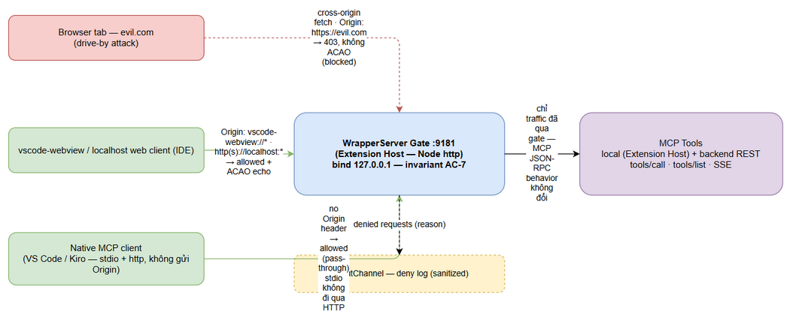
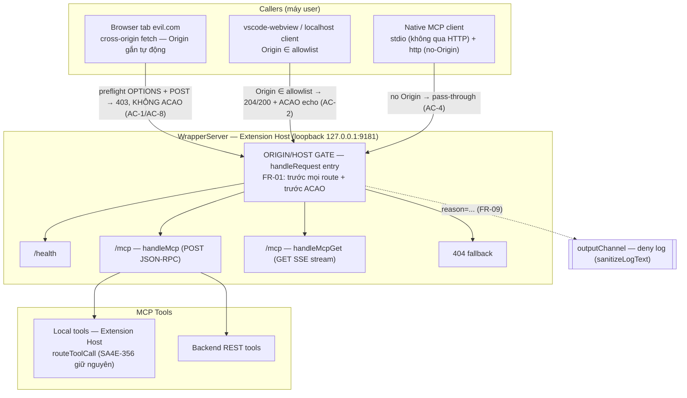
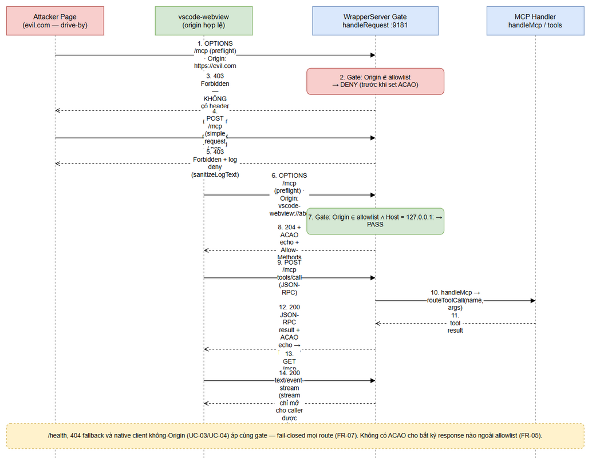
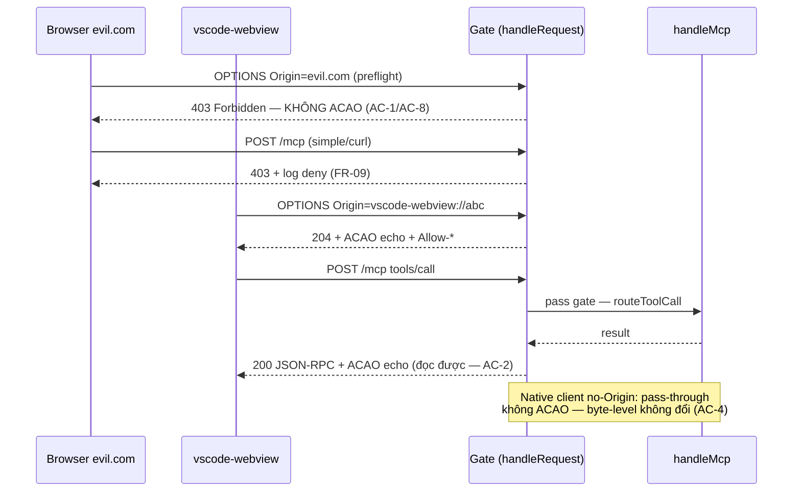
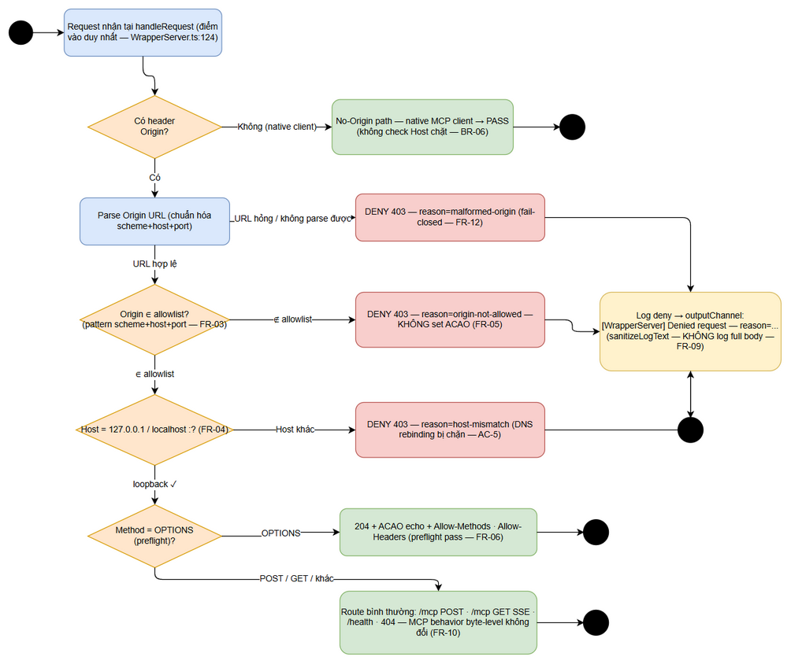
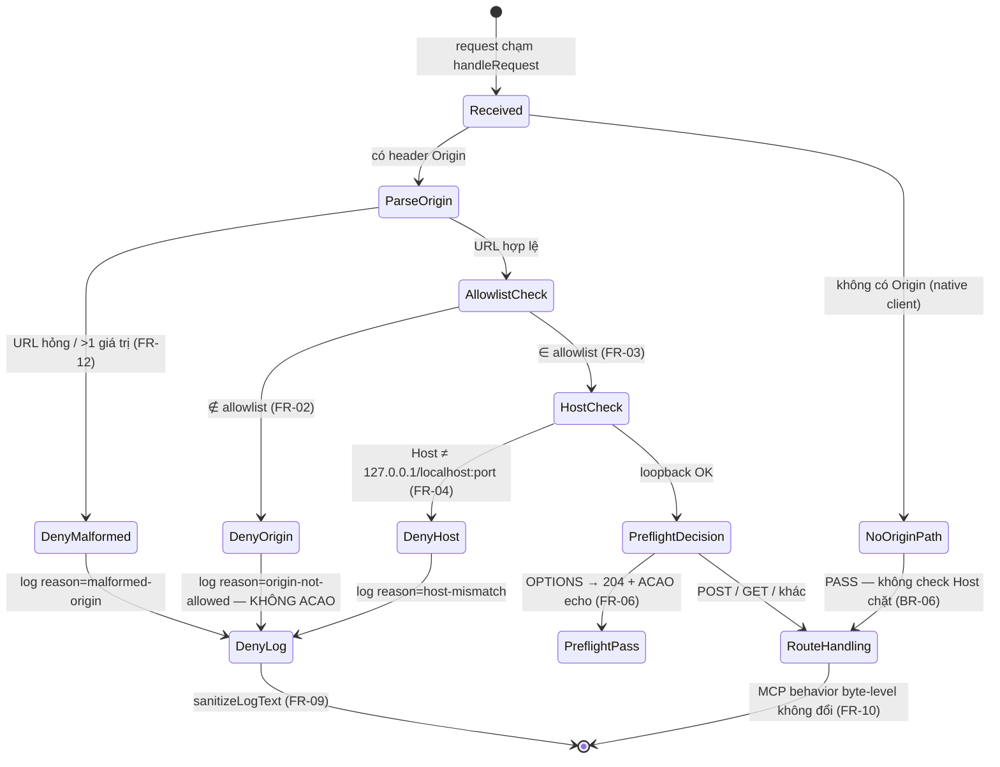

# Functional Specification Document (FSD)

## SA4E — SA4E-358: [Follow-up SA4E-356/SA-01] CORS * + no authN trên loopback :9181 — Origin/Host validation

---

## Document Information

| Field | Value |
|-------|-------|
| Jira Ticket | SA4E-358 |
| Title | [Follow-up SA4E-356/SA-01] CORS * + no authN trên loopback :9181 — Origin/Host validation |
| Author | BA Agent (business sections — draft v1.0) + TA Agent (technical enrichment — v1.1) |
| Version | 1.1 (TA enriched — technical contract §3.1.6.1, pseudocode §6.1, test matrix §10.1, Node http integration §5.3, verify plan V-1, benchmark §8) |
| Date | 2026-10-13 |
| Status | Enriched — chờ SA review (AC-3 gate) rồi chuyển Phase 3 (TDD) |
| Issue Type / Priority | Task / Medium |
| Related BRD | documents/SA4E-358/BRD.md (v1.0) |

---

## Revision History

| Version | Date | Author | Changes |
|---------|------|--------|---------|
| 1.0 | 2026-10-13 | BA Agent | Initiate draft — business sections: Functional Requirements (FR-01..FR-12 map AC-1..AC-8), Use Cases (UC-01..UC-07 đủ Main/AF/EF), Business Rules (BR-01..BR-10), bảng audit endpoints/paths của WrapperServer, Error Handling (403 shape + CORS headers on denial + log format), Data Specs (allowlist config shape hardcoded vs config — đánh giá; R-3 verify plan), Traceability matrix AC ↔ FR ↔ UC ↔ BR, 3 diagram (system-context, sequence, state). Xây TRÊN code hiện tại sau fix SA4E-356 (routeToolCall envelope + return-await đã live — KHÔNG mô tả lại). Chờ TA enrich (xem §11.3). |
| 1.1 | 2026-10-13 | TA Agent | Targeted enrichment 6/6 gaps §11.3 — KHÔNG tạo lại, chỉ bổ sung: **§3.1.6.1** Technical Contract Origin Gate (module placement `extension/src/services/OriginGate.ts`, TS signatures discriminated union, injection-for-test 2 mức, contract rules G-1..G-8); **§6.1** pseudocode gate logic (parse/normalize Origin, multiple-Origin fail-closed qua `rawHeaders`, Host parsing IPv6/port/case, precedence Origin > Host, Referer cấm); **§10.1** test matrix chi tiết T1..T14 (unit pure + integration server-thật, systematic no-ACAO sweep, raw-socket duplicate header); **§5.3** Node http header API; **§3.1.4.3** V-1 verify steps cụ thể; **§8** benchmark NFR. TA Notes: sửa inconsistency UC-05 Step 4 (Host check chỉ khi có Origin — FR-04/BR-06), clarify FR-10 "byte-level", chốt 403-uniform (Change Log #3). |

---

## 1. Introduction

### 1.1 Purpose

FSD này đặc tả hành vi chức năng của hardening bảo mật SA4E-358: thêm **Origin/Host validation gate** vào WrapperServer (local HTTP server bridge MCP JSON-RPC trên loopback :9181) để đóng finding SA-01 của SA4E-356 — `Access-Control-Allow-Origin: *` vô điều kiện + không authN trên /mcp, đã **live-confirmed ×3** trong pentest Phase 6.3 (P6-15 ACAO `*` trên /health, P6-16 preflight 204 từ origin bất kỳ, P6-17 SSE GET mở không authN).

**Vấn đề nghiệp vụ being solved:** bất kỳ trang web nào user visit (drive-by) đều gửi được cross-origin request vào loopback :9181, thực thi MCP tools với session/credential của user extension-side, và **đọc được response** nhờ ACAO `*` (cross-origin readback dữ liệu Atlassian) — điều kiện kích hoạt chỉ là "user mở extension + visit 1 trang web".

FSD dịch BRD v1.0 (AC-1..AC-8, 4 stories) thành: functional requirements chi tiết (FR-01..FR-12), use cases với luồng chính/biện thể/ngoại lệ (UC-01..UC-07), business rules (BR-01..BR-10), bảng audit hiện trạng từng endpoint của WrapperServer, đặc tả response khi denied (status + body + CORS headers), và đặc tả cấu hình allowlist.

**Nguyên tắc viết:** change là **additive gate** tại điểm vào duy nhất `handleRequest` — FSD chỉ đặc tả phần thay đổi (gate + CORS header behavior + deny response + log); mọi hành vi khác của server (handshake MCP, envelope lỗi PathResolverError của SA4E-356, Base64Proxy, port retry, SSE keep-alive...) được giữ nguyên byte-level và chỉ được liệt kê như ràng buộc không-đổi (FR-10), KHÔNG mô tả lại.

### 1.2 Scope

**In scope** (theo BRD §1.4 — 2 giải pháp được duyệt):

1. **Origin/Host validation gate** tại `handleRequest` (extension/src/services/WrapperServer.ts:124) chạy trước mọi route handling và trước khi set CORS headers (FR-01): no-Origin → pass (native MCP client); Origin ∈ allowlist → pass; còn lại → **403 Forbidden** (FR-02).
2. **Allowlist origin hợp lệ** (FR-03): `vscode-webview://*`, `http(s)://localhost:<mọi port>`, `http://127.0.0.1:<mọi port>` — constant có cấu trúc trong code (BR-09).
3. **Bỏ `ACAO: *` vô điều kiện** (FR-05): ACAO chỉ được echo khi Origin ∈ allowlist; không còn `*` ở bất kỳ response nào (403/404/health kể cả).
4. **Host validation khi có Origin** (FR-04): Host phải là `127.0.0.1:<port>` / `localhost:<port>` (port = port đang listen) — chặn DNS rebinding.
5. **Gate áp mọi route** (FR-07): /mcp POST, /mcp GET (SSE), /health, fallback 404 — fail-closed.
6. **Deny response + deny log** chuẩn hóa (FR-08, FR-09) — chống log-forging theo pattern `sanitizeLogText` đã có (PathResolver.ts:189).
7. **Binding invariant verify-only** (FR-11): giữ nguyên `listen(port, "127.0.0.1")` (WrapperServer.ts:98) + thêm unit test assert — không có code change cho binding.
8. Unit tests T1..T10 + live pentest-harness replay + security review gate (AC-3) — chi tiết verify trong §10.

**Out of scope** (theo BRD §1.5):

- Shared-secret header / token authN cho /mcp (đề xuất #3 — follow-up, chốt lại tại security review AC-3).
- CSRF-style token cho stateful calls (đề xuất #4 — wrapper không dùng cookie/session, bề mặt CSRF kinh điển không tồn tại).
- Thay đổi kiến trúc WrapperServer (vẫn Node http, cùng port retry EADDRINUSE 10 lần, cùng socket force-close on stop).
- Thay đổi hành vi nghiệp vụ MCP tools / envelope PathResolverError (SA4E-356 giữ nguyên).
- Setting user-facing (UI) cho allowlist (A-6 — chưa phát sinh nhu cầu).
- AuthN cho stdio transport (không đi qua HTTP — không nằm trong bề mặt này).
- Các finding khác SA4E-356 (SA-02..SA-07 — phân bổ riêng).

### 1.3 Definitions & Acronyms

Thuật ngữ dùng đúng Domain Glossary SA4E-358 (documents/SA4E-358/testdata/glossary-cors.md — đã ingest KB, 10 terms CORS):

| Term | Definition |
|------|------------|
| CORS (Cross-Origin Resource Sharing) | Cơ chế browser cho phép web page gọi resource của origin khác; server quyết định origin nào được ĐỌC response qua header Access-Control-Allow-Origin; ACAO `*` = mọi origin đều đọc được (nguy hiểm trên loopback server) |
| Origin | Scheme + host + port của caller (vd `https://evil.com`, `vscode-webview://abc123`); browser tự gắn header Origin cho cross-origin request và JavaScript KHÔNG thể giả mạo — là tín hiệu tin cậy chính để gate request trên loopback |
| ACAO (Access-Control-Allow-Origin) | Response header khai báo origin được phép đọc response; pattern an toàn: echo đúng Origin chỉ khi Origin thuộc allowlist, TUYỆT ĐỐI không dùng `*` vô điều kiện (CWE-942) |
| Preflight (OPTIONS) | Request OPTIONS browser gửi trước cross-origin request không-đơn-giản (vd POST JSON); chỉ khi preflight pass (2xx + ACAO hợp lệ) thì request thật mới được gửi; gate phải chặn preflight của origin lạ (trả 403 thay vì 204) |
| Allowlist | Danh sách pattern Origin hợp lệ (vscode-webview://*, http/https localhost + 127.0.0.1 mọi port); mọi giá trị ngoài danh sách bị deny (fail-closed); so khớp pattern theo scheme, KHÔNG substring matching |
| DNS Rebinding | Kỹ thuật attacker trỏ DNS domain của mình về 127.0.0.1 để request trông như same-origin nhưng chạm loopback server; phòng: validate Host header phải là 127.0.0.1/localhost:port (CWE-350) |
| Loopback Binding | Bind server vào 127.0.0.1 (chỉ nhận connection từ chính máy); WrapperServer đã bind đúng từ đầu (WrapperServer.ts:98) — chặn attacker remote từ mạng nhưng KHÔNG chặn browser cùng máy (drive-by) |
| Cross-Origin Readback | Kịch bản tấn công: JS của origin A ĐỌC được response của request gửi đến server khác — được bật bởi ACAO *; vector chính của SA-01: trang web đọc dữ liệu Atlassian qua MCP wrapper :9181 |
| Fail-closed | Nguyên tắc bảo mật: khi không xác định được trạng thái hợp lệ (header hỏng, thiếu thông tin, nhiều giá trị Origin) → TỪ CHỐI thay vì cho qua; ngược lại fail-open là anti-pattern |
| Drive-by Attack | Tấn công chỉ cần user visit 1 trang web (không cài đặt, không thao tác thêm); điều kiện kèm theo: server loopback đang listen trong browser context của user — đúng scenario SA-01 |
| WrapperServer | Local HTTP server trong Extension Host bridge MCP JSON-RPC qua REST (extension/src/services/WrapperServer.ts) — đối tượng thay đổi của FSD này |
| handleRequest | Điểm vào duy nhất của mọi HTTP request vào WrapperServer (WrapperServer.ts:124) — vị trí đặt gate |
| Native MCP client | MCP client không chạy trong browser (VS Code/Kiro MCP HTTP client, SDLC agents qua stdio) — client HTTP native không tự gắn header Origin (giả định A-1 — verify plan §3.1.4.3) |
| rawHeaders (Node http) | Thuộc tính `req.rawHeaders` của `http.IncomingMessage` — mảng phẳng `[name, value, name, value, ...]` GIỮ nguyên case gốc và KHÔNG gộp giá trị trùng — nguồn authoritative để phát hiện duplicate Origin/Host (§5.3, R-6); ngược lại `req.headers` là object đã lowercase-key và có thể join/gộp tùy phiên bản Node — KHÔNG dựa vào để đếm duplicates |
| Non-special scheme (WHATWG URL) | Scheme ngoài http/https/ws/wss/ftp/file (vd `vscode-webview`); `new URL()` parse authority dạng **opaque host** — KHÔNG normalize hostname, KHÔNG có default port, `url.origin` trả chuỗi `"null"` (do đó KHÔNG dùng `url.origin` để echo — §6.1 G-4); opaque host chứa `:` (port) → URL constructor throw |

### 1.4 References

| Document | Location |
|----------|----------|
| BRD SA4E-358 (v1.0) | documents/SA4E-358/BRD.md (KB entry #545) |
| Jira ticket | SA4E-358 (Task, Medium) — follow-up của SA4E-356/SA-01 |
| Finding nguồn | documents/SA4E-356/SECURITY-ASSESSMENT.md — SA-01 (Medium, pre-existing, CWE-942/346/350, A01/A05) |
| Live-confirmation | documents/SA4E-356/PENTEST-REPORT.md — P6-15, P6-16, P6-17 (SA-01 LIVE CONFIRMED ×3) |
| Pentest harness pattern (tái sử dụng §10) | documents/SA4E-356/testdata/pentest-harness.ts |
| Code đối tượng (verified 2026-10-13, branch main) | extension/src/services/WrapperServer.ts — CORS :126-129, gate điểm chèn :124-144, /mcp :156-201, SSE :207-225, bind :98 |
| Pattern sanitizeLogText (tái sử dụng FR-09) | extension/src/services/PathResolver.ts:189 — `export function sanitizeLogText(value: string): string` (thay [\r\n\0] → "?") |
| FSD format tham chiếu | documents/SA4E-356/FSD.md (v1.3) |
| Domain Glossary | documents/SA4E-358/testdata/glossary-cors.md (KB #547) |
| Test infrastructure hiện có (tái sử dụng §10.1) | extension/src/__tests__/wrapper-server.test.ts + wrapper-server.helpers.ts — `createTestServer()` (mock deps theo `WrapperServerDeps`), `postMcp`/`postRaw`/`openSse` (raw `http.request` test client — pattern header control), `server.start(0)` (port ngẫu nhiên) |
| Pattern technical contract (template v1.1) | documents/SA4E-356/FSD.md §3.1.6.1 — PathResolver: module placement rationale, discriminated union, injection-for-test 2 mức, contract rules C-1..C-6 — Origin Gate áp cùng style |
| Pattern sanitizeLogText (chi tiết) | extension/src/services/PathResolver.ts:189-191 — `value.replace(/[\r\n\0]/g, "?")` — pure, import một chiều `OriginGate → PathResolver` (không circular) |

---

## 2. System Overview

### 2.1 System Context


*[Edit in draw.io](diagrams/system-context.drawio)*

WrapperServer chạy trong **Extension Host** (VS Code/Kiro), listen loopback `127.0.0.1:9181` (invariant AC-7 — WrapperServer.ts:98, verify-only), và phục vụ 3 nhóm caller với xử lý KHÁC NHAU sau khi có gate:

| Caller | Đặc điểm | Kết quả qua gate |
|--------|----------|------------------|
| Browser tab độc hại (drive-by) | Cross-origin fetch từ trang web bất kỳ; browser **luôn** gắn header `Origin` (JS không thể giả mạo — glossary "Origin") | **DENY 403** — không ACAO → browser chặn cả request lẫn readback (AC-1, AC-8) |
| vscode-webview / localhost web client | Origin `vscode-webview://*` hoặc `http(s)://localhost:*`, `http://127.0.0.1:*` | **ALLOW** — preflight 204 + ACAO echo, tool call + SSE bình thường (AC-2) |
| Native MCP client (VS Code/Kiro HTTP; SDLC agents stdio) | Không gửi header Origin (A-1 — verify plan §3.1.4.3); stdio không đi qua HTTP | **ALLOW pass-through** — không cần ACAO, hành vi byte-level không đổi (AC-4) |

Mọi traffic qua gate mới chạm được MCP tools (local Extension Host + backend REST). Mỗi lần deny ghi 1 dòng log sanitized vào outputChannel.

### 2.2 System Architecture (hiện trạng — điểm chèn gate)

Kiến trúc giữ nguyên: **Caller → WrapperServer (loopback :9181, Node http) → MCP Tools (local registry + backend REST)**. Gate là **thêm một lớp kiểm tra ở đầu `handleRequest`** — không đổi kiến trúc, không đổi route table, không đổi handler bên dưới.



**Hiện trạng code đối tượng (verified 2026-10-13, branch main):**

| # | Vị trí code (WrapperServer.ts) | Hành vi hiện tại | Liên quan finding |
|---|--------------------------------|------------------|-------------------|
| 1 | :124 `handleRequest(req, res)` | Điểm vào duy nhất của mọi request; parse URL ngay dòng 125 | Điểm chèn gate (FR-01) |
| 2 | :126 `res.setHeader("Access-Control-Allow-Origin", "*")` | ACAO `*` trả cho MỌI response | P6-15 live (kể cả /health) — FR-05 bỏ |
| 3 | :127-128 Allow-Methods GET/POST/OPTIONS, Allow-Headers Content-Type | Set vô điều kiện | R-5 — giữ mức cần thiết cho caller được phép |
| 4 | :129 `OPTIONS → 204` | Preflight pass vô điều kiện | P6-16 live — FR-06 |
| 5 | :131 `/mcp` → handleMcp (:156-201) | POST JSON-RPC: initialize / ping / tools/list / tools/call — không auth check | SA-01 (a) — gate trước (FR-02, FR-07) |
| 6 | :158 → handleMcpGet (:207-225) | GET mở SSE stream — không auth, keep-alive 15s | P6-17 live — gate trước khi writeHead (FR-07, AC-6) |
| 7 | :132-136 `/health` | 200 `{"status":"ok","mode":"wrapper"}` | P6-15 — gate áp cùng rule (FR-07) |
| 8 | :137 fallback 404 `{"error":"Not found"}` | 404 + ACAO `*` kèm theo | FR-07 — gate trước 404 |
| 9 | :138-143 catch → 500 | Error handler cuối | Giữ nguyên làm chốt chặn cuối (NFR) |
| 10 | :98 `srv.listen(requestedPort, "127.0.0.1")` | Bind loopback đúng | AC-7 invariant — verify-only (FR-11) |
| 11 | :233-254 `routeToolCall` | return-await + envelope PathResolverError (SA4E-356) | Giữ nguyên byte-level (FR-10) |
| 12 | :314-326 `readBody` — MAX_BODY_SIZE 1MB | Body limit | Giữ nguyên (FR-10) |
| 13 | remote-backend-client.ts:118-123 `invokeTool` → `wrapperServer.routeToolCall(...)` **trực tiếp** | In-process path — KHÔNG qua `handleRequest`/HTTP | Gate không áp dụng (caller cùng process Extension Host — đã tin cậy); chỉ bề mặt HTTP chịu gate — ghi rõ để SA review không hiểu nhầm scope |

> **Ghi chú kế thừa SA4E-356:** fix path resolution + envelope (routeToolCall return-await, PathResolverError → MCP TOOL error result) **đã live trên main** — FSD này xây TRÊN trạng thái đó, không sửa và không mô tả lại các phần không đổi. Gate chỉ đọc headers (Origin/Host) — không chạm vào body parsing, protocol negotiation, hay tool routing.

---

## 3. Functional Requirements

### 3.1 Feature: Origin/Host Gate cho WrapperServer

**Source:** BRD SA4E-358 — Story 1 (AC-1, AC-5, AC-8), Story 2 (AC-2, AC-6), Story 3 (AC-4, AC-7), Story 4 (AC-3)

#### 3.1.1 Description

Thêm một **gate Origin/Host validation** tại đầu `handleRequest` (extension/src/services/WrapperServer.ts:124) — điểm vào duy nhất của server — chạy **trước mọi route handling** và **trước khi set bất kỳ CORS header nào**. Gate đọc 2 request header (Origin, Host), phân loại caller theo 3 nhánh (no-Origin / Origin ∈ allowlist / còn lại), và quyết định pass hay 403 theo FR-02/FR-04. Gate **thay thế** behavior CORS hiện tại (ACAO `*` vô điều kiện :126-129) bằng cơ chế echo-when-allowed (FR-05/FR-06).

Gate là pure header-check: không đọc body, không I/O, không đổi state — overhead < 1ms/request (NFR §8).

**Functional Requirements FR-01..FR-12 (Feature 3.1 — map AC-1..AC-8):**

| FR | Requirement | Source (AC / BRD) | Verify |
|----|-------------|-------------------|--------|
| FR-01 | Gate đặt tại `handleRequest` (:124) chạy **TRƯỚC** mọi route handling (/mcp, /health, 404) và **TRƯỚC** khi set bất kỳ CORS header nào — đảm bảo không có response nào thoát ra ngoài gate | BRD Story 1 Req 1; AC-1, AC-8 | T1, T2, T7 + code review |
| FR-02 | Quy tắc Origin theo thứ tự: (a) request **không có header Origin** → pass (native MCP client); (b) Origin ∈ allowlist (FR-03) → pass; (c) Origin khác → **403 Forbidden**, không route tiếp, không set ACAO | BRD Story 1 Req 2; AC-1, AC-4 | T1, T3, T4, T5 |
| FR-03 | Allowlist mặc định (constant có cấu trúc — §3.1.4.1): `vscode-webview://*` (mọi webview ID); `http://localhost:<mọi port>`; `https://localhost:<mọi port>`; `http://127.0.0.1:<mọi port>` | BRD Story 2 Req 1; AC-2 | T4, T5 |
| FR-04 | Quy tắc Host (chặn DNS rebinding): khi request **CÓ** Origin, `Host` phải là `127.0.0.1:<port>` hoặc `localhost:<port>` với port = port đang listen; Host khác → **403** (reason=host-mismatch). Request không-Origin không bị check Host chặt (giữ hành vi native client — BR-06) | BRD Story 1 Req 3; AC-5 | T6 |
| FR-05 | **Bỏ `ACAO: *` vô điều kiện** (:126): ACAO chỉ được set khi Origin ∈ allowlist, giá trị = **echo đúng Origin đó** (không dùng `*` kể cả cho allowlist). Mọi response khác (403 deny, 404, /health cho caller lạ, 500) **KHÔNG chứa ACAO** | BRD Story 1 Req 4; AC-8 | T1, T2, T7 + assert "không ACAO" mọi response |
| FR-06 | Preflight OPTIONS: chỉ trả **204 + Allow-Methods (GET, POST, OPTIONS) + Allow-Headers (Content-Type) + ACAO echo** khi Origin được phép (và Host pass FR-04); còn lại → **403** (không 204) | BRD Story 1 Req 5; AC-1, AC-2 | T2, T4 |
| FR-07 | Gate áp cho **MỌI method/route**: /mcp POST, /mcp GET (SSE — chặn trước khi stream mở), /health, fallback 404 — fail-closed (glossary: fail-closed) | BRD Story 1 Req 6, Story 2 Req 4; AC-1, AC-6 | T1, T6, T7 |
| FR-08 | Deny response chuẩn: HTTP **403** + body JSON rút gọn `{"error":"Forbidden"}` + Content-Type application/json — **không leak allowlist config, không echo giá trị header attacker** | BRD Story 1 Error Handling; AC-8 | T1, T2, T6, T10 |
| FR-09 | Deny log: mỗi lần từ chối ghi 1 dòng vào outputChannel, format `[WrapperServer] Denied request — reason=<origin-not-allowed\|host-mismatch\|malformed-origin>` — giá trị header đưa vào log PHẢI qua `sanitizeLogText` (PathResolver.ts:189, thay [\r\n\0]→"?" — chống log-forging R-4); **KHÔNG log full request body** | BRD Story 1 Error Handling, R-4 | T9 |
| FR-10 | **Zero regression MCP:** cho caller được phép, hành vi byte-level không đổi — handshake initialize (protocol negotiation :170-182), notifications/initialized → 202, ping, tools/list (schema rewrite Base64Proxy), tools/call (routeToolCall + envelope PathResolverError của SA4E-356), SSE keep-alive 15s, body limit 1MB, port retry EADDRINUSE (10 lần), socket force-close on stop. Stdio transport không đi qua HTTP → không chịu tác động | BRD Story 3 Req 1-3, 6; AC-4 | Full regression suite + live smoke (§10) |
| FR-11 | **Binding invariant:** giữ nguyên `srv.listen(requestedPort, "127.0.0.1")` (:98) — KHÔNG có code change cho binding; thêm unit test assert bind address = 127.0.0.1 để chặn hồi quy âm thầm về 0.0.0.0 (biến "đề xuất binding" của ticket thành verify-only theo BRD §1.4) | BRD Story 3 Req 4; AC-7 | T8 |
| FR-12 | **Fail-closed với header hỏng:** Origin không parse được thành URL hợp lệ (malformed, rỗng sau trim, ký tự lạ) hoặc request chứa **nhiều giá trị Origin** → **403** (reason=malformed-origin), không exception thoát handleRequest, không crash server (error handler :138-143 vẫn là chốt chặn cuối) | BRD Story 1 Validation Rules, R-6; AC-1 | T10 + assert Node http lowercases header keys |

#### 3.1.2 Use Cases

---

**Use Case ID:** UC-01
**Tên:** Browser drive-by cross-origin bị chặn (preflight + POST → 403, không ACAO)
**Actor:** Browser tab độc hại (evil.com — drive-by)
**Preconditions:** WrapperServer đang listen 127.0.0.1:9181 (user đã mở extension); user visit trang độc hại; JS trong trang gửi cross-origin request vào wrapper với `Origin: https://evil.com` (browser gắn tự động, không thể giả mạo).
**Postconditions:** Wrapper trả 403 cho cả preflight lẫn POST; tool KHÔNG thực thi; response KHÔNG có ACAO → browser chặn việc đọc response (không readback); 1 dòng deny log được ghi.

**Main Flow:**

| Step | Actor | System | Description |
|------|-------|--------|-------------|
| 1 | Browser (JS evil.com) | | Gửi preflight `OPTIONS /mcp` với `Origin: https://evil.com`, `Access-Control-Request-Method: POST`, `Access-Control-Request-Headers: Content-Type` |
| 2 | | Gate (FR-01) | Nhận request tại handleRequest — TRƯỚC khi set CORS headers |
| 3 | | Gate (FR-02, FR-12) | Có Origin → parse URL hợp lệ → so allowlist (FR-03): `https://evil.com` ∉ allowlist |
| 4 | | Gate (FR-06, FR-08) | Trả **403 Forbidden** + `{"error":"Forbidden"}` — KHÔNG 204, KHÔNG ACAO, KHÔNG Allow-Methods/Headers |
| 5 | | Gate (FR-09) | Ghi log: `[WrapperServer] Denied request — reason=origin-not-allowed` |
| 6 | Browser | | Preflight fail → **KHÔNG gửi POST thật** (theo CORS spec); trang không đọc được gì |
| 7 | Browser (non-browser client / simple request) | | Nếu POST /mcp vẫn được gửi (simple request hoặc client không tuân CORS) → Gate chặn tương tự ở bước 2-5 trước khi chạm handleMcp |

**Alternative Flows:**

| ID | Condition | Steps |
|----|-----------|-------|
| AF-1 | Attacker dùng curl/HTTP client trực tiếp (không qua browser) với Origin giả | Gate vẫn chặn — Origin value không nằm allowlist → 403. Attacker BỎ header Origin → rơi vào nhánh no-Origin (UC-04) — chấp nhận: client không-browser đã nằm ngoài threat model drive-by (BRD §1.1.1 — malware cục bộ out of scope), và đây đúng là behavior của native client |
| AF-2 | Attacker giả `Origin: vscode-webview://evil` qua curl | Gate pass ở Origin check (pattern scheme khớp) — NHƯNG đây là client non-browser tự chịu trách nhiệm header của mình; browser thật không cho phép JS giả mạo header này. Ranh giới bảo mật của ticket là browser-drive-by (BRD A-5); việc harden thêm cho non-browser = shared-secret follow-up (BRD §1.4) |

**Exception Flows:**

| ID | Condition | Steps |
|----|-----------|-------|
| EF-1 | Origin header hỏng (`%%`, rỗng, chứa control chars) | FR-12 — deny 403 reason=malformed-origin; giá trị đưa vào log qua sanitizeLogText; server không crash |
| EF-2 | Nhiều giá trị Origin trong 1 request (header trick — R-6) | FR-12 — deny 403 fail-closed (không chọn giá trị đầu tiên) |

---

**Use Case ID:** UC-02
**Tên:** vscode-webview được chấp nhận (preflight 204 + ACAO echo → tool call)
**Actor:** vscode-webview / IDE web client (origin `vscode-webview://<id>`)
**Preconditions:** Webview của extension (hoặc IDE fork dùng cùng scheme) gửi request vào wrapper; wrapper đang listen.
**Postconditions:** Preflight 204 + ACAO echo; POST tool call thực thi bình thường; response có ACAO echo → browser CHO PHÉP webview đọc (AC-2).

**Main Flow:**

| Step | Actor | System | Description |
|------|-------|--------|-------------|
| 1 | Webview | | Gửi preflight `OPTIONS /mcp` với `Origin: vscode-webview://abc123` |
| 2 | | Gate (FR-02, FR-03) | Origin khớp pattern scheme `vscode-webview://*` (mọi host ID — pattern-based theo scheme, không substring — BR-02) |
| 3 | | Gate (FR-04) | Host check: `Host: 127.0.0.1:9181` (hoặc localhost:9181) = loopback + đúng port listen → pass |
| 4 | | Gate (FR-06) | Trả **204** + `Access-Control-Allow-Origin: vscode-webview://abc123` (echo) + Allow-Methods + Allow-Headers |
| 5 | Webview | | Gửi POST /mcp tools/call (JSON-RPC) với cùng Origin |
| 6 | | Gate | Pass lại (cùng nhánh allow) → forward handleMcp |
| 7 | | handleMcp (FR-10) | Thực thi tools/call qua routeToolCall — hành vi byte-level như hiện tại (envelope SA4E-356 giữ nguyên) |
| 8 | | handleMcp | Trả 200 JSON-RPC result + ACAO echo → webview đọc được response |

**Alternative Flows:**

| ID | Condition | Steps |
|----|-----------|-------|
| AF-1 | Webview ID đổi giữa phiên (VS Code sinh ID ngẫu nhiên theo phiên) | Pattern `vscode-webview://*` khớp mọi ID — không cần cập nhật allowlist |
| AF-2 | Webview gửi request KHÔNG preflight (simple GET /health) | Gate pass Origin + Host → /health trả 200 + ACAO echo |

**Exception Flows:**

| ID | Condition | Steps |
|----|-----------|-------|
| EF-1 | Origin `vscode-webview://abc` nhưng Host lạ (DNS rebinding — UC-05) | FR-04 — deny 403 reason=host-mismatch (Origin pass không đủ — BR-05) |
| EF-2 | Fork IDE dùng scheme webview khác (R-1) | Deny 403 reason=origin-not-allowed + log → BA/DEV thêm pattern vào allowlist constant (code change nhỏ + unit test T4 mở rộng) — KHÔNG nới `*` (BR-10) |

---

**Use Case ID:** UC-03
**Tên:** localhost client được chấp nhận
**Actor:** Web app / dev server chạy localhost (origin `http://localhost:<p>` hoặc `http://127.0.0.1:<p>`)
**Preconditions:** Client chạy trên chính máy user, port bất kỳ.
**Postconditions:** Được chấp nhận như vscode-webview (UC-02) — preflight 204 + echo, tool call + SSE bình thường.

**Main Flow:**

| Step | Actor | System | Description |
|------|-------|--------|-------------|
| 1 | Localhost client | | Gửi POST /mcp với `Origin: http://localhost:3000` (port KHÁC 9181 — vẫn hợp lệ theo FR-03) |
| 2 | | Gate (FR-02, FR-03) | Origin khớp pattern `http://localhost:<mọi port>` → pass |
| 3 | | Gate (FR-04) | Host = `localhost:9181` / `127.0.0.1:9181` (port listen) → pass |
| 4 | | handleMcp | Thực thi bình thường; response + ACAO echo `http://localhost:3000` |

**Alternative Flows:**

| ID | Condition | Steps |
|----|-----------|-------|
| AF-1 | `Origin: http://127.0.0.1:5173` (dev server Vite) | Cùng nhánh allow — pattern `http://127.0.0.1:<mọi port>` (FR-03) |
| AF-2 | `Origin: https://localhost:8443` | Cùng nhánh allow — pattern https://localhost (FR-03) |

**Exception Flows:**

| ID | Condition | Steps |
|----|-----------|-------|
| EF-1 | `Origin: http://localhost.evil.com:3000` (hostname khác) | KHÔNG khớp pattern (so khớp scheme+host chính xác — BR-02, không substring matching) → 403 reason=origin-not-allowed |
| EF-2 | `Origin: http://localhost:3000` nhưng scheme bị thay (`ftp://localhost:3000`) | KHÔNG khớp scheme → 403 |

---

---

**Use Case ID:** UC-04
**Tên:** Native MCP client không-Origin được chấp nhận (zero regression)
**Actor:** Native MCP client — VS Code/Kiro MCP HTTP client (không gửi Origin — A-1); SDLC agents qua stdio (không qua HTTP)
**Preconditions:** Client cấu hình như hiện tại (không đổi config — AC-4); wrapper đang listen.
**Postconditions:** Request đi qua gate như pass-through; toàn bộ MCP flow (initialize → tools/list → tools/call → SSE) hoạt động byte-level như trước change.

**Main Flow:**

| Step | Actor | System | Description |
|------|-------|--------|-------------|
| 1 | Native client | | Gửi POST /mcp `initialize` — KHÔNG có header Origin |
| 2 | | Gate (FR-02a) | Không có Origin → nhánh no-Origin → **pass** (không check Host chặt — BR-06, giữ hành vi hiện tại cho native client) |
| 3 | | handleMcp (FR-10) | Protocol negotiation trả protocolVersion + serverInfo như hiện tại (:170-182) |
| 4 | Native client | | Gửi tools/list → nhận schema đã rewrite (Base64Proxy) như hiện tại |
| 5 | Native client | | Gửi tools/call → routeToolCall thực thi (local tool hoặc backend REST), envelope PathResolverError của SA4E-356 giữ nguyên |
| 6 | Native client | | Mở GET /mcp SSE → gate pass (no-Origin) → stream mở như hiện tại (keep-alive 15s) |

**Alternative Flows:**

| ID | Condition | Steps |
|----|-----------|-------|
| AF-1 | Client thật CÓ gửi Origin (A-1 sai — R-3) và Origin là localhost/127.0.0.1 | Pass qua allowlist (lớp bảo vệ 2 cho AC-4 — hai lớp độc lập: no-Origin rule + allowlist) |
| AF-2 | Client thật CÓ gửi Origin NGOÀI allowlist (vd `app-electron://...`) | **Regression fail** → xử lý theo R-2/R-3 + BR-10: thêm pattern vào allowlist constant (code change nhỏ + unit test) — TUYỆT ĐỐI KHÔNG nới rule thành `*`; bắt verify plan R-3 (§3.1.4.3) đã chạy trước merge |

**Exception Flows:**

| ID | Condition | Steps |
|----|-----------|-------|
| EF-1 | Native client bị deny oan (403) sau change | Điều tra deny log (reason) → nếu allowlist thiếu pattern: cập nhật constant theo AF-2; nếu client gửi header hỏng: báo client fix. Không được "fix" bằng cách bỏ gate (no-workaround-rule) |
| EF-2 | Stdio client | Không đi qua HTTP server → gate không thể tác động — assert bằng regression suite hiện có (FR-10) |

---

**Use Case ID:** UC-05
**Tên:** DNS rebinding attempt (Host ≠ loopback) bị chặn
**Actor:** Attacker DNS rebinding (domain attacker trỏ DNS về 127.0.0.1)
**Preconditions:** User đã truy cập domain attacker; DNS của domain đó giờ trỏ về 127.0.0.1; JS trang gửi request — request "trông như same-origin" nhưng Host header là domain attacker.
**Postconditions:** Wrapper trả 403 (reason=host-mismatch); tool không thực thi; không có ACAO.

**Main Flow:**

| Step | Actor | System | Description |
|------|-------|--------|-------------|
| 1 | Browser (trang attacker) | | Gửi POST /mcp — request đi tới 127.0.0.1:9181 (do DNS rebinding) nhưng header `Host: attacker.com:9181` (HTTP/1.1 Host = hostname user đã gõ) và `Origin: http://attacker.com` |
| 2 | | Gate (FR-02, FR-03) | Origin `http://attacker.com` ∉ allowlist → đủ điều kiện deny ngay |
| 3 | | Gate (FR-04) | (Independent layer) Host `attacker.com:9181` ≠ `127.0.0.1:9181`/`localhost:9181` → vi phạm Host rule |
| 4 | | Gate (FR-08, FR-09) | 403 Forbidden + `{"error":"Forbidden"}` + log `reason=origin-not-allowed` (Origin check chạy trước; nếu attacker bỏ Origin, Host check vẫn chặn với reason=host-mismatch) |

**Alternative Flows:**

| ID | Condition | Steps |
|----|-----------|-------|
| AF-1 | Attacker setup để Host header = 127.0.0.1:9181 (rebinding hoàn hảo) | Host check pass — NHƯNG browser vẫn gắn `Origin: http://attacker.com` (cross-origin theo quan điểm browser) → Origin check chặn → 403. Hai lớp độc lập: một lớp bị qua thì lớp kia còn (defense theo depth chi phí thấp) |

**Exception Flows:**

| ID | Condition | Steps |
|----|-----------|-------|
| EF-1 | Host header thiếu (HTTP/1.0 client) | Request không-Origin rơi nhánh no-Origin (pass — BR-06); request CÓ-Origin thiếu Host → FR-04 fail → 403 reason=host-mismatch (fail-closed) |
| EF-2 | Port trong Host khác port listen (`Host: 127.0.0.1:9999`) | FR-04 — so khớp port **chính xác** với port đang listen → 403 reason=host-mismatch (BR-03) |

<!-- TA enrichment (v1.1) — correction -->
> **TA Note (v1.1 — điều chỉnh Main Flow Step 4):** câu parenthetical *"nếu attacker bỏ Origin, Host check vẫn chặn với reason=host-mismatch"* **mâu thuẫn với FR-04/BR-06 và với EF-1 của chính UC này**: request BỎ Origin → nhánh no-Origin → **PASS** (không Host check). Scenario "bỏ Origin + Host lạ" chỉ khả thi từ client non-browser (browser luôn gắn Origin cho cross-origin fetch/XHR — invariant mà thiết kế dựa vào; curl tự set tự do là out of threat model BRD §1.1.1 + AF-1/AF-2 UC-01). Behavior đúng: Step 4 parenthetical rút gọn thành *"Origin check chạy trước và đủ điều kiện deny; Host check là lớp xác nhận độc lập khi Origin hiện diện"*. Danh sách full origin-test cases: §6.1 pseudocode Phase 3-5 + §10.1 T1-T12.

---

**Use Case ID:** UC-06
**Tên:** SSE GET /mcp được gate như mọi route khác
**Actor:** Bất kỳ caller nào mở GET /mcp (Streamable HTTP SSE channel)
**Preconditions:** Wrapper đang listen; caller muốn nhận server-initiated messages.
**Postconditions:** Chỉ caller được phép (no-Origin hoặc Origin ∈ allowlist + Host loopback) mở được stream; origin lạ nhận 403 TRƯỚC khi stream mở (không rò header SSE).

**Main Flow:**

| Step | Actor | System | Description |
|------|-------|--------|-------------|
| 1 | Caller được phép | | GET /mcp (no-Origin hoặc Origin ∈ allowlist) |
| 2 | | Gate (FR-07) | Pass → forward handleMcp → handleMcpGet mở stream như hiện tại (:207-225 — keep-alive 15s giữ nguyên) |
| 3 | | handleMcpGet | 200 text/event-stream + endpoint event + initialized message — byte-level không đổi (FR-10) |

**Alternative Flows:**

| ID | Condition | Steps |
|----|-----------|-------|
| AF-1 | vscode-webview mở SSE | Pass theo UC-02 — stream nhận keep-alive bình thường |

**Exception Flows:**

| ID | Condition | Steps |
|----|-----------|-------|
| EF-1 | Origin lạ GET /mcp | Gate chặn **trước** handleMcpGet → 403 + log; KHÔNG có header SSE nào được gửi (P6-17 được đóng — AC-6) |
| EF-2 | Origin lạ mà preflight đã bị chặn trước đó | Browser không bao giờ gửi GET (preflight fail — UC-01) — EF-1 chỉ xảy ra với client non-browser |

---

**Use Case ID:** UC-07
**Tên:** Preflight handling — ma trận hành vi OPTIONS
**Actor:** Browser CORS engine (thay mặt mọi web caller)
**Preconditions:** Browser chuẩn bị gửi cross-origin request "không đơn giản" (POST JSON) vào wrapper.
**Postconditions:** Chỉ preflight từ caller được phép nhận 204 + đầy đủ Allow-* headers; còn lại 403.

**Main Flow:**

| Step | Actor | System | Description |
|------|-------|--------|-------------|
| 1 | Browser | | OPTIONS /mcp với Origin + Access-Control-Request-Method/Headers |
| 2 | | Gate | Áp cùng 3 nhánh như request thường (FR-02): no-Origin → 204 hiện trạng giữ nguyên cho native client (OPTIONS không-Origin hiếm nhưng không hại — không leak gì); Origin ∈ allowlist + Host pass → 204 + ACAO echo + Allow-Methods + Allow-Headers (FR-06); còn lại → 403 + log |

**Alternative Flows — ma trận đầy đủ:**

| # | Origin | Host | Gate result | Response |
|---|--------|------|-------------|----------|
| 1 | (không có) | bất kỳ | PASS (native — FR-02a) | 204 hiện trạng (không ACAO) |
| 2 | vscode-webview://abc | 127.0.0.1:9181 | PASS (FR-03 + FR-04) | 204 + ACAO echo + Allow-* (FR-06) |
| 3 | http://localhost:3000 | localhost:9181 | PASS | 204 + ACAO echo |
| 4 | https://evil.com | bất kỳ | DENY | **403**, không ACAO, không Allow-* (AC-1) |
| 5 | vscode-webview://abc | attacker.com:9181 | DENY | 403 reason=host-mismatch (FR-04) |
| 6 | %% (malformed) | bất kỳ | DENY | 403 reason=malformed-origin (FR-12) |

**Exception Flows:**

| ID | Condition | Steps |
|----|-----------|-------|
| EF-1 | Allow-Headers hiện tại (Content-Type) thiếu header client thật cần (vd `mcp-session-id` — R-5) | Preflight pass ở gate nhưng request thật có thể bị browser chặn thiếu Allow-Headers → phát hiện qua regression live (T4/T5) → bổ sung header vào Allow-Headers cho caller được phép — KHÔNG liên quan deny logic |

---

#### 3.1.3 Business Rules

| Rule ID | Rule | Source |
|---------|------|--------|
| BR-01 | **Fail-closed, default deny:** mọi case không chắc chắn (header hỏng, nhiều giá trị Origin, Host thiếu khi có Origin) → DENY 403. Gate áp mọi route — không có route "ngoại lệ". | BRD NFR Security; glossary fail-closed |
| BR-02 | **Allowlist so khớp chính xác scheme + host** (pattern-based theo scheme cho vscode-webview; scheme+host cho localhost/127.0.0.1 với port bất kỳ). KHÔNG dùng substring matching (chặn bypass `http://localhost.evil.com` hay query-string tricks). | BRD Story 1 Validation Rules |
| BR-03 | **Host check:** hostname so khớp case-insensitive; port so khớp **chính xác** với port đang listen (đọc từ server address, không hardcode 9181). | BRD Story 1 Validation Rules |
| BR-04 | **Deny log không chứa dữ liệu nguy hiểm:** không log full request body; không echo raw header attacker; mọi giá trị header đưa vào log PHẢI qua `sanitizeLogText` (PathResolver.ts:189) thay ký tự control [\r\n\0] → "?" (anti log-forging — R-4, pattern SEC-05 SA4E-356). | BRD R-4 |
| BR-05 | **Header precedence Origin > Host:** khi request CÓ Origin → Origin quyết định allow/deny (tín hiệu tin cậy — browser kiểm soát, JS không giả mạo được — glossary Origin); Host là lớp xác nhận độc lập request nhắm loopback (chặn DNS rebinding). Khi request KHÔNG có Origin → không áp Host check chặt (BR-06). Không bao giờ dùng Referer thay Origin. | BRD Story 1 Req 2-3; glossary DNS Rebinding |
| BR-06 | **No-Origin = native client signal:** request không header Origin được coi là native MCP client → pass không cần ACAO, không check Host chặt (giữ hành vi hiện tại — giả định A-1, verify plan §3.1.4.3). | BRD Story 2 Req 2; A-1 |
| BR-07 | **ACAO chỉ echo, không `*`:** kể cả cho origin trong allowlist, ACAO = giá trị Origin cụ thể (echo). Không còn `Access-Control-Allow-Origin: *` ở bất kỳ response nào. | BRD Story 1 Req 4; AC-8; glossary ACAO |
| BR-08 | **Byte-level behavior không đổi cho caller được phép:** MCP handshake, envelope lỗi, schema rewrite, SSE format, keep-alive, body limit, port retry — không thay đổi. Gate chỉ thêm nhánh deny. | BRD Story 3; FR-10 |
| BR-09 | **Allowlist là constant có cấu trúc trong code** (không setting runtime / không contributes.configuration — đánh giá §3.1.4.1); mở rộng = code change nhỏ + unit test. | BRD A-6, Out-of-scope |
| BR-10 | **No-workaround:** khi regression phát hiện client hợp lệ bị chặn → thêm pattern allowlist (R-2) — TUYỆT ĐỐI KHÔNG nới rule thành `*` hay bỏ gate. | BRD Story 3 Error Handling; no-workaround-rule |

---

#### 3.1.4 Data Specifications

##### 3.1.4.1 Allowlist config shape — đánh giá hardcoded constant vs contributes.configuration

**Quyết định (theo BRD A-6 + Out-of-scope): allowlist là constant có cấu trúc trong code — KHÔNG dùng setting runtime.** Đánh giá 2 phương án:

| Tiêu chí | A: Constant trong code (CHỌN) | B: `contributes.configuration` (settings) |
|----------|-------------------------------|---------------------------------------------|
| Testability | Unit test import trực tiếp constant — deterministic | Phải mock vscode config layer trong test |
| Attack surface | Không thể thay đổi từ ngoài process — attacker không thể "tự cho phép" | **Workspace-scoped settings bị supply-chain qua repo (`.vscode/settings.json` theo workspace)** — mở đường attacker (qua tool ghi file trong workspace — chính là side-effect SA-01) tự thêm origin lạ vào allowlist rồi request — làm gate vô dụng |
| User safety | Không có nút "vô hiệu hóa bảo mật" cho user bấm nhầm | Settings UI khuyến khích user chỉnh giá trị bảo mật |
| Nhu cầu hiện tại | 1 webview scheme + localhost — tĩnh, ổn định | Chưa phát sinh nhu cầu cấu hình runtime (A-6) |
| Chi phí mở rộng | Code change nhỏ + unit test (R-1 mitigation đã ghi trong BRD) | Zero code change nhưng rủi ro security ở trên |

**Shape (functional view — TA finalize TypeScript):**

```
ALLOWED_ORIGIN_PATTERNS (readonly, pattern-based theo scheme):
  1. { scheme: "vscode-webview", host: "*" }              // mọi webview ID (AF-1 UC-02)
  2. { scheme: "http",  host: "localhost",  port: "*" }   // mọi port
  3. { scheme: "https", host: "localhost",  port: "*" }
  4. { scheme: "http",  host: "127.0.0.1",  port: "*" }
Deny reason enum: "origin-not-allowed" | "host-mismatch" | "malformed-origin"
```

Match semantics: so khớp **scheme + host chính xác** (host case-insensitive), port bất kỳ cho localhost/127.0.0.1; vscode-webview khớp theo scheme với host ID bất kỳ (BR-02). KHÔNG substring matching.

<!-- TA enrichment (v1.1) — finalize TypeScript -->
> **TA Note (v1.1):** Shape functional trên được finalize thành TypeScript types + allowlist constant export trong **§3.1.6.1** (`AllowedOriginPattern`, `ALLOWED_ORIGIN_PATTERNS`, `evaluateOriginGate`) — DEV implement trực tiếp từ §3.1.6.1, không từ khối pseudo ở đây.

##### 3.1.4.2 Input Data (headers gate tiêu thụ) / Output Data (response)

**Input Data:**

| Field | Type | Required | Validation | Description |
|-------|------|----------|------------|-------------|
| Origin | HTTP request header | No (browser gắn cho cross-origin; native client không gửi) | Parse thành URL hợp lệ (scheme+host+port); malformed → deny (FR-12); nhiều giá trị → deny (FR-12); so allowlist FR-03 | Tín hiệu quyết định allow/deny (BR-05) |
| Host | HTTP request header | Yes (HTTP/1.1 bắt buộc) | Khi CÓ Origin: phải `127.0.0.1:<port>`/`localhost:<port>` với port = port đang listen (FR-04, BR-03); hostname case-insensitive | Chặn DNS rebinding (AC-5) |
| Access-Control-Request-Method / -Headers | HTTP request header | No | Không validate giá trị — chỉ dùng bởi browser cho preflight; gate không đọc | Ngữ cảnh preflight (UC-07) |

**Output Data:**

| Field | Type | Description |
|-------|------|-------------|
| Status code | 200 / 202 / 204 / 400 / 403 / 404 / 405 / 500 | 403 = gate deny; còn lại = hành vi hiện tại cho caller được phép (FR-10) |
| Access-Control-Allow-Origin (response header) | string | Chỉ set khi Origin ∈ allowlist — echo đúng Origin đó (FR-05, BR-07); KHÔNG có trên 403/404 và KHÔNG `*` |
| Access-Control-Allow-Methods / -Headers | string | `GET, POST, OPTIONS` / `Content-Type` — chỉ set cùng lúc với ACAO echo (FR-06) |
| Body (deny) | JSON | `{"error":"Forbidden"}` — rút gọn, không leak allowlist, không echo attacker header (FR-08) |

##### 3.1.4.3 R-3 / A-1 Verify Plan — giả định "native client không gửi Origin" (BẮT BUỘC trước merge)

**Giả định:** Native MCP HTTP clients (VS Code/Kiro) KHÔNG gửi header `Origin` cho request /mcp (A-1). Nếu sai → gate chặn oan client hiện có (R-3, impact High, likelihood Medium).

**Verify plan (2 lớp — Phase 2 phân tích + Phase 6 test):**

| # | Bước | Phase | Hoạt động | Kết quả / tiêu chí pass |
|---|------|-------|-----------|--------------------------|
| V-1 | Phân tích tĩnh client | Phase 2 (TA) | Đọc source/config của VS Code MCP HTTP client + Kiro MCP client: xác định HTTP client dùng (Node http/undici/fetch) và danh sách header set; Node http client KHÔNG tự gắn Origin (Origin chỉ do browser engine gắn) | Tài liệu ghi rõ: client X dùng Y → không có Origin; hoặc phát hiện có Origin → ghi giá trị |
| V-2 | Test đơn vị + harness | Phase 6 (QA) | Unit test T3 (POST /mcp no-Origin → 200) + live regression: chạy VS Code/Kiro MCP client thật qua /mcp (initialize + tools/list + tools/call + SSE) sau change | 100% flow pass không đổi config; deny log KHÔNG xuất hiện reason=origin-not-allowed cho native client |
| V-3 | Capture header (nếu V-2 mờ) | Phase 6 (QA) | Bật wrapper log debug / proxy trung gian để capture header thật của client trong 1 session MCP đầy đủ | Bằng chứng header list — nếu có Origin → AF-2 UC-04: thêm pattern vào allowlist (BR-10), update T4/T5 |
| V-4 | Chốt giả định | Phase 6 | Cập nhật BRD A-1 trạng thái (verified/refuted) + FSD §11.2 Change Log nếu refuted | Không có open assumption trước merge |

> Nếu V-1..V-4 không chạy đủ → KHÔNG được merge (R-3 impact High — điều kiện security review AC-3).

<!-- TA enrichment (v1.1) — gap §11.3-5: chi tiết hóa V-1 thành steps chạy được -->

##### 3.1.4.3.1 V-1 Detail — Static Analysis Steps (TA thực hiện / DEV phối hợp)

**Mục tiêu:** chứng minh bằng source + runtime evidence rằng các HTTP client thật của wrapper không gắn `Origin` khi gọi `http://127.0.0.1:9181/mcp`.

**V-1a — Xác định HTTP layer của từng client:**

| Client | HTTP layer cần kiểm tra | Cách tra | Kỳ vọng |
|--------|------------------------|----------|---------|
| VS Code built-in MCP HTTP client | `@modelcontextprotocol/sdk` (bundled trong VS Code) — `client/streamableHttp.js` + `client/sse.js` | Tìm package trong `node_modules` của VS Code install (hoặc bản bundled); grep -i `"origin"` trong `dist/esm/client/` | Transport build headers bằng `fetch(url, { method, headers, body })` — KHÔNG có dòng gắn `Origin`; `Origin` là browser-only header, Node fetch (undici) KHÔNG tự gắn |
| Kiro MCP HTTP client | Cùng SDK family (@modelcontextprotocol/sdk) | Tương tự — grep trong Kiro install dir | Như trên |
| SDLC pipeline agents (in-process) | remote-backend-client.ts:118-123 `invokeTool` → `routeToolCall` trực tiếp | Đã verify code (§2.2 row 13) | KHÔNG qua HTTP → A-1 tự động đúng cho consumer này |
| SDLC agents cấu hình MCP qua HTTP (opencode/khác) | MCP SDK client tương tự | Tương tự V-1a | Như trên |

**V-1b — Runtime capture (evidence mạnh hơn static):** deny log của chính gate **là** capture mechanism — sau khi enable gate, chạy 1 session MCP đầy đủ (initialize → tools/list → tools/call → SSE) bằng client thật: nếu client gửi Origin lạ → deny log xuất hiện `reason=origin-not-allowed origin=<sanitized>` (FR-09) → A-1 refuted ngay lập tức. Không cần thêm proxy trung gian. Optional bổ sung: one-off listener (`nc -l 9181` / script Node) trước khi enable gate để dump raw headers.

**V-1c — Evidence lưu:** `documents/SA4E-358/testdata/native-client-headers.md` (grep output + kết luận từng client) + 1 dòng CSV trong `pentest-results.csv` (V-1 pass/fail). Tiêu chí PASS V-1: (a) static grep không thấy Origin được set bởi client, VÀ (b) 1 session live không sinh deny log. Nếu V-1b sinh deny log → chuyển AF-2 UC-04 (thêm pattern allowlist, BR-10) + update BRD A-1 = refuted.

#### 3.1.5 UI Specifications

N/A — backend HTTP server behavior, không có UI (theo BRD).

#### 3.1.6 API Contract (Functional View)

> **Note:** Functional contract của gate (business view). Technical chi tiết (TS signature của hàm gate, cách đọc port listen, cách mock header trong vitest, normalization chi tiết) do **TA enrich**.


*[Edit in draw.io](diagrams/sequence.drawio)*

**Bảng audit endpoints/paths của WrapperServer — mỗi endpoint được gate như nào** (verified 2026-10-13):

| # | Endpoint / Route | Method | Code hiện tại | Gate áp dụng | Behavior sau fix (caller được phép) | Behavior sau fix (caller bị deny) |
|---|------------------|--------|---------------|--------------|--------------------------------------|-----------------------------------|
| 1 | Preflight (mọi path) | OPTIONS | :129 → 204 vô điều kiện + ACAO `*` | FR-01, FR-02, FR-06 | 204 + ACAO echo + Allow-Methods/Headers (UC-07 row 1-3) | **403** `{"error":"Forbidden"}`, không ACAO (UC-07 row 4-6) |
| 2 | /mcp (MCP JSON-RPC) | POST | :131 → handleMcp :156-201 | FR-01, FR-02, FR-04, FR-07 | handleMcp byte-level như hiện tại (initialize/ping/tools/list/tools/call) | **403** trước khi chạm handleMcp — tool không thực thi (AC-1) |
| 3 | /mcp (SSE stream) | GET | :158 → handleMcpGet :207-225 | FR-01, FR-02, FR-04, FR-07 (AC-6) | Stream mở như hiện tại (keep-alive 15s) | **403** trước khi writeHead — KHÔNG có header SSE nào rò ra (P6-17 đóng) |
| 4 | /health | GET | :132-136 → 200 status ok | FR-01, FR-02, FR-04, FR-07 | 200 `{"status":"ok","mode":"wrapper"}` + ACAO echo nếu browser | **403** (P6-15 đóng — /health không còn ACAO `*` cho caller lạ) |
| 5 | Fallback (path khác) | any | :137 → 404 | FR-01, FR-02, FR-07 | 404 `{"error":"Not found"}` như hiện tại | **403** thay vì 404 (fail-closed — không tiết lộ route tồn tại cho caller lạ) |
| 6 | stdio transport | — | Không qua HTTP server | N/A | Không đổi (FR-10, A-2) | N/A |

<!-- TA enrichment — verdict Change Log #3 (SA chốt tại review AC-3) -->

> **TA Note (v1.1 — verdict 403-thay-404, confirm quyết định BA row 5):** caller bị deny nhận **403 uniform trên MỌI path + method** (kể cả path không tồn tại) — **CHỐT: 403**. Lý do: (1) **không leak route map** — nếu origin lạ nhận 404 trên `/nonexistent` nhưng 403 trên `/mcp`, chính sự khác biệt status tiết lộ `/mcp` tồn tại; 403 uniform cho mọi path không tiết lộ gì thêm; (2) **gate stays route-agnostic** — deny nhất quán tại 1 exit point, gate không cần biết route table (ít code = ít bug); (3) status code TỰ THÂN KHÔNG phải control — control thực sự là **không ACAO + tool không thực thi** (AC-8 giữ nguyên ở cả 2 phương án); 403 chỉ làm policy tường minh + log/test dễ assert. Caller ĐƯỢC phép vẫn nhận 404 như hiện trạng (FR-10). Side condition: response 403 phải kèm `Content-Type: application/json` + body `{"error":"Forbidden"}` (FR-08) — không phân biệt body giữa các reason (không leak reason enum ra ngoài; reason chỉ nằm trong server log FR-09).

**Sequence — component interaction (Mermaid, tóm tắt UC-01/02/04):**



**Business Error Scenarios (gate-level):**

| Scenario | User Message (client nhận) | Trigger Condition |
|----------|---------------------------|-------------------|
| Cross-origin không-được-phép | HTTP 403 + `{"error":"Forbidden"}` — KHÔNG ACAO (browser hiển thị CORS error phía console) | Origin ∉ allowlist (FR-02c — UC-01) |
| DNS rebinding | HTTP 403 + `{"error":"Forbidden"}` | CÓ Origin + Host ≠ loopback:port (FR-04 — UC-05) |
| Header hỏng / nhiều Origin | HTTP 403 + `{"error":"Forbidden"}` | Origin không parse được / >1 giá trị (FR-12 — UC-01 EF-1/EF-2) |
| Method không hỗ trợ (caller được phép) | 405 `{"error":"Method not allowed"}` — hành vi hiện tại giữ nguyên | POST/GET ngoài /mcp-methods, sau khi pass gate (FR-10) |

<!-- TA enrichment (v1.1) — gap §11.3-1: Technical Contract. Template theo §3.1.6.1 SA4E-356 (PathResolver). -->

#### 3.1.6.1 Technical Contract — Origin Gate (TA)

**[Implements: FR-01..FR-09, FR-12; BR-01..BR-07, BR-09; AC-1, AC-2, AC-4, AC-5, AC-8]**

##### A. Module placement — quyết định

| Attribute | Value | Rationale |
|-----------|-------|-----------|
| **File mới** | `extension/src/services/OriginGate.ts` | (1) **Pure-function module** — gate là header string-check thuần (không I/O, không throw, không state) → tách khỏi `WrapperServer.ts` để unit test KHÔNG cần khởi động HTTP server; (2) **Folder convention**: `services/` là nơi chứa logic module tách theo SRP (`PathResolver.ts`, `Base64ProxyService.ts`, `WorkspaceScopeResolver.ts`); **KHÔNG phải `proxy/`** — folder đó là outbound HTTP adapters (`HttpClient`, `CurlTransport`, `ProxyAgentFactory`, `ToolProxy`) — gate là INBOUND request check, sai ngữ nghĩa; (3) **Dependency direction sạch**: `WrapperServer → OriginGate → PathResolver` (chỉ import `sanitizeLogText`) — một chiều, không circular; (4) **Evaluated option — inline trong WrapperServer.ts: BỊ LOẠI** — làm `WrapperServer` (đã 337 dòng, vượt chuẩn code-standards ≤200 lines/file) phình thêm ~120 dòng parse+match+deny logic, và unit test gate sẽ phải qua server thật (chậm, flaky hơn) hoặc mock `IncomingMessage` (liên kết không cần thiết với `http` types); (5) Evaluated option — `proxy/OriginGate.ts`: từ chối vì lý do (2). |
| Test files | `extension/src/services/__tests__/origin-gate.test.ts` (unit pure — mới) + mở rộng `extension/src/__tests__/wrapper-server.test.ts` (integration server-thật — hiện có) | 2 mức testability — chi tiết §10.1 |
| vscode-free | Gate KHÔNG import `vscode`, KHÔNG import `http` | Pure module — test chạy mọi CI không cần alias/mock; `req.rawHeaders` được extract bởi `WrapperServer` và truyền vào gate dạng `readonly string[]` |

##### B. TypeScript signatures (complete — DEV implement trực tiếp từ đây)

```typescript
// extension/src/services/OriginGate.ts
import { sanitizeLogText } from "./PathResolver"; // một chiều — không circular

/** Machine-readable deny reason (FR-09) — chỉ nằm trong server log, KHÔNG leak vào response. */
export type OriginDenyReason = "origin-not-allowed" | "host-mismatch" | "malformed-origin";

/** Pattern allowlist (BR-09, §3.1.4.1) — constant có cấu trúc, mở rộng = code change + test. */
export interface AllowedOriginPattern {
  scheme: "vscode-webview" | "http" | "https";
  host: "*" | "localhost" | "127.0.0.1"; // "*" = mọi host ID (vscode-webview)
  port: "*";                             // "*" = mọi port (Host check vẫn dùng port CHÍNH XÁC — FR-04)
}

export const ALLOWED_ORIGIN_PATTERNS: readonly AllowedOriginPattern[] = [
  { scheme: "vscode-webview", host: "*",         port: "*" },
  { scheme: "http",           host: "localhost", port: "*" },
  { scheme: "https",          host: "localhost", port: "*" },
  { scheme: "http",           host: "127.0.0.1", port: "*" },
];

/** Pass — route tiếp. echoOrigin = Origin cần echo vào ACAO; null = no-Origin → KHÔNG set CORS headers nào (G-5). */
export interface OriginGatePass {
  ok: true;
  /** NGUYÊN giá trị Origin đã trim (G-4) — KHÔNG phải url.origin (non-special scheme → "null"). null = no-Origin. */
  echoOrigin: string | null;
}
/** Deny — 403 + log. Các giá trị header ĐÃ qua sanitizeLogText — an toàn log trực tiếp (BR-04). */
export interface OriginGateDeny {
  ok: false;
  reason: OriginDenyReason;
  originSanitized: string; // sanitized — có thể rỗng
  hostSanitized: string;   // sanitized — có thể rỗng
}
/** Discriminated union — caller (WrapperServer) MUST check `.ok` trước khi đọc field khác. */
export type OriginGateResult = OriginGatePass | OriginGateDeny;

/** Header bundle extract từ rawHeaders (export riêng để unit test extraction độc lập). */
export interface GateHeaders {
  origin: string | undefined;
  host: string | undefined;
  duplicateOrigin: boolean; // >1 key `origin` trong rawHeaders (R-6 — fail-closed FR-12)
  duplicateHost: boolean;   // >1 key `host` (request-smuggling surface — fail-closed)
}

/**
 * Extract Origin/Host từ req.rawHeaders — version-independent, KHÔNG dựa vào
 * join semantics của req.headers (thay đổi theo phiên bản Node / options).
 * rawHeaders: mảng phẳng [name, value, ...] giữ nguyên case — key so sánh
 * lowercase (header KEYS do Node parse, values giữ nguyên case).
 */
export function extractGateHeaders(rawHeaders: readonly string[]): GateHeaders;

/**
 * Origin/Host gate — PURE function: không I/O, KHÔNG BAO GIỜ throw (G-1),
 * mọi failure là OriginGateDeny. Logic chi tiết: pseudocode §6.1 (v1.1).
 *
 * @param rawHeaders  req.rawHeaders của request (WrapperServer truyền trực tiếp)
 * @param listenPort  Port ĐANG listen thực tế — lấy từ srv.address().port
 *                    (WrapperServer.ts:99 đã lưu this.port); KHÔNG hardcode 9181
 *                    (start(0) trong test ra port ngẫu nhiên — G-7).
 */
export function evaluateOriginGate(
  rawHeaders: readonly string[],
  listenPort: number,
): OriginGateResult;
```

##### C. Tích hợp vào WrapperServer.handleRequest — pattern chuẩn (diff sketch)

```typescript
// extension/src/services/WrapperServer.ts — handleRequest (SAU change):
import { evaluateOriginGate } from "./OriginGate";
import { sanitizeLogText } from "./PathResolver";

private async handleRequest(req: http.IncomingMessage, res: http.ServerResponse): Promise<void> {
  // ── GATE (FR-01) — TRƯỚC MỌI thứ khác, kể cả setHeader (:126-129 cũ XOÁ) ──
  const gate = evaluateOriginGate(req.rawHeaders, this.port ?? 0); // port 0 nếu unset → host-mismatch (fail-closed)
  if (!gate.ok) {
    this.deps.outputChannel.appendLine(
      `[WrapperServer] Denied request — reason=${gate.reason} origin=${gate.originSanitized} ` +
      `host=${gate.hostSanitized} (${req.method} ${sanitizeLogText(req.url ?? "/")})` // BR-04 — mọi giá trị qua sanitize
    );
    res.writeHead(403, { "Content-Type": "application/json" }); // KHÔNG setHeader nào trước đó
    res.end('{"error":"Forbidden"}');
    return;
  }
  // ── CORS headers CHỈ cho caller có Origin ∈ allowlist (FR-05/FR-06, G-5) ──
  if (gate.echoOrigin !== null) {   // gate đã narrow thành OriginGatePass sau check !ok phía trên
    res.setHeader("Access-Control-Allow-Origin", gate.echoOrigin);
    res.setHeader("Access-Control-Allow-Methods", "GET, POST, OPTIONS");
    res.setHeader("Access-Control-Allow-Headers", "Content-Type");
  }
  // ── hiện trạng từ đây GIỮ NGUYÊN :125-143 (URL parse, OPTIONS 204, routing) ──
  const u = new URL(req.url || "/", "http://localhost");
  try { /* ... như hiện tại ... */ }
}
```

> **Critical ordering note (Node http):** `res.setHeader()` tích lũy vào header list và header đó SẼ materialize trong response ngay cả khi sau đó `writeHead(403)` — vì thế dòng `setHeader("ACAO", "*")` cũ (:126) phải **XOÁ/dời xuống sau gate**, không chỉ "override". Chi tiết setHeader vs writeHead: §5.3.

##### D. Contract rules (bắt buộc khi implement — verify bằng unit test)

| # | Rule | Verify bằng |
|---|------|-------------|
| G-1 | Gate KHÔNG BAO GIỜ throw — mọi failure (URL hỏng, rawHeaders lệch cấu trúc, port NaN) là `OriginGateDeny` (pattern C-1 PathResolver) | Unit test gọi với mọi input lỗi → không exception (T10) |
| G-2 | Gate PURE — chỉ import `sanitizeLogText`; không I/O, không `http`, không `vscode`, không đọc body | Code review + unit test chạy không server |
| G-3 | `OriginGateDeny.originSanitized/hostSanitized` ĐÃ qua `sanitizeLogText` **bên trong gate** — WrapperServer không thể log giá trị raw dù muốn (BR-04, anti log-forging R-4) | T9 — inject `\r\n\0` vào header → log không chứa control char |
| G-4 | `echoOrigin` = giá trị Origin RAW đã trim (echo đúng browser gửi) — KHÔNG dùng `url.origin` hay URL serialization: non-special scheme (`vscode-webview`) có `url.origin === "null"`; browser so ACAO byte-equal với Origin của nó | T4 — ACAO response === `vscode-webview://abc` chính xác |
| G-5 | Echo semantics uniform: Origin ∈ allowlist → ACAO echo + Allow-* set trên **mọi response** của caller đó (200/202/204/400/404/405/500 — kể cả 404 fallback); no-Origin → KHÔNG có CORS header nào; deny → KHÔNG có CORS header nào; KHÔNG BAO GIỜ `*` (BR-07) | T11 sweep — scan mọi response, assert theo 3 nhánh |
| G-6 | Fail-closed + route-agnostic: duplicate Origin/Host, malformed, Host thiếu khi có Origin → deny; gate không biết route table → 403 uniform mọi path (TA Note §3.1.6) | T10, T12 |
| G-7 | `listenPort` từ `srv.address().port` (đã lưu `this.port` :99) — không hardcode 9181; `start(0)` test-safe | T6 với server port ngẫu nhiên |
| G-8 | So khớp scheme + hostname **case-insensitive** (fold lowercase — RFC 3986 §3.1/3.2.2; URL constructor đã lowercase hostname của special scheme, nhưng vscode-webview opaque host GIỮ case → gate tự fold); port so **numeric** (parseInt — `:09181` === `:9181`); KHÔNG substring matching (BR-02) | T5b — `HTTPS://LOCALHOST:3000` → allow; `http://localhost.evil.com` → deny |

##### E. Injection-for-test — 2 mức testability (pattern PathResolver)

| Mức | Cách | Dùng cho |
|-----|------|----------|
| 1 — Pure function (nhanh, chiếm đa số) | Gọi trực tiếp `evaluateOriginGate(["Origin", "https://evil.com", "Host", "127.0.0.1:9181"], 9181)` — mảng phẳng mô phỏng rawHeaders, không HTTP, không mock vscode | T1-T6, T10 unit phần decision + toàn bộ parse/normalize matrix (§10.1) |
| 2 — Integration server-thật | `createTestServer()` (wrapper-server.helpers.ts) + `server.start(0)` + raw `http.request` với custom headers — mở rộng helper `requestWithHeaders()` (§10.1) | T1..T11 end-to-end: assert status/headers/body + `restCallToolMock.calls.length === 0` (tool không thực thi) + deny log qua mock outputChannel |

Không cần DI thêm vào `WrapperServerDeps` — gate là pure import (không injectable state). Nếu sau này allowlist cần cấu hình (A-6 reverse), thêm provider theo pattern `WorkspaceRootProvider` — hiện tại KHÔNG làm (BR-09).

> **FR-10 "byte-level" — TA clarify (v1.1):** "byte-level không đổi" được hiểu là **semantic equivalence**: JSON-RPC request/response body, status code, SSE frame format, keep-alive, body limit, envelope lỗi — GIỐNG NHAU cho caller được phép. CORS headers **có chủ đích thay đổi** (đó chính là fix: bỏ ACAO `*`); native client (no-Origin) trước đây nhận ACAO `*` vô nghĩa, sau change nhận response KHÔNG có CORS header — native client không parse CORS headers → zero functional impact. Hệ quả cho QA: regression assert KHÔNG được yêu cầu ACAO trên response của native client; assert body + status + tool behavior.

---

## 4. Data Model

> **Note:** Không có database / persistent entity trong ticket này — gate là stateless header check. ER diagram không áp dụng. "Data" duy nhất là **allowlist constant** (§3.1.4.1) và **deny log entry** (§7.3).

### 4.1 Entity Relationship Diagram

N/A — không có thay đổi data model (theo BRD Out-of-scope: không đổi hành vi nghiệp vụ tool, không thêm storage).

### 4.2 Logical Entities

#### Entity: ALLOWED_ORIGIN_PATTERN (constant — không persist)

| Attribute | Type | Required | Business Rule | Description |
|-----------|------|----------|---------------|-------------|
| scheme | string | Y | BR-02 | `vscode-webview` / `http` / `https` |
| host | string | Y | BR-02 | `*` (vscode-webview — mọi ID) / `localhost` / `127.0.0.1` |
| port | string | N | BR-02, BR-03 | `*` (mọi port) — chỉ có ý nghĩa với localhost/127.0.0.1; Host check ở FR-04 dùng port **chính xác** của server |

#### Entity: DENY_LOG_ENTRY (outputChannel line — không persist)

| Attribute | Type | Required | Business Rule | Description |
|-----------|------|----------|---------------|-------------|
| timestamp | auto | Y | — | Thời điểm deny |
| reason | enum | Y | FR-09 | `origin-not-allowed` / `host-mismatch` / `malformed-origin` |
| origin (sanitized) | string | N | BR-04 | Giá trị Origin đã qua sanitizeLogText — dùng để chẩn đoán R-1/R-2 |
| host (sanitized) | string | N | BR-04 | Giá trị Host đã qua sanitizeLogText |
| method + path | string | Y | BR-04 | Ngữ cảnh request (vd `POST /mcp`) — KHÔNG log body |

---

## 5. Integration Specifications

> **Note:** Không có external system mới. Bảng dưới đặc tả ranh giới dữ liệu của gate với các caller hiện có (business view). Chi tiết kỹ thuật (Node http header API, normalization) — TDD.

### 5.1 Caller: Browser (cross-origin — dùng CORS)

| Attribute | Value |
|-----------|-------|
| Purpose | Web client của extension (vscode-webview / localhost) gọi MCP tools từ web context |
| Direction | Inbound (browser → wrapper) |
| Data Format | HTTP headers (Origin, Host) + JSON-RPC body |
| Frequency | Real-time, on-demand |

**Data Exchange:**

| Our Data | External Data | Direction | Business Rule |
|----------|--------------|-----------|---------------|
| ACAO response header | Origin request header | Receive → Send (echo) | Echo chỉ khi Origin ∈ allowlist (FR-05, BR-07) |
| 403 body | Origin ngoài allowlist | Receive → Send | `{"error":"Forbidden"}` — không echo header attacker (FR-08) |

### 5.2 Caller: Native MCP client (VS Code/Kiro HTTP + stdio)

| Attribute | Value |
|-----------|-------|
| Purpose | Pipeline SDLC + IDE gọi tools — phải hoạt động KHÔNG ĐỔI config (AC-4) |
| Direction | Inbound (client → wrapper); stdio không qua HTTP |
| Data Format | JSON-RPC (POST) + SSE (GET) |
| Frequency | Real-time |

**Data Exchange:**

| Our Data | External Data | Direction | Business Rule |
|----------|--------------|-----------|---------------|
| Pass-through (không ACAO) | Thiếu header Origin | Receive | BR-06 — no-Origin = native; verify plan §3.1.4.3 (R-3) |
| Pass-through byte-level | tools/call + args | Receive → Route | FR-10 — envelope SA4E-356, schema rewrite, SSE giữ nguyên |

<!-- TA enrichment (v1.1) — gap §11.3-4: Node http header API (kỹ thuật DEV cần) -->

### 5.3 Node http Header API — Integration Specs Kỹ Thuật (TA)

| # | Chủ đề | Spec / Behavior | Tác động đến gate |
|---|--------|-----------------|-------------------|
| 1 | `req.headers` (parsed object) | Keys **lowercase** bởi Node parser (`req.headers.origin`, `req.headers.host`); values giữ nguyên case; duplicate values có thể được **join bằng `", "`** hoặc giữ giá trị đầu — **thay đổi theo phiên bản Node / option `joinDuplicateHeaders`** → KHÔNG dùng làm nguồn truth cho duplicate detection | Gate đọc Origin/Host qua `extractGateHeaders(req.rawHeaders)` — KHÔNG qua `req.headers` |
| 2 | `req.rawHeaders` (mảng phẳng) | `[name, value, name, value, ...]` — **giữ nguyên case gốc, KHÔNG join, KHÔNG sắp lại** — ổn định mọi phiên bản Node | Nguồn authoritative cho: giá trị header + đếm duplicate Origin/Host (R-6, G-6). Key compare lowercase; value giữ nguyên (gate tự fold khi so khớp — G-8) |
| 3 | Duplicate Origin | Node server-side: >1 dòng `Origin:` → `req.headers.origin` chứa `", "` (join) hoặc giữ first (tùy version) — **không đoán được** | Dual-check fail-closed: (a) `extractGateHeaders` đếm key trên `rawHeaders` → `duplicateOrigin` → deny; (b) `evaluateOriginGate` deny mọi giá trị Origin chứa `,` (single Origin hợp lệ không có comma — Phase 3 pseudocode) |
| 4 | Duplicate Host | Tương tự — thêm bề mặt **request smuggling** | `duplicateHost` → deny reason=host-mismatch (Phase 1 pseudocode) |
| 5 | Host header thiếu (HTTP/1.0 client) | `req.headers.host === undefined`; HTTP/1.1 bắt buộc Host | Có-Origin + thiếu Host → **deny host-mismatch** (EF-1 UC-05 — fail-closed); no-Origin + thiếu Host → pass (BR-06) |
| 6 | `res.setHeader(name, value)` | Tích lũy vào header list; **KHÔNG gửi ngay** — materialize khi `writeHead`/`end` | ⚠️ Dòng `setHeader("ACAO","*")` cũ (:126) chạy TRƯỚC routing → nếu chỉ "ghi đè sau" mà không xóa thì 403 vẫn kèm ACAO — **phải dời/xóa setHeader cũ, chỉ set sau gate pass** (G-5) |
| 7 | `res.writeHead(status, headersObj)` | Headers trong object **merge** với các `setHeader` trước đó (writeHead ưu tiên khi trùng key); gọi `headersSent` = true, status khóa | Deny path: `writeHead(403, {"Content-Type": "application/json"})` trên res SẠCH (không setHeader nào trước đó) → response đúng FR-08 |
| 8 | SSE (`handleMcpGet` :207-225) | `res.writeHead(200, {Content-Type: text/event-stream, ...})` rồi `res.write(...)` — sau write đầu, `headersSent=true`, KHÔNG đổi được status/header nữa | Gate phải chặn **TRƯỚC** `handleMcpGet` — 403 phải đi ra trước khi 1 byte SSE nào được write (P6-17 đóng — AC-6). Không được "chặn trong stream" |
| 9 | Header value case | Node lowercase KEYS; values nguyên case (`Origin: HTTPS://EVIL.COM` giữ value) | Gate fold value khi so khớp (G-8); T5b assert |
| 10 | Body khi deny | Deny trả **trước** `readBody` → body attacker không bao giờ được đọc/xử lý; Node tự drain/discard sau `res.end()` | Không cần `req.destroy()` (giữ đơn giản); MAX_BODY_SIZE flow (:314-326) không đổi cho caller được phép (FR-10) |
| 11 | `req.url` | Raw request URL có thể chứa ký tự bất thường (Node parser chặn CR/LF trong request line — vẫn sanitize khi log theo BR-04) | Log `(${req.method} ${sanitizeLogText(req.url ?? "/")})` — §3.1.6.1 sketch |
| 12 | `srv.address()` | Trả `AddressInfo` SAU callback `listen` — `WrapperServer.ts:99` đã lưu `this.port` | Gate nhận `listenPort = this.port` — port ngẫu nhiên khi `start(0)` (G-7); fallback `?? 0` → mọi Host check fail → fail-closed |

---

## 6. Processing Logic

### 6.1 Gate Pipeline — Origin/Host validation (handleRequest)

**Trigger:** Mọi HTTP request chạm WrapperServer (điểm vào duy nhất :124).
**Schedule:** N/A — synchronous, per-request.
**Input:** Request headers (Origin, Host) + method + URL.
**Output:** Pass (route tiếp như hiện tại) HOẶC 403 deny + log.

**Processing Steps:**

| Step | Description | Error Handling |
|------|-------------|----------------|
| 1 | Nhận request tại handleRequest — CHƯA set bất kỳ CORS header nào (FR-01) | — |
| 2 | Đọc header Origin. **Không có** → nhánh no-Origin: pass qua route (BR-06) | — |
| 3 | Có Origin → parse URL. Fail (malformed / rỗng / >1 giá trị) → **DENY 403** reason=malformed-origin (FR-12, fail-closed) | sanitizeLogText + log; không crash (FR-12) |
| 4 | So allowlist (FR-03, BR-02 — scheme+host chính xác, không substring). Không khớp → **DENY 403** reason=origin-not-allowed | 403 + log (FR-08, FR-09) |
| 5 | Host check (FR-04, BR-03): Host = 127.0.0.1/localhost : port-listen (hostname case-insensitive, port chính xác). Sai → **DENY 403** reason=host-mismatch | 403 + log |
| 6 | OPTIONS (preflight) → **204** + ACAO echo + Allow-Methods + Allow-Headers (FR-06) | — |
| 7 | Method khác → route như hiện tại: /mcp POST → handleMcp; /mcp GET → SSE; /health → 200; khác → 404 (FR-07, FR-10) | 500 handler hiện tại :138-143 giữ nguyên làm chốt chặn cuối |
| 8 | Set ACAO **chỉ trên response thành công của caller được phép** — echo Origin (FR-05) | Không bao giờ `*` (BR-07) |

<!-- TA enrichment (v1.1) — gap §11.3-2: pseudocode gate logic (TS, đúng ngữ nghĩa WHATWG URL + Node http) -->

**Pseudocode gate — `evaluateOriginGate(rawHeaders, listenPort)` (§3.1.6.1 signature):**

```
function evaluateOriginGate(rawHeaders: readonly string[], listenPort: number): OriginGateResult:

  # ── Phase 1 — extract (version-independent, §5.3) ──────────────────────
  h = extractGateHeaders(rawHeaders)
      # scan cặp [name, value]; key.toLowerCase():
      #   "origin" → originValues.push(value)   "host" → hostValues.push(value)
  if h.duplicateOrigin:                      # >1 key Origin (R-6)
      return DENY("malformed-origin", origin=join(h.originValues), host=h.host)
      # KHÔNG first-wins: Origin KHÔNG phải list-header (RFC 7230 §3.2.2) —
      # request >1 Origin là non-conformant → fail-closed (FR-12)
  if h.duplicateHost:                        # >1 key Host — request smuggling surface
      return DENY("host-mismatch", origin=h.origin, host=join(h.hostValues))
  origin = h.origin?.trim() ?? ""            # trim — phòng OWS padding từ client thô
  host   = h.host?.trim()  ?? ""

  # ── Phase 2 — nhánh no-Origin (FR-02a, BR-06) ───────────────────────────
  if origin == "":
      return PASS(echoOrigin = null)         # native client: pass, KHÔNG Host check, KHÔNG CORS headers
      # (Invarian dựa vào: browser LUÔN gắn Origin cho cross-origin fetch/XHR —
      #  drive-by không thể "ẩn Origin"; non-browser tự chịu trách nhiệm — AF-1/AF-2 UC-01)

  # ── Phase 3 — parse/normalize Origin (FR-12) ────────────────────────────
  if origin contains ",":                    # defense-in-depth: Node có thể join duplicates
      return DENY("malformed-origin")        # single Origin hợp lệ KHÔNG BAO GIỜ chứa comma
  try url = new URL(origin)
  catch: return DENY("malformed-origin")     # "%%", "null", "file:" — URL constructor throw
  if url.hostname == "":                     # scheme-only / scheme:path — vd "localhost:3000" parse thành
      return DENY("malformed-origin")        #   scheme="localhost" + hostname="" → rơi vào ĐÂY (không phải catch)
  scheme   = url.protocol.removeSuffix(":").toLowerCase()   # URL trả "https:" — đã lowercase
  hostname = url.hostname.toLowerCase()      # special scheme: URL đã lowercase; opaque host GIỮ case → fold
      # Edge (deterministic, documented):
      #  - "https://evil.com." (trailing dot)  → hostname "evil.com." → không khớp → deny (không DNS-normalize)
      #  - "vscode-webview://abc:9181"         → opaque host chứa ":" → URL throw → malformed deny
      #    (webview thật không bao giờ có port — http/not-special)
      #  - "http://[::1]:3000" (origin IPv6)   → hostname "::1" → không thuộc allowlist → deny (R-1 extension candidate)

  # ── Phase 4 — allowlist match (FR-03, BR-02) ────────────────────────────
  for pattern in ALLOWED_ORIGIN_PATTERNS:
      if pattern.scheme == scheme and (pattern.host == "*" or pattern.host == hostname):
          goto HostCheck
  return DENY("origin-not-allowed")
      # KHÔNG substring matching: "http://localhost.evil.com:3000" → hostname "localhost.evil.com"
      # ≠ "localhost" (exact set membership) → deny (chặn bypass BR-02)

  # ── Phase 5 — Host check (FR-04, BR-03) — CHỈ chạy khi CÓ Origin ────────
  HostCheck:
  if host == "":
      return DENY("host-mismatch")           # fail-closed (EF-1 UC-05 — HTTP/1.0 thiếu Host)
  if host starts with "[":                   # Host IPv6 literal "[::1]:9181"
      return DENY("host-mismatch")           # allowlist Host chỉ có 127.0.0.1/localhost (bind 127.0.0.1 — ::1 không chạm được server)
  idx = host.lastIndexOf(":")
  if idx < 0:  hostName = host;  hostPort = NONE
  else:        hostName = host[0..idx);  hostPort = host[idx+1..]
  if hostName.toLowerCase() not in {"127.0.0.1", "localhost"}:
      return DENY("host-mismatch")           # DNS rebinding (UC-05), "localhost.evil.com" (BR-02)
  if hostPort == NONE:
      effectivePort = 80                     # HTTP/1.1 default khi Host không có port
  else if hostPort matches /^\d+$/:  effectivePort = parseInt(hostPort)   # "09181" === 9181 (numeric — G-8)
  else: return DENY("host-mismatch")         # ":", "abc", "9181:extra" — malformed port
  if effectivePort != listenPort:
      return DENY("host-mismatch")           # BR-03 — port CHÍNH XÁC port đang listen (không hardcode)

  # ── Phase 6 — pass ──────────────────────────────────────────────────────
  return PASS(echoOrigin = origin)           # echo RAW đã trim — G-4 (KHÔNG url.origin — "null" cho non-special)
```

> **Pseudocode ↔ BA processing steps mapping:** Phase 1 = Step 1 (FR-12 mở rộng duplicate Host); Phase 2 = Step 2; Phase 3 = Step 3; Phase 4 = Step 4; Phase 5 = Step 5; Phase 6 = Steps 6-8. Mọi DENY đi qua cùng exit: 403 + `{"error":"Forbidden"}` + 1 dòng log (FR-08/FR-09) — **không có exception path nào thoát gate** (G-1).

**Precedence & thứ tự check — quyết định TA (trả lời câu hỏi BA ở note cuối §6.1):**

| Quyết định | Chọn | Lý do |
|------------|------|-------|
| Thứ tự Origin → Host | **GIỮ nguyên (không đảo)** | (1) Origin ∉ allowlist đã đủ deny theo AC-1 — thoát sớm nhất, chi phí trung bình thấp nhất cho traffic độc hại; (2) Origin là tín hiệu quyết định (BR-05 — browser kiểm soát), Host chỉ là lớp xác nhận độc lập; (3) đảo thứ tự không tăng security (cả 2 đều chạy trước route) mà chỉ đổi reason trong log. Semantics BR-05 giữ nguyên. |
| Origin vs Host precedence khi CẢ HAI fail | Origin reason thắng (origin-not-allowed) | Origin check chạy trước — deny đầu tiên định reason (UC-05 Step 4 giữ nguyên behavior) |
| Multiple-Origin policy | **REJECT (fail-closed) — không first-wins** | First-wins = attacker inject Origin thứ 2 hợp lệ hy vọng Node giữ giá trị đầu; reject an toàn trên MỌI phiên bản Node bất kể join/discard behavior (đo bằng `rawHeaders` — không phụ thuộc `req.headers` join semantics thay đổi theo version/option `joinDuplicateHeaders`) |
| Referer làm fallback khi thiếu Origin | **CẤM** | Referer do client tự set (curl/postman set tự do — KHÔNG như Origin mà browser kiểm soát); dùng làm tín hiệu trust = mở bypass; BR-05 ghi rõ |
| `Sec-Fetch-Site` làm tín hiệu bổ sung | Không dùng (v1.1) | Chỉ Chromium gửi; Firefox/Safari khác behavior; tăng độ phức tạp không tăng coverage — Origin là đủ cho threat model; có thể xem xét ở follow-up shared-secret nếu AC-3 yêu cầu |

**State Diagram — request lifecycle qua gate:**


*[Edit in draw.io](diagrams/state.drawio)*



> **Thứ tự check (Origin trước Host)** là quyết định business: Origin ∉ allowlist đã đủ điều kiện deny theo AC-1; Host check là lớp độc lập bắt đúng trường hợp Origin bị lược bỏ (AF-1 UC-05). TA có thể đề xuất đảo thứ tự nếu tối ưu hơn — miễn là cả 2 lớp đều chạy trước route (BR-05).

<!-- TA enrichment (v1.1) — correction -->
> **TA Note (v1.1 — sửa 1 claim trong blockquote trên):** câu *"Host check là lớp độc lập bắt đúng trường hợp Origin bị lược bỏ"* **KHÔNG chính xác** theo FR-04/BR-06: Host check **chỉ chạy khi request CÓ Origin** — request BỎ Origin rơi nhánh no-Origin → PASS (kể cả Host lạ, vì non-browser client tự chịu trách nhiệm header — AF-1/AF-2 UC-01, BRD §1.1.1). Vai trò đúng của Host check: **lớp xác nhận độc lập khi Origin HIỆN DIỆN** (DNS rebinding — UC-05: Origin attacker.com fail Ở LỚP ORIGIN rồi, nhưng Host check vẫn chạy để chặn trường hợp Origin hợp lệ + Host rebinding, vd `Origin: vscode-webview://x` + `Host: attacker.com`). Giữ nguyên quyết định không Host-check no-Origin requests — siết thêm là scope creep so với BRD Story 1 Req 3; ghi nhận như candidate hardening cho follow-up shared-secret (nếu AC-3 yêu cầu). Tham chiếu decision table mới ngay trên (§6.1 v1.1).

---

## 7. Security Requirements

> **Note:** Business-level security requirements của change. Chi tiết kỹ thuật (header parsing API, normalization, test mocking) — TDD §7. Security review độc lập (AC-3) là gate bắt buộc trước deploy.

### 7.1 Authentication & Authorization (origin-based)

| Caller | "Quyền" | Surface |
|--------|---------|---------|
| Native MCP client (no-Origin) | Full MCP access (pass-through) — như hiện tại | /mcp POST + GET SSE (BR-06) |
| vscode-webview://* / localhost:* / 127.0.0.1:* | Full MCP access + CORS readback (ACAO echo) | /mcp POST + GET SSE (FR-03) |
| Origin khác (mọi web origin) | **NONE** — 403, không ACAO, không route | Mọi route (FR-02, FR-07) |
| Shared-secret / token authN | Follow-up — chốt tại security review AC-3 (BRD §1.4) | — |

### 7.2 Data Sensitivity Classification

| Data Type | Classification | Business Requirement |
|-----------|---------------|---------------------|
| Kết quả MCP tools (Atlassian data — jira_get_issue, confluence_get_comments, find_tools...) | Confidential | Không được đọc được từ web origin lạ — đóng readback (BO-1, AC-8) |
| Session/credential extension-side (dùng bởi tools) | Restricted | Không bao giờ rò ra qua response header/body của gate (FR-08) |
| Deny log | Internal | Chứa metadata sanitized — không body, không raw attacker header (BR-04) |
| 403 body | Public | Rút gọn — không leak allowlist config (FR-08) |

### 7.3 Audit Trail

| Event | Logged Fields | Retention | Business Reason |
|-------|--------------|-----------|-----------------|
| Request denied | timestamp, reason (enum), origin + host (sanitized), method + path | Session outputChannel (như hiện trạng server logs) | Chẩn đoán R-1/R-2 (client hợp lệ bị chặn) + phát hiện probe/attack; chống log-forging (BR-04) |
| Request allowed | Không log thêm (giữ nguyên hiện trạng — tránh noise + tránh leak traffic pattern) | — | Zero regression FR-10 |

---

## 8. Non-Functional Requirements

> **Note:** Business-level NFR. Technical implementation — TDD §8.

| Category | Business Requirement | Acceptance Criteria |
|----------|---------------------|---------------------|
| Performance | Gate là header string-check — không I/O, không đọc body | < 1ms overhead/request; không ảnh hưởng throughput tools/call; SSE keep-alive 15s không đổi |
| Security | Fail-closed mọi route; không ACAO `*` ở bất kỳ response nào; không leak allowlist | T1/T2/T7 + assert "không ACAO" toàn bộ response (AC-8) |
| Security | Anti log-forging | T9 — deny log không chứa ký tự control từ header attacker (BR-04) |
| Backward Compatibility | Zero config migration; stdio + http native client không đổi | Full regression + live smoke AC-4 (FR-10); binding assert T8 (FR-11/AC-7) |
| Reliability | Không crash với input xấu | T10 — malformed header → 403 sạch; error handler :138-143 chốt chặn cuối (FR-12) |
| Compatibility | Cross-platform (Windows/macOS/Linux — Node http API, không platform-specific code) | Regression suite pass trên CI |
| Maintainability | Allowlist constant có cấu trúc, documented; mở rộng = code change nhỏ + unit test (BR-09) | T4 mở rộng khi thêm pattern (R-1) |

<!-- TA enrichment (v1.1) — gap §11.3-6: benchmark method cho "< 1ms overhead" -->

### 8.1 NFR Benchmark — Method Đo Overhead (TA)

**Mục tiêu:** biến NFR "gate < 1ms/request" từ claim thành số đo kiểm chứng được.

| # | Item | Spec |
|---|------|------|
| 1 | Công cụ | Script `documents/SA4E-358/testdata/bench-gate.ts` (tsx, pattern pentest-harness SA4E-356 — không thêm dependency, không đặt trong CI mặc định — chạy on-demand trước security review) |
| 2 | Đo micro (mức 1) | `process.hrtime.bigint()` loop: warmup 10⁴ lần → đo 10⁶ lần `evaluateOriginGate` cho 4 input class: (a) no-Origin, (b) allowed webview, (c) denied evil, (d) malformed — mỗi class báo p50/p95/p99 (ns/op) |
| 3 | Đo end-to-end (mức 2) | Server thật `start(0)`: 10⁴ request `GET /health` sequential qua raw http — đo median/p95 per-request SAU change; so với baseline (server hiện trạng — branch trước change) → **delta median** chính là gate overhead thực |
| 4 | Ngưỡng PASS | Micro: p99 < 1ms (kỳ vọng thực tế < 10µs — gate = 1 lần scan rawHeaders + ≤1 lần `new URL` + vài string compare; `new URL` ~1-3µs là chi phí lớn nhất). E2E: delta median < 1ms (kỳ vọng < 0.1ms). SSE keep-alive 15s + throughput tools/call không đổi (không thêm I/O vào hot path tool) |
| 5 | Evidence | `documents/SA4E-358/testdata/bench-results.csv` — columns: input_class, p50_ns, p95_ns, p99_ns, e2e_delta_median_ms — trích vào security review AC-3 |
| 6 | Quy tắc | KHÔNG tối ưu hóa sớm (premature) — nếu số đo đạt ngưỡng dừng; caching decision theo header (Map) là KHÔNG cần thiết và TỪ CHỐI ở v1.1 (state + key-expiry phức tạp hóa gate thuần — G-2) |

---

## 9. Error Handling (User-Facing)

> **Note:** Caller-facing error của gate. Technical logging specs (log levels, format chuỗi) — FR-09 + TDD §9.

### 9.1 Error Scenarios

| Scenario | Severity | User Message (client nhận) | Expected Behavior |
|----------|----------|---------------------------|-------------------|
| Cross-origin bị deny (Origin ∉ allowlist) | Info (an toàn) | HTTP **403** + `{"error":"Forbidden"}`; **KHÔNG có header ACAO** (browser hiển thị CORS error console phía caller) | Tool không thực thi; không readback; log `reason=origin-not-allowed` (FR-02, FR-08) |
| DNS rebinding bị deny (Host mismatch) | Info | HTTP **403** + `{"error":"Forbidden"}` — không ACAO | Log `reason=host-mismatch` (FR-04) |
| Header hỏng / nhiều Origin | Warning | HTTP **403** + `{"error":"Forbidden"}` — không ACAO | Fail-closed, không crash; log `reason=malformed-origin` qua sanitizeLogText (FR-12) |
| Client hợp lệ bị chặn oan (R-1/R-2) | Warning | 403 phía client + deny log phía server → chẩn đoán | Theo BR-10: thêm pattern allowlist (code change nhỏ) — KHÔNG nới `*` |
| Method không hỗ trợ (caller được phép) | Info | 405 `{"error":"Method not allowed"}` | Hành vi hiện tại giữ nguyên sau gate (FR-10) |

### 9.2 Response shape khi denied — CORS headers on denial (trả lời trực tiếp câu hỏi "có ACAO không?")

| Aspect | Spec |
|--------|------|
| Status code | **403 Forbidden** (cả preflight OPTIONS lẫn POST/GET) |
| Body | `{"error":"Forbidden"}` — Content-Type: application/json |
| **ACAO trên response deny** | **KHÔNG SET** — không `Access-Control-Allow-Origin`, không `Access-Control-Allow-Methods`, không `Access-Control-Allow-Headers` (FR-05, FR-08) |
| Lý do design | Browser chặn đọc response khi thiếu ACAO hợp lệ → kể cả nếu có lỗi route-song-sóng, attacker vẫn không readback được (defense-in-depth của AC-8) |
| Log format | `[WrapperServer] Denied request — reason=<origin-not-allowed\|host-mismatch\|malformed-origin> origin=<sanitized> host=<sanitized> (<METHOD> <path>)` — 1 dòng, KHÔNG body (FR-09, BR-04) |

### 9.3 Notification Requirements

| Event | Who is Notified | Channel | Timing |
|-------|----------------|---------|--------|
| Deny spike bất thường (nhiều 403 liên tiếp) | Developer/BA (thủ công qua outputChannel — không có alerting tự động trong ticket này) | outputChannel | Real-time log |
| Client hợp lệ bị chặn (R-1/R-2/R-3) | DEV/BA | Deny log + regression fail | Trước merge (blocker) |

---

## 10. Testing Considerations

### 10.1 Test Scenarios (unit — vitest; matrix từ BRD STORY 4 — TA enrich chi tiết data setup)

| ID | Scenario | Input | Expected Output | Priority | AC |
|----|----------|-------|-----------------|----------|-----|
| T1 | POST /mcp Origin evil | `Origin: https://evil.com` | 403, không ACAO, tool không thực thi, log deny | High | AC-1, AC-8 |
| T2 | OPTIONS preflight Origin evil | `Origin: https://evil.com` | 403 (không 204), không Allow-* | High | AC-1 |
| T3 | POST /mcp no-Origin (native) | không Origin | 200 JSON-RPC result bình thường | High | AC-4 |
| T4 | OPTIONS preflight webview | `Origin: vscode-webview://abc` | 204 + ACAO echo `vscode-webview://abc` | High | AC-2 |
| T5 | POST /mcp localhost | `Origin: http://localhost:3000` | 200 + ACAO echo | High | AC-2 |
| T6 | POST /mcp Host attacker | `Origin` hợp lệ + `Host: attacker.com:9181` | 403 reason=host-mismatch (DNS rebinding chặn) | High | AC-5 |
| T7 | GET /mcp SSE Origin lạ | `Origin: https://evil.com` | 403, không mở stream, không header SSE | High | AC-6 |
| T8 | Bind address assertion | start server | `srv.listen(port, "127.0.0.1")` — assert bind 127.0.0.1 (AC-7) | Medium | AC-7 |
| T9 | Deny log sanitized | Origin chứa `\r\n\0` | Log không chứa ký tự control (sanitizeLogText thay "?") | Medium | R-4 |
| T10 | Malformed Origin | `%%`, rỗng, >1 giá trị Origin | 403 fail-closed, không crash server | High | AC-1, FR-12 |

<!-- TA enrichment (v1.1) — gap §11.3-3: test matrix chi tiết (setup + asserts từng case) -->

#### 10.1.1 Test Infrastructure (TA — DEV dựng trước khi viết T1..T14)

| Thành phần | File | Nội dung |
|------------|------|----------|
| Unit pure (mức 1) | `extension/src/services/__tests__/origin-gate.test.ts` (mới) | Test `evaluateOriginGate` + `extractGateHeaders` trực tiếp với mảng rawHeaders mô phỏng — KHÔNG server, KHÔNG mock http; ~30 case từ bảng dưới |
| Integration (mức 2) | mở rộng `extension/src/__tests__/wrapper-server.test.ts` | Dùng lại `createTestServer()` + `server.start(0)` (port ngẫu nhiên — G-7) + helper mới bên dưới; assert qua `restCallToolMock.calls.length` (tool không thực thi) + mock `outputChannel` (deny log) |
| Helper mới | `wrapper-server.helpers.ts` — thêm `requestWithHeaders(port, {method, path, headers, body})` | Raw `http.request` với headers TÙY Ý (helper hiện có `postMcp` hard-code Content-Type, không nhận Origin) — trả `{status, headers, body}` |
| Helper mới | `assertNoAccessControlHeaders(resHeaders)` | Scan mọi key — assert KHÔNG key nào bắt đầu `access-control-` — **áp trên MỌI denied response (kể cả 404)** + trên mọi response no-Origin (G-5). Đây là assert systematic cho AC-8, không phải assert lẻ tẻ từng test |
| Helper mới | `sendRawRequest(port, rawBytes)` (raw socket `net.connect`) | Gửi HTTP/1.1 thô cho case Node client API KHÔNG gửi được: duplicate `Origin:` header (T12), whitespace/CRLF quirks (R-6 harness vector) |

#### 10.1.2 Matrix T1..T10 — setup + assert chi tiết (mở rộng bảng BA, cùng ID)

| ID | Mức | Setup/Input (headers) | Assert bắt buộc |
|----|-----|----------------------|-----------------|
| T1 | 1 + 2 | `POST /mcp` + `Origin: https://evil.com` + `Host: 127.0.0.1:<port>` (port thật từ `listeningPort`) + body JSON-RPC `tools/call` hợp lệ | `403`; **`assertNoAccessControlHeaders`**; body === `{"error":"Forbidden"}`; `Content-Type: application/json`; `restCallToolMock.calls.length === 0`; deny log chứa `reason=origin-not-allowed` (qua mock outputChannel capture) |
| T2 | 1 + 2 | `OPTIONS /mcp` + `Origin: https://evil.com` + `Access-Control-Request-Method: POST` + `Access-Control-Request-Headers: Content-Type` | `403` (KHÔNG 204); **`assertNoAccessControlHeaders`** (kể cả Allow-Methods/Headers — FR-06); log `reason=origin-not-allowed` |
| T3 | 1 + 2 | `POST /mcp` KHÔNG Origin (native) — body `initialize` + `tools/list` + `tools/call` | `200` + JSON-RPC result đúng (byte-semantic như hiện trạng); **không có CORS header nào trên response** (G-5 — native client ignore); KHÔNG assert ACAO (TA clarify §3.1.6.1-E); regression: full suite TC-22..TC-31 hiện có vẫn pass |
| T4 | 1 + 2 | `OPTIONS /mcp` + `Origin: vscode-webview://abc123` + `Host: 127.0.0.1:<port>` | `204`; `access-control-allow-origin === "vscode-webview://abc123"` (echo EXACT — G-4); Allow-Methods === `GET, POST, OPTIONS`; Allow-Headers === `Content-Type` |
| T5 | 1 + 2 | `POST /mcp` + `Origin: http://localhost:3000` + `Host: localhost:<port>` | `200` + ACAO echo `http://localhost:3000`; tool thực thi bình thường |
| T5b (TA thêm) | 1 | Origin variants: `HTTPS://LOCALHOST:3000` (allow — G-8), `http://localhost.evil.com:3000` (deny — BR-02), `https://127.0.0.1:8443` (deny — https+127.0.0.1 KHÔNG trong FR-03, chủ đích BRD), `http://localhost.` (deny — trailing dot), `http://[::1]:3000` (deny — R-1 candidate), `null` literal (deny malformed), `vscode-webview://abc:9181` (deny malformed — URL throw), `file://x` (deny), `http://localhost:3000/evil` (allow — hostname match, echo raw — G-4) | Từng case assert đúng allow/deny như ghi — matrix thuần ở mức 1 (mỗi case 1 dòng, chạy < 50ms) |
| T6 | 1 + 2 | `POST /mcp` + `Origin: vscode-webview://abc` + `Host: attacker.com:9181` (server trên port NGẪU NHIÊN ≠ 9181 để chứng minh không hardcode — G-7) + variant `Host: 127.0.0.1:<port+1>` (port sai) + variant `Host` thiếu hẳn + variant `Host: [::1]:<port>` | `403` `reason=host-mismatch` cho cả 4 variant; **`assertNoAccessControlHeaders`**; tool không thực thi |
| T7 | 1 + 2 | `GET /mcp` (SSE) + `Origin: https://evil.com` | `403` TRƯỚC khi stream mở — `assertNoAccessControlHeaders` + body KHÔNG chứa `event:`/`text/event-stream` (P6-17 đóng — AC-6); phía allowed: `openSse()` hiện có vẫn mở bình thường (TC-SSE hiện có) |
| T8 | 2 | `server.start(0)` → introspect bind: wrap `srv.listen` qua spy HOẶC connect thử từ `0.0.0.0`-side không khả thi → assert qua `srv.address().address === "127.0.0.1"` (export accessor hoặc assert `listeningPort` + `address()`) | Bind address === `127.0.0.1` (AC-7) — KHÔNG có code change bind (FR-11) |
| T9 | 1 + 2 | `Origin: "https://evil.com\r\nX-Injected: 1\0more"` + `Host: "localhost\r\n:9181"` | Deny (malformed); **log KHÔNG chứa `\r`, `\n`, `\0`** — tất cả thành `?` (G-3: sanitize BÊN TRONG gate); response vẫn `{"error":"Forbidden"}` sạch |
| T10 | 1 + 2 | `Origin: "%%"` / `Origin: ""` (empty sau trim) / `Origin: "   "` / `Origin` chứa `,` / **duplicate `Origin:` keys (rawHeaders 2 cặp)** / `Origin: "localhost:3000"` (thiếu scheme) | `403` `reason=malformed-origin` (empty-Origin → nhánh no-Origin PASS — assert riêng); duplicate → deny dù 1 trong 2 giá trị hợp lệ (KHÔNG first-wins); server không crash (request tiếp theo vẫn xử lý được) |
| T11 (TA) | 2 — sweep | Với MỖI route × MỖI nhánh caller: `(GET /health, GET /mcp, POST /mcp, OPTIONS /mcp, GET /nonexistent) × (Origin evil, Origin webview, no-Origin)` = 15 response | Bảng assert G-5: evil → 403 + zero CORS headers (mọi route, kể cả 404); webview → ACAO echo mọi status (kể cả 404 — G-5); no-Origin → zero CORS headers + behavior hiện trạng. **Đây là assert systematic "không ACAO trên MỌI denied response (kể cả 404)" — AC-8** |
| T12 (TA) | 2 — raw socket | `net.connect` → ghi raw `POST /mcp HTTP/1.1\r\nHost: 127.0.0.1:<port>\r\nOrigin: vscode-webview://abc\r\nOrigin: https://evil.com\r\n...` (duplicate Origin — client API chuẩn không gửi được) | `403` `reason=malformed-origin` (duplicate reject — KHÔNG first-wins); variant duplicate `Host:` → 403 host-mismatch; variant `origin:` lowercase key → vẫn detect (key compare case-insensitive) |
| T13 (TA) | 1 + 2 — preflight matrix | 6-row ma trận UC-07 × ACAM có/không: `(no-Origin, webview+Host-ok, webview+Host-evil, localhost, evil, malformed) × (ACAM: POST+Content-Type, rỗng)` | Row 1: 204 bare (không ACAO — hiện trạng giữ); row 2 + row 4 (localhost): 204 + echo + Allow-*; **row 3 (webview+Host-evil): 403 reason=host-mismatch — Origin pass KHÔNG đủ (FR-04, UC-07 row 5)**; row 5-6: 403 + zero CORS. ACAM có hay không KHÔNG đổi kết quả — gate không đọc ACAM (§3.1.4.2) |
| T14 (TA) | 1 — bench | §8.1 benchmark pattern — `evaluateOriginGate` × 10⁶/each input class | p99 < 1ms (kỳ vọng thực tế < 10µs) — threshold rộng để CI không flaky |

**Regression bắt buộc song song:** full `wrapper-server.test.ts` hiện có (TC-22..TC-31, TC-37...) + `tool-proxy.test.ts` + live harness §10.2 — pass 100% trước security review (FR-10/AC-4). Lưu ý QA: các test hiện có KHÔNG assert ACAO nên không break; nếu có test nào assert `ACAO *` → cập nhật theo G-5 (change có chủ đích).

### 10.2 Live Verification (pentest harness replay — tái sử dụng pattern SA4E-356)

| Bước | Hoạt động | Kết quả kỳ vọng |
|------|-----------|-----------------|
| 1 | Mở server thật :9181 (không mock transport) — đúng pattern `documents/SA4E-356/testdata/pentest-harness.ts` | Server listen 127.0.0.1 |
| 2 | **Attacker-red** (trên code cũ — optional, đã có P6-15/16/17 làm baseline): preflight evil → 204 + ACAO `*`; POST evil → result đọc được | Tái hiện finding SA-01 |
| 3 | **Green** (sau fix): preflight evil → **403 không ACAO**; POST evil → 403; GET SSE evil → 403; /health với Origin evil → 403 không ACAO | AC-1, AC-6, AC-8 (P6-15/16/17 chuyển sang closed) |
| 4 | Native client + webview live: initialize/tools list/tools call/SSE | AC-2, AC-4 — không đổi config |
| 5 | Ghi evidence CSV tương tự `pentest-results.csv` SA4E-356 → `documents/SA4E-358/testdata/` | AC-3 evidence |

### 10.3 Security Review Gate (AC-3)

- Trước khi mở review: T1..T10 PASS 100% + live harness green (BRD STORY 4 Validation Rules).
- Reviewer (Security Agent — pattern Phase 5.7 SA4E-356) xác nhận: gate đặt đúng layer (handleRequest, trước ACAO), không bypass route, allowlist không quá rộng, log an toàn (BR-04), và **chốt dứt khoát** whether shared-secret/CSRF cần follow-up ticket.
- Evidence (test output + log + CSV) lưu `documents/SA4E-358/testdata/`.
- **TA update (v1.1):** "T1..T10 PASS" đọc thành **T1..T14 PASS** (T11 sweep no-ACAO, T12 raw-socket duplicate, T13 preflight matrix, T14 bench — §10.1.2) — điều kiện mở security review AC-3.

---

## 11. Appendix

### 11.1 Diagrams

| Diagram | File | Nội dung |
|---------|------|----------|
| System Context | [system-context.png](diagrams/system-context.png) / [system-context.drawio](diagrams/system-context.drawio) | 3 nhóm caller → gate → tools + deny log (§2.1) |
| Sequence — Gate interaction | [sequence.png](diagrams/sequence.png) / [sequence.drawio](diagrams/sequence.drawio) | Browser drive-by → preflight → gate → 403 vs vscode-webview → allow → tool call → SSE (§3.1.6) |
| State — Request lifecycle qua gate | [state.png](diagrams/state.png) / [state.drawio](diagrams/state.drawio) | nhận → parse Origin → allowlist → Host → allow/deny/log (§6.1) |
| Use Case (BRD, tham chiếu) | [use-case.png](diagrams/use-case.png) / [use-case.drawio](diagrams/use-case.drawio) | Actors + capabilities (BRD §2.1) |
| Business Flow (BRD, tham chiếu) | [business-flow.png](diagrams/business-flow.png) / [business-flow.drawio](diagrams/business-flow.drawio) | Threat flow trước/sau fix (BRD §2.1) |

### 11.2 Change Log from BRD

| # | Điểm | BRD | FSD | Lý do |
|---|------|-----|-----|-------|
| 1 | Binding | Story 3 Req 4 — "đề xuất binding của ticket thành verify-only" | FR-11 khẳng định: KHÔNG code change cho bind; chỉ thêm test assert | Code hiện tại đã bind 127.0.0.1 (:98) — verified 2026-10-13 |
| 2 | Allowlist | Story 2 Req 1 — "constant có cấu trúc" | §3.1.4.1 — đánh giá tường minh hardcoded vs contributes.configuration + lý do supply-chain workspace settings | Làm rõ căn cứ quyết định A-6 cho SA/TA review |
| 3 | 404 fallback | BRD note §2.3 — "404) theo nguyên tắc fail-closed" | Endpoint audit row 5: caller lạ nhận **403 thay vì 404** | Làm rõ: fail-closed có nghĩa là 403 (không tiết lộ route) — caller được phép vẫn nhận 404 như hiện tại |
| 4 | OPTIONS no-Origin | BRD không nêu | UC-07 row 1: OPTIONS không-Origin → 204 hiện trạng (không ACAO) | Native client OPTIONS hiếm nhưng không hại — giữ hiện trạng, không leak |
| 5 | Thứ tự check | BRD Story 1 Req 2-3 (Origin rule rồi Host rule) | §6.1 — Origin check trước Host check, 2 lớp độc lập | Làm rõ mechanics; TA có thể đề xuất đảo nếu tối ưu (BR-05 giữ nguyên semantics) |
| 6 | UC-05 Step 4 + §6.1 note (TA correction) | — (BRD không nêu) | TA Note UC-05 + TA Note §6.1: Host check **chỉ chạy khi có Origin** (FR-04/BR-06); claim "bỏ Origin vẫn bị Host chặn" bị sửa | Nhất quán với EF-1 UC-05 + invariant "browser luôn gắn Origin cross-origin"; non-browser tự chịu trách nhiệm header (AF-1/AF-2 UC-01) |
| 7 | ACAO echo scope | FR-05 (ngầm hiểu) | §3.1.6.1 G-5: echo set uniform trên MỌI response của caller có Origin ∈ allowlist (kể cả 404/500); no-Origin → không CORS headers | Làm rõ rule testable cho T11 sweep; 404 "caller lạ" trong FR-05 = 404 cho caller bị deny — không mâu thuẫn |
| 8 | FR-10 "byte-level" | FR-10 | TA clarify §3.1.6.1-E: semantic equivalence (body/status/SSE frames); CORS headers thay đổi có chủ đích | Ngăn QA assert sai (không yêu cầu ACAO trên native responses); native client ignore CORS headers — zero impact |
| 9 | 403-vs-404 verdict | FSD v1.0 Change Log #3 | TA Note §3.1.6 (sau bảng audit): **CHỐT 403 uniform** mọi path/method từ caller bị deny + rationale (không leak route map; route-agnostic gate; status không phải control — no-ACAO mới là control) | BA đề xuất đúng — TA confirm + bổ sung lý do; SA chốt lần cuối tại review AC-3 |

### 11.3 Open Items for TA Enrichment (draft v1.0 → v1.1)

| # | Item | Section cần enrich |
|---|------|--------------------|
| 1 | **API contracts chi tiết:** TS signature của hàm gate (tên module/file —vd `extension/src/services/OriginGate.ts` hay inline trong WrapperServer.ts), input/output types, cách đọc port listen từ server address, cách inject cho unit test | §3.1.6 (functional → technical contract) |
| 2 | **Pseudocode gate logic:** parse/normalize Origin (URL constructor, case handling), multiple-Origin detection trên Node http (Node gộp duplicate headers bằng ", " — cần tách), Host parsing (hostname:port tách IPv6 edge), thứ tự check tối ưu | §6.1 |
| 3 | **Test matrix chi tiết:** data setup từng T1..T10 (mock http.IncomingMessage/ServerResponse hay server thật trên port ngẫu nhiên), assert "không ACAO" systematic (response headers scan), case Node duplicate-header join, header casing (Node đã lowercase — assert) | §10.1 |
| 4 | Integration specs kỹ thuật: Node http header API (req.headers object lowercase), behavior khi Host header thiếu (HTTP/1.0), response header ordering | §5 |
| 5 | Xác nhận V-1 (verify plan §3.1.4.3): đọc client MCP HTTP của VS Code/Kiro — xác nhận không gắn Origin | §3.1.4.3 V-1 |
| 6 | Số đo NFR: confirm <1ms overhead bằng benchmark đơn giản (nếu cần) | §8 |

<!-- TA enrichment (v1.1) — resolution status -->

> **TA Note (v1.1) — 6/6 items RESOLVED:** (1) TS signature + module placement → **§3.1.6.1 A/B** (`extension/src/services/OriginGate.ts` — pure module, evaluated + loại 2 phương án thay thế); (2) pseudocode → **§6.1 v1.1** (parse/normalize/multiple-Origin fail-closed qua rawHeaders/Host IPv6+port/case/precedence + decision table); (3) test matrix → **§10.1.1 + §10.1.2** (infra + T1..T10 chi tiết + T11 sweep no-ACAO + T12 raw-socket duplicate + T13 preflight matrix + T14 bench); (4) Node http integration → **§5.3** (12 specs: rawHeaders vs headers, setHeader vs writeHead, SSE, Host thiếu, body drain); (5) V-1 → **§3.1.4.3.1** (static grep steps per client + runtime capture qua chính deny log + evidence format); (6) benchmark → **§8.1** (micro 4 input class + e2e delta, ngưỡng + evidence CSV).

### 11.4 Traceability Matrix — AC ↔ FR ↔ UC ↔ BR ↔ Test

| AC (BRD) | Mô tả ngắn | FR | UC | BR | Test |
|----------|------------|-----|-----|-----|------|
| AC-1 | Cross-origin evil → 403 (preflight + POST /mcp) trước handleMcp | FR-01, FR-02, FR-06, FR-07, FR-12 | UC-01, UC-07 | BR-01, BR-02, BR-05 | T1, T2, T10 |
| AC-2 | vscode-webview + localhost accepted (preflight 204 + echo, POST, SSE) | FR-03, FR-06 | UC-02, UC-03, UC-07 | BR-02, BR-07 | T4, T5 |
| AC-3 | Security review pass (verdict không còn finding Medium+ về CORS/Origin trên :9181) | (process gate — §10.3) | — | — | §10.2 harness + §10.3 review |
| AC-4 | MCP clients hiện có (stdio + http) hoạt động không lỗi, không đổi config | FR-02a (no-Origin), FR-10 | UC-04 | BR-06, BR-08, BR-10 | T3 + full regression + live smoke |
| AC-5 | Host ≠ loopback khi có Origin → 403 (DNS rebinding) | FR-04 | UC-05 | BR-03, BR-05 | T6 |
| AC-6 | GET /mcp (SSE) áp cùng gate | FR-07 | UC-06 | BR-01 | T7 |
| AC-7 | Binding 127.0.0.1 giữ nguyên + test assert | FR-11 | UC-04 (EF-2 stdio) | BR-08 | T8 |
| AC-8 | Response denied KHÔNG chứa ACAO; không còn `ACAO: *` ở bất kỳ response nào | FR-01, FR-05, FR-08 | UC-01, UC-07 | BR-07, BR-01 | T1, T2, T7 + systematic no-ACAO assert |
| R-4 (log-forging) | Deny log sanitized | FR-09 | UC-01 EF-1 | BR-04 | T9 |

<!-- TA enrichment (v1.1) — test addendum -->
> **TA Note (v1.1):** Test mới từ enrichment map vào AC hiện có: **T11** (no-ACAO sweep) → AC-8; **T12** (raw-socket duplicate Origin/Host) → AC-1, FR-12, R-6; **T13** (preflight matrix 6×2) → AC-1, AC-2, UC-07; **T14** (bench) → NFR §8.1; **T5b/T6 variants** → BR-02/BR-03/AC-5. Cột Test của matrix trên đọc thêm 10.1.2.

---

*— Hết FSD v1.1 (business v1.0 + TA technical enrichment) — SA4E-358 — TA enrichment 6/6 gaps §11.3 RESOLVED: §3.1.6.1 (contract), §6.1 (pseudocode), §10.1.1-10.1.2 (test), §5.3 (Node http), §3.1.4.3.1 (V-1), §8.1 (benchmark) — chờ SA review (AC-3) —*
