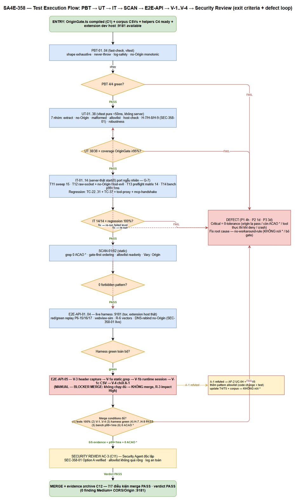
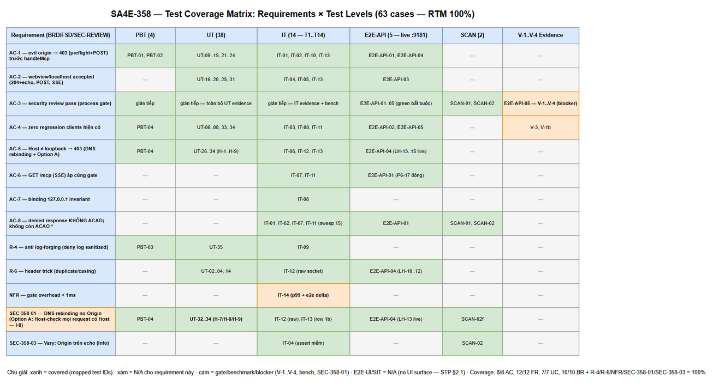

# Software Test Plan (STP)

## SDLC-Agents-4-Enterprise — SA4E-358: [Follow-up SA4E-356/SA-01] CORS * + no authN trên loopback :9181 — Origin/Host validation

---

## Document Information

| Field | Value |
|-------|-------|
| Jira Ticket | SA4E-358 |
| Title | [Follow-up SA4E-356/SA-01] CORS * + no authN trên loopback :9181 — Origin/Host validation |
| Author | QA Agent |
| Version | 1.2 |
| Date | 2026-10-13 |
| Status | Draft (v1.1 — fold SEC-358-01 Option A theo Security Design Review v1.0, SM chốt) |
| Related BRD | documents/SA4E-358/BRD.md (v1.0) |
| Related FSD | documents/SA4E-358/FSD.md (v1.1 — TA enriched, 6/6 gaps resolved) |
| Related TDD | documents/SA4E-358/TDD.md (v1.0 — 0 discrepancy vs code main) |

---

## Author Tracking

| Role | Name - Position | Responsibility |
|------|-----------------|----------------|
| Author | QA Agent – QA Engineer | Create STP/STC, test data CSVs, diagrams |
| Peer Reviewer | BA Agent – Business Analyst | Review business coverage (STC) |
| Approver | SM Agent – Scrum Master | Final approval |

---

## Revision History

| Version | Date | Author | Changes |
|---------|------|--------|---------|
| 1.0 | 2026-10-13 | QA Agent | Initiate STP — risk-based plan, 6 levels (PBT/UT/IT/E2E-API/E2E-UI/SIT) + SCAN, security-hardening focus; RTM 100% AC-1..AC-8 ↔ FR-01..12 ↔ tests; V-1 evidence là exit criterion bắt buộc trước merge (TDD C9) |
| 1.1 | 2026-10-13 | QA Agent | Fold **SEC-358-01** (SECURITY-REVIEW.md v1.0 — SM chốt **Option A**: Host-check áp cho MỌI request có Host, fold vào Phase 5): +3 UT **H-7/H-8/H-9** (UT-32..34); IT-12/IT-13 thêm variant no-Origin + Host evil; E2E-API-04 thêm vector DNS-rebind no-Origin live; **V-3 one-off header capture** thành bước BẮT BUỘC đầu C9 (khuyến nghị 6 security review); tổng 60 → **63 cases** (62 auto + 1 manual); exit criteria thêm "H-7..H-9 PASS + V-1..V-4 + bench p99<1ms + grep 0 ACAO *" per 7 điều kiện merge |
| 1.2 | 2026-10-13 | QA Agent | Hygiene per BA review (APPROVED với điều kiện): **Gap-3** — §1.1 sửa "Không test: binding (verify-only — FR-11)" → "binding: **không code change** — assert qua **IT-08** (AC-7, FR-11)" (binding CÓ assert, chỉ không có code change); đồng bộ STC v1.1 — §1.1 "TDD v1.0 / 6 phases" → **TDD v1.1 / 7 phases** (N-QA3 cùng lớp); ghi nhận STC v1.1 thêm **1 case optional** (UT-39 — SEC-358-05, skip-nếu-DEV-không-implement) → STC 64 rows (63 bắt buộc + 1 optional); số liệu case-count bảng STP giữ nguyên cho 63 case bắt buộc |

---

## Sign-Off

| Name | Signature and date |
|------|--------------------|
| | ☐ I agree and confirm the test plan in this STP |
| | ☐ I agree and confirm the test plan in this STP |

---

## 1. Introduction

### 1.1 Purpose

Test Plan này định nghĩa strategy, scope và approach để verify security hardening SA4E-358: thêm **Origin/Host validation gate** vào điểm vào duy nhất `handleRequest` của WrapperServer (loopback 127.0.0.1:9181) nhằm đóng finding **SA-01** của SA4E-356 — `Access-Control-Allow-Origin: *` vô điều kiện + preflight OPTIONS 204 vô điều kiện + SSE GET mở không authN (đã live-confirmed ×3: P6-15/16/17, PENTEST-REPORT SA4E-356).

Change đối tượng test (TDD v1.1):

1. **Module mới `extension/src/services/OriginGate.ts`** — pure function module: `extractGateHeaders(rawHeaders)` + `evaluateOriginGate(rawHeaders, listenPort)` — logic **7 phases** (TDD §3.3 — gồm Phase 1.5 Host-check-mọi-request-có-Host, SEC-358-01 Option A), contract rules G-1..G-8 (TDD §3.5).
2. **WrapperServer integration** — rewrite `handleRequest` (:124-144): gate TRƯỚC mọi route; xóa `setHeader("ACAO","*")` (:126-128); CORS echo chỉ khi `echoOrigin !== null`; deny = 403 + `{"error":"Forbidden"}` + 1 dòng log sanitized.
3. **Test infrastructure** — 4 helpers mới (`requestWithHeaders`, `assertNoAccessControlHeaders`, `sendRawRequest`, `createCapturingOutputChannel`) + unit suite `origin-gate.test.ts` + integration matrix T1..T14.
4. **Live verification** — `cors-pentest-harness.ts` (tái sử dụng pattern SA4E-356) + `bench-gate.ts` + **V-1 evidence (A-1/R-3 — điều kiện merge)**.
5. **SEC-358-01 fix (Option A — SECURITY-REVIEW.md v1.0, SM chốt 2026-10-13):** Host check áp cho **MỌI request có header Host** (Phase 1.5 — invariant mới **I-8**); chỉ no-Origin + Host thiếu (HTTP/1.0 legacy) được pass. Delta ~5-8 dòng + 3 unit tests **H-7/H-8/H-9** + cập nhật T12/T13 — đóng DNS rebinding same-origin qua nhánh no-Origin (GET /mcp SSE, /health). SA sign-off contract change FR-04/BR-06 theo khuyến nghị 1 của security review.

Không test: hành vi MCP tools / envelope PathResolverError (SA4E-356 giữ nguyên — FR-10), shared-secret/CSRF (out of scope — BRD §1.4). Binding: **không code change** — assert qua **IT-08** (AC-7, FR-11 — `srv.address().address === "127.0.0.1"`).

### 1.2 Test Objectives

- Verify mọi request có **Origin ngoài allowlist** (evil.com, DNS-rebind domain, origin variants) bị **403** — cả preflight OPTIONS lẫn POST/GET — **trước khi chạm handleMcp** (tool không thực thi) (AC-1, AC-5, BO-1, BO-2).
- Verify response cho caller bị deny **KHÔNG chứa bất kỳ CORS header nào** (không ACAO, không Allow-Methods/Headers) — systematic qua T11 sweep 5 route × 3 nhánh = 15 response (AC-8).
- Verify **không còn `ACAO: *` ở bất kỳ response nào** — kể cả 404/health/500 (AC-8, BR-07, SCAN-01).
- Verify caller được phép (vscode-webview://*, http(s)://localhost:*, http://127.0.0.1:*) được chấp nhận: preflight 204 + ACAO **echo EXACT** (G-4 — giá trị RAW, không `url.origin`), POST + SSE bình thường (AC-2).
- Verify **no-Origin = native client pass-through** (BR-06): zero CORS headers nhưng behavior semantic-identical hiện trạng (AC-4, FR-10).
- Verify **Host check** chặn DNS rebinding khi có Origin: hostname ∉ {127.0.0.1, localhost}, port ≠ port listen, IPv6 literal, malformed port, Host thiếu → 403 reason=host-mismatch (AC-5, BR-03).
- Verify **SEC-358-01 fix (Option A)**: Host check áp cho MỌI request có Host — kể cả no-Origin: no-Origin + `Host: attacker.com:<port>` → **403 host-mismatch** (UT-32, IT-12/IT-13, E2E-API-04); no-Origin + Host loopback đúng port → pass (UT-33); no-Origin + không Host (HTTP/1.0) → pass legacy (UT-34) (invariant I-8).
- Verify **fail-closed**: duplicate Origin/Host (KHÔNG first-wins — rawHeaders), malformed Origin, Origin chứa comma → 403, không throw, không crash server (FR-12, G-1, BR-01).
- Verify **anti log-forging**: deny log qua `sanitizeLogText` BÊN TRONG gate (G-3) — inject `\r\n\0` vào header → log chỉ chứa `?` (R-4, BR-04).
- Verify **binding invariant 127.0.0.1** giữ nguyên + assert test (AC-7, FR-11, T8).
- Verify **zero regression MCP**: full suite hiện có (TC-22..TC-31, TC-37, tool-proxy, mcp-handshake) + live session client thật không đổi config (AC-4, FR-10, BR-08).
- Verify **NFR performance**: gate overhead < 1ms/request (micro p99 + e2e delta median — T14, FSD §8.1).
- Hoàn tất **V-1 evidence** (giả định A-1: native client không gửi Origin) — **điều kiện bắt buộc trước merge** (TDD C9, OI-3, R-3 impact High).

### 1.3 References

| Document | Location |
|----------|----------|
| BRD SA4E-358 v1.0 | documents/SA4E-358/BRD.md |
| FSD SA4E-358 v1.1 | documents/SA4E-358/FSD.md — §3.1.6.1 (contract), §6.1 (pseudocode), §10.1 (test matrix), §3.1.4.3 (V-1), §8.1 (bench) |
| TDD SA4E-358 v1.0 | documents/SA4E-358/TDD.md — §3 (module contract), §11 (test architecture), §12 (C1..C12), §15 (AD/OI) |
| Security design review | documents/SA4E-358/SECURITY-REVIEW.md (v1.0 — PASS-with-fixes; **SEC-358-01 Medium → Option A**; 7 điều kiện merge §"Điều kiện merge (AC-3)") |
| Finding nguồn | documents/SA4E-356/SECURITY-ASSESSMENT.md — SA-01 (Medium, CWE-942/346/350) |
| Live evidence baseline | documents/SA4E-356/PENTEST-REPORT.md — P6-15/16/17 (SA-01 LIVE CONFIRMED ×3) |
| Harness pattern | documents/SA4E-356/testdata/pentest-harness.ts (Row/Verdict bookkeeping, tmp self-cleaning) |
| Format tham chiếu | documents/SA4E-356/STP.md + STC.md (ticket liền trước, cùng loại security hardening) |
| Test infra hiện có | extension/src/__tests__/wrapper-server.test.ts (TC-22..TC-31, TC-37), wrapper-server.helpers.ts (createTestServer, postMcp, postRaw, openSse) |
| STC (ticket này) | documents/SA4E-358/STC.md |
| Test data | documents/SA4E-358/testdata/*.csv |

---

## 2. Test Strategy

### 2.1 Test Levels (7 Levels — Security Hardening, TypeScript Extension, Loopback Server)

| Level | Scope | Automation | Tools |
|-------|-------|------------|-------|
| PBT | Correctness properties của `evaluateOriginGate`: fail-closed exhaustiveness, no-throw, sanitize idempotent/log-safety, no-Origin monotonic pass | Automated | fast-check ^4.9.0 (vitest) — có sẵn trong extension/package.json |
| UT | OriginGate pure unit — **38 case 7 nhóm** theo TDD §11.4 + SEC-358-01 remediation: extract (5), no-Origin (3), malformed (7), allowlist (10), host-check (6), **host-mọi-request Option A (3: H-7/H-8/H-9 — UT-32..34)**, robustness (4); gọi trực tiếp với mảng rawHeaders — KHÔNG server, KHÔNG mock | Automated | vitest — `extension/src/services/__tests__/origin-gate.test.ts` (MỚI) |
| IT | WrapperServer integration server-thật (port ngẫu nhiên `start(0)`) — matrix T1..T14: gate trước dispatch, deny zero-CORS sweep T11, raw-socket duplicate header T12, preflight matrix T13, SSE gate T7, bind assert T8, bench T14 | Automated | vitest + `http.request` + `net.connect` — mở rộng `wrapper-server.test.ts` (T1..T14) |
| E2E-API | Live harness trên server thật :9181 (extension dev host thật — không mock transport): browser-sim cross-origin → 403; vscode-webview-sim → pass + echo; native client no-Origin → pass; vector R-6 (raw socket, casing, CRLF); **V-1 evidence procedure** | Automated (harness tsx) + 1 manual procedure (V-1) | tsx + `documents/SA4E-358/testdata/cors-pentest-harness.ts` (pattern SA4E-356) |
| E2E-UI | Browser UI E2E | N/A — see justification below | — |
| SIT | Manual exploratory / edge cases only | N/A — see justification below | — |
| SCAN | Static scans: SCAN-01 (không còn `ACAO: *` hardcoded ngoài gate echo block), SCAN-02 (gate-first ordering — mọi setHeader access-control- chỉ sau gate) | Automated | grep + vitest static scan |

**E2E-UI — N/A justification:** ticket này là backend HTTP server behavior thuần — không có UI surface (BRD: "UI Specifications: N/A" cho cả 4 stories; FSD §3.1.5: N/A; TDD §1.2 — không đổi webview/panel nào). Không có screen/dialog/visual element để assert; browser test chỉ lặp lại những gì E2E-API harness đã chứng minh trực tiếp trên HTTP.

**SIT (manual exploratory) — N/A justification:** mọi behavior của gate đều deterministic và quan sát được qua status code + response headers + body + deny log — đã phủ bởi PBT/UT/IT (server thật port ngẫu nhiên) + E2E-API (server thật :9181 live). Không có visual/UX/timing judgment. Residual exploratory risk (client thật gửi Origin lạ — A-1) được xử lý bằng **V-1 evidence procedure (E2E-API-05)** — quy trình có định nghĩa steps + tiêu chí PASS rõ ràng, không phải exploratory.


*[Edit in draw.io](diagrams/test-execution-flow.drawio)*

### 2.2 Test Types

| Type | Description | Applicable |
|------|-------------|------------|
| Functional Testing | Verify 3 nhánh caller (deny / allow-echo / no-Origin pass) theo FSD UC-01..UC-07 | Yes |
| Business Rule Validation | Exercise mọi BR-01..BR-10 | Yes |
| Boundary & Negative Testing | Duplicate Origin/Host, malformed URL, trailing dot, IPv6, port variants (":09181", ":abc"), empty/whitespace, odd-length rawHeaders | Yes |
| Security Testing | Fail-closed, không throw (G-1), không log-forging (G-3), không ACAO `*` (BR-07), không leak route map (403 uniform), không echo attacker header (FR-08) | Yes |
| Regression Testing | TC-22..TC-31 + TC-37 + tool-proxy + mcp-handshake.regression — 100% pass (FR-10/BR-08); test hiện có KHÔNG assert ACAO nên không break | Yes |
| Performance Testing | NFR <1ms — micro benchmark 4 input class (p50/p95/p99) + e2e delta median trên GET /health (T14, bench-gate.ts) | Yes (lightweight, on-demand trước security review) |
| Compatibility Testing | Cross-platform (Windows/macOS/Linux — Node http + WHATWG URL); Node version-independent duplicate detection qua rawHeaders (C-3, T12) | Yes |
| Usability Testing | N/A — no UI | No |

### 2.3 Test Approach

**Risk-based prioritization:**

- **P1 (Critical — chặn ticket):** Gate chặn origin lạ trước handleMcp (UT-09..15, IT-01/02/10), zero-CORS trên mọi deny response (IT-01/02/07/11), no-Origin pass-through native (UT-06..08, IT-03), Host check DNS-rebinding + **SEC-358-01 Option A host-mọi-request** (UT-26..34, IT-06, IT-12, IT-13), preflight matrix (IT-13), echo EXACT (IT-04/05), live harness green (E2E-API-01..04). P1 fail → KHÔNG mở security review (TDD §8.5).
- **P2 (High):** Log sanitization (UT-35, IT-09), duplicate header raw-socket (IT-12), bind assert (IT-08), SCAN-01/02, full regression suite (IT-03/IT-08), V-1 evidence (E2E-API-05 — blocker merge).
- **P3 (Medium):** PBT properties (PBT-01..04), bench NFR (IT-14), extract edge cases (UT-01..05), port numeric G-8 (UT-31), trailing-dot/IPv6 origin (UT-23/24), Vary: Origin assert (SEC-358-03 — trong IT-04).

**Automation first:** 62/63 cases automated; case duy nhất chạy manual là **E2E-API-05 (V-1..V-4 evidence procedure)** — quy trình documented với tiêu chí PASS machine-checkable (V-3 header capture + grep output + deny log check + CSV rows), bắt buộc do cần client thật (VS Code/Kiro MCP HTTP client) và extension dev host thật ngoài tầm với của CI.

**Implementation order theo TDD §12 (thứ tự KHÔNG đảo):** C1-C2 (OriginGate + unit suite) trước C3 (wire server) → C4-C5 (helpers + T1..T14) trước C6 (full suite) → C7-C8 (bench + live harness) → **C9 (V-1) bắt buộc trước C11 (security review)** → C12 (evidence archive). QA trace từng C-step trong STC; QA trực tiếp thực hiện C8/C9 (TDD N-QA1/N-QA2).

### 2.4 Entry Criteria

| Level | Entry Criteria |
|-------|----------------|
| PBT | `OriginGate.ts` compile (`tsc -p ./` pass); fast-check import được trong vitest |
| UT | `OriginGate.ts` + `services/__tests__/origin-gate.test.ts` committed; gate KHÔNG import http/vscode (G-2 — verify bằng grep) |
| IT | UT 38/38 green; helpers 4 cái mới trong `wrapper-server.helpers.ts` compile; `createTestServer()` + `start(0)` hoạt động (pattern TC-22 hiện có) |
| E2E-API | IT T1..T14 100% green; full suite regression green (C6); extension dev host chạy thật trên :9181; harness script `cors-pentest-harness.ts` sẵn sàng |
| SCAN | Code change committed; pre-fix snapshot (grep `Access-Control-Allow-Origin`) captured để diff |
| Security review (AC-3) | T1..T14 PASS 100% + live harness green + **V-1 evidence hoàn tất (C9)** + regression 100% (TDD §8.5 — điều kiện mở review) |

### 2.5 Exit Criteria

| Level | Exit Criteria |
|-------|---------------|
| PBT | 4/4 properties giữ qua randomized corpus — 0 counterexample (nếu có → shrink + file defect Major) |
| UT | 38/38 pass (kể cả H-7/H-8/H-9 SEC-358-01), <50ms; coverage `OriginGate.ts` ≥95% lines/branches (TDD §11.8) |
| IT | 14/14 pass (T1..T14); T11 sweep 15/15 response đúng bảng G-5; T12 bao gồm variant no-Origin + Host evil (SEC-358-01); T13 row 1b no-Origin + Host evil → 403; T10 assert server không crash (request kế tiếp 200); regression TC-22..TC-31 + TC-37 pass |
| E2E-API | Harness green toàn bộ (attacker vectors → 403 + zero CORS; native/webview → pass; **vector DNS-rebind no-Origin + Host evil → 403 host-mismatch live — SEC-358-01**); evidence CSV `pentest-results.csv`; **E2E-API-05 (V-1..V-4): V-3 capture + `native-client-headers.md` + CSV V-1 row + BRD A-1 status cập nhật — FAIL hoặc không chạy đủ → KHÔNG merge (R-3 impact High, TDD C9/OI-3)** |
| SCAN | SCAN-01: 0 match `ACAO: *` ngoài test files; SCAN-02: mọi `setHeader("Access-Control` chỉ trong echo block sau gate |
| Ticket close | Tất cả exit criteria trên + security review AC-3 verdict PASS (không còn finding Medium+ CORS/Origin trên :9181) + **7 điều kiện merge security review v1.0: (1) T1..T14 + unit 38 + regression 100%; (2) V-1..V-4 evidence; (3) live harness green; (4) SEC-358-01 Option A implemented — H-7/H-8/H-9 PASS; (5) bench p99 <1ms; (6) grep 0 `ACAO: *` + T11 zero-CORS; (7) verdict cuối PASS** + evidence archive C12 đủ cho audit |

### 2.6 E2E Automation Coverage Classification

| Scenario Type | Classify As | Rationale |
|---------------|-------------|-----------|
| CRUD-equivalent HTTP behaviors (preflight/POST/GET trên mọi route) | IT (T1..T11) | Server thật port ngẫu nhiên, deterministic |
| API response verification (403 shape, ACAO echo, Allow-*) | IT (T1..T5) | assertNoAccessControlHeaders helper — systematic |
| RBAC-equivalent origin allow/deny | UT + IT | Pure gate function + server-thật verify |
| Raw-socket duplicate header (client API chuẩn không gửi được) | IT-12 (T12) | `net.connect` — chỉ làm được ở mức integration |
| Live server :9181 với extension host thật | E2E-API (harness) | Pattern SA4E-356 — không mock transport |
| Native client thật (VS Code/Kiro MCP client) session đầy đủ | E2E-API-02 + E2E-API-05 (V-1) | Cần client thật — V-1b chính deny log là capture mechanism |
| Static pattern scans (ACAO * remnants, gate ordering) | SCAN-01/02 | Grep — không cần runtime |
| Visual/layout verification | N/A | Không có UI |
| Complex UX flows / timing | N/A | Gate là stateless header-check, không timing-sensitive |

### 2.7 Test Cases Summary

| Level | Count | Automated | Manual |
|-------|-------|-----------|--------|
| PBT | 4 | 4 | 0 |
| UT | 38 | 38 | 0 |
| IT | 14 | 14 | 0 |
| E2E-API | 5 | 4 (harness tsx) | 1 (E2E-API-05 — V-1..V-4 evidence procedure) |
| E2E-UI | 0 | 0 (N/A — no UI surface, see §2.1) | 0 |
| SIT | 0 | 0 (N/A — all deterministic, see §2.1) | 0 |
| SCAN | 2 | 2 | 0 |
| **Total** | **63** | **62 (98%)** | **1 (2%)** |

### 2.8 V-1 Verify Plan — Điều kiện Merge (section riêng — TDD C9, FSD §3.1.4.3)

**Giả định cần verify (A-1):** Native MCP HTTP clients (VS Code/Kiro) KHÔNG gửi header `Origin` cho request /mcp. Nếu sai → gate chặn oan client hiện có (R-3, impact High, likelihood Medium).

| # | Bước | Hoạt động | Evidence / Tiêu chí PASS |
|---|------|-----------|---------------------------|
| **V-3** | **One-off header capture (E2E-API-05 step 0 — BẮT BUỘC chạy ĐẦU TIÊN, security review khuyến nghị 6)** | Trước khi enable gate: one-off listener/proxy trên :9181 bắt raw headers thật của từng client (VS Code built-in MCP client, Kiro client) trong 1 session MCP đầy đủ | `native-client-headers.md` mục V-3 — giá trị Origin/Host THẬT per client (biết trước thay vì đoán); nếu client nào gửi Origin lạ → xử lý theo BR-10 TRƯỚC khi enable gate |
| V-1a | Static analysis (E2E-API-05 step 1) | Đọc HTTP layer của từng client: VS Code built-in MCP client (`@modelcontextprotocol/sdk` — `client/streamableHttp.js`, `client/sse.js`) + Kiro client; grep -i "origin" trong dist/esm/client/; SDLC agents in-process đã verify code (remote-backend-client.ts:120 — KHÔNG qua HTTP) | `documents/SA4E-358/testdata/native-client-headers.md` — per client: HTTP layer + kết luận. PASS: không có dòng gắn Origin |
| V-1b | Runtime capture (E2E-API-02 step, sau khi gate live) | Chạy 1 session MCP đầy đủ (initialize → tools/list → tools/call → SSE) bằng client thật trên :9181 | Deny log KHÔNG xuất hiện `reason=origin-not-allowed` cho native client (chính deny log là capture mechanism — FSD §3.1.4.3.1 V-1b) |
| V-1c | Evidence CSV (E2E-API-05 step 3) | Ghi 1 dòng V-1 vào `pentest-results.csv` | PASS = (a) static grep sạch **VÀ** (b) 1 session live không sinh deny log |
| V-4 | Chốt giả định (E2E-API-05 step 4) | Cập nhật BRD A-1 trạng thái (verified/refuted) + FSD §11.2 Change Log nếu refuted | Không có open assumption trước merge |

**Quy tắc xử lý khi V-1 refuted:** nếu V-1b sinh deny log cho native client → theo AF-2 UC-04 + BR-10: **thêm pattern vào allowlist constant (code change nhỏ + unit test)** — TUYỆT ĐỐI KHÔNG nới rule thành `*` hay bỏ gate (no-workaround-rule); update T4/T5 + corpus CSV.

**Điều kiện merge:** V-1..V-4 không chạy đủ → **KHÔNG merge** (R-3 impact High — điều kiện security review AC-3, TDD §8.5 #1, C9 trước C11; V-3 là bước đầu C9 per security review khuyến nghị 6).

---

## 3. Test Scope


*[Edit in draw.io](diagrams/test-coverage.drawio)*

### 3.1 Features In Scope

| # | Feature / Story | Priority | FSD Reference | Test Cases |
|---|----------------|----------|---------------|------------|
| 1 | Gate chạy trước mọi route + trước mọi setHeader CORS (FR-01, I-1) | High | UC-01..07, FR-01 | IT-01, IT-02, IT-07, IT-11, IT-13, SCAN-02 |
| 2 | Origin rule: no-Origin → pass (native — BR-06) | High | UC-04, FR-02a | UT-06..08, PBT-04, IT-03, E2E-API-02 |
| 3 | Origin rule: Origin ∈ allowlist → pass + echo RAW (G-4) | High | UC-02/03, FR-02b, FR-03, BR-02 | UT-16..25, IT-04, IT-05, IT-13, E2E-API-03 |
| 4 | Origin rule: Origin khác → 403 trước handleMcp (FR-02c) | High | UC-01, FR-02c | UT-09..15, UT-19..23, IT-01, IT-02, IT-10, E2E-API-01 |
| 5 | Host check — DNS rebinding (FR-04, BR-03) + **SEC-358-01 Option A: áp MỌI request có Host (I-8)** | High | UC-05, FR-04, SEC-358-01 | UT-26..34, IT-06, IT-12, IT-13, E2E-API-04 |
| 6 | Bỏ ACAO `*` — echo-only semantics, zero CORS trên deny (FR-05, BR-07) | High | UC-01/07, AC-8 | IT-01, IT-02, IT-07, IT-11, SCAN-01 |
| 7 | Preflight matrix OPTIONS (UC-07 6-row × ACAM) | High | UC-07, FR-06 | IT-02, IT-04, IT-13 |
| 8 | Gate áp SSE GET /mcp — chặn trước stream (FR-07, AC-6) | High | UC-06, FR-07 | IT-07, IT-11, E2E-API-01 |
| 9 | Fail-closed: duplicate Origin/Host, malformed, không throw (FR-12, G-1, G-6) | High | UC-01 EF-1/2, FR-12 | PBT-01/02, UT-09..15, UT-35, IT-10, IT-12 |
| 10 | Deny response shape 403 + `{"error":"Forbidden"}` (FR-08) | High | §7.1 TDD | IT-01, IT-02, IT-06, IT-10 |
| 11 | Deny log 1 dòng + sanitizeLogText bên trong gate (FR-09, BR-04, G-3) | Medium | UC-01 EF-1, R-4 | UT-32, IT-01, IT-09, PBT-03 |
| 12 | Zero regression MCP cho caller được phép (FR-10, BR-08) | High | UC-04, FR-10 | IT-03, IT-05, IT-08, E2E-API-02 |
| 13 | Binding invariant 127.0.0.1 + assert (FR-11, AC-7) | Medium | Story 3 Req 4 | IT-08 |
| 14 | NFR gate overhead <1ms (FSD §8.1) | Medium | NFR | IT-14 |
| 15 | Live harness replay attacker-red/green trên :9181 thật (Story 4) | High | §10.2 FSD | E2E-API-01..04 |
| 16 | V-1 evidence — A-1 verified trước merge (R-3, OI-3) | High | §3.1.4.3 FSD | E2E-API-02, E2E-API-05 |
| 17 | Static hygiene: không còn ACAO `*` / gate-first ordering (G-5, I-2) | Medium | §7.4, §8.6 TDD | SCAN-01, SCAN-02 |
| 18 | **SEC-358-01 fix — Host-check-mọi-request-có-Host (Phase 1.5)**: no-Origin + Host evil → deny host-mismatch; no-Origin + không Host (HTTP/1.0) → pass legacy | High | SECURITY-REVIEW.md v1.0 §SEC-358-01, I-8 | UT-32..34 (H-7/H-8/H-9), IT-12, IT-13, E2E-API-04 |

### 3.2 Features Out of Scope

| # | Feature | Reason |
|---|---------|--------|
| 1 | Shared-secret header / token authN cho /mcp | BRD §1.4 mục 3 — follow-up; chốt lại tại security review AC-3 |
| 2 | CSRF-style token cho stateful calls | BRD §1.4 mục 4 — wrapper không dùng cookie/session |
| 3 | ~~Host check cho request no-Origin~~ — **ĐÃ CHUYỂN VÀO SCOPE** (SEC-358-01 Option A, SM chốt 2026-10-13): Host check áp cho MỌI request có Host; chỉ no-Origin + không-Host (HTTP/1.0) được pass. Full defense (shared-secret) vẫn follow-up (OI-1) | Security review v1.0 — điều kiện merge #4 |
| 4 | Kiến trúc WrapperServer (port retry, socket force-close, SSE keep-alive, body limit) | Không đổi — chỉ assert qua regression hiện có |
| 5 | Hành vi MCP tools / envelope PathResolverError (SA4E-356) | FR-10 — giữ nguyên byte-semantic; chỉ assert qua regression |
| 6 | Cấu hình allowlist runtime / setting UI | BR-09, A-6 — constant trong code |
| 7 | Fix SA-02..SA-07 | Phân bổ riêng |
| 8 | Rate limiting / deny-spike alerting | OI-3/OI-4 — follow-up nếu AC-3 yêu cầu |
| 9 | Stdio transport authN | Không qua HTTP — ngoài bề mặt (A-2) |

---

## 4. Test Environment

### 4.1 Environment Requirements

| Environment | Root / URL | Purpose |
|-------------|-----------|---------|
| Extension host dev (Kiro/VS Code) | Workspace `C:\projects\kiro\SDLC-Agents-4-Enterprise` | UT/IT qua vitest với vscode mock; live host cho harness/V-1 |
| CI (vitest) | `extension/vitest.config.ts` (alias `vscode → src/test/mocks/vscode.ts` :7, include `src/**/__tests__/**` :13, `fileParallelism: false` :23, `retry: 2` :26) | PBT/UT/IT/SCAN automated |
| Live wrapper server | `127.0.0.1:9181` (config `sdlcAgents.mcpServerPort`) — extension dev host thật | E2E-API harness + V-1b runtime capture |
| Integration test server | `createTestServer()` + `server.start(0)` — port ngẫu nhiên (G-7 — chứng minh không hardcode 9181) | IT T1..T14 |
| Raw socket client | `net.connect` (helper `sendRawRequest`) | T12 duplicate header / CRLF quirks |

### 4.2 Test Data Requirements

| Data Type | Description | Source | Preparation |
|-----------|-------------|--------|-------------|
| Baseline environment | Server listen 127.0.0.1, port {listen_port} ngẫu nhiên (IT) / 9181 (live); mock deps (restCallToolMock, capturing outputChannel); allowlist constant 4 pattern | `testdata/pre-seeded-data.csv` | Static CSV |
| Origin/Host corpus (unit) | 35 row: rawHeaders pairs + listenPort + expected gate result (PASS/DENY + reason/echo) | `testdata/origin-host-corpus.csv` | Static CSV — inject trực tiếp vào `evaluateOriginGate` |
| PBT property seeds | 4 row: property + generator + invariant | `testdata/pbt-properties.csv` | Static CSV; fast-check arbitraries mở rộng tại runtime |
| Integration matrix | T1..T13 rows: method/path/origin/host/body/expected status + ACAO + tool-exec + log reason | `testdata/integration-matrix.csv` | Static CSV |
| Preflight matrix | UC-07 6 rows × ACAM có/không = 12 combos | `testdata/preflight-matrix.csv` | Static CSV |
| Live harness vectors | Attacker-red (baseline P6-15/16/17) + green + R-6 vectors + V-1 row | `testdata/live-harness-corpus.csv` | Static CSV; harness ghi `pentest-results.csv` |
| Scan patterns | Forbidden/allowed grep patterns + expected match counts | `testdata/scan-patterns.csv` | Static CSV |
| Evidence (runtime-generated) | `pentest-results.csv`, `bench-results.csv`, `native-client-headers.md`, deny log samples | Generated by harness/bench/V-1 | Lưu `documents/SA4E-358/testdata/` (C12) |

### 4.3 External Dependencies

| System | Dependency | Mock/Stub Available |
|--------|-----------|---------------------|
| Node http `rawHeaders` | Mảng phẳng [name, value, ...] giữ case — nguồn authoritative duplicate detection (C-3) | Unit level inject mảng mô phỏng — không cần Node |
| Mock deps | `restGetTools`/`restCallTool` (assert calls.length === 0 khi deny), `outputChannel` capturing | Yes — `createCapturingOutputChannel()` (helper mới §11.5.1) |
| Extension dev host | Server :9181 thật cho live harness + V-1b | No — bắt buộc host thật (C8/C9); không khả dụng → block review AC-3 (N-QA2) |
| VS Code/Kiro MCP HTTP client | Session MCP đầy đủ cho V-1b + live regression AC-4 | No — client thật; static grep V-1a đọc từ install dir client |
| Atlassian backend (qua tools) | Không đụng — deny path không thực thi tool | Mock tại IT; live tools chỉ gọi bởi native client hợp lệ trong V-1b |

---

## 5. Test Schedule

| Phase | Duration | Milestone |
|-------|----------|-----------|
| Test Planning | 0.5 day | STP + STC approved (BA review per Review Gate) |
| Test Data Preparation | 0.5 day | 8 CSVs committed under `documents/SA4E-358/testdata/` |
| PBT + UT Execution (TDD C1-C2) | 1 day | 42/42 green (PBT 4 + UT 38, gồm H-7/H-8/H-9); coverage OriginGate ≥95% |
| IT Execution T1..T14 (TDD C3-C6) | 1.5 days | 14/14 green; regression TC-22..31/TC-37 green; full suite 100% |
| Bench + Live Harness (TDD C7-C8) | 0.5 day | p99 <1ms evidence; harness green + `pentest-results.csv` |
| **V-1 Evidence (TDD C9)** | 0.5 day | `native-client-headers.md` + CSV V-1 row + A-1 status — **blocker merge** |
| SCAN + Evidence Archive (C12) | 0.5 day | 0 forbidden patterns; evidence đủ cho audit |
| Security Review AC-3 (C11) | — | Verdict PASS → merge; FAIL → fix + retest loop |

---

## 6. Resources & Responsibilities

| Role | Name | Responsibility |
|------|------|---------------|
| Test Lead | QA Agent | Test planning, STP/STC, data + diagrams, quality gates |
| QA Engineer | QA Agent | Test design per TDD §11; thực hiện live harness C8 + V-1 C9 (N-QA1/N-QA2); evidence archive |
| Developer | Dev Agent | Implement per TDD §12 order (C1..C10); unit + IT suites do DEV viết (C2, C5); keep gates green |
| BA | BA Agent | Business coverage review của STC (mandatory Review Gate, max 2 iterations) |
| Security Agent | Security Agent | Security review độc lập AC-3 (C11) — gate đúng layer, không bypass, allowlist không quá rộng, log an toàn |
| SM | SM Agent | Orchestration, KB ingest, Jira transitions, evidence attach |

**Tools:** vitest 4.1.8 + fast-check 4.9.0, vscode mock alias, `http.request`/`net.connect` raw clients, capturing outputChannel mock, tsx cho harness/bench on-demand, grep scans, draw.io XML + PNG export.

---

## 7. Risk & Mitigation

| # | Risk | Impact | Likelihood | Mitigation |
|---|------|--------|------------|------------|
| TR-1 | Node duplicate-header join semantics khác nhau giữa phiên bản (C-3) → first-wins bypass | High | Medium | Gate đo bằng `req.rawHeaders` (version-independent) + dual-check comma (FSD §5.3 #3); IT-12 raw-socket duplicate Origin/Host; unit E-2/E-3/E-4 |
| TR-2 | Extension dev host không khả dụng → live harness/V-1 không chạy được | High | Medium | C8/C9 schedule trước C11; nếu không chạy được → **block security review AC-3** (N-QA2 — QA không được skip); harness tự chứa (tsx) chỉ cần server :9181 |
| TR-3 | A-1 sai — client thật có gửi Origin lạ → chặn oan (R-3) | High | Medium | V-1 bắt buộc trước merge (§2.8, **mở đầu bằng V-3 one-off header capture** — biết trước header thật của từng client); nếu refuted → BR-10 thêm pattern allowlist + update corpus; KHÔNG nới `*` |
| TR-10 | SEC-358-01 Option A chặn nhầm native client gửi Host bất thường (vd qua proxy local) | High | Low | Native MCP clients (HTTP/1.1, undici/fetch) luôn gửi Host `127.0.0.1:<port>`/`localhost:<port>` — đúng allowlist Host; V-3 capture + V-1b runtime session chứng minh trước merge; nếu có case đặc biệt → BR-10 xem xét Host allowlist extension qua code change (KHÔNG bỏ Host check) |
| TR-4 | Test hiện có assert `ACAO *` → break sau change | Medium | Low | Đã verify: TC-22..31/TC-37 không assert ACAO (TDD §11.5.2); nếu phát hiện → cập nhật theo G-5 (change có chủ đích), ghi vào test report |
| TR-5 | Port xung đột EADDRINUSE khi chạy suite song song | Medium | Low | `fileParallelism: false` đã set (:23); IT dùng `start(0)` port ngẫu nhiên |
| TR-6 | Line-number drift giữa TDD-verify (2026-10-13) và DEV start | Low | Medium | DEV re-grep theo symbol name (C-6, OI-7); SCAN symbol-based không line-based |
| TR-7 | Bench flaky trên CI shared runner | Medium | Medium | T14 threshold rộng (p99 <1ms, kỳ vọng thực tế <10µs); bench chạy on-demand trước security review, không trong CI mặc định (FSD §8.1 #1) |
| TR-8 | Scope creep — shared-secret/CSRF kéo vào ticket (R-7 BRD) | Medium | Medium | Chốt out-of-scope §3.2; security review AC-3 quyết định follow-up |
| TR-9 | Regex/grep scan false-positive (comment, doc string chứa "Access-Control-Allow-Origin") | Low | Medium | SCAN pattern chỉ match `setHeader("Access-Control` + literal `"*"` trong file .ts của src/; whitelist test files + docs |

---

## 8. Defect Management

### 8.1 Severity Levels

| Severity | Definition | Example |
|----------|-----------|---------|
| Critical | Security property broken: origin lạ pass gate / tool thực thi khi deny / còn `ACAO: *` / còn response nào cho attacker chứa ACAO / server crash với input xấu | `Origin: https://evil.com` nhận 200 + tool thực thi; 403 kèm ACAO; duplicate Origin first-wins bypass |
| Major | Contract broken: deny shape sai (body/Content-Type), echo không EXACT (G-4), log chứa control char (G-3 fail), regression AC-4 break (client hợp lệ bị 403), gate không phải statement đầu handleRequest | `{"error":"Forbidden"}` thiếu; log `origin=...\r\nX-Injected: 1`; native client nhận 403 |
| Minor | Edge mishandled: reason enum sai (origin-not-allowed vs host-mismatch precedence), log format lệch chi tiết, echo trên route không-uniform (G-5 1 ô sai trong sweep) | 403 cho path không tồn tại nhưng log thiếu method |
| Trivial | Test naming/style, CSV description typos, evidence formatting | ID/testdata label mismatch |

### 8.2 Priority Levels

| Priority | Definition | SLA (Fix Time) |
|----------|-----------|----------------|
| P1 | Must fix immediately — chặn security review AC-3 / merge | 4 hours |
| P2 | Must fix trước merge | 1 business day |
| P3 | Should fix nếu còn thời gian | 3 business days |
| P4 | Defer → follow-up ticket | Next release |

### 8.3 Defect Lifecycle

```
New → Open → In Progress → Fixed → Ready for Retest → Verified → Closed
                                                      → Reopened → In Progress
```

**Ticket-specific rules:**
- **V-1 không chạy đủ / FAIL → KHÔNG merge** (R-3 impact High — TDD C9, §2.8).
- T1..T14 bất kỳ FAIL → **KHÔNG mở security review AC-3** (TDD §8.5 #2, §10.3).
- Regression (TC-22..31/TC-37/mcp-handshake) FAIL → KHÔNG mở security review (FR-10/AC-4 blocker).
- Live harness phát hiện vector bypass mới (header casing, CRLF, multiple-Origin...) → ghi FINDING + fix trong ticket (gate phải normalize/fail-closed) — BRD Story 4 Error Handling.

---

## 9. Test Metrics & Reporting

### 9.1 Metrics

| Metric | Formula | Target |
|--------|---------|--------|
| Test Execution Rate | Executed / Total × 100% | 100% (63/63) |
| Pass Rate | Passed / Executed × 100% | 100% (security hardening close gate) |
| AC Coverage | ACs covered / 8 × 100% | 100% |
| FR Coverage | FRs covered / 12 × 100% | 100% |
| UC Coverage | UCs covered / 7 × 100% | 100% |
| BR Coverage | BRs covered / 10 × 100% | 100% |
| Module Coverage (mới) | Statements+Branches trên `OriginGate.ts` | ≥95% (TDD §11.8) |
| No-ACAO Sweep (T11) | Đúng spec responses / 15 | 15/15 (AC-8) |
| Zero-CORS-on-Deny | Denied responses chứa access-control-* / total denied | 0 |
| Log-Forging Leaks (T9/PBT-03) | Control chars lọt vào log / injected samples | 0 |
| Gate Overhead (T14) | micro p99 + e2e delta median | <1ms (kỳ vọng <10µs) |
| V-1 Evidence Complete | V-3 + V-1a + V-1b + V-1c + V-4 | 5/5 — blocker merge |
| Critical Defect Count | Count of Critical severity | 0 |
| Defect Fix Rate | Fixed / Total Defects × 100% | 100% |

### 9.2 Reporting Schedule

| Report | Frequency | Audience |
|--------|-----------|----------|
| Test Status (per level gate) | Per TDD §12 step (C1..C12) | Dev + SM |
| Defect Summary | On failure | Dev team |
| Test Completion Report (TEST-REPORT) | End of testing | All stakeholders — template `documents/templates/TEST-REPORT-TEMPLATE.md`; re-test history ở Appendix A |
| BA Review Verdict | After STC submit (max 2 iterations) | QA + SM |

---

## 10. Appendix

### Requirements Traceability — AC ↔ FR ↔ Tests (summary; full RTM in STC §10)

| AC (BRD) | Description | FR | Test Cases | Coverage |
|----------|-------------|----|------------|----------|
| AC-1 | Cross-origin evil → 403 (preflight + POST) trước handleMcp | FR-01, FR-02, FR-06, FR-07, FR-12 | PBT-01, UT-09..15, UT-19..23, IT-01, IT-02, IT-10, IT-13, E2E-API-01 | ✅ |
| AC-2 | vscode-webview + localhost accepted (204 + echo, POST, SSE) | FR-03, FR-06 | UT-16..25, IT-04, IT-05, IT-13, E2E-API-03 | ✅ |
| AC-3 | Security review pass (verdict không còn finding Medium+ CORS/Origin :9181) | (process gate — §10.3 FSD) | Tất cả levels + E2E-API-05 (V-1) + E2E-API-01..04 | ✅ |
| AC-4 | MCP clients hiện có (stdio + http) không lỗi, không đổi config | FR-02a, FR-10 | PBT-04, UT-06..08, IT-03, IT-08, IT-11, E2E-API-02, E2E-API-05, SCAN-01/02 | ✅ |
| AC-5 | Host ≠ loopback khi có Origin → 403 (DNS rebinding) + **SEC-358-01 Option A: Host ≠ loopback kể cả no-Origin** | FR-04, SEC-358-01 | UT-26..31, **UT-32..34 (H-7..H-9)**, IT-06, IT-12, IT-13, E2E-API-04 | ✅ |
| AC-6 | GET /mcp (SSE) áp cùng gate — không stream cho origin lạ | FR-07 | IT-07, IT-11, E2E-API-01 | ✅ |
| AC-7 | Binding 127.0.0.1 giữ nguyên + assert | FR-11 | IT-08 | ✅ |
| AC-8 | Denied response KHÔNG ACAO; không còn `ACAO: *` | FR-01, FR-05, FR-08 | IT-01, IT-02, IT-07, IT-11, SCAN-01, SCAN-02, E2E-API-01 | ✅ |
| R-4 (log-forging) | Deny log sanitized | FR-09 | PBT-03, UT-35, IT-09 | ✅ |
| SEC-358-01 | DNS rebinding same-origin qua nhánh no-Origin — Host check mọi request có Host (Option A) | Security review v1.0 | UT-32..34, IT-12, IT-13, E2E-API-04 | ✅ |
| SEC-358-03 | Vary: Origin trên response echo | Security review v1.0 (Info) | IT-04 | ✅ |
| NFR <1ms | Gate overhead | (FSD §8.1) | IT-14 | ✅ |

**Coverage: 8/8 ACs, 12/12 FRs, 10/10 BRs, 7/7 UCs + SEC-358-01 (H-7..H-9) + SEC-358-03 + R-4 + NFR — 100%.** (Full matrix per-requirement: STC §8.)

### Diagram Index

| # | Diagram | Image | Source (editable) |
|---|---------|-------|-------------------|
| 1 | Test Coverage (AC → levels) | [test-coverage.png](diagrams/test-coverage.png) | [test-coverage.drawio](diagrams/test-coverage.drawio) |
| 2 | Test Execution Flow (levels + entry/exit + defect loop + V-1 blocker) | [test-execution-flow.png](diagrams/test-execution-flow.png) | [test-execution-flow.drawio](diagrams/test-execution-flow.drawio) |

### Glossary

| Term | Definition |
|------|------------|
| DENY_SHAPE | Response chuẩn khi bị deny: 403 + body exact `{"error":"Forbidden"}` + Content-Type application/json + KHÔNG header nào bắt đầu `access-control-` + 1 dòng deny log |
| Gate | `evaluateOriginGate(req.rawHeaders, this.port)` — pure function chạy đầu `handleRequest` |
| echoOrigin | Origin RAW đã trim cần echo vào ACAO (G-4); null = no-Origin → zero CORS headers |
| listenPort | Port thực tế từ `srv.address().port` (this.port :99) — không hardcode 9181 (G-7) |
| rawHeaders | Mảng phẳng [name, value, ...] của Node http — giữ case, không join — nguồn authoritative (C-3) |
| V-1 | Verify plan giả định A-1 (native client không gửi Origin) — điều kiện merge (TDD C9) |
| attacker-red / green | Harness bước tái hiện finding trên code cũ (optional — có P6 baseline) / chứng minh fix trên code mới (bắt buộc) |
| SCAN | Static grep-scan level (ACAO `*` remnants + gate-first ordering) |
| T5b | Origin variants matrix unit-thuần (9 case) — mapped vào UT-16..25 (allowlist + malformed groups) |

### Assumptions

- IT server chạy `start(0)` port ngẫu nhiên — mọi tham chiếu `{listen_port}` trong test data resolve tại runtime (G-7).
- Live harness + V-1 chạy trên extension dev host thật :9181 — không mock transport (C8/C9); client thật cần 1 session MCP đầy đủ.
- `fast-check` có sẵn (extension/package.json devDependencies ^4.9.0) — nếu environment thiếu → PBT 4 case chuyển thành UT fuzz mở rộng + ghi rõ (fallback đã có sẵn ở UT-38 — R-4 fuzz 100 inputs).
- Test hiện có không assert ACAO — đã verify trong TDD §11.5.2 note.
- Deny log lấy qua `createCapturingOutputChannel()` (helper mới) — `appendLine` thu vào `lines[]`.
- **SEC-358-01 Option A** đã được SM chốt (2026-10-13): DEV implement Host-check-mọi-request-có-Host trong Phase 5 (TDD §3.3 sẽ được SA bổ sung Phase 1.5 + I-8 theo khuyến nghị 1 security review); STP/STC thiết kế test theo remediation H-7/H-8/H-9 NGAY từ đầu để DEV có target test rõ ràng. Nếu TDD chưa cập nhật lúc DEV start → DEV implement theo SECURITY-REVIEW.md remediation Option A nguyên văn + SA sign-off.
