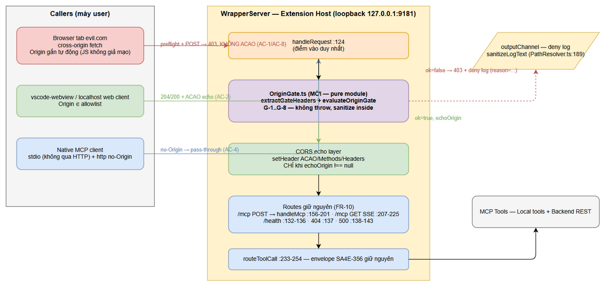
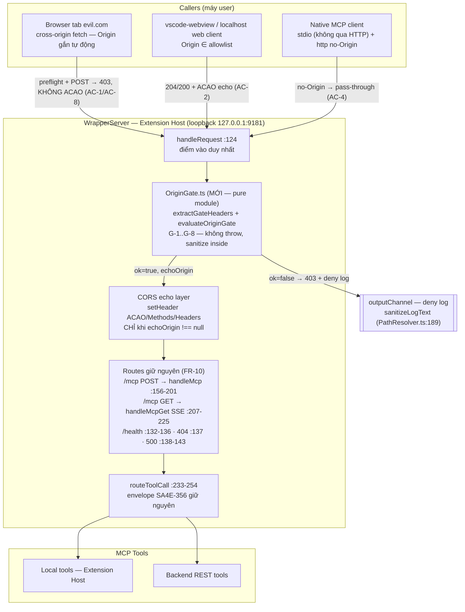
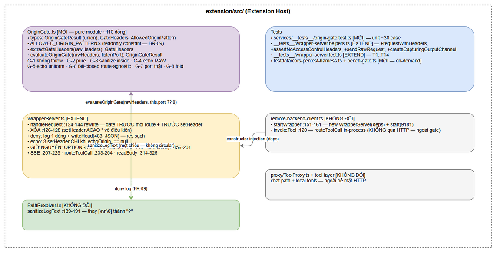
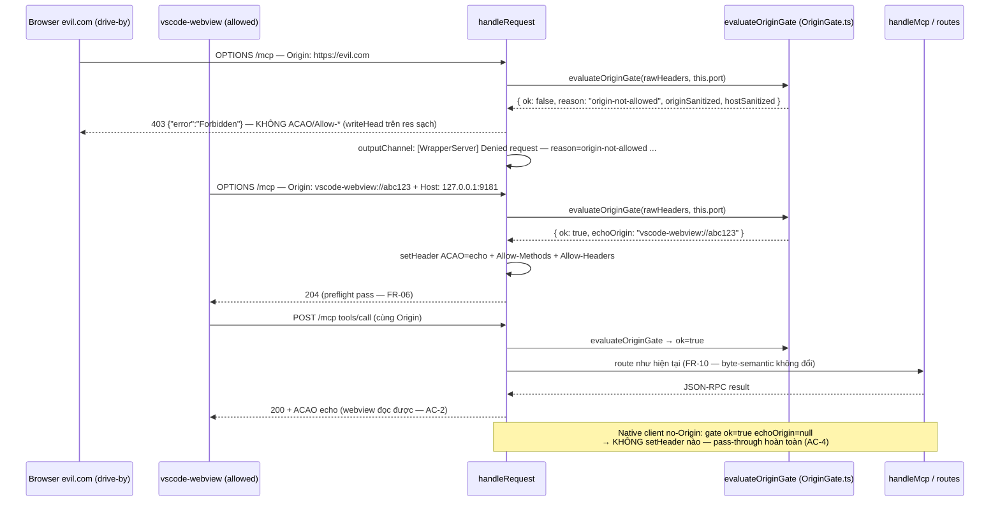
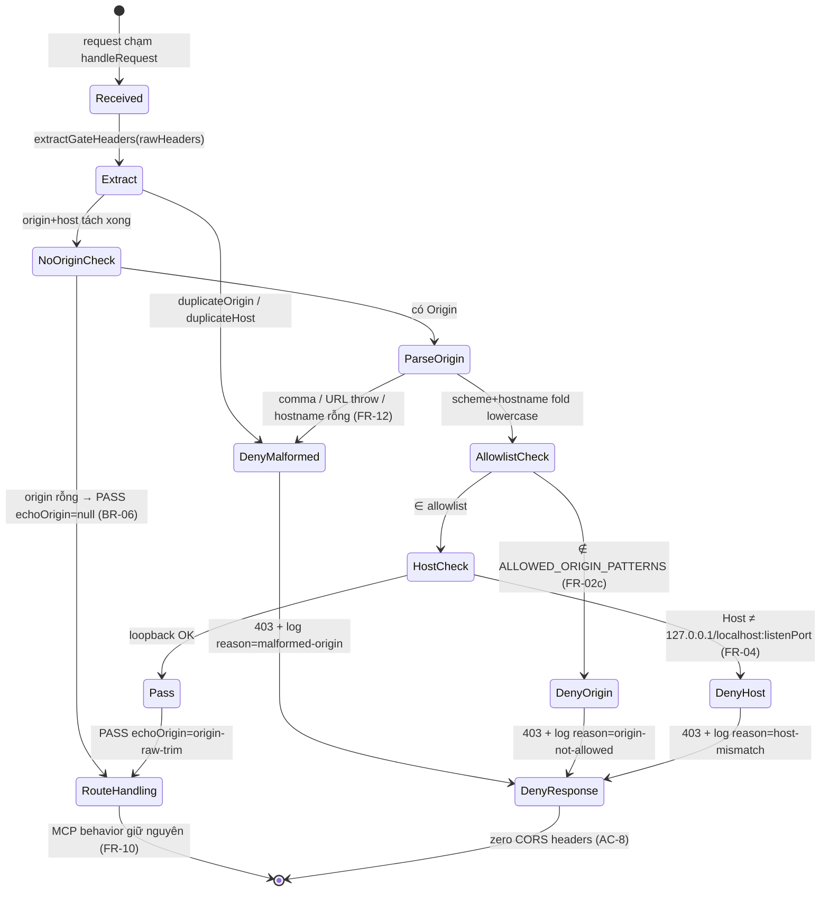
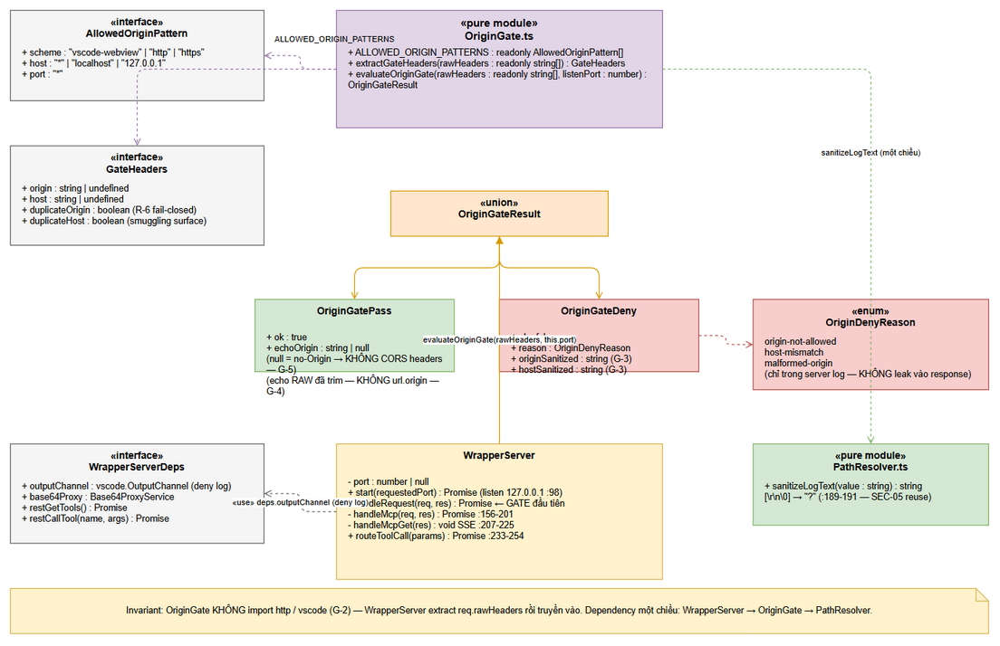
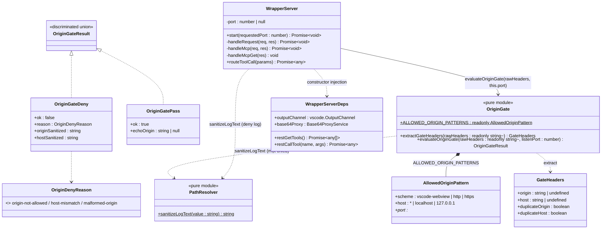

# Technical Design Document (TDD)

## SA4E — SA4E-358: [Follow-up SA4E-356/SA-01] CORS * + no authN trên loopback :9181 — Origin/Host validation

---

## Document Information

| Field | Value |
|-------|-------|
| Jira Ticket | SA4E-358 |
| Title | [Follow-up SA4E-356/SA-01] CORS * + no authN trên loopback :9181 — Origin/Host validation |
| Author | SA Agent |
| Version | 1.0 |
| Date | 2026-10-13 |
| Status | Draft — SA chốt thiết kế; DEV implement từ §3 + §5 |
| Issue Type / Priority | Task / Medium |
| Related BRD | documents/SA4E-358/BRD.md (v1.0) |
| Related FSD | documents/SA4E-358/FSD.md (v1.1 — TA enriched, 6/6 gaps resolved) |

---

## Author Tracking

| Role | Name - Position | Responsibility |
|------|-----------------|----------------|
| Author | SA Agent – Solution Architect | Thiết kế kỹ thuật — module contract, integration, test architecture |
| Peer Reviewer | Security Agent | Security review gate (AC-3) trước merge/deploy |
| Verified against | WrapperServer.ts 337 dòng (branch main, 2026-10-13) | SA re-read toàn bộ code đối tượng trước khi thiết kế |

---

## Revision History

| Version | Date | Author | Changes |
|---------|------|--------|---------|
| 1.0 | 2026-10-13 | SA Agent | Khởi tạo — dựa trên FSD v1.1 (TA technical contract §3.1.6.1 + pseudocode §6.1 + test matrix §10.1) + code verify trực tiếp WrapperServer.ts / PathResolver.ts / wrapper-server.helpers.ts / remote-backend-client.ts. 4 TA decisions được SA confirm (AD-1..AD-4); 5 SA-added decisions (AD-5..AD-9). 0 discrepancy giữa FSD và code thực tế (mọi line reference khớp 100%). |

---

## Sign-Off

| Name | Signature and date |
|------|--------------------|
| | ☐ Tôi đồng ý và xác nhận thiết kế kỹ thuật trong TDD này |
| | ☐ Tôi đồng ý và xác nhận thiết kế kỹ thuật trong TDD này |

---

## 1. Introduction

> **Scope Boundary:** TDD này đặc tả HOW — module contract của `OriginGate`, integration vào `WrapperServer`, invariants, test architecture và checklist implement. KHÔNG lặp lại functional requirements / business rules / use cases — xem FSD v1.1 (§3.1 FR-01..FR-12, §3.1.3 BR-01..BR-10, §3.1.2 UC-01..UC-07).

### 1.1 Purpose

Thiết kế kỹ thuật cho hardening bảo mật SA4E-358: thêm **Origin/Host validation gate** (module mới `OriginGate.ts`) vào điểm vào duy nhất `handleRequest` của WrapperServer (extension/src/services/WrapperServer.ts:124) để đóng finding SA-01 của SA4E-356 — `Access-Control-Allow-Origin: *` vô điều kiện (:126) + preflight OPTIONS 204 vô điều kiện (:129) + SSE GET mở (:207-225), đã **live-confirmed ×3** (P6-15/16/17, PENTEST-REPORT SA4E-356).

Thiết kế này: (1) đặc tả hoàn chỉnh module `OriginGate.ts` để DEV implement trực tiếp (types, signature, allowlist, G-rules); (2) chỉ định chính xác delta của `WrapperServer.ts` (xóa setHeader ACAO :126 — không ghi đè; gate trước mọi route); (3) định nghĩa invariants ràng buộc integration; (4) hạ tải test infrastructure (3 helpers mới + harness pattern tái sử dụng SA4E-356).

### 1.2 Scope — Technical Scope

**In scope (kỹ thuật):**

1. **Module mới `extension/src/services/OriginGate.ts`** — pure function module (không `vscode`, không `http`): types `OriginGateResult` (discriminated union), `AllowedOriginPattern`, `ALLOWED_ORIGIN_PATTERNS`, `extractGateHeaders(rawHeaders)`, `evaluateOriginGate(rawHeaders, listenPort)` — §3.
2. **WrapperServer integration** — rewrite `handleRequest` (:124-129): gate TRƯỚC mọi thứ; xóa `setHeader("ACAO", "*")`; CORS headers chỉ khi `echoOrigin !== null`; deny path = 403 + `{"error":"Forbidden"}` + 1 dòng log sanitized — §5.2, §6.
3. **Test infrastructure** — 3 helpers mới trong `wrapper-server.helpers.ts` (`requestWithHeaders`, `assertNoAccessControlHeaders`, `sendRawRequest`) + unit suite `origin-gate.test.ts` (~30 case) + integration matrix T1..T14 — §11.
4. **Live verification harness** — `documents/SA4E-358/testdata/cors-pentest-harness.ts` (tái sử dụng pattern `documents/SA4E-356/testdata/pentest-harness.ts`) + benchmark `bench-gate.ts` — §11.6, §9.
5. **Binding invariant verify-only (AC-7)** — KHÔNG code change cho `listen(port, "127.0.0.1")` (:98); chỉ thêm unit test assert `srv.address().address === "127.0.0.1"` (T8).

**Out of scope (kỹ thuật):**

- **Shared-secret header / token authN** cho /mcp (BRD §1.4 mục 3 — follow-up, chốt lại tại security review AC-3).
- **CSRF-style token** cho stateful calls (BRD §1.4 mục 4 — wrapper không dùng cookie/session).
- **Host check cho request no-Origin** — giữ hành vi native client (FR-04/BR-06); candidate hardening cho follow-up shared-secret nếu AC-3 yêu cầu (TA Note §6.1 v1.1 — SA đồng ý).
- Kiến trúc WrapperServer (vẫn Node http, port retry EADDRINUSE 10 lần :55-84, socket force-close :108-122, SSE keep-alive 15s :207-225, body limit 1MB :314-326).
- Hành vi MCP tools / envelope PathResolverError của SA4E-356 (`routeToolCall` :233-254 — giữ nguyên byte-semantic, FR-10).
- Cấu hình allowlist runtime / setting UI (BR-09, A-6 — constant trong code).
- Fix SA-02..SA-07 (phân bổ riêng).

### 1.3 Technology Stack

| Layer | Technology | Version / Verified |
|-------|-----------|--------------------|
| Language | TypeScript | extension/package.json — version 1.52.0, vitest 4.1.8 |
| Runtime | Node.js (Extension Host process) | Node `http` module — `rawHeaders` API (FSD §5.3, 12 specs) |
| Framework | VS Code / Kiro Extension API | `vscode.OutputChannel` — inject qua `WrapperServerDeps` (gate không import) |
| Test | Vitest | `extension/vitest.config.ts` — alias vscode :7, include `src/**/__tests__/**` :13, fileParallelism false :23, retry 2 :26 |
| Live harness | tsx (on-demand) | pattern `documents/SA4E-356/testdata/pentest-harness.ts` — không thêm dependency |

**NEW DEPENDENCY: không có.** Gate là pure TypeScript + Node types; harness/bench tái sử dụng tsx đã có.

### 1.4 Design Principles

1. **Fail-closed, default deny (BR-01)** — mọi trạng thái không chắc chắn (malformed, duplicate header, Host thiếu khi có Origin, port unset) → 403. Không có route ngoại lệ.
2. **Pure-function gate (G-2)** — OriginGate không I/O, không throw, không state; unit test không cần HTTP server.
3. **Defense in depth với 2 lớp độc lập** — Origin (tín hiệu tin cậy browser kiểm soát) + Host (chặn DNS rebinding) đều chạy trước route; một lớp bị qua thì lớp kia còn (UC-05 AF-1).
4. **Single entry point (SRP)** — gate tại `handleRequest` duy nhất; route-agnostic, không biết route table.
5. **Zero regression (FR-10)** — caller được phép nhận hành vi semantic-identical; native client (no-Origin) không nhận CORS headers nào (nhưng không parse CORS → zero functional impact — FSD §3.1.6.1-E).
6. **Reuse proven patterns** — sanitizeLogText (PathResolver.ts:189), discriminated union (PathResolver contract C-rules), 2-mức testability, pentest-harness (SA4E-356).

### 1.5 Constraints

- **C-1 — WrapperServer.ts đã 337 dòng** (vượt chuẩn code-standards ≤200): delta gate ~+15 dòng net (4 dòng setHeader cũ → ~17 dòng gate + echo); chấp nhận vì file đã oversized trước ticket — tách gate ra OriginGate chính là biện pháp hạn chế phình (FSD §3.1.6.1-A lý do loại inline). Không refactor ngoài scope.
- **C-2 — Node http setHeader tích lũy:** `res.setHeader()` ghi vào header list và materialize khi `writeHead`/`end` — dòng `setHeader("ACAO","*")` cũ (:126) **phải XÓA**, không được "ghi đè sau" (FSD §5.3 #6 — nếu để setHeader cũ chạy trước gate, 403 vẫn kèm ACAO — vi phạm AC-8).
- **C-3 — Node http duplicate-header semantics thay đổi theo version/option:** `req.headers` có thể join bằng ", " hoặc giữ first → KHÔNG dùng làm nguồn truth; gate đọc `req.rawHeaders` (mảng phẳng giữ case, không join — ổn định mọi phiên bản).
- **C-4 — SSE materialize:** sau `writeHead` đầu tiên của `handleMcpGet` (:208), headersSent=true — 403 phải đi ra TRƯỚC khi 1 byte SSE nào được write (không chặn trong stream).
- **C-5 — vscode alias trong vitest:** OriginGate KHÔNG import `vscode` → unit test không cần mock; WrapperServer đã có alias :7.
- **C-6 — Kiểm chứng line references:** mọi vị trí code trong TDD này đã SA verify bằng read/grep ngày 2026-10-13 trên branch main; nếu merge lớn xảy ra trước DEV start → re-grep theo symbol name (pattern OI-7 SA4E-356).

### 1.6 References

| Document | Location |
|----------|----------|
| FSD SA4E-358 v1.1 (source of truth chính) | documents/SA4E-358/FSD.md — §3.1.6.1 (contract), §6.1 (pseudocode), §5.3 (Node http), §10.1 (tests), §8.1 (bench), §3.1.4.3.1 (V-1) |
| BRD SA4E-358 v1.0 | documents/SA4E-358/BRD.md — AC-1..AC-8, S1-S4 |
| Finding nguồn | documents/SA4E-356/SECURITY-ASSESSMENT.md — SA-01 (Medium, CWE-942/346/350) |
| Live evidence | documents/SA4E-356/PENTEST-REPORT.md — P6-15/16/17 (SA-01 LIVE CONFIRMED ×3) |
| Harness pattern | documents/SA4E-356/testdata/pentest-harness.ts (Row/Verdict bookkeeping, tmp self-cleaning) |
| Code đối tượng (SA verified 2026-10-13) | extension/src/services/WrapperServer.ts (337 dòng), PathResolver.ts (sanitizeLogText :189-191), remote-backend-client.ts (:120 in-process path, :151-161 startWrapper) |
| Test infra hiện có | extension/src/__tests__/wrapper-server.helpers.ts (createTestServer :54-76, postMcp :79-99, postRaw :102-117, openSse :124-143), wrapper-server.test.ts (TC-22..TC-31, TC-37) |
| TDD format tham chiếu | documents/SA4E-356/TDD.md v1.2 (§3 module contract, §5.4 file-by-file, §11 test arch, §15 AD/OI) |

---

## 2. System Architecture

### 2.1 Architecture Overview

Kiến trúc **không đổi**: Caller → WrapperServer (loopback 127.0.0.1:9181, Node http) → MCP Tools. Gate là **một lớp kiểm tra pure-function chèn ở đầu `handleRequest`** — module `OriginGate.ts` tách riêng theo SRP, dependency một chiều `WrapperServer → OriginGate → PathResolver` (chỉ import `sanitizeLogText`, không circular).


*[Edit in draw.io](diagrams/architecture.drawio)*



**Ba nhóm caller — ba nhánh gate (FSD §2.1):**

| Caller | Header đặc trưng | Gate result | Response đặc trưng |
|--------|-----------------|-------------|--------------------|
| Browser drive-by (evil.com) | `Origin: https://evil.com` | **DENY 403** (reason=origin-not-allowed) | `{"error":"Forbidden"}` + **zero CORS headers** → browser chặn cả request lẫn readback |
| vscode-webview / localhost | `Origin: vscode-webview://abc` / `http://localhost:3000` | PASS + echo | 204/200 + ACAO echo đúng Origin + Allow-Methods/Headers |
| Native MCP client (stdio/http) | KHÔNG Origin (A-1 — V-1 verify §11.7) | PASS không echo | behavior hiện trạng, zero CORS headers (native không parse — zero impact) |

### 2.2 Component Diagram


*[Edit in draw.io](diagrams/component.drawio)*

| Component | Responsibility | File (verified) | Thay đổi |
|-----------|---------------|-----------------|----------|
| **OriginGate** | Pure header-check: extract rawHeaders → parse/normalize Origin → allowlist match → Host check → Pass/Deny(+reason, sanitized) | `extension/src/services/OriginGate.ts` | **MỚI** (~110 dòng) |
| **WrapperServer** | HTTP server; gọi gate đầu `handleRequest`; set CORS khi echo; deny 403 + log | `extension/src/services/WrapperServer.ts` | EXTEND (`handleRequest` :124-144 rewrite; import 2 symbol) |
| **PathResolver** | Cung cấp `sanitizeLogText` (thay [\r\n\0]→"?", :189-191) — reused, KHÔNG đổi | `extension/src/services/PathResolver.ts` | KHÔNG đổi |
| **RemoteBackendClient** | Wiring production: `startWrapper()` :151-161 đọc config `sdlcAgents.mcpServerPort` (9181), `invokeTool` :120 gọi `routeToolCall` in-process (KHÔNG qua HTTP → gate không áp dụng — caller cùng process, đã tin cậy) | `extension/src/remote-backend-client.ts` | KHÔNG đổi |
| **ToolProxy / backend-local-tools** | Chat path + local tools — ngoài bề mặt HTTP | `extension/src/proxy/ToolProxy.ts` | KHÔNG đổi |
| **Test helpers** | Mock deps + HTTP test client | `extension/src/__tests__/wrapper-server.helpers.ts` | EXTEND (+3 helpers mới) |

### 2.3 Deployment Architecture

Không đổi — change chạy **in-process Extension Host** (không container, không service mới):

- Extension Host (VS Code/Kiro) khởi động → `RemoteBackendClient.startWrapper()` (remote-backend-client.ts:151-161) → `new WrapperServer(deps)` → `start(9181)` (config `sdlcAgents.mcpServerPort`) → `srv.listen(port, "127.0.0.1")` (:98) → gate active trên mọi request.
- Bind loopback giữ nguyên (AC-7 — verify-only, T8). Port retry EADDRINUSE 10 lần (:55-84), socket force-close on stop (:108-122) — không đụng.
- Deny log ghi vào `outputChannel` hiện có (channel của RemoteBackendClient truyền qua deps) — không thêm infra.
- Stdio transport (SDLC agents) không đi qua HTTP — gate không thể tác động (A-2, assert bằng regression suite hiện có).

### 2.4 Communication Patterns

| From | To | Protocol | Pattern | Ghi chú |
|------|----|----------|---------|---------|
| Browser/webview (cross-origin) | WrapperServer | HTTP/1.1 + CORS | Sync request/response | Origin header do browser kiểm soát — tín hiệu trust chính |
| Native MCP client (http) | WrapperServer | HTTP/1.1 (POST JSON-RPC + GET SSE) | Sync + server-push stream | No-Origin pass-through (BR-06) |
| SDLC agents (stdio) | routeToolCall (in-process) | JSON-RPC qua stdio bridge | Sync | KHÔNG qua `handleRequest` → ngoài bề mặt gate (FSD §2.2 row 13) |
| WrapperServer → outputChannel | Deny log | In-process API | Fire-and-forget | 1 dòng/deny, sanitized (BR-04) |

### 2.5 Request Lifecycle qua Gate



**State — request lifecycle qua gate (tổng hợp FSD §6.1):**



---

## 3. Module Contract Design (OriginGate — Internal API)

> **Prerequisite:** Functional contract của gate (3 nhánh caller, ma trận deny, business view) đã định nghĩa trong FSD §3.1.6 + §3.1.6.1. Section này đặc tả **technical contract hoàn chỉnh** — DEV implement trực tiếp từ đây, không cần đọc lại FSD để code.

### 3.1 Contract Overview

| Attribute | Value | Rationale (FSD §3.1.6.1-A — SA verify 2026-10-13) |
|-----------|-------|----------------------------------------------------|
| **File mới** | `extension/src/services/OriginGate.ts` | (1) Pure-function module — unit test KHÔNG cần HTTP server; (2) `services/` là convention cho logic module tách theo SRP (`PathResolver.ts`, `Base64ProxyService.ts`, `WorkspaceScopeResolver.ts` — SA verify glob); **KHÔNG phải `proxy/`** — folder đó là outbound HTTP adapters (HttpClient, CurlTransport, ProxyAgentFactory, ToolProxy — SA verify glob), gate là INBOUND check; (3) dependency một chiều `WrapperServer → OriginGate → PathResolver`; (4) inline trong WrapperServer: BỊ LOẠI — file đã 337 dòng + test gate phải qua server thật; (5) `proxy/OriginGate.ts`: BỊ LOẠI — sai ngữ nghĩa folder |
| Test files | `extension/src/services/__tests__/origin-gate.test.ts` (unit pure — MỚI; folder `services/__tests__/` đã tồn tại với `path-resolver.test.ts`) + mở rộng `extension/src/__tests__/wrapper-server.test.ts` (integration server-thật) | 2 mức testability (§11.3) |
| vscode-free | Gate KHÔNG import `vscode`, KHÔNG import `http` | Pure module — chạy mọi CI không cần alias/mock; `req.rawHeaders` được extract bởi WrapperServer và truyền vào dạng `readonly string[]` |
| Size budget | ~110-120 dòng (types + constants + 2 functions) | code-standards ≤200 lines/file |

### 3.2 Types & Signatures (complete — DEV implement trực tiếp)

```typescript
// extension/src/services/OriginGate.ts
import { sanitizeLogText } from "./PathResolver"; // một chiều — không circular

/** Machine-readable deny reason (FR-09) — chỉ nằm trong server log, KHÔNG leak vào response. */
export type OriginDenyReason = "origin-not-allowed" | "host-mismatch" | "malformed-origin";

/** Pattern allowlist (BR-09, FSD §3.1.4.1) — constant có cấu trúc, mở rộng = code change + test. */
export interface AllowedOriginPattern {
  scheme: "vscode-webview" | "http" | "https";
  host: "*" | "localhost" | "127.0.0.1"; // "*" = mọi host ID (vscode-webview)
  port: "*";                             // "*" = mọi port (Host check vẫn dùng port CHÍNH XÁC — FR-04)
}

export const ALLOWED_ORIGIN_PATTERNS: readonly AllowedOriginPattern[] = [
  { scheme: "vscode-webview", host: "*",         port: "*" },
  { scheme: "http",           host: "localhost", port: "*" },
  { scheme: "https",          host: "localhost", port: "*" },
  { scheme: "http",           host: "127.0.0.1", port: "*" },
];

/** Pass — route tiếp. echoOrigin = Origin cần echo vào ACAO; null = no-Origin → KHÔNG set CORS headers nào (G-5). */
export interface OriginGatePass {
  ok: true;
  /** NGUYÊN giá trị Origin đã trim (G-4) — KHÔNG phải url.origin (non-special scheme → "null"). null = no-Origin. */
  echoOrigin: string | null;
}

/** Deny — 403 + log. Các giá trị header ĐÃ qua sanitizeLogText — an toàn log trực tiếp (BR-04). */
export interface OriginGateDeny {
  ok: false;
  reason: OriginDenyReason;
  originSanitized: string; // sanitized — có thể rỗng
  hostSanitized: string;   // sanitized — có thể rỗng
}

/** Discriminated union — caller (WrapperServer) MUST check `.ok` trước khi đọc field khác. */
export type OriginGateResult = OriginGatePass | OriginGateDeny;

/** Header bundle extract từ rawHeaders (export riêng để unit test extraction độc lập). */
export interface GateHeaders {
  origin: string | undefined;
  host: string | undefined;
  duplicateOrigin: boolean; // >1 key `origin` trong rawHeaders (R-6 — fail-closed FR-12)
  duplicateHost: boolean;   // >1 key `host` (request-smuggling surface — fail-closed)
}

/**
 * Extract Origin/Host từ req.rawHeaders — version-independent, KHÔNG dựa vào
 * join semantics của req.headers (thay đổi theo phiên bản Node / joinDuplicateHeaders).
 * rawHeaders: mảng phẳng [name, value, ...] giữ nguyên case — key so sánh
 * lowercase (header KEYS do Node parse, values giữ nguyên case).
 */
export function extractGateHeaders(rawHeaders: readonly string[]): GateHeaders;

/**
 * Origin/Host gate — PURE function: không I/O, KHÔNG BAO GIỜ throw (G-1),
 * mọi failure là OriginGateDeny. Logic chi tiết: §3.3.
 *
 * @param rawHeaders  req.rawHeaders của request (WrapperServer truyền trực tiếp)
 * @param listenPort  Port ĐANG listen thực tế — lấy từ srv.address().port
 *                    (WrapperServer.ts:99 đã lưu this.port); KHÔNG hardcode 9181
 *                    (start(0) trong test ra port ngẫu nhiên — G-7).
 */
export function evaluateOriginGate(
  rawHeaders: readonly string[],
  listenPort: number,
): OriginGateResult;
```

### 3.3 `evaluateOriginGate()` — Semantics 6 Phases (SA confirm pseudocode FSD §6.1)

| Phase | Bước | Kết quả | Ghi chú SA |
|-------|------|---------|------------|
| **1 — Extract** | `extractGateHeaders(rawHeaders)`: scan cặp [name, value]; key so sánh `toLowerCase()`; gom `originValues[]`, `hostValues[]`. `duplicateOrigin` = originValues.length > 1 → **DENY malformed-origin** (KHÔNG first-wins — Origin không phải list-header, RFC 7230 §3.2.2). `duplicateHost` → **DENY host-mismatch**. Sau đó `origin = h.origin?.trim() ?? ""`, `host = h.host?.trim() ?? ""` | Deny hoặc tiếp | Dual-check (a) đếm key trên rawHeaders + (b) deny Origin chứa `,` — chống join semantics Node |
| **2 — No-Origin branch** | `origin === ""` → **PASS `{ ok: true, echoOrigin: null }`** — KHÔNG Host check, KHÔNG CORS headers | Pass | BR-06 — native client; invariant dựa vào: browser LUÔN gắn Origin cho cross-origin fetch/XHR |
| **3 — Parse/normalize Origin** | (a) Origin chứa `,` → DENY malformed-origin; (b) `new URL(origin)` throw → DENY malformed-origin; (c) `url.hostname === ""` (scheme-only, vd `localhost:3000` parse thành scheme="localhost" + hostname="") → DENY malformed-origin; (d) `scheme = url.protocol` (đã lowercase, bỏ `:`); `hostname = url.hostname.toLowerCase()` (opaque host giữ case → gate tự fold) | Deny hoặc tiếp | Edge deterministic: trailing dot `evil.com.` → deny (không DNS-normalize); `vscode-webview://abc:9181` → URL throw (opaque host chứa ":") → malformed; `[::1]:3000` → hostname "::1" không thuộc allowlist → deny (R-1 candidate) |
| **4 — Allowlist match** | For từng pattern: `pattern.scheme === scheme && (pattern.host === "*" || pattern.host === hostname)` → goto Phase 5; hết pattern → **DENY origin-not-allowed** | Deny hoặc tiếp | Exact set membership — KHÔNG substring (`localhost.evil.com` ≠ `localhost` — BR-02) |
| **5 — Host check** (CHỈ khi có Origin) | (a) host rỗng → DENY host-mismatch (fail-closed, EF-1 UC-05); (b) host bắt đầu `[` (IPv6 literal) → DENY host-mismatch (allowlist Host chỉ 127.0.0.1/localhost — bind 127.0.0.1, ::1 không chạm được); (c) tách port bằng `lastIndexOf(":")` (an toàn với hostname thường); không có port → effectivePort = 80 (HTTP/1.1 default); port khớp `/^\d+$/` → parseInt (":09181" === 9181 — numeric G-8); port khác → DENY host-mismatch; (d) hostname (fold lowercase) ∉ {"127.0.0.1", "localhost"} → DENY host-mismatch; (e) `effectivePort !== listenPort` → DENY host-mismatch | Deny hoặc tiếp | BR-03 — port CHÍNH XÁC port đang listen (từ this.port, không hardcode); IPv6 `::1` deny là chủ đích — server bind 127.0.0.1 nên ::1 không thể chạm server |
| **6 — Pass** | **PASS `{ ok: true, echoOrigin: origin }`** — giá trị RAW đã trim (không `url.origin` — non-special scheme trả "null"; browser so ACAO byte-equal với Origin của nó) | Pass | G-4 |

**Precedence decisions (SA confirm TA §6.1):**

| Quyết định | Chọn | SA rationale |
|------------|------|--------------|
| Thứ tự Origin → Host | **GIỮ nguyên** | Origin ∉ allowlist đã đủ deny theo AC-1 — early-exit chi phí thấp nhất; Origin là tín hiệu quyết định (BR-05); Host là lớp xác nhận độc lập. Đảo thứ tự không tăng security |
| Origin vs Host đều fail | Origin reason thắng (`origin-not-allowed`) | Deny đầu tiên định reason (UC-05 Step 4 — TA correction v1.1: Host check chỉ chạy khi CÓ Origin) |
| Multiple-Origin | **REJECT fail-closed** — không first-wins | An toàn trên MỌI phiên bản Node bất kể join/discard behavior; đo bằng rawHeaders — không phụ thuộc `req.headers` semantics |
| Referer fallback | **CẤM** | Referer client tự set (curl/postman tự do) — dùng làm trust = mở bypass (BR-05) |
| Sec-Fetch-Site | Không dùng (v1.1) | Chỉ Chromium gửi; Origin là đủ cho threat model — xem xét lại ở follow-up shared-secret nếu AC-3 yêu cầu |

### 3.4 `extractGateHeaders()` — Spec chi tiết

```typescript
// Pseudocode implementation — DEV viết TS tương đương (~15 dòng):
export function extractGateHeaders(rawHeaders: readonly string[]): GateHeaders {
  let origin: string | undefined;
  let host: string | undefined;
  let originCount = 0, hostCount = 0;
  const originValues: string[] = [], hostValues: string[] = [];
  for (let i = 0; i + 1 < rawHeaders.length; i += 2) {
    const key = rawHeaders[i].toLowerCase();
    if (key === "origin") { originCount++; originValues.push(rawHeaders[i + 1]); origin = rawHeaders[i + 1]; }
    else if (key === "host") { hostCount++; hostValues.push(rawHeaders[i + 1]); host = rawHeaders[i + 1]; }
  }
  return {
    origin, host,
    duplicateOrigin: originCount > 1,
    duplicateHost: hostCount > 1,
  };
}
```

- Input lệch cấu trúc (odd length, rỗng) → loop không crash, trả `origin: undefined, host: undefined` → nhánh no-Origin — KHÔNG throw (G-1).
- `originValues`/`hostValues` dùng cho deny payload join (malformed/host-mismatch log) — join bằng `", "` rồi sanitize.

### 3.5 Contract Rules G-1..G-8 (carry-over FSD §3.1.6.1-D — SA confirm toàn bộ)

| # | Rule | Verify bằng |
|---|------|-------------|
| G-1 | Gate KHÔNG BAO GIỜ throw — mọi failure (URL hỏng, rawHeaders lệch cấu trúc, port NaN) là `OriginGateDeny` | Unit test gọi với mọi input lỗi → không exception (T10) |
| G-2 | Gate PURE — chỉ import `sanitizeLogText`; không I/O, không `http`, không `vscode`, không đọc body | Code review + unit test chạy không server |
| G-3 | `originSanitized/hostSanitized` ĐÃ qua `sanitizeLogText` BÊN TRONG gate — WrapperServer không thể log giá trị raw dù muốn (BR-04, R-4) | T9 — inject `\r\n\0` vào header → log không chứa control char |
| G-4 | `echoOrigin` = giá trị Origin RAW đã trim — KHÔNG dùng `url.origin`/URL serialization (non-special scheme → "null"; browser so ACAO byte-equal) | T4 — ACAO response === `vscode-webview://abc123` chính xác |
| G-5 | Echo semantics uniform: Origin ∈ allowlist → ACAO echo + Allow-* trên MỌI response của caller đó (200/202/204/400/404/405/500); no-Origin → KHÔNG CORS header nào; deny → KHÔNG CORS header nào; KHÔNG BAO GIỜ `*` (BR-07) | T11 sweep — 5 route × 3 nhánh = 15 response assert |
| G-6 | Fail-closed + route-agnostic: duplicate Origin/Host, malformed, Host thiếu khi có Origin → deny; gate không biết route table → 403 uniform mọi path | T10, T12 |
| G-7 | `listenPort` từ `srv.address().port` (this.port :99) — không hardcode 9181; `start(0)` test-safe | T6 — server port ngẫu nhiên + variant `Host: 127.0.0.1:<port+1>` |
| G-8 | So khớp scheme + hostname **case-insensitive** (fold lowercase — RFC 3986; special scheme URL đã lowercase, opaque host GIỮ case → gate tự fold); port so **numeric** (parseInt — ":09181" === ":9181"); KHÔNG substring (BR-02) | T5b — `HTTPS://LOCALHOST:3000` → allow; `http://localhost.evil.com` → deny |

### 3.6 WrapperServer Integration Pattern (SA chỉ định chính xác — thay FSD diff sketch)

```typescript
// extension/src/services/WrapperServer.ts — handleRequest SAU change:
import { evaluateOriginGate } from "./OriginGate";
import { sanitizeLogText } from "./PathResolver";   // đã import PathResolverError từ "./PathResolver" (:15) — gộp 1 dòng import

private async handleRequest(req: http.IncomingMessage, res: http.ServerResponse): Promise<void> {
  // ── GATE (SA4E-358 FR-01) — TRƯỚC MỌI thứ khác; dòng setHeader ACAO * cũ :126-129 XÓA ──
  const gate = evaluateOriginGate(req.rawHeaders, this.port ?? 0);
  if (!gate.ok) {
    this.deps.outputChannel.appendLine(
      `[WrapperServer] Denied request — reason=${gate.reason} origin=${gate.originSanitized} ` +
      `host=${gate.hostSanitized} (${req.method} ${sanitizeLogText(req.url ?? "/")})`
    );
    res.writeHead(403, { "Content-Type": "application/json" }); // res SẠCH — chưa setHeader nào
    res.end('{"error":"Forbidden"}');
    return;
  }
  // ── CORS headers CHỈ cho caller có Origin ∈ allowlist (FR-05/FR-06, G-5) ──
  if (gate.echoOrigin !== null) {
    res.setHeader("Access-Control-Allow-Origin", gate.echoOrigin);
    res.setHeader("Access-Control-Allow-Methods", "GET, POST, OPTIONS");
    res.setHeader("Access-Control-Allow-Headers", "Content-Type");
  }
  // ── hiện trạng từ đây GIỮ NGUYÊN :125-143 (URL parse, OPTIONS 204, routing, catch 500) ──
  const u = new URL(req.url || "/", "http://localhost");
  try {
    if (u.pathname === "/mcp") { await this.handleMcp(req, res); return; }
    if (u.pathname === "/health") {
      res.writeHead(200, { "Content-Type": "application/json" });
      res.end('{"status":"ok","mode":"wrapper"}');
      return;
    }
    res.writeHead(404); res.end('{"error":"Not found"}');
  } catch (err: unknown) {
    if (!res.headersSent) {
      res.writeHead(500);
      res.end(JSON.stringify({ error: (err as Error).message }));
    }
  }
}
```

**SA verification notes cho integration (mỗi row đã đọc code):**

| # | Điểm | Verified |
|---|------|----------|
| 1 | Dòng `setHeader("Access-Control-Allow-Origin", "*")` :126 + Allow-Methods :127 + Allow-Headers :128 **XÓA** khỏi vị trí hiện tại (trước OPTIONS/routing) — được thay bằng block `if (gate.echoOrigin !== null)` sau gate | setHeader trước gate sẽ materialize trên 403 (C-2) |
| 2 | Dòng OPTIONS `:129 if (req.method === "OPTIONS") { res.writeHead(204); res.end(); return; }` **GIỮ NGUYÊN vị trí** (sau gate + CORS echo) → cho phép: no-Origin → 204 bare (UC-07 row 1); allowed Origin → 204 + ACAO echo + Allow-* (UC-07 row 2-3); evil → 403 từ gate (row 4-6) | Khớp ma trận UC-07 FSD |
| 3 | `this.port ?? 0` — port null chỉ xảy ra khi server chưa listen (handleRequest không thể chạy khi chưa listen — Node chỉ dispatch sau listen callback :98-104); fallback 0 → mọi Host check fail → **fail-closed** (AD-7) | Defensive; G-7 |
| 4 | URL parse `:125` chuyển XUỐNG sau gate — không parse URL cho request bị deny (deny không cần URL; cũng tránh parse URL attacker-controlled sớm) | I-1 |
| 5 | `handleMcpGet` (:207-225) không đổi — gate đã chặn trước đó; SSE stream chỉ mở cho caller pass (C-4) | T7 |
| 6 | `routeToolCall` :233-254, `readBody` :314-326, port retry :59-84, socket tracking :90-93 — KHÔNG đụng | FR-10 |

---

## 4. Database Design

> **N/A — không có database / persistent entity.** Gate là stateless header check; "data" duy nhất là allowlist constant (§3.2) và deny log line (§7.3 — outputChannel, không persist). Không DDL, không migration, không ER diagram (FSD §4 — SA đồng ý).

---

## 5. Class / Module Design

### 5.1 Package Structure (thay đổi trong `extension/src/`)

```
extension/src/
├── services/
│   ├── OriginGate.ts                    [MỚI — pure module, ~110 dòng]
│   ├── WrapperServer.ts                 [EXTEND — handleRequest :124-144 rewrite]
│   ├── PathResolver.ts                  [không đổi — cung cấp sanitizeLogText :189]
│   └── __tests__/
│       └── origin-gate.test.ts          [MỚI — unit pure ~30 case]
├── __tests__/
│   ├── wrapper-server.helpers.ts        [EXTEND — +3 helpers + capturing outputChannel]
│   └── wrapper-server.test.ts           [EXTEND — +T1..T14 describe block]
└── remote-backend-client.ts             [không đổi — startWrapper :151-161, invokeTool :120]
documents/SA4E-358/testdata/
├── cors-pentest-harness.ts              [MỚI — live harness AC-1/AC-6/AC-8 evidence]
├── bench-gate.ts                        [MỚI — benchmark NFR <1ms]
└── (CSV evidence: pentest-results.csv, bench-results.csv, native-client-headers.md)
```

Dependency direction: `WrapperServer → OriginGate → PathResolver` (một chiều). `OriginGate` không import ngược bất kỳ module nào khác. Không DI thêm vào `WrapperServerDeps` — gate là pure import (FSD §3.1.6.1-E; nếu sau này allowlist cần cấu hình → thêm provider theo pattern `WorkspaceRootProvider`, hiện tại KHÔNG — BR-09).

### 5.2 File-by-File Changes — Implementation Table (SA verify từng row bằng read code 2026-10-13)

| # | File : vị trí (verified) | Thay đổi cụ thể | Test verify |
|---|--------------------------|-----------------|-------------|
| 1 | `services/OriginGate.ts` — **file MỚI** | Theo §3.2 (types + constants) + §3.3 (6 phases) + §3.4 (extract). Exports: `OriginDenyReason`, `AllowedOriginPattern`, `ALLOWED_ORIGIN_PATTERNS`, `OriginGatePass`, `OriginGateDeny`, `OriginGateResult`, `GateHeaders`, `extractGateHeaders`, `evaluateOriginGate`. CHỈ import `sanitizeLogText` từ `./PathResolver`. KHÔNG import http/vscode (G-2). Mọi deny path populate `originSanitized`/`hostSanitized` qua sanitizeLogText (G-3). KHÔNG throw — wrap `new URL()` trong try/catch; guard odd-length rawHeaders | Unit ~30 case (§11.4): T5b variants, T9, T10 + `extractGateHeaders` độc lập |
| 2 | `services/WrapperServer.ts` — import block (:11-15) | Thêm: `import { evaluateOriginGate } from "./OriginGate";` + mở dòng :15 thành `import { PathResolverError, sanitizeLogText } from "./PathResolver";` | Build TS pass; unit không cần mock |
| 3 | `services/WrapperServer.ts` — `handleRequest` (:124-144) | **Rewrite theo §3.6:** (a) gate line đầu tiên: `evaluateOriginGate(req.rawHeaders, this.port ?? 0)`; (b) deny path: 1 dòng log format §7.3 + `writeHead(403, {"Content-Type": "application/json"})` + `end('{"error":"Forbidden"}')` + `return` — **KHÔNG setHeader nào trước đó**; (c) echo path: 3 setHeader (ACAO=echoOrigin, Methods, Headers) chỉ khi `echoOrigin !== null`; (d) **XÓA** :126-128 (setHeader ACAO */Methods/Headers vô điều kiện); (e) **GIỮ NGUYÊN** :129 OPTIONS-204 + :130-143 (routes + catch 500); URL parse :125 dời xuống sau gate | Mức 2: T1..T14 (§11.5); regression TC-22..TC-31, TC-37 vẫn pass |
| 4 | `__tests__/wrapper-server.helpers.ts` — cuối file (sau `cleanTmpDir` :149-151) | **+4 helpers mới** (specs §11.5.1): `requestWithHeaders(port, opts)` — raw `http.request` với headers TÙY Ý, trả `{status, headers, body}` (body giữ raw string + attempt JSON.parse); `assertNoAccessControlHeaders(headers)` — scan mọi key, assert KHÔNG key nào bắt đầu `access-control-`; `sendRawRequest(port, rawBytes)` — `net.connect` + ghi bytes thô, parse status + raw response text (cho duplicate header, CRLF quirks); `createCapturingOutputChannel()` — mock outputChannel thu `appendLine` vào mảng `lines` (test đọc deny log) | Helpers được T1..T14 dùng; tự test qua chính matrix |
| 5 | `__tests__/wrapper-server.test.ts` — thêm `describe("SA4E-358 Origin Gate (T1..T14)")` mới trong cùng file (dùng lại `createTestServer` + `server.start(0)`) | Matrix T1..T14 theo §11.5.2 — mỗi test tự dựng server riêng (beforeAll/afterAll trong describe) để không ảnh hưởng TC-22..TC-31 hiện có; assert `restCallToolMock.calls.length === 0` cho deny cases + deny log qua `createCapturingOutputChannel()` | T1..T14 PASS |
| 6 | `services/__tests__/origin-gate.test.ts` — **file MỚI** | Unit mức 1: gọi trực tiếp `evaluateOriginGate([...], 9181)` với mảng rawHeaders mô phỏng — KHÔNG server, KHÔNG mock. ~30 case theo §11.4 (T1..T10 phần decision + T5b matrix + extract headers + edge cases) | PASS < 50ms |
| 7 | `documents/SA4E-358/testdata/cors-pentest-harness.ts` — **file MỚI** (không trong CI) | Live harness pattern SA4E-356 (Row/Verdict bookkeeping `rec()/check()`, self-cleaning tmp): bước attacker-red trên code cũ (optional — có P6-15/16/17 baseline) + green post-fix: preflight evil → 403; POST evil → 403; GET SSE evil → 403; /health evil → 403 không ACAO; webview/native → pass. Chạy `npx tsx documents/SA4E-358/testdata/cors-pentest-harness.ts` với extension dev host thật trên :9181 | CSV evidence → §11.6 |
| 8 | `documents/SA4E-358/testdata/bench-gate.ts` — **file MỚI** (không trong CI) | Benchmark theo FSD §8.1: micro (10⁶ lần × 4 input class, hrtime.bigint, p50/p95/p99) + e2e delta median (`GET /health` 10⁴ request sau-fix vs baseline). Evidence `bench-results.csv` | p99 < 1ms (§9) |
| 9 | `services/PathResolver.ts`, `remote-backend-client.ts`, `proxy/ToolProxy.ts`, toàn bộ tool layer | **KHÔNG THAY ĐỔI** | Regression hiện có |

### 5.3 Class Diagram


*[Edit in draw.io](diagrams/class-diagram.drawio)*



### 5.4 Design Patterns

| Pattern | Áp dụng | Lý do |
|---------|---------|-------|
| **Discriminated union result** (Result-style, không throw) | `OriginGateResult` = Pass \| Deny — caller check `.ok` | Match proven pattern PathResolver (C-1); gate không throw (G-1) — fail-closed mà không cần exception path |
| **Pure function module** | OriginGate (no I/O, no state, no vscode/http) | 2-mức testability; không flaky; <1ms overhead dễ chứng minh |
| **Constant allowlist (immutable data)** | `readonly AllowedOriginPattern[]` | BR-09 — không setting runtime (supply-chain qua workspace settings — FSD §3.1.4.1); mở rộng = code change + test |
| **Single entry point / Gatekeeper** | Gate tại `handleRequest` duy nhất, trước mọi dispatch | Không route song song (audit FSD §3.1.6 — mọi route đi qua 1 cửa) |
| **Dependency injection hiện có** | `WrapperServerDeps.outputChannel` cho deny log — KHÔNG thêm deps | Gate pure import; log qua deps đã có → test capture bằng mock channel |
| **Reuse helper** | `sanitizeLogText` từ PathResolver thay vì viết mới | DRY; proven SEC-05 SA4E-356 |

### 5.5 Error Handling Strategy (module-level)

- **OriginGate:** KHÔNG có exception path ra ngoài (G-1). Mọi input xấu → `OriginGateDeny` với reason phù hợp. Không có error class mới — deny reason enum là duy nhất (khác PathResolver có `PathResolverError` vì caller ở đó là throw-path).
- **WrapperServer deny path:** KHÔNG dùng error handler :138-143 cho deny — deny là **happy path của gate** (expected behavior), trả 403 trực tiếp; try/catch hiện có giữ nguyên làm chốt chặn cuối cho error không lường trước (NFR Reliability — FSD §8).
- **Không crash:** deny KHÔNG đọc body (Node tự drain sau res.end — FSD §5.3 #10); KHÔNG `req.destroy()` (giữ đơn giản); server tiếp tục nhận request kế tiếp (T10 assert "request tiếp theo vẫn xử lý được").

---

## 6. Sequence Design + Integration Invariants

### 6.1 Flow UC-01 — Drive-by deny (attacker)

1. `OPTIONS /mcp` + `Origin: https://evil.com` → handleRequest → gate: duplicate check (không) → origin="https://evil.com" → parse OK (scheme=https, hostname=evil.com) → allowlist: không khớp (scheme https chỉ cho host localhost) → **DENY** `{ok:false, reason:"origin-not-allowed", originSanitized:"https://evil.com", hostSanitized:...}` → log 1 dòng → `writeHead(403, {Content-Type})` + `{"error":"Forbidden"}` → return. KHÔNG 204, KHÔNG ACAO, KHÔNG Allow-*.
2. POST /mcp (nếu client vẫn gửi — simple request/curl) → gate deny tương tự **trước khi chạm handleMcp** — `restCallTool` không được gọi (assert `calls.length === 0`).

### 6.2 Flow UC-02/04 — Allow (webview / native)

1. Webview `OPTIONS /mcp` + `Origin: vscode-webview://abc123` + `Host: 127.0.0.1:9181` → gate: parse OK (opaque host "abc123" — URL không throw vì không có ":") → allowlist scheme `vscode-webview` + host `*` → khớp → Host check: "127.0.0.1":9181 === listenPort → **PASS echoOrigin="vscode-webview://abc123"** → setHeader ACAO/Methods/Headers → OPTIONS → **204 + ACAO echo**.
2. Native client `POST /mcp` initialize (no-Origin) → gate: origin rỗng → **PASS echoOrigin=null** → KHÔNG setHeader nào → handleMcp :156-201 handshake byte-semantic như hiện trạng (:170-182 protocol negotiation, :184 notifications 202, :186 tools/list rewrite, :191 tools/call envelope SA4E-356).

### 6.3 Flow UC-05 — DNS rebinding (Origin pass + Host fail)

`Origin: vscode-webview://x` + `Host: attacker.com:9181` → gate Phase 4 pass (webview scheme) → Phase 5: hostname "attacker.com" ∉ {"127.0.0.1","localhost"} → **DENY host-mismatch** → 403. Origin là lớp quyết định, Host là lớp xác nhận độc lập — một lớp bị qua thì lớp kia còn (AF-1 UC-05: Host giả 127.0.0.1 hoàn hảo → Origin vẫn chặn vì browser gắn Origin thật).

### 6.4 Integration Invariants (bắt buộc — verify bằng test + code review)

| # | Invariant | Verify |
|---|-----------|--------|
| **I-1** | Gate chạy **TRƯỚC** mọi route dispatch và TRƯỚC mọi `res.setHeader` — không có response nào thoát ngoài gate (URL parse :125 dời xuống sau gate) | T1..T7, T11 sweep + code review |
| **I-2** | Deny path **KHÔNG set CORS headers nào** — res sạch trước `writeHead(403)`; không còn `ACAO: *` ở bất kỳ response nào (kể cả 404/health cho caller lạ) | `assertNoAccessControlHeaders` trên MỌI denied response (T11) |
| **I-3** | Gate **KHÔNG throw** (G-1); sanitize **BÊN TRONG** gate (G-3) — WrapperServer không thể log giá trị raw dù muốn | T9, T10 unit + integration |
| **I-4** | rawHeaders là **nguồn duy nhất** cho header read + duplicate detection — KHÔNG dùng `req.headers` (C-3) | T12 raw-socket duplicate; code review |
| **I-5** | `echoOrigin` = RAW origin đã trim — KHÔNG `url.origin` (G-4) | T4 echo EXACT |
| **I-6** | `listenPort` từ `this.port` (srv.address().port :99) — KHÔNG hardcode 9181; fallback 0 → fail-closed | T6 với port ngẫu nhiên + variant port+1 |
| **I-7** | Caller được phép → behavior **semantic-identical** hiện trạng (FR-10): handshake :170-182, notifications 202 :184, ping :185, tools/list :186-190, tools/call :191-195 + envelope SA4E-356 :233-254, SSE :207-225 keep-alive 15s, body limit :314-326, 405 :159, parse-error :161-166, 404/500 | Full regression TC-22..TC-31, TC-37 + mcp-handshake.regression + live smoke |

---

## 7. Error / Deny Handling Design

### 7.1 Deny Response Shape (SA confirm FSD §3.1.6 verdict — 403 uniform)

| Aspect | Spec |
|--------|------|
| Status | **403 Forbidden** — uniform MỌI path + method từ caller bị deny (kể cả path không tồn tại — không leak route map; gate route-agnostic). SA chốt cuối (AC-3 sẽ re-verify) |
| Body | `{"error":"Forbidden"}` — Content-Type: `application/json`; KHÔNG phân biệt body giữa các reason (reason KHÔNG leak ra ngoài — chỉ trong log) |
| CORS headers | **KHÔNG SET** — không ACAO, không Allow-Methods, không Allow-Headers (FR-05, FR-08). Đây là control thực sự (defense-in-depth AC-8: kể cả lỗi route-song-song, attacker không readback được) |
| Body khi preflight deny | Giống POST deny (403 + JSON) — KHÔNG phải 204 (FR-06) |

### 7.2 Deny Reasons Enum + Mapping (tổng hợp từ §3.3)

| Reason | Trigger (Phase) | Case tiêu biểu | Test |
|--------|-----------------|----------------|------|
| `malformed-origin` | Duplicate Origin (P1); Origin chứa "," (P3a); URL throw (P3b); hostname rỗng — scheme-only (P3c) | `%%`, `""`, `"null"`, `file://x`, `localhost:3000` (thiếu scheme), 2 dòng Origin:, `vscode-webview://abc:9181` | T10, T12 |
| `origin-not-allowed` | Origin parse OK nhưng ∉ allowlist (P4) | `https://evil.com`, `http://localhost.evil.com:3000`, `https://127.0.0.1:8443` (https+127.0.0.1 không trong FR-03), `http://[::1]:3000`, `http://localhost.` (trailing dot) | T1, T2, T5b |
| `host-mismatch` | Duplicate Host (P1); CÓ Origin + Host rỗng (P5a); Host IPv6 literal (P5b); hostname ∉ loopback (P5d); port malformed/khác listenPort (P5c/e) | `Host: attacker.com:9181`, `Host: 127.0.0.1:<port+1>`, `Host` thiếu khi có Origin, `Host: [::1]:<port>`, `Host: 127.0.0.1:abc` | T6, T13 |

### 7.3 Deny Log Format (FR-09, BR-04 — SA xác định chính xác 1 dòng)

```
[WrapperServer] Denied request — reason=<reason> origin=<originSanitized> host=<hostSanitized> (<METHOD> <sanitizeLogText(req.url ?? "/")>)
```

- **1 dòng** per deny vào `outputChannel` (channel hiện có qua deps) — không log body, không log full header list.
- `originSanitized`/`hostSanitized` đã qua sanitizeLogText BÊN TRONG gate (G-3 — có thể rỗng); `req.url` sanitize tại call site (FSD §5.3 #11 — Node parser chặn CR/LF trong request line nhưng vẫn sanitize theo BR-04).
- Allowed request KHÔNG log thêm (FSD §7.3 — tránh noise + tránh leak traffic pattern).
- Anti log-forging: T9 inject control chars `\r\n\0` → log chỉ chứa `?`.

### 7.4 No-ACAO-on-Deny Matrix (assert systematic — T11)

| Caller nhánh | /mcp POST | /mcp GET (SSE) | OPTIONS preflight | /health | 404 fallback |
|--------------|-----------|----------------|--------------------|---------|--------------|
| Origin evil | 403 + zero CORS | 403 + zero CORS (không byte SSE nào) | 403 + zero CORS | 403 + zero CORS | 403 + zero CORS |
| Origin webview/localhost (Host OK) | 200/202/400 + ACAO echo | 200 SSE + ACAO echo | 204 + ACAO echo + Allow-* | 200 + ACAO echo | 404 + ACAO echo (G-5 — echo uniform kể cả 404) |
| No-Origin (native) | 200/202/400 behavior hiện trạng, zero CORS | 200 SSE hiện trạng, zero CORS | 204 bare (không ACAO), zero CORS | 200 hiện trạng, zero CORS | 404 hiện trạng, zero CORS |
| Origin webview + Host evil | 403 + zero CORS (host-mismatch) | 403 | 403 | 403 | 403 |

> Lưu ý G-5: caller ĐƯỢC phép nhận ACAO echo kể cả trên 404/500 — khác hẳn caller bị deny (403 thay 404, zero CORS). No-Origin không có CORS header nào nhưng vẫn nhận behavior hiện trạng (không phải deny).

---

## 8. Security Design

### 8.1 Threat Model Recap (BRD §1.1 — nguồn finding SA-01)

| Vector | Attacker | Cơ chế | Hậu quả nếu không fix (live-confirmed) | Chốt bởi |
|--------|----------|--------|----------------------------------------|----------|
| **Drive-by cross-origin readback** | Trang web bất kỳ user visit | Browser gắn `Origin` (JS không giả mạo được) + ACAO `*` cho phép đọc response | Đọc cúp dữ liệu Atlassian qua `jira_get_issue`, `confluence_get_comments`... trong context user (P6-15) | Origin gate + bỏ ACAO `*` (AC-1, AC-8) |
| **Preflight abuse** | Như trên | OPTIONS 204 vô điều kiện | Preflight pass 100% → request thật được gửi (P6-16) | Gate chặn OPTIONS (FR-06) |
| **SSE mở không authN** | Như trên | GET /mcp mở stream | Kênh server-initiated messages mở (P6-17) | Gate trước `writeHead` SSE (FR-07, AC-6) |
| **DNS rebinding** | Domain attacker trỏ DNS → 127.0.0.1 | Request "same-origin" nhưng Host = attacker.com | Gate bị qua nếu chỉ check Origin | Host check khi có Origin (FR-04, AC-5) |
| **Header injection / smuggling tricks** | Client non-browser | Duplicate Origin/Host, casing, CRLF | First-wins có thể bị inject Origin thứ 2 hợp lệ | rawHeaders duplicate detect fail-closed (R-6, T12) + sanitizeLogText chống log-forging (T9) |

**Không trong threat model** (BRD §1.1.1): malware cục bộ có quyền user; user độc hại trên máy; attacker từ mạng remote (bind 127.0.0.1 :98); client non-browser tự chịu trách nhiệm header (AF-1/AF-2 UC-01 — shared-secret follow-up nếu AC-3 yêu cầu).

### 8.2 Fail-Closed Design (SA decisions)

| # | Điểm fail-closed | Biểu hiện |
|---|------------------|-----------|
| 1 | Header hỏng / parse fail | 403 malformed-origin — không exception thoát (G-1) |
| 2 | Duplicate Origin/Host | 403 — KHÔNG first-wins (dù 1 trong 2 giá trị hợp lệ — T12) |
| 3 | Host thiếu khi có Origin (HTTP/1.0) | 403 host-mismatch (EF-1 UC-05) |
| 4 | Port Host malformed (`:`, `abc`, `9181:extra`) | 403 host-mismatch |
| 5 | `this.port` null (chưa listen) | fallback 0 → Host check fail → 403 (AD-7 — defensive, không thể xảy ra qua HTTP nhưng fail-closed vẫn đúng) |
| 6 | Không-Origin + OPTIONS | 204 bare — không leak gì (UC-07 row 1; deny 403 ở đây sẽ break client HTTP/1.0 hiếm gặp — giữ hiện trạng, SA confirm) |
| 7 | Route lạ + caller bị deny | 403 (không 404 — không tiết lộ route map) |

### 8.3 Allowlist Immutability

- `ALLOWED_ORIGIN_PATTERNS` là `readonly` constant — KHÔNG setting runtime, KHÔNG `contributes.configuration` (BR-09). Lý do: workspace-scoped settings bị supply-chain qua repo (`.vscode/settings.json` theo workspace) — attacker qua tool ghi file trong workspace (chính là side-effect SA-01) tự thêm origin lạ → gate vô dụng (FSD §3.1.4.1 bảng đánh giá — SA đồng ý phân tích).
- Mở rộng (R-1: fork IDE scheme khác; R-2/R-3: client thật gửi Origin lạ): code change nhỏ trong 1 commit + unit test T4/T5b mở rộng — KHÔNG BAO GIỜ nới `*` hay substring (BR-10, no-workaround-rule).
- `https://127.0.0.1:<port>` KHÔNG trong allowlist — chủ đích theo FR-03 (chỉ http+127.0.0.1); nếu webview thật cần → thêm pattern qua code change, không phải default deny sai (T5b assert behavior này).

### 8.4 Data Protection

| Data | Classification | Bảo vệ |
|------|---------------|--------|
| Kết quả MCP tools (Atlassian data) | Confidential | Gate chặn origin lạ trước handleMcp; zero CORS trên deny → không readback (AC-8) |
| Session/credential extension-side | Restricted | Không bao giờ trong response header/body của gate; deny body rút gọn (FR-08) |
| Deny log | Internal | Metadata sanitized — không body, không raw header (BR-04); outputChannel local session (như hiện trạng server logs) |
| 403 body | Public | `{"error":"Forbidden"}` — không leak allowlist, không echo attacker header |

### 8.5 Verification Gates Trước Merge (bắt buộc — điều kiện AC-3)

1. **V-1 (A-1/R-3 verify):** chứng minh native client không gắn Origin — static grep client source (FSD §3.1.4.3.1 V-1a) + runtime: 1 session MCP đầy đủ với client thật sau change → deny log KHÔNG có `reason=origin-not-allowed` cho native client (V-1b — chính deny log là capture mechanism). Evidence: `documents/SA4E-358/testdata/native-client-headers.md`. **V-1..V-4 không chạy đủ → KHÔNG merge** (R-3 impact High).
2. **T1..T14 PASS 100%** (điều kiện mở security review — TA update v1.1 §10.3).
3. **Live harness green** (attacker-red optional có P6-15/16/17 baseline; green bắt buộc).
4. **Security review độc lập (AC-3):** Security Agent xác nhận gate đúng layer, không bypass route, allowlist không quá rộng, log an toàn, **chốt dứt khoát** whether shared-secret/CSRF cần follow-up. Verdict không còn finding Medium+ về CORS/Origin trên :9181.
5. **Regression 100%:** wrapper-server.test.ts hiện có + tool-proxy + mcp-handshake.regression + live smoke SDLC agent workflow.

### 8.6 Security Invariants Tóm Tắt (cho code review checklist)

- [ ] Không còn `Access-Control-Allow-Origin: *` ở bất kỳ dòng code nào (grep `setHeader("Access-Control` chỉ còn trong block echo).
- [ ] Gate là lệnh đầu tiên trong `handleRequest` — không statement nào trước nó.
- [ ] Allowlist constant không thể mutate (readonly + không export mutable reference).
- [ ] Mọi deny path đều log đúng 1 dòng với reason từ enum.
- [ ] `sanitizeLogText` áp cho mọi giá trị header/URL vào log.

---

## 9. Performance & NFR Design

| NFR | Yêu cầu | Thiết kế đáp ứng | Verify |
|-----|---------|------------------|--------|
| Gate overhead | < 1ms/request | Pure string-check: 1 lần scan rawHeaders (O(n) header count nhỏ) + ≤1 lần `new URL` (~1-3µs — chi phí lớn nhất) + vài string compare; KHÔNG I/O, KHÔNG đọc body, KHÔNG caching decision (Map cache TỪ CHỐI ở v1.1 — state + key-expiry phức tạp hóa gate thuần, FSD §8.1 #6 — SA đồng ý) | T14 bench: micro p99 < 1ms (kỳ vọng thực tế <10µs) + e2e delta median < 1ms trên `GET /health` |
| Throughput tools/call | Không đổi | Gate KHÔNG nằm trong hot path của tool execution (chạy 1 lần trước route); routeToolCall/envelope không đụng (I-7) | Regression + live smoke |
| SSE | keep-alive 15s không đổi | Gate trước `handleMcpGet`; stream logic :207-225 nguyên vẹn | T7 allowed nhánh + openSse() hiện có |
| Body limit | 1MB không đổi | Deny trả TRƯỚC `readBody` — attacker body không được đọc (FSD §5.3 #10 — Node tự drain); MAX_BODY_SIZE :314-326 nguyên vẹn | Regression + T10 |
| Reliability | Không crash input xấu | G-1 không throw; error handler :138-143 chốt chặn cuối | T10 (server vẫn xử lý request kế tiếp) |
| Cross-platform | Windows/macOS/Linux | Node http API + WHATWG URL — không platform-specific code (không path.sep, không fs) | CI suite |
| Binding | 127.0.0.1 invariant (AC-7) | Verify-only — T8 assert `srv.address().address === "127.0.0.1"` | T8 |

**Benchmark method** (FSD §8.1 — SA confirm): script `bench-gate.ts` chạy on-demand trước security review (không trong CI mặc định); 4 input class (no-Origin, allowed webview, denied evil, malformed) × 10⁶ lần sau warmup 10⁴; e2e so delta median với baseline server hiện trạng; evidence CSV.

---

## 10. Monitoring & Observability

### 10.1 Logging Standards

| Event | Level/Format | Channel | Nội dung |
|-------|--------------|---------|----------|
| Deny | 1 dòng format §7.3 | `outputChannel` (deps) | reason enum + origin/host sanitized + method + path sanitized; KHÔNG body |
| Allowed | Không log thêm | — | Giữ hiện trạng (tránh noise — FSD §7.3) |
| Server error (500) | Như hiện trạng :138-143 + :198 | outputChannel | Không đổi |

### 10.2 Metrics

Không thêm metrics infra trong ticket (outputChannel là kênh duy nhất — như hiện trạng). Deny log là nguồn data cho:

- **Deny spike thủ công** (FSD §9.3): nhiều 403 liên tiếp trong outputChannel → developer/BA rà soát (không alerting tự động — out of scope, ghi nhận OI).
- **R-1/R-2/R-3 chẩn đoán:** reason=origin-not-allowed xuất hiện cho client hợp lệ → bổ sung allowlist pattern (BR-10).

### 10.3 Aggregation / Rate

- **KHÔNG rate-limit, KHÔNG aggregation trong ticket này** — gate deny là stateless; request rate không đổi behavior (fail-closed mọi request). Rate limiting cho loopback local server là candidate cho follow-up shared-secret (nếu AC-3 yêu cầu) — ghi nhận OI-3.
- Evidence thu thập thủ công: copy outputChannel deny log vào `documents/SA4E-358/testdata/` khi điều tra.

### 10.4 Health Checks

- `/health` giữ nguyên `{"status":"ok","mode":"wrapper"}` (:132-136) — giờ yêu cầu caller hợp lệ (403 cho origin lạ — P6-15 đóng). Health-checker của extension side chạy in-process (không qua HTTP) nên không bị ảnh hưởng.

---

## 11. Test Architecture

### 11.1 Framework & Conventions

- **Framework:** Vitest — `extension/vitest.config.ts` hiện có: alias `vscode → src/test/mocks/vscode.ts` (:7), include `src/**/__tests__/**/*.test.ts` (:13), `fileParallelism: false` (:23), `retry: 2` (:26). **Test code MUST TypeScript** (match extension).
- **Ngôn ngữ test:** TypeScript — chia sẻ types (`GateHeaders`, `OriginGateResult`) + helpers với production code.
- **Convention:** unit test cho services đặt tại `services/__tests__/` (pattern `path-resolver.test.ts` đã tồn tại); integration test tại `src/__tests__/` (pattern wrapper-server.test.ts).
- **Facts đã verify (SA re-confirm từ code thật 2026-10-13):** `createMockOutputChannel()` hiện tại `appendLine: () => {}` — KHÔNG capture → cần helper mới `createCapturingOutputChannel()`; `postMcp()` hard-code headers (không nhận Origin) → cần `requestWithHeaders()`; `openSse()` không nhận headers; `server.start(0)` cho port ngẫu nhiên (đã dùng ở TC-22 suite — G-7 safe).

### 11.2 Test Files Layout

| File | Status | Nội dung |
|------|--------|----------|
| `extension/src/services/__tests__/origin-gate.test.ts` | **NEW** | Unit pure mức 1: `evaluateOriginGate` + `extractGateHeaders` trực tiếp với mảng rawHeaders — ~30 case (§11.4) |
| `extension/src/__tests__/wrapper-server.helpers.ts` | **EXTEND** | +4 helpers: `requestWithHeaders`, `assertNoAccessControlHeaders`, `sendRawRequest`, `createCapturingOutputChannel` (§11.5.1) |
| `extension/src/__tests__/wrapper-server.test.ts` | **EXTEND** | +`describe("SA4E-358 Origin Gate (T1..T14)")` — integration mức 2, server thật port ngẫu nhiên (§11.5.2); TC-22..TC-31 hiện có giữ nguyên |
| `documents/SA4E-358/testdata/cors-pentest-harness.ts` | **NEW** (on-demand) | Live harness — attacker-red/green + evidence CSV (§11.6) |
| `documents/SA4E-358/testdata/bench-gate.ts` | **NEW** (on-demand) | Benchmark NFR (§9) |
| Regression | Không đổi | TC-22..TC-31, TC-37 + tool-proxy.test.ts + mcp-handshake.regression.test.ts — pass 100% (FR-10) |

### 11.3 2 Mức Testability (pattern PathResolver — FSD §3.1.6.1-E)

**Mức 1 — Pure function (chiếm đa số, <50ms):** gọi trực tiếp với mảng rawHeaders mô phỏng:

```typescript
// extension/src/services/__tests__/origin-gate.test.ts
import { describe, it, expect } from "vitest";
import { evaluateOriginGate, extractGateHeaders } from "../OriginGate";

const H = (...pairs: [string, string]) => pairs.flat();

it("T1 unit — evil origin denied", () => {
  const r = evaluateOriginGate(
    H(["Host", "127.0.0.1:9181"], ["Origin", "https://evil.com"]), 9181);
  expect(r.ok).toBe(false);
  if (!r.ok) expect(r.reason).toBe("origin-not-allowed");
});

it("T4 unit — webview echo RAW", () => {
  const r = evaluateOriginGate(
    H(["Host", "127.0.0.1:9181"], ["Origin", "vscode-webview://abc123"]), 9181);
  expect(r).toEqual({ ok: true, echoOrigin: "vscode-webview://abc123" });
});
```

**Mức 2 — Integration server-thật:** `createTestServer()` + `server.start(0)` + `requestWithHeaders()` — assert status/headers/body + `restCallToolMock.calls.length === 0` (tool không thực thi) + deny log qua `createCapturingOutputChannel()`.

Không cần DI thêm vào `WrapperServerDeps` (FSD §3.1.6.1-E — SA confirm).

### 11.4 Unit Tests Mức 1 — origin-gate.test.ts (~30 case)

| Nhóm | Case | Input (rawHeaders pairs + listenPort) | Kỳ vọng |
|------|------|----------------------------------------|---------|
| **extract (5)** | E-1 single origin+host | `[Origin, http://x.com, Host, 127.0.0.1:9181]` | origin/host đúng, no duplicate |
| | E-2 duplicate origin | 2 cặp Origin | `duplicateOrigin: true` |
| | E-3 duplicate host | 2 cặp Host | `duplicateHost: true` |
| | E-4 casing key | `[ORIGIN, x]`, `[origin, y]` | 2 value gom, duplicate detect (key compare lowercase) |
| | E-5 empty / odd array | `[]`, `[Origin]` | origin undefined, không throw |
| **no-Origin (3)** | N-1 không có Origin | `[Host, 127.0.0.1:9181]` | PASS echoOrigin=null |
| | N-2 Origin rỗng | `[Origin, "", Host, ...]` | PASS echoOrigin=null (rỗng sau trim = no-Origin) |
| | N-3 Origin whitespace | `[Origin, "   ", ...]` | PASS echoOrigin=null (trim) |
| **malformed (7)** | M-1 `%%` | URL throw | DENY malformed-origin |
| | M-2 `null` literal | URL throw | DENY malformed-origin |
| | M-3 `file://x` | scheme ngoài allowlist + URL OK → allowlist miss | DENY (origin-not-allowed — parse OK; nếu developer viết fallback malformed cũng chấp nhận — assert deny KHÔNG pass) |
| | M-4 `localhost:3000` (thiếu scheme) | scheme-only → hostname rỗng | DENY malformed-origin |
| | M-5 chứa comma | `http://a.com,http://b.com` | DENY malformed-origin |
| | M-6 duplicate Origin (rawHeaders) | 2 cặp, 1 giá trị hợp lệ | DENY malformed-origin (KHÔNG first-wins) |
| | M-7 `vscode-webview://abc:9181` | opaque host chứa ":" → URL throw | DENY malformed-origin |
| **allowlist match (10)** | A-1 `vscode-webview://abc123` + Host OK | port listen | PASS echo RAW |
| | A-2 `http://localhost:3000` (port khác listen) | Host OK | PASS echo |
| | A-3 `https://localhost:8443` | Host OK | PASS |
| | A-4 `http://127.0.0.1:5173` | Host OK | PASS |
| | A-5 `HTTPS://LOCALHOST:3000` (G-8 fold) | Host OK | PASS (value fold) |
| | A-6 `http://localhost.evil.com:3000` | — | DENY origin-not-allowed (BR-02) |
| | A-7 `https://127.0.0.1:8443` | — | DENY (https+127.0.0.1 không trong FR-03) |
| | A-8 `http://localhost.` trailing dot | — | DENY |
| | A-9 `http://[::1]:3000` | — | DENY (R-1 candidate) |
| | A-10 `http://localhost:3000/evil` | — | PASS echo RAW (hostname match; echo value nguyên — G-4) |
| **host check (6)** | H-1 `Host: attacker.com:9181` | origin OK | DENY host-mismatch |
| | H-2 `Host: 127.0.0.1:<listen+1>` | — | DENY host-mismatch (port chính xác) |
| | H-3 Host thiếu khi có Origin | — | DENY host-mismatch |
| | H-4 `Host: [::1]:9181` | — | DENY host-mismatch |
| | H-5 `Host: 127.0.0.1:abc` / `:` | — | DENY host-mismatch (malformed port) |
| | H-6 `Host: LOCALHOST:9181` + `:09181` | — | PASS (fold hostname; port numeric) |
| **robustness (4)** | R-1 control chars trong Origin | `\r\n\0` | DENY + sanitized không còn control char (G-3, T9) |
| | R-2 listenPort=0 | bất kỳ | Host check fail → DENY (AD-7 fail-closed) |
| | R-3 URL constructor không throw nhưng protocol lạ | `javascript:alert(1)` | DENY (scheme không trong allowlist) |
| | R-4 không throw với input ngẫu nhiên | fuzz 100 rawHeaders arrays | `expect(() => evaluate(...)).not.toThrow()` + result có `ok` |

### 11.5 Integration Tests Mức 2 — T1..T14 (wrapper-server.test.ts)

#### 11.5.1 Helpers mới — Specs (wrapper-server.helpers.ts)

| Helper | Signature | Spec |
|--------|-----------|------|
| `requestWithHeaders` | `(port: number, opts: { method: string; path?: string; headers?: Record<string,string>; body?: string }) => Promise<{ status: number; headers: http.IncomingHttpHeaders; body: string }>` | Raw `http.request` (pattern postMcp :79-99 — test client intentional); headers TÙY Ý (Origin, Host, ACAM...); KHÔNG tự thêm Content-Type nếu caller không đưa (cho phép assert preflight bare); body trả raw string + caller tự JSON.parse khi cần |
| `assertNoAccessControlHeaders` | `(headers: http.IncomingHttpHeaders) => void` | Scan mọi key — `expect(key.startsWith("access-control-")).toBe(false)` cho từng key; throw với message liệt kê key vi phạm. **Áp trên MỌI denied response (kể cả 404) + mọi response no-Origin (G-5) — assert systematic cho AC-8, không assert lẻ tẻ** |
| `sendRawRequest` | `(port: number, rawBytes: string) => Promise<{ status: number | null; raw: string }>` | `net.connect` + ghi HTTP/1.1 thô (cho duplicate `Origin:` header, CRLF quirks — client API chuẩn không gửi được); đọc response tới khi close/timeout 2s; parse status line |
| `createCapturingOutputChannel` | `() => vscode.OutputChannel & { lines: string[] }` | Mock outputChannel thu `appendLine(line)` vào `lines[]` — test assert deny log chứa `reason=...` và không chứa control char |

#### 11.5.2 Matrix T1..T14 — Setup + Assert bắt buộc (SA confirm FSD §10.1.2, bổ sung infra chi tiết)

| ID | Mức | Setup/Input | Assert bắt buộc |
|----|-----|-------------|-----------------|
| T1 | 1+2 | POST /mcp + `Origin: https://evil.com` + `Host: 127.0.0.1:<port>` + body JSON-RPC tools/call hợp lệ | 403; **assertNoAccessControlHeaders**; body === `{"error":"Forbidden"}`; Content-Type application/json; `restCallToolMock.calls.length === 0`; deny log (capturing channel) chứa `reason=origin-not-allowed` |
| T2 | 1+2 | OPTIONS /mcp + `Origin: https://evil.com` + ACAM POST + ACRH Content-Type | 403 (KHÔNG 204); assertNoAccessControlHeaders (kể cả Allow-*); log reason=origin-not-allowed |
| T3 | 1+2 | POST /mcp KHÔNG Origin — initialize + tools/list + tools/call | 200 + JSON-RPC result đúng; **KHÔNG CORS header nào** (G-5 — KHÔNG assert ACAO, TA clarify); full TC-22..TC-31 regression pass |
| T4 | 1+2 | OPTIONS /mcp + `Origin: vscode-webview://abc123` + `Host: 127.0.0.1:<port>` | 204; ACAO === `vscode-webview://abc123` (echo EXACT G-4); Allow-Methods === `GET, POST, OPTIONS`; Allow-Headers === `Content-Type` |
| T5 | 1+2 | POST /mcp + `Origin: http://localhost:3000` + `Host: localhost:<port>` | 200 + ACAO echo; tool thực thi bình thường |
| T5b | 1 | 9 origin variants (bảng §11.4 nhóm allowlist) | Từng case đúng allow/deny — unit thuần |
| T6 | 1+2 | POST /mcp + Origin webview + `Host: attacker.com:<port>` + variants port+1 / thiếu / `[::1]` | 403 reason=host-mismatch cả 4 variant (server port NGẪU NHIÊN — chứng minh không hardcode, G-7); assertNoAccessControlHeaders; tool không thực thi |
| T7 | 1+2 | GET /mcp (SSE) + `Origin: https://evil.com` | 403 TRƯỚC stream mở — assertNoAccessControlHeaders + body KHÔNG chứa `event:` / `text/event-stream` (P6-17 đóng — AC-6); nhánh allowed: `openSse()` hiện có vẫn mở |
| T8 | 2 | `server.start(0)` → assert `srv.address().address === "127.0.0.1"` (qua introspect address hoặc accessor) | Bind 127.0.0.1 (AC-7 — KHÔNG code change bind) |
| T9 | 1+2 | `Origin: "https://evil.com\r\nX-Injected: 1\0more"` + `Host: "localhost\r\n:9181"` | Deny (malformed); log KHÔNG chứa `\r`/`\n`/`\0` — tất cả `?` (G-3 sanitize bên trong gate); response `{"error":"Forbidden"}` sạch |
| T10 | 1+2 | `%%` / rỗng / whitespace / comma / duplicate Origin (rawHeaders 2 cặp) / `localhost:3000` thiếu scheme | 403 malformed-origin (empty → nhánh no-Origin PASS — assert riêng); duplicate → deny dù 1 giá trị hợp lệ; **server không crash — request kế tiếp vẫn 200** |
| T11 | 2 — sweep | 5 route (GET /health, GET /mcp, POST /mcp, OPTIONS /mcp, GET /nonexistent) × 3 nhánh (evil, webview, no-Origin) = 15 response | Bảng G-5 (§7.4): evil → 403 + zero CORS mọi route (kể cả 404); webview → ACAO echo mọi status (kể cả 404); no-Origin → zero CORS + behavior hiện trạng. **Assert systematic AC-8** |
| T12 | 2 — raw socket | `sendRawRequest`: duplicate `Origin:` (2 dòng) + variant duplicate `Host:` + variant key `origin:` lowercase | 403 malformed-origin (duplicate Origin — KHÔNG first-wins); 403 host-mismatch (duplicate Host); lowercase key vẫn detect |
| T13 | 1+2 — preflight matrix | 6-row UC-07 × (ACAM có/không) | Row 1 (no-Origin): 204 bare không ACAO; row 2+4: 204 + echo + Allow-*; **row 3 (webview+Host evil): 403 host-mismatch — Origin pass KHÔNG đủ (FR-04)**; row 5-6: 403 zero CORS; ACAM có/không KHÔNG đổi kết quả (gate không đọc ACAM) |
| T14 | 1 — bench | §9 benchmark pattern | p99 < 1ms (threshold rộng để CI không flaky) |

**Regression bắt buộc song song:** TC-22..TC-31, TC-37 + tool-proxy + mcp-handshake.regression — pass 100% trước security review (FR-10/AC-4). Các test hiện có KHÔNG assert ACAO → không break; nếu test nào assert `ACAO *` → cập nhật theo G-5 (change có chủ đích).

### 11.6 Live Verification Harness (pattern SA4E-356 — §10.2 FSD)

File: `documents/SA4E-358/testdata/cors-pentest-harness.ts` — chạy `npx tsx documents/SA4E-358/testdata/cors-pentest-harness.ts` với extension dev host thật (server :9181 thật, không mock transport):

| Bước | Hoạt động | Kết quả kỳ vọng |
|------|-----------|-----------------|
| 1 | Mở server thật :9181 — pattern pentest-harness (Row/Verdict bookkeeping `rec()/check()`, self-cleaning tmp) | Server listen 127.0.0.1 |
| 2 | **Attacker-red** (optional — trên code cũ; có P6-15/16/17 baseline): preflight evil → 204 + ACAO `*`; POST evil → result đọc được | Tái hiện SA-01 |
| 3 | **Green** (post-fix): preflight evil → 403 không ACAO; POST evil → 403; GET SSE evil → 403; /health evil → 403 không ACAO; readback chặn | AC-1, AC-6, AC-8 — P6-15/16/17 chuyển closed |
| 4 | Native client + webview live: initialize/tools list/tools call/SSE — không đổi config | AC-2, AC-4 |
| 5 | Vector bổ sung (R-6): duplicate Origin qua raw socket, casing trick, header CRLF | Fail-closed có log — không bypass |
| 6 | Evidence CSV `pentest-results.csv` (columns: id, vector, payload, expected, actual, verdict) → `documents/SA4E-358/testdata/` | AC-3 evidence |

### 11.7 V-1 Evidence Steps (A-1/R-3 — điều kiện merge)

| Bước | Hoạt động | Evidence |
|------|-----------|----------|
| V-1a | Static grep client HTTP layer (VS Code built-in MCP client `@modelcontextprotocol/sdk` client/streamableHttp.js + client/sse.js; Kiro client tương tự): grep -i "origin" trong dist/esm/client/ | `documents/SA4E-358/testdata/native-client-headers.md` — per client: HTTP layer + kết luận |
| V-1b | Runtime capture: sau khi enable gate, chạy 1 session MCP đầy đủ (initialize → tools/list → tools/call → SSE) bằng client thật | Deny log KHÔNG có `reason=origin-not-allowed` cho native client (chính deny log là capture mechanism — FSD §3.1.4.3.1) |
| V-1c | CSV 1 dòng trong `pentest-results.csv` (V-1 pass/fail) | PASS = (a) static grep không thấy Origin được set + (b) 1 session live không sinh deny log |
| V-4 | Cập nhật BRD A-1 trạng thái (verified/refuted) + FSD §11.2 Change Log nếu refuted | Không có open assumption trước merge |

Nếu V-1b sinh deny log → AF-2 UC-04: thêm pattern allowlist (BR-10) + update T4/T5 — KHÔNG nới `*`.

### 11.8 Coverage Targets

- `OriginGate.ts`: mục tiêu ≥95% lines/branches (match chuẩn PathResolver SA4E-356 N-7) — đạt được tự nhiên qua ~30 unit case + matrix T1..T14.
- Gate deny paths trong WrapperServer: cover qua T1/T2/T6/T7/T11 mức 2.
- KHÔNG bật coverage threshold CI cho file này trong ticket (pattern SA4E-356: threshold scoped per-file — cân nhắc follow-up).

---

## 12. Implementation Checklist (thứ tự bắt buộc — DEV thực hiện theo)

| # | Bước | Nội dung | Điều kiện hoàn thành |
|---|------|----------|----------------------|
| C1 | Tạo `OriginGate.ts` | Module mới theo §3.2/§3.3/§3.4 — types + constants + 2 functions; KHÔNG import http/vscode | Build TS pass; file ≤200 dòng |
| C2 | Unit suite mức 1 | `origin-gate.test.ts` ~30 case theo §11.4 (nhóm extract/no-Origin/malformed/allowlist/host/robustness) | 100% PASS, <50ms, coverage ≥95% file |
| C3 | Wire WrapperServer | Import (row 2 §5.2) + rewrite `handleRequest` theo §3.6 (gate đầu tiên, xóa :126-128, echo block, giữ :129-143) | Build pass; regression TC-22..TC-31 + TC-37 PASS |
| C4 | Helpers mới | 4 helpers §11.5.1 vào wrapper-server.helpers.ts | Helpers compile; không phá helpers hiện có |
| C5 | Integration matrix | T1..T14 trong wrapper-server.test.ts describe mới (§11.5.2) | T1..T14 PASS 100% |
| C6 | Full suite | `npm test` (vitest run) toàn extension | 100% pass (kể cả suite hiện có) |
| C7 | Bench | `bench-gate.ts` — micro 4 input class + e2e delta | p99 < 1ms; evidence CSV |
| C8 | Live harness | `cors-pentest-harness.ts` trên server :9181 thật (extension dev host) | Green toàn bộ; evidence CSV + outputChannel deny log samples |
| C9 | V-1 verify | V-1a static grep + V-1b runtime session client thật + V-1c CSV | Evidence `native-client-headers.md`; A-1 verified/refuted + cập nhật docs nếu refuted |
| C10 | T8 binding assert | Assert `address() === "127.0.0.1"` | PASS (AC-7) |
| C11 | Security review | Security Agent review độc lập (AC-3) — SA + QA evidence sẵn sàng | Verdict PASS (không còn finding Medium+ CORS/Origin trên :9181); chốt shared-secret/CSRF follow-up |
| C12 | Evidence archive | Test output + deny log + CSV vào `documents/SA4E-358/testdata/` | Đủ cho audit AC-3 |

**Thứ tự KHÔNG được đảo:** C1-C2 trước C3 (gate phải có unit suite trước khi wire — tránh debug qua server thật); C5-C6 trước C7-C8 (unit/integration green rồi mới live); C9 bắt buộc trước C11 (điều kiện mở review).

---

## 13. Rollback Plan

- **1 commit duy nhất** chứa toàn bộ change (module mới + WrapperServer delta + tests): revert commit = rollback hoàn toàn.
- Delta WrapperServer nhỏ (1 method rewrite + 2 import) — revert không xung đột với các ticket song song (SA-02..SA-07 ở tool layer, không đụng handleRequest).
- KHÔNG có schema/DB/config migration → rollback không cần bước dữ liệu.
- KHÔNG có config client cần rollback (AC-4 — zero config migration).
- Sau revert: server trở về ACAO `*` + preflight 204 vô điều kiện (behavior pre-fix, P6-15/16/17) — chấp nhận được trong thời gian ngắn vì đây là hardening (không phải data-integrity fix); note lại finding SA-01 re-open nếu rollback kéo dài.
- Feature flag: KHÔNG dùng (gate luôn-on — flag tắt gate = bypass security, trái fail-closed; rollback = revert commit).

---

## 14. Traceability Matrix — AC ↔ FR ↔ UC ↔ BR ↔ TDD Section ↔ Test

| AC (BRD) | FR (FSD) | UC | BR | TDD Section | Test |
|----------|----------|-----|-----|-------------|------|
| AC-1 (evil origin 403 cả preflight + POST, trước handleMcp) | FR-01, FR-02, FR-06, FR-07, FR-12 | UC-01, UC-07 | BR-01, BR-02, BR-05 | §3.3, §3.6, §6.1, §7.1, §8.2 | T1, T2, T10, T13 + unit nhóm malformed |
| AC-2 (webview/localhost accepted — 204 + echo, POST, SSE) | FR-03, FR-06 | UC-02, UC-03, UC-07 | BR-02, BR-07 | §3.2 allowlist, §3.3 P4/P6, §6.2 | T4, T5, T5b, T13 + unit nhóm allowlist |
| AC-3 (security review pass — process gate) | (§10.3 FSD) | — | — | §8.5, §12 C11 | T1..T14 + harness + V-1 evidence |
| AC-4 (clients hiện có không lỗi, không đổi config) | FR-02a (no-Origin), FR-10 | UC-04 | BR-06, BR-08, BR-10 | §3.3 P2, §6.2, I-7 | T3 + regression TC-22..31/37 + live smoke + V-1 |
| AC-5 (Host ≠ loopback khi có Origin → 403) | FR-04 | UC-05 | BR-03, BR-05 | §3.3 P5, §6.3, §7.2 | T6, T13 + unit nhóm host-check |
| AC-6 (SSE GET áp cùng gate) | FR-07 | UC-06 | BR-01 | §3.6 note 5, §7.4 | T7 |
| AC-7 (binding 127.0.0.1 + assert) | FR-11 | UC-04 EF-2 | BR-08 | §2.3, §9 NFR binding | T8 |
| AC-8 (denied response KHÔNG ACAO; không còn `*`) | FR-01, FR-05, FR-08 | UC-01, UC-07 | BR-07, BR-01 | §3.6, I-2, §7.1, §7.4 | T1, T2, T7 + T11 sweep systematic |
| R-4 (log-forging) | FR-09 | UC-01 EF-1 | BR-04 | §7.3, G-3 | T9 |
| NFR <1ms | §8 FSD | — | — | §9 | T14 bench |

---

## 15. Appendix

### 15.1 SA Architecture Decisions (confirm/chỉnh 4 TA decisions + SA-added)

| # | Decision (nguồn) | SA status | Ghi chú |
|---|------------------|-----------|---------|
| AD-1 | **OriginGate.ts placement** — file mới `extension/src/services/OriginGate.ts`, pure module, KHÔNG `proxy/`, KHÔNG inline (TA §3.1.6.1-A) | ✅ **CONFIRM** | SA verify glob: `services/` chứa logic module SRP (PathResolver, Base64ProxyService, WorkspaceScopeResolver); `proxy/` chứa outbound adapters (HttpClient, CurlTransport, ProxyAgentFactory, ToolProxy) — gate là inbound check, đúng TA. Dependency 1 chiều verify không circular |
| AD-2 | **Multiple-Origin REJECT fail-closed** — không first-wins, đo bằng rawHeaders (TA §6.1 decision table) | ✅ **CONFIRM** | RawHeaders là nguồn version-independent (C-3); first-wins phụ thuộc join semantics Node thay đổi theo version/option — reject là lựa chọn duy nhất an toàn mọi môi trường |
| AD-3 | **403 uniform mọi path/method từ caller bị deny** (BA đề xuất, TA confirm + SA chốt cuối per AC-3) | ✅ **CONFIRM** | Rationale: (1) không leak route map; (2) gate route-agnostic — ít code ít bug; (3) control thực sự là no-ACAO + tool không thực thi (AC-8) — status chỉ làm policy tường minh. Caller ĐƯỢC phép vẫn 404 như hiện trạng (FR-10) |
| AD-4 | **Origin-before-Host precedence** (TA §6.1) | ✅ **CONFIRM** | Early-exit chi phí thấp nhất cho traffic độc hại; Host là lớp xác nhận độc lập khi Origin hiện diện (TA correction v1.1 — Host KHÔNG check no-Origin: đúng FR-04/BR-06, SA đồng ý giữ — siết thêm là scope creep, candidate cho follow-up shared-secret) |
| AD-5 | *(SA bổ sung)* Echo/uniform semantics: echo + Allow-* chỉ set khi `echoOrigin !== null` (G-5); no-Origin → zero CORS headers; deny → zero CORS; KHÔNG `*` bất kỳ đâu | ➕ **SA-ADDED** | §3.6, §7.4 — biến G-5 thành code structure rõ ràng (1 if duy nhất); T11 sweep assert |
| AD-6 | *(SA bổ sung)* Deny path KHÔNG dùng error handler :138-143 — 403 trực tiếp với `writeHead(403, {Content-Type})` trên res sạch | ➕ **SA-ADDED** | §5.5 — deny là happy path của gate; error handler giữ vai trò chốt chặn cuối (không đổi) |
| AD-7 | *(SA bổ sung)* `this.port ?? 0` fallback — port null → mọi Host check fail → deny (fail-closed) | ➕ **SA-ADDED** | §3.6 note 3 — defensive cho trạng thái chưa-listen (không thể xảy ra qua HTTP nhưng invariant đúng) |
| AD-8 | *(SA bổ sung)* OPTIONS no-Origin → 204 bare giữ hiện trạng (không ACAO) — không deny | ➕ **SA-ADDED** | §8.2 #6 — UC-07 row 1; balance đúng: không leak gì, tránh break client HTTP/1.0 hiếm gặp |
| AD-9 | *(SA bổ sung)* KHÔNG caching gate decision (Map) — v1.1 | ➕ **SA-ADDED** | §9 — state + key-expiry phức tạp hóa pure gate (G-2); <1ms không cần cache (FSD §8.1 #6) |

### 15.2 Open Issues (kế thừa FSD — trạng thái sau TDD)

| ID | Issue | SA status trong TDD này |
|----|-------|--------------------------|
| OI-1 | **Shared-secret header** cho local clients (BRD §1.4 mục 3 — follow-up) | Chờ security review AC-3 chốt dứt khoát; nếu cần → SM tạo ticket riêng; candidate hardening kèm: Host check cho no-Origin requests, rate limiting, Sec-Fetch-Site |
| OI-2 | **CSRF-style token** (BRD §1.4 mục 4 — follow-up) | Chỉ khi wrapper thêm cookie/session surface trong tương lai — hiện không có bề mặt CSRF kinh điển |
| OI-3 | **R-3/V-1 verify pending** — giả định A-1 (native client không gửi Origin) phải verify trước merge (§11.7) | Blocker điều kiện merge — DEV/QA thực hiện C9 trước C11; nếu refuted → BR-10 thêm pattern + update docs |
| OI-4 | Deny spike monitoring thủ công (§10.2) — không alerting tự động | Chấp nhận cho ticket này; candidate follow-up nếu AC-3 yêu cầu |
| OI-5 | WrapperServer.ts 337 dòng (C-1) — vượt chuẩn ≤200 trước ticket | Chấp nhận; refactor ngoài scope; OriginGate tách là biện pháp hạn chế |
| OI-6 | Allowlist `https://127.0.0.1` không có (FR-03 chủ đích) | Nếu client thật cần → code change nhỏ + test (R-1/R-2 flow); KHÔNG default deny sai |
| OI-7 | Re-verify line references nếu merge lớn trước DEV start (C-6) | DEV re-grep theo symbol name (pattern OI-7 SA4E-356) |

### 15.3 Diagram Index

| # | Diagram | Image | Source (editable) |
|---|---------|-------|-------------------|
| 1 | Architecture — WrapperServer + OriginGate layer | [architecture.png](diagrams/architecture.png) | [architecture.drawio](diagrams/architecture.drawio) |
| 2 | Component — OriginGate, WrapperServer routes, ToolProxy, callers | [component.png](diagrams/component.png) | [component.drawio](diagrams/component.drawio) |
| 3 | Class Diagram — OriginGate types/functions + WrapperServer + PathResolver | [class-diagram.png](diagrams/class-diagram.png) | [class-diagram.drawio](diagrams/class-diagram.drawio) |

> Inline Mermaid (§2.1 graph TB, §2.5 sequence + state, §5.3 classDiagram) là sơ đồ bổ sung đọc trực tiếp trong markdown — không thay thế draw.io export.

### 15.4 Glossary

Xem FSD SA4E-358 §1.3 (12 terms CORS: ACAO, Origin, Preflight, Allowlist, DNS Rebinding, Loopback Binding, Cross-Origin Readback, Fail-closed, Drive-by, WrapperServer, handleRequest, rawHeaders, Non-special scheme) và BRD §8 — TDD không lặp lại. Thuật ngữ mới trong TDD: `listenPort` (port thực tế từ srv.address().port — G-7), `echoOrigin` (Origin RAW cần echo — G-4), `extractGateHeaders` (bundle rawHeaders — §3.4).

### 15.5 Verification Notes (phiên tạo TDD)

- **Code verify (2026-10-13, branch main):** SA re-read trực tiếp bằng read/grep — `WrapperServer.ts` 337 dòng toàn bộ (mọi line reference trong TDD khớp: :98 bind, :124 handleRequest, :126-128 setHeader ACAO *, :129 OPTIONS, :131-143 routes, :156-201 handleMcp, :207-225 SSE, :233-254 routeToolCall, :314-326 readBody); `PathResolver.ts` sanitizeLogText :189-191; `wrapper-server.helpers.ts` (createTestServer :54, postMcp :79, postRaw :102, openSse :124); `remote-backend-client.ts` (:120 invokeTool in-process, :151-161 startWrapper); `vitest.config.ts` (:7 alias, :13 include, :23 fileParallelism, :26 retry); `wrapper-server.test.ts` TC-22..TC-31/TC-37 pattern.
- **Discrepancy:** 0 discrepancy giữa FSD v1.1 và code thực tế — mọi line reference + pattern FSD mô tả khớp 100% (không tạo DISCREPANCY.md). Lưu ý duy nhất: prompt task ghi `extension/src/proxy/WrapperServer.ts` — thực tế file ở `extension/src/services/WrapperServer.ts` (FSD đúng, proxy/ là outbound adapters) — đã dùng vị trí đúng trong toàn TDD.
- **FSD reading:** toàn bộ 1191 dòng FSD v1.1 đã đọc; 4 TA decisions + 2 TA corrections (UC-05 Step 4, §6.1 note) được SA đối chiếu với FR-04/BR-06 — nhất quán.
- PNG export: 3 diagram mới export qua draw.io CLI ngay trong phiên (không defer như SA4E-356).

### 15.6 Notes cho BA / QA

| ID | Nội dung | TDD ref | Hành động đề xuất |
|----|----------|---------|-------------------|
| N-BA1 | Prompt ticket ghi path `proxy/WrapperServer.ts` sai vị trí — FSD/TDD dùng `services/WrapperServer.ts` (đúng code thật) | §5.1 | Không cần sửa FSD/BRD (đã đúng) |
| N-QA1 | Tests mới T1..T14 + unit ~30 case do DEV implement (C2, C5); QA trace trong STP/STC + thực hiện live harness + V-1 (C8, C9) | §11 | STC cần rows cho T11 sweep + T12 raw-socket + T13 preflight matrix; evidence vào test report |
| N-QA2 | V-1 là điều kiện merge (OI-3) — QA không được skip khi extension dev host không khả dụng; nếu không chạy được → block review AC-3 | §11.7 | Ghi vào STP exit criteria |

---

*— Hết TDD v1.0 — SA4E-358 — Origin/Host gate: OriginGate.ts (pure module, G-1..G-8) + WrapperServer handleRequest rewrite (gate trước mọi route, bỏ ACAO *, deny 403 + log sanitized) + test T1..T14 — 0 discrepancy vs code main 2026-10-13 — SA confirm 4 TA decisions + 5 SA-added —*

