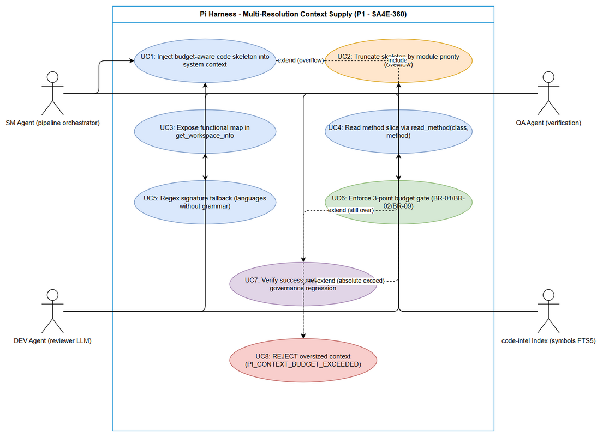
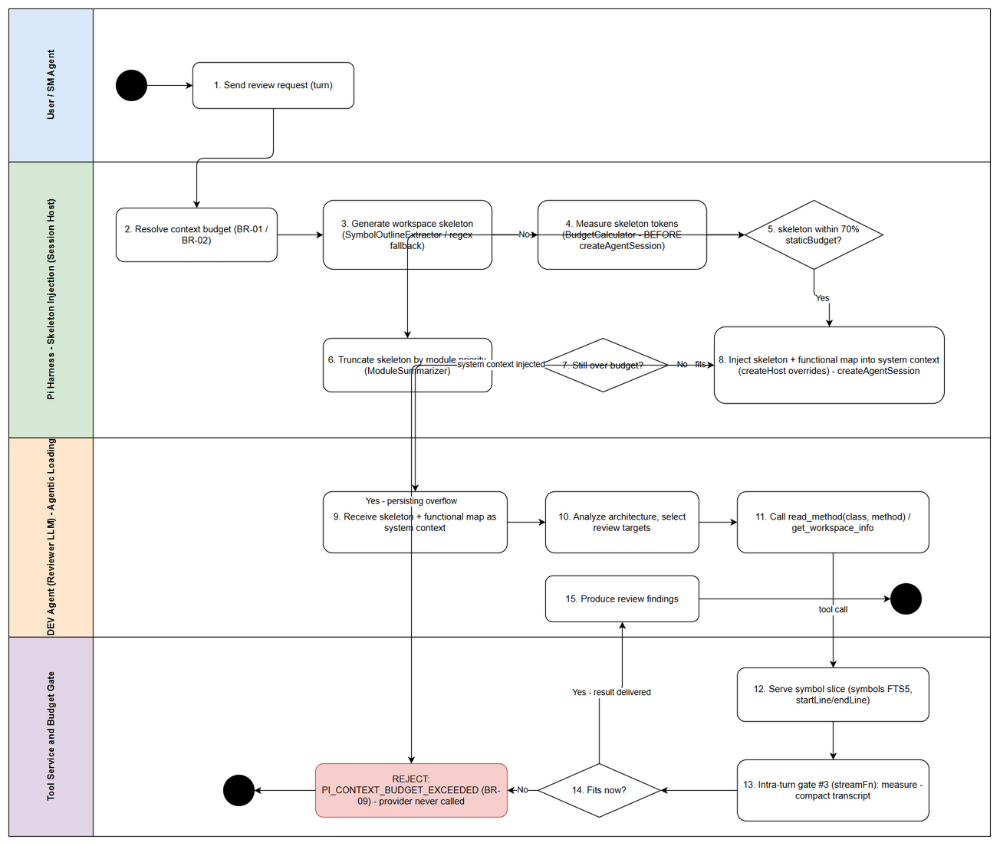

# Business Requirements Document (BRD)

## Pi Harness — SA4E-360: Multi-Resolution Context Supply for Pi Harness — P1: Code Skeletonization + Agentic Context Loading

---

## Document Information

| Field | Value |
|-------|-------|
| Jira Ticket | SA4E-360 |
| Title | Multi-Resolution Context Supply for Pi Harness — P1: Code Skeletonization + Agentic Context Loading (wire dormant foundation) |
| Issue Type / Priority | Story / High |
| Labels | context-governance, pi-harness, wire-only |
| Project | SA4E — SDLC Agents 4 Enterprise |
| Author | BA Agent |
| Version | 1.1 |
| Date | 2026-10-13 |
| Status | Draft |

---

## Author Tracking

| Role | Name - Position | Responsibility |
|------|-----------------|----------------|
| Author | BA Agent – Business Analyst | Create document |
| Peer Reviewer | TA Agent – Technical Architect | Review business requirements and token math (source: TA Review sections T1–T6 of the context compaction proposal) |

---

## Revision History

| Version | Date | Author | Changes |
|---------|------|--------|---------|
| 1.0 | 2026-10-13 | BA Agent | Initiate document — auto-generated from Jira ticket SA4E-360, TA review of documents/SA4E-355/context_compaction_strategies.md (TA Review T1–T6), and SA4E-355 TDD v1.3 (§13 budget gate architecture) |
| 1.1 | 2026-10-13 | BA Agent | v1.1: removed Mermaid inline (project rule Draw.io Only), replaced with drawio PNG references |

---

## Sign-Off

| Name | Signature and date |
|------|--------------------|
| | ☐ I agree and confirm all criteria on this BRD as expected requirements |
| | ☐ I agree and confirm all criteria on this BRD as expected requirements |

---

## 1. Introduction

### 1.1 Scope

SA4E-360 wires the dormant **multi-resolution context supply** foundation into the Pi Harness chat path so that reviewing an entire workspace on local LLMs (32K/65K context windows) becomes feasible without overflowing the model context window.

Per the TA review of the context compaction proposal (documents/SA4E-355/context_compaction_strategies.md, sections TA Review T1–T6), approximately 80% of the required foundation ALREADY EXISTS but is DORMANT — not wired into the chat path. This ticket is therefore **wire-only** (inherits BR-11 from SA4E-355): it composes existing mechanisms; it does not build new engines, routers, or algorithms.

SA4E-355 (shipped, v1.52.0) is the **governance plane** — it decides "how many tokens" may be loaded (3-point budget gate + transcript compaction, BR-01..BR-16). This ticket is the **content plane** — it decides "what" is loaded. The two planes are complementary, NOT redundant: every mechanism delivered by SA4E-360 must operate INSIDE the existing budget of SA4E-355 and must never replace or weaken it.

**In scope (P1 — two strategies, per Jira ticket description):**

1. **Agentic Context Loading completion** (proposal Strategy 2):
   - Wire a new `read_method(class, method)` tool that reads a single symbol slice (startLine/endLine from the existing `symbols` FTS5 table) instead of whole files.
   - Wire the functional map (from the dormant `SummaryTreeBuilder`) into the production tool `get_workspace_info` (already wired, layout cached 60s).
2. **Code Skeletonization, budget-aware** (proposal Strategy 1):
   - Wire the dormant `SymbolOutlineExtractor.extractOutline` (extension/src/pi-agent/context-retrieval/) into session creation.
   - Inject the workspace skeleton (classes, interfaces, method signatures, parameters, imports, doc comments — no method bodies) into the system context via `createHost` overrides.
   - **Mandatory budget-aware sizing:** skeleton ≤ 70% of staticBudget (~13.8K tokens @32k), measured with `BudgetCalculator` BEFORE `createAgentSession`; persisting overflow → REJECT per BR-09.
   - Regex fallback (`signature-extractor.ts`) for languages without a tree-sitter grammar (e.g., Svelte).

### 1.2 Out of Scope

The following items are explicitly excluded from SA4E-360 and are reserved for follow-up tickets (TA roadmap T6):

| # | Excluded Item | Reason | Follow-up |
|---|---------------|--------|-----------|
| 1 | **P2 — Contextual RAG wire**: wire `ContextRetriever` (McpSearchProvider → RRF merger) pre-turn for query-specific review | P1 must first measure the hit-rate baseline of skeleton + targeted reads | Future ticket (P2, to be created) |
| 2 | **P3 — Map-Reduce wire**: wire `MapReduceOrchestrator` for very large workspaces | Over-engineering while skeleton fits staticBudget; trigger condition is skeleton > staticBudget | Future ticket (P3, to be created) |
| 3 | **P4 — Call-graph pruning (depth=1)** | Call-edge quality for TS/JS not yet proven for review purposes; deferred until a feature-flow review need exists | Deferred |
| 4 | Hybrid/vector retrieval latency optimization | The hybrid path is wired at P2; P1 validates the FTS5 path only | P2 |
| 5 | Any new Tree-sitter dependency | tree-sitter + 16 grammar .wasm bundles are already shipped in backend/src/engine/parsers/ | N/A (prohibited) |
| 6 | Any new router / engine / algorithm (e.g., replacing `QueryRouter`, rewriting budget math) | No-workaround rule + BR-11 wire-only | N/A (prohibited) |

### 1.3 Preliminary Requirement

1. **SA4E-355 shipped (v1.52.0)** — 3-point budget gate (legacy turn-start auto-chunk; session turn-start `createHost` gate with escalation ladder BR-08; intra-turn `streamFn` gate, TDD v1.3 §13) and transcript compaction (pin newest user message; atomic tool-unit drop) fully operational. Baseline test suite: 285 test files / 2,748 tests green (Phase 6 PASS).
2. **code-intel index fresh** — the `symbols` table (FTS5: name, kind, signature, startLine, endLine, docComment) must be current; mtime check + re-index on demand per the "code-index freshness" guardrail.
3. **Tree-sitter + 16 grammars bundled** in backend/src/engine/parsers/ (ts, js, py, go, java, kotlin, c, cpp, c#, php, ruby, rust, scala, swift, apex, jsp) — no new dependency required.
4. **Dormant components available for wiring**: `SymbolOutlineExtractor.extractOutline` (tests-only today), `signature-extractor.ts` (regex multi-language), `SummaryTreeBuilder` (dormant), `workspace-info-tool.ts` (`get_workspace_info`, wired production, cached 60s), `TurnBudgetGuard` (anti-livelock, shipped).

---

## 2. Business Requirements

### 2.1 High Level Process Map

The P1 feature turns every workspace-review turn into a **budget-aware, multi-resolution context supply** pipeline: the harness first resolves the token budget (governance plane, SA4E-355), then builds and measures a code skeleton (content plane, this ticket), injects it as static context only if it fits ≤ 70% of staticBudget, and finally lets the reviewer LLM pull detail lazily via tool calls that remain subject to the intra-turn gate.

**Use Case view (actors SM / DEV / QA):**

*[Edit in draw.io](diagrams/use-case.drawio)*

**High-level process map — end-to-end business flow (swimlane view):**

*[Edit in draw.io](diagrams/business-flow.drawio)*

### 2.2 List of User Stories / Use Cases

| # | Story / Use Case | Priority | Source Ticket |
|---|------------------|----------|---------------|
| 1 | As a developer agent reviewing an entire workspace on a 32K/65K local LLM, I want a token-budgeted code skeleton injected into my system context so that I understand the full architecture without overflowing the context window | MUST HAVE | SA4E-360 |
| 2 | As a reviewer LLM, I want to read only the specific method I need via read_method(class, method) so that each inspection consumes minimal tokens and tool results stay compact | MUST HAVE | SA4E-360 |
| 3 | As a reviewer LLM, I want a functional summary map inside get_workspace_info so that I can decide which files/methods to read without scanning the raw directory tree | MUST HAVE | SA4E-360 |
| 4 | As the harness, I want regex-based signature extraction for languages without a tree-sitter grammar so that skeleton coverage stays high and session creation never blocks on missing grammars | MUST HAVE | SA4E-360 |
| 5 | As a Scrum Master, I want the existing 3-point budget governance and transcript compaction to remain fully effective after the new wiring so that context budget enforcement is never weakened | MUST HAVE | SA4E-360 |

---

### 2.3 Details of User Stories

#### Business Flow

**Step 1:** The user (or SM Agent on behalf of the pipeline) sends a workspace review request as a chat turn.

**Step 2:** The Session Host resolves the context budget via the existing chain: provider-detected n_ctx → ModelRegistry → default 8192 (BR-01), then usable = nCtx − reserveOutput − ceil(nCtx × 8%) with 70/30 static/history split (BR-02/BR-03). At 32k (qwen): usable = 28,098; staticBudget = 19,668; historyBudget = 8,430. At 65k: usable = 58,245; staticBudget = 40,771; historyBudget = 17,474.

**Step 3:** The harness generates the workspace skeleton by wiring `SymbolOutlineExtractor.extractOutline(file, symbols, maxTokens)` over the indexed symbols; languages without a tree-sitter grammar fall back to regex extraction (`signature-extractor.ts`).

**Step 4:** Skeleton tokens are measured with `estimateTokenCount` and gated with `BudgetCalculator.calculateBudget` — BEFORE `createAgentSession` (turn-start gate, execution point #2).

**Step 5:** Decision — skeleton ≤ 70% staticBudget (~13.8K @32k)? If yes, go to Step 7. If no, the skeleton is truncated by module priority (using metrics from `ModuleSummarizer`) and re-measured (Step 6).

**Step 6:** After truncation, if the skeleton still exceeds 70% staticBudget, the session is REJECTED with `PI_CONTEXT_BUDGET_EXCEEDED` (BR-09) — the provider is NEVER called with an oversized prompt. If it now fits, continue.

**Step 7:** The skeleton plus the functional map (from `SummaryTreeBuilder`, served inside `get_workspace_info`) are injected into the system context via `createHost` overrides, and the agent session is created. The reviewer LLM now holds the whole-workspace architecture in ~≤70% of staticBudget, leaving the remainder for steering, tool schemas, and history.

**Step 8:** The reviewer LLM analyzes the architecture and lazily pulls detail: it calls `read_method(class, method)` to read a single symbol slice (startLine/endLine from the symbols FTS5 table) and consults the functional map in `get_workspace_info` to choose targets. Read loops are bounded by the existing `TurnBudgetGuard` (4× identical tool+args → steer → abort).

**Step 9:** Every tool result flows through the intra-turn gate (execution point #3, `Agent.streamFn`, TDD v1.3 §13): measure → compact transcript (trim-oldest tool units atomically, pin newest user message) → REJECT only if the pinned user query itself cannot fit (BR-09).

**Step 10:** The reviewer produces review findings. Success is measured against the metrics in section 2.5 (coverage, hit-rate, findings parity, latency, zero `exceed_context_size_error`).

> **Note:** The skeleton is a STATIC context component — it is measured once at the turn-start gate (point #2) and never grows during the turn. Only tool results (read_method slices, workspace info) grow intra-turn and are absorbed by gate #3 + transcript compaction. This is exactly the division of responsibility between the governance plane (SA4E-355) and the content plane (this ticket).

**End-to-end sequence view:**

The end-to-end interaction across participants (User / SM Agent → Session Host → Skeleton Builder → Budget Gate → Reviewer LLM → Tool Service), including the two budget-gate decision points (turn-start gate #2 and intra-turn gate #3) and the truncate → REJECT path (BR-09), is visualized in the swimlane business-flow diagram:

*[Edit in draw.io](diagrams/business-flow.drawio)*

---

#### STORY 1: Budget-Aware Code Skeleton Injection

> As a developer agent reviewing an entire workspace on a 32K/65K local LLM, I want a token-budgeted code skeleton (class/interface names, method signatures with parameter types, imports, doc comments — no method bodies) injected into my system context, so that I understand the full architecture and its dependencies without overflowing the context window.

**Requirement Details:** *(Source: SA4E-360 description; TA Review T2, T5)*

1. Wire the dormant `SymbolOutlineExtractor.extractOutline(file, symbols, maxTokens)` (extension/src/pi-agent/context-retrieval/symbol-outline-extractor.ts, currently tests-only) into session creation.
2. Inject the rendered skeleton as static context via `createHost` overrides so it is measured at the turn-start budget gate (execution point #2) BEFORE `createAgentSession`.
3. Budget-aware sizing: skeleton MUST target ≤ 70% of staticBudget — ~13.8K tokens @32k (staticBudget 19,668), ~28.5K @65k (staticBudget 40,771). Fixed-size skeletons (e.g., the proposal's original "15K") are explicitly wrong at 32k (would be 76% of staticBudget).
4. Measurement MUST use `estimateTokenCount` + `BudgetCalculator.calculateBudget` before session creation (early measurement, in the spirit of BR-12: detect BEFORE assembly).
5. On overflow: truncate the skeleton by module priority (metrics from `ModuleSummarizer`), then re-measure. If it still exceeds → REJECT per BR-09 (fail-safe, never fail-open).
6. The skeleton keeps the existing 70/30 split untouched: tool calls continue to consume historyBudget, not staticBudget.

**Data Fields (business-level; FSD formalizes):**

| Field | Type | Required | Description | Example |
|-------|------|----------|-------------|---------|
| skeletonContent | string | Yes | Rendered outline: classes, interfaces, signatures, imports, doc comments (no bodies) | "class BudgetCalculator { calculateBudget(...): ContextBudget }" |
| skeletonTokens | number | Yes | Token estimate via estimateTokenCount | 13,200 |
| staticBudget | number | Yes | 70% share of usable budget (BR-01/BR-02/BR-03 math) | 19,668 (@32k) |
| usagePercent | number | Yes | skeletonTokens / staticBudget | 0.67 |
| truncationApplied | boolean | Yes | Whether module-priority truncation ran | true |
| modulePriorityOrder | list | No | Module ordering used for truncation (ModuleSummarizer metrics) | [engine, extension, backend] |
| measurementPoint | string | Yes | Where measurement happened | "turn-start gate #2, before createAgentSession" |
| gateDecision | enum | Yes | PASS / TRUNCATED_PASS / REJECT | TRUNCATED_PASS |

**Acceptance Criteria:**

1. On a supported-language workspace, the skeleton is injected into the system context at session creation; turn-1 review on qwen 32k produces **0 × `exceed_context_size_error`** (inherits BR-09).
2. Every session satisfies **skeletonTokens ≤ 70% staticBudget** (13.8K @32k; 28.5K @65k) — verified by the gate measurement.
3. Skeleton tokens are measured with `BudgetCalculator` **BEFORE `createAgentSession`**; no provider call may occur before the measurement.
4. When the raw skeleton exceeds the limit, truncation by module priority runs; if it still exceeds, the turn is REJECTED with `PI_CONTEXT_BUDGET_EXCEEDED` and the provider is never called (BR-09).
5. Skeleton coverage ≥ **95%** of exported symbols, verified against the `symbols` table.
6. The 70/30 static/history budget split and escalation ladder (BR-08) behavior are unchanged (see STORY 5).

**Validation Rules:**

- `skeletonTokens = estimateTokenCount(skeletonContent)`; reject any session where `skeletonTokens / staticBudget > 0.70` after truncation (BR-360-01/02).
- Tree-sitter-supported language → AST path (`extractOutline`); unsupported language → regex fallback (STORY 4); the same 70% cap applies to both paths.
- Empty or unparseable file → skip that file, continue, and log (never fail the whole session for one file).

**Error Handling:**

- Skeleton build fails for a single file → skip file, log warning, continue with the rest.
- Token estimation fails → treat as unknown-size (conservative overflow path) → truncate → REJECT if persisting.
- Index missing/stale → mtime check triggers on-demand re-index; if re-index fails → proceed without skeleton and steer the LLM to `get_workspace_info` + `read_method` (agentic fallback), never silently oversize the context.

---

#### STORY 2: read_method Tool — Symbol-Level Agentic Reading

> As a reviewer LLM, I want to read only the specific method I need via read_method(class, method) so that each inspection consumes minimal tokens and tool results stay compact under the intra-turn budget gate.

**Requirement Details:** *(Source: SA4E-360 description; TA Review T3, T5)*

1. Supply a new core tool `read_method(class, method)` in the existing toolset (BR-06 core tools + `get_workspace_info` + `find_tools` chain). It resolves the symbol from the `symbols` FTS5 table (name, kind, signature, startLine, endLine) and returns ONLY that line range from the source file.
2. This is the primary replacement for whole-file reads during review: symbol-targeted inspection consumes a fraction of the tokens and directly reduces intra-turn transcript growth.
3. Tool results remain ordinary tool results: they are measured by the intra-turn gate (execution point #3, `Agent.streamFn`) and are droppable atomically by transcript compaction (pin-newest-user rule, TDD v1.3 §13.3).
4. Repeated identical reads are bounded by the shipped `TurnBudgetGuard` (4× identical tool+args → steer → abort) — no new loop protection may be written (BR-11).
5. Retrieval is served from FTS5 (p95 ≤ 300ms).

**Data Fields:**

| Field | Type | Required | Description | Example |
|-------|------|----------|-------------|---------|
| class | string | Yes | Target class/interface name (as indexed in symbols table) | "SymbolOutlineExtractor" |
| method | string | Yes | Target method name | "extractOutline" |
| filePath | string | Output | Resolved source file of the symbol | "extension/src/pi-agent/context-retrieval/symbol-outline-extractor.ts" |
| startLine / endLine | number | Output | Symbol line range from the symbols table | 42 / 88 |
| signature | string | Output | Indexed signature | "extractOutline(file, symbols, maxTokens)" |
| sourceSlice | string | Output | Exact source lines startLine..endLine | — |
| symbolKind | string | Output | method / function / class | method |

**Acceptance Criteria:**

1. `read_method(class, method)` returns the exact symbol slice matching the symbols-table line range for supported languages.
2. Retrieval p95 latency **FTS5 ≤ 300ms**.
3. The result token size is smaller than a whole-file read for the same target; the result is counted as a tool result and passes the intra-turn gate like any other tool result.
4. Unknown class/method → an actionable "not found" tool result with steering suggestions (use `get_workspace_info` / `find_tools`), NOT an exception that crashes the turn.
5. Retrieval **hit-rate ≥ 80% top-5** on the golden query set (TA Review T5).
6. A read loop (identical call ×4) triggers the existing `TurnBudgetGuard` steer/abort behavior.

**Validation Rules:**

- Both arguments required and non-empty; resolution must match exactly one symbol when possible; ambiguous names (e.g., overloads) → return the candidate list with locations instead of an arbitrary pick.
- startLine/endLine must satisfy 1 ≤ startLine ≤ endLine; a stale line range (file changed vs index) → trigger index refresh per the code-index freshness guardrail before answering.

**Error Handling:**

- Symbol not found → "not found" result + suggestion (see AC 4).
- Index stale → mtime check → on-demand re-index → retry once → then "not found" guidance.
- File unreadable/permission error → actionable error message in the tool result; the turn continues.

---

#### STORY 3: Functional Map in get_workspace_info

> As a reviewer LLM, I want a functional summary map (what each module does + its key symbols) served inside get_workspace_info, so that I can decide which files/methods to read without scanning the raw directory tree.

**Requirement Details:** *(Source: SA4E-360 description; TA Review T3)*

1. Wire the dormant `SummaryTreeBuilder` into the production tool `workspace-info-tool.ts` (`get_workspace_info` — already wired, layout cached 60s). The tool returns the existing layout PLUS a functional-map section (module → functional summary → key symbols).
2. The functional map is token-bounded (capped result size) so the tool result itself cannot blow up the transcript.
3. The functional map the LLM receives as system context (Step 7 of the business flow) is part of static context and is measured at the turn-start gate together with the skeleton.
4. Reuse only — no new summarization algorithm (BR-11); `SummaryTreeBuilder` output is consumed as-is.

**Data Fields:**

| Field | Type | Required | Description | Example |
|-------|------|----------|-------------|---------|
| layout | object | Yes | Existing directory layout (unchanged behavior) | — |
| functionalMap | list | Yes | Entries: module path, functional summary, key symbols | [{module: "extension/src/pi-agent", summary: "agent session + query routing", keySymbols: ["QueryRouter", "SymbolOutlineExtractor"]}] |
| mapTokens | number | Yes | Token cost of the functional-map section | 1,800 |
| cacheTtlSeconds | number | Yes | Existing 60s cache preserved | 60 |

**Acceptance Criteria:**

1. `get_workspace_info` returns both the layout and the functional map; the map is built by the wired `SummaryTreeBuilder`.
2. The existing 60s cache behavior is preserved (no regression to `get_workspace_info` callers).
3. The functional map section is token-bounded; its cost is included in the static context measurement at the turn-start gate.
4. Building the map for a large workspace never exceeds the tool-result cap; on cap pressure, entries are trimmed by module priority (consistent with STORY 1 truncation semantics).

**Validation Rules:**

- `mapTokens` measured with `estimateTokenCount` before serving; result size ≤ tool-result cap (FSD to quantify the cap).
- Every functionalMap entry must reference real indexed module paths (no fabricated modules).

**Error Handling:**

- `SummaryTreeBuilder` fails for a module → omit that module's entry, log, serve the rest.
- Map build fails entirely → return layout only (existing behavior) and log `PI_FUNCTIONAL_MAP_UNAVAILABLE` (name to be finalized in FSD); the reviewer still has `read_method`/`find_tools` steering.

---

#### STORY 4: Regex Signature Fallback for Languages Without Grammar

> As the harness, I want regex-based signature extraction (signature-extractor.ts) for languages without a tree-sitter grammar (e.g., Svelte), so that skeleton coverage stays high and session creation never blocks on missing grammars.

**Requirement Details:** *(Source: SA4E-360 description; TA Review T3, T5 failure modes)*

1. For a file whose language has no bundled tree-sitter grammar (16 grammars shipped; Svelte is the named example), extract signatures with the existing regex multi-language extractor `backend/src/engine/parsers/signature-extractor.ts` instead of failing.
2. Regex-extracted symbols feed the same skeleton renderer (`SymbolOutlineExtractor.extractOutline`) and are subject to the same 70% staticBudget cap.
3. Coverage of the fallback path is tracked separately but counts toward the ≥ 95% coverage metric.
4. If regex extraction yields nothing usable → degrade to raw head-of-file (imports + declarations region) rather than crashing.

**Data Fields:**

| Field | Type | Required | Description | Example |
|-------|------|----------|-------------|---------|
| language | string | Yes | Detected file language | "svelte" |
| grammarAvailable | boolean | Yes | Whether a tree-sitter grammar is bundled | false |
| fallbackMode | enum | Yes | REGEX_SIGNATURES / RAW_HEAD / SKIPPED | REGEX_SIGNATURES |
| extractedSymbols | list | Yes | Regex-extracted signatures (name, kind, line) | ["export function load(...)", ...] |

**Acceptance Criteria:**

1. A Svelte (or any grammar-less) file produces a skeleton contribution via regex signatures; session creation is never blocked by a missing grammar.
2. Fallback output is included in the ≥ 95% coverage metric and reported separately (fallback share visible in logs).
3. Fallback output is subject to the same ≤ 70% staticBudget rule as grammar-based output.
4. When regex extraction yields nothing, the head-of-file degradation applies and the file is marked SKIPPED in skeleton telemetry (never a hard failure).

**Validation Rules:**

- grammarAvailable must be resolved from the bundled grammar list (16 languages) — never hardcoded per file extension guesswork outside the existing detection.
- Fallback extraction results must carry real line numbers (1 ≤ line ≤ fileLines).

**Error Handling:**

- Regex extraction throws → log, mark SKIPPED, continue.
- Malformed/unreadable file → mark SKIPPED, continue.
- Fallback produces oversized output → truncation path of STORY 1 applies unchanged.

---

#### STORY 5: Governance Regression Safety (3-Point Budget Enforcement Untouched)

> As a Scrum Master, I want the existing 3-point budget governance and transcript compaction to remain fully effective after skeleton injection and new tool wiring, so that context budget enforcement is never weakened by the content plane.

**Requirement Details:** *(Source: SA4E-360 description constraints; SA4E-355 TDD v1.3 §13; TA Review T1)*

1. All three governance execution points must remain enforced and unchanged: (a) legacy turn-start auto-chunk (`governLegacyTurn`), (b) session turn-start gate in `createHost` with escalation ladder (BR-08) before `createAgentSession`, (c) intra-turn per-request gate in `Agent.streamFn` (`streamWithBudgetGate`).
2. Transcript compaction rules remain untouched: trim-oldest tool-unit ATOMIC drop (including the newest), pin-newest-user rule (`userReserveTokens`), REJECT only when the pinned user query cannot fit (BR-09).
3. Skeleton injection and the functional map only ADD measured static content at gate #2 — they must not bypass, weaken, or duplicate any gate.
4. Development constraints from the ticket: test-first, npm test green after each task, ≤ 200 lines/file, ≤ 20 lines/function, SOLID, TSDoc.

**Acceptance Criteria:**

1. Full test suite green after every task — baseline 285 test files / 2,748 tests (SA4E-355 Phase 6) plus new tests; zero regressions in governance suites (context-governance, context-budget, budget-gate, session-tier, transcript compaction).
2. Turn-1 workspace review on qwen 32k: **0 × `exceed_context_size_error`** end-to-end (skeleton + tool traffic included).
3. A forced oversized skeleton (test harness) results in REJECT `PI_CONTEXT_BUDGET_EXCEEDED` with the provider never called — proving the fail-safe still dominates.
4. Intra-turn growth from `read_method` traffic is absorbed by gate #3 + compaction; a forced incompressible tool result still triggers the shipped REJECT→COMPACT behavior (atomic tool-unit drop, pinned user message).
5. Code-compliance checks pass: ≤ 200 lines/file, ≤ 20 lines/function, SOLID, TSDoc, test-first per task.

**Validation Rules:**

- Every new code path must measure tokens via `estimateTokenCount`/`BudgetCalculator` — no parallel estimation logic (BR-11).
- No new dependency; no new engine/router (BR-11, no-workaround rule).

**Error Handling:**

- Any wiring defect that would skip a gate must fail tests (gate regression tests are part of the definition of done), not be patched with workarounds.

---

### 2.4 Business Rules

#### 2.4.1 Inherited Rules (reference only — defined in SA4E-355 FSD §3.8; NOT redefined here)

| Rule | Definition (reference) | Source | Applies to |
|------|------------------------|--------|------------|
| BR-01 | `nCtx` MUST be > 0 — fallback chain: provider detection → ModelRegistry → default 8192; never 0/unbounded | SA4E-355 FSD §3.8 | Budget resolution before skeleton sizing |
| BR-02 | `safetyMargin = ceil(nCtx × 0.08)` — compensates chars/4 under-estimation for Vietnamese/CJK | SA4E-355 FSD §3.8 | usable/staticBudget math used for the 70% skeleton cap |
| BR-09 | Absolute exceed → actionable `chat:error` `PI_CONTEXT_BUDGET_EXCEEDED`; provider is NEVER called with an oversized prompt | SA4E-355 FSD §3.8 | Skeleton overflow (after truncation) and intra-turn REJECT |
| BR-11 | Wire-only: reuse existing mechanisms (`BudgetCalculator`, `compressPrompt`, `RoleScopeFilter`, extractors, routers); writing new algorithms is prohibited | SA4E-355 FSD §3.8 | Entire ticket (label: wire-only) |

#### 2.4.2 New Rules (this ticket)

| Rule | Definition | Source |
|------|------------|--------|
| BR-360-01 | The injected skeleton MUST satisfy `skeletonTokens ≤ 70% staticBudget` (~13.8K @32k, ~28.5K @65k), measured with `estimateTokenCount` + `BudgetCalculator.calculateBudget` BEFORE `createAgentSession` (turn-start gate #2). Fixed-size skeletons are prohibited. | SA4E-360; TA Review T2, T5 |
| BR-360-02 | If the skeleton still exceeds the cap after module-priority truncation, the session is REJECTED per BR-09 — fail-safe, never fail-open; the provider is never called oversized. | SA4E-360 |
| BR-360-03 | Languages without a bundled tree-sitter grammar MUST fall back to regex signature extraction (`signature-extractor.ts`); extraction failure degrades gracefully (raw head-of-file / SKIPPED) and MUST NOT block session creation. | SA4E-360; TA Review T5 failure modes |
| BR-360-04 | `read_method` results are ordinary tool results — subject to the intra-turn gate (#3) and transcript compaction (atomic tool-unit drop, pinned newest user). Symbol-slice reads are preferred over whole-file reads for symbol-targeted inspection. | SA4E-360 |
| BR-360-05 | Skeleton/functional-map construction MUST reuse the existing modules (`SymbolOutlineExtractor`, `signature-extractor.ts`, `SummaryTreeBuilder`, `QueryRouter`) — building a new skeleton engine, router, or token estimator is prohibited (specialization of BR-11). | SA4E-360 |

### 2.5 Success Metrics (from TA Review T5 — quantitative acceptance)

| # | Metric | Target | Measurement |
|---|--------|--------|-------------|
| M1 | Skeleton coverage of exported symbols | ≥ 95% | Diff skeleton symbols vs `symbols` table (fallback share reported separately) |
| M2 | `read_method` retrieval hit-rate | ≥ 80% top-5 | Golden query set |
| M3 | Findings parity vs full-context review baseline | ≥ 80% | Same subset of 10 files, skeleton + targeted reads vs full read |
| M4 | Retrieval p95 latency | FTS5 ≤ 300ms; hybrid ≤ 1.5s | Hybrid target validated when P2 wires the hybrid path |
| M5 | Turn-1 review on qwen 32k | 0 × `exceed_context_size_error` | End-to-end run log (inherits BR-09) |
| M6 | Skeleton token share of staticBudget | ≤ 70% | Gate measurement log per session |

---

## 3. Dependencies

| Dependency | Type | Related Ticket | Description |
|------------|------|----------------|-------------|
| SA4E-355 shipped (v1.52.0) | System | SA4E-355 | 3-point budget gate + transcript compaction must be operational — skeleton injection rides on top of governance (BR-01..BR-16) and must not weaken it |
| code-intel index fresh | Infrastructure | N/A | `symbols` FTS5 table (name, kind, signature, startLine, endLine, docComment) must be current for skeleton + read_method; mtime check + on-demand re-index guardrail |
| Tree-sitter + 16 grammars bundled | System | SA4E-355 (shipped foundation) | backend/src/engine/parsers/tree-sitter-indexer.ts + grammar .wasm bundles; NO new dependency allowed |
| Dormant components available | System | N/A | `SymbolOutlineExtractor` (tests-only today), `signature-extractor.ts`, `SummaryTreeBuilder`, `workspace-info-tool.ts` (wired, cached 60s) |
| SA4E-355 TDD v1.3 §13 | Document | SA4E-355 | Gate architecture (3 execution points + compaction mechanics) that skeleton/RAG must be compatible with |
| TurnBudgetGuard + compaction shipped | System | SA4E-355 | Anti-livelock backstop for tool-call loops; atomic tool-unit compaction for read_method result growth |

---

## 4. Stakeholders

| Role | Name / Team | Responsibility | Source |
|------|-------------|----------------|--------|
| Reporter / Creator | Duc Nguyen Minh | Requirements owner, approves scope and metrics | SA4E-360 Jira (reporter, creator) |
| Scrum Master (SM Agent) | SDLC pipeline | Pipeline coordination, phase transitions, Jira status (To Do until BRD approved → In Progress) | SA4E-360 Jira comment |
| TA Agent | Technical architecture | Requirement source and reviewer — TA Review T1–T6 (token math corrections, success metrics, roadmap) | documents/SA4E-355/context_compaction_strategies.md |
| BA Agent | Business analysis | Author of this BRD | This document |
| SA / QA / DEV Agents | SDLC pipeline | TDD design, STP/STC test planning, implementation (wire-only constraints) | SDLC pipeline |

---

## 5. Risks and Assumptions

### 5.1 Risks

| Risk | Impact | Likelihood | Mitigation |
|------|--------|------------|------------|
| Skeleton size varies per workspace (large monorepo exceeds 70% staticBudget even after truncation) | High | Medium | Module-priority truncation (ModuleSummarizer metrics); REJECT per BR-09 as fail-safe; P3 map-reduce reserved as the future escape hatch |
| Missing grammar produces low-quality skeletons for some languages (Svelte...) | Medium | Medium | Regex fallback (STORY 4) + separate coverage tracking; head-of-file degradation as last resort |
| Stale index → wrong startLine/endLine → wrong read_method slices or broken skeleton | High | Medium | mtime check + on-demand re-index guardrail (code-index freshness) before serving |
| Tool-call loops (LLM repeatedly reading the same method) inflate transcript | Medium | Medium | Shipped `TurnBudgetGuard` (4× identical → steer → abort); lean tool schemas (BR-06) |
| Skeleton lacks implementation detail → reviewer misses body-level findings | Medium | Medium | Agentic lazy loading via read_method compensates; M3 findings-parity ≥ 80% measures it |
| Regression to existing 3-gate enforcement from new wiring | High | Low | STORY 5 regression AC + full suite (2,748 tests baseline) green gate after every task |
| Ambiguous symbol names (overloads) misdirect read_method | Low | Medium | Return candidate list with locations; hit-rate M2 tracks quality |

### 5.2 Assumptions

- `estimateTokenCount` (chars/4) precision is acceptable, backed by the 8% safety margin (BR-02) — consistent with SA4E-355 assumption A-6.
- The `symbols` table line ranges are accurate for grammar-supported languages at index time.
- The existing 60s `get_workspace_info` cache freshness is acceptable for review sessions.
- qwen 32k is the primary target size (13.8K skeleton cap); 65k is secondary (28.5K cap).
- The golden query set for M2 and the 10-file subset for M3 are established during test planning (QA) — TA defines the targets, QA operationalizes the measurement.

---

## 6. Non-Functional Requirements

| Category | Requirement | Details |
|----------|-------------|---------|
| Performance | Retrieval latency: p95 FTS5 ≤ 300ms for `read_method` symbol resolution; hybrid ≤ 1.5s reserved for P2 validation | TA Review T5; budget resolution itself stays in-process, synchronous, no I/O (< 50ms per session creation, SA4E-355 TDD baseline preserved) |
| Performance | Session creation overhead from skeleton build | Skeleton build + measure must not add provider-visible latency beyond the gate measurement; skeleton is built once per session, cached with index |
| Regression Safety | Existing budget governance must remain fully effective | 3-point gate (legacy auto-chunk, createHost gate, streamFn intra-turn gate) + transcript compaction unchanged; full suite green (baseline 285 files / 2,748 tests); skeleton injection may only add measured static content at gate #2 |
| Reliability | Fail-safe behavior | Provider is NEVER called with an oversized prompt (BR-09); graceful degradation for missing grammar (STORY 4) and stale index (re-index guardrail) |
| Scalability | Large-workspace behavior | Truncation by module priority scales skeleton to workspace size; P3 map-reduce (out of scope) reserved for skeleton > staticBudget cases |
| Maintainability | Code standards | ≤ 200 lines/file, ≤ 20 lines/function, SOLID, TSDoc, test-first, npm test green after each task (ticket constraint) |
| Observability | Budget & skeleton telemetry | Skeleton tokens, staticBudget, truncation events, gate decisions, fallback-mode counts demoable in the extension log (consistent with SA4E-355 FSD §8 observability) |

---

## 7. Related Tickets

| Ticket Key | Summary | Status | Type | Relationship |
|------------|---------|--------|------|--------------|
| SA4E-360 | Multi-Resolution Context Supply for Pi Harness — P1: Code Skeletonization + Agentic Context Loading (wire dormant foundation) | To Do | Story | Main ticket |
| SA4E-355 | Implement Context Budget Governance for Pi Harness | Shipped (v1.52.0, Phase 6 PASS) | Story | Predecessor — governance plane; BR-01..BR-16 inherited; 3-point gate + compaction reused (no issue link recorded in Jira at BRD time) |
| P2 ticket (to be created) | Contextual RAG wire — `ContextRetriever` pre-turn + RRF | Not created | Story | Follow-up (P2, TA roadmap T6) — blocked on P1 hit-rate baseline (M2) |
| P3 ticket (to be created) | Map-Reduce wire — `MapReduceOrchestrator` for oversized workspaces | Not created | Story | Follow-up (P3, TA roadmap T6) — trigger: skeleton > staticBudget |
| P4 (deferred) | Call-graph pruning depth=1 | Deferred | — | Follow-up only if feature-flow review is requested (TA roadmap T6) |

---

## 8. Appendix

### 8.1 Budget Arithmetic Reference (TA Review T2 — corrections applied)

| n_ctx | reserveOutput | margin 8% | usable | staticBudget (70%) | historyBudget (30%) | Skeleton cap (70% of static) |
|-------|---------------|-----------|--------|--------------------|---------------------|------------------------------|
| 32,768 (qwen) | 2,048 | 2,622 | 28,098 | 19,668 | 8,430 | ~13.8K |
| 65,536 | 2,048 | 5,243 | 58,245 | 40,771 | 17,474 | ~28.5K |

Why the original proposal's "15K fixed skeleton" was corrected: at 32k, 15K = 76% of staticBudget, leaving only ~4.7K for steering + tool schemas — hence the budget-aware ≤ 70% cap (BR-360-01).

### 8.2 Glossary

| Term | Definition |
|------|------------|
| Code Skeleton | AST-derived outline of a codebase: classes, interfaces, method signatures with parameter types, imports, doc comments — method bodies stripped |
| Skeletonization | Strategy 1 of the multi-resolution proposal — building the skeleton via tree-sitter AST parsing (or regex fallback) |
| Agentic Context Loading | Strategy 2 — the LLM starts with project map + functional map only and pulls detail lazily via tools (`read_method`, `get_workspace_info`, `find_tools`) |
| read_method | New core tool (this ticket): returns the source slice of one symbol (startLine/endLine from the symbols FTS5 table) |
| staticBudget | 70% share of the usable token budget for static context (system prompt + steering + tool schemas + skeleton); the other 30% is historyBudget |
| Budget Gate (3 points) | SA4E-355 governance execution points: #1 legacy turn-start auto-chunk, #2 session turn-start `createHost` gate (escalation ladder BR-08), #3 intra-turn `Agent.streamFn` per-request gate (TDD v1.3 §13) |
| Transcript Compaction | Trim-oldest tool-unit atomic drop (including newest), pin-newest-user rule; REJECT only when the pinned user query cannot fit (BR-09) |
| TurnBudgetGuard | Anti-livelock backstop: 4× identical tool+args signature → steer → abort (pi-provider.ts) |
| Wire-only (BR-11) | Implementation style: compose existing shipped/dormant mechanisms; no new engines, routers, or algorithms |
| Findings Parity (M3) | % of review findings reproduced with skeleton + targeted reads vs the full-context baseline on a fixed 10-file subset |
| Regex Fallback | `signature-extractor.ts` regex multi-language symbol extraction used when no tree-sitter grammar exists (e.g., Svelte) |

### 8.3 Reference Documents

| Document | Link / Location |
|----------|-----------------|
| Jira ticket SA4E-360 (description: scope P1 + success metrics + constraints) | https://jiraassist.atlassian.net/browse/SA4E-360 |
| Context compaction proposal + TA Review T1–T6 (primary requirement source) | documents/SA4E-355/context_compaction_strategies.md |
| SA4E-355 TDD v1.3 — §13 Intra-Turn Request Governance (budget gate 3-point architecture) | documents/SA4E-355/TDD.md |
| SA4E-355 FSD v1.0 — §3.8 consolidated business rules BR-01..BR-16 | documents/SA4E-355/FSD.md |
| SA4E-355 BRD v1.0 — governance plane business requirements | documents/SA4E-355/BRD.md |
| Code intelligence index (.analysis/code-intelligence/) | .analysis/code-intelligence/ |
| Dormant foundation modules | extension/src/pi-agent/context-retrieval/symbol-outline-extractor.ts; backend/src/engine/parsers/signature-extractor.ts; extension/src/pi-workflow/workspace-info-tool.ts |

### 8.4 Diagram Index

| # | Diagram | Image | Source (editable) |
|---|---------|-------|-------------------|
| 1 | Use Case | [use-case.png](diagrams/use-case.png) | [use-case.drawio](diagrams/use-case.drawio) |
| 2 | Business Flow (high-level process map / swimlane) | [business-flow.png](diagrams/business-flow.png) | [business-flow.drawio](diagrams/business-flow.drawio) |

---

*End of BRD — SA4E-360 v1.1. Traceability: Stories 1–5 ↔ Jira description scope P1 + TA Review T4/T6 (P1 row); Business Rules §2.4 ↔ SA4E-355 FSD §3.8 (inherited) + TA Review T2/T5 (new); Success Metrics §2.5 ↔ TA Review T5; diagrams embedded in §2.1 and §2.3, indexed in §8.4.*
