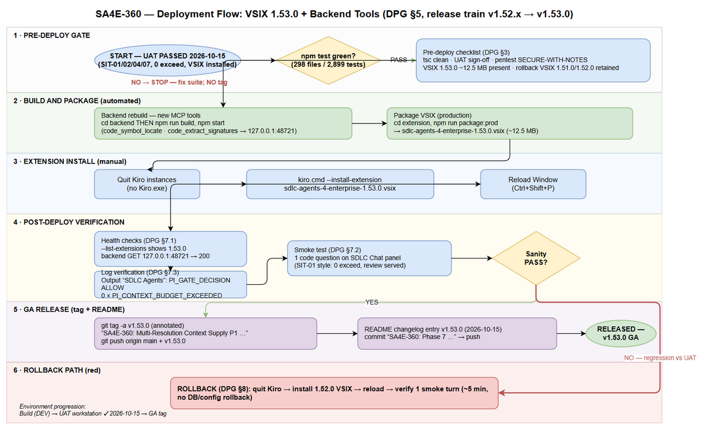
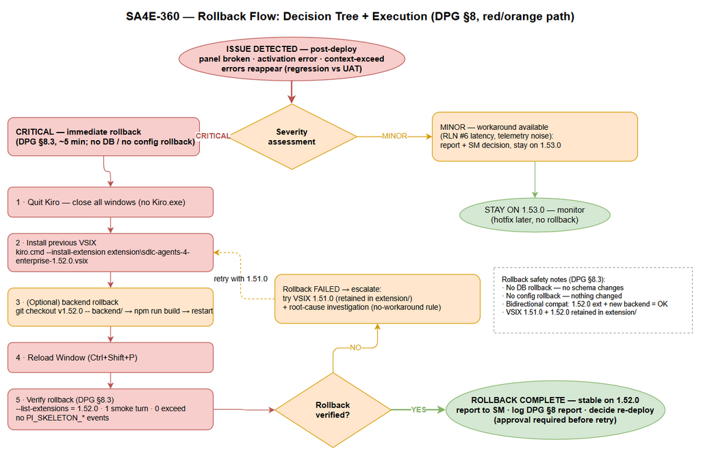

# Deployment Guide (DPG)

## SDLC Agents for Enterprise — SA4E-360: Multi-Resolution Context Supply (P1: Code Skeletonization + Agentic Context Loading)

---

## Document Information

| Field | Value |
|-------|-------|
| Jira Ticket | SA4E-360 |
| Title | Multi-Resolution Context Supply for Pi Harness — P1: Code Skeletonization + Agentic Context Loading |
| Author | DevOps Agent |
| Version | 1.0 |
| Date | 2026-10-15 |
| Status | Released (UAT passed 2026-10-15; GA via git tag v1.53.0) |
| Related TDD | TDD-v1.1-SA4E-360.docx |

---

## Revision History

| Version | Date | Author | Changes |
|---------|------|--------|---------|
| 1.0 | 2026-10-15 | DevOps Agent | Initiate document — generated from TDD v1.1, STP/STC, TEST-REPORT v1.0 and UAT round-3 evidence |

---

## Sign-Off

| Name | Role | Signature and date |
|------|------|--------------------|
| | Dev Lead | ☐ Approved for deployment |
| | QA Lead | ☐ Testing completed (UAT PASSED 2026-10-15 — CDP round 3) |
| | Ops Lead | ☐ Infrastructure ready |

---

## 1. Overview

### 1.1 Feature Summary

SA4E-360 delivers **P1 of the Multi-Resolution Context Supply** architecture for the Pi harness. Instead of injecting whole files into the LLM context, the extension injects a **code skeleton** (signatures + structural outline, token-budgeted) and lets the agent pull details on demand via the new `read_method` tool — backed by two new loopback-backend MCP tools (`code_symbol_locate`, `code_extract_signatures`) and a **functional map**. A **fallback ladder** preserves pre-360 behavior whenever skeleton supply cannot be satisfied (index missing, stale, bridge absent, budget pressure), and a **secret-redaction pass** (SEC-360-01) keeps credentials out of prompts.

Deployed on top of the SA4E-355 3-gate context-budget governance (shipped in v1.52.0), multi-turn sessions on large workspaces complete with **0 context-exceed errors** (UAT: 6-turn journey, compaction 47k–56k tokens ≤ 58,293 usable).

### 1.2 Deployment Scope

| Item | Type | Description |
|------|------|-------------|
| Kiro/VS Code extension (`sdlc-agents-4-enterprise`) | Modified + New module | New `extension/src/pi-workflow/skeleton/` (8 modules: SkeletonProvider, IndexFreshnessChecker, SkeletonTruncator, SkeletonInjector, ReadMethodTool, FunctionalMapProvider, SymbolLocator port, wiring); `read_method` added to `READ_ONLY_TOOLS` + lean tool loadout; `PI_GATE_DECISION` enriched (OI-5). Shipped as **VSIX 1.53.0 (~12.5 MB)**. |
| Loopback backend server | Modified | 2 new thin MCP tools registered additively: `code_symbol_locate` (`backend/src/engine/tools/code-locate.ts`) and `code_extract_signatures` (`backend/src/engine/tools/code-extract.ts`). No changes to existing endpoints. |
| Database | None | No schema changes; SQLite/PostgreSQL untouched. |
| Configuration | None | No new settings keys, env vars or feature flags; skeleton auto-activates on the Pi session path. |

### 1.3 Target Environments

This product deploys to **developer workstations** (IDE extension + loopback backend), not server farms:

| Environment | Target | Deploy Order | Approval Required |
|-------------|--------|--------------|-------------------|
| Build (DEV) | Repo build machine — `npm test` + `npm run package:prod` | 1st | No |
| UAT — user workstation (Kiro IDE) | SDLC Chat panel, CDP-verified | 2nd | QA + User sign-off — **DONE 2026-10-15** |
| PROD / GA | Git tag `v1.53.0` + README changelog (source of truth for all workstations) | 3rd | SM sign-off |
| npm publish (backend server) | Out of scope this release | — | Deferred — optional follow-up, SM decision |

---

## 2. Prerequisites

### 2.1 Infrastructure

| Requirement | Status | Notes |
|-------------|--------|-------|
| Kiro IDE installed with `kiro.cmd` on PATH | Ready | Verified at `C:\Users\<user>\AppData\Local\Programs\Kiro\bin\kiro.cmd` |
| Backend runs locally (loopback `127.0.0.1:48721`) | Ready | `node dist/index.js` after build; no external network needed |
| Node.js + npm toolchain | Ready | `esbuild`, `vsce`, `vitest`, `tsc` via npm scripts |
| Rollback artifacts retained | Ready | `extension/sdlc-agents-4-enterprise-1.51.0.vsix` + `-1.52.0.vsix` kept on disk |

### 2.2 Software Dependencies

| Dependency | Version | Status |
|-----------|---------|--------|
| Node.js / npm | ≥ 20 (repo toolchain) | Installed |
| Kiro IDE | current (Chromium-based, CDP-capable) | Installed |
| Backend dependencies | `npm ci` in `backend/` | Installed |

### 2.3 Access Requirements

| Access | Type | Who Needs It |
|--------|------|--------------|
| Local file system write (`extension/dist`, Kiro extensions dir) | Current user | DevOps / installer |
| Git push rights (tag `v1.53.0`, push `main`) | SSH/HTTPS credential | DevOps / Release |
| VPN / external credentials | **Not required** | — (feature is local-loopback only) |

### 2.4 Backup Requirements

- [x] Previous VSIX artifacts retained (1.51.0, 1.52.0 in `extension/`)
- [x] Git last-known-good tagged: `v1.52.0`
- [x] Workspace code-intel index is runtime-generated and self-healing — no user data at risk; chat sessions are recreatable
- N/A — no database backup required (no DB changes)

---

## 3. Pre-Deployment Checklist

| # | Item | Responsible | Status |
|---|------|-------------|--------|
| 1 | Code on `main`; implementation commits verified: 5d92322, 5225170, 9b44169+83c32ab, f60999e (impl), 0d33706+ea84217 (security F-1..F-3 + regression), cac13a7/1b822b0 (bumps), 3da3376 (test report), aa44bb8/4617265/02e6506 (pentest/UAT) | Developer | ✅ |
| 2 | Extension full suite green — **298 files / 2,896 tests** at impl; Phase-7 re-run logged to `documents/SA4E-360/evidence/phase7-npm-test.log` | Developer | ✅ |
| 3 | `tsc` clean (production build compiles) | Developer | ✅ |
| 4 | SIT/UAT sign-off — SIT-01/02/04/07 PASS on SDLC Chat panel (CDP round 3), **0 exceed errors** | QA + User | ✅ 2026-10-15 |
| 5 | Pentest verdict **SECURE-WITH-NOTES** (120 attempts, 0 Crit/High/Med) | QA | ✅ |
| 6 | Database backup | N/A — no DB changes | — |
| 7 | Configuration files prepared | N/A — no new settings | — |
| 8 | Feature flags configured | N/A — skeleton auto-active on session path | — |
| 9 | Rollback plan reviewed (§8); previous VSIX retained | DevOps | ✅ |
| 10 | Deployment window confirmed — workstation install immediate; GA = tag + README | SM | ✅ |
| 11 | VSIX artifact present, ~12.5 MB (`extension/sdlc-agents-4-enterprise-1.53.0.vsix`) | DevOps | ✅ |

---

## 4. Database Migration

**Not applicable.** SA4E-360 introduces **no database schema changes**. The skeleton supply reads the code-intel SQLite index — a runtime artifact, auto-generated and self-healing via `IndexFreshnessChecker` (stale → `reindex` or `degrade`, event `PI_SKELETON_INDEX_STALE`).

- Migration scripts: N/A
- Verification queries: N/A
- Rollback scripts: N/A

---

## 5. Application Deployment

### 5.1 Deployment Flow



### 5.2 Deployment Steps

| Step | Action | Command | Verification |
|------|--------|---------|--------------|
| 1 | Quit running Kiro instances | Close all Kiro windows (File → Exit) | Task Manager: no `Kiro.exe` process |
| 2 | Rebuild backend (adds 2 new tools) | `cd backend; npm run build` | `tsc` exits 0; `dist/engine/tools/code-locate.js` + `code-extract.js` exist |
| 3 | Restart backend | `npm start` (or restart existing service) | Console: server listening on `127.0.0.1:48721` |
| 4 | Package VSIX (production) | `cd extension; npm run package:prod` | `sdlc-agents-4-enterprise-1.53.0.vsix` created, ~12.5 MB |
| 5 | Install VSIX | `kiro.cmd --install-extension sdlc-agents-4-enterprise-1.53.0.vsix` | CLI reports “Successfully installed … 1.53.0” |
| 6 | Reload Window | Kiro: `Ctrl+Shift+P` → “Developer: Reload Window” | Extension host restarts cleanly, no activation errors |
| 7 | Verify install | `kiro.cmd --list-extensions` | Lists `sdlc-agents-4-enterprise-1.53.0` |

> **Note:** For this release, steps 1–7 were already executed and verified on the user workstation on **2026-10-15** (VSIX 1.53.0 built + installed into Kiro; user actively using it). Section 5.2 remains the canonical procedure for fresh workstations.

### 5.3 Docker Deployment (if applicable)

N/A — desktop deployment. If the workstation runs the backend in Docker, rebuild additively:

```bash
cd backend
docker compose build
docker compose up -d
```

Feature parity is identical (additive tools only); no volumes or ports change.

---

## 6. Configuration Changes

### 6.1 New Environment Variables

None. No environment variables are introduced by this release.

### 6.2 Application Properties Changes

None. Existing SA4E-355 context-budget settings (gate thresholds, tiering, safety margin) are unchanged and reused as-is.

### 6.3 Feature Flags

None. Skeleton supply **auto-activates** on the Pi session path; degradation is telemetry-driven (`PI_SKELETON_*` events), not config-driven. Diagnostics are visible in the Kiro **Output channel "SDLC Agents"** (see §7.3).

---

## 7. Post-Deployment Verification

### 7.1 Health Checks

| Check | Endpoint/Command | Expected Result | Timeout |
|-------|-----------------|-----------------|---------|
| Extension installed | `kiro.cmd --list-extensions` | `sdlc-agents-4-enterprise-1.53.0` listed | 30s |
| Backend up | `GET http://127.0.0.1:48721/` (loopback) | HTTP 200 (API index) | 10s |
| Extension activated | Kiro Output channel "SDLC Agents" | No activation errors; status bar "KB: Ready" | 60s |

### 7.2 Smoke Tests

| # | Scenario | Steps | Expected Result |
|---|----------|-------|-----------------|
| 1 | Skeleton in system context (SIT-01 replay) | Open **SDLC Chat** panel; ask a code question about a workspace file | Turn completes; 0 exceed errors; ~2–3 min on local model (UAT: 138 s) |
| 2 | Agentic detail loading (SIT-02 replay) | Ask agent for workspace overview | `get_workspace_info` correct; repeat call served from cache |
| 3 | Multi-turn budget stability (SIT-04 replay) | 6-turn conversation on large workspace | 0 context-exceed; compaction keeps usage ≤ usable budget (UAT: 47k–56k ≤ 58,293) |
| 4 | Interactive verify (SIT-07 replay) | Frame-anchored typing in panel; send message | User-visible turn + response rendered in panel |
| 5 | Fallback ladder | Open chat in a workspace with no code-intel index | `PI_SKELETON_FALLBACK` / `PI_SKELETON_BRIDGE_ABSENT` logged; turn still completes (pre-360 behavior) |

### 7.3 Log Verification

Output channel: **"SDLC Agents"** (Kiro → View → Output).

| Log Entry | Level | Expected | Meaning |
|-----------|-------|----------|---------|
| `PI_GATE_DECISION` | INFO | Every turn; `decision: ALLOW|WARN`; OI-5 enriched payload | 3-gate verdict with skeleton audit fields |
| `PI_GATE_WARN` | WARN | Only when budget > 85% | Advisory; turn proceeds |
| `PI_GATE_ESCALATION` | INFO | Auto-split steps when budget pressure | measure==inject invariant held |
| `PI_SKELETON_TRUNCATED` | INFO | At most **one** per run, only when sections dropped | Truncator ran (STC UT-03) |
| `PI_SKELETON_FALLBACK` | WARN | When index missing/stale/budget pressure | Fallback ladder engaged (expected pre-index) |
| `PI_SKELETON_INDEX_STALE` | WARN | Stale detected | `action: reindex` or `degrade` |
| `PI_SKELETON_BRIDGE_ABSENT` | WARN | MCP bridge unavailable | Degraded mode, non-fatal |
| `PI_CONTEXT_BUDGET_EXCEEDED` (REJECT claim) | — | **MUST BE ABSENT** | 0 exceed in UAT; presence = regression → §8 rollback |

### 7.4 Monitoring Dashboard

Local workstation only — no external dashboards. Evidence of healthy state:

- [ ] Output channel shows `PI_GATE_DECISION … ALLOW` on first turn
- [ ] 0 `PI_CONTEXT_BUDGET_EXCEEDED` across a 6-turn session
- [ ] `PI_SKELETON_*` events only of the expected fallback kinds (no `SECTIONS_FAILED` storms)
- [ ] Turn durations comparable to UAT (27–421 s band on local models; limitation #6 in RLN)
- [ ] Reference evidence: `documents/SA4E-360/evidence/uat3/` (SIT-01/02/04/07 artifacts)

---

## 8. Rollback Plan

### 8.1 Rollback Flow



### 8.2 Rollback Decision Criteria

| Condition | Action |
|-----------|--------|
| Extension activation error / SDLC Chat panel broken | **Immediate rollback** to 1.52.0 |
| Context-exceed errors reappear on session path (regression vs UAT) | **Immediate rollback** to 1.52.0 |
| Turn duration persistently ≫ 421 s (unusable) | Report + SM decision; rollback if no workaround accepted (see RLN limitation #6) |
| New backend tool errors (`code_symbol_locate` / `code_extract_signatures`) | Optional backend rollback; extension alone degrades gracefully — **extension rollback is sufficient** |
| Minor telemetry noise / cosmetic issues | Hotfix — no rollback |

### 8.3 Rollback Steps

| Step | Action | Command | Verification |
|------|--------|---------|--------------|
| 1 | Quit Kiro | Close all Kiro windows | No `Kiro.exe` process |
| 2 | Install previous VSIX | `kiro.cmd --install-extension extension\sdlc-agents-4-enterprise-1.52.0.vsix` | "Successfully installed … 1.52.0" |
| 3 | (Optional) backend rollback | `git checkout v1.52.0 -- backend/` → `cd backend; npm run build` → restart | Old toolset registered; new tool routes unused |
| 4 | Reload Window | `Ctrl+Shift+P` → "Developer: Reload Window" | Clean activation, no errors |
| 5 | Verify rollback | `kiro.cmd --list-extensions`; run 1 smoke turn | Version 1.52.0; no `PI_SKELETON_*` events; 0 exceed |

> Notes: **no DB rollback** (no DB changes); **no config rollback** (nothing changed). VSIX **1.51.0** is also retained in `extension/` if 1.52.0 is itself suspect. Backward compatibility is bidirectional (RLN §6.3): old backend + new extension = fallback ladder; new backend + old extension = additive tools unused.

### 8.4 Rollback Time Estimate

| Action | Estimated Time |
|--------|----------------|
| Extension rollback (install + reload) | ~2 min |
| Backend rollback (optional, from tag) | ~5 min |
| Verification (smoke turn + logs) | ~3 min |
| **Total** | **~5 min** (extension only) / **~10 min** incl. backend |

---

## 9. Environment-Specific Notes

### 9.1 Build (DEV)

- Node ≥ 20; `npm ci` in both `extension/` and `backend/` before building.
- **Gate:** `npm test` in `extension/` must be green **before** packaging and before tagging (Phase-7 run: 298 files / 2,899 tests passed — `evidence/phase7-npm-test.log`).
- Package with `npm run package:prod` (esbuild production bundle + checksums), never `package:debug`.

### 9.2 UAT — user workstation

- **Executed & PASSED 2026-10-15** (CDP automation round 3, single window, frame-anchored typing, panel **SDLC Chat**):
  - SIT-01 PASS (138 s, 7,034-char review, 0 exceed)
  - SIT-02 PASS (`get_workspace_info` correct, cache verified)
  - SIT-04 PASS 6/6 turns (27–421 s; compaction 47k–56k ≤ usable 58,293)
  - SIT-07 PASS (driver saved response `sit07.txt`; user confirmed turn + response in panel)
  - SIT-08 PASS with exception (Finding E: 2 files 211/229 lines > 200, recorded)
  - SIT-03/05/06 **NOT RUN** (harness-specific, user-discretion) — see RLN §4
- Evidence: `documents/SA4E-360/evidence/uat3/`.

### 9.3 PROD / GA

- **Deployment Window:** immediate (workstation release; no shared-infra window needed).
- **Approval Required From:** SM sign-off; QA UAT record (obtained).
- **GA artifact set:** annotated git tag `v1.53.0` + README changelog entry + this DPG/RLN pair.
- **Communication Plan:** notify users via README changelog; SM attaches DPG/RLN to Jira SA4E-360.
- **On-Call Contact:** DevOps agent (via SM).

### 9.4 npm publish (backend server)

Deferred — the loopback backend ships from source in this release. Publishing `sdlc-agent-4-enterprise-server` to npm is an **optional follow-up** requiring SM approval (README Quick Start already documents the npm path for older versions).

---

## 10. Appendix

### Contacts

| Role | Name | Contact |
|------|------|---------|
| Release Manager / SM | (per Jira SA4E-360 assignee) | Jira |
| Dev Lead | (per Jira component owner) | Jira |
| QA Lead | (per Phase 6 owner) | Jira |
| On-Call DevOps | DevOps agent (via SM) | Jira |

### Related Tickets

| Ticket | Summary | Relationship |
|--------|---------|--------------|
| SA4E-360 | Multi-Resolution Context Supply P1 | **Main ticket** |
| SA4E-355 | Context Budget Governance (3-gate) | Predecessor — foundation shipped in v1.52.0 |
| SA4E-361 | Skeleton into legacy chat path | Follow-up — future work, **not in this release** |
| SA4E-356 / SA4E-358 | MCP path resolution / CORS Origin-Host gate | Same release train (v1.52.x security hardening) |

### Evidence Index

| Evidence | Location |
|----------|----------|
| Extension full suite (impl) | `evidence/extension-full-suite.log`, `evidence/round2-ext-full-suite.log` |
| Backend unit + E2E-API suites | `evidence/backend-unit-suite.log`, `evidence/backend-e2e-api-suite.log`, `evidence/round2-backend-focused.log`, `evidence/round2-e2e-api.log` |
| Security-fix verification | `evidence/f-fix-verification-2026-10-15.log` |
| Pentest run | `evidence/pentest-360-run.log`, `testdata/pentest-360-results.csv` |
| UAT round 3 | `evidence/uat3/` (screenshots, console, driver logs, `UAT3-SUMMARY.md`) |
| Phase-7 pre-tag suite | `evidence/phase7-npm-test.log` |
