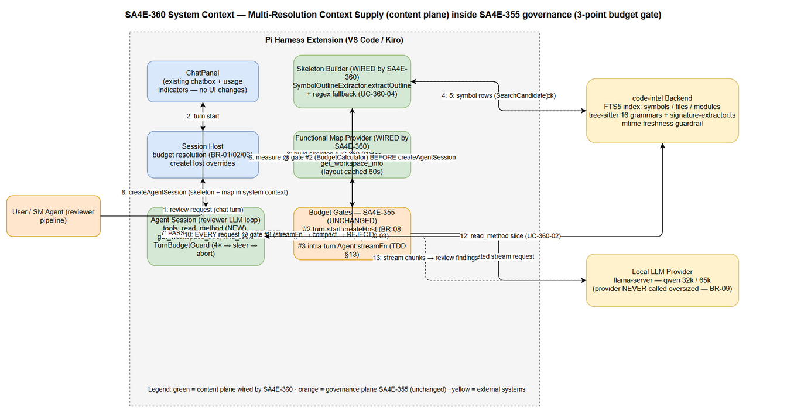
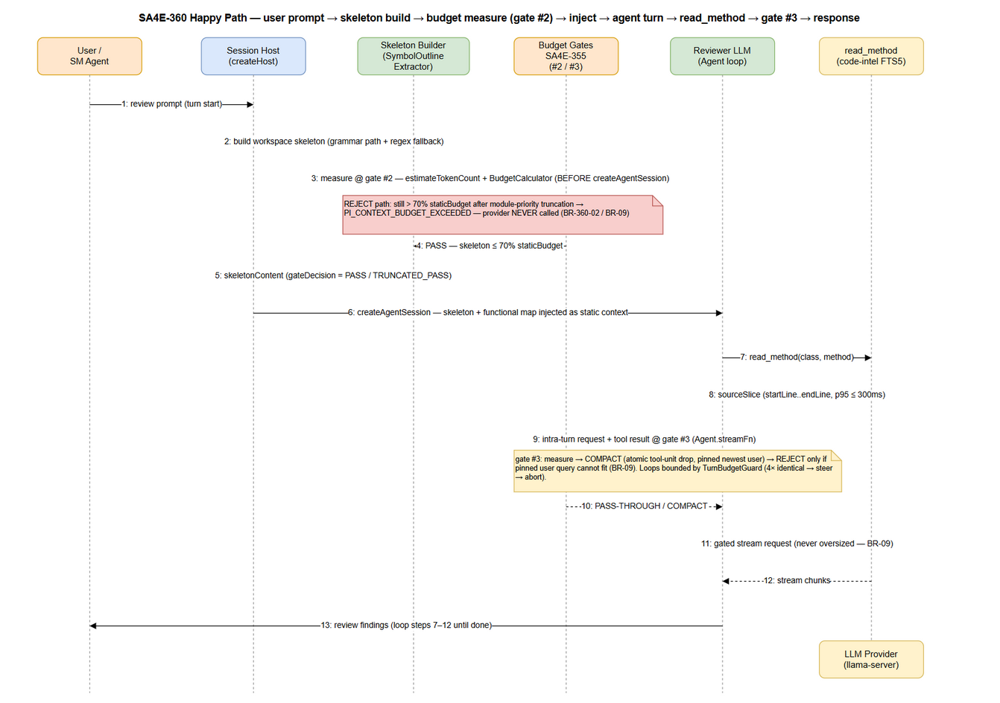
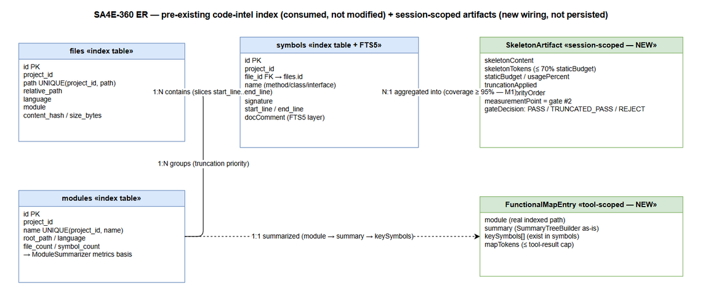
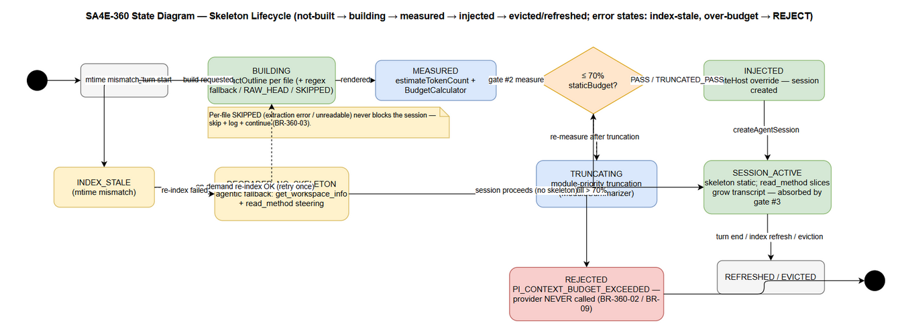

# Functional Specification Document (FSD)

## Pi Harness — SA4E-360: Multi-Resolution Context Supply for Pi Harness — P1: Code Skeletonization + Agentic Context Loading

---

## Document Information

| Field | Value |
|-------|-------|
| Jira Ticket | SA4E-360 |
| Title | Multi-Resolution Context Supply for Pi Harness — P1: Code Skeletonization + Agentic Context Loading (wire dormant foundation) |
| Issue Type / Priority | Story / High |
| Labels | context-governance, pi-harness, wire-only |
| Project | SA4E — SDLC Agents 4 Enterprise |
| Author | BA Agent |
| Version | 1.1 (TA-ENRICHED) |
| Date | 2026-10-13 |
| Status | TA enrichment applied (v1.1) — API contracts (§3.x.5), integration parameters (§5.4), pseudocode (§6), quantified NFRs (§8), open issues (§11.4). Ready for SA (TDD) |
| Related BRD | documents/SA4E-360/BRD.md (v1.1) |

---

## Author Tracking

| Role | Name - Position | Responsibility |
|------|-----------------|----------------|
| Author | BA Agent – Business Analyst | Create FSD draft from BRD v1.1, TA Review T1–T6, SA4E-355 TDD v1.3 §13, and direct codebase verification of dormant components |
| Technical Enrichment | TA Agent – Technical Architect | Enrich technical depth: API contracts (§3.x.5 — C-360-S/R/M/F series), integration/timeout/retry details (§5.4), pseudocode (§6.1/§6.2), quantified NFRs (§8), open issues (§11.4) |
| Design Review (planned) | SA Agent – Solution Architect | TDD design based on this FSD |

---

## Revision History

| Version | Date | Author | Changes |
|---------|------|--------|---------|
| 1.0 | 2026-10-13 | BA Agent | Initiate FSD draft — business sections only. Derived from BRD SA4E-360 v1.1 (5 user stories, BR-360-01..05, metrics M1–M6), TA Review T1–T6 (documents/SA4E-355/context_compaction_strategies.md), SA4E-355 TDD v1.3 §13 (3-point budget gate architecture), and codebase verification (extension/src/pi-agent/context-retrieval/, extension/src/pi-workflow/workspace-info-tool.ts, backend/src/engine/parsers/signature-extractor.ts, symbols table schema). API contracts (§3.x.5) intentionally RESERVED for TA enrichment per plan. |
| 1.1 | 2026-10-13 | TA Agent | TA enrichment pass — business sections untouched. Filled §3.1.5/§3.2.5/§3.3.5/§3.4.5/§3.5.5 API contracts (C-360-S1..S3, C-360-R1/R2, C-360-M1/M2, C-360-F1, gate-interaction contract); finalized tool-result cap (§3.3.5: map ≤ 1,500 tokens = SummaryTreeBuilder default maxTokens; whole result ≤ 16,000 chars = MAX_TOOL_RESULT_CHARS); added §5.4 index query path + light freshness guardrail; added pseudocode (§6.1 sizing loop, §6.2 read_method disambiguation); added missing AF/EF flows (UC-360-01/02/03); quantified NFRs (§8); Open Issues §11.4 (OI-1..OI-6). All signatures verified against codebase 2026-10-13. |

---

## Sign-Off

| Name | Signature and date |
|------|--------------------|
| | ☐ I agree and confirm all criteria on this FSD as expected requirements |
| | ☐ I agree and confirm all criteria on this FSD as expected requirements |

---

## 1. Introduction

### 1.1 Purpose

This FSD specifies **functionally how** SA4E-360 wires the dormant multi-resolution context supply foundation into the Pi Harness chat path, so that reviewing an entire workspace on local LLMs (32K/65K context windows) becomes feasible without overflowing the model context window.

SA4E-355 (shipped, v1.52.0) is the **governance plane** — it decides *how many* tokens may be loaded (3-point budget gate + transcript compaction, BR-01..BR-16). SA4E-360 is the **content plane** — it decides *what* is loaded. This document specifies the content-plane behavior; every mechanism specified here operates INSIDE the existing SA4E-355 budget and never replaces or weakens it (BRD Story 5).

**Document maturity note:** this is a business-level draft. Sections 3.x.5 (API Contracts), §5 technical parameters (timeouts, retries), and §6 implementation detail are intentionally reserved for TA enrichment. Data shapes in §3.1.4/§3.2.4/§3.3.4 were verified against the actual codebase and are authoritative for wiring.

> **TA enrichment (v1.1):** the reserved sections are now specified — §3.x.5 API contracts (functional view, C-360-* identifiers), §5.4 technical parameters (index query path, timeouts, light freshness guardrail), §6 pseudocode for the two complex algorithms, and §11.4 open issues. All code signatures re-verified against the codebase on 2026-10-13; BA content above is unchanged.

### 1.2 Scope

**In scope (per BRD §1.1 — P1, two strategies, wire-only per BR-11):**

1. **Agentic Context Loading completion (proposal Strategy 2):**
   - New core tool `read_method(class, method)` returning a single symbol slice (startLine/endLine from the `symbols` FTS5 table) instead of whole files (§3.2).
   - Wire the dormant `SummaryTreeBuilder` functional map into the production tool `get_workspace_info` (§3.3).
2. **Code Skeletonization, budget-aware (proposal Strategy 1):**
   - Wire the dormant `SymbolOutlineExtractor.extractOutline` (extension/src/pi-agent/context-retrieval/symbol-outline-extractor.ts, tests-only today) into session creation (§3.1).
   - Inject the workspace skeleton into system context via `createHost` overrides, measured at budget gate #2 BEFORE `createAgentSession`.
   - Mandatory budget-aware sizing: skeleton ≤ 70% of staticBudget (~13.8K tokens @32k), module-priority truncation on overflow, REJECT per BR-09 if persisting.
   - Regex fallback (`signature-extractor.ts`) for languages without a bundled tree-sitter grammar (§3.4).

**Out of scope (per BRD §1.2):** P2 Contextual RAG wire, P3 Map-Reduce wire, P4 call-graph pruning, hybrid retrieval latency optimization, any new Tree-sitter dependency (16 grammars already bundled), any new router/engine/algorithm. **No UI changes** (§3.1.6).

**Technical clarifications (verified against codebase):**

| Dormant/Shipped Component | Verified Location | Current State | Wired By |
|---------------------------|-------------------|---------------|----------|
| `SymbolOutlineExtractor.extractOutline(filePath, symbols, maxTokens)` | extension/src/pi-agent/context-retrieval/symbol-outline-extractor.ts | Tests-only (dormant) | UC-360-01 |
| `FsContentReader.readHead` + `MAX_READ_BYTES = 1_048_576` (SEC-325-D3) | same file | Dormant | UC-360-01/04 |
| `SummaryTreeBuilder.build(rootDir, options) → { text, tokens }` | extension/src/pi-agent/context-retrieval/summary-tree.ts | Dormant | UC-360-03 |
| `get_workspace_info` (`WORKSPACE_INFO_TOOL_NAME`, zero-arg, layout cached 60s, `clearLayoutCache`) | extension/src/pi-workflow/workspace-info-tool.ts | Wired production | UC-360-03 (extended) |
| `signature-extractor.ts` (regex multi-language) | backend/src/engine/parsers/signature-extractor.ts | Shipped | UC-360-04 |
| `symbols` table (FTS5: name, kind, signature, start_line, end_line, docComment) | backend engine index | Shipped | UC-360-01/02/04 |
| Turn-start gate #2 (`createHost` + `BudgetCalculator.calculateBudget` + escalation ladder BR-08) | extension/src/pi-workflow/ | Shipped (SA4E-355) | UC-360-01 (consumer) |
| Intra-turn gate #3 (`Agent.streamFn` → `governIntraTurnRequest` → `compactTranscriptToFit`) | extension/src/pi-workflow/intra-turn-budget-gate.ts, transcript-compaction.ts | Shipped (SA4E-355 TDD v1.3 §13) | UC-360-02 (consumer) |
| `TurnBudgetGuard` (4× identical tool+args → steer → abort, `DEFAULT_MAX_SAME_TOOL_REPEATS = 4`) | extension/src/pi-workflow/ (pi-provider.ts L399/424/436) | Shipped | UC-360-02 (consumer) |

### 1.3 Definitions & Acronyms

| Term | Definition |
|------|------------|
| Code Skeleton | AST-derived outline of a codebase: classes, interfaces, method signatures with parameter types — method bodies stripped. Rendered by `SymbolOutlineExtractor.extractOutline` (format §3.1.4). |
| Skeletonization | Strategy 1 of the multi-resolution proposal — building the skeleton via tree-sitter AST symbols (or regex fallback, UC-360-04). |
| Agentic Context Loading | Strategy 2 — the LLM starts with skeleton + functional map only and pulls detail lazily via tools (`read_method`, `get_workspace_info`, `find_tools`). |
| staticBudget / historyBudget | ~70% / ~30% of usable tokens. Static: system prompt + steering + tool schemas + skeleton + functional map. History: conversation incl. tool results. |
| Budget Gate #2 | Session turn-start gate in `createHost` (before `createAgentSession`) — measures static context incl. skeleton; escalation ladder BR-08 (compress → drop steering → min loadout → error). |
| Budget Gate #3 | Intra-turn per-request gate in `Agent.streamFn` → `governIntraTurnRequest` — measure → compact transcript → REJECT (SA4E-355 TDD v1.3 §13). |
| TOOL-UNIT | Atomic trim unit in transcript compaction: an assistant toolCall message + the toolResult messages following it. |
| Escalation Ladder (BR-08) | compress → drop steering → min loadout → error. |
| TurnBudgetGuard | Anti-livelock backstop: identical tool+args signature ×4 (`DEFAULT_MAX_SAME_TOOL_REPEATS`) → steer correction; persistent repetition → abort. |
| FTS5 | SQLite full-text search layer over the `symbols` index (name, kind, signature, start_line, end_line, docComment). |
| Index Freshness Guardrail | mtime check + on-demand re-index before serving symbols; prevents stale startLine/endLine slices. |
| SearchCandidate | Symbol record shape consumed by the extractor: { name, kind, startLine?, signature?, docComment? } (extension/src/pi-agent/context-retrieval/types.ts). |
| fallbackMode | Skeleton extraction mode per file: REGEX_SIGNATURES / RAW_HEAD / SKIPPED (UC-360-04). |
| Wire-only (BR-11) | Implementation style: compose existing shipped/dormant mechanisms; no new engines, routers, or token estimators. |
| Findings Parity (M3) | % of review findings reproduced with skeleton + targeted reads vs the full-context baseline on a fixed 10-file subset. |

### 1.4 References

| Document | Location |
|----------|----------|
| BRD (primary input) | documents/SA4E-360/BRD.md (v1.1) |
| Context compaction proposal + TA Review T1–T6 | documents/SA4E-355/context_compaction_strategies.md |
| SA4E-355 TDD v1.3 — §13 Intra-Turn Request Governance | documents/SA4E-355/TDD.md |
| SA4E-355 FSD v1.0 — §3.8 business rules BR-01..BR-16 | documents/SA4E-355/FSD.md |
| Dormant skeleton renderer | extension/src/pi-agent/context-retrieval/symbol-outline-extractor.ts |
| Dormant functional map builder | extension/src/pi-agent/context-retrieval/summary-tree.ts |
| Production workspace info tool | extension/src/pi-workflow/workspace-info-tool.ts |
| Regex signature fallback | backend/src/engine/parsers/signature-extractor.ts |
| Intra-turn gate + transcript compaction (shipped) | extension/src/pi-workflow/intra-turn-budget-gate.ts; transcript-compaction.ts |
| Jira ticket SA4E-360 | https://jiraassist.atlassian.net/browse/SA4E-360 |

---

## 2. System Overview

### 2.1 System Context Diagram


*[Edit in draw.io](diagrams/system-context.drawio)*

SA4E-360 operates entirely inside the Pi Harness extension session lifecycle. The **content plane** (this ticket — green components) supplies skeleton, functional map, and symbol-slice reads; the **governance plane** (SA4E-355 — orange components) measures and enforces the token budget at every execution point. The code-intel backend index and the local LLM provider are external to the extension host.

**Participants and data flows:**

| # | From → To | Flow | UC |
|---|-----------|------|-----|
| 1 | User / SM Agent → ChatPanel (existing UI) | Workspace review request as a chat turn | — |
| 2 | ChatPanel → Session Host | Turn start; budget resolution (BR-01 chain) | UC-360-01 |
| 3 | Session Host → Skeleton Builder | Build workspace skeleton | UC-360-01 |
| 4 | Skeleton Builder → code-intel Backend | Query symbols (FTS5: name, kind, signature, start_line, end_line, docComment); mtime freshness check | UC-360-01/04 |
| 5 | code-intel Backend → Skeleton Builder | Symbol rows (SearchCandidate) | UC-360-01 |
| 6 | Skeleton Builder → Budget Gates | Measure skeleton at gate #2 (`estimateTokenCount` + `BudgetCalculator.calculateBudget`) BEFORE `createAgentSession` | UC-360-01 |
| 7 | Budget Gates → Session Host | PASS / TRUNCATED_PASS / REJECT (escalation ladder BR-08) | UC-360-01 |
| 8 | Session Host → Agent Session | `createAgentSession` with skeleton + functional map in system context | UC-360-01/03 |
| 9 | Agent Session → Functional Map Provider | `get_workspace_info` (layout + functional map, 60s cache) | UC-360-03 |
| 10 | Agent Session → code-intel Backend | `read_method` symbol-slice lookup (FTS5) | UC-360-02 |
| 11 | Agent Session → Budget Gates | EVERY intra-turn LLM request at gate #3 (`Agent.streamFn`) | UC-360-02 |
| 12 | Budget Gates → Local LLM Provider | Gated stream request — the provider is NEVER called oversized (BR-09) | — |
| 13 | Local LLM Provider → Agent Session → User | Stream chunks → review findings | — |

### 2.2 System Architecture

**Two-plane composition (TA Review T1):**

| Plane | Ticket | Question Answered | Mechanisms (all shipped unless noted) |
|-------|--------|-------------------|----------------------------------------|
| Governance | SA4E-355 (v1.52.0) | *How many* tokens | Budget resolver (BR-01/02/03), 3-point gate (legacy auto-chunk, `createHost` gate #2, `streamFn` gate #3), transcript compaction (atomic tool-unit drop, pinned newest user), `TurnBudgetGuard` |
| Content | SA4E-360 (this ticket) | *What* tokens | Skeleton injection (wire `SymbolOutlineExtractor`), functional map (wire `SummaryTreeBuilder`), `read_method` symbol-slice tool (new tool, existing FTS5), regex fallback (shipped `signature-extractor.ts`) |

**Where each UC lives in the session lifecycle:**

| Lifecycle Phase | Component | UC |
|-----------------|-----------|-----|
| Turn assembly (before session creation) | Skeleton Builder + Budget Gate #2 | UC-360-01, UC-360-04 |
| Session creation (`createHost` overrides) | Static context injection (skeleton + map) | UC-360-01, UC-360-03 |
| Agent loop (intra-turn) | `read_method` + `get_workspace_info` tool calls; gate #3 absorbs tool-result growth | UC-360-02, UC-360-03 |
| Any phase (regression) | All 3 gates + compaction remain untouched | UC-360-05 |

**Design invariants (apply to every UC):**

1. INV-1 — The skeleton and functional map are STATIC context: measured once at gate #2, never grow during the turn. Only tool results grow intra-turn and are absorbed by gate #3 + compaction (BRD §2.3 note).
2. INV-2 — Every new content path measures tokens via the existing `estimateTokenCount` / `BudgetCalculator` — no parallel estimation (BR-360-05, BR-11).
3. INV-3 — Fail-safe, never fail-open: persisting overflow → REJECT `PI_CONTEXT_BUDGET_EXCEEDED`; the provider is NEVER called with an oversized prompt (BR-09, BR-360-02).
4. INV-4 — No new dependency, no new engine/router/estimator (BR-11; tree-sitter + 16 grammars already bundled in backend/src/engine/parsers/).

---

## 3. Functional Requirements

> **Traceability:** UC-360-01..05 map 1:1 to BRD Stories 1..5 (§2.3). Inherited business rules BR-01, BR-02, BR-09, BR-11 are referenced, not redefined (SA4E-355 FSD §3.8). New rules BR-360-01..05 are detailed per UC in §3.x.3.
>
> **API contracts (§3.x.5) are intentionally omitted in this draft** — TA enrichment will add functional-view API contracts per the agreed plan. Data shapes in §3.x.4 are business-level but code-verified.
>
> **TA enrichment (v1.1):** §3.x.5 contracts are NOW SPECIFIED below each feature (identifiers C-360-*). The blockquote above reflects the v1.0 draft state and is retained for traceability.

### 3.1 Feature: Budget-Aware Code Skeleton Injection

**Source:** BRD Story 1 (SA4E-360 §2.3); TA Review T2, T5.

#### 3.1.1 Description

At session assembly time (before `createAgentSession`), the harness builds a workspace-wide code skeleton — class/interface names, method/function signatures with parameter types; no method bodies — from the indexed `symbols` table using the dormant `SymbolOutlineExtractor.extractOutline(filePath, symbols, maxTokens)`. The rendered skeleton is injected into the system context via `createHost` overrides and measured at budget gate #2 together with the rest of the static context. Sizing is strictly budget-aware: the skeleton targets ≤ 70% of staticBudget; overflow triggers module-priority truncation; persisting overflow REJECTs the session per BR-09. Languages without a bundled tree-sitter grammar take the regex fallback path (§3.4) without blocking session creation.

#### 3.1.2 Use Case UC-360-01

**Use Case ID:** UC-360-01
**Actor:** Session Host (on behalf of the developer agent / SM pipeline reviewer)
**Preconditions:** SA4E-355 governance operational (v1.52.0); code-intel index populated and fresh (mtime check); workspace open; n_ctx resolved via BR-01 chain.
**Postconditions:** Skeleton injected into system context (gateDecision = PASS or TRUNCATED_PASS) OR session rejected with `PI_CONTEXT_BUDGET_EXCEEDED`; gate measurement logged (skeletonTokens, staticBudget, usagePercent, truncationApplied).

**Happy-path sequence (spans UC-360-01 → UC-360-02):**


*[Edit in draw.io](diagrams/sequence.drawio)*

**Main Flow:**

| Step | Actor | System | Description |
|------|-------|--------|-------------|
| 1 | Actor sends review turn | Session Host | Turn starts; budget resolved: provider `meta.n_ctx` → ModelRegistry → default 8192 (BR-01); `usable = nCtx − reserveOutput − ceil(nCtx × 8%)` (BR-02); 70/30 static/history split (BR-03). @32k: usable 28,098 / static 19,668 / skeleton cap ~13.8K. @65k: usable 58,245 / static 40,771 / cap ~28.5K. |
| 2 | | Session Host | Requests skeleton build for workspace source files. |
| 3 | | Skeleton Builder | Per file: resolve language; query `symbols` (FTS5) after mtime freshness check; call `extractOutline(filePath, symbols, maxTokens = floor(0.70 × staticBudget))`. Grammar-less language → regex fallback (UC-360-04). |
| 4 | | Skeleton Builder | Measures `skeletonTokens = estimateTokenCount(skeletonContent)`. |
| 5 | | Budget Gate #2 | `BudgetCalculator.calculateBudget` with skeleton as static input — BEFORE `createAgentSession` (BR-360-01). |
| 6 | | Budget Gate #2 | `usagePercent = skeletonTokens / staticBudget` ≤ 0.70 → gateDecision = PASS. |
| 7 | | Session Host | Injects skeleton (+ functional map, UC-360-03) into system context via `createHost` overrides; creates agent session. |
| 8 | | Session Host | Logs skeleton telemetry (skeletonTokens, staticBudget, usagePercent, measurementPoint = "turn-start gate #2, before createAgentSession", gateDecision). |

**Alternative Flows:**

| ID | Condition | Steps |
|----|-----------|-------|
| AF-1 | Raw skeleton exceeds 70% staticBudget | Truncate by module priority (metrics from `ModuleSummarizer`) → re-measure (Step 4–6) → fits → gateDecision = TRUNCATED_PASS → inject (Step 7). |
| AF-2 | File language has no bundled grammar | Route to UC-360-04 (regex fallback / RAW_HEAD / SKIPPED); same 70% cap applies. |
| AF-3 | 65k window (qwen secondary target) | Same flow with staticBudget 40,771 and cap ~28.5K. |
| AF-4 | Functional map build fails at assembly | Inject skeleton alone; log `PI_FUNCTIONAL_MAP_UNAVAILABLE` (§3.3.5); session proceeds — the map is optional static content, never a gate blocker. |
| AF-5 | Turn N+1 on the same workspace (sections cached) | Skeleton/map sections reused from the 60s cache (C-360-M2) — measurement at gate #2 still runs per session (INV-1); only the build is skipped. |

**Exception Flows:**

| ID | Condition | Steps |
|----|-----------|-------|
| EF-1 | Skeleton still > 70% staticBudget after truncation | REJECT session with `PI_CONTEXT_BUDGET_EXCEEDED` (BR-360-02 / BR-09) — fail-safe; the provider is NEVER called. User recovery: narrow review scope or use P3 map-reduce (future). |
| EF-2 | Index stale (mtime mismatch) | On-demand re-index per freshness guardrail → retry once → resume at Step 3. If re-index fails: proceed WITHOUT skeleton; steer LLM to `get_workspace_info` + `read_method` (agentic fallback); never silently oversize. |
| EF-3 | Single-file extraction error (empty/unparseable/read failure) | Skip that file, log warning, continue with the rest — one file never fails the session. |
| EF-4 | Token estimation fails | Treat as unknown size (conservative overflow path) → truncate → REJECT if still persisting. |
| EF-5 | No indexed symbols for the workspace (fresh/empty index) | skeletonTokens = 0 → DEGRADED_NO_SKELETON; session proceeds with agentic steering (`get_workspace_info` + `read_method`); missing content NEVER triggers REJECT. |

#### 3.1.3 Business Rules

| Rule ID | Rule | Source |
|---------|------|--------|
| BR-360-01 | Injected skeleton MUST satisfy `skeletonTokens ≤ 70% staticBudget` (~13.8K @32k, ~28.5K @65k), measured with `estimateTokenCount` + `BudgetCalculator.calculateBudget` BEFORE `createAgentSession` (gate #2). Fixed-size skeletons are prohibited. | BRD §2.4.2; TA Review T2 |
| BR-360-02 | Persisting overflow after module-priority truncation → session REJECTED per BR-09 — fail-safe, never fail-open; provider never called oversized. | BRD §2.4.2 |
| BR-360-05 | Skeleton construction MUST reuse `SymbolOutlineExtractor`, `signature-extractor.ts`, `SummaryTreeBuilder`, `QueryRouter` — building a new skeleton engine, router, or token estimator is prohibited. | BRD §2.4.2 (specialization of BR-11) |
| BR-01 (inherited) | `nCtx` > 0 via fallback chain: provider detection → ModelRegistry → default 8192; never 0/unbounded. | SA4E-355 FSD §3.8 |
| BR-02 (inherited) | `safetyMargin = ceil(nCtx × 0.08)`; compensates chars/4 under-estimation (Vietnamese/CJK). | SA4E-355 FSD §3.8 |
| BR-09 (inherited) | Absolute exceed → actionable `chat:error` `PI_CONTEXT_BUDGET_EXCEEDED`; provider NEVER called with oversized prompt. | SA4E-355 FSD §3.8 |
| BR-11 (inherited) | Wire-only: reuse existing mechanisms; writing new algorithms is prohibited. | SA4E-355 FSD §3.8 |

#### 3.1.4 Data Specifications

**Skeleton artifact (session-scoped; not persisted to the index):**

| Field | Type | Required | Validation | Description |
|-------|------|----------|------------|-------------|
| skeletonContent | string | Yes | Rendered per format below; no method bodies | Injected static context |
| skeletonTokens | number | Yes | = estimateTokenCount(skeletonContent); > 0 unless DEGRADED | Gate measurement input |
| staticBudget | number | Yes | 70% share of usable (BR-01/02/03 math) | 19,668 @32k; 40,771 @65k |
| usagePercent | number | Yes | skeletonTokens / staticBudget; MUST be ≤ 0.70 after truncation (BR-360-01) | Gate decision basis |
| truncationApplied | boolean | Yes | — | Whether module-priority truncation ran |
| modulePriorityOrder | list | No | Module names from `ModuleSummarizer` metrics | Truncation ordering, e.g. [engine, extension, backend] |
| measurementPoint | string | Yes | Constant: "turn-start gate #2, before createAgentSession" | Audit |
| gateDecision | enum | Yes | PASS / TRUNCATED_PASS / REJECT | Gate #2 output |

**Skeleton render format (verified — `SymbolOutlineExtractor.extractOutline`):**

- Line 1 per file: `// <file basename>` (e.g. `// symbol-outline-extractor.ts`).
- One line per symbol: `<kind> <name> <signature>` when a signature exists; `<kind> <name>` otherwise (e.g. `class SymbolOutlineExtractor`, `method extractOutline(filePath, symbols, maxTokens)`).
- Signature normalization: whitespace collapsed to single spaces; longer than 120 chars → first 117 chars + `...`.
- Incremental token enforcement: symbols are appended until `estimateTokenCount` exceeds `maxTokens`; the overflowing symbol is dropped and rendering for that file stops.
- `SearchCandidate` input per symbol: { name: string, kind: string, startLine?: number, signature?: string, docComment?: string } (extension/src/pi-agent/context-retrieval/types.ts).
- Scope note: the extractor renders kind/name/signature lines. Doc comments (`docComment` field) and head-of-file regions (imports/declarations via `FsContentReader.readHead`, 1 MB cap SEC-325-D3) are available through existing mechanisms and MAY be surfaced by DEV within wire-only limits; the 70% cap and measurement semantics are unaffected either way. Final rendered detail level is recorded at DEV time.

<!-- TA enrichment v1.1 -->
> **TA Note — verified `SearchCandidate` shape (types.ts L3-11):** `filePath: string` and `source: 'code_search' | 'mem_search'` are REQUIRED fields in addition to the fields above — index-derived rows carry `source = 'code_search'`. The §3.1.5 contract uses the full verified shape.

**Budget arithmetic reference (TA Review T2):**

| n_ctx | reserveOutput | margin 8% | usable | staticBudget (70%) | historyBudget (30%) | Skeleton cap (70% of static) |
|-------|---------------|-----------|--------|--------------------|---------------------|------------------------------|
| 32,768 (qwen) | 2,048 | 2,622 | 28,098 | 19,668 | 8,430 | ~13.8K |
| 65,536 | 2,048 | 5,243 | 58,245 | 40,771 | 17,474 | ~28.5K |

#### 3.1.5 API Contract (Functional View)

<!-- TA enrichment v1.1 — a DEV implements the skeleton path from this contract alone. All signatures verified 2026-10-13. -->

**Wiring point:** `createHost(opts: SessionHostOptions): Promise<SessionHost>` (extension/src/pi-workflow/pi-agent-session-host.ts L240, invoked at L512) — the gate-#2 assembly point that runs BEFORE `SessionConfigurator.createAgentSession` (session-configurator.ts L116). Skeleton build + measurement are inserted between budget resolution and session creation; no shipped module is modified (wire-only).

**C-360-S1 — Skeleton build service (new thin wiring module):**

```ts
interface SkeletonBuildInput {
  workspaceRoot: string;
  staticBudget: number;          // 70% share of usable (BR-01/02/03 math) — 19,668 @32k / 40,771 @65k
  modulePriorityOrder: string[]; // from ModuleSummarizer metrics (e.g. [engine, extension, backend])
}
interface SkeletonBuildResult {
  skeletonContent: string;   // rendered outline, format §3.1.4
  skeletonTokens: number;    // = estimateTokenCount(skeletonContent)
  truncationApplied: boolean;
  fallbackFiles: number;     // files with fallbackMode REGEX_SIGNATURES / RAW_HEAD
  skippedFiles: number;      // files SKIPPED (UC-360-01 EF-3, UC-360-04 EF-1/EF-2)
  gateDecision: 'PASS' | 'TRUNCATED_PASS' | 'REJECT' | 'DEGRADED_NO_SKELETON';
}
buildWorkspaceSkeleton(input: SkeletonBuildInput): SkeletonBuildResult;
```

- Per file: `extractOutline(filePath, symbols, maxTokens = Math.floor(0.70 × staticBudget))` — the per-file token bound EQUALS the whole-skeleton cap, so no single file can consume the full budget (extractor enforces incrementally, §3.1.4).
- `symbols` rows come from the index as `SearchCandidate` (full verified shape — TA Note §3.1.4): `{ name, filePath, kind, startLine?, signature?, docComment?, source: 'code_search' }`.
- One BATCHED symbols query for the workspace (not per-file queries) — see §5.4 query path; keeps build latency inside the §8 budget.

**C-360-S2 — Measure + inject ordering (BR-360-01 — binding sequence):**

| Order | Step | Mechanism (existing, reused — no new estimator) |
|-------|------|--------------------------------------------------|
| 1 | Resolve budget | `resolveContextBudget` (BR-01 chain) → `usableTokensOf` → staticBudget (context-budget-resolver.ts) |
| 2 | Build content | `buildWorkspaceSkeleton` (C-360-S1) + functional-map section (C-360-M1, §3.3.5) |
| 3 | Measure | `estimateTokenCount(skeleton + map)` → `BudgetCalculator.calculateBudget` — BEFORE `createAgentSession` |
| 4 | Decide | ≤ 70% staticBudget → inject via `createHost` system-context overrides → `createAgentSession`; else truncation loop (§6.1 pseudocode) → REJECT |
| 5 | Telemetry | `PI_GATE_DECISION` enriched with skeleton fields (§3.5.5 mapping; OI-5) |

**C-360-S3 — Telemetry events (PI_ family, consistent with shipped SA4E-355 events):**

| Event | Level | Payload |
|-------|-------|---------|
| `PI_SKELETON_BUILT` | info | { workspaceRoot, files, symbols, skeletonTokens, staticBudget, fallbackFiles, skippedFiles, durationMs } |
| `PI_SKELETON_TRUNCATED` | info | { skeletonTokensBefore, skeletonTokensAfter, modulesDropped[], staticBudget } |
| `PI_SKELETON_FALLBACK` | info | { filePath, language, fallbackMode } — one per fallback file (UC-360-04) |
| `PI_SKELETON_FILE_SKIPPED` | warn | { filePath, reason } — never fatal (UC-360-01 EF-3) |
| `PI_SKELETON_INDEX_STALE` | warn | { staleFiles, action: 'reindex' \| 'degrade' } (§5.4) |

**Error codes (skeleton path):**

| Code | Condition | Handling |
|------|-----------|----------|
| `INDEX_STALE` | file mtime/hash newer than index (§5.4 light check) | On-demand re-index (changed files only) → retry once → else DEGRADED_NO_SKELETON (UC-360-01 EF-2) |
| `SKELETON_OVER_BUDGET` | > 70% staticBudget after truncation loop | REJECT — `PiContextBudgetExceededError` / `PI_CONTEXT_BUDGET_EXCEEDED` (BR-360-02/BR-09); provider NEVER called |
| `FILE_UNREADABLE` | stat/read failure for one file | Skip file (`PI_SKELETON_FILE_SKIPPED` warn), continue — never fails the session |

#### 3.1.6 UI Specifications

**No UI changes.** SA4E-360 introduces no new screens, dialogs, or controls. The existing chatbox (ChatPanel) and the context-usage indicators shipped by SA4E-355 remain the only user-facing surfaces. The only visible effect is behavioral: a REJECT (EF-1) surfaces through the existing actionable `chat:error` message `PI_CONTEXT_BUDGET_EXCEEDED`, and budget/skeleton telemetry appears in the extension log (observability, BRD §6).

---

### 3.2 Feature: read_method Tool — Symbol-Level Agentic Reading

**Source:** BRD Story 2 (SA4E-360 §2.3); TA Review T3, T5.

#### 3.2.1 Description

A new core tool `read_method(class, method)` is supplied in the existing toolset (BR-06 core tools + `get_workspace_info` + `find_tools` chain). It resolves the target symbol in the `symbols` FTS5 table (name, kind, signature, start_line, end_line) and returns ONLY that line range from the source file — the primary replacement for whole-file reads during review. Results are ordinary tool results: measured by intra-turn gate #3 (`Agent.streamFn`) and droppable atomically by transcript compaction (pin-newest-user rule, TDD v1.3 §13.3). Read loops are bounded by the shipped `TurnBudgetGuard` — no new loop protection may be written (BR-11).

#### 3.2.2 Use Case UC-360-02

**Use Case ID:** UC-360-02
**Actor:** Reviewer LLM (Agent loop)
**Preconditions:** Agent session active (UC-360-01 passed or DEGRADED fallback); `symbols` table populated; source files readable from workspace.
**Postconditions:** Exact symbol slice returned OR actionable not-found/ambiguous result; every result counted as a tool result under gate #3; hit-rate and latency telemetry recorded (M2, M4).

**Main Flow:**

| Step | Actor | System | Description |
|------|-------|--------|-------------|
| 1 | Reviewer LLM | | Emits `read_method(class, method)` targeting a symbol identified from the skeleton/functional map. |
| 2 | | read_method tool | Validates arguments: both required, non-empty (see §3.2.4 validation). |
| 3 | | read_method tool | Resolves the symbol in the `symbols` FTS5 table: name = `method` within enclosing type `class`; prefers exactly one match. |
| 4 | | read_method tool | Fetches the source file path via the `files` relation; verifies freshness (file mtime vs index). |
| 5 | | read_method tool | Reads lines `startLine..endLine` → `sourceSlice`. |
| 6 | | read_method tool | Returns { filePath, symbolKind, name, signature, startLine, endLine, sourceSlice }. |
| 7 | | Budget Gate #3 | Result flows into the next intra-turn request; measured; if over budget → COMPACT (atomic tool-unit drop) → REJECT only if the pinned user query cannot fit (BR-09, BR-360-04). |
| 8 | Reviewer LLM | | Continues analysis with the slice. |

**Alternative Flows:**

| ID | Condition | Steps |
|----|-----------|-------|
| AF-1 | Ambiguous name (overloads / same name in multiple classes) | Return candidate list with locations { name, kind, filePath, startLine } instead of an arbitrary pick; the LLM refines the call. |
| AF-2 | Stale line range (file mtime newer than index) | Trigger on-demand re-index per freshness guardrail → retry once → then answer or fall through to EF-1. |
| AF-3 | Repeated identical calls | `TurnBudgetGuard`: 4× identical tool+args → steer correction; persistent repetition → abort (existing, shipped). |
| AF-4 | `class` matches an indexed type but `method` is not inside it | not_found envelope ENRICHED with the class's indexed method names (top 10) — actionable refinement without an extra tool call. |

**Exception Flows:**

| ID | Condition | Steps |
|----|-----------|-------|
| EF-1 | Symbol not found | Actionable "not found" tool result WITH steering suggestions (use `get_workspace_info` / `find_tools` / `code_search`) — NOT an exception that crashes the turn (BRD AC 4). |
| EF-2 | Source file unreadable / permission error | Actionable error message inside the tool result; the turn continues. |
| EF-3 | Retrieval backend unavailable | Actionable error result; LLM steered to `get_workspace_info` layout; turn continues. |
| EF-4 | Corrupt line bounds (endLine < startLine, or endLine > files.line_count) | INDEX_STALE result — freshness path (§5.4), never a silently wrong slice. |

#### 3.2.3 Business Rules

| Rule ID | Rule | Source |
|---------|------|--------|
| BR-360-04 | `read_method` results are ordinary tool results — subject to intra-turn gate #3 and transcript compaction (atomic tool-unit drop, pinned newest user). Symbol-slice reads are preferred over whole-file reads for symbol-targeted inspection. | BRD §2.4.2 |
| BR-360-05 | Reuse the `symbols` FTS5 index and existing resolution mechanisms; no new retrieval engine (BR-11). | BRD §2.4.2 |
| BR-09 (inherited) | Intra-turn REJECT only when the pinned user query cannot fit; provider never called oversized. | SA4E-355 FSD §3.8; TDD v1.3 §13 |
| BR-11 (inherited) | Loop protection = existing `TurnBudgetGuard` only; no new loop protection written. | SA4E-355 FSD §3.8 |

#### 3.2.4 Data Specifications

**Request (tool arguments):**

| Field | Type | Required | Validation | Description |
|-------|------|----------|------------|-------------|
| class | string | Yes | Non-empty after trim; must match an indexed enclosing type name | Target class/interface name as indexed in `symbols` |
| method | string | Yes | Non-empty after trim; must match an indexed symbol name | Target method/function name |

**Response — success:**

| Field | Type | Validation | Description |
|-------|------|------------|-------------|
| filePath | string | Real workspace-relative path from `files` table | Resolved source file of the symbol |
| symbolKind | string | method / function / class / interface | From `symbols.kind` |
| name | string | = `method` argument | Symbol name |
| signature | string | As indexed | e.g. "extractOutline(filePath, symbols, maxTokens)" |
| startLine | number | 1 ≤ startLine ≤ endLine | From `symbols.start_line` |
| endLine | number | ≥ startLine; ≤ file line count | From `symbols.end_line` |
| sourceSlice | string | Exact source lines startLine..endLine | The returned code slice |

**Response — ambiguous:**

| Field | Type | Description |
|-------|------|-------------|
| status | "ambiguous" | Candidate list returned instead of an arbitrary pick |
| candidates | list of { name, kind, filePath, startLine } | All matching symbols with locations |

**Response — not found (EF-1):**

| Field | Type | Description |
|-------|------|-------------|
| status | "not_found" | Actionable result, turn continues |
| suggestions | list | ["get_workspace_info", "find_tools", "code_search"] steering |

**Quality targets:** resolution p95 ≤ 300 ms FTS5 (M4); hit-rate ≥ 80% top-5 on the golden query set (M2); result token size smaller than a whole-file read for the same target (BRD AC 3).

#### 3.2.5 API Contract (Functional View)

<!-- TA enrichment v1.1 — complete tool contract; schema stays lean (BR-06 lean tool loadout). Verified 2026-10-13. -->

**C-360-R1 — Tool registration:**

| Attribute | Value |
|-----------|-------|
| Tool name | `read_method` |
| Kind | Core read-only agent tool — added to the `createHost` tools allowlist alongside `get_workspace_info` (pi-agent-session-host.ts); registered in `READ_ONLY_TOOLS` (pi-workflow-gate.ts L103) so approval flows treat it as read-only |
| Session shape | Via `toSessionToolDefinition` (workspace-info-tool.ts L100) — `promptSnippet: 'Symbol-level code read'`; `promptGuidelines`: prefer `read_method` over whole-file `read` for symbol-targeted inspection |
| Loadout | Lean: exactly 2 required string params, no optionals (BR-06) |

**Parameter schema (TypeBox — same style as workspace-info-tool.ts):**

```ts
parameters: Type.Object({
  class:  Type.String({ minLength: 1, description: 'Enclosing class/interface name as indexed in symbols' }),
  method: Type.String({ minLength: 1, description: 'Method/function name as indexed in symbols' }),
})
```

**C-360-R2 — Execution contract:** `execute(toolCallId, params, signal?, onUpdate?) → AgentToolResult` (legacy AgentTool shape, mirroring `createWorkspaceInfoTool`):
- `content[0].text` = JSON envelope below (single text block — gate #3 measures the flattened text, chars/4, so a slice of N lines costs ~N×line/4 tokens).
- `details` = the same parsed envelope for structured consumers.

**Result envelopes:**

```json
// success (status = "ok")
{ "status": "ok", "filePath": "extension/src/pi-agent/context-retrieval/symbol-outline-extractor.ts",
  "symbolKind": "method", "name": "extractOutline",
  "signature": "extractOutline(filePath, symbols, maxTokens)",
  "startLine": 35, "endLine": 48, "sourceSlice": "<exact source lines 35..48>" }

// ambiguous (status = "ambiguous") — candidates, NO arbitrary pick
{ "status": "ambiguous",
  "candidates": [ { "name": "build", "kind": "method", "filePath": "...", "startLine": 12 } ] }

// not found (status = "not_found") — actionable steering, turn continues
{ "status": "not_found", "suggestions": ["get_workspace_info", "find_tools", "code_search"] }
```

**Error codes (conveyed inside the tool result — the turn NEVER crashes on these):**

| Code | Condition | Result envelope |
|------|-----------|-----------------|
| `INVALID_ARGS` | class/method missing, empty after trim, or non-string | validation error text + usage hint (§6.2 Step 1) |
| `NOT_FOUND` | zero symbol rows after stale re-check | not_found envelope + suggestions (EF-1; AF-4 adds class method list) |
| `AMBIGUOUS` | > 1 candidate for (class, method) — incl. overloads | ambiguous envelope with candidates { name, kind, filePath, startLine } (AF-1) |
| `INDEX_STALE` | file mtime/hash newer than index (§5.4) | freshness path: light check → re-index changed files → retry once → resolve or NOT_FOUND (AF-2, EF-4) |
| `FILE_UNREADABLE` | slice read fails (permissions/IO) | actionable error text inside the tool result (EF-2) |
| `INDEX_UNAVAILABLE` | retrieval backend unreachable (timeout ×2, §5.4) | actionable error + steer to `get_workspace_info` (EF-3) |

**Resolution semantics:** exact-match `method` within enclosing type `class` against the `symbols` FTS5 table, joined to `files` for `path` + `line_count` (bounds-checks `endLine ≤ fileLines` WITHOUT reading the file — §4.2 files entity). Overloads (same class + same method name, multiple rows) → AMBIGUOUS even when kinds differ. Loops are bounded by the shipped `TurnBudgetGuard` (`DEFAULT_MAX_SAME_TOOL_REPEATS = 4`, turn-budget-guard.ts L24) — no new loop protection (BR-11). Resolution p95 ≤ 300 ms (M4); disambiguation pseudocode in §6.2.

#### 3.2.6 UI Specifications

**No UI changes.** `read_method` is a core agent tool — invisible to the end user except as ordinary tool activity in the existing chat transcript. No new UI elements, no usage indicators changes.

---

### 3.3 Feature: Functional Map in get_workspace_info

**Source:** BRD Story 3 (SA4E-360 §2.3); TA Review T3.

#### 3.3.1 Description

The dormant `SummaryTreeBuilder` (extension/src/pi-agent/context-retrieval/summary-tree.ts) is wired into the production tool `workspace-info-tool.ts` (`get_workspace_info` — already wired, layout cached 60s). The tool returns the existing layout PLUS a functional-map section (module → functional summary → key symbols), token-bounded so the tool result itself cannot blow up the transcript. The functional map served as system context (Step 7 of UC-360-01) is part of static context and measured at gate #2 together with the skeleton. Reuse only — no new summarization algorithm (BR-11); `SummaryTreeBuilder` output is consumed as-is.

#### 3.3.2 Use Case UC-360-03

**Use Case ID:** UC-360-03
**Actor:** Reviewer LLM
**Preconditions:** Workspace open; index available for key-symbol selection; existing 60s layout cache operational.
**Postconditions:** Tool result contains layout + functional map (or layout only on map failure); map tokens bounded; cache behavior unchanged for existing callers.

**Main Flow:**

| Step | Actor | System | Description |
|------|-------|--------|-------------|
| 1 | Reviewer LLM | | Calls `get_workspace_info` (zero-arg, unchanged signature) during exploration. |
| 2 | | workspace-info-tool | Serves cached layout (60s TTL preserved — no regression to existing callers). |
| 3 | | workspace-info-tool | Builds functional map by consuming `SummaryTreeBuilder.build(rootDir, options) → { text, tokens }` output as-is. |
| 4 | | workspace-info-tool | Measures `mapTokens = estimateTokenCount(mapSection)`; enforces tool-result cap. |
| 5 | | workspace-info-tool | Returns { layout (unchanged), functionalMap[], mapTokens, cacheTtlSeconds = 60 }. |
| 6 | Reviewer LLM | | Uses the map to choose `read_method` targets (UC-360-02) instead of scanning the raw directory tree. |

**Alternative Flows:**

| ID | Condition | Steps |
|----|-----------|-------|
| AF-1 | Map under cap pressure (large workspace) | Trim entries by module priority (consistent with UC-360-01 truncation semantics) until under the tool-result cap; serve the trimmed map. |
| AF-2 | Cache hit (within 60s TTL) | Serve the cached layout + map unchanged — no rebuild; mapTokens unchanged (layoutCache, workspace-info-tool.ts L20). |
| AF-3 | Static injection at session assembly (UC-360-01 Step 7) | The SAME sections function serves the assembly path — one build per TTL window feeds both the static context and tool results (C-360-M2). |

**Exception Flows:**

| ID | Condition | Steps |
|----|-----------|-------|
| EF-1 | `SummaryTreeBuilder` fails for ONE module | Omit that module's entry, log, serve the rest. |
| EF-2 | Map build fails entirely | Return layout only (existing behavior) + log `PI_FUNCTIONAL_MAP_UNAVAILABLE` (warn). The reviewer still has `read_method` / `find_tools` steering. |

#### 3.3.3 Business Rules

| Rule ID | Rule | Source |
|---------|------|--------|
| BR-360-05 | Map construction MUST reuse `SummaryTreeBuilder` as-is — no new summarization algorithm. | BRD §2.4.2 (BR-11 specialization) |
| BR-360-01 (applies) | Map section served as static context is measured at gate #2 together with the skeleton; combined static content respects the ≤ 70% skeleton+map share semantics of BR-360-01. | BRD Story 3 (point 3) |
| BR-11 (inherited) | Wire-only; existing 60s cache reused; no parallel caching logic. | SA4E-355 FSD §3.8 |

#### 3.3.4 Data Specifications

**Tool result shape (extended `get_workspace_info`):**

| Field | Type | Required | Validation | Description |
|-------|------|----------|------------|-------------|
| layout | object/text | Yes | Existing format, unchanged behavior | Directory layout (cached 60s) |
| functionalMap | list | Yes (unless EF-2) | Every entry references a real indexed module path — no fabricated modules | Entries: { module, summary, keySymbols[] } |
| functionalMap[].module | string | Yes | Real indexed module path | e.g. "extension/src/pi-agent" |
| functionalMap[].summary | string | Yes | Non-empty; from `SummaryTreeBuilder` output | e.g. "agent session + query routing" |
| functionalMap[].keySymbols | list | Yes | Names exist in `symbols` table | e.g. ["QueryRouter", "SymbolOutlineExtractor"] |
| mapTokens | number | Yes | = estimateTokenCount(mapSection); ≤ tool-result cap | Cost of the map section |
| cacheTtlSeconds | number | Yes | 60 (existing behavior preserved) | Cache TTL |

**Tool-result cap:** the FSD-finalized bound is "token-bounded with module-priority trimming on pressure" (BRD Story 3 point 2/AC 4). The concrete cap value inherits the SA4E-355 tool-result token budget; TA confirms the exact number during enrichment (§3.3.5 placeholder).

#### 3.3.5 API Contract (Functional View)

<!-- TA enrichment v1.1 — extended get_workspace_info contract; tool-result cap FINALIZED (resolves BRD Story 3 "FSD to quantify"). Verified 2026-10-13. -->

**C-360-M1 — Tool shape (zero-arg signature UNCHANGED):**

| Attribute | Value (verified — workspace-info-tool.ts) |
|-----------|--------------------------------------------|
| Name / registration | `get_workspace_info` (`WORKSPACE_INFO_TOOL_NAME` L16) via `createWorkspaceInfoTool(workspaceRoot)` L84 — `parameters: Type.Object({})` unchanged |
| Description | Extended to mention the functional-map section (description text only — no schema change, no caller regression) |
| Result | `AgentToolResult { content: [{ type: 'text', text }], details }` where `text = layoutText + '\n\n' + functionalMapSection` (existing layout text format preserved byte-for-byte) and `details = { functionalMap, mapTokens, cacheTtlSeconds: 60 }` |

**Tool-result cap — FINALIZED (task #8, replaces the §3.3.5 placeholder):**

| Bound | Value | Source (verified, wire-only — no new bound invented) |
|-------|-------|------------------------------------------------------|
| Functional-map section | **≤ 1,500 tokens** | `SummaryTreeBuilder` built-in default `maxTokens ?? 1500` (summary-tree.ts L34) — consumed as-is per BR-360-05 |
| Whole tool-result text | **≤ 16,000 chars** (≈ 4,000 tokens @ chars/4) | `MAX_TOOL_RESULT_CHARS = 16_000` (pi-event-mapper.ts L29 — shipped SA4E-355 tool-result bound) |
| Cap pressure | Trim functionalMap entries by module priority until text ≤ 16,000 chars; re-measure mapTokens | AF-1 — consistent with UC-360-01 truncation semantics |

**Build contract:** `SummaryTreeBuilder.build(rootDir, options) → { text, tokens }` with defaults `maxDepth: 3, maxTokens: 1500, filesPerDir: 8, pageSize: 100` (summary-tree.ts L30-41); the builder's `text` is shaped into `functionalMap[]` entries `{ module, summary, keySymbols }` with `keySymbols` drawn from real `symbols` rows (no fabricated modules — §3.3.4 validation).

**C-360-M2 — Cache (single cache, no parallel caching — BR-360-05):**

- The map rides the EXISTING `layoutCache` entry (extended value `{ layout, map? }`); TTL `LAYOUT_CACHE_TTL_MS = 60_000` unchanged; `clearLayoutCache()` clears both (test hook preserved).
- Session assembly (UC-360-01 Step 7) calls the same shared sections function — one build per TTL window serves static injection AND tool results (UC-360-03 AF-3).
- Cache key = workspaceRoot (existing behavior) — multi-root workspaces get one entry per root (Open Issue OI-3).

**Event:** `PI_FUNCTIONAL_MAP_UNAVAILABLE` (warn) `{ workspaceRoot, reason }` — full-map failure only (EF-2); per-module omission (EF-1) logs at debug level, not an event.

#### 3.3.6 UI Specifications

**No UI changes.** `get_workspace_info` remains a core agent tool; the functional map is visible only inside tool results in the existing chat transcript.

---

### 3.4 Feature: Regex Signature Fallback for Languages Without Grammar

**Source:** BRD Story 4 (SA4E-360 §2.3); TA Review T3, T5 failure modes.

#### 3.4.1 Description

For a file whose language has no bundled tree-sitter grammar (16 grammars shipped: ts, js, py, go, java, kotlin, c, cpp, c#, php, ruby, rust, scala, swift, apex, jsp — Svelte is the named example), signatures are extracted with the existing regex multi-language extractor `backend/src/engine/parsers/signature-extractor.ts` instead of failing. Regex-extracted symbols feed the SAME skeleton renderer (`SymbolOutlineExtractor.extractOutline`) and are subject to the SAME 70% staticBudget cap. Fallback coverage counts toward the ≥ 95% coverage metric (M1) and is reported separately in telemetry.

#### 3.4.2 Use Case UC-360-04

**Use Case ID:** UC-360-04
**Actor:** Skeleton Builder
**Preconditions:** File language detected; grammar availability resolvable from the bundled grammar list (16 languages) — never per-extension guesswork outside existing detection.
**Postconditions:** File contributes skeleton output via REGEX_SIGNATURES or RAW_HEAD, or is marked SKIPPED; session creation never blocked by a missing grammar (BR-360-03).

**Main Flow:**

| Step | Actor | System | Description |
|------|-------|--------|-------------|
| 1 | | Skeleton Builder | Detects file language; resolves `grammarAvailable` from the bundled grammar list. |
| 2 | | Skeleton Builder | grammarAvailable = false → fallbackMode = REGEX_SIGNATURES; runs `signature-extractor.ts` regex extraction. |
| 3 | | Skeleton Builder | Converts extracted signatures to `SearchCandidate` records (name, kind, line) with REAL line numbers (1 ≤ line ≤ fileLines). |
| 4 | | Skeleton Builder | Feeds records into the same `extractOutline` renderer as grammar-based symbols (UC-360-01 Step 3). |
| 5 | | Skeleton Builder | Records fallbackMode + extracted symbol count in skeleton telemetry (fallback share visible in logs). |

**Alternative Flows:**

| ID | Condition | Steps |
|----|-----------|-------|
| AF-1 | Regex extraction yields nothing usable | Degrade to RAW_HEAD: raw head-of-file region (imports + declarations) via `FsContentReader.readHead` (≤ 1 MB cap, SEC-325-D3); mark fallbackMode = RAW_HEAD. |

**Exception Flows:**

| ID | Condition | Steps |
|----|-----------|-------|
| EF-1 | Regex extraction throws | Log, mark file SKIPPED, continue with the rest. |
| EF-2 | Malformed / unreadable file | Mark SKIPPED, continue. |
| EF-3 | Fallback output oversized | UC-360-01 truncation path applies unchanged (AF-1 of UC-360-01). |

#### 3.4.3 Business Rules

| Rule ID | Rule | Source |
|---------|------|--------|
| BR-360-03 | Languages without a bundled tree-sitter grammar MUST fall back to regex signature extraction (`signature-extractor.ts`); extraction failure degrades gracefully (RAW_HEAD / SKIPPED) and MUST NOT block session creation. | BRD §2.4.2; TA Review T5 |
| BR-360-01 (applies) | Fallback output subject to the same ≤ 70% staticBudget rule as grammar-based output. | BRD Story 4 AC 3 |
| BR-11 (inherited) | Reuse the shipped regex extractor and bundled grammar list; no new extraction algorithm. | SA4E-355 FSD §3.8 |

#### 3.4.4 Data Specifications

**Fallback record (per file, telemetry):**

| Field | Type | Required | Validation | Description |
|-------|------|----------|------------|-------------|
| language | string | Yes | Detected by existing language detection | e.g. "svelte" |
| grammarAvailable | boolean | Yes | Resolved from the bundled 16-grammar list | false triggers fallback |
| fallbackMode | enum | Yes | REGEX_SIGNATURES / RAW_HEAD / SKIPPED | Degradation level |
| extractedSymbols | list | Yes (unless SKIPPED) | name, kind, line with 1 ≤ line ≤ fileLines | Regex-extracted signatures, e.g. "export function load(...)" |

#### 3.4.5 API Contract (Functional View)

<!-- TA enrichment v1.1 — fallback invocation contract. Verified 2026-10-13. -->

**C-360-F1 — Fallback invocation path:**

| Step | Mechanism | Verified signature / constant |
|------|-----------|-------------------------------|
| 1 | Grammar availability | `grammarAvailable = language ∈ bundled 16-grammar list` (backend/src/engine/parsers/ — ts, js, py, go, java, kotlin, c, cpp, c#, php, ruby, rust, scala, swift, apex, jsp); resolved via existing language detection — never per-extension guesswork (BRD validation rule) |
| 2 | Regex extraction | `extractSymbols(content, language): ExtractedSymbol[]` (signature-extractor.ts L43) — `ExtractedSymbol { name, kind, signature, startLine, endLine, parentSymbol, visibility, docComment }`; per-language `PatternDef[]` from `LANGUAGE_PATTERNS` (./languages); ReDoS guard C2: lines > `MAX_LINE_LENGTH = 8192` chars blanked before matching |
| 3 | Mapping | `ExtractedSymbol` → `SearchCandidate` (name, kind, filePath, startLine, signature, source: 'code_search') — kinds map onto the extractor's `SymbolKind` union (function/class/interface/method/...) |
| 4 | Render | Same `extractOutline(filePath, candidates, maxTokens)` as the grammar path (UC-360-01 Step 3) — identical ≤ 70% staticBudget cap |

**Degradation mechanics (verified):**

- Empty `PatternDef` set for the detected language (`extractSymbols` returns `[]`) → go straight to RAW_HEAD (skip a doomed regex pass) — refinement of AF-1.
- RAW_HEAD: `FsContentReader.readHead(filePath, maxLines)` (symbol-outline-extractor.ts L17) — stat-first, hard cap `MAX_READ_BYTES = 1_048_576` (SEC-325-D3), returns `''` on any failure → SKIPPED. RAW_HEAD content is token-trimmed by the extractor's `trimToTokenBudget`.
- Regex throw / malformed file → `PI_SKELETON_FILE_SKIPPED` (warn) + SKIPPED (EF-1/EF-2); session creation NEVER blocked (BR-360-03).

> **TA Note (physical location — Open Issue OI-1, §11.4):** `signature-extractor.ts` lives in `backend/src/engine/parsers/`; the skeleton builder runs in the extension host. The reuse path (backend-side extraction behind the existing MCP bridge vs shared-module promotion) is an SA/TDD decision — the functional contract above is binding regardless of the physical wiring chosen; neither option adds a new algorithm (BR-11).

#### 3.4.6 UI Specifications

**No UI changes.** Fallback activity is visible only in skeleton telemetry (extension log).

---

### 3.5 Feature: Governance Regression Safety (3-Point Budget Enforcement Untouched)

**Source:** BRD Story 5 (SA4E-360 §2.3); SA4E-355 TDD v1.3 §13; TA Review T1.

#### 3.5.1 Description

All three governance execution points remain enforced and unchanged after the content-plane wiring: (a) legacy turn-start auto-chunk (`governLegacyTurn`), (b) session turn-start gate in `createHost` with escalation ladder BR-08 before `createAgentSession`, (c) intra-turn per-request gate in `Agent.streamFn` (`streamWithBudgetGate`). Transcript compaction rules remain untouched: trim-oldest tool-unit ATOMIC drop (including the newest), pin-newest-user rule (`userReserveTokens`), REJECT only when the pinned user query cannot fit (BR-09). Skeleton injection and the functional map only ADD measured static content at gate #2 — they never bypass, weaken, or duplicate any gate.

#### 3.5.2 Use Case UC-360-05 (Verification Use Case)

**Use Case ID:** UC-360-05
**Actor:** Scrum Master / QA (verification); enforced by DEV via tests
**Preconditions:** Full baseline suite green (285 test files / 2,748 tests, SA4E-355 Phase 6); new wiring implemented test-first.
**Postconditions:** Zero governance regressions; full suite green after every task; forced-overflow tests prove fail-safe dominance.

**Main Flow (verification):**

| Step | Actor | System | Description |
|------|-------|--------|-------------|
| 1 | DEV (test-first) | | Implements each wiring task with tests FIRST; `npm test` green after each task (ticket constraint). |
| 2 | | Test suite | Governance suites stay green: context-governance, context-budget, budget-gate, session-tier, transcript compaction. |
| 3 | QA / SM | | Turn-1 workspace review on qwen 32k end-to-end → 0 × `exceed_context_size_error` (skeleton + tool traffic included). |
| 4 | QA / SM | | Forced oversized skeleton (test harness) → REJECT `PI_CONTEXT_BUDGET_EXCEEDED`, provider never called. |
| 5 | QA / SM | | Forced incompressible tool result → shipped REJECT→COMPACT behavior (atomic tool-unit drop, pinned user message). |

**Exception Flows:**

| ID | Condition | Steps |
|----|-----------|-------|
| EF-1 | Any wiring defect that would skip a gate | Tests FAIL (gate regression tests are part of the definition of done) → fix root cause (no-workaround rule); never patched with workarounds. |

#### 3.5.3 Business Rules

| Rule ID | Rule | Source |
|---------|------|--------|
| BR-360-01/02/04/05 | As specified in §3.1.3–§3.4.3 — all content-plane additions operate INSIDE governance. | BRD §2.4.2 |
| BR-01/02/09/11 (inherited) | Unchanged application across all 3 gates; wire-only constraint. | SA4E-355 FSD §3.8 |
| DEV constraint | Test-first; `npm test` green after each task; ≤ 200 lines/file; ≤ 20 lines/function; SOLID; TSDoc. | SA4E-360 ticket |
| Validation | Every new code path measures tokens via `estimateTokenCount`/`BudgetCalculator` — no parallel estimation logic; no new dependency; no new engine/router. | BRD Story 5 validation rules |

#### 3.5.4 Data Specifications

**Regression evidence set:**

| Artifact | Type | Description |
|----------|------|-------------|
| Gate decision log | telemetry | { modelId, nCtx, usable, staticBudget, skeletonTokens, usagePercent, gateDecision, truncationApplied } per session |
| Compaction events | telemetry | `PI_LEGACY_HISTORY_COMPACTED` (info), `PI_CONTEXT_BUDGET_EXCEEDED` (error), `PI_TRANSCRIPT_COMPACTED_NO_USER_QUERY` (warn) — unchanged shapes (TDD §13.7) |
| Test suite | CI | Baseline 285 files / 2,748 tests + new tests; green after every task |

#### 3.5.5 API Contract (Functional View)

<!-- TA enrichment v1.1 — binding gate-interaction contract (no functional API for this feature). Verified 2026-10-13. -->

1. **Gate #2 (`createHost` → session budget gate, session-budget-gate.ts):** skeleton + map are ordinary static inputs — measured via `estimateTokenCount` / `BudgetCalculator.calculateBudget` BEFORE `SessionConfigurator.createAgentSession` (session-configurator.ts L116). No new gate, no parallel measurement (INV-2).
2. **Gate #3 (`governIntraTurnRequest`, intra-turn-budget-gate.ts L93):** `read_method` / `get_workspace_info` results are ordinary `Message` tool results — measured by `measureIntraTurnRequest` (L71), compacted by `compactTranscriptToFit` (atomic tool-unit drop, pinned newest user), REJECT via `PiContextBudgetExceededError` only when the pinned user query cannot fit. The shipped module is NOT modified — SA4E-360 only supplies tool results into the existing flow.
3. **Loop bound (`TurnBudgetGuard`, turn-budget-guard.ts):** `DEFAULT_MAX_SAME_TOOL_REPEATS = 4` (MIN 2, CAP 20) — identical (tool, args) ×4 → steer; persistent → abort. Counts `read_method` like any tool; no new loop protection (BR-11).
4. **Telemetry mapping (OI-5):** FSD `gateDecision` vocabulary maps onto shipped logs — PASS / TRUNCATED_PASS → `PI_GATE_DECISION` (budget-gate.ts L141, decision ALLOW/WARN) enriched with `{ skeletonTokens, usagePercent, truncationApplied, measurementPoint }`; REJECT → shipped `PI_CONTEXT_BUDGET_EXCEEDED` error log + `PiContextBudgetExceededError` throw, shape unchanged.

#### 3.5.6 UI Specifications

**No UI changes.** Governance outcomes surface through existing channels only (chat:error for REJECT; usage indicators from SA4E-355).

---

## 4. Data Model

> **Note:** Logical (business) model only. Physical DDL/index/migration design is specified in the TDD (SA phase). The index schema below is PRE-EXISTING (shipped) and shown because UC-360-01/02/04 consume it; SA4E-360 adds NO new persisted tables — the skeleton artifact and functional map are session/tool-scoped only.

### 4.1 Entity Relationship Diagram


*[Edit in draw.io](diagrams/er-diagram.drawio)*

### 4.2 Logical Entities

#### Entity: symbols (pre-existing index table — consumed, not modified)

| Attribute | Type | Required | Business Rule | Description |
|-----------|------|----------|---------------|-------------|
| id | integer PK | Yes | — | Symbol id |
| project_id | text | Yes | DEFAULT '' | Workspace/project scope |
| file_id | integer FK → files.id | Yes | — | Owning file |
| name | text | Yes | Non-empty | Symbol name (class/method/function/interface) |
| kind | text | Yes | method/function/class/interface/... | Symbol kind |
| signature | text | No | Normalized single-line in outline rendering | e.g. "extractOutline(filePath, symbols, maxTokens)" |
| start_line | integer | Yes | 1 ≤ start_line ≤ end_line | Slice start (read_method, UC-360-02) |
| end_line | integer | Yes | ≥ start_line | Slice end |
| docComment | text (FTS5 layer) | No | Available for outline/map enrichment | Doc comment captured at index time |

#### Entity: files (pre-existing index table — consumed, not modified)

| Attribute | Type | Required | Business Rule | Description |
|-----------|------|----------|---------------|-------------|
| id | integer PK | Yes | — | File id |
| project_id | text | Yes | — | Workspace scope |
| path / relative_path | text | Yes | UNIQUE(project_id, path) | File location |
| language | text | Yes | Drives grammarAvailable (UC-360-04) | Detected language |
| module | text | Yes | Module grouping for truncation priority | e.g. "extension" |
| content_hash / size_bytes | text / integer | Yes | Freshness + 1 MB read cap input (SEC-325-D3) | Integrity + bounds |

#### Entity: modules (pre-existing index table — consumed, not modified)

| Attribute | Type | Required | Business Rule | Description |
|-----------|------|----------|---------------|-------------|
| id | integer PK | Yes | — | Module id |
| project_id | text | Yes | — | Workspace scope |
| name | text | Yes | UNIQUE(project_id, name) | Module name |
| root_path / language | text | Yes | — | Module root and language |
| file_count / symbol_count | integer | Yes | Inputs to ModuleSummarizer metrics | Truncation priority basis |

#### Entity: SkeletonArtifact (NEW — session-scoped, not persisted)

| Attribute | Type | Required | Business Rule | Description |
|-----------|------|----------|---------------|-------------|
| skeletonContent | string | Yes | Render format §3.1.4 | Injected static context |
| skeletonTokens | number | Yes | ≤ 70% staticBudget after truncation (BR-360-01) | Measured via estimateTokenCount |
| staticBudget | number | Yes | BR-01/02/03 math | 19,668 @32k / 40,771 @65k |
| usagePercent | number | Yes | ≤ 0.70 after truncation | Gate basis |
| truncationApplied | boolean | Yes | — | Module-priority truncation ran |
| modulePriorityOrder | list | No | From ModuleSummarizer metrics | Truncation order |
| measurementPoint | string | Yes | Constant "turn-start gate #2" | Audit |
| gateDecision | enum | Yes | PASS / TRUNCATED_PASS / REJECT | BR-360-02 on REJECT |

#### Entity: FunctionalMapEntry (NEW — tool-scoped, not persisted)

| Attribute | Type | Required | Business Rule | Description |
|-----------|------|----------|---------------|-------------|
| module | string | Yes | Real indexed module path | Module identity |
| summary | string | Yes | From SummaryTreeBuilder output as-is | Functional summary |
| keySymbols | list | Yes | Names exist in symbols table | Suggested read_method targets |
| mapTokens | number | Yes | ≤ tool-result cap | Token cost |

**Relationships:**

| From Entity | To Entity | Cardinality | Description |
|-------------|-----------|-------------|-------------|
| modules | files | 1:N | Module groups files (truncation priority) |
| files | symbols | 1:N | File contains symbols (start_line/end_line slices) |
| symbols | SkeletonArtifact | N:1 (aggregation) | Skeleton aggregates exported symbols per file (M1 coverage ≥ 95%) |
| modules | FunctionalMapEntry | 1:1 | One functional summary per module |

---

## 5. Integration Specifications

> **Note:** Business view of the interfaces SA4E-360 touches. SA4E-360 introduces NO new external system and NO new network integration — it composes existing in-process and loopback connections. Technical parameters (timeouts, retries, circuit breakers) are specified in the TDD (TA/SA enrichment).

### 5.1 code-intel Backend Index (FTS5)

| Attribute | Value |
|-----------|-------|
| Purpose | Source of symbol truth for skeleton build (UC-360-01/04) and read_method resolution (UC-360-02) |
| Direction | Inbound queries from the extension host |
| Data Format | SQLite FTS5 rows → SearchCandidate { name, kind, startLine, signature, docComment } |
| Frequency | On-demand: per session build (skeleton) and per tool call (read_method); mtime freshness check before each serve |
| Business Rules | Index Freshness Guardrail: stale mtime → on-demand re-index → retry once (UC-360-01 EF-2, UC-360-02 AF-2); p95 ≤ 300 ms (M4) |

**Data Exchange:**

| Our Data | External Data | Direction | Business Rule |
|----------|--------------|-----------|---------------|
| File path + language | symbols rows (name, kind, signature, start_line, end_line, docComment) | Receive | Real indexed values only — no fabricated modules/symbols (BRD Story 3 validation) |
| class + method (read_method) | Matching symbol row + files.path | Receive | Exactly-one match preferred; ambiguous → candidate list (UC-360-02 AF-1) |
| Skeleton/coverage telemetry | — | Send | Fallback share reported separately (UC-360-04) |

### 5.2 Local LLM Provider (llama-server — qwen 32k/65k)

| Attribute | Value |
|-----------|-------|
| Purpose | Reviewer LLM inference |
| Direction | Outbound (gated) / inbound stream |
| Data Format | Existing provider protocol (unchanged) |
| Frequency | Per gated request (gate #2 for assembly; gate #3 for EVERY agent-loop request) |
| Business Rules | The provider is NEVER called with an oversized prompt (BR-09, BR-360-02); streamFn gating unchanged (TDD v1.3 §13) |

### 5.3 Workspace Filesystem

| Attribute | Value |
|-----------|-------|
| Purpose | Source-slice reads (read_method) and head-of-file reads (RAW_HEAD fallback, imports/declarations) |
| Direction | Inbound reads |
| Business Rules | `FsContentReader.readHead` caps reads at `MAX_READ_BYTES = 1_048_576` (SEC-325-D3); stat-first; line-limited reads; unreadable file → SKIPPED / actionable error (UC-360-04 EF-2, UC-360-02 EF-2) |

### 5.4 Index Query Path & Freshness Guardrail (technical view)

<!-- TA enrichment v1.1 — technical parameters for §5.1; all values verified in code 2026-10-13. -->

**Query path (extension host → backend FTS5 — existing loopback chain, no new integration):**

```
Skeleton Builder / read_method tool (extension host)
  → McpSearchProvider.search() / callTool          (search-provider.ts L105)
    → McpBridgeCaller.callMcpWrapper(tool, { query, limit })
      → loopback MCP wrapper  POST /mcp            (JSON-RPC tools/call)
        · loopback-only URL validation (fail-closed)   — validateLoopbackWrapperUrl (L171)
        · X-Session-Nonce header on every call         — SESSION_NONCE_HEADER (L19)
        · MCP_WRAPPER_FETCH_TIMEOUT_MS = 5_000         — AbortSignal.timeout (L16)
        → backend code-intel tools over the SQLite FTS5 index
          → symbols rows → parseSearchText → SearchCandidate[]
```

| Parameter | Value | Source (verified) |
|-----------|-------|-------------------|
| Search timeout | `searchTimeoutMs = 2,000 ms` | `DEFAULT_RETRIEVAL_CONFIG` (types.ts L72) |
| Retry | 1 retry after `retryBackoffMs = 200 ms`; secondary source (`mem_search`) failure → `[]` (optional, non-fatal) | search-provider.ts `withRetry`/`optional` (L124-143) |
| Query cap | `MAX_QUERY_CHARS` enforced fail-closed → `RetrievalValidationError` | search-provider.ts L159; query-router |
| Dedupe / topK | `${filePath}::${name}` lowercase dedupe, then topK slice | search-provider.ts L95-112 |
| Wrapper timeout | `MCP_WRAPPER_FETCH_TIMEOUT_MS = 5,000 ms`, loopback-only, per-session nonce | search-provider.ts L16-19, L171-194 |

**read_method resolution query (C-360-R2 input path):** targeted exact-match against `symbols` (name = `method` within enclosing type `class`; join `files` for `path` + `line_count`) — not the fuzzy `code_search` path; same loopback wrapper + timeout/retry values apply. p95 ≤ 300 ms (M4).

**Index staleness — LIGHT check (stat mtime first; hash only on change; never a whole-workspace reindex per call):**

```
checkFresh(file):                                  // session-scoped lastKnownGoodMtime map
  1. stat(file).mtimeMs  vs lastKnownGoodMtime[file]        // cheap stat — no I/O beyond stat
  2. unchanged → FRESH (return)                             // hot path: 1 stat per file
  3. changed   → hash(file content) vs files.content_hash   // hash ONLY the changed file
  4. hash equal → refresh cached mtime → FRESH              // touch-only change: no reindex
  5. hash differs → STALE → on-demand re-index (changed files ONLY) → retry resolution ONCE
  6. re-index fails → DEGRADED (skeleton omitted / read_method INDEX_UNAVAILABLE steering)
```

- Scope: per-file, on the served path only — implements the "code-index freshness" guardrail without heavy reindexing (BR-11 wire-only: reuses the existing re-index mechanism, adds only the light mtime/hash pre-check).
- Skeleton build uses the batched variant: ONE staleness sweep + ONE batched symbols query for the workspace (§3.1.5 C-360-S1) — keeps build latency inside the §8 wall-clock budget.
- `files` table carries `content_hash` / `size_bytes` / `line_count` (verified DDL) — no mtime column exists in the index, hence the stat-then-hash order above.

---

## 6. Processing Logic

### 6.1 Skeleton Build Pipeline (UC-360-01 + UC-360-04)

**Trigger:** Session assembly — turn start for a workspace-review request.
**Input:** Workspace root, resolved budget (BR-01/02/03), symbols index.
**Output:** skeletonContent (+ telemetry) OR REJECT.

**Processing Steps:**

| Step | Description | Error Handling |
|------|-------------|----------------|
| 1 | Resolve budget: provider `meta.n_ctx` → ModelRegistry → default 8192 (BR-01); usable/staticBudget per BR-02/BR-03 | Default 8192 fallback keeps nCtx > 0 |
| 2 | Freshness check: mtime of indexed files vs workspace | Stale → on-demand re-index → retry once → fail: DEGRADED (no skeleton, agentic steering) |
| 3 | Per file: resolve grammarAvailable from bundled 16-grammar list | Unknown language → treated as grammar-less (fallback path) |
| 4 | Grammar path: query symbols (FTS5) → `extractOutline(filePath, symbols, maxTokens = floor(0.70 × staticBudget))` | Single-file error → skip file, log, continue (EF-3) |
| 5 | Fallback path (no grammar): `signature-extractor.ts` regex → SearchCandidate records (real line numbers) → same renderer | Regex throws → SKIPPED; nothing usable → RAW_HEAD (≤ 1 MB read cap) |
| 6 | Measure: skeletonTokens = estimateTokenCount(skeletonContent) | Estimation fails → conservative overflow path (EF-4) |
| 7 | Gate #2: BudgetCalculator.calculateBudget incl. skeleton (+ map) | usagePercent > 0.70 → Step 8 |
| 8 | Truncation by module priority (ModuleSummarizer metrics) → re-measure | Still > 70% → REJECT `PI_CONTEXT_BUDGET_EXCEEDED` (BR-360-02/BR-09) |
| 9 | Inject via createHost overrides → createAgentSession → log telemetry | — |

**Skeleton lifecycle state machine:**


*[Edit in draw.io](diagrams/state.drawio)*

State semantics: NOT_BUILT → BUILDING (per-file extraction; per-file SKIPPED never blocks) → MEASURED (gate #2) → INJECTED (≤ 70%) or TRUNCATING → re-measure → INJECTED or REJECTED (terminal, provider never called). INDEX_STALE recovers to BUILDING via on-demand re-index (retry once) or degrades to DEGRADED_NO_SKELETON (session proceeds with agentic steering to `get_workspace_info` + `read_method`). SESSION_ACTIVE spans the agent turn — the skeleton is static; only tool results grow and are absorbed by gate #3. REFRESHED/EVICTED closes the lifecycle at turn end or index refresh.

**Budget-aware skeleton sizing loop (pseudocode — implements UC-360-01 AF-1/EF-1, BR-360-01/02; TA enrichment):**

```ts
// Implements: BRD Story 1 req 3–5; TA Review T2. Language: TypeScript (project stack).
function buildAndGateSkeleton(input: SkeletonBuildInput): GateDecision {
  const cap = Math.floor(0.70 * input.staticBudget);            // ~13.8K @32k, ~28.5K @65k

  // BUILD: one batched symbols query (§5.4), render per file (extractOutline enforces
  // its incremental token bound per file at `cap` — §3.1.4), grammar path + fallback path (UC-360-04).
  let parts = renderAllModules(input.workspaceRoot, cap, input.modulePriorityOrder);
  let tokens = estimateTokenCount(parts.join('\n'));            // INV-2: estimateTokenCount only
  let truncated = false;

  // TRUNCATE: module-priority drop, lowest priority first; then file-level within modules.
  while (tokens > cap) {                                        // AF-1 entry condition
    const victim = lowestPriorityPart(parts, input.modulePriorityOrder); // module first, then file
    if (victim === undefined) break;                            // nothing left to drop
    parts = parts.filter(p => p !== victim);                    // parts strictly shrinks → terminates
    tokens = estimateTokenCount(parts.join('\n'));              // re-measure after EVERY drop
    truncated = true;
  }
  logger.info('PI_SKELETON_TRUNCATED', { skeletonTokensBefore, skeletonTokensAfter: tokens, truncated });

  // DECIDE: per-file extractOutline bound (≤ cap per artifact) makes post-truncation overflow
  // unreachable in normal operation — if it still fires, it is a defect or a forced-harness
  // condition (TC-360-03): fail-safe REJECT, provider NEVER called (BR-360-02/BR-09).
  if (tokens > cap) {
    logger.error('PI_CONTEXT_BUDGET_EXCEEDED', { skeletonTokens: tokens, staticBudget: cap });
    return { gateDecision: 'REJECT' };
  }
  if (parts.length === 0) return { gateDecision: 'DEGRADED_NO_SKELETON' };  // EF-5: empty index
  logger.info('PI_SKELETON_BUILT', { skeletonTokens: tokens, truncated });
  return { gateDecision: truncated ? 'TRUNCATED_PASS' : 'PASS',
           content: parts.join('\n'), skeletonTokens: tokens };
}
```

> **TA Note — gate semantics:** the skeleton loop guarantees `skeletonTokens ≤ cap`; the session-level REJECT of record remains gate #2: TOTAL static content (system prompt + steering + tool schemas + skeleton + map) > staticBudget after the BR-08 escalation ladder → REJECT (shipped behavior, unchanged). Both paths surface `PI_CONTEXT_BUDGET_EXCEEDED` with the provider never called — matching UC-360-01 EF-1 and TC-360-03.

### 6.2 read_method Symbol Resolution (UC-360-02)

**Trigger:** Reviewer LLM tool call during the agent loop.
**Input:** { class, method }.
**Output:** Symbol slice result (success / ambiguous / not_found) — ordinary tool result.

**Processing Steps:**

| Step | Description | Error Handling |
|------|-------------|----------------|
| 1 | Validate arguments (both non-empty) | Invalid → actionable validation error result; turn continues |
| 2 | FTS5 resolution: name = method within enclosing type class; prefer exactly-one match | Ambiguous → candidate list (AF-1) |
| 3 | Freshness check (file mtime vs index) | Stale → re-index → retry once (AF-2) |
| 4 | Read sourceSlice = lines startLine..endLine | Unreadable → actionable error result (EF-2) |
| 5 | Return result; measured by gate #3; loop bounded by TurnBudgetGuard (4× identical → steer → abort) | Over budget → COMPACT (atomic tool-unit drop) → REJECT only if pinned user query cannot fit (BR-09) |

**read_method symbol resolution with disambiguation (pseudocode — implements UC-360-02 AF-1/AF-2/EF-1/EF-4; TA enrichment):**

```ts
// Implements: BRD Story 2 validation rules + AC 4. Language: TypeScript (project stack).
async function resolveSymbol(cls: string, method: string): Promise<ReadMethodResult> {
  if (!isNonEmptyTrimmedString(cls) || !isNonEmptyTrimmedString(method))
    return validationError('INVALID_ARGS');                    // actionable; turn continues (never throws)

  let rows = querySymbolsExact(cls, method);                   // symbols FTS5 ⋈ files (path, line_count) — §5.4
  if (rows.length === 0 && anyRelevantFileStale(rows, files)) {
    await reindexChangedFilesOnly();                           // light check: stat mtime → hash on change (§5.4)
    rows = querySymbolsExact(cls, method);                     // retry ONCE (AF-2)
  }
  if (rows.length === 0)
    return notFound(suggestionsFor(cls, method));              // EF-1 + AF-4: steering + class method list
  if (rows.length > 1)
    return ambiguous(rows.map(r =>                             // AF-1: overloads — candidates, NO arbitrary pick
      ({ name: r.name, kind: r.kind, filePath: r.filePath, startLine: r.start_line })));

  const row = rows[0];                                         // exactly-one match preferred (§3.2.5)
  if (row.end_line < row.start_line || row.end_line > row.line_count)
    return staleError('INDEX_STALE');                          // EF-4: never return a silently wrong slice
  const slice = readLinesInWorkspace(row.filePath, row.start_line, row.end_line);
  if (slice === null) return errorResult('FILE_UNREADABLE');   // EF-2: actionable text inside the result
  return ok({ filePath: row.filePath, symbolKind: row.kind, name: row.name,
              signature: row.signature, startLine: row.start_line,
              endLine: row.end_line, sourceSlice: slice });
}
```

- `readLinesInWorkspace` resolves through the existing path-containment mechanism (path-containment.ts) — slices resolve only inside the workspace root (§7.3).
- Identical-call repetition is bounded by the shipped `TurnBudgetGuard` — this function adds NO loop protection (BR-11).

### 6.3 Functional Map Build (UC-360-03)

**Trigger:** `get_workspace_info` call (zero-arg) — during exploration, and once for static injection at session assembly.
**Input:** Workspace root; existing 60s layout cache.
**Output:** { layout, functionalMap[], mapTokens, cacheTtlSeconds = 60 }.

**Processing Steps:**

| Step | Description | Error Handling |
|------|-------------|----------------|
| 1 | Serve cached layout (60s TTL — unchanged) | Cache miss → existing layout build path |
| 2 | Consume `SummaryTreeBuilder.build(rootDir, options) → { text, tokens }` as-is | Module-level failure → omit entry, log (EF-1) |
| 3 | Shape functionalMap entries (module, summary, keySymbols from real index) | Fabricated paths prohibited (validation §3.3.4) |
| 4 | Measure mapTokens; enforce tool-result cap | Cap pressure → trim entries by module priority (AF-1) |
| 5 | Total failure → layout only + `PI_FUNCTIONAL_MAP_UNAVAILABLE` warn (EF-2) | Reviewer keeps read_method/find_tools steering |

---

## 7. Security Requirements

### 7.1 Authentication & Authorization

No new authentication or authorization surfaces. All tool execution runs inside the existing user-local extension session with the workspace's existing permissions. `read_method` and the extended `get_workspace_info` are core agent tools supplied through the existing toolset chain (BR-06 core tools + `find_tools`), subject to the existing lean-loadout rules.

### 7.2 Data Sensitivity Classification

| Data Type | Classification | Business Requirement |
|-----------|---------------|---------------------|
| Source code slices (sourceSlice, skeleton) | Internal — workspace-local | Stays on the local machine: inference is via the LOCAL LLM provider (llama-server); no code content leaves the workspace path |
| Skeleton telemetry (token counts, gate decisions, fallback counts) | Internal — logs | Logged WITHOUT code bodies; sizes and decisions only |
| User review prompts | Internal — workspace-local | Handled by existing chat governance (unchanged) |

### 7.3 Audit Trail & Hard Boundaries

| Event | Logged Fields | Retention | Business Reason |
|-------|--------------|-----------|-----------------|
| Gate #2 skeleton decision | { modelId, nCtx, usable, staticBudget, skeletonTokens, usagePercent, truncationApplied, gateDecision, fallback share } | Extension log (session) | Observability (BRD §6) + M1/M6 verification |
| REJECT | `PI_CONTEXT_BUDGET_EXCEEDED` { totalTokens, usable, nCtx } | Extension log | Fail-safe proof (BR-09) |
| Compaction events | `PI_LEGACY_HISTORY_COMPACTED`, `PI_TRANSCRIPT_COMPACTED_NO_USER_QUERY` — unchanged shapes (TDD §13.7) | Extension log | Governance transparency |
| Map unavailability | `PI_FUNCTIONAL_MAP_UNAVAILABLE` { workspaceRoot } | Extension log | Degradation visibility (EF-2, name finalized by this FSD) |
| Read bound | `MAX_READ_BYTES = 1_048_576` stat-first cap (SEC-325-D3) | Enforced in code | A multi-GB (or hostile) file must never be read whole into the extension host |
| Path containment | Existing `path-containment.ts` mechanism reused | Enforced in code | Symbol slices resolve only inside the workspace root |

---

## 8. Non-Functional Requirements

| Category | Business Requirement | Acceptance Criteria (measurable) |
|----------|---------------------|-----------------------------------|
| Performance | read_method symbol resolution latency | p95 FTS5 ≤ 300 ms (M4; hybrid ≤ 1.5 s reserved for P2 validation) |
| Performance | Budget resolution overhead | In-process, synchronous, no I/O — < 50 ms per session creation (SA4E-355 baseline preserved) |
| Performance | Skeleton build overhead | Built once per session, cached with index; no provider-visible latency beyond the gate measurement |
| Performance | Skeleton build wall-clock (TA) | ≤ 2 s p95 per session creation (ONE batched symbols query + render + measure; ≤ 2,000-file workspace) — §5.4, §6.1 |
| Performance | Functional map build (TA) | ≤ 500 ms p95 (SummaryTreeBuilder walk: maxDepth 3, ≤ 1,500-token bound) — tool path and assembly path share one build per 60s TTL window |
| Memory | Session-scoped artifact footprint (TA) | Skeleton ≤ ~114 KB chars (≈ 28.5K tokens @65k worst case; ≈ 55 KB @32k) + map ≤ ~6 KB (1,500 tokens); held in session-scoped/60s-cached strings, NEVER persisted to disk or the index |
| Coverage | Skeleton coverage of exported symbols | ≥ 95% vs symbols table; fallback share reported separately (M1) |
| Quality | read_method retrieval hit-rate | ≥ 80% top-5 on golden query set (M2) |
| Effectiveness | Findings parity vs full-context baseline | ≥ 80% on fixed 10-file subset (M3) |
| Reliability | Zero context overflow | Turn-1 review on qwen 32k: 0 × `exceed_context_size_error` end-to-end (M5, inherits BR-09) |
| Budget discipline | Skeleton token share | ≤ 70% of staticBudget per session, gate-measured (M6, BR-360-01) |
| Regression safety | Governance unchanged | Full suite green (baseline 285 files / 2,748 tests + new); all governance suites green after every task |
| Scalability | Large-workspace behavior | Module-priority truncation scales skeleton to workspace size; P3 map-reduce reserved for skeleton > staticBudget (out of scope) |
| Maintainability | Code standards | ≤ 200 lines/file; ≤ 20 lines/function; SOLID; TSDoc; test-first; `npm test` green after each task (ticket constraint) |
| Observability | Budget & skeleton telemetry | Skeleton tokens, staticBudget, truncation events, gate decisions, fallback-mode counts demoable in extension log |

---

## 9. Error Handling (User-Facing)

### 9.1 Error Scenarios

| Scenario | Severity | Code / Signal | User Message | Expected Behavior / System Action |
|----------|----------|---------------|--------------|-----------------------------------|
| Skeleton overflow persisting after truncation | Error | `PI_CONTEXT_BUDGET_EXCEEDED` (chat:error) | Actionable budget-exceeded message (existing BR-09 shape) | Session REJECTED; provider NEVER called; user narrows review scope (P3 map-reduce is the future escape hatch) — BR-360-02 |
| Intra-turn pinned query cannot fit (gate #3) | Error | `PI_CONTEXT_BUDGET_EXCEEDED` (chat:error) | Actionable budget-exceeded message | Turn ends with actionable error; provider never sees the oversized request (TDD §13.2) |
| Index stale | Warning (recoverable) | mtime mismatch → on-demand re-index | None (automatic) | Re-index → retry once → resume; re-index fails → DEGRADED: proceed without skeleton + steer to `get_workspace_info`/`read_method`; never silently oversize |
| read_method: symbol not found | Info (actionable) | not_found result | Tool-result guidance | Suggestions: `get_workspace_info` / `find_tools` / `code_search`; turn continues (UC-360-02 EF-1) |
| read_method: ambiguous symbol | Info | ambiguous result | Candidate list with locations | LLM refines the call; no arbitrary pick (UC-360-02 AF-1) |
| read_method: invalid arguments | Info (actionable) | INVALID_ARGS result | Tool-result guidance | Actionable validation text + usage hint; turn continues (§3.2.5) |
| read_method: corrupt line bounds | Warning | INDEX_STALE result | None (automatic) | Freshness path (§5.4): re-index changed files → retry once; never a silently wrong slice (UC-360-02 EF-4) |
| read_method: unreadable file | Warning | actionable tool-result error | Error text inside tool result | Turn continues (UC-360-02 EF-2) |
| Grammar miss (no tree-sitter grammar) | Info (degradation) | fallbackMode = REGEX_SIGNATURES / RAW_HEAD | None (automatic) | Regex fallback → RAW_HEAD → SKIPPED; session creation NEVER blocked (BR-360-03); fallback share in telemetry |
| Skeleton overflow first pass | Info (recoverable) | truncationApplied = true | None (automatic) | Module-priority truncation → re-measure → TRUNCATED_PASS or REJECT |
| Retrieval empty (functional map build fails) | Warning | `PI_FUNCTIONAL_MAP_UNAVAILABLE` (name finalized by this FSD) | None (tool result degrades) | Layout only served; reviewer keeps read_method/find_tools steering (UC-360-03 EF-2) |
| Tool-call loop | Warning | TurnBudgetGuard steer | Steer correction injected | 4× identical tool+args → steer; persistent → abort (shipped; no new loop protection, BR-11) |
| Compaction ran | Info | `PI_LEGACY_HISTORY_COMPACTED` | None (telemetry) | Tool-unit atomic drop; pinned user preserved (TDD §13.3) |
| Userless transcript post-compaction | Warning | `PI_TRANSCRIPT_COMPACTED_NO_USER_QUERY` | None (defensive warn) | Visible in logs; never crashes (TDD §13.7) |

### 9.2 Notification Requirements

| Event | Who is Notified | Channel | Timing |
|-------|-----------------|---------|--------|
| REJECT (budget exceeded) | End user / SM agent | Existing chat:error message | Immediate |
| Skeleton telemetry (tokens, gate decision, fallback share) | Developers / QA | Extension log | Per session |
| Degradations (index stale recovery, grammar miss, map unavailable) | Developers | Extension log (warn/info) | Immediate |

---

## 10. Testing Considerations

### 10.1 Test Scenarios

| ID | Scenario | Input | Expected Output | Priority | Source |
|----|----------|-------|-----------------|----------|--------|
| TC-360-01 | Happy-path skeleton injection @32k | Workspace review turn on qwen 32k | Skeleton injected; gateDecision = PASS; skeletonTokens ≤ 13.8K; 0 × exceed error | High | UC-360-01 Main; M5/M6 |
| TC-360-02 | 70% cap enforcement | Skeleton raw > 70% staticBudget | Truncation by module priority → TRUNCATED_PASS with usagePercent ≤ 0.70 | High | UC-360-01 AF-1; BR-360-01 |
| TC-360-03 | REJECT fail-safe | Forced oversized skeleton (test harness), truncation insufficient | `PI_CONTEXT_BUDGET_EXCEEDED`; provider NEVER called | High | UC-360-01 EF-1; BR-360-02; BR-09 |
| TC-360-04 | Measurement before session creation | Instrumented session creation | estimateTokenCount + BudgetCalculator execute BEFORE createAgentSession | High | UC-360-01 Step 5; BR-360-01 |
| TC-360-05 | Stale index recovery | Mutate file mtime > index | On-demand re-index → retry once → correct skeleton/read slice | High | UC-360-01 EF-2; UC-360-02 AF-2 |
| TC-360-06 | Single-file extraction failure | One unparseable file in workspace | File skipped + logged; session proceeds | Medium | UC-360-01 EF-3 |
| TC-360-07 | read_method exact slice | read_method("SymbolOutlineExtractor", "extractOutline") | sourceSlice matches symbols-table startLine..endLine exactly | High | UC-360-02 Main; BRD AC 1 |
| TC-360-08 | read_method latency | Golden query set | p95 ≤ 300 ms FTS5 | Medium | UC-360-02; M4 |
| TC-360-09 | read_method hit-rate | Golden query set | ≥ 80% top-5 | High | UC-360-02; M2 |
| TC-360-10 | Ambiguous symbol | Overloaded method name | Candidate list with locations; no arbitrary pick | Medium | UC-360-02 AF-1 |
| TC-360-11 | read_method loop guard | 4× identical read_method call | TurnBudgetGuard steer at 4th; abort on persistence | High | UC-360-02 AF-3; BR-11 |
| TC-360-12 | Grammar-miss fallback | Svelte file in workspace | REGEX_SIGNATURES skeleton contribution; session never blocked | High | UC-360-04; BR-360-03 |
| TC-360-13 | RAW_HEAD degradation | Grammar-less file with no regex matches | fallbackMode = RAW_HEAD; marked in telemetry; not a hard failure | Medium | UC-360-04 AF-1 |
| TC-360-14 | Fallback coverage accounting | Mixed workspace (grammar + grammar-less) | Coverage ≥ 95% incl. fallback; fallback share reported separately | Medium | UC-360-04; M1 |
| TC-360-15 | Functional map served | get_workspace_info call | layout + functionalMap; built by SummaryTreeBuilder; mapTokens ≤ cap; real module paths only | High | UC-360-03 Main |
| TC-360-16 | 60s cache preservation | Two rapid get_workspace_info calls | Second call served from cache; no regression for existing callers | Medium | UC-360-03; BRD AC 2 |
| TC-360-17 | Map cap trimming | Large workspace map > cap | Entries trimmed by module priority; result ≤ cap | Medium | UC-360-03 AF-1 |
| TC-360-18 | Map total failure | SummaryTreeBuilder throws | Layout only + `PI_FUNCTIONAL_MAP_UNAVAILABLE` warn; steering intact | Medium | UC-360-03 EF-2 |
| TC-360-19 | Governance regression | Full suite run | 285 files / 2,748 baseline tests + new tests green; governance suites green after every task | High | UC-360-05; BRD AC 1 |
| TC-360-20 | Intra-turn growth absorption | read_method traffic inflating transcript | Gate #3 COMPACT absorbs (atomic tool-unit drop); pinned user preserved; REJECT only when pinned query cannot fit | High | UC-360-02 Step 7; UC-360-05 AC 4 |
| TC-360-21 | Findings parity | 10-file subset review | ≥ 80% findings parity vs full-context baseline | High | M3; BRD §2.5 |
| TC-360-22 | Code standards compliance | New modules | ≤ 200 lines/file; ≤ 20 lines/function; SOLID; TSDoc; test-first | Medium | UC-360-05; ticket constraint |

---

## 11. Appendix

### 11.1 Diagram Index

| # | Diagram | Image (PNG) | Editable Source | Embedded In |
|---|---------|-------------|-----------------|-------------|
| 1 | System Context Diagram | [system-context.png](diagrams/system-context.png) | [system-context.drawio](diagrams/system-context.drawio) | §2.1 |
| 2 | Sequence — Happy Path (prompt → skeleton → gate #2 → inject → read_method → gate #3 → response) | [sequence.png](diagrams/sequence.png) | [sequence.drawio](diagrams/sequence.drawio) | §3.1.2 |
| 3 | State — Skeleton Lifecycle | [state.png](diagrams/state.png) | [state.drawio](diagrams/state.drawio) | §6.1 |
| 4 | ER — Index Schema + Session Artifacts | [er-diagram.png](diagrams/er-diagram.png) | [er-diagram.drawio](diagrams/er-diagram.drawio) | §4.1 |
| 5 | Use Case (from BRD, reused) | [use-case.png](diagrams/use-case.png) | [use-case.drawio](diagrams/use-case.drawio) | BRD §2.1 |
| 6 | Business Flow swimlane (from BRD, reused) | [business-flow.png](diagrams/business-flow.png) | [business-flow.drawio](diagrams/business-flow.drawio) | BRD §2.1/§2.3 |

### 11.2 Change Log from BRD

| # | Deviation / Clarification | Rationale |
|---|---------------------------|-----------|
| 1 | `extractOutline` parameter name corrected to `filePath` (BRD wrote `file`) | Code-verified signature: `extractOutline(filePath, symbols, maxTokens)` (symbol-outline-extractor.ts L35) |
| 2 | `PI_FUNCTIONAL_MAP_UNAVAILABLE` — event name finalized by this FSD | BRD Story 3 error handling left the name "to be finalized in FSD" |
| 3 | Skeleton render format documented from verified code (kind/name/signature lines, 120-char signature trim, incremental token enforcement); imports/doc-comment surfacing noted as DEV-time detail within wire-only limits | BRD described the business intent; the extractor's actual output is authoritative — honest spec prevents DEV drift |
| 4 | Tool-result cap for the functional map stated as "token-bounded with module-priority trimming"; exact number deferred to TA enrichment (§3.3.5) | BRD Story 3 validation rule asked FSD to quantify; the concrete bound inherits SA4E-355 tool-result budget — TA confirms |
| 5 | API contracts (§3.x.5) intentionally omitted | Per plan — TA enrichment pass adds functional-view API contracts |
| 6 | Error-code inventory consolidated (§9.1) incl. shipped TDD §13.7 events | Single user-facing error table for QA test planning |
| 7 | §3.x.5 contracts FILLED by TA enrichment (v1.1): skeleton build/inject (C-360-S1..S3), read_method tool contract (C-360-R1/R2), extended get_workspace_info (C-360-M1/M2), fallback invocation (C-360-F1), gate-interaction contract (§3.5.5) | Plan item executed; all signatures code-verified 2026-10-13 |
| 8 | Tool-result cap FINALIZED: map section ≤ 1,500 tokens (SummaryTreeBuilder default `maxTokens ?? 1500`, summary-tree.ts L34); whole tool-result text ≤ 16,000 chars (`MAX_TOOL_RESULT_CHARS`, pi-event-mapper.ts L29) | BRD Story 3 asked the FSD to quantify — resolved from verified code, no new bound invented (BR-11) |
| 9 | Index freshness specified as LIGHT mtime-first → hash-confirm check (§5.4); `files` table has `content_hash` but no mtime column (verified DDL) | BRD guardrail kept cheap per BR-11 — stat is O(1), hash only on mtime change, re-index only changed files |

### 11.3 Traceability

| FSD Element | BRD Source | Jira / TA Source |
|-------------|-----------|------------------|
| UC-360-01 (§3.1) | BRD Story 1 | SA4E-360 description; TA Review T2, T5 |
| UC-360-02 (§3.2) | BRD Story 2 | SA4E-360 description; TA Review T3, T5 |
| UC-360-03 (§3.3) | BRD Story 3 | SA4E-360 description; TA Review T3 |
| UC-360-04 (§3.4) | BRD Story 4 | SA4E-360 description; TA Review T3, T5 failure modes |
| UC-360-05 (§3.5) | BRD Story 5 | SA4E-360 constraints; SA4E-355 TDD v1.3 §13; TA Review T1 |
| BR-360-01..05 (§3.x.3) | BRD §2.4.2 | SA4E-360; TA Review T2/T5 |
| Inherited BR-01/02/09/11 | BRD §2.4.1 | SA4E-355 FSD §3.8 |
| Metrics M1–M6 (§8, §10) | BRD §2.5 | TA Review T5 |
| Gate integration (§3.1, §6.1) | BRD §2.3 Steps 2–9 | SA4E-355 TDD v1.3 §13 (3 execution points, compaction mechanics, TurnBudgetGuard) |

### 11.4 Open Issues (TA — technical decisions deferred to TDD unless noted)

<!-- TA enrichment v1.1 — unresolved technical decisions with owners and targets. -->

| # | Issue | Impact | Recommendation | Owner | Target |
|---|-------|--------|----------------|-------|--------|
| OI-1 | `signature-extractor.ts` is a backend module (backend/src/engine/parsers/); the skeleton builder runs in the extension host — cross-package reuse path undefined | UC-360-04 wiring | Prefer backend-side extraction behind the existing MCP bridge (same loopback path as code_search, §5.4) OR promote the pure module to a shared package; both are wire-only-compatible (no new algorithm). SA decides at TDD. | SA | Phase 3 (TDD) |
| OI-2 | Skeleton artifact lifetime across turns of the same session (rebuild per session creation vs reuse while index unchanged) | UC-360-01 performance | Tie reuse to index freshness (no time-based TTL): rebuild only when the §5.4 staleness sweep detects changes — keeps INV-1 (measured at gate #2 per session) intact. | SA | Phase 3 (TDD) |
| OI-3 | Multi-root workspace behavior: which root feeds skeleton/map when multiple workspace folders are open | UC-360-01/03 | Ship P1 single-active-root (the root already used by get_workspace_info; layoutCache is keyed per root, so multi-root cache is safe by construction); merged-root skeleton deferred to P3 scope. | SA / Product | Phase 3 (TDD) |
| OI-4 | Fallback-extracted symbols (UC-360-04) are TRANSIENT — not persisted to the `symbols` table, so `read_method` cannot resolve them | M2 hit-rate scope | Scope M2 measurement to indexed (grammar-parsed) symbols; grammar-less files keep the `read`/`grep` path. Document in STP. | QA (measurement), SA (design) | Phase 4 |
| OI-5 | FSD `gateDecision` vocabulary (PASS/TRUNCATED_PASS/REJECT) vs shipped `PI_GATE_DECISION` values (ALLOW/WARN, budget-gate.ts L141) | Telemetry consistency | Enrich the `PI_GATE_DECISION` payload with { skeletonTokens, usagePercent, truncationApplied }; keep shipped decision values unchanged; REJECT = shipped `PI_CONTEXT_BUDGET_EXCEEDED`. Finalize exact payload at TDD. | SA | Phase 3 (TDD) |
| OI-6 | Map rides the 60s layoutCache (C-360-M2) but the skeleton has NO cache (per-session build only) | Perf consistency | Acceptable for P1 (build ≤ 2 s p95, §8); revisit only if session-creation latency regresses in Phase 6 measurement. | SA | Phase 6 (monitor) |

---

*End of FSD — SA4E-360 v1.1 (TA-ENRICHED). TA enrichment complete: §3.x.5 API contracts (C-360-*), §5.4 technical parameters, §6 pseudocode, quantified NFRs (§8), Open Issues (§11.4) — business sections (v1.0) unchanged. Next: SA (TDD). All diagrams are draw.io sources exported to PNG per project rule.*
