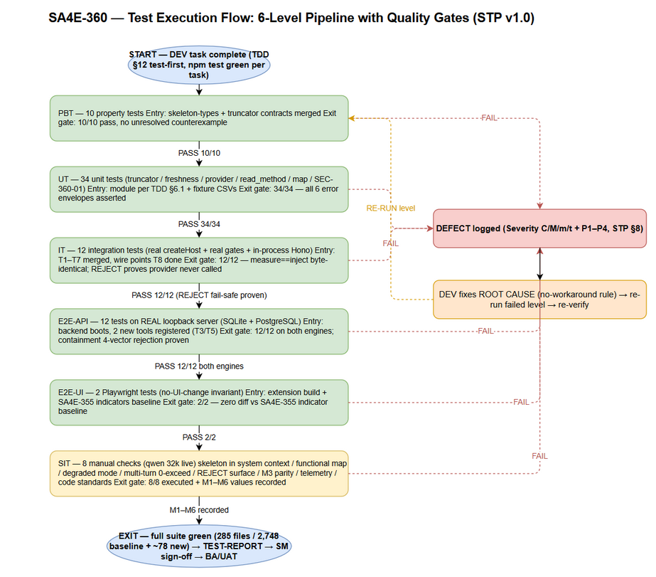
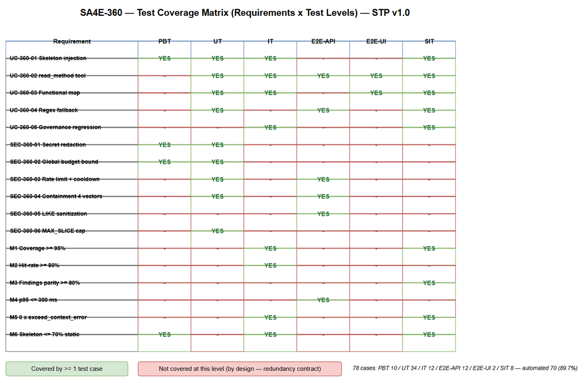

# Software Test Plan (STP)

## SDLC Agents 4 Enterprise — SA4E-360: Multi-Resolution Context Supply for Pi Harness — P1: Code Skeletonization + Agentic Context Loading

---

## Document Information

| Field | Value |
|-------|-------|
| Jira Ticket | SA4E-360 |
| Title | Multi-Resolution Context Supply for Pi Harness — P1: Code Skeletonization + Agentic Context Loading (wire dormant foundation) |
| Author | QA Agent |
| Version | 1.0 |
| Date | 2026-10-14 |
| Status | Draft — pending BA review (Review Gate) |
| Related BRD | documents/SA4E-360/BRD.md (v1.1) |
| Related FSD | documents/SA4E-360/FSD.md (v1.2, SA-DISCREPANCY-ALIGNED) |
| Related TDD | documents/SA4E-360/TDD.md (v1.1) |
| Security Review | documents/SA4E-360/SECURITY-REVIEW.md (v1.0 — PASS WITH NOTES) |
| Governance baseline | documents/SA4E-355/TDD.md (v1.3 §13 — 3-point budget gate, UNTOUCHED) |

---

## Author Tracking

| Role | Name - Position | Responsibility |
|------|-----------------|----------------|
| Author | QA Agent – QA Engineer | Create document |
| Peer Reviewer | BA Agent – Business Analyst | Business-coverage review (Review Gate) |

---

## Revision History

| Version | Date | Author | Changes |
|---------|------|--------|---------|
| 1.0 | 2026-10-14 | QA Agent | Initiate document — auto-generated from BRD v1.1 (5 stories, BR-360-01..05, M1–M6), FSD v1.2 (UC-360-01..05, C-360-* contracts, 12 error scenarios, §10.1 test scenarios TC-360-01..22), TDD v1.1 (T1–T9 checklist, 8 new skeleton modules + 2 backend tools), and SECURITY-REVIEW v1.0 (SEC-360-01..08). 6 test levels (PBT/UT/IT/E2E-API/E2E-UI/SIT), 78 test cases, 11 test data CSVs. |
| 1.1 | 2026-10-14 | QA Agent | SM review fix (Step 4b — CSV test data coverage gap): 6 STC IDs (PBT-08, UT-11, IT-02, IT-07, IT-11, E2E-API-12) were referenced only inside composite `A;B` test_case_id values, so the CSV coverage script counted them as uncovered. Added 5 dedicated test data CSVs (16 total) giving each of the 78 STC IDs an exact-ID row; extended FIX-01 signature to 133 chars to satisfy the ">120-char fixture" precondition. Coverage re-verified: 78/78 (script: Import-Csv → unique test_case_id vs STC `### LEVEL-xx` sections). |

---

## Sign-Off

| Name | Signature and date |
|------|--------------------|
| | ☐ I agree and confirm the test plan in this STP |
| | ☐ I agree and confirm the test plan in this STP |

---

## 1. Introduction

### 1.1 Purpose

This Test Plan (STP) defines the test strategy, scope, environment, schedule, and defect management for **SA4E-360** — wiring the dormant multi-resolution context supply foundation into the Pi Harness chat path so that whole-workspace review on local LLMs (qwen 32k/65k) fits inside the model context window without overflow.

SA4E-360 is a **wire-only** ticket (BR-11): it composes existing mechanisms (governance plane SA4E-355 + dormant content modules) and adds 8 new skeleton modules (extension/src/pi-workflow/skeleton/) plus 2 thin backend MCP tools (`code_symbol_locate`, `code_extract_signatures`). The test plan therefore emphasizes:

1. **Governance non-regression** — the 3-point budget gate (SA4E-355) must remain byte-for-byte effective (UC-360-05).
2. **Budget arithmetic exactness** — resolver-true values are binding test oracles (@32k: margin 2,622 / usable 28,098 / staticBudget 19,668 / skeleton cap 13,767; @65k: 5,243 / 58,245 / 40,771 / 28,539 — DISC-7 resolver-authoritative).
3. **Security remediation verification** — SEC-360-01 (secret redaction), SEC-360-02 (global budget bound), SEC-360-03 (rate limit / reindex cooldown), SEC-360-04 (backend path-containment twin — 4 vectors), SEC-360-05 (LIKE sanitization), SEC-360-06 (MAX_SLICE cap) are treated as DEV requirements with dedicated test cases.
4. **Metrics M1–M6** — each quantitative acceptance target has a designated measurement test case.

### 1.2 Test Objectives

- Verify all 5 user stories (BRD §2.3) and their acceptance criteria are implemented per FSD UC-360-01..05.
- Exercise every new business rule BR-360-01..05 and inherited rules BR-01/BR-02/BR-09/BR-11 in their SA4E-360 context.
- Validate the API contracts C-360-S1..S3, C-360-R1/R2, C-360-M1/M2, C-360-F1 (FSD §3.x.5 — binding for DEV).
- Prove the 12 error scenarios (FSD §9.1) degrade gracefully — the turn/session NEVER crashes, and the provider is NEVER called oversized (BR-09).
- Verify the 12 FSD §10.1 test scenarios (TC-360-01..22) with reproducible steps and concrete expected results.
- Verify security requirements SEC-360-01..08 from the Security Design Review, including redaction and path-containment 4-vector coverage.
- Measure the 6 success metrics M1–M6 (coverage ≥ 95%, hit-rate ≥ 80% top-5, findings parity ≥ 80%, p95 ≤ 300 ms FTS5, 0 × exceed_context_size_error, skeleton ≤ 70% staticBudget).
- Prove zero regression to the SA4E-355 governance baseline (285 test files / 2,748 tests green) after every task.

### 1.3 References

| Document | Location |
|----------|----------|
| BRD v1.1 | documents/SA4E-360/BRD.md |
| FSD v1.2 (TA-enriched, DISC-1..7 applied) | documents/SA4E-360/FSD.md |
| TDD v1.1 (§12 implementation checklist T1–T9) | documents/SA4E-360/TDD.md |
| Security Design Review v1.0 (SEC-360-01..08) | documents/SA4E-360/SECURITY-REVIEW.md |
| SA4E-355 TDD v1.3 §13 (governance baseline) | documents/SA4E-355/TDD.md |
| SA4E-355 FSD §3.8 (inherited BR-01/02/09/11) | documents/SA4E-355/FSD.md |
| Test Cases (STC) | documents/SA4E-360/STC.md |
| Test data | documents/SA4E-360/testdata/*.csv (16 files) |

---

## 2. Test Strategy

### 2.1 Test Levels

| Level | Scope | Automation | Tools | Location |
|-------|-------|------------|-------|----------|
| PBT | Property-based: budget arithmetic invariants (resolver-true values), truncation loop invariants (strict-shrink, termination), skeleton sizing ≤ 70% staticBudget, signature normalization, redaction completeness | ✅ Automated | vitest + fast-check | extension/src/pi-workflow/skeleton/__tests__/*.property.test.ts |
| UT | Unit: SkeletonProvider, SkeletonTruncator, IndexFreshnessChecker, ReadMethodTool (envelopes + disambiguation), FunctionalMapProvider, redactSecretLike (SEC-360-01) | ✅ Automated | vitest | extension/src/pi-workflow/skeleton/__tests__/, backend/src/engine/tools/__tests__/ |
| IT | Integration: createHost wiring (gate #2 measure==inject byte-identical), read_method → code_symbol_locate chain (in-process Hono), gate #3 interaction (read_method results compactable), TurnBudgetGuard interplay | ✅ Automated | vitest + Hono in-process | extension/src/pi-workflow/skeleton/__tests__/skeleton-wiring.integration.test.ts |
| E2E-API | REST/MCP endpoint E2E on real backend server: code_symbol_locate + code_extract_signatures over real QueryLayer (SQLite + PostgreSQL dual-engine), loopback wrapper timeout/retry, rate limit | ✅ Automated | vitest + fetch (real server) | backend/tests/e2e/sa4e-360-tools.e2e.test.ts |
| E2E-UI | Browser/extension UI E2E — minimal by design ("no UI changes" invariant): usage indicators regression + transcript tool-activity rendering | ✅ Automated | Playwright | tests/e2e/sa4e-360-ui.e2e.test.ts |
| SIT | Manual exploratory: skeleton injection visible in system context, functional map in get_workspace_info, degraded mode (index stale), multi-turn review session on qwen 32k, REJECT surface, findings parity (M3) | ❌ Manual | VS Code + llama-server + browser checklist | documents/SA4E-360/testdata/sit-checklist-testdata.csv |

**STP Test Cases Summary (consistent with STC v1.0):**

| Level | Count | Automated | Manual |
|-------|-------|-----------|--------|
| PBT | 10 | 10 | 0 |
| UT | 34 | 34 | 0 |
| IT | 12 | 12 | 0 |
| E2E-API | 12 | 12 | 0 |
| E2E-UI | 2 | 2 | 0 |
| SIT | 8 | 0 | 8 |
| **Total** | **78** | **70 (89.7%)** | **8 (10.3%)** |

### 2.2 Test Types

| Type | Description | Applicable |
|------|-------------|------------|
| Functional Testing | UC-360-01..05 main/alternative/exception flows per FSD §3 | Yes |
| Regression Testing | SA4E-355 governance suites green (context-governance, context-budget, budget-gate, session-tier, transcript-compaction) + E2E-UI indicators | Yes — gate after every task (TDD §12) |
| Performance Testing | p95 latency M4 ≤ 300 ms, skeleton build ≤ 2 s p95, map build ≤ 500 ms p95, budget resolution < 50 ms | Yes (measurable ACs in FSD §8) |
| Security Testing | SEC-360-01..08: redaction, containment 4 vectors, rate limit, LIKE sanitization, MAX_SLICE cap, ReDoS guard | Yes |
| Usability Testing | Manual SIT — reviewer UX with skeleton + functional map on qwen 32k | Yes (SIT only) |
| Compatibility Testing | Dual-engine index (SQLite + PostgreSQL) parity | Yes (E2E-API-04) |

### 2.3 Test Approach

1. **Risk-based, wire-first.** The highest-risk areas are (a) gate interaction — any wiring defect that skips/weaken a gate is Critical; (b) budget arithmetic — resolver-true values are the single source of truth (DISC-7); (c) fail-safe dominance — REJECT must be provable with the provider never called. These get the deepest coverage (PBT + IT + E2E-API + SIT).
2. **Redundancy avoidance between levels.** Each property/behavior is asserted at exactly ONE primary level; lower levels cover construction mechanics, higher levels cover composition:
   - Budget arithmetic FORMULA → PBT (PBT-01..03); its USE in gate ordering → IT-02; its TELEMETRY → SIT-01. No duplicated arithmetic asserts in UT.
   - Truncation MECHANICS (cap, priority, re-measure) → UT-01..05; loop INVARIANTS (shrink, termination, global bound) → PBT-04..07/10; forced-overflow END-TO-END → IT-03 + SIT-05.
   - Symbol resolution SQL semantics → E2E-API (real engine); envelope/steering logic → UT; full chain (extension tool → loopback → backend) → IT-04. E2E-API never re-asserts envelope shapes already covered by UT.
3. **Real dependencies over mocks (IT/E2E-API quality gate).** IT uses the real createHost, real gates, real compaction, in-process Hono app for the backend chain — only the LLM provider is a scripted fake (a real llama-server is unavailable in CI). E2E-API runs against a REAL backend server with real SQLite/PostgreSQL QueryLayer — no mock-all. Local infrastructure (SQLite, Postgres, HTTP server, filesystem) MUST be real; mocking them classifies the test as UT and is a defect per the test-implementation review rule.
4. **Test-first alignment with TDD §12.** Test IDs are grouped to the T1–T9 task checklist so DEV can implement tests first per task and keep `npm test` green after each task (ticket constraint).
5. **Security remediations are first-class requirements.** SEC-360-01/02 (Medium) and SEC-360-03..06 (Low) each have designated test cases (RTM §10); the Security Review's STP-recommended tests (secret-in-source → [REDACTED]; 200-file RAW_HEAD wall-clock; multi-root isolation) are included.

### 2.4 E2E Automation Coverage (SIT → E2E classification)

| Scenario Type (candidate SIT) | Classification | Rationale |
|-------------------------------|----------------|-----------|
| Budget arithmetic oracle values | **PBT** (PBT-01..03) | Pure functions — deterministic, property-expressible |
| Truncation loop invariants | **PBT** (PBT-04..07, PBT-10) | Random-input invariants; manual testing cannot enumerate inputs |
| Skeleton tool envelopes, validation, steering | **UT** (UT-17..25) | Pure logic with injected fakes |
| createHost wiring + measure==inject | **IT** (IT-01..02) | In-process, deterministic |
| Forced oversized skeleton → REJECT, provider never called | **IT** (IT-03) | Deterministic with scripted fake provider; SIT-05 keeps only the user-visible chat:error demo |
| read_method → backend chain | **IT** (IT-04) for chain + **E2E-API** (E2E-API-02..04) for real-engine SQL semantics | Splits chain wiring vs engine correctness |
| Gate #3 compaction absorption of read_method results | **IT** (IT-05) | Deterministic transcript construction |
| Locate latency p95 ≤ 300 ms (M4) | **E2E-API-12** | Measurable on real server |
| Golden-set hit-rate (M2) | **IT-11** | Drives real tool over fixture index |
| Usage indicators / transcript rendering regression | **E2E-UI** (E2E-UI-01..02) | DOM assertions |
| Skeleton visible in system context; reviewer UX | **SIT** (SIT-01, SIT-04) | Requires real LLM quality judgment |
| Degraded mode (stale index recovery UX) | **SIT** (SIT-03) — mechanics automated in UT-06..10/IT-09 | End-to-end recovery demo needs live workspace mutation |
| REJECT chat:error surface + provider-never-called proof | **SIT** (SIT-05) | Cross-process log inspection (llama-server) |
| Findings parity (M3) | **SIT** (SIT-06) | Human review-quality comparison |
| Code standards compliance | **SIT-08** | Line-count/TSDoc spot-check (CI-assisted) |

**Result: 70/78 (89.7%) automated; only 8 manual SIT cases remain, all requiring human judgment, a real LLM, or cross-process evidence.**

### 2.5 Entry Criteria

| Level | Entry Criteria |
|-------|---------------|
| PBT | skeleton-types.ts + truncator/resolver interfaces merged (T1 contracts); fast-check available in devDependencies |
| UT | Module under test exists per TDD §6.1; fixture CSVs loaded (documents/SA4E-360/testdata/); baseline suite green |
| IT | T1–T7 merged; createHost wire points implemented (T8); in-process Hono backend test harness available |
| E2E-API | Backend server boots on loopback with SQLite AND PostgreSQL adapters; 2 new tools registered (T3/T5 done) |
| E2E-UI | Extension builds (esbuild); SA4E-355 UI indicators present; Playwright harness configured |
| SIT | All automated levels green; llama-server running with qwen 32k (n_ctx 32,768 / maxOutput 2,048); code-intel backend indexed on the test workspace; STC SIT checklist printed |

### 2.6 Exit Criteria

| Level | Exit Criteria |
|-------|--------------|
| PBT | 10/10 pass; no shrinking counterexamples unresolved |
| UT | 34/34 pass; every error envelope asserted (INVALID_ARGS/NOT_FOUND/AMBIGUOUS/INDEX_STALE/FILE_UNREADABLE/INDEX_UNAVAILABLE) |
| IT | 12/12 pass; measure==inject byte-identical proven; REJECT path proves provider never called |
| E2E-API | 12/12 pass on BOTH engines (where applicable); containment 4-vector rejection proven |
| E2E-UI | 2/2 pass; zero diff in SA4E-355 indicator behavior |
| SIT | 8/8 executed with evidence screenshots/log excerpts; M1–M6 values recorded; 0 Critical / 0 Major open |
| Overall | Full suite green (baseline 285 files / 2,748 tests + ~78 new); RTM 100%; STP/STC signed off |

### 2.7 Test Execution Flow


*[Edit in draw.io](diagrams/test-execution-flow.drawio)*

---

## 3. Test Scope

### 3.1 Features In Scope

| # | Feature / Story | Priority | FSD Reference | Levels Applied |
|---|-----------------|----------|---------------|----------------|
| 1 | UC-360-01 Budget-aware code skeleton injection (gate #2, ≤ 70% cap, truncation, REJECT, DEGRADED) | High | FSD §3.1 | PBT, UT, IT, SIT |
| 2 | UC-360-02 read_method tool (resolve, disambiguation, envelopes, bounds, containment) | High | FSD §3.2 | UT, IT, E2E-API, E2E-UI, SIT |
| 3 | UC-360-03 Functional map in get_workspace_info (caps, cache, EF-1/EF-2) | High | FSD §3.3 | UT, IT, E2E-UI, SIT |
| 4 | UC-360-04 Regex signature fallback (backend code_extract_signatures, RAW_HEAD, SKIPPED) | High | FSD §3.4 | UT, E2E-API, SIT |
| 5 | UC-360-05 Governance regression safety (3 gates untouched, compaction, TurnBudgetGuard) | High | FSD §3.5 | IT, SIT |
| 6 | SEC-360-01 Secret redaction (redactSecretLike + secret-file exclusion) | High | SECURITY-REVIEW §SEC-360-01 | PBT, UT |
| 7 | SEC-360-02 Global budget bound + O(parts) truncator + termination cap | High | SECURITY-REVIEW §SEC-360-02 | PBT, UT |
| 8 | SEC-360-03 Rate limit /mcp + reindex cooldown | Medium | SECURITY-REVIEW §SEC-360-03 | UT, E2E-API |
| 9 | SEC-360-04 Backend path-containment twin (4 vectors: null-byte / UNC / dotdot / symlink) | High | SECURITY-REVIEW §SEC-360-04 | UT, E2E-API |
| 10 | SEC-360-05 LIKE wildcard sanitization (findSymbols) | Medium | SECURITY-REVIEW §SEC-360-05 | E2E-API |
| 11 | SEC-360-06 MAX_SLICE cap for read_method | Medium | SECURITY-REVIEW §SEC-360-06 | UT |
| 12 | SEC-360-07 Control-character strip (defense-in-depth) | Low | SECURITY-REVIEW §SEC-360-07 | UT |
| 13 | SEC-360-08 Inherited controls verified (containment, loopback-only, 1 MB cap, telemetry counts-only) | Medium | SECURITY-REVIEW §SEC-360-08 | UT, IT, E2E-API (re-verification) |
| 14 | Metrics M1–M6 (coverage, hit-rate, parity, latency, zero-overflow, 70% share) | High | BRD §2.5 | IT, E2E-API, SIT |
| 15 | Contracts C-360-S1..S3 / R1/R2 / M1/M2 / F1 | High | FSD §3.x.5 | UT, IT, E2E-API, SIT |
| 16 | Dual-engine index parity (SQLite symbols_fts / PostgreSQL ILIKE) | Medium | FSD §1.3, TDD P-8 | E2E-API |
| 17 | FSD §10.1 scenarios TC-360-01..22 | High | FSD §10.1 | Mapped in STC Appendix B |

### 3.2 Features Out of Scope

| # | Feature | Reason |
|---|---------|--------|
| 1 | P2 Contextual RAG wire (ContextRetriever, RRF merger) | BRD §1.2 — future ticket; P1 validates skeleton + targeted reads only |
| 2 | P3 Map-Reduce wire (MapReduceOrchestrator) | BRD §1.2 — escape hatch reserved; trigger condition (skeleton > staticBudget) is REJECT territory in P1 |
| 3 | P4 Call-graph pruning | Deferred (TA roadmap T6) |
| 4 | Hybrid retrieval latency (≤ 1.5 s target) | M4 hybrid half validated only when P2 wires the hybrid path (BRD §2.5) |
| 5 | New UI screens/controls | FSD §3.x.6 — "No UI changes"; only regression verification of SA4E-355 indicators (E2E-UI) |
| 6 | Rate limiting of /api/admin/*, /api/v1/pega/* | Pre-existing surfaces, unchanged by SA4E-360 (SEC-360-03 covers /mcp only) |
| 7 | SA4E-355 gate internals re-design | Governance plane is UNTOUCHED — only interaction/regression is tested (UC-360-05) |
| 8 | M2 hit-rate on fallback-extracted (non-indexed) symbols | OI-4 — fallback symbols are TRANSIENT; M2 scoped to indexed symbols |
| 9 | Multi-root merged skeleton | OI-3 — P1 ships single-active-root; only per-root isolation is tested (IT-08) |

### 3.3 Test Coverage Overview


*[Edit in draw.io](diagrams/test-coverage.drawio)*

---

## 4. Test Environment

### 4.1 Environment Requirements

| Environment | Configuration | Purpose |
|-------------|--------------|---------|
| DEV-CI (PBT/UT/IT) | Node LTS, vitest, fast-check; extension + backend packages; in-process Hono app; temp fixture workspaces | Automated levels 1–3 |
| E2E-API | Real backend MCP server on loopback (JSON-RPC POST /mcp); SQLite (SCHEMA_V1 + symbols_fts) AND PostgreSQL adapters; fixture workspace indexed | Levels 4 — real QueryLayer, no mocks |
| E2E-UI | VS Code extension dev host (or webview harness) + Playwright Chromium | Level 5 — DOM regression |
| SIT | Windows dev machine: VS Code + SA4E extension build; llama-server qwen 32k (contextWindow 32,768 / maxOutput 2,048); code-intel backend indexed on a representative workspace (≥ 200 files incl. Svelte/grammar-less) | Level 6 — end-to-end human-verified |

### 4.2 Tooling

| Tool | Use |
|------|-----|
| vitest | PBT/UT/IT runner (extension + backend) |
| fast-check | Property-based tests (PBT) |
| Hono in-process (`app.request()`) | IT for /mcp backend chain without network |
| fetch against real loopback server | E2E-API |
| Playwright | E2E-UI + SIT browser evidence |
| llama-server (qwen 32k/65k) | SIT reviewer LLM |
| VS Code extension log | Telemetry evidence (PI_SKELETON_*, PI_GATE_DECISION, PI_READ_METHOD_RESULT) |

### 4.3 Test Data Requirements

All test data is versioned as CSV under `documents/SA4E-360/testdata/` — every STC test case ID appears in at least one CSV as an exact `test_case_id` value (78/78, verified by the coverage script: `Import-Csv *.csv → Sort-Object -Unique test_case_id` vs the 78 `### LEVEL-xx` sections in STC.md; v1.0 covered 72/78 because 6 IDs appeared only inside composite `A;B` references).

| # | File | Covers | Rows |
|---|------|--------|------|
| 1 | pre-seeded-index-fixtures.csv | Baseline files/symbols fixtures for build/render/cache/multi-root/coverage (PBT-08, UT-11/12/16, IT-08/09/12, E2E-API-01/02/04) | 14 |
| 2 | index-freshness-testdata.csv | Freshness states: fresh/touch-only/content-changed/reindex-fail/cooldown/wrapper-timeout (UT-06..10, IT-09, E2E-API-08, SIT-03) | 9 |
| 3 | budget-scenarios-testdata.csv | Resolver oracle values @32k/@65k/default + arbitrary nCtx (PBT-01..03, IT-01/02/07) | 8 |
| 4 | truncation-scenarios-testdata.csv | Module priority parts, forced-overflow, global-bound properties (PBT-04..07/10, UT-01..05, IT-03) | 12 |
| 5 | read-method-testdata.csv | read_method inputs → envelopes (UT-17..25, IT-04/05/06, E2E-API-02/03/04/09) | 20 |
| 6 | skeleton-fallback-testdata.csv | Grammar-less files, fallback ladder, empty corpus (UT-13/14/15, E2E-API-05/06, SIT-07) | 9 |
| 7 | secret-redaction-testdata.csv | Secret-like patterns → [REDACTED] (PBT-09, UT-30..34) | 12 |
| 8 | backend-security-testdata.csv | Containment 4 vectors + rate limit + LIKE sanitize + tenant (UT-24, E2E-API-07/09/10/11) | 12 |
| 9 | golden-query-set.csv | M2 hit-rate + M4 latency golden queries — 12-query FROZEN set, composite refs `IT-11;E2E-API-12` (exact-ID metric/benchmark rows live in files #12 and #13) | 12 |
| 10 | functional-map-testdata.csv | Map entries, caps, EF-1/EF-2 (UT-26..29, IT-10, SIT-02) | 8 |
| 11 | sit-checklist-testdata.csv | Manual SIT + E2E-UI execution checklist (SIT-01..08, E2E-UI-01/02) | 10 |
| 12 | signature-normalization-testdata.csv | PBT-08 signature samples — >120/120-boundary/121 just-over/whitespace-collapse inputs → expected normalized ≤ 120 chars (input uses literal `\t`/`\n` escapes interpreted as tab/newline) | 6 |
| 13 | golden-hitrate-testdata.csv | IT-11 M2 metric rows — hit-rate ≥ 80% top-5 over the frozen 12-query set (11 ok + GQ-12 designed miss = 91.7%) | 3 |
| 14 | latency-benchmark-testdata.csv | E2E-API-12 M4 benchmark — 12 golden queries × 20 iterations = 240 latencies, p95 ≤ 300 ms; hybrid-scope exclusion row | 14 |
| 15 | skeleton-render-testdata.csv | UT-11 batched corpus render format per FSD §3.1.4 — file header line, kind+name lines, no bodies, single fetchSymbolCorpus call | 6 |
| 16 | gate-order-escalation-testdata.csv | IT-02 gate-order wiring (measure BEFORE createAgentSession) + IT-07 BR-08 escalation ladder tiers (compress → drop steering → min loadout → REJECT) | 7 |

### 4.4 External Dependencies

| System | Dependency | Mock/Stub Policy |
|--------|-----------|------------------|
| code-intel backend | REAL server for E2E-API/IT (in-process Hono for IT) | ❌ Never mocked in IT/E2E-API (quality gate) |
| SQLite / PostgreSQL | REAL engines for dual-engine parity | ❌ Never mocked |
| llama-server (qwen 32k/65k) | Required for SIT only | ✅ Scripted fake provider in IT (CI has no local LLM) — acceptable, external paid-equivalent boundary |
| VS Code extension host | Required for E2E-UI/SIT | ❌ Real |

---

## 5. Test Schedule

| Phase | Start Date | End Date | Duration | Milestone |
|-------|-----------|----------|----------|-----------|
| Test Planning | 2026-10-14 | 2026-10-15 | 1 d | STP + STC BA-approved |
| Test Data Preparation | 2026-10-15 | 2026-10-15 | 0.5 d | 16 CSVs + fixture workspace ready |
| PBT + UT execution (T1–T7) | 2026-10-16 | 2026-10-20 | 3 d | 44 automated cases green |
| IT execution (T8) | 2026-10-20 | 2026-10-21 | 1 d | 12 wiring cases green |
| E2E-API + E2E-UI (T9) | 2026-10-21 | 2026-10-22 | 1 d | 14 cases green on both engines |
| SIT execution (manual) | 2026-10-22 | 2026-10-23 | 1.5 d | 8 SIT executed + evidence |
| Defect Fix & Retest | 2026-10-23 | 2026-10-24 | 1 d | 0 Critical/Major open |
| UAT / Sign-off | 2026-10-24 | 2026-10-24 | 0.5 d | TEST-REPORT + metrics recorded |

---

## 6. Resources & Responsibilities

| Role | Name | Responsibility |
|------|------|---------------|
| Test Lead | QA Agent | Test planning, RTM, metrics reporting, BA review coordination |
| QA Engineer | QA Agent | STC authoring, automated suite review (implementation-vs-spec), SIT execution, evidence collection |
| BA | BA Agent | Business-coverage review gate (STC vs BRD/FSD), UAT acceptance |
| Developer | DEV Agent | Test-first implementation (T1–T9), bug fixing, fixture hooks |
| Solution Architect | SA Agent | Clarifies TDD §4/§6 contracts when tests expose design ambiguity |
| Security Agent | Security Agent | Re-verification of SEC-360-01..06 remediations at Phase 5.7 |
| DevOps | DevOps Agent | CI wiring for vitest + Playwright jobs, PostgreSQL test service |

---

## 7. Risk & Mitigation

| # | Risk | Impact | Likelihood | Mitigation |
|---|------|--------|------------|------------|
| 1 | Budget arithmetic drift between docs and resolver (DISC-7-type slips) | High | Medium | PBT-01..03 hard-code resolver-true oracles; any doc/resolver mismatch fails CI immediately |
| 2 | Truncation loop latency blow-up on large grammar-less workspaces (SEC-360-02) | High | Medium | PBT-10 + UT-01..05 enforce global incremental bound; SIT workspace includes ≥ 100 RAW_HEAD files; wall-clock assert in IT-01 |
| 3 | Secrets leaking into skeleton/system context (SEC-360-01) | High | Medium | PBT-09 + UT-30..34 redaction suite; secret-file exclusion rows; Phase 5.7 re-verification |
| 4 | Backend containment twin weaker than extension path-containment (SEC-360-04) | High | Low | E2E-API-07 runs all 4 vectors against the REAL server; UT-24 asserts rejection before read |
| 5 | Governance regression from wiring (gate skipped/weakened) | High | Low | IT-01/02/03/05/07 gate-interaction suite + full baseline suite green gate after every TDD task |
| 6 | Test environment: llama-server unavailable/flaky for SIT | Medium | Medium | SIT scheduled in dedicated window; IT uses scripted fake provider so automation never blocks on LLM |
| 7 | Dual-engine behavior divergence (SQLite FTS5 vs PostgreSQL ILIKE) | Medium | Medium | E2E-API-04 runs the same fixture set on both engines and diffs row-for-row |
| 8 | Golden query set bias (M2/M4) | Medium | Low | Golden set drawn from real indexed symbols across ≥ 5 modules; scope limited to indexed symbols (OI-4), documented in STC Appendix C |

---

## 8. Defect Management

### 8.1 Severity Levels

| Severity | Definition | Example (SA4E-360 context) |
|----------|-----------|-----------------------------|
| Critical | Security breach or governance broken | Secret appears unredacted in skeleton (SEC-360-01); provider called oversized (BR-09 violated); gate skipped |
| Major | Feature not working, workaround exists | read_method returns wrong slice; map never served; REJECT not raised on persisting overflow |
| Minor | Degraded behavior with workaround | Fallback share not logged separately; telemetry payload field missing |
| Trivial | Cosmetic/logging | Typo in event payload, log level mismatch |

### 8.2 Priority Levels

| Priority | Definition | SLA (Fix Time) |
|----------|-----------|----------------|
| P1 | Must fix immediately | 4 hours |
| P2 | Must fix before release | 1 business day |
| P3 | Should fix if time permits | 3 business days |
| P4 | Nice to fix, can defer | Next release |

### 8.3 Defect Lifecycle

```
New → Open → In Progress → Fixed → Ready for Retest → Verified → Closed
                                                 → Reopened → In Progress
```

**Quality-gate defects (test-implementation review):** an IT/E2E test that mocks local infrastructure (SQLite/Postgres/HTTP server) instead of using real instances, or that bypasses the real createHost chain, is itself a **Major** defect — sent back to DEV with the STC spec reference.

---

## 9. Test Metrics & Reporting

### 9.1 Test Execution Metrics

| Metric | Formula | Target |
|--------|---------|--------|
| Test Execution Rate | Executed / 78 × 100% | 100% |
| Pass Rate (automated) | Passed / 70 × 100% | 100% at exit |
| Automation Ratio | Automated / Total × 100% | ≥ 89% (achieved: 89.7%) |
| Requirement Coverage (RTM) | Covered requirements / 48 × 100% | 100% |
| Defect Density | Defects / 78 test cases | ≤ 0.15 |
| Critical Defects | Count | 0 |

### 9.2 BRD Metric Measurement Procedures (M1–M6)

| Metric | Target | Measurement Test | Procedure |
|--------|--------|------------------|-----------|
| M1 Skeleton coverage | ≥ 95% exported symbols | IT-12 | Diff skeleton-rendered symbol names vs `symbols` table for the fixture workspace; fallback share reported separately from PI_SKELETON_FALLBACK count (OI-4 scope) |
| M2 read_method hit-rate | ≥ 80% top-5 | IT-11 | Run golden-query-set.csv (12 queries) through ReadMethodTool with real locator; hit = status ok; ratio ≥ 80% |
| M3 Findings parity | ≥ 80% | SIT-06 | Same 10-file subset reviewed twice (skeleton+targeted reads vs full-context baseline); findings matched by file+issue; ratio ≥ 80% |
| M4 Retrieval p95 latency | FTS5 ≤ 300 ms | E2E-API-12 | 12 golden locate queries × 20 iterations on real server; p95 from PI_READ_METHOD_RESULT.durationMs / measured fetch times |
| M5 Zero context overflow | 0 × exceed_context_size_error | SIT-04 (+IT-03/05) | Turn-1 + 10-turn review on qwen 32k; grep run log for exceed_context_size_error — count must be 0 |
| M6 Skeleton token share | ≤ 70% staticBudget | PBT-07, IT-02, SIT-01 | PI_GATE_DECISION enriched payload skeletonTokens/staticBudget per session; usagePercent ≤ 0.70 |

### 9.3 Reporting Schedule

| Report | Frequency | Audience |
|--------|-----------|----------|
| Automated suite status | Per CI run / per TDD task | DEV + SM |
| SIT execution report | End of SIT window | SM + BA |
| TEST-REPORT (TEST-REPORT-TEMPLATE) | Phase 6 exit | All stakeholders |

---

## 10. Appendix

### 10.1 Glossary

| Term | Definition |
|------|------------|
| PBT | Property-Based Testing — invariant assertions over random inputs (fast-check) |
| IT | Integration test — real createHost/gates/in-process Hono backend; only the LLM provider is scripted |
| E2E-API | Automated test against the REAL loopback backend server (JSON-RPC POST /mcp) |
| E2E-UI | Playwright browser assertions on the extension webview |
| SIT | System Integration Testing — manual, human-verified scenarios |
| staticBudget | 70% share of usable tokens — 19,668 @32k / 40,771 @65k (resolver-authoritative) |
| Skeleton cap | floor(0.70 × staticBudget) — 13,767 @32k / 28,539 @65k (BR-360-01) |
| Golden query set | 12 read_method queries over real indexed symbols used for M2/M4 (Appendix C) |
| Resolver-true values | Budget numbers produced by the shipped resolveContextBudget (DISC-7) — the only accepted oracle |
| Fallback ladder | GRAMMAR → REGEX_SIGNATURES → RAW_HEAD → SKIPPED (UC-360-04) |

### 10.2 Assumptions

- estimateTokenCount (chars/4 ∨ words×1.3, max) precision is acceptable, backed by the 8% safety margin (BR-02) — consistent with SA4E-355 A-6.
- qwen 32k is the primary SIT target; 65k is secondary (AF-3).
- CI provides a PostgreSQL service for the dual-engine E2E job; if not, E2E-API-04 runs in the nightly job with a containerized Postgres.
- The golden query set (Appendix C / golden-query-set.csv) is frozen at test-planning time; changes require SM approval.

### 10.3 Deliverables

| # | Deliverable | Location |
|---|-------------|----------|
| 1 | STP (this document) | documents/SA4E-360/STP.md |
| 2 | STC (78 test cases + RTM) | documents/SA4E-360/STC.md |
| 3 | Test data (16 CSVs) | documents/SA4E-360/testdata/*.csv |
| 4 | Coverage + execution flow diagrams | documents/SA4E-360/diagrams/test-coverage.{drawio,png}, test-execution-flow.{drawio,png} |
| 5 | Test execution report | documents/SA4E-360/TEST-REPORT-SA4E-360.md (+ CSV tracker) — Phase 6 |
| 6 | Evidence | documents/SA4E-360/evidence/ (screenshots, log excerpts) |

---

*End of STP — SA4E-360 v1.0. Traceability: every section maps to BRD v1.1 / FSD v1.2 / TDD v1.1 / SECURITY-REVIEW v1.0. Pending: BA review gate (STC business-coverage review) → then DOCX/XLSX export + Jira attachment by SM.*