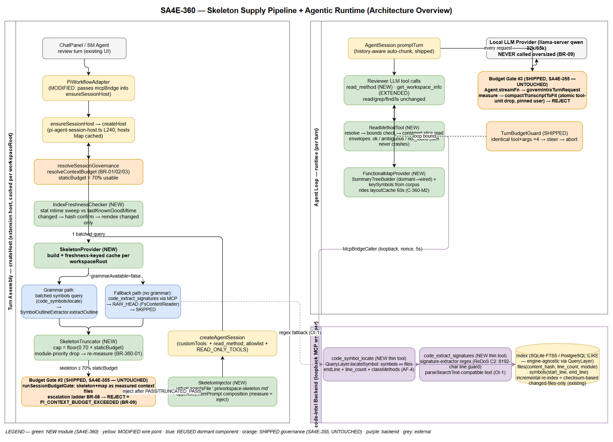
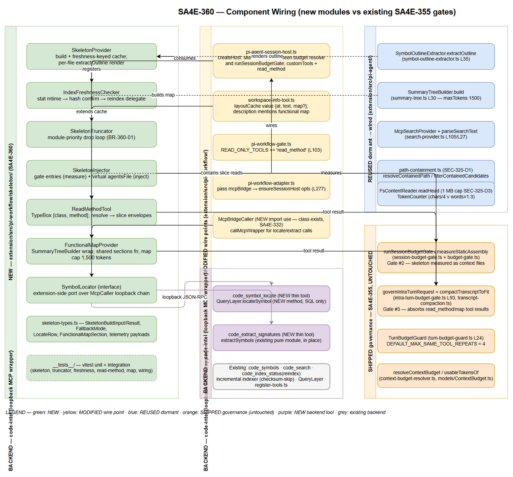
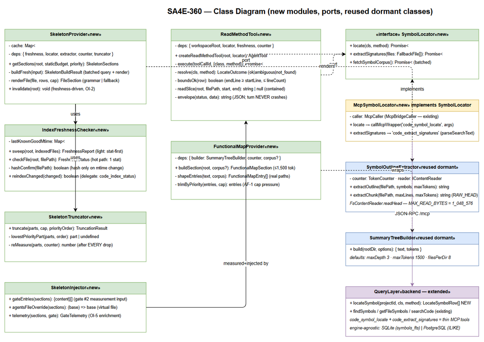
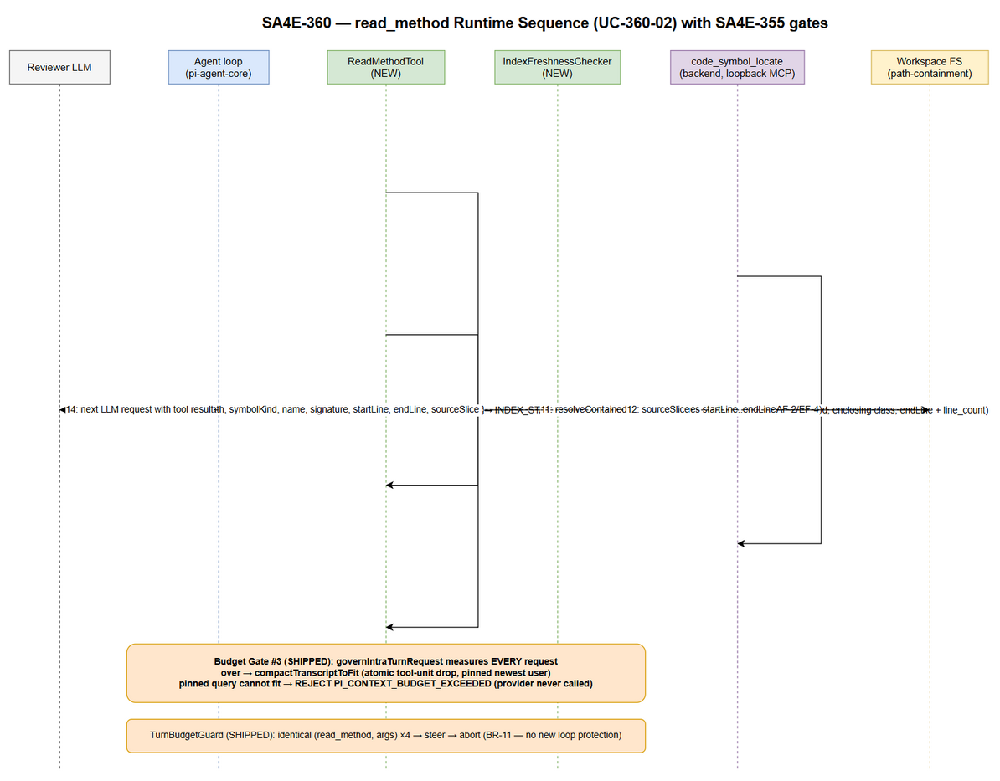

# Technical Design Document (TDD)

## Pi Harness — SA4E-360: Multi-Resolution Context Supply for Pi Harness — P1: Code Skeletonization + Agentic Context Loading

---

## Document Information

| Field | Value |
|-------|-------|
| Jira Ticket | SA4E-360 |
| Title | Multi-Resolution Context Supply for Pi Harness — P1: Code Skeletonization + Agentic Context Loading (wire dormant foundation) |
| Issue Type / Priority | Story / High |
| Labels | context-governance, pi-harness, wire-only |
| Project | SA4E — SDLC Agents 4 Enterprise |
| Author | SA Agent (Solution Architect) |
| Version | 1.1 |
| Date | 2026-10-14 |
| Status | Draft — Ready for SM review |
| Related BRD | documents/SA4E-360/BRD.md (v1.1) |
| Related FSD | documents/SA4E-360/FSD.md (v1.2, TA-ENRICHED — DISC-1..7 applied) |
| Governance baseline | documents/SA4E-355/TDD.md (v1.3 — §13 3-point budget gate architecture, UNTOUCHED) |
| Discrepancy report | documents/SA4E-360/DISCREPANCY.md (7 findings, 0 Critical) |

---

## Revision History

| Version | Date | Author | Changes |
|---------|------|--------|---------|
| 1.0 | 2026-10-13 | SA Agent | Initiate TDD from FSD v1.1 + BRD v1.1 + SA4E-355 TDD v1.3 §13. Codebase verified 2026-10-13: dormant components (SymbolOutlineExtractor, SummaryTreeBuilder, McpSearchProvider, ContextRetriever), wire points (pi-agent-session-host.ts createHost L240/L325/L378, workspace-info-tool.ts, pi-coding-tools.ts, pi-workflow-gate.ts L103, pi-provider.ts L273), backend index (SCHEMA_V1 files/symbols/symbols_fts, QueryLayer, code_symbols/code_search/code_index_status tools, incremental checksum indexer, signature-extractor with ReDoS C2 guard, grammar-config.json 21 languages). Resolves OI-1..OI-6 (§3). 2 new thin backend tools designed (code_symbol_locate, code_extract_signatures). 4 draw.io diagrams created + exported. Discrepancy report DISC-1..DISC-7. |
| 1.1 | 2026-10-14 | SA Agent | Corrected budget arithmetic @32k per resolver-true values (BA feedback, DISC-7 arithmetic slip: ceil(2621.44)=2622) — §2.2 now states margin 2,622 / usable 28,098 / staticBudget 19,668 / skeleton cap 13,767 (~13.8K); @65k values already correct (5,243/58,245/40,771/28,539 — unchanged). Related FSD ref updated to v1.2 (DISC-1..7 applied). DISCREPANCY.md Resolution section added — ALL RESOLVED. No other sections, diagrams, or OI decisions changed. |

---

## Sign-Off

| Name | Signature and date |
|------|--------------------|
| | ☐ I agree and confirm all criteria on this TDD as expected design |
| | ☐ I agree and confirm all criteria on this TDD as expected design |

---

## 1. Introduction

### 1.1 Purpose

This TDD specifies **technically how** SA4E-360 wires the dormant multi-resolution context supply foundation into the Pi Harness session lifecycle, so that a whole-workspace review on local LLMs (qwen 32k/65k) fits inside the model context window.

The design is bound by two invariants inherited from the FSD and the SA4E-355 baseline:

- **Governance plane unchanged** — the 3-point budget gate architecture shipped by SA4E-355 (TDD v1.3 §13) remains the ONLY enforcement mechanism. SA4E-360 adds measured static content (skeleton + functional map) and ordinary tool results (read_method, extended get_workspace_info). **No 4th gate is created**; every content output flows through the existing gates: turn-start legacy (`governLegacyTurn`) / session turn-start (gate #2, `runSessionBudgetGate` in `createHost`) / intra-turn (gate #3, `governIntraTurnRequest` in `Agent.streamFn`).
- **Wire-only (BR-11)** — compose existing shipped/dormant mechanisms. No new skeleton engine, router, or token estimator. The only new backend surface is 2 THIN MCP tools that serialize existing `QueryLayer` / `signature-extractor` capabilities for the extension host (boundary wiring, same class of change as SA4E-355's transcript grouping).

### 1.2 Scope

**In scope (per FSD §1.2):**

1. UC-360-01 — Budget-aware code skeleton injection at session assembly (gate #2 measured, ≤ 70% staticBudget per BR-360-01, module-priority truncation, REJECT per BR-09 on persisting overflow).
2. UC-360-02 — `read_method(class, method)` core tool returning a single symbol slice (startLine..endLine from the index), ordinary tool result under gate #3.
3. UC-360-03 — Functional map (`SummaryTreeBuilder`) wired into `get_workspace_info` + the session assembly path, riding the existing 60s `layoutCache` (C-360-M2).
4. UC-360-04 — Regex signature fallback (`signature-extractor.ts`) for languages without a bundled tree-sitter grammar, with RAW_HEAD/SKIPPED degradation (BR-360-03).
5. UC-360-05 — Governance regression safety: all 3 gates untouched, test-first, full suite green after every task.

**Out of scope:** P2 Contextual RAG wire, P3 Map-Reduce wire, P4 call-graph pruning, any new tree-sitter dependency (grammars already bundled), UI changes (none — FSD §3.x.6), multi-root merged skeleton (OI-3 → P3).

### 1.3 Technology Stack (verified against codebase 2026-10-13)

| Layer | Technology | Evidence |
|-------|-----------|----------|
| Extension host | TypeScript, VS Code extension, vitest | extension/package.json (`"test": "vitest run"`), src under extension/src/ |
| Agent harness | pi-agent-core / pi-coding-agent (AgentTool, AgentSession, streamFn) | pi-agent-session-host.ts imports @earendil-works/pi-coding-agent |
| Tool schema | TypeBox (same style as workspace-info-tool.ts L91) | `parameters: Type.Object({...})` |
| Governance (SA4E-355) | context-budget-resolver, session-budget-gate, intra-turn-budget-gate, transcript-compaction, TurnBudgetGuard | extension/src/pi-agent/*, extension/src/pi-workflow/* |
| Backend index | Node/TS MCP server; SQLite (@sqlite.org/sqlite-wasm, SCHEMA_V1 with symbols_fts FTS5 external-content) OR PostgreSQL (pg-schema-ensure.ts); dual-engine via DatabaseAdapter + DialectHelper | backend/src/engine/db/schema.ts L17-60; backend/src/database/migration/pg-schema-ensure.ts L29-61 |
| MCP transport | loopback JSON-RPC wrapper POST /mcp; loopback-only URL validation, X-Session-Nonce, 5s AbortSignal timeout | search-provider.ts L16-19, L171-194, L204-234 |
| Parsers | web-tree-sitter + bundled grammars (grammar-config.json: 21 language entries); regex multi-language extractor (ReDoS C2 guard: MAX_LINE_LENGTH 8192) | backend/src/engine/parsers/grammar-config.json; signature-extractor.ts L40-51 |

### 1.4 Design Principles & Constraints

| # | Principle | Source |
|---|-----------|--------|
| P-1 | Wire-only: reuse `SymbolOutlineExtractor`, `signature-extractor.ts`, `SummaryTreeBuilder`, `QueryRouter`, `McpSearchProvider`, `path-containment.ts` — no new engine/router/estimator | BR-360-05, BR-11 |
| P-2 | Every content path measures tokens via the existing `estimateTokenCount` (pi-agent/prompt-compressor.ts) / `TokenCounter` / `BudgetCalculator.calculateBudget` — no parallel estimation | INV-2 (FSD §2.2), BR-360-01 |
| P-3 | Fail-safe, never fail-open: persisting overflow → REJECT `PI_CONTEXT_BUDGET_EXCEEDED`; provider NEVER called oversized | INV-3, BR-360-02, BR-09 |
| P-4 | Skeleton + functional map are STATIC context: measured once at gate #2 per session creation, never grow intra-turn; only tool results grow and are absorbed by gate #3 + compaction | INV-1 (FSD §2.2) |
| P-5 | No 4th gate. Content-plane outputs are inputs to the shipped gates, never enforcement points | SA4E-355 TDD §13 (consistency constraint) |
| P-6 | Code standards: ≤ 200 lines/file, ≤ 20 lines/function, SOLID, TSDoc, test-first, `npm test` green after every task | Ticket constraint, FSD §3.5.3 |
| P-7 | Diagrams: draw.io only (no Mermaid) — every diagram embedded as PNG with editable .drawio source | Project rule (AGENTS.md) |
| P-8 | Multi-engine index agnostic: all symbol queries go through `QueryLayer` methods (SQLite symbols_fts OR PostgreSQL ILIKE behind the adapter) — no raw FTS5 SQL in the extension host | Verified dual-engine schema (DISC-6) |

### 1.5 References

| Document | Location |
|----------|----------|
| BRD (primary input) | documents/SA4E-360/BRD.md (v1.1) |
| FSD (functional contract — C-360-* identifiers are binding) | documents/SA4E-360/FSD.md (v1.1) |
| SA4E-355 TDD v1.3 — §13 Intra-Turn Request Governance | documents/SA4E-355/TDD.md |
| SA4E-355 FSD §3.8 — inherited business rules BR-01/02/09/11 | documents/SA4E-355/FSD.md |
| Dormant skeleton renderer | extension/src/pi-agent/context-retrieval/symbol-outline-extractor.ts |
| Dormant functional map builder | extension/src/pi-agent/context-retrieval/summary-tree.ts |
| Production workspace info tool (wire point) | extension/src/pi-workflow/workspace-info-tool.ts |
| Session host (wire point) | extension/src/pi-workflow/pi-agent-session-host.ts (createHost L240, gate L325, createAgentSession L378, ensureSessionHost L507) |
| Regex signature fallback | backend/src/engine/parsers/signature-extractor.ts (extractSymbols L43, MAX_LINE_LENGTH L40) |
| Grammar registry config | backend/src/engine/parsers/grammar-config.json (21 language entries — DISC-3) |
| Index schema (SCHEMA_V1 + FTS5) | backend/src/engine/db/schema.ts (files L17, symbols L36, symbols_fts L52) |
| PostgreSQL index schema | backend/src/database/migration/pg-schema-ensure.ts (files L29, symbols L46) |
| QueryLayer (symbol queries) | backend/src/engine/query/query-layer.ts (findSymbols L169, getFileSymbols L187) |
| Existing MCP tools | backend/src/engine/tools/code-symbols.ts, code-search.ts, code-index-status.ts, register-tools.ts |
| Incremental indexer (checksum skip) | backend/src/engine/indexer/checksum-service.ts, index-helper.ts (isFileUnchanged L18) |
| Path containment (SEC-325-D1) | extension/src/pi-agent/context-retrieval/path-containment.ts |
| Loopback MCP caller (SEC-325-D2/D4) | extension/src/pi-agent/context-retrieval/search-provider.ts |

---

## 2. System Architecture

### 2.1 Two-Plane Composition (verified)

SA4E-360 operates entirely inside the Pi Harness extension session lifecycle. The **content plane** (this ticket) supplies skeleton, functional map, and symbol-slice reads; the **governance plane** (SA4E-355, shipped v1.52.0) measures and enforces the token budget at 3 execution points. The code-intel backend index (loopback MCP wrapper) and the local LLM provider are external to the extension host.


*[Edit in draw.io](diagrams/architecture.drawio)*

**Verified component inventory (ground truth for this design):**

| Component | Verified Location | State | Role in SA4E-360 |
|-----------|-------------------|-------|------------------|
| `SymbolOutlineExtractor.extractOutline(filePath, symbols, maxTokens)` | extension/src/pi-agent/context-retrieval/symbol-outline-extractor.ts L35 | Dormant (tests-only) | Skeleton renderer — reused as-is |
| `FsContentReader.readHead` + `MAX_READ_BYTES = 1_048_576` | same file L12-27 | Dormant | RAW_HEAD fallback (extension-local, never blocks on backend) |
| `SummaryTreeBuilder.build(rootDir, options) → {text, tokens}` | extension/src/pi-agent/context-retrieval/summary-tree.ts L30 (defaults maxDepth 3, maxTokens 1500, filesPerDir 8, pageSize 100) | Dormant | Functional map builder — reused as-is |
| `McpSearchProvider` / `parseSearchText` / `validateLoopbackWrapperUrl` | extension/src/pi-agent/context-retrieval/search-provider.ts L105 / L27 / L171 | Dormant provider class; production bridge caller exists | Loopback index query chain (skeleton corpus + fallback extraction) |
| `ContextRetriever` | extension/src/pi-agent/context-retriever.ts (parent dir — DISC-5) | Dormant (constructed only in tests) | NOT wired in P1 (P2 scope); its sub-components are wired individually |
| `createHost(opts)` | extension/src/pi-workflow/pi-agent-session-host.ts L240; budget resolve L291; gate #2 `runSessionBudgetGate` L325; `createAgentSession` L378; host cache `hosts` Map L62/L507-522 | Shipped (SA4E-355) | Wire point — skeleton build inserted between budget resolution and gate #2 |
| `runSessionBudgetGate` / `measureStaticAssembly` | extension/src/pi-agent/session-budget-gate.ts L56 / budget-gate.ts L157 | Shipped | Gate #2 — skeleton+map enter as measured context files |
| `PI_GATE_DECISION` | extension/src/pi-agent/budget-gate.ts L141 (payload: decision, usagePercent, staticTokens, escalations) | Shipped | OI-5 — payload enriched, values unchanged |
| `governIntraTurnRequest` / `measureIntraTurnRequest` | extension/src/pi-workflow/intra-turn-budget-gate.ts L93 / L71 | Shipped | Gate #3 — absorbs read_method/map tool results (module NOT modified) |
| `streamWithBudgetGate` / streamFn wiring | extension/src/pi-workflow/pi-provider.ts L226 / L273 | Shipped | Untouched |
| `TurnBudgetGuard` (`DEFAULT_MAX_SAME_TOOL_REPEATS = 4`, MIN 2, CAP 20) | extension/src/pi-workflow/turn-budget-guard.ts L24; pi-provider.ts L399/L424 | Shipped | Loop bound for read_method — no new loop protection |
| `READ_ONLY_TOOLS` | extension/src/pi-workflow/pi-workflow-gate.ts L103: ['read','grep','find','ls','get_workspace_info'] | Shipped | + 'read_method' (approval semantics) |
| `layoutCache` (Map keyed by workspaceRoot, TTL 60s) | extension/src/pi-workflow/workspace-info-tool.ts L18-20, `clearLayoutCache` L43 | Shipped | Extended value `{ at, text, map? }` (C-360-M2) |
| `McpBridge` / `McpBridgeCaller` | extension/src/mcp/mcp-bridge.ts L21; mcp-bridge-caller.ts L13; adapter instantiation pi-workflow-adapter.ts L78 | Shipped | Transport for locate/extract queries (DI into session host) |
| `code_symbols` MCP tool (name prefix / file listing) | backend/src/engine/tools/code-symbols.ts L9-33 → QueryLayer.findSymbols L169 (`name LIKE 'name%'`) | Shipped | Symbol corpus source for the skeleton build (batched) |
| `code_search` MCP tool | backend/src/engine/tools/code-search.ts (QueryLayer.searchCode — ILIKE, NOT FTS5 MATCH — DISC-6) | Shipped | Not used by SA4E-360 paths (fuzzy); referenced only in not_found steering |
| `code_index_status` MCP tool (reindex=true → `indexer.runFullIndex`) | backend/src/engine/tools/code-index-status.ts L18-23 | Shipped | On-demand re-index delegate (freshness recovery) |
| Incremental indexer (checksum-based skip) | backend/src/engine/indexer/checksum-service.ts, index-helper.ts L18 (`isFileUnchanged` content_hash compare) | Shipped | "Changed files only" re-index mechanics (FSD §5.4 maps onto this) |
| `signature-extractor.ts` (`extractSymbols(content, language)`) | backend/src/engine/parsers/signature-extractor.ts L43; ReDoS C2 L40-51; `getPatterns` L133 → LANGUAGE_PATTERNS / GENERIC_PATTERNS | Shipped | Regex fallback for grammar-less languages (OI-1: invoked backend-side) |
| Index schema | backend/src/engine/db/schema.ts — files (content_hash, line_count, module, UNIQUE(project_id, path)), symbols (start_line, end_line, parent_symbol), symbols_fts FTS5 external-content (name, signature, doc_comment, kind) + sync triggers; PostgreSQL twin pg-schema-ensure.ts | Shipped | Consumed; NO new tables (FSD §4) |

### 2.2 Skeleton Supply Pipeline (UC-360-01, session assembly)

1. **Turn start** — ChatPanel → `PiWorkflowAdapter` → `ensureSessionHost(opts)` (pi-workflow-adapter.ts L276-277; **MODIFIED**: opts now carries `mcpBridge`). Host is cached per workspaceRoot (`hosts` Map) with a 30s ensure timeout — the pipeline below runs once per host creation, satisfying INV-1 (measured once per session).
2. **Budget resolution (gate #2 input, shipped)** — `resolveSessionGovernance` → `resolveContextBudget` (BR-01 chain: provider meta.n_ctx → ModelRegistry → default 8192) → `usable = nCtx − reserveOutput − ceil(nCtx × 8%)` (BR-02) → `staticBudget = floor(usable × 0.70)` (BR-03). @32k (resolver-authoritative math — DISC-7): margin 2,622 (ceil(32,768 × 0.08) = ceil(2,621.44)), usable 28,098, staticBudget 19,668, **skeleton cap = floor(0.70 × 19,668) = 13,767 tokens (~13.8K)**. @65k: usable 58,245, staticBudget 40,771, cap ≈ 28,539 (~28.5K).
3. **Index freshness check (NEW — IndexFreshnessChecker)** — ONE light stat sweep over indexed files (per-file mtime vs session-scoped `lastKnownGoodMtime` map); on change: hash-confirm ONLY the changed file against `files.content_hash`; STALE → on-demand re-index delegate (`code_index_status` reindex → backend incremental indexer skips unchanged files via checksum) → retry ONCE. Re-index failure → DEGRADED_NO_SKELETON (session proceeds with agentic steering — never REJECT for missing content, EF-5).
4. **Skeleton build (NEW — SkeletonProvider)** — ONE batched symbol corpus query (`code_symbols` name-prefix batches via McpSearchProvider chain; fallback files via `code_extract_signatures`) → per-file `extractOutline(filePath, symbols, maxTokens = floor(0.70 × staticBudget))` (the per-file bound EQUALS the whole-skeleton cap — extractor enforces incrementally). Grammar-less languages take the regex fallback path (UC-360-04) without blocking (BR-360-03). Single-file failure → skip + `PI_SKELETON_FILE_SKIPPED` warn (EF-3).
5. **Budget-aware sizing (NEW — SkeletonTruncator)** — measure `skeletonTokens = estimateTokenCount(joined)`; while > cap: drop lowest-priority module part (ModuleSummarizer-metrics order), re-measure after EVERY drop; loop terminates (parts strictly shrink). Persisting overflow → REJECT (defect/forced-harness case — BR-360-02; unreachable in normal operation because per-file bounds ≤ cap).
6. **Gate #2 (SHIPPED, untouched)** — skeleton + functional-map sections are passed as ADDITIONAL context-file entries into `runSessionBudgetGate`'s `loadFiles`; `measureStaticAssembly` measures them with the same `estimateTokenCount` (compress-aware ladder). Escalation ladder BR-08 (compress → drop steering → min loadout) → REJECT throws `PiContextBudgetExceededError` (provider never called). **Gate #2 remains the session-level REJECT of record.**
7. **Injection (NEW — SkeletonInjector)** — after PASS/TRUNCATED_PASS: `agentsFilesOverride` composes a virtual context file `.pi/workspace-skeleton.md` (content = the SAME measured string) so measurement and injected content are structurally identical; `createAgentSession` proceeds. Functional map rides the same mechanism (§4.4).
8. **Telemetry** — `PI_SKELETON_BUILT` / `PI_SKELETON_TRUNCATED` / `PI_SKELETON_FALLBACK` / `PI_SKELETON_FILE_SKIPPED` / `PI_SKELETON_INDEX_STALE` (C-360-S3) + `PI_GATE_DECISION` payload enriched (OI-5).

### 2.3 Agentic Runtime Loop (UC-360-02/03, intra-turn)

- **Skeleton + map** sit in the system context as static content (never grow).
- **read_method** (NEW core tool, registered in `customTools` + allowlist + `READ_ONLY_TOOLS`): resolve exact symbol (`code_symbol_locate` → QueryLayer exact/prefix rows with endLine + line_count) → bounds check (corrupt → INDEX_STALE freshness path, never a wrong slice) → path-contained line-range read → JSON envelope tool result. Every result is an ordinary tool result: measured by gate #3, droppable atomically by compaction (BR-360-04). Repetition bounded by shipped `TurnBudgetGuard` (4× identical → steer → abort) — no new loop protection (BR-11).
- **get_workspace_info** (EXTENDED, zero-arg unchanged): cached layout (60s TTL preserved) + functional-map section (≤ 1,500 tokens, SummaryTreeBuilder output as-is; whole result ≤ 16,000 chars = shipped `MAX_TOOL_RESULT_CHARS`).
- **Gate #3** (SHIPPED, untouched): EVERY intra-turn request measured at `Agent.streamFn`; over → `compactTranscriptToFit` (atomic tool-unit drop, pinned newest user); REJECT only when the pinned user query cannot fit (BR-09).


*[Edit in draw.io](diagrams/component.drawio)*

### 2.4 Deployment Architecture

Unchanged from the SA4E-355 baseline — all logic executes in the two existing local processes:

| Node | Process | Contents |
|------|---------|----------|
| VS Code Extension Host | extension (bundled by esbuild) | NEW: pi-workflow/skeleton/* modules; MODIFIED: pi-agent-session-host.ts, workspace-info-tool.ts, pi-coding-tools.ts, pi-workflow-gate.ts, pi-workflow-adapter.ts |
| code-intel Backend | Node MCP server, loopback only | NEW: 2 thin MCP tools (code_symbol_locate, code_extract_signatures) + QueryLayer.locateSymbol; MODIFIED: register-tools.ts |
| Index | SQLite (sqlite-wasm, SCHEMA_V1 + symbols_fts) or PostgreSQL (pg-schema-ensure) — engine-agnostic via DatabaseAdapter/DialectHelper | Consumed; NO schema change |
| Local LLM | llama-server (qwen 32k/65k), loopback | Untouched — never called oversized (BR-09) |

No new process, port, container, or network path. The only network traffic is the EXISTING loopback extension→backend MCP wrapper (JSON-RPC POST /mcp, loopback-only validated, session-nonce header, 5s AbortSignal timeout).

### 2.5 Communication Patterns

| Flow | Pattern | Bound |
|------|---------|-------|
| Skeleton build (assembly) | Synchronous, ONE batched corpus query + N fallback extractions (minority of files) | ≤ 2 s p95 wall-clock (§9) |
| read_method (runtime) | Async tool call → loopback MCP → bounded local slice read | p95 ≤ 300 ms (M4) |
| get_workspace_info (runtime) | Async, cached 60s; map build ≤ 500 ms p95 | Tool result ≤ 16,000 chars |
| Freshness recovery | Async re-index delegate (backend incremental, checksum-skip) | Retry ONCE, then degrade |
| LLM requests | Gated streams through gates #2/#3 (shipped) | Provider never oversized |

---

## 3. Open Issue Decisions (FSD §11.4 — OI-1..OI-6 resolved)

All six open issues deferred to TDD by the TA enrichment are resolved here with binding decisions. Each decision is grounded in code-verified facts (Section 2.1 inventory).

### OI-1 — Cross-package reuse path for `signature-extractor.ts` (UC-360-04)

| | Decision |
|---|---|
| **Decision** | **Backend-side extraction behind the existing MCP bridge.** One NEW thin MCP tool `code_extract_signatures` (backend/src/engine/tools/code-extract.ts) wraps the existing pure module `extractSymbols(content, language)` IN PLACE (no file move, no shared package). The extension host sends a batch of workspace-contained file paths; the backend reads each file bounded (1 MB cap mirroring SEC-325-D3), runs the regex extraction, and emits `code_search`-style text lines (`[kind] name` / `File: path:line` / `Sig:`) that the EXISTING `parseSearchText` (search-provider.ts L27) parses into `SearchCandidate[]` — zero new parsing. |
| **Rejected alternative** | Promoting `signature-extractor.ts` + `languages/` (15+ per-language pattern files) to a shared package — larger blast radius across the backend import graph for zero functional gain; duplicating the module into the extension — code duplication violates single-source (BR-360-05 spirit). |
| **Rationale** | (1) The pure module stays where its 15+ language pattern sets live; (2) the loopback chain is already hardened (loopback-only URL validation, session nonce, 5s timeout — search-provider.ts L171/L204); (3) fallback files are the minority (21 bundled grammars cover common languages), so per-batch MCP latency stays inside the §8 budget; (4) the RAW_HEAD degradation rung (`FsContentReader.readHead`) is fully extension-local, so the fallback ladder NEVER blocks on backend availability. |
| **Wire-only compliance** | Thin tool over an existing function — boundary wiring, no new algorithm (same classification as SA4E-355 transcript grouping, TDD §13.4). |

### OI-2 — Skeleton artifact lifetime (rebuild per session vs reuse while index unchanged)

| | Decision |
|---|---|
| **Decision** | **Tie reuse to index freshness (no time-based TTL)** — exactly the FSD recommendation. `SkeletonProvider` holds a per-workspaceRoot cache entry `{ fingerprint, artifact }` where `fingerprint` = the sorted `[relativePath, mtimeMs]` pairs from the IndexFreshnessChecker stat sweep. On every `getSections` call: sweep → fingerprint unchanged → serve cached artifact (build skipped); changed → hash-confirm changed files → re-index if needed → rebuild. |
| **Rationale** | (1) INV-1 intact — measurement at gate #2 still happens per session creation; only the BUILD is skipped on a fresh host re-creation; (2) the host itself is cached per workspaceRoot (`hosts` Map, pi-agent-session-host.ts L62/L507), so in the common case the skeleton is built once per workspace session lifetime and refreshed exactly when the index goes stale; (3) no TTL means no stale-window bugs and no gratuitous rebuilds (§8 build ≤ 2 s p95 stays a cold-path cost). |
| **Multi-turn note** | Files changed MID-session do not rebuild the static skeleton (INV-1: static context is fixed once measured); `read_method` covers freshness per call (AF-2), and the next host creation picks up the changes. |

### OI-3 — Multi-root workspace behavior

| | Decision |
|---|---|
| **Decision** | **Ship P1 single-active-root.** The skeleton and functional map are built for the SAME single `workspaceRoot` already used by `createHost` / `get_workspace_info` / `createWorkspaceTools` (pi-agent-session-host.ts / workspace-info-tool.ts). No merged-root skeleton in P1. |
| **Rationale** | (1) Consistency invariant: skeleton, map, `read_method` path containment, and `TurnBudgetGuard` tool args all resolve against ONE root — no cross-root path ambiguity in slices; (2) `layoutCache` and the `hosts` Map are already keyed per workspaceRoot, so multi-root workspaces are SAFE by construction (each root gets its own cache/host entry — no cross-root pollution); (3) merged-root skeleton (priority-interleaved) is deferred to P3 scope as the FSD suggests. |
| **Action** | DEV documents the single-root contract in the module TSDoc; STP adds a multi-root test case asserting per-root isolation (no cross-root cache bleed). |

### OI-4 — Fallback-extracted symbols are TRANSIENT (not persisted → read_method cannot resolve them)

| | Decision |
|---|---|
| **Decision** | **Confirmed as designed: fallback symbols are rendered into the skeleton ONLY and never persisted to `symbols`** (FSD §4 explicitly adds no tables). Consequences adopted: (1) M2 hit-rate measurement is scoped to indexed (grammar-parsed) symbols — QA operationalizes in STP; (2) `read_method` on a fallback-only symbol returns the actionable `not_found` envelope WITH steering (`get_workspace_info` / `find_tools` / `code_search` — the LLM keeps `read`/`grep` for grammar-less files); (3) telemetry reports fallback share separately (`PI_SKELETON_FALLBACK` per file, `fallbackFiles` count in `PI_SKELETON_BUILT`). |
| **Rationale** | Persisting transient symbols would require write access to the index from a read-path feature (schema + lifecycle cost, violates wire-only); the agentic fallback path already compensates (BRD Story 2 AC 4). |

### OI-5 — `gateDecision` vocabulary vs shipped `PI_GATE_DECISION` values

| | Decision |
|---|---|
| **Decision** | **Keep shipped decision values UNCHANGED** (`BudgetDecision`: ALLOW / WARN / REJECT — budget-gate.ts L141; tests assert `decision: 'ALLOW'`). The FSD skeleton-loop vocabulary maps onto the shipped events: skeleton-loop `PASS` / `TRUNCATED_PASS` → `PI_GATE_DECISION` decision ALLOW enriched with `{ skeletonTokens, usagePercent, truncationApplied, measurementPoint: 'turn-start gate #2, before createAgentSession' }`; skeleton-loop `REJECT` and session-gate REJECT → the shipped `PI_CONTEXT_BUDGET_EXCEEDED` error event + `PiContextBudgetExceededError` throw (shape `{ staticTokens, staticBudget, nCtx }` — unchanged). New skeleton events (`PI_SKELETON_*`) carry the FSD `gateDecision` field verbatim for traceability. |
| **Rationale** | Zero regression risk to SA4E-355 log consumers and tests; the enrichment is additive payload fields on an existing info event (no schema break), and the FSD vocabulary remains queryable via the enriched fields. |

### OI-6 — Skeleton has no cache vs map rides the 60s layoutCache

| | Decision |
|---|---|
| **Decision** | **Accepted for P1 — no TTL cache for the skeleton beyond the OI-2 freshness-keyed provider cache.** The map keeps its 60s `layoutCache` ride (C-360-M2) because it is a TOOL result cache; the skeleton is a STATIC-context artifact whose lifetime is already governed by host caching + index freshness. Revisit only if Phase 6 measures session-creation latency regression beyond the §8 budget. |
| **Rationale** | The two caches serve different lifecycles (tool-result freshness vs measured static context); unifying them would either over-invalidate the skeleton (TTL churn against INV-1) or under-invalidate the map (stale tool data). |

---

## 4. API & Contract Design

The FSD §3.x.5 contracts (C-360-S1..S3, C-360-R1/R2, C-360-M1/M2, C-360-F1) are BINDING and are NOT redefined here — this section maps each to its concrete implementation surface and specifies the 2 new backend tool contracts that the contracts require (DISC-1/DISC-2).

### 4.1 C-360-S1/S2/S3 — Skeleton build, measure+inject ordering, telemetry

| FSD contract | Implementation surface (this TDD) |
|--------------|-----------------------------------|
| `SkeletonBuildInput` / `SkeletonBuildResult` / `buildWorkspaceSkeleton(input)` | `skeleton-types.ts` + `SkeletonProvider.getSections()` (§6) — identical field shapes; `gateDecision` values PASS / TRUNCATED_PASS / REJECT / DEGRADED_NO_SKELETON carried in `PI_SKELETON_BUILT.gateDecision` (OI-5) |
| Binding order: resolve budget → build content → measure → decide → telemetry | `createHost` wire sequence (§2.2 steps 2-8) — build between `resolveSessionGovernance` (L291) and `runSessionBudgetGate` (L325), injection via resourceLoader overrides before `createAgentSession` (L378) |
| Telemetry `PI_SKELETON_BUILT` / `PI_SKELETON_TRUNCATED` / `PI_SKELETON_FALLBACK` / `PI_SKELETON_FILE_SKIPPED` / `PI_SKELETON_INDEX_STALE` | Emitted by SkeletonProvider / SkeletonTruncator / IndexFreshnessChecker — payload shapes per FSD C-360-S3 (§11) |

**C-360-S2 measurement semantics (binding):** skeleton and map enter gate #2 as context-file entries (`loadFiles` composition) — `measureStaticAssembly` therefore measures them with the SAME `estimateTokenCount` (+ `compressPrompt` under ladder step 1) as every other static input; the injected virtual agentsFile carries the SAME string. Measure == inject, byte-identical (INV-2).

### 4.2 NEW backend tool — `code_symbol_locate` (serves C-360-R2)

**Why new (DISC-1):** the existing `code_symbols` text output prints only `startLine` (formatSymbolList L46-54) — no `endLine`, no `line_count`, no enclosing-type scoping. read_method requires exact slice bounds and the EF-4 bounds check. The tool serializes an EXISTING capability (symbols ⋈ files join, QueryLayer) — no new algorithm.

**Registration:** backend/src/engine/tools/code-locate.ts → register-tools.ts.

**Input schema (zod, MCP convention — mirrors code-symbols.ts):**

```ts
{
  class: z.string().min(1).describe('Enclosing class/interface name as indexed'),
  method: z.string().min(1).describe('Method/function name as indexed'),
  limit: z.number().optional().default(25),
  __projectId: z.string().optional()   // SA4E-41 tenant scope (injected)
}
```

**Output:** single text block containing a compact JSON array (transport = MCP text protocol; extension parses JSON directly — read_method needs structured bounds, not SearchCandidate fuzz):

```json
[
  { "name": "extractOutline", "kind": "method",
    "signature": "extractOutline(filePath, symbols, maxTokens)",
    "filePath": "extension/src/pi-agent/context-retrieval/symbol-outline-extractor.ts",
    "startLine": 35, "endLine": 48, "lineCount": 68,
    "parentSymbol": "SymbolOutlineExtractor" }
]
```

When the class matches but the method does not, the response appends `"classMethods"` (top 10 indexed method names of the matched class file(s)) — serves AF-4 enrichment in ONE call (C-360-R2 EF-1/AF-4).

**Backend resolution query (QueryLayer.locateSymbol — NEW method, SQL only, engine-agnostic):**

```sql
SELECT s.name, s.kind, s.signature,
       f.relative_path AS filePath,
       s.start_line AS startLine, s.end_line AS endLine,
       f.line_count AS lineCount, s.parent_symbol AS parentSymbol
FROM symbols s
JOIN files f ON s.file_id = f.id
WHERE s.name = @method
  AND s.kind IN ('method','function')
  AND s.project_id = @projectId
  AND ( s.parent_symbol = @class
     OR s.file_id IN (SELECT id FROM symbols
                      WHERE name = @class
                        AND kind IN ('class','interface','struct','trait')
                        AND project_id = @projectId) )
ORDER BY f.relative_path, s.start_line
LIMIT @limit
```

Enclosing-type semantics: `parent_symbol` match when populated (tree-sitter path) with same-file-membership fallback (class row shares `file_id`) — robust against regex-indexed corpora where `parent_symbol` is null. Existed `idx_symbols_name` supports the lookup; bounded by LIMIT.

### 4.3 NEW backend tool — `code_extract_signatures` (serves C-360-F1, OI-1)

**Registration:** backend/src/engine/tools/code-extract.ts → register-tools.ts.

**Input schema:**

```ts
{
  files: z.array(z.object({
    path: z.string().min(1),            // workspace-relative OR absolute (resolved + contained server-side)
    language: z.string().min(1)         // detected by the extension's existing language detection
  })).max(50),
  __projectId: z.string().optional()
}
```

**Processing (per file, fail-soft):** resolve + verify the path is inside the backend workspace root (defense-in-depth mirroring path-containment) → read bounded (1 MB cap — SEC-325-D3 server-side twin) → `extractSymbols(content, language)` (ReDoS C2 guard built-in) → skip file on ANY error (returned in `skipped[]`, never fails the batch).

**Output text (parseSearchText-compatible — zero new parser):**

```
Found 2 files

[class] SymbolOutlineExtractor
  File: extension/src/pi-agent/context-retrieval/symbol-outline-extractor.ts:29
  Sig: class SymbolOutlineExtractor

[function] trimSignature
  File: extension/src/pi-agent/context-retrieval/symbol-outline-extractor.ts:65
  Sig: function trimSignature(signature: string): string
```

`McpSearchProvider.parseSearchText` converts these lines into `SearchCandidate[]` (`source: 'code_search'`); empty pattern sets return `[]` → the extension goes straight to RAW_HEAD (FSD C-360-F1 refinement). Extraction throw / unreadable → file SKIPPED + `PI_SKELETON_FILE_SKIPPED` (BR-360-03: session never blocked).

### 4.4 C-360-M1/M2 — Extended `get_workspace_info` (zero-arg signature UNCHANGED)

| Aspect | Implementation |
|--------|----------------|
| Tool shape | `createWorkspaceInfoTool(workspaceRoot)` (workspace-info-tool.ts L84) — `parameters: Type.Object({})` unchanged; description text extended to mention the functional-map section (no schema change, no caller regression) |
| Result text | `text = layoutText + '\n\n' + functionalMapSection` — existing layout format preserved byte-for-byte (cache hit path returns the same layout text) |
| `details` | `{ functionalMap: [{module, summary, keySymbols}], mapTokens, cacheTtlSeconds: 60 }` |
| Map build | `FunctionalMapProvider.buildSection()` — consumes `SummaryTreeBuilder.build(rootDir, {maxDepth:3, maxTokens:1500})` output AS-IS (BR-360-05); `keySymbols` drawn from the skeleton build's real symbol corpus grouped by module (no fabricated modules; corpus unavailable → bounded `code_symbols` per top module); per-module failure → omit entry (EF-1, debug log); total failure → layout only + `PI_FUNCTIONAL_MAP_UNAVAILABLE` warn (EF-2) |
| Caps | map section ≤ 1,500 tokens (builder default, consumed as-is); whole result text ≤ 16,000 chars (`MAX_TOOL_RESULT_CHARS` — shipped pi-event-mapper.ts L29); cap pressure → trim entries by module priority, re-measure `mapTokens` (AF-1) |
| Cache (C-360-M2) | `layoutCache` value EXTENDED: `{ at: number, text: string, map?: FunctionalMapSection }` — read sites use `hit.text` (backward compatible); TTL 60,000 ms unchanged; `clearLayoutCache()` clears both (test hook preserved); key = workspaceRoot (multi-root safe per OI-3) |
| Assembly path | Session assembly (UC-360-01 step 7) calls the SAME shared sections function — one build per TTL window serves static injection AND tool results (AF-3) |

### 4.5 C-360-R1/R2 — `read_method` tool contract (conformance)

| Attribute | Value (binding per FSD §3.2.5) | Implementation |
|-----------|-------------------------------|----------------|
| Name / kind | `read_method`, core read-only agent tool | `createReadMethodTool(workspaceRoot, locator)` — legacy `AgentTool` shape mirroring `createWorkspaceInfoTool` |
| Registration | `customTools` in `createAgentSession` (via `toSessionToolDefinition`, promptSnippet 'Symbol-level code read') + allowlist name in `getSessionToolLoadout` (pi-agent-session-host.ts L71-74) + `READ_ONLY_TOOLS` (pi-workflow-gate.ts L103) | pi-agent-session-host.ts (MODIFIED), pi-workflow-gate.ts (MODIFIED) |
| Parameter schema (TypeBox — lean, BR-06) | `Type.Object({ class: Type.String({minLength:1, description:'Enclosing class/interface name as indexed in symbols'}), method: Type.String({minLength:1, description:'Method/function name as indexed in symbols'}) })` | read-method-tool.ts |
| Execution | `execute(toolCallId, params, signal?, onUpdate?) → AgentToolResult`; `content[0].text` = JSON envelope; `details` = same parsed envelope | read-method-tool.ts (§6) |
| Envelopes | `ok` / `ambiguous` (candidates, NO arbitrary pick) / `not_found` (suggestions + classMethods) — the turn NEVER crashes on error codes | §10 error mapping |
| Resolution | exact-match `method` within enclosing type `class` (§4.2 query); overloads → AMBIGUOUS; bounds-checked against `files.line_count` WITHOUT reading the file first (EF-4) | locate → bounds → slice |
| Loop bound | Shipped `TurnBudgetGuard` only (`DEFAULT_MAX_SAME_TOOL_REPEATS = 4`) — no new loop protection (BR-11) | untouched pi-provider.ts |
| Latency / hit-rate | p95 ≤ 300 ms (M4); ≥ 80% top-5 on golden set (M2, indexed-symbol scope per OI-4) | `PI_READ_METHOD_RESULT` telemetry (§11) |

### 4.6 Internal DI contract (extension side)

```ts
/** Port over the loopback MCP chain — implemented by McpSymbolLocator (§6). */
interface SymbolLocator {
  locate(cls: string, method: string): Promise<LocateResponse>;          // code_symbol_locate
  extractSignatures(files: FallbackFile[]): Promise<SearchCandidate[]>;  // code_extract_signatures
  fetchSymbolCorpus(): Promise<SearchCandidate[]>;                       // batched code_symbols
}

/** SessionHostOptions gains ONE optional DI field (fail-safe when absent): */
interface SessionHostOptions {
  // ...existing fields (pi-agent-session-host.ts L34-54)...
  mcpBridge?: unknown;   // McpBridge — absent ⇒ DEGRADED_NO_SKELETON + read_method INDEX_UNAVAILABLE steering
}
```

Absent bridge = fail-safe degradation (never a crashed session): skeleton omitted, map layout-only, read_method returns `INDEX_UNAVAILABLE` steering — matching FSD UC-360-01 EF-2 / UC-360-02 EF-3 semantics.

---

## 5. Data Design

### 5.1 Data footprint summary

SA4E-360 adds **NO new persisted tables** (FSD §4 binding): the skeleton artifact and functional map are session/tool-scoped in-memory strings; the index schema is consumed as-is. All durable data lives in the PRE-EXISTING index (`files`, `symbols`, `symbols_fts`, `modules` — SCHEMA_V1 / pg-schema-ensure, verified §2.1).

### 5.2 Skeleton artifact (session-scoped, NOT persisted)

Shape per FSD §3.1.4 / C-360-S1 — carried in `SkeletonSections`:

| Field | Type | Source |
|-------|------|--------|
| skeletonContent | string | Renderer output — per file: `// <basename>` header line, then `<kind> <name> <signature>` per symbol (signature normalized: whitespace collapsed; > 120 chars → first 117 + `...`); incremental per-file token bound = whole-skeleton cap |
| skeletonTokens | number | `estimateTokenCount(skeletonContent)` (chars/4 ∨ words×1.3, max — TokenCounter.ts L5-11; same estimator as gate #2 — INV-2) |
| staticBudget | number | `resolveContextBudget` (BR-01/02/03 math — resolver-authoritative, DISC-7) |
| usagePercent | number | skeletonTokens / staticBudget; ≤ 0.70 after truncation (BR-360-01) |
| truncationApplied | boolean | SkeletonTruncator ran |
| modulePriorityOrder | string[] | Module names from ModuleSummarizer metrics (module file/symbol counts via `code_symbols`/module listing — truncation order; absent → insertion order) |
| gateDecision | 'PASS' \| 'TRUNCATED_PASS' \| 'REJECT' \| 'DEGRADED_NO_SKELETON' | Skeleton loop output (OI-5 mapping) |
| fallbackFiles / skippedFiles | number | UC-360-04 telemetry |

**Skeleton cache entry (per workspaceRoot — OI-2):**

```
Map<workspaceRoot, { fingerprint: string; artifact: SkeletonSections }>
fingerprint = JSON.stringify(sorted([relativePath, Math.round(mtimeMs)] pairs of indexed files))
```

Freshness sweep = 1 stat per indexed file (≤ ~2,000 files per §8 scale assumption → ~20 ms p95 on warm FS cache); hash confirm ONLY on mtime change; the fingerprint compare is O(files) in memory.

### 5.3 Functional map section (tool-scoped, rides layoutCache)

| Field | Type | Rule |
|-------|------|------|
| functionalMap[] | `{ module: string, summary: string, keySymbols: string[] }[]` | module = REAL indexed module path (from `SummaryTreeBuilder` walk + module corpus grouping); keySymbols exist in `symbols` (corpus-derived); no fabricated modules (FSD §3.3.4) |
| mapTokens | number | ≤ 1,500 (builder default consumed as-is); trimmed by module priority under cap pressure |
| cache | `{ at, text, map? }` in `layoutCache` keyed by workspaceRoot | TTL 60,000 ms unchanged; `clearLayoutCache()` clears both |

### 5.4 Index queries (all through QueryLayer — engine-agnostic, P-8)

| # | Query | Mechanism | Consumer |
|---|-------|-----------|----------|
| Q1 | Symbol corpus for skeleton build (batched) | `code_symbols` MCP tool with `name` prefix batches (e.g. per module/letter bucket) → `QueryLayer.findSymbols` (`name LIKE 'name%'`, JOIN files; idx_symbols_name) — SearchCandidate rows with startLine/signature | SkeletonProvider (ONE batched pass, §8) |
| Q2 | Exact symbol locate | NEW `code_symbol_locate` → `QueryLayer.locateSymbol` (§4.2 SQL: name equality + enclosing-type scoping + `files.line_count`) | ReadMethodTool |
| Q3 | Fallback signatures | NEW `code_extract_signatures` → `extractSymbols` regex (no index read; server-side file read bounded 1 MB) | SkeletonProvider fallback path |
| Q4 | Re-index delegate | `code_index_status` {reindex:true} → `indexer.runFullIndex`; backend incremental checksum skip (`isFileUnchanged` — index-helper.ts L18) makes it changed-files-only in effect | IndexFreshnessChecker |
| Q5 | Module metrics (truncation priority) | `code_symbols` file listing / module listing rows (file_count, symbol_count) — ModuleSummarizer metrics basis | SkeletonProvider (priority order) |

**Bounds-check invariant (EF-4):** `endLine ≤ lineCount` is verified from INDEX data (Q2 returns `line_count`) BEFORE any file read — a corrupt/stale row routes to the freshness path instead of a silently wrong slice (FSD §3.2.5).

### 5.5 Freshness model (light check — FSD §5.4, verified against real DDL)

```
checkFresh(file):                                   // session-scoped lastKnownGoodMtime map
  1. stat(file).mtimeMs vs lastKnownGoodMtime[file]      // cheap stat — no I/O beyond stat
  2. unchanged → FRESH                                   // hot path: 1 stat per file
  3. changed   → hash(file content) vs files.content_hash// hash ONLY the changed file
  4. hash equal → refresh cached mtime → FRESH           // touch-only change: no reindex
  5. hash differs → STALE → on-demand re-index (changed files ONLY — checksum skip) → retry resolution ONCE
  6. re-index fails → DEGRADED (skeleton omitted / read_method INDEX_UNAVAILABLE steering)
```

Verified DDL note (DISC-4/DISC-6): `files` carries `content_hash` / `size_bytes` / `line_count` / `last_indexed` but NO file-mtime column — hence stat-then-hash order. `symbols_fts` (SQLite) indexes only name/signature/doc_comment/kind; `start_line`/`end_line` live in the base `symbols` table (joined in every query above). PostgreSQL path uses ILIKE fallback (no FTS) — all queries above are engine-agnostic through QueryLayer/DialectHelper.

### 5.6 Cache keys (complete inventory)

| Cache | Key | Value | TTL / Invalidation |
|-------|-----|-------|--------------------|
| `layoutCache` (existing, extended) | workspaceRoot | `{ at, text, map? }` | 60 s sliding; `clearLayoutCache()` test hook |
| SkeletonProvider cache (new) | workspaceRoot | `{ fingerprint, artifact }` | Freshness-driven only (OI-2) — no TTL |
| `lastKnownGoodMtime` (new, per checker instance) | absolute filePath | mtimeMs | Refreshed on every FRESH/confirmed check; reset on re-index |
| `hosts` (existing, untouched) | workspaceRoot | Promise\<SessionHost\> | Cleared on ensure failure (L518-520); `clearSessionHostCache()` test hook |

---

## 6. Class & Module Design

### 6.1 Package structure (new + modified files)

```
extension/src/pi-workflow/
  skeleton/                              ← NEW package (all ≤ 200 lines, ≤ 20 lines/function, TSDoc)
    skeleton-types.ts                    ← SkeletonBuildInput/Result, SkeletonSections, FallbackMode,
    |                                      LocateResponse/LocateRow, FunctionalMapSection, freshness types
    index-freshness-checker.ts           ← IndexFreshnessChecker (stat→hash→reindex delegate)
    symbol-locator.ts                    ← SymbolLocator interface + McpSymbolLocator (McpCaller adapter)
    skeleton-provider.ts                 ← SkeletonProvider (build orchestration + OI-2 cache)
    skeleton-truncator.ts                ← SkeletonTruncator (module-priority loop, BR-360-01)
    skeleton-injector.ts                 ← SkeletonInjector (gate entries + agentsFile override + telemetry)
    functional-map-provider.ts           ← FunctionalMapProvider (SummaryTreeBuilder wrap, C-360-M1/M2)
    read-method-tool.ts                  ← createReadMethodTool (TypeBox C-360-R1, envelopes C-360-R2)
    __tests__/
      skeleton-truncator.test.ts         ← unit (cap, priority order, termination, REJECT)
      index-freshness-checker.test.ts    ← unit (fresh/hash-confirm/stale/degrade, retry-once)
      skeleton-provider.test.ts          ← unit (build, fallback ladder, per-file skip, OI-2 cache)
      read-method-tool.test.ts           ← unit (envelopes, bounds, containment, steering)
      functional-map-provider.test.ts    ← unit (map shape, caps, EF-1/EF-2)
      skeleton-wiring.integration.test.ts← createHost wiring (measure==inject, gate order, OI-5 payload)
  pi-agent-session-host.ts               ← MODIFIED (wire points — deltas §6.4)
  workspace-info-tool.ts                 ← MODIFIED (cache value + map section + description)
  pi-workflow-gate.ts                    ← MODIFIED (READ_ONLY_TOOLS += 'read_method')
  pi-workflow-adapter.ts                 ← MODIFIED (pass mcpBridge into ensureSessionHost)
backend/src/engine/
  tools/code-locate.ts                   ← NEW thin tool code_symbol_locate (§4.2)
  tools/code-extract.ts                  ← NEW thin tool code_extract_signatures (§4.3)
  tools/register-tools.ts                ← MODIFIED (register both)
  query/query-layer.ts                   ← MODIFIED (+ locateSymbol method — SQL §4.2)
  tools/__tests__/code-locate.test.ts    ← NEW (resolution, ambiguity, classMethods, tenant scope)
  tools/__tests__/code-extract.test.ts   ← NEW (patterns, ReDoS guard, skip-fail-soft, text format)
```


*[Edit in draw.io](diagrams/class-diagram.drawio)*

### 6.2 Key interfaces and classes

```ts
/** skeleton-types.ts — data contracts (FSD C-360-S1 shapes). */
export type FallbackMode = 'GRAMMAR' | 'REGEX_SIGNATURES' | 'RAW_HEAD' | 'SKIPPED';
export interface SkeletonBuildInput { workspaceRoot: string; staticBudget: number; modulePriorityOrder: string[]; }
export interface SkeletonBuildResult {
  skeletonContent: string; skeletonTokens: number; truncationApplied: boolean;
  fallbackFiles: number; skippedFiles: number;
  gateDecision: 'PASS' | 'TRUNCATED_PASS' | 'REJECT' | 'DEGRADED_NO_SKELETON';
}
export interface SkeletonSections { skeleton: SkeletonBuildResult; map?: FunctionalMapSection; }
export interface LocateRow { name: string; kind: string; signature?: string; filePath: string;
  startLine: number; endLine: number; lineCount: number; parentSymbol?: string | null; }

/** index-freshness-checker.ts — light mtime-first guardrail (FSD §5.4). */
export class IndexFreshnessChecker {
  constructor(deps: { reindex: () => Promise<boolean> });          // delegate → code_index_status
  sweep(root: string, indexedFiles: ReadonlyArray<IndexedFileInfo>): Promise<FreshnessReport>;
  checkFile(root: string, filePath: string): Promise<FreshnessStatus>;  // hot path: 1 stat
  private hashConfirm(filePath: string): boolean | undefined;      // only on mtime change
}

/** symbol-locator.ts — port over the loopback MCP chain (DI seam). */
export interface SymbolLocator { /* §4.6 */ }
export class McpSymbolLocator implements SymbolLocator {
  constructor(caller: McpCaller, config?: Partial<RetrievalConfig>); // 2s timeout, 1 retry, backoff 200ms
}

/** skeleton-provider.ts — orchestrates freshness → build → truncate (OI-2 cache). */
export class SkeletonProvider {
  constructor(deps: { locator: SymbolLocator; freshness: IndexFreshnessChecker;
    extractor: SymbolOutlineExtractor; counter: TokenCounter; truncator: SkeletonTruncator;
    fallback: FallbackRunner; mapProvider: FunctionalMapProvider });
  getSections(root: string, staticBudget: number, priority: string[]): Promise<SkeletonSections>;
  invalidate(root: string): void;
}

/** skeleton-injector.ts — measure==inject composition (C-360-S2). */
export class SkeletonInjector {
  gateEntries(sections: SkeletonSections): ReadonlyArray<{ content: string }>;
  agentsFileOverride(sections: SkeletonSections): <T extends { path: string; content: string }>(base: { agentsFiles: T[] }) => { agentsFiles: T[] };
  telemetry(sections: SkeletonSections, gate: SessionGateResult): SkeletonGateTelemetry;  // OI-5
}

/** read-method-tool.ts — C-360-R1/R2 (TypeBox, legacy AgentTool shape). */
export function createReadMethodTool(workspaceRoot: string, locator: SymbolLocator,
  freshness: IndexFreshnessChecker): AgentTool;
```

### 6.3 Design patterns applied

| Pattern | Where | Purpose |
|---------|-------|---------|
| Port / Adapter (hexagonal seam) | `SymbolLocator` ← `McpSymbolLocator` | Extension logic stays transport-agnostic; tests inject fakes; backend swap (or P2 hybrid) without touching consumers |
| Facade | `SkeletonProvider` | Single entry point composing freshness + corpus + render + fallback + truncation (createHost touches ONE module) |
| Strategy | `FallbackRunner` ladder (GRAMMAR → REGEX_SIGNATURES → RAW_HEAD → SKIPPED) | Degradation rungs selected per file without branching in the orchestrator (BR-360-03) |
| Decorator (composition) | `SkeletonInjector.agentsFileOverride` wraps the existing `applyCompressedAgentsFiles` composition in createHost | Additive override — shipped overrides untouched (fail-open pattern preserved) |
| Repository (consumed) | `QueryLayer.locateSymbol` | Existing data-access seam; NEW method is SQL-only (§4.2) |
| Cache-aside | SkeletonProvider cache (freshness-keyed) + layoutCache (TTL) | Two lifecycles, two caches (OI-6) |

### 6.4 Wire-point deltas (exact, review-friendly)

| File | Delta (minimal, additive) |
|------|---------------------------|
| `pi-workflow-adapter.ts` | At `ensureSessionHost({...})` (L277): add `mcpBridge: this.mcpBridge` |
| `pi-agent-session-host.ts` `createHost` | After `resolveSessionGovernance` (L298) and BEFORE `runSessionBudgetGate` (L325): ① construct locator/checker/provider/injector from `opts.mcpBridge` (absent → degraded sections); ② `const sections = await provider.getSections(workspaceRoot, budget.staticBudget, priority)`; ③ `loadFiles` composition gains `injector.gateEntries(sections)`; ④ `agentsFilesOverride` composes `injector.agentsFileOverride(sections)` after the existing `applyCompressedAgentsFiles`; ⑤ `customTools` (L386-388) gains `toSessionToolDefinition(createReadMethodTool(workspaceRoot, locator, checker))`; ⑥ `getSessionToolLoadout` (L71-74) adds `'read_method'`; ⑦ post-gate: `injector.telemetry(sections, gate)` → OI-5 enrichment |
| `workspace-info-tool.ts` | `layoutCache` value type `{ at, text, map? }`; `createWorkspaceInfoTool` description + `details` extended; NEW exported `getWorkspaceSectionsText(root, mapProvider)` shared by tool + assembly path (C-360-M2 AF-3); `clearLayoutCache` unchanged |
| `pi-workflow-gate.ts` | `READ_ONLY_TOOLS` (L103) += `'read_method'` |
| `pi-coding-tools.ts` | NO change in P1 (read_method ships on the session path; legacy engine path keeps `get_workspace_info` steering only — FSD scope §1.2 wires skeleton into session creation) |

### 6.5 Error handling strategy (exception hierarchy)

- **Tool boundary (read_method):** NEVER throws for domain conditions — all error codes (INVALID_ARGS / NOT_FOUND / AMBIGUOUS / INDEX_STALE / FILE_UNREADABLE / INDEX_UNAVAILABLE) are conveyed inside the JSON envelope (C-360-R2) so the turn continues (FSD §9.1). Only true defects (unexpected throw) surface via the existing tool-failure event path.
- **Assembly boundary (skeleton build):** per-file errors are SKIPPED (never fatal); index staleness recovers or degrades (DEGRADED_NO_SKELETON); the ONLY REJECT path is the shipped gate #2 throw (`PiContextBudgetExceededError`) — SA4E-360 never throws budget errors of its own (P-3/P-5).
- **Backend tools:** fail-soft batch semantics (`skipped[]`), loopback timeouts bounded (5s wrapper / 2s search), tenant-scoped queries (`__projectId` injected — SA4E-41).

---

## 7. Integration Design

### 7.1 Loopback query chain (single existing integration — FSD §5.4, verified)

```
SkeletonProvider / ReadMethodTool (extension host)
  → McpSymbolLocator → McpBridgeCaller.callMcpWrapper(tool, args)   (mcp-bridge-caller.ts L13)
    → McpBridge.callTool(name, args)                                 (mcp-bridge.ts L28; 60s outer cap)
      → loopback MCP wrapper  POST /mcp (JSON-RPC tools/call)
        · loopback-only URL validation (fail-closed) — validateLoopbackWrapperUrl (L171)
        · X-Session-Nonce header on every call — SESSION_NONCE_HEADER (L19)
        · MCP_WRAPPER_FETCH_TIMEOUT_MS = 5_000 — AbortSignal.timeout (L16)
        → backend tools: code_symbol_locate | code_extract_signatures | code_symbols | code_index_status
```

| Parameter | Value | Source (verified) |
|-----------|-------|-------------------|
| Search/tool timeout | `searchTimeoutMs = 2,000 ms` | DEFAULT_RETRIEVAL_CONFIG (types.ts L72) |
| Retry | 1 retry after `retryBackoffMs = 200 ms` | search-provider.ts withRetry (L124-131) |
| Query cap | `MAX_QUERY_CHARS = 4096`, fail-closed → RetrievalValidationError | query-router.ts L5; search-provider.ts L159-163 |
| Wrapper timeout | `MCP_WRAPPER_FETCH_TIMEOUT_MS = 5,000 ms`, loopback-only, per-session nonce | search-provider.ts L16-19, L171-194 |
| Fallback batch | ≤ 50 files per `code_extract_signatures` call; per-file fail-soft | §4.3 |
| Re-index delegate | `code_index_status {reindex:true}`; backend checksum-skip makes it changed-files-only | code-index-status.ts L18-23; index-helper.ts L18 |

### 7.2 read_method runtime sequence (UC-360-02)


*[Edit in draw.io](diagrams/sequence-read-method.drawio)*

Happy path (with shipped gates): LLM emits `read_method(class, method)` → validate → locate (Q2) → freshness check (1 stat hot path) → bounds check (index data) → contained slice read (`resolveContainedPath` → line-range read) → `ok` envelope → gate #3 measures the result in the NEXT request; over → COMPACT (atomic tool-unit drop, pinned user) → REJECT only if the pinned query cannot fit. Alternate/exception paths per FSD AF-1 (ambiguous), AF-2 (stale → reindex → retry once), AF-3 (TurnBudgetGuard), AF-4 (classMethods enrichment), EF-1..EF-4 (§10).

### 7.3 Existing FSD diagrams (reused, not duplicated)

| Diagram | Source | Covers |
|---------|--------|--------|
| System Context | documents/SA4E-360/diagrams/system-context.png (+.drawio) | Two-plane participants + data flows 1-13 |
| Sequence — Happy Path (skeleton) | documents/SA4E-360/diagrams/sequence.png (+.drawio) | UC-360-01 → UC-360-02 assembly + first read |
| State — Skeleton Lifecycle | documents/SA4E-360/diagrams/state.png (+.drawio) | NOT_BUILT → BUILDING → MEASURED → INJECTED/TRUNCATING → REJECTED; INDEX_STALE recovery; DEGRADED_NO_SKELETON |
| ER — Index + Artifacts | documents/SA4E-360/diagrams/er-diagram.png (+.drawio) | files/symbols/modules + session artifacts |

### 7.4 Timeout / retry / degradation summary

| Failure | Detection | Action | Terminal state |
|---------|-----------|--------|----------------|
| Locate/extract timeout (2s ×2) | McpSearchProvider withRetry | Retry once → give up | read_method: INDEX_UNAVAILABLE steering; skeleton: file SKIPPED / corpus empty → DEGRADED_NO_SKELETON |
| Wrapper unreachable | McpServerNotRunningError / fetch error | No retry loop (fail fast) | Same as above — turn/session continue |
| Index stale | stat mtime → hash differ | Re-index changed files → retry ONCE | Recovery; else DEGRADED |
| Re-index slow | Backend async (checksum-skip bounded) | Extension awaits once; no nested retry | Recovery or DEGRADED |
| Slice read fails | fs error after containment | Actionable error envelope | Turn continues (EF-2) |

---

## 8. Security Design

Implements FSD §7 (no new authn/authz surfaces) with concrete mechanisms, all verified in code:

| Control | Mechanism | Verified source |
|---------|-----------|-----------------|
| Path containment (slices) | `read_method` resolves EVERY index-derived path via `resolveContainedPath(root, path)` — realpath canonicalization, `\0` rejection, UNC rejection, lexical `isWithin` + symlink follow-within (SEC-325-D1). Slice reads happen ONLY on contained absolute paths | path-containment.ts L18-64 |
| Path containment (fallback extraction) | Extension sends only corpus/index-derived paths; backend re-verifies containment against its workspace root before reading (defense-in-depth) | §4.3 |
| Read caps | `read_method` slice = line-range read (startLine..endLine, bounded by index bounds ≤ line_count) — never a whole-file read; `FsContentReader.readHead` caps RAW_HEAD at `MAX_READ_BYTES = 1_048_576` stat-first (SEC-325-D3); backend extraction applies the same 1 MB cap server-side | symbol-outline-extractor.ts L12-27; §4.3 |
| ReDoS guard (regex fallback) | `extractSymbols` blanks lines > `MAX_LINE_LENGTH = 8192` chars before `matchAll` (condition C2) + per-language bounded patterns; hostile content cannot force unbounded regex scans | signature-extractor.ts L40-51 |
| Loopback-only MCP | `validateLoopbackWrapperUrl` fail-closed (malformed / remote / non-HTTP(S) rejected — stricter than general backend URL policy); `HttpMcpCaller` re-validates at construction | search-provider.ts L171-186, L209 |
| Session nonce | `X-Session-Nonce` header on every wrapper call — anti-replay across sessions | search-provider.ts L19, L192-194, L218 |
| Oversized-query fail-closed | `enforceQueryCap` (MAX_QUERY_CHARS 4096) before any MCP tool call | search-provider.ts L159-163 |
| No secrets in skeleton output | Skeleton renders kind/name/signature ONLY (no file bodies, no doc comments by default, no env/config content); `.env`-style files excluded by the index's own language scoping + `isExcludedPath`/EXCLUDED_DIRS hygiene in the corpus walk | symbol-outline-extractor.ts L35-48; file-exclusion-filter.ts |
| Data locality | Source code never leaves the machine: inference is the LOCAL provider (llama-server); backend is loopback; skeleton telemetry logs counts/decisions only (no code content) — error hygiene consistent with gate #2 (TDD-355 §7) | FSD §7.2; budget-gate.ts (counts-only logging) |
| Approval semantics | `read_method` registered in `READ_ONLY_TOOLS` — read-only approval flow (no confirm prompts for reads), consistent with `get_workspace_info` | pi-workflow-gate.ts L103 |
| Tenant isolation | Backend queries carry injected `__projectId` scope (SA4E-41) — locate/extract cannot cross tenants | code-symbols.ts L18; query-isolation.test.ts |

**Audit trail:** skeleton gate decision + REJECT + compaction events land in the extension log exactly as shipped (FSD §7.3); SA4E-360 adds the `PI_SKELETON_*` family + `PI_READ_METHOD_RESULT` (§11) — all counts/latencies/status, no code bodies.

---

## 9. Performance & Scalability

### 9.1 NFR mapping (FSD §8 → implementation)

| NFR (FSD) | Target | Design mechanism | Verification |
|-----------|--------|------------------|--------------|
| read_method resolution latency (M4) | p95 ≤ 300 ms FTS5 | One indexed locate query (idx_symbols_name, LIMIT 25) + 1-stat freshness hot path + bounded line-range read; loopback 2s timeout ceiling | TC-360-08 |
| Budget resolution overhead | < 50 ms per session creation | UNCHANGED shipped resolver (in-process, no I/O) | SA4E-355 baseline suite |
| Skeleton build wall-clock | ≤ 2 s p95 (≤ 2,000-file workspace) | ONE batched corpus query (Q1, prefix buckets) + minority fallback extractions (≤ 50/batch) + renderer pass + single truncation loop (re-measure per drop, O(parts²) worst-case with tiny parts count) | TC-360-01; provider integration test with timing assert (loose CI bound) |
| Functional map build | ≤ 500 ms p95 | SummaryTreeBuilder walk (maxDepth 3, ≤ 1,500-token bound) + corpus grouping; ONE build per 60s TTL window feeds tool + assembly paths (C-360-M2 AF-3) | TC-360-15/16 |
| Skeleton token share (M6) | ≤ 70% staticBudget, gate-measured | Per-file extractOutline bound = whole cap; truncation loop; gate #2 measures TOTAL static | TC-360-02/04 |
| Zero context overflow (M5) | 0 × exceed_context_size_error | Gates #2/#3 shipped fail-safe (BR-09); provider never called oversized | TC-360-03/19/20 |
| Coverage (M1) | ≥ 95% exported symbols incl. fallback | Grammar path + regex fallback + RAW_HEAD; fallback share reported separately | TC-360-12/13/14 |
| Session artifact memory | ≤ ~114 KB chars @65k worst case + map ≤ ~6 KB | In-memory strings only (cache entries, no disk persistence) | Code review + §5 limits |
| Governance regression | Baseline 285 files / 2,748 tests green + new | Test-first per task (§12) | TC-360-19 |

### 9.2 Scalability notes

- **Module-priority truncation scales the skeleton to workspace size** (lowest-priority module dropped first, then file-level within modules — FSD §6.1); skeleton > staticBudget persists only as a defect/forced-harness case → REJECT (P3 map-reduce is the future escape hatch, out of scope).
- **Freshness sweep is O(files) stats** (~2,000 stats ≈ tens of ms) — acceptable per-session; per-call hot path is 1 stat (read_method).
- **Corpus query batching:** prefix-bucketed `code_symbols` calls keep each response bounded (limit per call ≤ 200 rows); total ≤ 2s p95 holds for ≤ 2,000-file workspaces per §8; larger workspaces rely on truncation + P3 (documented, not designed here).
- **Horizontal scaling: N/A** — single-user local IDE extension by design; no shared mutable state beyond the local index.

---

## 10. Error Handling (FSD §9.1 — 12 scenarios → implementation mapping)

| # | Scenario (FSD) | Severity | Code / Signal | Implementation behavior |
|---|----------------|----------|---------------|--------------------------|
| 1 | Skeleton overflow persisting after truncation | Error | `PI_CONTEXT_BUDGET_EXCEEDED` (chat:error) | SkeletonTruncator returns gateDecision REJECT → session assembly throws via shipped `enforceBudgetGate` path; provider NEVER called (BR-360-02/BR-09). Normal-operation unreachable (per-file bounds ≤ cap) — defect/forced-harness case (TC-360-03) |
| 2 | Intra-turn pinned query cannot fit (gate #3) | Error | `PI_CONTEXT_BUDGET_EXCEEDED` | SHIPPED `governIntraTurnRequest` REJECT→COMPACT semantics — SA4E-360 adds no code; read_method/map results are ordinary droppable tool units |
| 3 | Index stale | Warning (recoverable) | `PI_SKELETON_INDEX_STALE` {staleFiles, action} | IndexFreshnessChecker: hash-confirm → re-index changed-only → retry ONCE → FRESH; else DEGRADED (skeleton omitted, agentic steering) — never silently oversize |
| 4 | read_method: symbol not found | Info (actionable) | not_found envelope | Suggestions `[get_workspace_info, find_tools, code_search]` + AF-4 classMethods (matched class, missing method); turn continues |
| 5 | read_method: ambiguous symbol | Info | ambiguous envelope | Candidates `{name, kind, filePath, startLine}` — overloads incl. kind-differing rows; NO arbitrary pick |
| 6 | read_method: invalid arguments | Info (actionable) | INVALID_ARGS envelope | Non-empty trim validation + usage hint text; turn continues |
| 7 | read_method: corrupt line bounds | Warning | INDEX_STALE result | `endLine < startLine || endLine > lineCount` → freshness path (re-index changed → retry once) → resolve or NOT_FOUND; never a silently wrong slice |
| 8 | read_method: unreadable file | Warning | FILE_UNREADABLE envelope | Actionable error text inside the tool result; turn continues |
| 9 | Grammar miss (no tree-sitter grammar) | Info (degradation) | `PI_SKELETON_FALLBACK` {filePath, language, fallbackMode} | Fallback ladder: REGEX_SIGNATURES (backend tool, empty pattern set → skip pass) → RAW_HEAD (extension-local readHead ≤ 1 MB) → SKIPPED; session NEVER blocked (BR-360-03) |
| 10 | Skeleton overflow first pass | Info (recoverable) | `PI_SKELETON_TRUNCATED` + truncationApplied=true | Module-priority drop → re-measure per drop → TRUNCATED_PASS or REJECT |
| 11 | Retrieval empty (map build fails) | Warning | `PI_FUNCTIONAL_MAP_UNAVAILABLE` {workspaceRoot, reason} | Layout-only result (existing behavior byte-identical); per-module failure omits entry (debug, no event); reviewer keeps read_method/find_tools steering |
| 12 | Tool-call loop | Warning | TurnBudgetGuard steer | SHIPPED: identical (tool, args) ×4 → steer correction; persistent → abort; counts read_method like any tool (BR-11 — no new loop protection) |

Plus shipped compaction observability (unchanged): `PI_LEGACY_HISTORY_COMPACTED` (info), `PI_TRANSCRIPT_COMPACTED_NO_USER_QUERY` (warn) — SA4E-355 TDD §13.7.

---

## 11. Monitoring & Observability

### 11.1 Event inventory (additive — shipped SA4E-355 events unchanged)

| Event | Level | Emitter | Payload |
|-------|-------|---------|---------|
| `PI_SKELETON_BUILT` | info | SkeletonProvider | { workspaceRoot, files, symbols, skeletonTokens, staticBudget, fallbackFiles, skippedFiles, gateDecision, durationMs } |
| `PI_SKELETON_TRUNCATED` | info | SkeletonTruncator | { skeletonTokensBefore, skeletonTokensAfter, modulesDropped[], staticBudget } |
| `PI_SKELETON_FALLBACK` | info | SkeletonProvider (per fallback file) | { filePath, language, fallbackMode } |
| `PI_SKELETON_FILE_SKIPPED` | warn | SkeletonProvider (per skip) | { filePath, reason } — never fatal |
| `PI_SKELETON_INDEX_STALE` | warn | IndexFreshnessChecker | { staleFiles, action: 'reindex' \| 'degrade' } |
| `PI_FUNCTIONAL_MAP_UNAVAILABLE` | warn | FunctionalMapProvider | { workspaceRoot, reason } — full-map failure only (EF-2) |
| `PI_READ_METHOD_RESULT` (new, enables M2/M4) | info | ReadMethodTool | { status, durationMs, sliceLines } — counts only, no code |
| `PI_GATE_DECISION` (enriched — OI-5) | info | budget-gate.ts L141 (existing emitter) | { decision, usagePercent, staticTokens, escalations } + { skeletonTokens, truncationApplied, measurementPoint } |
| `PI_CONTEXT_BUDGET_EXCEEDED` | error | shipped (budget-gate.ts L105 / intra-turn) | { staticTokens, staticBudget, nCtx } — shape unchanged |

### 11.2 Metrics → BRD measurement

| Metric | Derivation |
|--------|-----------|
| M1 coverage ≥ 95% | Diff `PI_SKELETON_BUILT` symbol counts vs symbols table per module; fallback share from `PI_SKELETON_FALLBACK` count |
| M2 hit-rate ≥ 80% | `PI_READ_METHOD_RESULT.status === 'ok'` ratio on the QA golden query set (indexed-symbol scope — OI-4) |
| M4 p95 ≤ 300 ms | `PI_READ_METHOD_RESULT.durationMs` distribution |
| M5 zero overflow | Absence of provider `exceed_context_size_error` in the E2E run log |
| M6 ≤ 70% | `PI_GATE_DECISION` enriched payload (skeletonTokens/staticBudget) |

### 11.3 Health

No new health endpoint. Backend availability is observable via the existing MCP wrapper (tool call success/latency); extension-side degradation states are logged (events above). QA manual verification per FSD UC-360-05 (turn-1 qwen 32k review; forced-overflow harness; incompressible tool-result case).

---

## 12. Implementation Checklist (test-first order)

Ordering rule (ticket constraint): every task is TEST-FIRST and `npm test` (extension vitest; backend vitest) stays green before the next task starts. Estimated totals: **9 tasks, ~13 files touched, ~70 new tests** (12 direct backend + 58 extension incl. integration).

| # | Task | Files (create † / modify ‡) | Tests (first) | Est. |
|---|------|------------------------------|----------------|------|
| T1 | Contracts + truncation core | † skeleton/skeleton-types.ts; † skeleton/skeleton-truncator.ts; † __tests__/skeleton-truncator.test.ts | Cap enforcement, priority order, termination (strict-shrink proof), re-measure per drop, REJECT unreachable-in-normal-op | 8 |
| T2 | Freshness guardrail | † skeleton/index-freshness-checker.ts; † __tests__/index-freshness-checker.test.ts | 1-stat hot path, hash-confirm on change, touch-only refresh, reindex retry-once, degrade | 10 |
| T3 | Backend locate (serves C-360-R2) | ‡ backend query/query-layer.ts (+locateSymbol); † backend tools/code-locate.ts; ‡ backend tools/register-tools.ts; † backend tools/__tests__/code-locate.test.ts | Exact match, enclosing-type scoping (parent_symbol + same-file fallback), overloads→multi-row, classMethods enrichment, tenant isolation, engine-agnostic adapter test | 10 |
| T4 | read_method tool (C-360-R1/R2) | † skeleton/read-method-tool.ts; † skeleton/symbol-locator.ts (port + MCP adapter); † __tests__/read-method-tool.test.ts | TypeBox validation, ok/ambiguous/not_found envelopes, bounds→INDEX_STALE, contained slice read, FILE_UNREADABLE, INDEX_UNAVAILABLE steering | 12 |
| T5 | Backend fallback extraction (OI-1) | † backend tools/code-extract.ts; ‡ backend tools/register-tools.ts; † backend tools/__tests__/code-extract.test.ts | extractSymbols wiring, parseSearchText-compatible text, 1 MB cap, containment re-check, fail-soft batch, empty-patterns→[] | 8 |
| T6 | Skeleton provider (build + OI-2 cache) | † skeleton/skeleton-provider.ts; † __tests__/skeleton-provider.test.ts | Batched corpus render, per-file bound = cap, fallback ladder, per-file skip (EF-3), empty index → DEGRADED_NO_SKELETON (EF-5), fingerprint reuse + invalidation | 10 |
| T7 | Functional map (C-360-M1/M2) | † skeleton/functional-map-provider.ts; ‡ workspace-info-tool.ts (cache value + section + description); † __tests__/functional-map-provider.test.ts | Map shape (real paths/corpus keySymbols), 1,500-token cap, 16k-char result cap + priority trim, EF-1 omit, EF-2 layout-only + event, 60s cache preserved | 8 |
| T8 | Wiring (measure==inject, gates untouched) | ‡ pi-agent-session-host.ts (§6.4 deltas); ‡ pi-workflow-gate.ts (READ_ONLY_TOOLS); ‡ pi-workflow-adapter.ts (bridge DI); † __tests__/skeleton-wiring.integration.test.ts | Gate order (measure BEFORE createAgentSession — TC-360-04), measure==inject byte-identical, escalation ladder over skeleton content, OI-5 PI_GATE_DECISION payload, REJECT path (forced oversized — TC-360-03), multi-root cache isolation (OI-3), bridge-absent degradation | 10 |
| T9 | E2E + regression sweep | † __tests__/skeleton-agentic.e2e.test.ts (session-level, mocked provider) | TC-360-01 happy path @32k (0 × exceed), TC-360-20 intra-turn growth absorbed by gate #3 compaction; full suite green (TC-360-19); manual qwen 32k checklist handoff to QA | 4 + manual |

**Definition of done per task:** file ≤ 200 lines, function ≤ 20 lines, TSDoc on every export, `npm test` green (extension + backend), governance suites (context-governance, context-budget, budget-gate, session-tier, transcript-compaction) green, no new dependency added (P-1).

**Notes for DEV:**
- T3/T5 are the only backend touches — keep tools THIN (serialization only); any logic temptation belongs to QueryLayer/parsers (BR-11).
- The bridge is OPTIONAL DI (§4.6): every consumer must degrade (never crash) when absent — covered by T8 tests.
- Reuse `toSessionToolDefinition` (workspace-info-tool.ts L100) for read_method session shape; mirror its promptSnippet/promptGuidelines style (C-360-R1).

---

## 13. Traceability Matrix (FSD → TDD)

| FSD element | TDD section | Verification artifact |
|-------------|-------------|------------------------|
| UC-360-01 (skeleton injection) | §2.2, §4.1, §6.2-6.4, §10-1/3/9/10 | T1/T2/T6/T8; TC-360-01..06 |
| UC-360-02 (read_method) | §4.2, §4.5, §6.2, §7.2, §10-4..8/12 | T3/T4; TC-360-07..11 |
| UC-360-03 (functional map) | §4.4, §5.3, §6.4, §10-11 | T7; TC-360-15..18 |
| UC-360-04 (regex fallback) | §4.3, §6.3 (Strategy), §10-9 | T5; TC-360-12..14 |
| UC-360-05 (governance regression) | §2.2 step 6, §9.1, §12 (per-task gates) | T8/T9; TC-360-03/19/20 |
| BR-360-01 (≤70% cap, measure before create) | §2.2 steps 2/5/6, §6.4 ①-⑦ | T1/T6/T8; TC-360-02/04 |
| BR-360-02 (fail-safe REJECT) | §6.5, §10-1 | T8; TC-360-03 |
| BR-360-03 (fallback never blocks) | §4.3, §10-9 | T5; TC-360-12/13 |
| BR-360-04 (ordinary tool results) | §2.3, §7.2 | T8/T9; TC-360-20 |
| BR-360-05 / BR-11 (reuse, no new engines) | §1.4 P-1, §6.3, DISCREPANCY | Full checklist |
| C-360-S1..S3 | §4.1 | T1/T6/T8 |
| C-360-R1/R2 | §4.5 | T3/T4 |
| C-360-M1/M2 | §4.4 | T7 |
| C-360-F1 | §4.3 | T5 |
| §5.4 query path + light freshness | §7.1, §5.5 | T2/T4 |
| §6.1 sizing loop / §6.2 disambiguation | §2.2 step 5, §4.2, §7.2 | T1/T3 |
| OI-1..OI-6 | §3 (all resolved) | T3/T5/T6/T7/T8 |

---

## Appendix A — Diagram Index

| # | Diagram | Image (PNG) | Editable Source | Embedded In |
|---|---------|-------------|-----------------|-------------|
| 1 | Architecture — skeleton supply pipeline + agentic runtime | [architecture.png](diagrams/architecture.png) | [architecture.drawio](diagrams/architecture.drawio) | §2.1 |
| 2 | Component — module wiring vs SA4E-355 gates | [component.png](diagrams/component.png) | [component.drawio](diagrams/component.drawio) | §2.3 |
| 3 | Class Diagram — new modules, ports, reused dormant classes | [class-diagram.png](diagrams/class-diagram.png) | [class-diagram.drawio](diagrams/class-diagram.drawio) | §6.1 |
| 4 | Sequence — read_method runtime (UC-360-02 with gates) | [sequence-read-method.png](diagrams/sequence-read-method.png) | [sequence-read-method.drawio](diagrams/sequence-read-method.drawio) | §7.2 |
| 5 | System Context (from FSD, reused) | [system-context.png](diagrams/system-context.png) | [system-context.drawio](diagrams/system-context.drawio) | FSD §2.1 |
| 6 | Sequence — Happy Path (from FSD, reused) | [sequence.png](diagrams/sequence.png) | [sequence.drawio](diagrams/sequence.drawio) | FSD §3.1.2 |
| 7 | State — Skeleton Lifecycle (from FSD, reused) | [state.png](diagrams/state.png) | [state.drawio](diagrams/state.drawio) | FSD §6.1 |
| 8 | ER — Index + Session Artifacts (from FSD, reused) | [er-diagram.png](diagrams/er-diagram.png) | [er-diagram.drawio](diagrams/er-diagram.drawio) | FSD §4.1 |

All diagrams are draw.io sources exported to PNG per project rule (no Mermaid).

---

*End of TDD — SA4E-360 v1.0. Design verified against the codebase 2026-10-13 (file:line citations throughout). OI-1..OI-6 resolved (§3); discrepancies DISC-1..DISC-7 reported in DISCREPANCY.md (0 Critical — no FSD rewrite required; SA decisions documented here are binding for DEV). Next: SM review → QA (STP/STC from §10/§12) → DEV (test-first checklist §12).*
