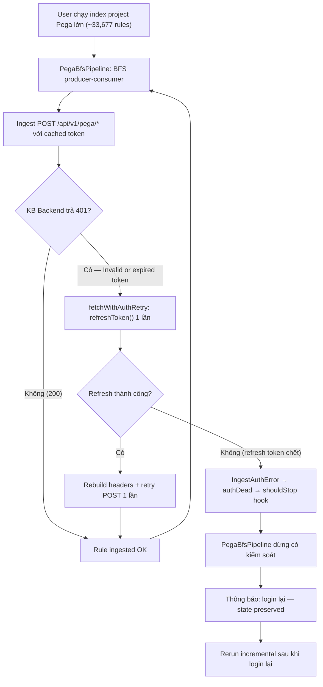
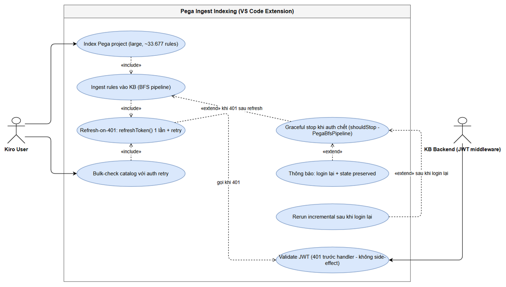
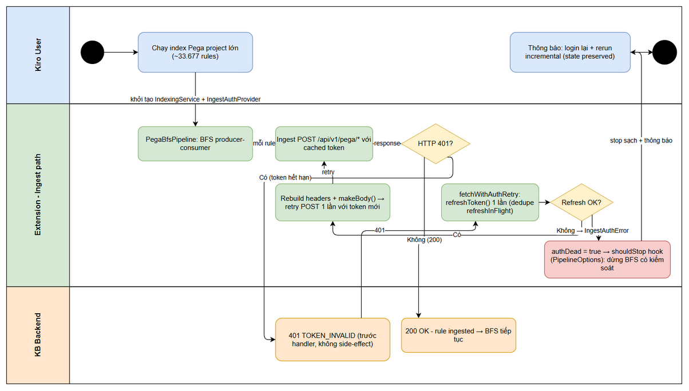
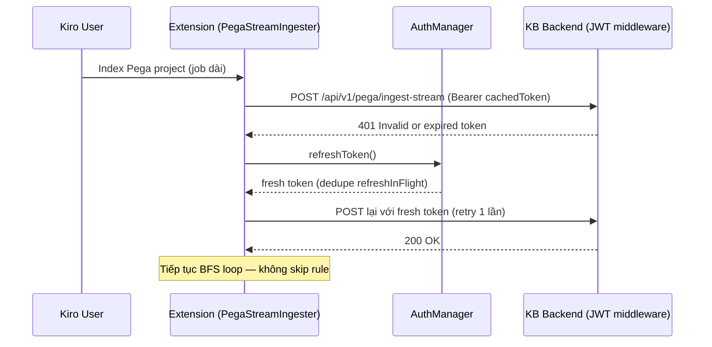

# Business Requirements Document (BRD)

## SDLC Agents 4 Enterprise — SA4E-362: [Pega Ingest] Invalid or expired token — ingest path thiếu refresh-on-401 khi access JWT hết hạn giữa job dài

---

## Document Information

| Field | Value |
|-------|-------|
| Jira Ticket | SA4E-362 |
| Title | [Pega Ingest] Invalid or expired token - ingest path thieu refresh-on-401 khi access JWT het han giua job dai |
| Type / Priority | Bug / High |
| Author | BA Agent |
| Version | 1.0 |
| Date | 2026-10-15 |
| Status | Draft |
| Branch | SA4E-362 (checked out from main) |

> **Nguồn dữ liệu:** Nội dung BRD được tổng hợp từ `SessionTimeout-FIX-PLAN.md` (repo root), phân tích đã verify của dev-agent + qa-agent (RUN-LOG SA4E-362 #1), và `documents/SA4E-362/STATUS.json`. Jira MCP hiện trả 404 cho các issue SA4E (kể cả SA4E-99/SA4E-300 đã hoàn tất) nên metadata Jira (reporter, assignee, status) không đọc được — các trường này đánh dấu "không có thông tin từ Jira". Link SA4E-99, SA4E-300 được SM ghi qua comment trên ticket (RUN-LOG #2).

---

## Author Tracking

| Role | Name - Position | Responsibility |
|------|-----------------|----------------|
| Author | BA Agent – Business Analyst | Create document |
| Peer Reviewer | SM Agent – Scrum Master | Review document (L3 mode) |

---

## Revision History

| Version | Date | Author | Changes |
|---------|------|--------|---------|
| 1.0 | 2026-10-15 | BA Agent | Initiate document — tổng hợp từ SessionTimeout-FIX-PLAN.md + phân tích dev/qa agent (SA4E-362) |

---

## Sign-Off

| Name | Signature and date |
|------|--------------------|
| | ☐ I agree and confirm all criteria on this BRD as expected requirements |
| | ☐ I agree and confirm all criteria on this BRD as expected requirements |

---
## 1. Introduction

### 1.1 Scope

**Vấn đề (Problem Statement):** Khi ingest một project Pega lớn (~33.677 rules) vào KB backend, job chạy rất lâu. Access JWT hết hạn giữa chừng job. Ingest path (`PegaStreamIngester` → `PegaBfsIndexer` → `PegaCatalogIndexer`/`PegaProjectIndexer`, wired từ `IndexingService`) chỉ dùng token tĩnh `getTokenSync()` (snapshot cached trong `AuthManager`, không bao giờ refresh) và **không có cơ chế refresh-on-401**. Kết quả:

- Mọi ingest POST sau thời điểm token hết hạn bị KB backend từ chối HTTP 401 `Invalid or expired token` (lỗi phát từ **JWT middleware của KB backend**, không phải từ Pega).
- Lỗi 401 bị nuốt trong catch block → rule bị **skip âm thầm hàng loạt**: ước tính **25k+ rules bị skip mỗi run** khi token hết hạn giữa job.
- Bulk-check catalog cũng dính 401 (`[Catalog] ⚠️ Bulk-check failed (bulk-check HTTP 401 Unauthorized)`) do `BackendHttpPoster`/`BulkCheckClient` dùng token tĩnh → phải **re-fetch toàn bộ catalog**.

Download path (`IndexerHttpClient`) đã có pattern refresh-on-401 chuẩn, proven qua SA4E-99 và SA4E-300 — nhưng ingest path chưa được áp dụng (bất đối xứng giữa 2 path).

**Phạm vi sửa (in scope):**

1. **Refresh-on-401 + retry một lần** cho toàn bộ HTTP call trên ingest path: `submitJob()` (POST `/api/v1/pega/ingest-stream`, stream NDJSON — body phải dựng lại được qua factory), `pollUntilComplete()` (GET `/api/v1/pega/jobs/:id` — rebuild headers mỗi request), `ingestSingleRule()` (POST `/api/v1/pega/ingest-rule`, JSON replay-able).
2. **Auth contract thống nhất:** interface `IngestAuthProvider` (`getTokenSync()` + `refreshToken(): Promise<string | undefined>`) thay cho `{ getTokenSync(): string }` rời rạc; adapter tại call site (pattern `CommandRegistrar.ts`) giữ nguyên chữ ký công khai của `AuthManager`.
3. **Graceful auth-dead stop:** khi refresh thất bại (refresh token chết), raise **typed `IngestAuthError`** (thay regex brittle), set `authDead`, và dừng BFS loop **qua stop-hook `shouldStop` trong `PipelineOptions` của `PegaBfsPipeline`** (producer-consumer) — flag trên `PegaBfsIndexer` đơn lẻ không thể dừng pipeline. Không auto-login; thông báo rõ "hãy login lại rồi chạy lại (state preserved, rerun incremental)".
4. **Bulk-check refresh-on-401:** `BackendHttpPoster`/`BulkCheckClient` nhận auth provider đầy đủ và áp dụng refresh-retry một lần cho POST bulk-check.
5. **Phủ các static-token path còn sót:** `PegaBackendClient` (crawl-plan/crawl-batch/check-rule), `PegaCodeIntelDiscovery`, `PegaSchemaIndexer` (hiện **thiếu hẳn Authorization header**); khuyến nghị dùng `BackendHttpPoster` (bulk-check) làm nền tảng chung.
6. **Wiring tại `IndexingService`:** tạo `IngestAuthProvider` đầy đủ (getTokenSync + refreshToken qua `refreshTokenFn`, giữ `this.token` đồng bộ — SA4E-300 GAP 4).

### 1.2 Out of Scope

| # | Item | Lý do loại |
|---|------|-----------|
| 1 | **Auto-login** khi refresh token chết | Quyết định thiết kế: chỉ dừng sạch + báo user login lại; tránh gửi credential tự động không kiểm soát |
| 2 | Thay đổi JWT backend (`jwt-auth.ts`, `LocalHS256Verifier`) hoặc TTL policy | Lỗi nằm ở client (ingest path), không ở backend; middleware hoạt động đúng |
| 3 | Redesign `AuthManager` timer nền (`scheduleAccessRefresh`/`TokenRefreshTimer`) | Timer vẫn giữ nguyên làm nền; fix bổ sung refresh **theo nhu cầu khi 401** + retry |
| 4 | Thay đổi download path (`IndexerHttpClient`) | Đã có pattern chuẩn proven (SA4E-99, SA4E-300) — chỉ tái sử dụng |
| 5 | Thay đổi giao thức ingest (NDJSON streaming) hoặc API backend | Không thuộc nguyên nhân gốc |

### 1.3 Preliminary Requirement

1. Refresh token còn hiệu lực tại thời điểm chạy job (session hợp lệ); nếu refresh token chết thì luồng graceful stop (US-2) xử lý.
2. State local index đã preserve và ingest backend **idempotent** — đảm bảo rerun sau khi login lại là incremental, không re-ingest rules đã xong.
3. KB backend trả 401 từ JWT middleware **trước khi vào handler** (`HttpServer.ts:111-119`) — đã verify — nên retry POST sau refresh là an toàn, không có side-effect trùng lặp.
4. Branch `SA4E-362` checked out; môi trường build/test extension hoạt động (`npm test`, Vitest).

---
## 2. Business Requirements

### 2.1 High Level Process Map

Quy trình nghiệp vụ index project Pega vào KB, thể hiện nhánh token hết hạn giữa job dài (điểm lỗi hiện tại) và hành vi sau fix (refresh-retry / graceful stop):

**Use Case Diagram** — actor chính là Kiro User, hệ thống tiếp nhận là KB Backend (JWT middleware):

*[Edit in draw.io](diagrams/use-case.drawio)*

**Business Flow / Swimlane** — luồng chi tiết qua 3 lane (Kiro User / Extension ingest path / KB Backend):

*[Edit in draw.io](diagrams/business-flow.drawio)*

**Điểm khác biệt trước/sau fix (high level):**

| Khía cạnh | Trước fix | Sau fix |
|-----------|-----------|---------|
| Token cho ingest POST | `getTokenSync()` — cached snapshot, không check hết hạn | `IngestAuthProvider`: sync token cho lần đầu + `refreshToken()` khi 401 |
| 401 giữa job | Nuốt lỗi → skip rule hàng loạt (25k+) | Refresh 1 lần → retry → tiếp tục; refresh chết → dừng sạch |
| Dừng khi auth chết | Không có — BFS chạy tiếp, skip toàn bộ phần còn lại | Stop-hook `shouldStop` của `PegaBfsPipeline` (producer-consumer) |
| Bulk-check | 401 → full catalog re-fetch | Refresh-retry 1 lần; refresh chết → dừng theo auth-dead |
| Phát hiện lỗi auth | Regex trên message (brittle, 4 format) | Typed `IngestAuthError` |

---

### 2.2 List of User Stories / Use Cases

| # | Story / Use Case | Priority | Source Ticket |
|---|------------------|----------|---------------|
| 1 | US-1: Là Kiro user index project Pega lớn, tôi muốn ingest path tự refresh token khi backend trả 401 giữa job và retry đúng một lần để job tiếp tục, nên không còn rule nào bị skip hàng loạt vì "Invalid or expired token" | MUST HAVE | SA4E-362 |
| 2 | US-2: Là Kiro user, tôi muốn job dừng có kiểm soát khi refresh token đã chết kèm thông báo "hãy login lại rồi chạy lại (state preserved)" để không lãng phí hàng giờ skip 25k+ rules và rerun được incremental | MUST HAVE | SA4E-362 |
| 3 | US-3: Là Kiro user, tôi muốn bulk-check catalog tự refresh-on-401 và retry để không còn spam "bulk-check HTTP 401" và không phải re-fetch toàn bộ catalog | MUST HAVE | SA4E-362 |
| 4 | US-4: Là maintainer, tôi muốn mọi call tới `/api/v1/pega/*` đi qua một contract `IngestAuthProvider` duy nhất với refresh-on-401, để không còn static-token path nào tái tạo lại bug này | SHOULD HAVE | SA4E-362 |

---
### 2.3 Details of User Stories

---

#### Business Flow

**Step 1:** User khởi chạy index một project Pega lớn (~33.677 rules) từ VS Code extension (Kiro).

**Step 2:** `IndexingService` dựng `IngestAuthProvider` (wiring) và khởi tạo `PegaCatalogIndexer`/`PegaProjectIndexer` → `PegaBfsIndexer` → `PegaStreamIngester`.

**Step 3:** `PegaBfsPipeline` (producer-consumer) duyệt BFS: với mỗi rule — download từ Pega (HTTP 200 bình thường qua `IndexerHttpClient`), rồi ingest vào KB backend.

**Step 4:** Ingest POST gửi với Authorization Bearer lấy từ cached token.

**Step 5:** KB backend JWT middleware kiểm tra token. Nếu còn hạn → 200, rule ingested. Nếu hết hạn → 401 `TOKEN_INVALID` "Invalid or expired token" — phát **trước khi vào handler**, không side-effect.

**Step 6 (sau fix):** `fetchWithAuthRetry` bắt 401 → `refreshToken()` **đúng một lần** (dedupe bởi `AuthManager.refreshInFlight` nếu nhiều call song song) → dựng lại headers (và stream body qua `makeBody()` factory nếu là `submitJob`) → retry **một lần**.

**Step 7:** Retry thành công → tiếp tục BFS loop như thường.

**Step 8 (nhánh auth chết):** Refresh thất bại (`refreshToken()` trả `undefined`) hoặc retry vẫn 401 → raise typed `IngestAuthError` → `authDead = true` → stop-hook `shouldStop` (`PipelineOptions`) dừng producer phát việc mới, consumer hoàn tất item đang chạy → **dừng có kiểm soát**, thông báo user "hãy login lại rồi chạy lại (state preserved)".

**Step 9:** User login lại → rerun → **incremental** (local index đã backfill; rules đã ingest không chạy lại).

> **Note:** Không auto-login ở bất kỳ bước nào. Retry chỉ đúng một lần — không retry vô hạn. GET poll (`pollUntilComplete`) idempotent; POST single-rule replay-able (JSON); stream phải dựng lại body qua factory mới retry được.

---
#### STORY 1 (US-1): Ingest auto-refresh-on-401 và tiếp tục giữa job dài

> **As a** Kiro user indexing a large Pega project, **I want** the ingest path to automatically refresh the access token when the KB backend returns 401 mid-job and retry the request once, **so that** ingestion continues and no rules are silently skipped with "Invalid or expired token".

**Requirement Details:**

1. `PegaStreamIngester` nhận `IngestAuthProvider` (thay `{ getTokenSync(): string }`): `getTokenSync()` cho lần gửi đầu, `refreshToken()` khi gặp 401.
2. Helper `fetchWithAuthRetry(send)` áp dụng cho cả 3 call site: `submitJob()` (POST `/api/v1/pega/ingest-stream`), `pollUntilComplete()` (GET `/api/v1/pega/jobs/:id`), `ingestSingleRule()` (POST `/api/v1/pega/ingest-rule`).
3. `submitJob()`: body NDJSON là `ReadableStream` không thể replay sau khi consume → tách thành factory `makeBody()`, gọi lại trong lần retry.
4. `pollUntilComplete()`: hiện build headers **một lần trước vòng while** → phải rebuild per-request với token mới.
5. Refresh được dedupe ở `AuthManager.refreshInFlight` — nhiều call 401 song song chỉ tạo đúng một refresh network call.

**Data Fields (auth contract):**

| Field | Type | Required | Description | Example |
|-------|------|----------|-------------|---------|
| `getTokenSync()` | `() => string` | Yes | Token hiện tại từ cache (có thể rỗng) — dùng cho lần gửi đầu | `"eyJhbGciOiJIUzI1NiIs..."` |
| `refreshToken()` | `() => Promise<string \| undefined>` | Yes | Rotate access token qua refresh_token; trả token mới hoặc `undefined` nếu refresh thất bại / phiên chết | token mới hoặc `undefined` |

**Acceptance Criteria (Given/When/Then):**

1. **Given** access token còn hạn, **When** ingest POST được gửi, **Then** request dùng cached token, không có lời gọi refresh.
2. **Given** access JWT hết hạn giữa job, **When** ingest POST trả 401 `Invalid or expired token`, **Then** hệ thống gọi `refreshToken()` đúng một lần, dựng lại headers/body, retry một lần với token mới — rule được ingest thành công (200), loop tiếp tục.
3. **Given** nhiều ingest call gặp 401 song song, **When** tất cả cùng cần refresh, **Then** chỉ có đúng một refresh network call (dedupe `refreshInFlight`), các call dùng chung token mới.
4. **Given** `submitJob()` stream upload cần retry, **When** refresh thành công, **Then** stream body được dựng lại qua `makeBody()` factory và retry đúng một lần.
5. **Given** `pollUntilComplete()` đang poll job, **When** GET trả 401, **Then** headers được rebuild per-request với token mới rồi retry — poll tiếp tục bình thường.
6. **Given** mọi bước trên, **Then** log ghi rõ điểm refresh (không log giá trị token).

**Validation Rules:**

- Retry đúng **một** lần cho mỗi request gặp 401; không retry vô hạn.
- Nếu `refreshToken()` trả `undefined` → không retry, trả 401 gốc cho caller xử lý (US-2 tiếp quản).
- Không tự động login lại trong ingester; token chỉ lấy từ `AuthManager` (single source of truth).

**Error Handling:**

- 401 + refresh thành công: retry 1 lần → tiếp tục.
- 401 + refresh thất bại: propagate lỗi auth lên `PegaBfsIndexer` (US-2), rule hiện tại trả `{ ingested: false }` (giữ eligible cho run sau).
- Lỗi network/5xx khác: giữ hành vi hiện tại, không nằm trong scope 401-refresh.

**Sequence (sau fix):**

---
#### STORY 2 (US-2): Graceful stop khi refresh token đã chết + rerun incremental

> **As a** Kiro user, **I want** the ingest job to stop in a controlled way when the refresh token is dead (401 persists after refresh), with a clear "please login again" notification, **so that** I do not waste hours silently skipping 25k+ rules and can rerun incrementally after logging back in.

**Requirement Details:**

1. `PegaStreamIngester` đã tự refresh-retry một lần (US-1); nếu vẫn 401 nghĩa là **phiên thực sự chết** → không tiếp tục ingest hàng nghìn rule nữa (tất cả sẽ fail).
2. Phát hiện lỗi auth bằng **typed `IngestAuthError`** (thay regex trên message — regex hiện miss "HTTP 401" với body rỗng và 4 format message khác nhau).
3. `PegaBfsIndexer.ingestAndDiscover` khi nhận `IngestAuthError`: set `authDead = true`, rule hiện tại trả `{ ingested: false }` (giữ eligible cho run sau).
4. BFS loop nằm trong `PegaBfsPipeline` (producer-consumer) — flag trên indexer đơn lẻ **không đủ** để dừng → cần **stop-hook `shouldStop` trong `PipelineOptions`**: producer ngừng phát việc mới, consumer hoàn tất item đang chạy rồi dừng.
5. Thông báo rõ cho user: "Auth hết hạn và refresh thất bại — hãy login lại rồi chạy lại; state đã preserve, lần chạy sau là incremental".
6. **Không auto-login.** State local preserved → rerun incremental an toàn.

**Acceptance Criteria (Given/When/Then):**

1. **Given** refresh token đã chết (refresh thất bại hoặc retry vẫn 401), **When** ingester trả lỗi auth lên `PegaBfsIndexer.ingestAndDiscover`, **Then** typed `IngestAuthError` được nhận diện (không qua regex), `authDead = true`.
2. **Given** `authDead = true`, **When** `PegaBfsPipeline` chạy, **Then** stop-hook `shouldStop` khiến producer ngừng phát item mới; consumer hoàn tất item đang chạy và dừng — **không** skip từng rule còn lại với log lỗi hàng loạt.
3. **Given** job dừng vì auth chết, **Then** user thấy đúng **một** thông báo rõ ràng: "hãy login lại rồi chạy lại (state preserved, rerun incremental)" — không spam lỗi.
4. **Given** user login lại và rerun, **When** job chạy, **Then** rerun là **incremental**: rules đã ingest trước đó không re-ingest, chỉ xử lý phần còn lại.
5. **Given** bulk-check hoặc các call song song khác cũng đang gặp 401, **When** auth chết, **Then** chúng dừng sạch theo cùng trạng thái auth-dead, không tự fallback re-fetch.

**Validation Rules:**

- Dừng ngay sau item đang chạy; số rule skip trước khi dừng ≈ 0 (chỉ item in-flight).
- Không có lời gọi login tự động; không lưu/tự điền credential.
- `shouldStop` được check tại điểm phát việc của producer (producer-consumer contract).

**Error Handling:**

- Typed `IngestAuthError` là tín hiệu duy nhất để phân biệt lỗi auth với lỗi thường (network/5xx xử lý như hiện tại).
- Job dừng sạch, trạng thái local index được flush/preserve trước khi thoát.

---
#### STORY 3 (US-3): Bulk-check refresh-on-401

> **As a** Kiro user, **I want** catalog bulk-check (`BackendHttpPoster`/`BulkCheckClient`) to refresh-on-401 and retry once, **so that** bulk-check no longer fails with "bulk-check HTTP 401" and does not force a full catalog re-fetch.

**Requirement Details:**

1. Log hiện tại: `[Catalog] ⚠️ Bulk-check failed (bulk-check HTTP 401 Unauthorized)` → bulk-check dùng token tĩnh → 401 → hệ thống phải **re-fetch toàn bộ catalog** (tốn thời gian + traffic).
2. `BackendHttpPoster` (nền tảng chung cho bulk-check) nhận `IngestAuthProvider` (hoặc `tokenRefresher`) thay vì chỉ `() => string`, áp dụng refresh-retry **một lần** cho POST bulk-check.
3. `PegaCatalogIndexer` (~line 143) truyền provider đầy đủ xuống `BulkCheckClient`/`BackendHttpPoster` (giữ `getTokenSync()` cho lần đầu).
4. Khi refresh chết → bulk-check dừng theo trạng thái auth-dead của job (US-2), **không** tự fallback full catalog re-fetch giữa phiên auth chết.

**Acceptance Criteria (Given/When/Then):**

1. **Given** bulk-check POST trả 401 vì token hết hạn, **When** refresh thành công, **Then** bulk-check retry đúng một lần với token mới → thành công; log **không còn** "bulk-check HTTP 401 Unauthorized" spam.
2. **Given** refresh token chết, **When** bulk-check gặp 401, **Then** bulk-check dừng sạch theo auth-dead (US-2), không re-fetch catalog.
3. **Given** retry bulk-check POST, **Then** an toàn (401 phát từ JWT middleware trước handler, không side-effect).

**Validation Rules:**

- Retry đúng một lần; refresh dedupe chung với ingest path.
- Không retry khi refresh trả `undefined`.

---

#### STORY 4 (US-4): Một contract auth duy nhất — không còn static-token path

> **As a** maintainer, **I want** all calls to `/api/v1/pega/*` to go through a single `IngestAuthProvider` contract with refresh-on-401, **so that** no static-token path remains that could reintroduce this bug.

**Requirement Details:**

1. Interface `IngestAuthProvider` (`getTokenSync()` + `refreshToken(): Promise<string | undefined>`) là contract duy nhất cho ingest path; adapter tại call site giữ nguyên chữ ký công khai của `AuthManager` (pattern `CommandRegistrar.ts`).
2. Các class áp dụng: `PegaStreamIngester`, `PegaBfsIndexer`, `PegaCatalogIndexer`, `PegaProjectIndexer`, `BulkCheckClient`/`BackendHttpPoster`.
3. **Phủ các static-token path còn sót (đã verify):**
   - `PegaBackendClient` (crawl-plan / crawl-batch / check-rule)
   - `PegaCodeIntelDiscovery`
   - `PegaSchemaIndexer` (hiện **thiếu hẳn Authorization header**)
   - Khuyến nghị: chuẩn hóa qua `BackendHttpPoster` (bulk-check) làm nền chung.
4. Wiring tại `IndexingService`: tạo `IngestAuthProvider` đầy đủ (getTokenSync + refreshToken qua `refreshTokenFn`, giữ `this.token` đồng bộ — SA4E-300 GAP 4).
5. Audit: không còn call site nào tự dựng `Authorization` từ `getTokenSync()` mà không qua `fetchWithAuthRetry` (ngoại trừ nội bộ `AuthManager`).

**Acceptance Criteria (Given/When/Then):**

1. **Given** toàn bộ call tới `/api/v1/pega/*`, **Then** đều đi qua provider có refresh-on-401; grep/audit không tìm thấy static-token path còn sót.
2. **Given** `PegaSchemaIndexer`, **When** gửi request, **Then** request có Authorization header (trước đây thiếu hẳn) và refresh-on-401.
3. **Given** regression suite, **When** `npm test` chạy, **Then** xanh — đặc biệt `auth-manager.test.ts`, `token-refresh-timer.test.ts`, `http-client.test.ts` + unit tests mới cho refresh-retry (13 test cases đề xuất từ phân tích).

**Validation Rules:**

- Một contract duy nhất; không duplicate logic refresh ở nhiều nơi.
- Không hardcode token, không fallback token ngoài `AuthManager`.

---
#### 2.4 Success Metrics (business-level acceptance criteria)

| # | Metric | Target |
|---|--------|--------|
| SM-1 | Số lần lặp lại "Invalid or expired token" **sau** điểm refresh trong một run | **0** (refresh + retry xử lý xong ngay lần đầu) |
| SM-2 | Số rule bị **silent skip** do auth trong run token hết hạn giữa job (log "Ingest POST failed (skipping)" do auth) | **0** (từ ~25k+ rules/run xuống 0; tối đa chỉ item in-flight khi dừng) |
| SM-3 | Khi refresh token chết: thời gian từ 401 xác nhận auth chết đến khi job dừng | Dừng ngay sau item đang chạy (vài giây), đúng **1** thông báo "login lại", không spam lỗi |
| SM-4 | Rerun sau khi login lại | **Incremental**: rules đã ingest không re-ingest; run mới hoàn tất phần còn lại |
| SM-5 | "bulk-check HTTP 401" occurrences trong một run bình thường (token có refresh được) | **0**; không còn full catalog re-fetch do 401 |
| SM-6 | Static-token path còn lại trên `/api/v1/pega/*` (audit grep) | **0** |
| SM-7 | Regression | `npm test` (extension) xanh; unit tests refresh-retry mới pass |

---

## 3. Dependencies

| Dependency | Type | Related Ticket | Description |
|------------|------|----------------|-------------|
| `AuthManager` + `refreshInFlight` | System | SA4E-362 | Nguồn token duy nhất; dedupe refresh song song đã có sẵn — contract mới bọc qua adapter, không đổi chữ ký công khai |
| Pattern refresh-on-401 của `IndexerHttpClient` | System | SA4E-99 | Pattern proven (setTokenRefresher → 401 → refresh → retry 1 lần → notifyTokenRefreshed) — tái sử dụng cho ingest path |
| `refreshTokenFn` trong `IndexingService` | System | SA4E-300 | Đã có từ SA4E-300 (GAP 4: giữ `this.token` đồng bộ) — dùng để dựng `IngestAuthProvider` tại wiring |
| KB backend JWT middleware behavior | Infrastructure | SA4E-362 | 401 phát **trước** handler (`HttpServer.ts:111-119`) → retry POST an toàn, không duplicate ingestion (đã verify) |
| `PegaBfsPipeline` producer-consumer | System | SA4E-362 | BFS loop nằm ở pipeline — stop-hook `shouldStop` trong `PipelineOptions` là điều kiện bắt buộc để dừng sớm có kiểm soát |
| State preservation + idempotent ingest | System | SA4E-362 | Local index backfill + ingest idempotent để rerun incremental an toàn sau auth-dead stop |
| Môi trường build/test extension | Infrastructure | N/A | Vitest (`npm test`), build extension để regression |

---

## 4. Stakeholders

| Role | Name / Team | Responsibility | Source |
|------|-------------|----------------|--------|
| Kiro User (Pega developer/BA) | End user | Chạy index project Pega; login lại khi auth chết; rerun | Use case chính |
| Scrum Master | SM Agent | Điều phối pipeline SDLC, tạo ticket, human gate | RUN-LOG SA4E-362 #2, #3 |
| Dev Agent | DEV | Implement fix theo fix plan + BRD | RUN-LOG #1 (phân tích song song) |
| QA Agent | QA | Test planning + kiểm thử (13 test cases đề xuất) | RUN-LOG #1 |
| KB Backend team | Platform | JWT middleware (không đổi trong scope này) | SessionTimeout-FIX-PLAN.md §2 |

> Metadata Jira (reporter/assignee/watcher) không đọc được lúc tạo BRD (Jira MCP trả 404 cho issue SA4E) — sẽ bổ sung khi khả dụng.

---
## 5. Risks and Assumptions

### 5.1 Risks

| Risk | Impact | Likelihood | Mitigation |
|------|--------|------------|------------|
| Stream body NDJSON không replay được khi retry (`ReadableStream` đã consume) | High | High (hiện trạng) | Factory `makeBody()` dựng lại stream trong mỗi lần send (fix plan §4.2.1); unit test assert body dựng lại 2 lần khi retry |
| Stop-hook thiếu → flag `authDead` trên indexer không dừng được BFS pipeline (producer-consumer) | High | High (nếu bỏ qua) | Bắt buộc `shouldStop` trong `PipelineOptions` của `PegaBfsPipeline` (phân tích dev/qa — điều chỉnh bắt buộc #1) |
| Regex phát hiện lỗi auth miss format ("HTTP 401" body rỗng, 4 format message) | Medium | High (hiện trạng) | Typed `IngestAuthError` duy nhất (điều chỉnh bắt buộc #2); unit test cho các biến thể message |
| Refresh race: nhiều 401 song song tạo nhiều refresh network call → token mới bị rotate lẫn nhau | Medium | Medium | `AuthManager.refreshInFlight` dedupe đã có; unit test confirm đúng 1 refresh call |
| Token hết hạn ngay **giữa** stream upload (sau khi mở stream) | Medium | Medium | Refresh **trước khi mở stream** nếu token sắp hết hạn + retry với `makeBody()` mới (fix plan §4.2.1) |
| Retry POST gây duplicate ingestion | Medium | Low | Đã verify: 401 phát từ JWT middleware **trước** handler (`HttpServer.ts:111-119`) → request 401 không side-effect → retry an toàn |
| Rerun sau auth-dead không incremental (state bị mất) | High | Low | Đã verify state preserve + idempotent ingest; kiểm thử rerun incremental (SM-4) |
| Đổi contract auth làm vỡ các call site hiện có | Medium | Medium | Adapter pattern giữ nguyên chữ ký công khai `AuthManager`; regression `npm test` |

### 5.2 Assumptions

- Refresh token còn hiệu lực trong phần lớn thời gian job; trường hợp refresh chết được xử lý bởi luồng graceful stop (US-2), không cố tự phục hồi.
- KB backend không đổi hành vi JWT middleware trong thời gian implement (401 trả trước handler, message `Invalid or expired token`).
- Ingest backend idempotent — retry/re-ingest cùng rule không tạo duplicate dữ liệu.
- Access token TTL không rút ngắn đáng kể (timer nền `scheduleAccessRefresh` vẫn hoạt động như lớp chủ động thứ nhất).

---

## 6. Non-Functional Requirements

| Category | Requirement | Details |
|----------|-------------|---------|
| Performance | Refresh chỉ xảy ra khi cần (on 401) và đúng một lần per request | Không thêm latency khi token còn hạn; refresh dedupe tránh thundering herd |
| Reliability | 0 silent skip do auth; job dài chạy trọn vẹn với token được rotate | SM-1, SM-2 |
| Security | Không log giá trị token; không auto-login; token chỉ từ `AuthManager` (single source of truth) | Fix plan §8 — không hardcode, không fallback token |
| Observability | Log rõ: điểm 401, điểm refresh, điểm retry, điểm dừng auth-dead | Thông báo user rõ ràng, đúng 1 lần |
| Scalability | Hoạt động với project ~33.677 rules; BFS producer-consumer dừng sạch với hàng chục nghìn item pending | Stop-hook không làm treo consumer |
| Maintainability | Một contract `IngestAuthProvider` duy nhất cho ingest path | US-4 — audit 0 static-token path |

---

## 7. Related Tickets

| Ticket Key | Summary | Status | Type | Relationship |
|------------|---------|--------|------|--------------|
| SA4E-362 | [Pega Ingest] Invalid or expired token — ingest path thiếu refresh-on-401 | Open (không đọc được từ Jira lúc tạo BRD) | Bug | Main ticket |
| SA4E-99 | Refresh-on-401 cho download path (`IndexerHttpClient`) | Đã hoàn tất (theo fix plan; không đọc được từ Jira) | Fix/Story | Pattern nguồn — tái sử dụng cho ingest path |
| SA4E-300 | `IndexingService` token + `refreshTokenFn` đồng bộ (GAP 4) | Đã hoàn tất (theo fix plan; không đọc được từ Jira) | Fix/Story | Cung cấp hạ tầng wiring cho `IngestAuthProvider` |

> Link giữa SA4E-362 và SA4E-99/SA4E-300 được SM ghi qua **comment trên ticket** (RUN-LOG #2 — field issuelinks không hỗ trợ).

---
## 8. Appendix

### 8.1 Root Cause Summary (với bằng chứng file:line)

"Invalid or expired token" **không đến từ Pega** — do JWT middleware của KB backend phát ra khi access JWT hết hạn giữa job dài. Ingest path dùng token tĩnh và không có refresh-retry:

| # | Vị trí | Bằng chứng | Vấn đề |
|---|--------|-----------|--------|
| 1 | `backend/src/server/middleware/jwt-auth.ts` | `isExpired(payload)` → `unauthorized('TOKEN_INVALID', 'Invalid or expired token')` | Nguồn 401 khi token hết hạn |
| 2 | `backend/src/server/middleware/verifiers/LocalHS256Verifier.ts` | `token_expired` | Verifier xác nhận token hết hạn |
| 3 | `backend/src/server/http/HttpServer.ts:111-119` | 401 emitted **trước** khi vào handler | Retry POST an toàn — không side-effect (đã verify) |
| 4 | `extension/src/auth/AuthManager.ts` | `getTokenSync(): string { return this.cachedToken \|\| ""; }` | Snapshot bộ nhớ — không bao giờ refresh |
| 5 | `extension/src/services/PegaStreamIngester.ts` | 3 call site (`submitJob`, `pollUntilComplete`, `ingestSingleRule`): `const token = this.authManager?.getTokenSync(); headers['Authorization'] = ...` | Đọc token một lần, đồng bộ, không check hết hạn trước mỗi POST |
| 6 | `extension/src/services/PegaStreamIngester.ts` — `pollUntilComplete` | Build headers **một lần trước vòng while** | Phải rebuild per-request |
| 7 | `extension/src/services/PegaBfsIndexer.ts` — `ingestAndDiscover` catch block | `log('❌ Ingest POST failed (skipping): ' + err.message)` → `return { ingested: false, relatives: [] }` | Nuốt lỗi 401 → skip hàng loạt (25k+ rules) |
| 8 | `extension/src/services/PegaBfsPipeline` | BFS loop producer-consumer | Flag trên indexer đơn lẻ không đủ dừng — cần stop-hook `shouldStop` trong `PipelineOptions` |
| 9 | `extension/src/services/PegaCatalogIndexer.ts` (~line 143) | `tokenProvider` = `getTokenSync` cho `BulkCheckClient`/`BackendHttpPoster` | Bulk-check 401 → full catalog re-fetch |
| 10 | `extension/src/services/IndexingService.ts` | Wiring `{ getTokenSync: () => this.currentToken() }` | Contract quá hẹp — thiếu `refreshToken()` |
| 11 | `extension/src/services/PegaBackendClient.ts` | crawl-plan / crawl-batch / check-rule | Static-token path còn sót (missed) |
| 12 | `extension/src/services/PegaCodeIntelDiscovery.ts` | discovery call | Static-token path còn sót (missed) |
| 13 | `extension/src/services/PegaSchemaIndexer.ts` | request không có Authorization | **Thiếu hẳn** auth header (missed) |
| 14 | `extension/src/services/PegaBfsIndexer.ts` — auth detection | Regex `/invalid or expired token\|unauthorized\|TOKEN_INVALID/i` trên message | Brittle — miss "HTTP 401" body rỗng và 4 format message → thay bằng typed `IngestAuthError` |
| 15 | `extension/src/services/IndexerHttpClient.ts` | `setTokenRefresher` + 401 → refresh → retry 1 lần → `notifyTokenRefreshed` | Pattern chuẩn proven (SA4E-99, SA4E-300) — mẫu để tái sử dụng |

**Vì sao timer refresh có sẵn không cứu:** `AuthManager.scheduleAccessRefresh()` (refresh tại 70% lifetime) + `TokenRefreshTimer` vẫn cập nhật `cachedToken`. Nhưng ingester đọc `getTokenSync()` tại thời điểm gửi: request bay ngay sau khi token hết hạn và trước khi timer kịp xoay (hoặc cả loạt request dùng chung snapshot cũ) → 401 vẫn xảy ra và **không có retry**. Cần refresh **theo nhu cầu khi 401** + retry, ngoài timer nền.

### 8.2 Glossary

| Term | Definition |
|------|------------|
| Access JWT / Access token | Token ngắn hạn gửi trong header Authorization; hết hạn giữa job dài gây 401 |
| Refresh token | Token dài hạn dùng để lấy access token mới (rotate) qua `AuthManager.refreshToken()` |
| 401-refresh-retry | Khi backend trả 401: refresh token một lần rồi retry request đúng một lần |
| `IngestAuthProvider` | Contract mới: `getTokenSync()` + `refreshToken(): Promise<string \| undefined>` cho ingest path |
| `IngestAuthError` | Typed error đánh dấu lỗi auth đã chết sau refresh — thay regex trên message |
| BFS (Breadth-First Search) | Thuật toán duyệt relatives của rule theo chiều rộng; `PegaBfsPipeline` chạy producer-consumer |
| Stop-hook (`shouldStop`) | Callback trong `PipelineOptions` để producer kiểm tra và ngừng phát việc mới |
| Bulk-check | POST hàng loạt kiểm tra rule đã tồn tại trong KB (`/api/v1/pega/bulk-check`) qua `BackendHttpPoster` |
| Idempotent | Gửi lại request/re-ingest cùng rule không tạo duplicate dữ liệu |
| Incremental rerun | Rerun chỉ xử lý phần còn lại; rules đã ingest trước đó không chạy lại (state local preserved) |
| KB backend | Backend SDLC-Agents-4-Enterprise (Kotlin/Ktor) chứa knowledge base, xác thực bằng JWT |
| Silent skip | Rule fail 401 bị nuốt lỗi và bỏ qua không báo cáo tổng thể → dữ liệu KB thiếu âm thầm |

### 8.3 Reference Documents

| Document | Link / Location |
|----------|-----------------|
| SessionTimeout-FIX-PLAN.md (fix plan gốc — root cause, thiết kế, checklist file) | Repo root: `SessionTimeout-FIX-PLAN.md` |
| documents/SessionTimeout.md (triệu chứng gốc, log) | `documents/SessionTimeout.md` |
| STATUS.json SA4E-362 | `documents/SA4E-362/STATUS.json` |
| RUN-LOG SA4E-362 (phân tích dev/qa, ticketing) | `documents/SA4E-362/RUN-LOG.md` |
| SA4E-337 TDD (pattern ingest/backend auth tham chiếu) | KB Memory (ingested) |
| Jira ticket SA4E-362 | https://jiraassist.atlassian.net/browse/SA4E-362 (MCP đọc 404 lúc tạo BRD) |

---

*BRD v1.0 — generated by BA Agent on 2026-10-15 from SessionTimeout-FIX-PLAN.md + verified dev/qa analysis. Jira metadata unavailable (API 404) tại thời điểm tạo; nội dung nghiệp vụ đã được đối chiếu với mã nguồn theo fix plan.*
