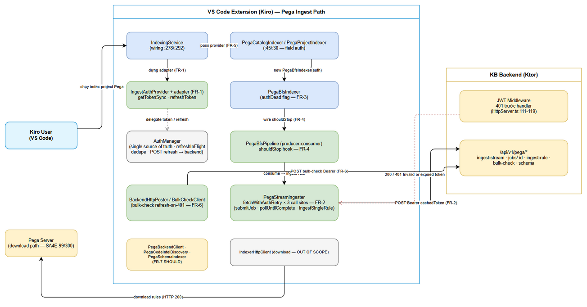
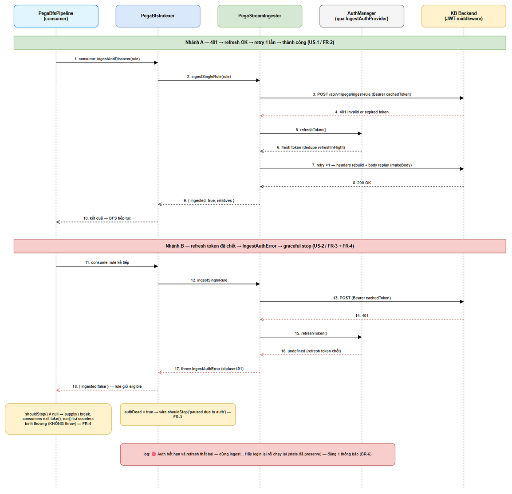
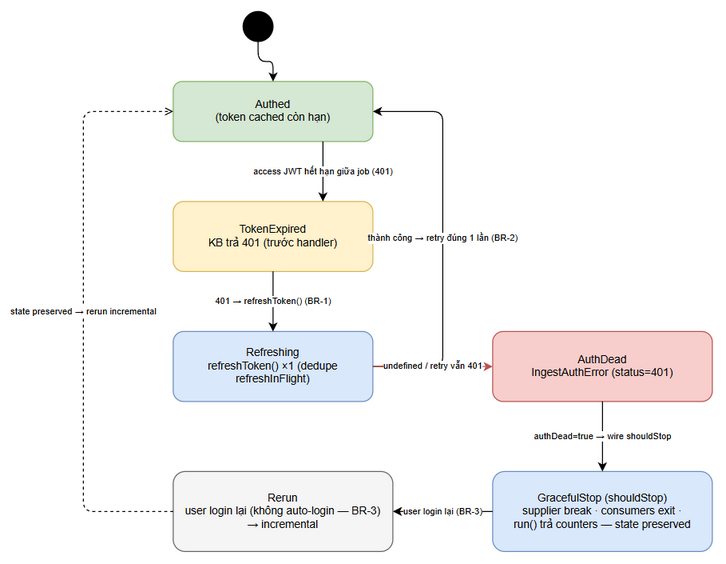

# Functional Specification Document (FSD)

## SDLC Agents 4 Enterprise — SA4E-362: [Pega Ingest] Invalid or expired token — refresh-on-401 cho ingest path

---

## Document Information

| Field | Value |
|-------|-------|
| Jira Ticket | SA4E-362 |
| Title | [Pega Ingest] Invalid or expired token — ingest path thiếu refresh-on-401 khi access JWT hết hạn giữa job dài |
| Type / Priority | Bug / High |
| Author | BA Agent (v0.9) / TA Agent (v1.0 enrichment) |
| Version | 1.0 |
| Date | 2026-10-16 |
| Status | v1.0 — TA enrichment hoàn tất (chờ review SM/SA) |
| Branch | SA4E-362 (checked out từ main; BA/TA không commit) |
| Related BRD | documents/SA4E-362/BRD.md (v1.0 — approved) |

> **Nguồn dữ liệu:** BRD v1.0 (documents/SA4E-362/BRD.md), SessionTimeout-FIX-PLAN.md (repo root), và ràng buộc kỹ thuật đã được dev-agent + qa-agent validate qua phân tích code (RUN-LOG SA4E-362 #1). Line number tham chiếu code tại branch SA4E-362 lúc 2026-10-15.

---

## Revision History

| Version | Date | Author | Changes |
|---------|------|--------|---------|
| 0.9 | 2026-10-15 | BA Agent | Draft FSD — FR-1..FR-8, BR-1..BR-6, error handling matrix, 3 diagrams (system-context, sequence-refresh-retry, state-machine-auth). Chờ TA enrichment |
| 1.0 | 2026-10-16 | TA Agent | TA enrichment (không đổi FR/BR IDs, không đổi scope): pseudocode `withAuthRetry` + 4 edge cases (FR-2); chốt class design + sửa claim regex (FR-3); tích hợp shouldStop vào producer-consumer + `BfsRunResult` (FR-4); snippet GAP-4 + thread-safety (FR-5); signature union + back-compat proof (FR-6); đặc tả per-target + audit grep (FR-7); map 16 automated tests STC v1.0 + fake timers (FR-8); ma trận lỗi per-endpoint (5.1a); observability spec (4.1); security notes (7); chốt Open Points #1-#4 (Appendix C) |

---

## 1. Introduction

### 1.1 Purpose

FSD này đặc tả **cách hoạt động chức năng (HOW)** của bản sửa lỗi SA4E-362. Hiện trạng: ingest path của VS Code extension (Kiro) gửi request tới KB backend bằng access JWT cached tĩnh (qua `getTokenSync()`) và **không có refresh-on-401**. Khi access JWT hết hạn giữa job ingest dài (~33.677 rules), mọi POST sau đó bị KB backend từ chối 401 `Invalid or expired token`, lỗi bị nuốt trong catch block → **silent-skip hàng loạt (~25k+ rules/run)**, kèm spam `bulk-check HTTP 401` buộc re-fetch toàn bộ catalog.

FSD đặc tả: (1) contract auth mới `IngestAuthProvider` + adapter tại call site; (2) cơ chế refresh-on-401 + retry đúng một lần cho mọi HTTP call trên ingest path; (3) typed `IngestAuthError` thay regex brittle; (4) dừng có kiểm soát (graceful stop) qua stop-hook `shouldStop` của `PegaBfsPipeline` khi refresh token đã chết. FSD trace 1:1 tới BRD US-1..US-4 (mục 1.5).

### 1.2 Scope (In)

1. **Contract + adapter:** interface `IngestAuthProvider { getTokenSync(): string; refreshToken(): Promise<string \| undefined> }` đặt tại `extension/src/utils/backend-auth-headers.ts` (cạnh `ITokenProvider` hiện có). `AuthManager` KHÔNG structural-match (refreshToken trả `Promise<void>`) → **adapter tại call site**, pattern `CommandRegistrar.ts:51`, giữ nguyên chữ ký công khai của `AuthManager`.
2. **Refresh-on-401 + retry một lần** cho 3 call site của `PegaStreamIngester`: `submitJob()` (~:119, body qua factory `makeBody()` để ReadableStream replay được, giữ `duplex:'half'`), `pollUntilComplete()` (~:149, headers rebuild **per-request** trong vòng while — hiện build một lần :148-150), `ingestSingleRule()` (~:212, JSON replay-safe). Retry chỉ trigger bởi **HTTP 401 response** (không phải network error — BR-1).
3. **Typed `IngestAuthError`** (kèm field `status`) khi 401 vẫn persists sau refresh-retry; `PegaBfsIndexer` bắt bằng **`instanceof`** (KHÔNG regex — regex miss "HTTP 401" với body rỗng; tồn tại 4 format message).
4. **Graceful stop:** option `shouldStop?: () => string \| null` trong `PipelineOptions` của `PegaBfsPipeline` (producer-consumer: `supply()` :115, `consume()` :161, flag `aborted` :71 hiện có). Khi stop: supplier break, channel đóng, consumer exit vòng `take()`, `run()` trả counters **bình thường** (không throw như `aborted`) để `PegaCatalogIndexer` báo "paused due to auth".
5. **Wiring `IndexingService`** (:278/:292): dựng provider từ `this.currentToken()` + `this.refreshTokenFn` (đã wired từ indexer.ts:85), cập nhật token nội bộ khi refresh — đóng GAP 4 của SA4E-300. Liên quan: `PegaCatalogIndexer` (:45 field, :120 tạo PegaBfsIndexer, :142-145 BackendHttpPoster tokenProvider), `PegaProjectIndexer` (:30 field, tạo PegaStreamIngester tại 2 điểm :117 và :348).
6. **Bulk-check refresh-on-401:** `BackendHttpPoster` (`extension/src/code-intel/delta/BackendHttpPoster.ts`, `tokenProvider?: () => string` :19) thêm refresh-on-401 single retry, **backward compatible** với chữ ký `() => string` (test `code-intel/delta/__tests__/BackendHttpPoster.test.ts:31,44,58` construct bằng plain function).
7. **SHOULD — phủ static-token path còn sót:** `PegaBackendClient` (buildBackendAuthHeaders :10-22), `PegaCodeIntelDiscovery` (:76-102), `PegaSchemaIndexer` (:92-96 — hiện **thiếu hẳn** Authorization header).
8. **Kiểm thử tự động:** 16 automated test cases (UT-01..UT-14 + PBT-01 + REG-13 — đồng bộ STC v1.0; UT-13/UT-14/PBT-01 bổ sung theo BA-review gate) — FR-8. <!-- TA enrichment: cập nhật số lượng theo STC v1.0 -->

### 1.3 Definitions & Acronyms

| Term | Definition |
|------|------------|
| `IngestAuthProvider` | Contract auth cho ingest path: `getTokenSync()` (token cached cho lần gửi đầu) + `refreshToken(): Promise<string \| undefined>` (rotate khi 401; `undefined` = phiên chết) |
| `IngestAuthError` | Typed error (kèm field `status`) báo hiệu auth đã chết sau refresh-retry — bắt bằng `instanceof`, thay regex trên message |
| `fetchWithAuthRetry(send)` | Helper `PegaStreamIngester`: gửi request; nếu HTTP 401 → refresh một lần → retry đúng một lần với token mới |
| `makeBody()` | Factory dựng lại `ReadableStream` NDJSON của `submitJob()` — bắt buộc vì stream đã consume không thể replay |
| `shouldStop` | Stop-hook trong `PipelineOptions` của `PegaBfsPipeline`; trả `string \| null` (chuỗi = lý do dừng, `null` = chạy tiếp) |
| `authDead` | Flag trên `PegaBfsIndexer` khi nhận `IngestAuthError` — kích hoạt stop-hook của pipeline |
| `refreshInFlight` | Dedupe sẵn có của `AuthManager` (:472-474): nhiều refresh song song chỉ tạo đúng một network call |
| bulk-check | POST hàng loạt kiểm tra rule đã tồn tại trong KB (`/api/v1/pega/bulk-check`) qua `BackendHttpPoster`/`BulkCheckClient` |

### 1.4 References

| Document / Code | Location |
|----------|----------|
| BRD v1.0 (approved) | documents/SA4E-362/BRD.md |
| Fix plan gốc | SessionTimeout-FIX-PLAN.md (repo root) |
| SA4E-99 — pattern refresh-on-401 download path | `extension/src/services/IndexerHttpClient.ts` (`setTokenRefresher` → 401 → refresh → retry 1 lần → `notifyTokenRefreshed`) |
| SA4E-300 — `refreshTokenFn` + GAP 4 | `extension/src/services/IndexingService.ts:27,43`; adapter pattern `CommandRegistrar.ts:51` |
| JWT middleware KB backend (401 trước handler) | `backend/src/server/HttpServer.ts:111-119` <!-- TA: sửa path — file nằm trực tiếp dưới `server/`, không có thư mục `http/` -->; `middleware/jwt-auth.ts` (401 `TOKEN_INVALID` "Invalid or expired token" :113/:118/:140; `AUTH_REQUIRED` :85/:92); `middleware/verifiers/LocalHS256Verifier.ts` |
| Code tham chiếu chính (dưới `extension/src/`) | `services/PegaStreamIngester.ts`, `services/PegaBfsIndexer.ts`, `services/PegaBfsPipeline.ts`, `services/PegaCatalogIndexer.ts`, `services/PegaProjectIndexer.ts`, `services/IndexingService.ts`, `code-intel/delta/BackendHttpPoster.ts`, `services/pega/PegaBackendClient.ts`, `services/PegaCodeIntelDiscovery.ts`, `services/PegaSchemaIndexer.ts`, `auth/AuthManager.ts` |

### 1.5 BRD Traceability Map

| BRD Story | Mô tả | FSD Requirement | Priority |
|-----------|-------|-----------------|----------|
| US-1 | Ingest tự refresh-on-401 + retry giữa job dài | FR-2 (cơ chế), FR-5 (wiring), FR-8 (test) | MUST |
| US-2 | Graceful stop khi refresh token chết + rerun incremental | FR-3 (typed error + authDead), FR-4 (stop-hook), FR-8 (test) | MUST |
| US-3 | Bulk-check refresh-on-401 | FR-6, FR-8 (test) | MUST |
| US-4 | Một contract auth duy nhất — hết static-token path | FR-1 (contract), FR-7 (static paths còn sót), FR-5 (wiring) | MUST (FR-7: SHOULD) |
| — | Kiểm thử & regression | FR-8 | MUST |

### 1.6 System Context


*[Edit in draw.io](diagrams/system-context.drawio)*

**Chuỗi component ingest path** (trong VS Code extension): `IndexingService` → dựng `IngestAuthProvider` (adapter bọc `AuthManager`) → `PegaCatalogIndexer`/`PegaProjectIndexer` → `PegaBfsIndexer` → `PegaBfsPipeline` (BFS producer-consumer) → `PegaStreamIngester` (3 HTTP call site) → KB backend `/api/v1/pega/*` (JWT middleware kiểm tra **trước** handler). Nhánh bulk-check: `PegaCatalogIndexer` → `BulkCheckClient`/`BackendHttpPoster` → KB backend. Nguồn token duy nhất: `AuthManager` (timer nền `scheduleAccessRefresh`/`TokenRefreshTimer` giữ nguyên làm lớp chủ động; fix bổ sung refresh **theo nhu cầu khi 401**). Download path (`IndexerHttpClient` → Pega Server) đã có refresh-on-401 chuẩn (SA4E-99/SA4E-300) — ngoài scope, chỉ tham chiếu.

**An toàn retry (đã verify):** 401 phát từ JWT middleware **trước khi vào handler** (`HttpServer.ts:111-119`) nên request 401 không có side-effect → retry POST an toàn, không duplicate ingestion (backend dedup thêm bằng checksum). `AuthManager.refreshToken()` không throw — refresh token chết thì `doRefresh()` gọi `clearSession()` và adapter trả `undefined`.

---

## 2. Functional Requirements

> Quy ước: **MUST** = bắt buộc trong scope fix SA4E-362; **SHOULD** = khuyến nghị mạnh. Mỗi FR có Main Flow + Alternative Flows + Exception Flows. Line number tham chiếu code tại branch SA4E-362.

### 2.1 FR-1: Contract `IngestAuthProvider` + adapter tại call site

| Attribute | Value |
|-----------|-------|
| Trace | US-4 (BRD §2.3 Story 4) |
| Priority | MUST |
| Files | `extension/src/utils/backend-auth-headers.ts` (interface mới), các call site dựng provider (FR-5) |

**Mô tả:** Định nghĩa contract auth duy nhất cho ingest path, thay các signature rời rạc `{ getTokenSync(): string }`:

```ts
export interface IngestAuthProvider {
  /** Token hiện tại từ cache (có thể rỗng). Dùng cho lần gửi đầu. */
  getTokenSync(): string;
  /** Refresh access token một lần (rotate qua refresh_token).
   *  @returns token mới, hoặc undefined nếu refresh thất bại / phiên đã chết. */
  refreshToken(): Promise<string | undefined>;
}
```

- Đặt cạnh `ITokenProvider` hiện có trong `backend-auth-headers.ts` (cùng domain auth header).
- **`AuthManager` KHÔNG structural-match** contract này: `AuthManager.refreshToken()` trả `Promise<void>` → bắt buộc **adapter tại call site** (pattern đã dùng ở `CommandRegistrar.ts:51`), giữ nguyên chữ ký công khai của `AuthManager`:

```ts
const ingestAuth: IngestAuthProvider = {
  getTokenSync: () => authManager.getTokenSync(),
  refreshToken: async () => {
    await authManager.refreshToken();
    return authManager.getTokenSync() || undefined;
  },
};
```

<!-- TA enrichment — v1.0 -->
> **TA Enrichment (FR-1):**

**1. Placement & import-direction rationale.** Interface đặt tại `extension/src/utils/backend-auth-headers.ts` cạnh `ITokenProvider` hiện có (:8-10) vì:
- Cùng domain: auth-header construction cho KB backend (`buildBackendAuthHeaders` :19-26 đã sống ở đây); các consumer của `IngestAuthProvider` (`PegaStreamIngester`, `BackendHttpPoster`, `PegaBackendClient`) đã import từ module này hoặc từ `utils/` — thêm contract vào đây KHÔNG tạo import cycle mới (utils không import ngược services).
- Import direction giữ nguyên luồng hiện có: `services/* → utils/backend-auth-headers` (one-way). Đặt contract trong `services/PegaStreamIngester.ts` sẽ buộc `BackendHttpPoster` (code-intel/delta) import ngược từ services — đảo hướng phụ thuộc, tránh.

**2. Vì sao bắt buộc adapter (không structural-match).** `AuthManager.refreshToken()` trả `Promise<void>` (AuthManager.ts:471) trong khi contract cần `Promise<string \| undefined>` — TypeScript structural typing fail ở return type. Hai lựa chọn: (a) đổi chữ ký `AuthManager.refreshToken()` → **bị loại** vì phá public API (nhiều caller hiện có; **public API freeze: KHÔNG thêm `getFreshToken` vào `AuthManager`, KHÔNG đổi signature `refreshToken`**); (b) adapter tại call site — pattern đã proven tại `CommandRegistrar.ts:51`. Chọn (b): adapter 5 dòng, zero-risk, token mới đọc lại qua `getTokenSync()` sau khi `adoptTokens` cập nhật `cachedToken` (AuthManager.ts:500).

**3. Đặc tả adapter đầy đủ (kèm xử lý lỗi — dev implement trực tiếp được):**

```ts
const ingestAuth: IngestAuthProvider = {
  getTokenSync: () => authManager.getTokenSync(),
  refreshToken: async () => {
    try {
      await authManager.refreshToken();               // không throw — doRefresh bắt network error (:503-505)
      return authManager.getTokenSync() || undefined; // refresh chết → clearSession (:495) → "" → undefined
    } catch { return undefined; }                     // phòng thủ: mọi exception = refresh thất bại
  },
};
```

- `AuthManager.refreshToken()` **không throw** (verify :477-506): refresh token chết → `doRefresh()` gọi `clearSession()` (:491-497) → `cachedToken = null` → adapter trả `undefined` = tín hiệu "phiên chết" chuẩn hoá cho consumer (FR-2/FR-3).
- Dedupe song song: `refreshInFlight` (:471-475) — N caller cùng lúc → đúng 1 POST `/api/auth/refresh` (UT-12).

**Use Case UC-1 — Cung cấp token cho một request ingest**

**Actor:** `PegaStreamIngester` / `BackendHttpPoster` (consumer của contract). **Preconditions:** provider đã được wire (FR-5). **Postconditions:** consumer có token sync cho lần gửi đầu và khả năng refresh khi 401.

**Main Flow:**

| Step | Actor | System | Description |
|------|-------|--------|-------------|
| 1 | Consumer | | Cần gửi request tới `/api/v1/pega/*` |
| 2 | | Contract | `getTokenSync()` trả token cached (snapshot `AuthManager.cachedToken`) |
| 3 | Consumer | | Token khác rỗng → gắn `Authorization: Bearer <token>`; token rỗng → bỏ qua header (BR-5) |

**Alternative Flows:**

| ID | Condition | Steps |
|----|-----------|-------|
| AF-1 | Nhiều consumer gọi `refreshToken()` song song (nhiều 401 cùng lúc) | `AuthManager.refreshInFlight` (:472-474) dedupe → đúng 1 refresh network call, các caller dùng chung token mới |

**Exception Flows:**

| ID | Condition | Steps |
|----|-----------|-------|
| EF-1 | Refresh token đã chết — `doRefresh()` gọi `clearSession()` | `refreshToken()` **không throw**; adapter trả `undefined` → consumer xử lý theo FR-2 (không retry) / FR-3 (authDead) |
| EF-2 | Chưa login (không session) | `getTokenSync()` trả `""` → không gửi Authorization (BR-5); request sẽ 401 → vào luồng refresh → `undefined` → EF-1 |

### 2.2 FR-2: `PegaStreamIngester` — `fetchWithAuthRetry` + hành vi per call site

| Attribute | Value |
|-----------|-------|
| Trace | US-1 (BRD §2.3 Story 1) |
| Priority | MUST |
| Files | `extension/src/services/PegaStreamIngester.ts` |

**Mô tả:**

- Constructor đổi thành `constructor(backendUrl: string, auth?: IngestAuthProvider)` (thay `authManager?: { getTokenSync(): string }`); field `private readonly auth?: IngestAuthProvider`.
- Thêm `private authHeaders(projectId: string, extra?: Record<string,string>): Record<string,string>`: dựng `X-Project-Id` + `Authorization: Bearer <token>` **chỉ khi token khác rỗng** (BR-5).
- Thêm `private async fetchWithAuthRetry(send: (token: string \| undefined) => Promise<Response>): Promise<Response>`:
  1. Lần đầu: `res = await send(getTokenSync())`.
  2. Nếu `res.status !== 401` **hoặc** không có `auth` → trả `res` ngay (không refresh — BR-1; network error/timeout không bao giờ tới được điểm check status nên **không** trigger refresh).
  3. `fresh = await auth.refreshToken()`; nếu `undefined` → trả 401 gốc cho caller (không retry — BR-2/BR-3).
  4. Retry `send(fresh)` **đúng một lần** (BR-2).

**Hành vi per call site:**

| Call site | Endpoint / Method | Yêu cầu đặc biệt khi retry |
|-----------|-------------------|----------------------------|
| `submitJob()` (~:119) | POST `/api/v1/pega/ingest-stream` (NDJSON stream) | Body `ReadableStream` không replay được sau khi consume → tách phần tạo stream thành factory `makeBody()`; mỗi lần `send` gọi `makeBody()` tạo stream **mới**; giữ `duplex:'half'` ở cả hai lần gửi |
| `pollUntilComplete()` (~:149) | GET `/api/v1/pega/jobs/:id` | Headers hiện build **một lần trước vòng while** (:148-150) → phải **rebuild per-request** (dùng `authHeaders()`) trong vòng lặp để 401 giữa poll được refresh + retry với token mới |
| `ingestSingleRule()` (~:212) | POST `/api/v1/pega/ingest-rule` | Body là JSON string — replay-safe; sau `fetchWithAuthRetry` vẫn parse envelope như cũ; nếu cuối cùng vẫn 401 → throw `IngestAuthError` (FR-3) |

<!-- TA enrichment — v1.0 -->
> **TA Enrichment (FR-2):** Thuật toán đầy đủ + edge cases.

**Thuật toán `fetchWithAuthRetry` (pseudocode):**

```
// Vị trí: private method của PegaStreamIngester, delegate sang helper dùng chung
// withAuthRetry() tại utils/backend-auth-headers.ts (chốt Open Point #2 — một chỗ
// định nghĩa, FR-6/FR-7 tái sử dụng; FR-2 giữ method wrapper vì cần authHeaders/makeBody riêng).
async function withAuthRetry(
  send: (token: string | undefined) => Promise<Response>,
  auth?: IngestAuthProvider,
): Promise<Response> {
  // Bước 1 — lần gửi đầu: token cached (snapshot, có thể rỗng → không Authorization, BR-5)
  let res = await send(auth?.getTokenSync());

  // Bước 2 — edge case (a): CHỈ status === 401 mới refresh.
  //   - Network error / timeout / abort → exception propagate ra ngoài, KHÔNG retry:
  //     server có thể đã consume một phần bytes (mid-upload disconnect) — replay
  //     không an toàn; backend có dedup theo checksum nhưng stay conservative (BR-1).
  //   - Non-401 (400/409/500/503…) → trả nguyên response, hành vi hiện tại giữ nguyên.
  if (res.status !== 401 || !auth) { return res; }

  // Bước 3 — refresh ĐÚNG MỘT lần (dedupe song song bởi AuthManager.refreshInFlight).
  const fresh = await auth.refreshToken();

  // Bước 4 — edge case (d): refresh thất bại (undefined) → KHÔNG retry, trả 401 gốc
  //   cho caller. Caller (envelope-parse path) sẽ throw IngestAuthError (FR-3) —
  //   giữ message gốc "Invalid or expired token" của backend cho messaging.
  if (fresh === undefined) { return res; }

  // Bước 5 — edge case (b): send() phải tự dựng lại headers + body với token mới.
  //   Retry ĐÚNG MỘT lần (BR-2). Kết quả (kể cả 401 lần 2) trả thẳng cho caller —
  //   KHÔNG refresh lần thứ hai.
  return send(fresh);
}
```

**Edge cases bắt buộc:**

| # | Edge case | Hành vi chốt |
|---|-----------|--------------|
| a | Network error / mid-upload disconnect | KHÔNG retry — chỉ `res.status === 401` trigger refresh (BR-1). Lý do: server có thể đã consume bytes → replay không an toàn; dedup checksum của backend tồn tại nhưng policy là conservative |
| b | `makeBody()` factory | Body NDJSON là `ReadableStream` — một lần enqueue là consume hết, không replay được. Tách phần tạo stream (PegaStreamIngester.ts:102-116) thành factory; mỗi `send()` gọi `makeBody()` → stream instance **mới**. `duplex: 'half'` BẮT BUỘC ở cả hai lần fetch — undici yêu cầu option này cho streaming request body (bỏ → TypeError) |
| c | `pollUntilComplete()` rebuild headers | Hiện headers build MỘT lần trước vòng while (:148-150) — bug: 401 giữa poll (job chạy dài hơn TTL token) không bao giờ có token mới. Fix: gọi `authHeaders()` BÊN TRONG vòng while mỗi iteration (fetch tại :155); mỗi poll attempt đi qua refresh-retry **độc lập** — 401 ở attempt nào thì refresh + retry attempt đó, các attempt khác không chịu ảnh hưởng |
| d | Refresh `undefined` / retry vẫn 401 | Trả 401 cuối cho caller; envelope-parse path throw `IngestAuthError` (FR-3) — message giữ contract hiện có ("Invalid or expired token" từ jwt-auth.ts:113/:118/:140 hoặc message envelope), KHÔNG regenerate |

**Implementation notes:**
- `authHeaders()` dựng lại từ `auth.getTokenSync()` MỖI lần gọi (không cache headers object) — token sau refresh phải có mặt ở retry.
- `submitJob()` retry: headers + body đều dựng lại; `X-Project-Id` bất biến giữa các lần gửi (identity, SEC-01).
- `pollUntilComplete()` giữ `POLL_INTERVAL_MS = 3000` (:53) — không đổi nhịp poll; chỉ đổi cách dựng headers per-request.

**Use Case UC-2 — Ingest một request gặp 401 giữa job dài**

**Actor:** `PegaBfsIndexer` (gọi ingester) / `PegaStreamIngester` (thực hiện). **Preconditions:** job BFS đang chạy; provider đã wire. **Postconditions:** request thành công sau tối đa 1 refresh + 1 retry, hoặc auth-dead được báo lên FR-3.

**Main Flow:**

| Step | Actor | System | Description |
|------|-------|--------|-------------|
| 1 | PegaBfsIndexer | | Gọi call site ingest (UC tương tự cho cả 3 call site) |
| 2 | | PegaStreamIngester | `send(getTokenSync())` — POST với Bearer cached token |
| 3 | | KB Backend | Trả 200/202 (token còn hạn) → trả kết quả, kết thúc (không refresh — 0 latency thêm) |
| 4 | | KB Backend | Trả **401** `Invalid or expired token` |
| 5 | | PegaStreamIngester | `auth.refreshToken()` một lần (dedupe bởi `refreshInFlight` nếu song song) |
| 6 | | PegaStreamIngester | Nhận token mới → dựng lại headers (`authHeaders()`) + body (`makeBody()` với submitJob) → **retry đúng một lần** |
| 7 | | KB Backend | Trả 200/202 → trả kết quả cho caller, BFS tiếp tục |

**Alternative Flows:**

| ID | Condition | Steps |
|----|-----------|-------|
| AF-1 | Nhiều request gặp 401 song song | Tất cả gọi `refreshToken()`; `refreshInFlight` dedupe → 1 network call; các request dùng chung token mới rồi tự retry |
| AF-2 | `pollUntilComplete()` gặp 401 giữa vòng while (sau N lần poll OK) | Headers **rebuild per-request** trong vòng lặp → refresh + retry request poll đó; poll tiếp tục bình thường |
| AF-3 | `submitJob()` cần retry | `makeBody()` được gọi lại → stream instance mới; cả hai lần fetch đều có `duplex:'half'` |
| AF-4 | Token rỗng lúc gửi đầu (`getTokenSync() = ""`) | Không gắn Authorization (BR-5); request 401 → vào Main Flow step 5 |

**Exception Flows:**

| ID | Condition | Steps |
|----|-----------|-------|
| EF-1 | `refreshToken()` trả `undefined` (phiên chết) | Không retry; 401 cuối → throw `IngestAuthError` (FR-3) cho caller |
| EF-2 | Retry vẫn 401 (refresh OK nhưng token mới cũng bị từ chối) | 401 cuối → throw `IngestAuthError` (FR-3); không retry lần thứ hai |
| EF-3 | Lỗi non-401 (400/4xx/5xx) | Không refresh; trả response/throw lỗi như hành vi hiện tại |
| EF-4 | Network error / timeout khi `send()` | Exception propagate như hiện tại; **không** refresh (BR-1 — chỉ 401-response mới trigger) |


*[Edit in draw.io](diagrams/sequence-refresh-retry.drawio)*

### 2.3 FR-3: Typed `IngestAuthError` + `PegaBfsIndexer.authDead`

| Attribute | Value |
|-----------|-------|
| Trace | US-2 (BRD §2.3 Story 2) |
| Priority | MUST |
| Files | `PegaStreamIngester.ts` (định nghĩa + throw — **TA chốt: export tại đây**, xem enrichment), `services/PegaBfsIndexer.ts` (catch) |

**Mô tả:**

- Định nghĩa typed error mới:

```ts
export class IngestAuthError extends Error {
  constructor(message: string, public readonly status: number) {
    super(message);
    this.name = 'IngestAuthError';
  }
}
```

- **Điểm throw:** sau `fetchWithAuthRetry`, nếu response cuối cùng vẫn 401 (refresh `undefined`, hoặc retry vẫn 401) → call site ném `IngestAuthError('...', 401)` thay vì generic Error:
  - `submitJob()`: nhánh `res.status !== 202` với `res.status === 401` → `IngestAuthError`.
  - `pollUntilComplete()`: nhánh `!res.ok` với `res.status === 401` → `IngestAuthError`.
  - `ingestSingleRule()`: envelope `json.error` với 401 persists → `IngestAuthError` (giữ parse message gốc vào message).
- **Điểm catch:** `PegaBfsIndexer.ingestAndDiscover` bắt lỗi bằng **`err instanceof IngestAuthError`** — tuyệt đối KHÔNG regex trên `err.message` (regex hiện tại `/invalid or expired token|unauthorized|TOKEN_INVALID/i` miss "HTTP 401" với body rỗng; tồn tại 4 format message khác nhau).
- Khi nhận `IngestAuthError`: set `this.authDead = true`; rule hiện tại vẫn `return { ingested: false, relatives: [] }` (**giữ eligible** cho run sau — đúng comment hiện có); wire `shouldStop` xuống `PegaBfsPipeline` (FR-4); log đúng một thông báo: `⛔ Auth hết hạn và refresh thất bại — dừng ingest... Hãy login lại rồi chạy lại (state đã preserve)`.
- **Không auto-login** (BR-3).

<!-- TA enrichment — v1.0 -->
> **TA Enrichment (FR-3):** Thiết kế class, throw/catch sites, sửa một claim của draft.

**Class design (chốt):**

```ts
export class IngestAuthError extends Error {
  constructor(message: string, public readonly status: number) {
    super(message);
    this.name = 'IngestAuthError'; // instance field — `err.name` đúng cả sau serialization
  }
}
```

- **Throw sites — đúng 3 call site**, mỗi site chỉ throw sau khi `withAuthRetry` trả response cuối cùng vẫn 401:
  1. `submitJob()` — nhánh `res.status !== 202` với `res.status === 401` (PegaStreamIngester.ts:132-135 hiện throw generic `Ingest submit failed: HTTP 401 — {text}`).
  2. `pollUntilComplete()` — nhánh `!res.ok` với `res.status === 401` (:156-158 hiện throw `Job poll failed: HTTP {status}`).
  3. `ingestSingleRule()` — envelope `json.error` khi 401 persists (:223-225); message giữ nguyên `json.error.message` của backend (contract messaging "Invalid or expired token") nhưng bọc trong `IngestAuthError`.
- **Catch site duy nhất:** `PegaBfsIndexer.ingestAndDiscover` (:267-278) — thêm nhánh `if (err instanceof IngestAuthError)` TRƯỚC catch-generic hiện tại: set `this.authDead = true`, log đúng 1 thông báo (BR-6), `return { ingested: false, relatives: [] }` (rule **giữ eligible** — đúng comment hiện có :227-228). Catch-generic giữ nguyên cho mọi lỗi khác (EF-1).
- **Envelope-parse non-401 stays as-is:** `json.error` với code khác auth (rate-limit, validation…) → generic Error như hiện tại — KHÔNG bọc `IngestAuthError` (typed error chỉ dành cho auth).

> **TA Note (sửa claim draft):** hiện trạng code KHÔNG có regex `/invalid or expired token|unauthorized|TOKEN_INVALID/i` trong ingest path — ngày nay lỗi 401 bị nuốt generic trong catch của `ingestAndDiscover` (chưa có cơ chế nhận diện auth nào). Yêu cầu "KHÔNG regex" là **design guard** chống phương án thay thế brittle: message 401 tồn tại ≥4 format trên các path (`Invalid or expired token` — jwt-auth.ts:113/:118/:140; `AUTH_REQUIRED` — :85/:92; `HTTP 401 …` từ các throw site; envelope `json.error.message`) và "HTTP 401" với body rỗng sẽ miss mọi regex. `instanceof` trên typed class là bắt buộc, không phải thay thế cho regex có sẵn.

- **Vị trí định nghĩa (chốt Open Point #1):** export từ `PegaStreamIngester.ts`. Lý do: (i) cả 3 throw sites nằm ở đó; (ii) `PegaBfsIndexer` ĐÃ import từ `PegaStreamIngester` (:16) — import direction không đổi, không file mới, không cycle; (iii) `BackendHttpPoster`/FR-7 paths KHÔNG throw `IngestAuthError` (giữ error mechanism hiện có) → không cần file shared.

**Use Case UC-3 — Xử lý auth-dead trong BFS loop**

**Actor:** `PegaBfsIndexer` / `PegaBfsPipeline`. **Preconditions:** `IngestAuthError` từ ingester. **Postconditions:** `authDead = true`, pipeline dừng sạch, state preserved.

**Main Flow:**

| Step | Actor | System | Description |
|------|-------|--------|-------------|
| 1 | | PegaStreamIngester | Throw `IngestAuthError(status=401)` sau khi refresh-retry thất bại |
| 2 | | PegaBfsIndexer | Catch bằng `instanceof` → set `authDead = true` |
| 3 | | PegaBfsIndexer | Trả `{ ingested: false, relatives: [] }` cho rule hiện tại (giữ eligible) |
| 4 | | PegaBfsIndexer | Log đúng 1 thông báo "login lại — state preserved" (không log token) |
| 5 | | PegaBfsPipeline | Nhận `shouldStop` → dừng có kiểm soát theo FR-4 |

**Alternative Flows:**

| ID | Condition | Steps |
|----|-----------|-------|
| AF-1 | Nhiều consumer cùng nhận `IngestAuthError` gần như đồng thời | `authDead` idempotent (set lại không đổi hành vi); chỉ 1 thông báo user (BR-6); pipeline stop-hook chặn việc phát item mới |

**Exception Flows:**

| ID | Condition | Steps |
|----|-----------|-------|
| EF-1 | Lỗi KHÔNG phải auth (network/5xx/Error thường) | Không set `authDead`; xử lý như hiện tại (`return { ingested: false }` + log); pipeline vẫn resilient chạy tiếp |
| EF-2 | `IngestAuthError` khi không còn provider auth (constructor không auth — legacy) | Không xảy ra (không có refresh → call site ném lỗi như hiện tại); giữ hành vi cũ |

### 2.4 FR-4: `PegaBfsPipeline` — graceful stop hook `shouldStop`

| Attribute | Value |
|-----------|-------|
| Trace | US-2 (BRD §2.3 Story 2) |
| Priority | MUST |
| Files | `extension/src/services/PegaBfsPipeline.ts` (`PipelineOptions` :55, `aborted` :71, `supply()` :112-115, `consume()` :155-161) |

**Mô tả:**

- Mở rộng `PipelineOptions` thêm: `shouldStop?: () => string \| null` — callback kiểm tra tại producer/consumer; trả chuỗi lý do dừng, `null` = chạy tiếp.
- `PegaBfsIndexer` truyền `shouldStop: () => this.authDead ? 'paused due to auth' : null` khi dựng pipeline options.
- Kiểm tra `shouldStop()` tại **cả hai** điểm:
  - `supply()` (:115): trong điều kiện vòng while — nếu stop → **break** (không phát item mới).
  - `consume()`: trước/vòng `take()` — nếu stop → exit vòng lặp consumer.
- Khi stop: supplier break → đóng channel → consumers exit vòng `take()` → `run()` **trả counters bình thường** (KHÔNG throw như flag `aborted` :71) để `PegaCatalogIndexer` báo "paused due to auth".

**Phân biệt `aborted` vs `shouldStop`:**

| Khía cạnh | `aborted` (hiện có, :71) | `shouldStop` (mới) |
|-----------|--------------------------|--------------------|
| Nguồn | Lỗi fetch server-side (SRP của pipeline) | Lý do nghiệp vụ bên ngoài (auth-dead từ indexer) |
| Kết thúc `run()` | **Throw** `Error(reason)` | **Return** counters bình thường |
| Hành vi sau stop | Caller nhận exception | Caller báo "paused due to auth", state preserved, rerun incremental |

<!-- TA enrichment — v1.0 -->
> **TA Enrichment (FR-4):** Tích hợp với producer-consumer hiện có + chốt Open Point #4.

**Signature (chốt):** `shouldStop?: () => string \| null` trong `PipelineOptions` (:55-62) — `null`/`undefined` = chạy tiếp; chuỗi non-empty = lý do dừng. `PegaBfsIndexer` wire: `shouldStop: () => this.authDead ? 'auth' : null` (chuỗi kỹ thuật ngắn; PegaCatalogIndexer map `'auth'` → log "paused due to auth").

**Tích hợp `supply()` (hiện tại :112-152) — điều kiện while mở rộng cạnh `!this.aborted`:**

```
while (!this.aborted && !this.stopReason && (fetchQueue.length > 0 || this.inFlight > 0)) {
  // ... logic hiện tại giữ nguyên (maxIterations, yield 15ms, fetchRulesInParallel,
  //     aborted branch, backpressure push) ...
}
channel.close(); // giữ nguyên — supply break sớm vẫn phải close
```

- `stopReason` = field mới trên pipeline (kiểu `string \| null`, khởi tạo `null`): set MỘT LẦN từ kết quả `shouldStop()` đầu tiên trả non-null (idempotent — các lần check sau đọc cache, không gọi lại callback để tránh reason đổi giữa chừng).

**Tích hợp `consume()` (hiện tại :161-179) — check ĐẦU VÒNG, trước khi take item kế tiếp:**

```
while (true) {
  if (this.stopReason) { return; }        // exit KHÔNG đếm item còn lại là skipped
  const next = await channel.take();
  if (next.done) { return; }
  // ... ingestFn + drain + inFlight-- giữ nguyên ...
}
```

**Ngữ nghĩa stop (chốt — dev implement trực tiếp được):**
1. Supplier break → không fetch/phát item mới → `channel.close()`.
2. Consumers exit qua check `stopReason` ở đầu vòng — item còn lại trong channel buffer bị bỏ qua, **KHÔNG bị đếm là skipped** (chưa từng được ingest — đếm skipped sẽ sai báo cáo).
3. `run()` đổi return type: `Promise<void>` → `Promise<BfsRunResult>` với `interface BfsRunResult { stopReason: string \| null }`. Counters GIỮ NGUYÊN cơ chế in/out qua parameter (`BfsCounters` truyền vào :89-93 — được fill bình thường; result mới chỉ mang stopReason). TA note: draft viết "run() trả counters" — chính xác là *counters được fill bình thường qua parameter* + *result mới bổ sung stopReason*. Caller cũ bỏ qua return value → non-breaking.
4. `aborted` (:71) GIỮ NGUYÊN hành vi throw (:108) — hai cơ chế độc lập; nếu cả hai xảy ra, throw của `aborted` vẫn thắng (EF-1).
5. `PegaCatalogIndexer` đọc `bfsResult`/`stopReason === 'auth'` → log/báo cáo `"paused due to auth"` (thông báo user theo 4.1).

**Concurrency note:** `ingestConcurrency` clamp max **64** (PegaBfsIndexer.ts:35 `INGEST_CONCURRENCY_BOUNDS`). Tại thời điểm stop: các rule in-flight (đang trong `ingestFn`) chạy **HOÀN TẤT hoặc FAIL CÁ NHÂN** — KHÔNG force-abort fetch/ingest đang chạy (an toàn: kết quả thành công vẫn ghi counters/localIndex; fail không corrupt state). Drain lock (:183-201) hoạt động bình thường → queue/dedup mutation không rơi vào half-state. Tổng thời gian dừng ≤ 1 lần ingest chậm nhất + 1 poll interval.

**Use Case UC-4 — Dừng BFS có kiểm soát khi auth-dead**

**Actor:** `PegaBfsPipeline` (producer-consumer). **Preconditions:** `shouldStop` đã wire (FR-3). **Postconditions:** không item mới được phát; item in-flight hoàn tất; counters trả về.

**Main Flow:**

| Step | Actor | System | Description |
|------|-------|--------|-------------|
| 1 | | PegaBfsIndexer | Set `authDead` → `shouldStop()` bắt đầu trả `'paused due to auth'` |
| 2 | | PegaBfsPipeline (supply) | Check `shouldStop()` → break: ngừng fetch/phát item mới |
| 3 | | PegaBfsPipeline (consume) | Consumers hoàn tất item đang chạy rồi exit vòng `take()` (channel đã đóng) |
| 4 | | PegaBfsPipeline | `run()` return counters (ingested/skipped/…) bình thường — không throw |
| 5 | | PegaCatalogIndexer | Báo cáo "paused due to auth" + 1 thông báo user "login lại" |

**Alternative Flows:**

| ID | Condition | Steps |
|----|-----------|-------|
| AF-1 | Có item đang in-flight tại thời điểm stop | Item đó chạy hết (không hủy giữa chừng); kết quả ghi nhận vào counters; không phát thêm item nào |

**Exception Flows:**

| ID | Condition | Steps |
|----|-----------|-------|
| EF-1 | Lỗi fetch server-side (`aborted`) xảy ra sau/song song với stop auth | `aborted` giữ nguyên hành vi throw (không đổi); ưu tiên xử lý như hiện tại — graceful stop chỉ áp dụng cho nhánh shouldStop |
| EF-2 | `shouldStop` không được cung cấp (options cũ) | Hành vi pipeline không đổi hoàn toàn (backward compatible) |


*[Edit in draw.io](diagrams/state-machine-auth.drawio)*

### 2.5 FR-5: Wiring `IndexingService` + đồng bộ token (SA4E-300 GAP 4)

| Attribute | Value |
|-----------|-------|
| Trace | US-1, US-4 (BRD §2.3 Story 1, 4) |
| Priority | MUST |
| Files | `services/IndexingService.ts` (:27, :43, :50, :278, :292), `services/PegaCatalogIndexer.ts` (:45, :120, :142-145), `services/PegaProjectIndexer.ts` (:30, :117, :348) |

**Mô tả:**

- `IndexingService` (:278/:292) hiện truyền `{ getTokenSync: () => this.currentToken() }` — contract quá hẹp. Đổi thành **provider đầy đủ** dựng một lần rồi truyền cho cả `PegaCatalogIndexer` lẫn `PegaProjectIndexer`:

```ts
const ingestAuth: IngestAuthProvider = {
  getTokenSync: () => this.currentToken(),
  refreshToken: async () => {
    if (!this.refreshTokenFn) { return undefined; }
    const fresh = await this.refreshTokenFn(); // đã wired từ indexer.ts:85 (adapter AuthManager)
    if (fresh) { /* cập nhật token nội bộ — GAP 4 SA4E-300 */ }
    return fresh;
  },
};
```

- **GAP 4 (SA4E-300):** khi refresh thành công phải cập nhật token nội bộ mà `currentToken()` đọc, để `getTokenSync()` ở các request sau trả token mới (nếu không, mọi request đầu sẽ lại dùng token cũ và phải qua 401→refresh mỗi lần).
- `PegaCatalogIndexer` (:45 field `authManager` → `auth?: IngestAuthProvider`; :120 truyền xuống `new PegaBfsIndexer(..., auth)`; :142-145 `tokenProvider` cho `BackendHttpPoster` — mở rộng theo FR-6).
- `PegaProjectIndexer` (:30 field; tạo `PegaStreamIngester` tại **2 điểm** :117 và :348 — cả hai đều phải nhận provider mới).
- `refreshTokenFn` đã được set từ `handleIndexWorkspace` args (`CommandRegistrar.ts`: adapter `async () => { await authManager?.refreshToken(); return authManager?.getTokenSync() || undefined; }`) — xác nhận đã gán vào `IndexingService` (:43 setter hiện có).

<!-- TA enrichment — v1.0 -->
> **TA Enrichment (FR-5):** Chốt Open Point #3 + ghi chú thread-safety.

**Snippet hoàn chỉnh (chốt — cập nhật field `this.token` hiện có :26):**

```ts
const ingestAuth: IngestAuthProvider = {
  getTokenSync: () => this.currentToken(),
  refreshToken: async () => {
    if (!this.refreshTokenFn) { return undefined; }   // AF-1 — chưa wired
    try {
      const fresh = await this.refreshTokenFn();      // adapter AuthManager (CommandRegistrar.ts:51)
      if (fresh) { this.token = fresh; }              // ← GAP 4 (SA4E-300): đồng bộ token nội bộ
      return fresh;
    } catch { return undefined; }                     // EF-1 — refresh throw = refresh thất bại
  },
};
```

- **GAP 4 closure:** `this.token = fresh` bảo đảm `getTokenSync()` các request sau trả token mới kể cả khi `globalThis.__authTokenProvider` KHÔNG được install. Khi provider global CÓ install, `currentToken()` (:50-53) đã ưu tiên live token của AuthManager (docstring :46-49: "never replayed") — cập nhật `this.token` là belt-and-braces cho nhánh fallback, không xung đột. **Precedence được tài liệu hoá chốt:** `globalThis.__authTokenProvider?.()` → `this.token` → `""`.
- **Thread-safety:** `IndexingService` có guard `isProcessing` (:23-24) — single-run-per-workspace; provider là closure captured per-run, dựng MỘT lần rồi truyền CÙNG instance cho cả `PegaCatalogIndexer` (:278) lẫn `PegaProjectIndexer` (:292). Hai indexer không chạy song song (catalog fail → fallback BFS, tuần tự) → không race trên `this.token`.
- **Không tạo field mới** trên `IndexingService` — tái dùng `this.token` + `this.refreshTokenFn` hiện có; diff tối thiểu.
- `PegaProjectIndexer` field :30 đổi kiểu `authManager?: { getTokenSync(): string }` → `auth?: IngestAuthProvider`; cả 2 điểm tạo `PegaStreamIngester` (:117 resolveDataTables, :347-348 streamIngest) nhận provider mới.

**Use Case UC-5 — Wire provider xuống chuỗi indexer**

**Actor:** `IndexingService`. **Preconditions:** user khởi chạy index; `refreshTokenFn` đã set (:43). **Postconditions:** mọi indexer/ingester/poster nhận cùng một provider đầy đủ.

**Main Flow:**

| Step | Actor | System | Description |
|------|-------|--------|-------------|
| 1 | IndexingService | | Dựng `ingestAuth` từ `currentToken()` + `refreshTokenFn` |
| 2 | IndexingService | | `new PegaCatalogIndexer(..., ingestAuth)` (:278) và `new PegaProjectIndexer(..., ingestAuth)` (:292) |
| 3 | PegaCatalogIndexer / PegaProjectIndexer | | Truyền `auth` xuống `PegaBfsIndexer` (:120) → `PegaStreamIngester` (:117, :348) và `BackendHttpPoster` (:142-145, theo FR-6) |

**Alternative Flows:**

| ID | Condition | Steps |
|----|-----------|-------|
| AF-1 | `refreshTokenFn` chưa set (undefined) | `refreshToken()` trả `undefined` → mọi 401 đi thẳng vào luồng auth-dead (FR-3); không crash |

**Exception Flows:**

| ID | Condition | Steps |
|----|-----------|-------|
| EF-1 | `refreshTokenFn()` throw (lỗi network khi refresh) | Adapter bắt → trả `undefined` (coi như refresh thất bại) → caller xử lý theo FR-2 EF-1; không làm crash vòng BFS |

### 2.6 FR-6: `BackendHttpPoster` — bulk-check refresh-on-401 (backward compatible)

| Attribute | Value |
|-----------|-------|
| Trace | US-3 (BRD §2.3 Story 3) |
| Priority | MUST |
| Files | `extension/src/code-intel/delta/BackendHttpPoster.ts` (:19 `tokenProvider?: () => string`), test `code-intel/delta/__tests__/BackendHttpPoster.test.ts` (:31, :44, :58) |

**Mô tả:**

- `BackendHttpPoster` hiện chỉ nhận `tokenProvider?: () => string` — token tĩnh cho POST bulk-check (JWT middleware chặn route → 401 khi token hết hạn).
- Mở rộng để nhận thêm provider đầy đủ (union / overload — giữ chữ ký cũ hợp lệ):

```ts
constructor(tokenProvider?: (() => string) | IngestAuthProvider, ...)
```

- Thêm refresh-on-401 **single retry** cho POST bulk-check: 401 → gọi `refreshToken()` (nếu provider hỗ trợ) → rebuild Authorization → retry đúng một lần; refresh `undefined` hoặc retry vẫn 401 → ném/ trả lỗi theo cơ chế hiện có để caller xử lý (không tự fallback full catalog re-fetch giữa phiên auth chết — BRD US-3 AC-2).
- **Backward compatibility bắt buộc:** các test hiện tại (:31, :44, :58) construct với plain function `() => string` — phải compile + pass không sửa chữ ký cũ; với plain function, hành vi không đổi (không có refresh).
- Nhánh bulk-check khi auth-dead: dừng sạch theo trạng thái auth-dead của job (US-2) — không re-fetch catalog.

<!-- TA enrichment — v1.0 -->
> **TA Enrichment (FR-6):** Chốt signature + proof back-compat.

**Signature (chốt — union + discrimination bằng runtime check):**

```ts
constructor(
  private readonly backendUrl: string,
  private readonly tokenProvider?: (() => string) | IngestAuthProvider,
) {}

/** Discriminate tại runtime — plain function (legacy) KHÔNG có refreshToken. */
private refreshTokenOnce(): (() => Promise<string | undefined>) | undefined {
  const tp = this.tokenProvider as (() => string) | IngestAuthProvider | undefined;
  if (!tp) return undefined;
  if (typeof tp === 'function') return undefined;                        // legacy — không refresh
  return typeof tp.refreshToken === 'function' ? () => tp.refreshToken() : undefined;
}
```

**postJson retry loop (đủ spec để implement):**

```
merged = { Content-Type, ...caller headers }
token = typeof tp === 'function' ? tp() : tp?.getTokenSync()
if (token) merged.Authorization = `Bearer ${token}`        // chỉ khi chưa có (giữ logic hiện có :25-26)
res = fetch(`${backendUrl}${path}`, POST, merged)
if (res.status === 401 && refreshFn) {
  fresh = await refreshFn()
  if (fresh !== undefined) {
    merged.Authorization = `Bearer ${fresh}`               // rebuild header
    res = fetch(...)                                       // ĐÚNG MỘT lần — không loop
  }
}
if (!res.ok) throw new Error(`bulk-check HTTP ${res.status} ${res.statusText}`)  // message GIỮ NGUYÊN (:34)
return res.json()
```

**Back-compat proof (3 test hiện tại phải xanh KHÔNG SỬA — đã verify test file):**
- Test :31 `() => TOKEN` → `typeof === 'function'` → không refresh path → assert Authorization đúng (pass).
- Test :44 `() => ""` → token rỗng → không Authorization (pass).
- Test :52-59 fetch stub LUÔN trả 401 + plain function → không refresh → throw `bulk-check HTTP 401 Unauthorized` — message giữ nguyên (`/401/` match, pass). Với full provider + refresh `undefined`/retry-vẫn-401 → cùng throw message này (EF-1: "báo lỗi theo cơ chế hiện có" — chính là dòng throw :34).
- Non-401 + network error → không refresh, hành vi hiện tại (EF-2).

**Use Case UC-6 — Bulk-check gặp 401**

**Actor:** `BulkCheckClient` (gọi) / `BackendHttpPoster` (thực hiện). **Preconditions:** provider được truyền từ `PegaCatalogIndexer` (:142-145). **Postconditions:** bulk-check thành công sau tối đa 1 refresh + 1 retry.

**Main Flow:**

| Step | Actor | System | Description |
|------|-------|--------|-------------|
| 1 | BulkCheckClient | | POST `/api/v1/pega/bulk-check` với Bearer token |
| 2 | | KB Backend | 200 → trả kết quả (không thêm latency) |
| 3 | | KB Backend | 401 (token hết hạn) |
| 4 | | BackendHttpPoster | `refreshToken()` → token mới → rebuild header → **retry một lần** |
| 5 | | KB Backend | 200 → kết quả; log không còn "bulk-check HTTP 401 Unauthorized" spam |

**Alternative Flows:**

| ID | Condition | Steps |
|----|-----------|-------|
| AF-1 | Provider là plain function cũ (`() => string`) | Không có `refreshToken` → 401 xử lý như hiện tại (không refresh) — backward compatible |

**Exception Flows:**

| ID | Condition | Steps |
|----|-----------|-------|
| EF-1 | Refresh `undefined` hoặc retry vẫn 401 | Báo lỗi lên caller; caller dừng theo auth-dead của job (US-2); **không** tự re-fetch full catalog |
| EF-2 | Non-401 / network error | Không refresh; hành vi hiện tại |

### 2.7 FR-7: Phủ static-token path còn sót (SHOULD)

| Attribute | Value |
|-----------|-------|
| Trace | US-4 (BRD §2.3 Story 4 — AC-2) |
| Priority | SHOULD |
| Files | `services/pega/PegaBackendClient.ts` (:10-22 `buildBackendAuthHeaders`), `services/PegaCodeIntelDiscovery.ts` (:76-102), `services/PegaSchemaIndexer.ts` (:92-96) |

**Mô tả:**

- `PegaBackendClient` (crawl-plan / crawl-batch / check-rule) và `PegaCodeIntelDiscovery`: áp cùng refresh-on-401 single retry (khuyến nghị tái sử dụng helper/logic chung với `BackendHttpPoster` — một chỗ định nghĩa, nhiều nơi dùng; TA quyết định vị trí chung).
- `PegaSchemaIndexer` (:92-96) hiện **không gửi Authorization header** → thêm `authHeaders()` (gắn Bearer khi token khác rỗng — BR-5) + refresh-on-401.
- Sau fix: audit (grep) không còn call site nào tới `/api/v1/pega/*` tự dựng `Authorization` từ `getTokenSync()` mà không qua cơ chế refresh-on-401 (ngoại trừ nội bộ `AuthManager`) — BRD SM-6.

<!-- TA enrichment — v1.0 -->
> **TA Enrichment (FR-7):** Đặc tả per-target (dev implement trực tiếp được).

**T-1. `PegaBackendClient.postBackend` (:10-22)** — wrap fetch với `withAuthRetry(send, auth?)`. Endpoints phủ: `check-rule` (:25-29), `ingest-rule` (:31-36), `crawl-plan` (:38-45), `crawl-batch`, `detect-project`. `buildBackendAuthHeaders()` vẫn là nguồn headers; `postBackend` nhận thêm optional param provider (cuối signature — các call hiện có không đổi). 401 → refresh 1 lần → rebuild headers (Bearer mới) → retry 1 lần; vẫn !ok → trả `{ res, json: undefined }` như hiện tại (branch `!res.ok` của từng caller giữ nguyên).

**T-2. `PegaCodeIntelDiscovery.callBackendDiscovery` (:83-102)** — hiện 401 (`AUTH_REQUIRED`, comment :88-89) → throw. Thêm: refresh 1 lần → retry 1 lần. `AbortSignal.timeout(120000)` (:92) áp **per-attempt** (mỗi lần fetch có budget timeout riêng — worst-case tổng 240s, chấp nhận được cho discovery). Vẫn fail → throw `backend ${res.status}: …` như hiện tại (:94-97).

**T-3. `PegaSchemaIndexer.generateForHarness` (:92-96)** — hiện **KHÔNG có Authorization** (chỉ `Content-Type` — đã verify) → 401 `AUTH_REQUIRED` chắc chắn khi `CODE_INTEL_REQUIRE_AUTH=true`. Fix: `headers: { "Content-Type": "application/json", ...buildBackendAuthHeaders() }` + refresh-on-401 1 lần như T-2.

**Shared helper (chốt Open Point #2):** `withAuthRetry(send, auth?)` export từ `utils/backend-auth-headers.ts` — cùng module với `IngestAuthProvider` (một chỗ cho "auth header + refresh-once"). `PegaStreamIngester.fetchWithAuthRetry` (FR-2) delegate sang helper này; `BackendHttpPoster` (FR-6) và T-1/T-2/T-3 dùng trực tiếp → không duplicate logic ở ≥4 file (NFR Maintainability).

**Audit (SM-6 / US-4 AC-1) — lệnh grep chốt:**

```
grep -rn "getTokenSync\|__authTokenProvider" extension/src --include="*.ts" \
  | grep -v "auth/AuthManager\|__tests__\|utils/backend-auth-headers"
```

Mọi match còn tự dựng `Authorization` cho `/api/v1/pega/*` mà không qua `withAuthRetry` = static-token path sót (liệt kê tường minh trong báo cáo nếu FR-7 bị hoãn — AF-1).

**Use Case UC-7 — Request từ static-token path còn sót**

**Main Flow:**

| Step | Actor | System | Description |
|------|-------|--------|-------------|
| 1 | PegaSchemaIndexer / PegaBackendClient / PegaCodeIntelDiscovery | | Gửi request tới `/api/v1/pega/*` **có** Authorization header (trước đây SchemaIndexer thiếu) |
| 2 | | Hệ thống | 401 → refresh một lần → retry một lần → thành công |

**Alternative Flows:**

| ID | Condition | Steps |
|----|-----------|-------|
| AF-1 | FR-7 không được thực hiện trong lần fix này (SHOULD bị hoãn) | Ghi nhận trong audit: các path này vẫn static-token; phải liệt kê tường minh trong báo cáo để theo dõi nợ kỹ thuật |

**Exception Flows:**

| ID | Condition | Steps |
|----|-----------|-------|
| EF-1 | Refresh chết trên các path này | Báo lỗi theo cùng cơ chế auth-dead (FR-3); không retry loop |

### 2.8 FR-8: Yêu cầu kiểm thử tự động — 16 automated test cases (STC v1.0)

| Attribute | Value |
|-----------|-------|
| Trace | US-1..US-4 |
| Priority | MUST |
| Files | `extension/src/services/__tests__/` (test mới cho PegaStreamIngester/PegaBfsIndexer/PegaBfsPipeline), `code-intel/delta/__tests__/BackendHttpPoster.test.ts` (mở rộng), `auth-manager.test.ts` (thêm case dedupe) |

**Mô tả:** 13 automated cases theo bảng case concepts của qa-agent (RUN-LOG #1). P1 = bắt buộc pass trước khi merge; P2 = nên có trong cùng PR.

| ID | Scenario | Given / Mock | Expected | Trace | Priority |
|----|----------|--------------|----------|-------|----------|
| UT-01 | 401 → refresh → retry đúng 1 lần | `fetch` trả 401 rồi 200/202; `refreshToken()` trả token mới | Refresh gọi đúng **1 lần**; request thứ 2 mang Authorization mới; kết quả success | FR-2 | P1 |
| UT-02 | Refresh `undefined` → không retry, không loop | `fetch` 401; `refreshToken()` → `undefined` | **Không** có request thứ 2; không vòng lặp vô hạn; lỗi auth (`IngestAuthError`) báo lên caller | FR-2, BR-2/BR-3 | P1 |
| UT-03 | Non-401 (400/500/503) → KHÔNG refresh | `fetch` trả 400 / 500 / 503 | `refreshToken()` gọi **0** lần; hành vi/lỗi như hiện tại | FR-2, BR-1 | P1 |
| UT-04 | submitJob stream replay khi retry | `fetch` 401 rồi 202; stream body | `makeBody()` gọi **2 lần**; 2 ReadableStream **instance khác nhau**; `duplex:'half'` ở **cả hai** lần fetch | FR-2 | P1 |
| UT-05 | Poll 401 giữa vòng while | GET lần 1: 401; sau refresh: 200 → done | Headers request sau chứa **token mới** (rebuild per-request); poll tiếp tục bình thường | FR-2 | P1 |
| UT-06 | Back-compat constructor không auth | `new PegaStreamIngester(url)` / `new BackendHttpPoster(plainFn)` | Compile + chạy; 401 không refresh, hành vi cũ; test cũ :31/:44/:58 không sửa | FR-1, FR-6 | P1 |
| UT-07 | Token rỗng → không Authorization | `getTokenSync()` trả `""` | Headers **không có** Authorization; vẫn có `X-Project-Id` | FR-2, BR-5 | P1 |
| UT-08 | BFS authDead dừng sớm | IngestAuthError từ ingester; queue còn nhiều rule | `authDead=true`; producer ngừng phát; các rule còn lại **không bị skip âm thầm**; `run()` trả counters bình thường; đúng **1** log "login lại" | FR-3, FR-4 | P1 |
| UT-09 | Lỗi non-auth giữ pipeline resilient | Ingester throw Error thường (network/5xx) | `authDead` **không** set; pipeline chạy tiếp như hiện tại | FR-3, BR-1 | P1 |
| UT-10 | BackendHttpPoster 401 retry | POST bulk-check 401 → refresh → 200 | Retry 1 lần; tương thích `tokenProvider: () => string` | FR-6 | P2 |
| UT-11 | IndexingService wiring + token sync (GAP 4) | `refreshTokenFn()` trả fresh | Token nội bộ cập nhật; `getTokenSync()` lần sau trả fresh; cả Catalog & Project indexer nhận cùng provider | FR-5 | P2 |
| UT-12 | AuthManager dedupe refresh song song | N call `refreshToken()` đồng thời | Đúng **1** refresh network call (`refreshInFlight`) | FR-1, FR-2 | P2 |
| REG-13 | Full regression | `npm test` (extension) | Xanh: `auth-manager.test.ts`, `token-refresh-timer.test.ts`, `http-client.test.ts`, `BackendHttpPoster.test.ts` + tests mới | FR-8 | P1 |

<!-- TA enrichment — v1.0 -->
> **TA Enrichment (FR-8):** Map 16 automated test cases STC v1.0 → FR (đồng bộ RTM STC §Traceability — v1.0 bổ sung UT-13/UT-14/PBT-01 theo BA-review gate).

| STC ID | Scenario tóm tắt | FR verified | Ghi chú kỹ thuật |
|--------|------------------|-------------|-------------------|
| UT-01 | 401 → refresh → retry đúng 1 lần | FR-2 | assert fetch gọi 2 lần, `refreshToken` đúng 1 lần |
| UT-02 | Refresh `undefined` → không retry | FR-2, FR-3 | auth-dead trigger #1 |
| UT-03 | Non-401 → 0 refresh call | FR-2 (BR-1) | 400/500/503 |
| UT-04 | submitJob stream replay | FR-2 | `makeBody()` → 2 ReadableStream instance khác nhau; `duplex:'half'` cả hai lần fetch |
| UT-05 | Poll 401 giữa vòng while | FR-2 | **fake timers**: `vi.useFakeTimers()` + `advanceTimersByTimeAsync(POLL_INTERVAL_MS=3000)` — không sleep thật 3s/poll |
| UT-06 | Back-compat constructor | FR-1, FR-6 | `new PegaStreamIngester(url)` / `new BackendHttpPoster(plainFn)` |
| UT-07 | Token rỗng → không Authorization | FR-2 (BR-5) | vẫn có `X-Project-Id` |
| UT-08 | BFS authDead dừng sớm | FR-3, FR-4 | đúng 1 log "login lại"; `run()` trả counters + stopReason |
| UT-09 | Non-auth error → resilient | FR-3 (BR-1) | `authDead` không set |
| UT-10 | BackendHttpPoster 401 retry | FR-6 | 3 test cũ :31/:44/:58 giữ nguyên |
| UT-11 | Wiring + token sync (GAP 4) | FR-5 | `this.token` cập nhật sau refresh; cả 2 indexer nhận cùng provider |
| UT-12 | AuthManager dedupe song song | FR-1, FR-2 | `refreshInFlight` — đúng 1 fetch `/api/auth/refresh` |
| UT-13 | SchemaIndexer Authorization + refresh | FR-7 | header xuất hiện lần đầu + retry-on-401 |
| UT-14 | Retry vẫn 401 → `IngestAuthError` | FR-2, FR-3 | auth-dead trigger #2 |
| PBT-01 | Property: mọi chuỗi status → ≤2 request, ≤1 refresh call | FR-2 | fast-check — bảo đảm BR-2 không loop |
| REG-13 | Full regression + audit static-token path | FR-8 (SM-6) | `npm run compile` + `npm run test:unit` xanh |

- E2E-API-01..04 (bulk-check/ingest POST thật) thuộc SIT — không tính trong 16 automated unit cases (STC v1.0).
- UT-05 + mọi test chạm `sleep(POLL_INTERVAL_MS)`: dùng **fake timers**; `afterEach` phải `vi.useRealTimers()` tránh leak sang test khác.

**Use Case UC-8 — Chạy kiểm thử**

**Main Flow:** implement theo FR-1..FR-7 → chạy UT-01..UT-12 (P1 block merge nếu fail) → chạy REG-13 full suite → xanh.

**Alternative Flows:**

| ID | Condition | Steps |
|----|-----------|-------|
| AF-1 | Có môi trường Pega | Manual test: index project lớn, ép access token hết hạn giữa chừng (giảm `expiresIn`) — kỳ vọng theo SM-1..SM-5 (BRD §2.4) |

**Exception Flows:**

| ID | Condition | Steps |
|----|-----------|-------|
| EF-1 | Test fail | Không merge; fix root cause (không workaround); rerun suite |

---

## 3. Business Rules

| ID | Rule | Áp dụng tại | Nguồn |
|----|------|-------------|-------|
| BR-1 | Refresh CHỈ trigger bởi **HTTP 401 response** (status code). Network error/timeout/status khác (400/500/503…) KHÔNG refresh | `fetchWithAuthRetry`, `BackendHttpPoster`, FR-7 paths | Task constraints #1/#7; BRD US-1 Validation |
| BR-2 | Retry đúng **MỘT lần** per request sau refresh; không retry-loop, không retry khi refresh `undefined` | Mọi call site có refresh-on-401 | BRD US-1/US-3 Validation |
| BR-3 | **Không auto-login.** Token chỉ từ `AuthManager` (single source of truth, qua provider/adapter). Refresh chết → dừng sạch + báo user login lại; không lưu/tự điền credential | `PegaBfsIndexer`, `IndexingService`, ingester | BRD US-2; Fix plan §8 |
| BR-4 | Auth-dead → **graceful stop**: supplier break, channel đóng, consumers exit, `run()` trả counters bình thường (không throw); rule hiện tại `{ingested:false}` **giữ eligible**; state preserved → rerun incremental | `PegaBfsPipeline` (shouldStop), `PegaBfsIndexer` (authDead) | BRD US-2; Task constraints #4/#5 |
| BR-5 | Token rỗng → **KHÔNG gửi** Authorization header (không `Bearer ` trống) | `authHeaders()`, `buildBackendAuthHeaders`, FR-7 | Fix plan §4.2; constraint #8 |
| BR-6 | **Không log giá trị token.** Log rõ điểm 401 / refresh / retry / dừng auth-dead; đúng **1** thông báo user "login lại" (không spam lỗi hàng loạt) | Các component có refresh | BRD §6 Observability, SM-3 |

---

## 4. Non-Functional Requirements

| Category | Requirement | Acceptance Criteria / Verification |
|----------|-------------|-------------------------------------|
| Performance | Happy path (token còn hạn): **0** lời gọi refresh, không thêm latency đáng kể (chỉ thêm 1 check `status === 401`); refresh chỉ khi cần + dedupe tránh thundering herd | UT-01/UT-03 assert refresh 0 lần khi response 200; BRD SM-1 |
| Observability | Log lines: điểm nhận 401, điểm refresh thành công/thất bại (không kèm token), điểm retry, điểm dừng auth-dead; **1** thông báo user duy nhất khi auth-dead: `⛔ Auth hết hạn và refresh thất bại — dừng ingest... Hãy login lại rồi chạy lại (state đã preserve)` | UT-08; review log output |
| Compatibility | Mọi call site constructor hiện có **compile không đổi**: `PegaProjectIndexer` tạo `PegaStreamIngester` tại 2 điểm (:117, :348); `BackendHttpPoster` giữ chấp nhận `() => string` (tests :31/:44/:58); pipeline options cũ không có `shouldStop` vẫn chạy | UT-06, UT-10, REG-13 |
| Reliability | 0 silent-skip do auth (từ ~25k+ rules/run về 0; tối đa item in-flight); job dừng ngay sau item đang chạy | UT-08; BRD SM-2/SM-3 |
| Security | Token không log, không hardcode, không fallback ngoài `AuthManager`; refresh qua `refreshInFlight` dedupe | Code review + BR-6 |
| Maintainability | Một contract `IngestAuthProvider` duy nhất; logic refresh-retry định nghĩa một chỗ, tái sử dụng (không duplicate ở nhiều file) | Audit grep BRD SM-6; US-4 AC-1 |

### 4.1 Observability & Logging Spec

<!-- TA enrichment — v1.0 -->
**Log lines chính xác (OutputChannel `log` — KHÔNG bao giờ chứa giá trị token, BR-6):**

| Sự kiện | Log line (định dạng chốt) | Level |
|---------|---------------------------|-------|
| Nhận 401 (per call site) | `[Pega Ingester] 🔐 401 received — refreshing token once (endpoint={submit\|poll\|rule\|bulk-check})` | info |
| Refresh OK | `[Pega Ingester] 🔐 Token refreshed — retrying once` | info |
| Refresh trả `undefined` | (không log riêng — đi thẳng vào auth-dead message bên dưới, tránh noise 2 dòng) | — |
| Auth-dead (đúng 1 lần/job) | `[Pega Ingester] ⛔ Auth hết hạn và refresh thất bại — dừng ingest. Hãy login lại rồi chạy lại (state đã preserve)` | error |
| Pipeline stop | `[BfsPipeline] ⏸️ Stopped: paused due to auth (in-flight completed: {n}, buffered discarded: {m})` | warn |
| Catalog summary | `[Catalog] ⏸️ Paused due to auth — rerun sẽ tiếp tục incremental (ingested={n} trước khi dừng)` | warn |

**Notification channel (chốt):** `vscode.window.showWarningMessage('⛔ Auth hết hạn và refresh thất bại — dừng ingest. Hãy login lại rồi chạy lại (state đã preserve).')` — non-modal warning, đúng **1 lần per run** (guard bằng flag trên `PegaBfsIndexer`, reset mỗi `run()`). Chọn warning (không error): state preserved + rerun incremental là hành vi bình thường, user chỉ cần login; nhất quán với pattern hiện có (`extension.ts:405/:488` dùng `showErrorMessage` cho ca MẤT hẳn session — ở đây chỉ access-token hết hạn, khác mức nghiêm trọng).

**Đảm bảo BR-6 (không spam, không leak):**
- N consumer cùng nhận `IngestAuthError` → `authDead` set idempotent + notification flag → đúng 1 log + 1 notification.
- Log KHÔNG chứa: token (cũ/mới), giá trị `Authorization`, `refresh_token`.
- Mỗi lần 401/refresh/retry log được (quan trọng cho debug) nhưng không emit per-rule identity trong log auth (insKey nằm ở log skip/error hiện có của `ingestAndDiscover`).

---

## 5. Error Handling Matrix

### 5.1 Ma trận lỗi HTTP × hành vi (per request type)

| # | Outcome | `PegaStreamIngester` (3 call site) / `BackendHttpPoster` | `PegaBfsIndexer` | `PegaBfsPipeline` → `run()` | User thấy |
|---|---------|----------------------------------------------|------------------|------------------------------|-----------|
| 1 | 200 / 202 | Trả response bình thường (0 refresh call) | `{ ingested: true }` | BFS tiếp tục | Tiến trình bình thường |
| 2 | 401 + refresh OK + retry 200/202 | Retry đúng 1 lần với token mới; headers/body dựng lại | `{ ingested: true }` | BFS tiếp tục | Log nội bộ refresh (không token); job chạy tiếp |
| 3 | 401 + refresh OK + **retry vẫn 401** | Trả 401 cuối → call site throw `IngestAuthError(401)` | `instanceof` catch → `authDead=true`; `{ingested:false}` keep eligible; wire shouldStop | Supplier break, consumers exit, `run()` **return** counters | **1** thông báo: "login lại — state preserved" |
| 4 | 401 + refresh trả `undefined` | Không retry; 401 cuối → throw `IngestAuthError(401)` | Như #3 | Như #3 | Như #3 |
| 5 | 401 + provider không hỗ trợ refresh (legacy plain function / không auth) | Không refresh — hành vi hiện tại (lỗi như cũ) | Catch như hiện tại (không authDead) | Như hiện tại | Log lỗi như hiện tại |
| 6 | Non-401 (400/4xx/5xx) | **Không refresh** (BR-1); trả response/throw như hiện tại | Catch như hiện tại (không authDead) | Pipeline resilient như hiện tại | Log lỗi như hiện tại |
| 7 | Network error / timeout | **Không refresh** (chỉ 401-response trigger); exception propagate | Catch như hiện tại | Như hiện tại | Log lỗi như hiện tại |

### 5.1a Ma trận lỗi per-endpoint

<!-- TA enrichment — v1.0 -->
Phạm vi: cột "401 + refresh fail" là cột DUY NHẤT đổi state (`authDead=true` → `shouldStop` → `run()` return `stopReason='auth'` → rerun incremental). Các cột khác giữ state machine hiện tại. Composite view per-component: bảng 5.1.

| Endpoint | 200/202 | 401 + refresh OK → retry 2xx | 401 + refresh fail (undefined / retry vẫn 401) | Non-401 4xx/5xx | Network error |
|----------|---------|------------------------------|------------------------------------------------|------------------|---------------|
| POST `/api/v1/pega/ingest-stream` (submitJob) | Parse jobId → poll (không log auth) | Log 🔐 refresh+retry; `makeBody()` lần 2; job tiếp tục | Throw `IngestAuthError(401)` → authDead | `Ingest submit failed: HTTP {status}` như hiện tại | Exception propagate, không refresh |
| GET `/api/v1/pega/jobs/:id` (pollUntilComplete) | Tiến trình/done như hiện tại | Log 🔐; headers rebuild per-iteration; poll tiếp tục | Throw `IngestAuthError(401)` → authDead | `Job poll failed: HTTP {status}` như hiện tại | Exception propagate |
| POST `/api/v1/pega/ingest-rule` (ingestSingleRule) | Envelope parse như hiện tại | Log 🔐; envelope parse lần 2 | Throw `IngestAuthError` (message envelope gốc) → authDead | Generic Error từ envelope (`Ingest failed: …`) như hiện tại | Exception propagate |
| POST `/api/v1/pega/rulecatalog/bulk-check` (BackendHttpPoster) | Return JSON như hiện tại (hết spam 401) | Log 🔐; retry 1 lần → 200 | Throw `bulk-check HTTP 401` như hiện tại → caller dừng theo auth-dead, KHÔNG re-fetch catalog | Throw `bulk-check HTTP {status}` như hiện tại | Exception → StateComparer fail-safe hiện có |
| POST `/api/v1/pega/check-rule`, `/crawl-plan`, `/crawl-batch`, `/detect-project` (PegaBackendClient) | Như hiện tại | Log 🔐; retry 1 lần | Trả `{ res: 401-response, json: undefined }` → branch `!ok` của từng caller như hiện tại | Như hiện tại | Exception propagate |
| POST `/api/v1/pega/discover` (PegaCodeIntelDiscovery) | Như hiện tại | Log 🔐; retry 1 lần | Throw `backend 401: …` như hiện tại | Như hiện tại | Exception (timeout 120s per attempt) |
| POST `/api/v1/pega/schema/generate` (PegaSchemaIndexer) | Như hiện tại (MỚI có Authorization) | Log 🔐; retry 1 lần | Throw `Backend 401: …` như hiện tại | Như hiện tại | Exception propagate |

### 5.2 Đặc tả `IngestAuthError`

| Field | Value |
|-------|-------|
| Kiểu | `class IngestAuthError extends Error` |
| Fields | `name = 'IngestAuthError'`; `message` (giữ message gốc từ response/envelope); `readonly status: number` (401) |
| Throw khi | Response cuối cùng (sau refresh + retry 1 lần) vẫn 401 — tại 3 call site của `PegaStreamIngester` (submitJob `status!==202`, pollUntilComplete `!res.ok`, ingestSingleRule envelope 401) |
| Bắt bởi | `PegaBfsIndexer.ingestAndDiscover` — **`err instanceof IngestAuthError`** (cấm regex/`String.includes`) |
| Hành động khi bắt | `authDead = true` → `shouldStop` → graceful stop (FR-4) + log 1 thông báo (BR-6) |
| Vị trí định nghĩa | `PegaStreamIngester.ts` (export) — TA chốt v1.0 (Appendix C #1: không file shared, không cycle) |

### 5.3 Sự thật an toàn đã verify (retry safety)

| # | Sự thật | Bằng chứng | Hệ quả |
|---|---------|------------|--------|
| 1 | 401 phát từ JWT middleware **trước** handler | `HttpServer.ts:111-119` | Request 401 không side-effect → retry POST an toàn, không duplicate ingestion |
| 2 | Backend dedup ingest bằng checksum | Ingest backend idempotent | Retry/re-ingest cùng rule không tạo duplicate |
| 3 | Refresh song song được dedupe | `AuthManager.refreshInFlight` (:472-474) | Nhiều 401 cùng lúc → đúng 1 refresh network call |
| 4 | `refreshToken()` không throw | `doRefresh()` → `clearSession()` khi refresh token chết | Adapter trả `undefined` → luồng auth-dead xử lý, không crash |

---

## 6. Out of Scope

| # | Item | Lý do loại |
|---|------|------------|
| 1 | **Auto-login** khi refresh token chết | Quyết định thiết kế: chỉ dừng sạch + báo user login lại (BR-3); tránh gửi credential tự động không kiểm soát |
| 2 | Thay đổi JWT backend (`jwt-auth.ts`, `LocalHS256Verifier`) hoặc TTL policy | Lỗi nằm ở client ingest path; middleware hoạt động đúng (401 trước handler) |
| 3 | Redesign `AuthManager` timer nền (`scheduleAccessRefresh`/`TokenRefreshTimer`) | Timer giữ nguyên làm lớp chủ động; fix bổ sung refresh **theo nhu cầu khi 401** + retry |
| 4 | Thay đổi download path (`IndexerHttpClient`) | Đã có pattern chuẩn proven (SA4E-99, SA4E-300) |
| 5 | Thay đổi giao thức ingest (NDJSON streaming) hoặc API backend | Không thuộc nguyên nhân gốc |
| 6 | CI pipeline installation | Ngoài scope bug-fix; regression chạy local `npm test` (REG-13) |

---

## 7. Security Notes (feed BRD §3.7 Security Review)

<!-- TA enrichment — v1.0 -->

| # | Note | Chi tiết |
|---|------|----------|
| 1 | **Không token trong log/telemetry** | Mọi log line mới (4.1) chỉ chứa endpoint + hành vi; cấm log `Authorization`, giá trị token cũ/mới, `refresh_token` (BR-6). Grep-review trước merge: log statement mới không tham chiếu biến token |
| 2 | **Token chỉ in-memory qua `AuthManager`** | Không có storage mới; access/refresh token vẫn do `AuthManager` quản lý (SecretStorage at-rest — cơ chế hiện có, ngoài scope). `IngestAuthProvider` là interface tham chiếu — KHÔNG copy/hold token riêng; adapter đọc live qua `getTokenSync()` mỗi lần gọi |
| 3 | **HTTPS backend base URL** | Fix giả định `backendUrl` HTTPS (prod); không thêm logic verify TLS mới — mọi POST mới đi đúng endpoint hiện có, không đổi transport |
| 4 | **Không auto-login / không credential mới** | BR-3: refresh chết → dừng sạch + báo user; không tự điền credential, không mở flow login tự động, không cache credential trong provider/adapter |
| 5 | **Không mở attack surface mới** | Không endpoint/route mới, không đổi JWT middleware (Out of Scope #2). Refresh-on-401 chỉ replay ĐÚNG endpoint vừa 401 — token chỉ gắn vào request tới `backendUrl` đã config, không forward tới URL khác |
| 6 | **Dedupe chống thundering-herd** | `refreshInFlight` (:471-475) — N 401 song song → 1 POST `/api/auth/refresh`; không tạo refresh storm (củng cố rate-limit phía backend) |

---

## Appendix

### A. Diagram Index

| # | Diagram | Image | Source (editable) |
|---|---------|-------|--------------------|
| 1 | System Context | [system-context.png](diagrams/system-context.png) | [system-context.drawio](diagrams/system-context.drawio) |
| 2 | Sequence — Refresh-Retry & Auth-Dead | [sequence-refresh-retry.png](diagrams/sequence-refresh-retry.png) | [sequence-refresh-retry.drawio](diagrams/sequence-refresh-retry.drawio) |
| 3 | State — Auth lifecycle | [state-machine-auth.png](diagrams/state-machine-auth.png) | [state-machine-auth.drawio](diagrams/state-machine-auth.drawio) |

### B. Change Log from BRD

Không đổi yêu cầu nghiệp vụ nào so với BRD v1.0. Các làm rõ kỹ thuật (do dev+qa code analysis validate):

1. **BR-1 chặt hơn BRD:** refresh chỉ trigger bởi HTTP 401 **response** — network error/timeout không refresh (BRD chỉ nói "non-401 giữ hành vi hiện tại").
2. **`run()` trả counters bình thường khi shouldStop** (khác `aborted` throw) — điều kiện để `PegaCatalogIndexer` báo "paused due to auth" mà không crash (BRD US-2 AC-2 làm rõ).
3. **Adapter pattern (option A)** được chọn: không đổi chữ ký công khai `AuthManager` (BRD §1.1 item 2).
4. **`IngestAuthError` thay hoàn toàn regex** — 4 format message + "HTTP 401" body rỗng là lý do (BRD §8.1 #14).
5. **`pollUntilComplete` rebuild headers per-request** — chi tiết :148-150 không có trong BRD (constraint #2).

### C. Open Points (đã chốt — TA enrichment v1.0)

| # | Điểm mở | Kết luận (TA — v1.0) |
|---|---------|----------------------|
| 1 | Vị trí export chung của `IngestAuthError` | ✅ **`PegaStreamIngester.ts`** — cả 3 throw sites ở đó; `PegaBfsIndexer` đã import từ file này (:16), không cycle, không file mới (FR-3) |
| 2 | Vị trí helper refresh-retry dùng chung cho FR-6/FR-7 | ✅ **`withAuthRetry()` trong `utils/backend-auth-headers.ts`** — cùng module với contract; `PegaStreamIngester` delegate; FR-6/FR-7 dùng trực tiếp (FR-2, FR-6, FR-7) |
| 3 | Cách `IndexingService` cập nhật token nội bộ (GAP 4) | ✅ **`this.token = fresh`** (field hiện có :26); precedence `globalThis.__authTokenProvider` → `this.token` → `""` được tài liệu hoá (FR-5) |
| 4 | Signature `shouldStop` + điểm check trong `consume()` | ✅ **`() => string \| null`**; check tại supply() while-condition (cạnh `!aborted`) + consume() đầu vòng (trước take); reason `'auth'` → "paused due to auth"; `run()` return `BfsRunResult{stopReason}` (FR-4) |

---

*FSD v1.0 — BA draft v0.9 (2026-10-15) + TA enrichment (2026-10-16). Section IDs 1-7 + Appendix giữ ổn định cho RTM. Trace: BRD v1.0 US-1..US-4; ràng buộc kỹ thuật đã validate bởi dev+qa (RUN-LOG SA4E-362 #1); Open Points #1-#4 đã chốt (Appendix C). Diagrams: 3 (không thêm — quan hệ adapter/provider đã đặc tả bằng TS contract + snippet tại FR-1/FR-5).*
