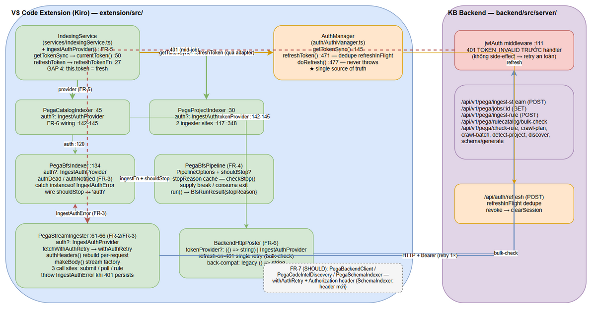
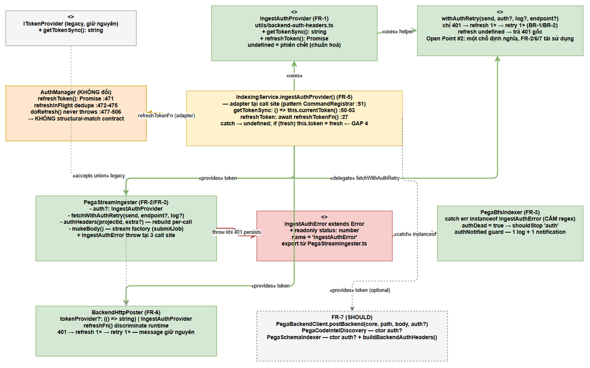
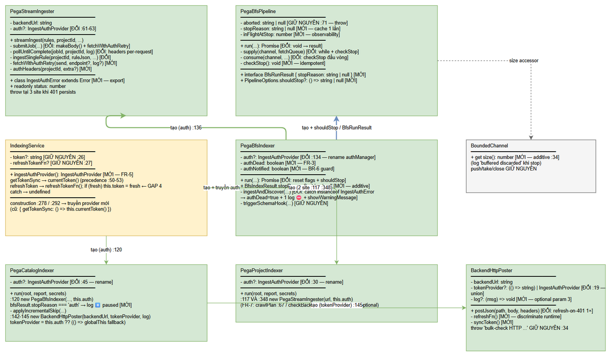

# Technical Design Document (TDD)

## SDLC Agents 4 Enterprise — SA4E-362: [Pega Ingest] Refresh-on-401 cho ingest path

---

## Document Information

| Field | Value |
|-------|-------|
| Jira Ticket | SA4E-362 |
| Title | [Pega Ingest] Invalid or expired token — ingest path thiếu refresh-on-401 khi access JWT hết hạn giữa job dài |
| Type / Priority | Bug / High |
| Author | SA Agent |
| Version | 1.0 |
| Date | 2026-10-16 |
| Status | Final — implementation-ready (dev-agent thực thi theo Section 2) |
| Branch | SA4E-362 (SA Agent KHÔNG commit) |
| Inputs | FSD v1.0 (authoritative), STC v1.1 (16 automated TCs), SessionTimeout-FIX-PLAN.md (superseded ở 2 điểm: pipeline stop-hook + typed error), code branch SA4E-362 |

## Revision History

| Version | Date | Author | Changes |
|---------|------|--------|---------|
| 1.0 | 2026-10-16 | SA Agent | Initiate TDD — design overview + ownership, per-file change spec (10 file), 2 sequence walkthroughs, data contracts, test mapping STC v1.1, rollback/compat plan, 3 drawio diagrams. Mọi signature/line number đã verify trực tiếp trên code branch SA4E-362. |

---

## 1. Design Overview

### 1.1 Mục tiêu thiết kế

Sửa root cause: ingest path (VS Code extension → KB backend `/api/v1/pega/*`) gửi access JWT cached tĩnh qua `getTokenSync()` và **không có refresh-on-401** — khi access JWT hết hạn giữa job dài (~33.677 rules), mọi POST sau đó bị 401 `Invalid or expired token`, lỗi bị nuốt trong catch → silent-skip hàng loạt (~25k+ rules/run), kèm spam `bulk-check HTTP 401` buộc re-fetch catalog.

Thiết kế đạt 4 mục tiêu, trace 1:1 FSD FR-1..FR-8:

1. **Một contract auth duy nhất** `IngestAuthProvider` cho ingest path (FR-1, US-4).
2. **Refresh-on-401 + retry đúng một lần** cho mọi HTTP call trên ingest path (FR-2, FR-6, FR-7 — US-1, US-3).
3. **Typed `IngestAuthError`** thay regex brittle; bắt bằng `instanceof` (FR-3 — US-2).
4. **Graceful stop** của BFS pipeline qua stop-hook `shouldStop` khi refresh đã chết; state preserved → rerun incremental (FR-4, FR-5 — US-2, US-4).

### 1.2 Design principles & ràng buộc

| # | Nguyên tắc | Áp dụng |
|---|-----------|---------|
| P-1 | **Không đổi public API `AuthManager`** — `refreshToken()` trả `Promise<void>` giữ nguyên; adapter tại call site (pattern proven `CommandRegistrar.ts:51`) | FR-1, FR-5 |
| P-2 | **Chỉ HTTP 401 response trigger refresh** — network error/timeout/non-401 không bao giờ refresh (replay mid-upload không an toàn) | BR-1, FR-2 |
| P-3 | **Retry đúng MỘT lần** — không loop; refresh `undefined` → trả 401 gốc, không retry | BR-2, FR-2, FR-6 |
| P-4 | **Không auto-login** — refresh chết → dừng sạch + báo user login lại | BR-3, FR-3 |
| P-5 | **Graceful stop ≠ abort** — `shouldStop` → `run()` return counters bình thường; `aborted` (server error) giữ nguyên hành vi throw, hai cơ chế độc lập | FR-4 |
| P-6 | **Token rỗng → không gửi Authorization**; **không log giá trị token** | BR-5, BR-6 |
| P-7 | **Một chỗ định nghĩa refresh-retry logic** — helper `withAuthRetry` export từ `utils/backend-auth-headers.ts`, mọi consumer tái sử dụng (không duplicate ≥4 file) | FR-2, FR-6, FR-7 (Open Point #2) |
| P-8 | **Backward compatible theo compile-time** — mọi signature cũ phải compile không đổi (optional params, union types); 3 test cũ `BackendHttpPoster.test.ts:31/:44/:58` không sửa | FR-6, FR-8 |

### 1.3 Phân vai ownership (ai sở hữu gì)

| Component | Sở hữu | KHÔNG sở hữu |
|-----------|--------|--------------|
| `AuthManager` (extension/src/auth/) | Single source of truth của token: `getTokenSync()` (:145-147 trả `cachedToken || ""`), `refreshToken()` (:471-475, dedupe `refreshInFlight` — N caller → 1 POST `/api/auth/refresh`), `doRefresh()` (:477-506 — refresh chết → `clearSession()` :491-497, **không throw**; network error chỉ `console.warn` :503-505) | Không biết gì về ingest/pipeline; không retry HTTP call của consumer |
| `IngestAuthProvider` (contract, utils/backend-auth-headers.ts) | Contract 2 method: `getTokenSync(): string` + `refreshToken(): Promise<string \| undefined>`. `undefined` = tín hiệu chuẩn hoá "phiên chết" | Không giữ/copy token (chỉ tham chiếu live qua closure) |
| Adapter tại `IndexingService` (`ingestAuthProvider()`) | Bọc `currentToken()` (:50-53) + `refreshTokenFn` (:27, wired từ CommandRegistrar) thành provider đầy đủ; cập nhật `this.token` khi refresh thành công (GAP 4 SA4E-300) | Không gọi HTTP; không dedupe (ủy quyền cho `AuthManager.refreshInFlight` qua `refreshTokenFn`) |
| `PegaStreamIngester` | Sở hữu **retry engine** cho 3 call site của mình: `withAuthRetry` delegation, `authHeaders()` rebuild, `makeBody()` factory; **throw `IngestAuthError`** khi 401 persists | Không biết BFS/queue; không set authDead |
| `PegaBfsIndexer` | Sở hữu **auth state của run**: `authDead`, `authNotified`; catch `IngestAuthError` bằng `instanceof`; wire `shouldStop` vào pipeline; log ⛔ + notification đúng 1 lần | Không tự refresh thêm (ingester đã retry); không auto-login |
| `PegaBfsPipeline` | Sở hữu **stop mechanics**: `stopReason` cache, supplier break, consumer exit, `BfsRunResult`; phân biệt với `aborted` | Không hiểu ý nghĩa reason (chỉ truyền chuỗi); không đếm remaining là skipped |
| `PegaCatalogIndexer` / `PegaProjectIndexer` | Sở hữu threading: truyền provider xuống BFS indexer / ingester / poster; đọc `stopReason === 'auth'` → log "paused due to auth" | Không can thiệp retry logic |
| `BackendHttpPoster` | Sở hữu refresh-on-401 cho bulk-check (union signature, single retry) | Không throw `IngestAuthError` (giữ `Error(`bulk-check HTTP ...`)` hiện có — caller xử lý theo auth-dead của job) |

### 1.4 Component interaction


*[Edit in draw.io](diagrams/architecture.drawio)*

Luồng dữ liệu chính (happy path + retry), khớp FSD §1.6:

```
IndexingService.indexWorkspace
  └─ ingestAuthProvider()  ← closure: currentToken() + refreshTokenFn  (FR-5, GAP 4)
       ├─ new PegaCatalogIndexer(..., ingestAuth)        (:278)
       │    ├─ new PegaBfsIndexer(..., auth)             (:120)
       │    │    └─ new PegaStreamIngester(backendUrl, auth)   (:136)
       │    │         └─ 3 call site × withAuthRetry(send, auth)  (FR-2)
       │    └─ new BackendHttpPoster(backendUrl, auth, log)     (:142-145, FR-6)
       └─ new PegaProjectIndexer(..., ingestAuth)        (:292)
            └─ new PegaStreamIngester(backendUrl, this.auth)   (:117 VÀ :348)
```

An toàn retry (verify trên code — FSD §5.3): 401 phát từ JWT middleware **trước** handler (`backend/src/server/HttpServer.ts:111` — `app.use('/api/v1/pega/*', jwtAuth)`), nên request 401 không side-effect → retry POST an toàn; backend dedup thêm bằng checksum. `AuthManager.refreshToken()` không throw (verify :477-506) → adapter trả `undefined` khi phiên chết, không crash vòng BFS.

---

## 2. Per-file Change Spec

> Quy ước cho dev-agent: mỗi mục đặc tả **file → thay đổi chính xác** (field/constructor/method/body), kèm line number của code hiện tại trên branch SA4E-362 (đã verify 2026-10-16). "GIỮ NGUYÊN" = không đổi gì. Signature là TypeScript strict; mọi thay đổi signature bắt buộc compile-pass trên toàn workspace (Section 6).


*[Edit in draw.io](diagrams/component-ingest-auth.drawio)*

### 2.1 `extension/src/utils/backend-auth-headers.ts` — FR-1, FR-2 (helper chung), Open Point #2

**Hiện tại:** `ITokenProvider { getTokenSync(): string }` (:8-10) + `buildBackendAuthHeaders()` (:19-26 — token từ `authManager?.getTokenSync() ?? globalThis.__authTokenProvider?.()`).

**Thêm 1 — interface mới (export, đặt cạnh `ITokenProvider`):**

```ts
/**
 * SA4E-362 FR-1 — Auth contract cho ingest path (KB backend /api/v1/pega/*).
 * Đặt cạnh ITokenProvider vì cùng domain auth-header; consumer đã import từ module này
 * (import direction services/* → utils/ giữ nguyên, không tạo cycle).
 */
export interface IngestAuthProvider {
  /** Token hiện tại từ cache (có thể rỗng ""). Dùng cho lần gửi đầu. */
  getTokenSync(): string;
  /**
   * Refresh access token một lần (rotate qua refresh_token).
   * KHÔNG throw — refresh thất bại / phiên chết trả undefined (tín hiệu chuẩn hoá).
   * Dedupe song song do AuthManager.refreshInFlight đảm nhận phía adapter.
   */
  refreshToken(): Promise<string | undefined>;
}
```

**Thêm 2 — helper refresh-retry dùng chung (export, cuối file):**

```ts
/**
 * SA4E-362 FR-2 — Gửi một request; nếu HTTP 401 và có provider → refresh ĐÚNG MỘT lần
 * rồi retry ĐÚNG MỘT lần. Chỉ status 401 trigger refresh (BR-1); network error /
 * non-401 propagate nguyên trạng. Refresh undefined → trả 401 gốc, KHÔNG retry (BR-2/BR-3).
 *
 * @param send — nhận token (có thể undefined khi không có provider) và trả Response.
 *   send PHẢI tự dựng lại headers + body với token mới ở lần gọi thứ 2.
 * @param log — optional logger (không bao giờ log giá trị token — BR-6).
 */
export async function withAuthRetry(
  send: (token: string | undefined) => Promise<Response>,
  auth?: IngestAuthProvider,
  log?: (msg: string) => void,
  endpoint = "",
): Promise<Response> {
  // Lần đầu: token cached (snapshot; rỗng → không Authorization — BR-5)
  const res = await send(auth?.getTokenSync());

  // CHỈ 401 mới refresh. Network error/timeout không bao giờ tới được điểm này
  // (exception propagate ở send) — mid-upload disconnect không retry (BR-1).
  if (res.status !== 401 || !auth) { return res; }

  log?.(`[Pega Ingester] 🔐 401 received — refreshing token once (endpoint=${endpoint})`);

  // Refresh ĐÚNG MỘT lần (dedupe song song bởi AuthManager.refreshInFlight :472-475).
  const fresh = await auth.refreshToken();
  if (fresh === undefined) { return res; } // phiên chết → 401 gốc cho caller (throw IngestAuthError tại call site)

  log?.(`[Pega Ingester] 🔐 Token refreshed — retrying once`);
  return send(fresh); // retry ĐÚNG MỘT lần — kể cả 401 lần 2 cũng trả thẳng, KHÔNG refresh lần hai
}
```

**GIỮ NGUYÊN:** `ITokenProvider`, `buildBackendAuthHeaders()` (ký hiệu + hành vi — nhiều caller hiện có).

### 2.2 `extension/src/services/PegaStreamIngester.ts` — FR-2, FR-3 (3 call site + typed error)

**Đổi 1 — field + constructor (:61-66):**

```ts
// cũ (:61-63):
private readonly authManager?: { getTokenSync(): string };
constructor(backendUrl: string, authManager?: { getTokenSync(): string }) { ... }

// mới:
private readonly auth?: IngestAuthProvider;
constructor(backendUrl: string, auth?: IngestAuthProvider) {
  this.backendUrl = backendUrl;
  this.auth = auth;
}
```

Import thêm: `import { withAuthRetry, type IngestAuthProvider } from "../utils/backend-auth-headers";`

**Thêm 2 — class `IngestAuthError` (export, đặt trên class `PegaStreamIngester`):**

```ts
/**
 * SA4E-362 FR-3 — Typed error báo hiệu auth đã chết sau refresh-retry (401 persists).
 * Bắt bằng instanceof (CẤM regex trên message — ≥4 format message, "HTTP 401" body rỗng miss mọi regex).
 * Export từ đây vì cả 3 throw sites nằm ở file này; PegaBfsIndexer ĐÃ import từ đây (:16) — không cycle.
 */
export class IngestAuthError extends Error {
  constructor(message: string, public readonly status: number) {
    super(message);
    this.name = "IngestAuthError"; // instance field — err.name đúng cả sau serialization
  }
}
```

**Thêm 3 — helper `authHeaders` (private):**

```ts
/** Dựng headers: X-Project-Id (identity — SEC-01) + Authorization chỉ khi token khác rỗng (BR-5). */
private authHeaders(projectId: string, extra?: Record<string, string>): Record<string, string> {
  const headers: Record<string, string> = { ...(extra ?? {}) };
  if (projectId) { headers["X-Project-Id"] = projectId; }
  const token = this.auth?.getTokenSync(); // đọc MỖI lần gọi — không cache headers
  if (token) { headers["Authorization"] = `Bearer ${token}`; }
  return headers;
}
```

**Thêm 4 — `fetchWithAuthRetry` (private, delegate sang helper chung — STC truy cập qua `(ing as any).fetchWithAuthRetry`):**

```ts
private fetchWithAuthRetry(
  send: (token: string | undefined) => Promise<Response>,
  endpoint = "rule",
  log?: LogFn,
): Promise<Response> {
  return withAuthRetry(send, this.auth, log, endpoint);
}
```

**Đổi 5 — `submitJob()` (:90-143): tách stream thành factory `makeBody()`, gửi qua `fetchWithAuthRetry`.**

Thân mới của khối :99-130 (logic stream :102-116 chuyển nguyên văn vào factory):

```ts
const meta: StreamMetadata = { __meta: true, projectId, checksums, versions, visitedKeys };
const encoder = new TextEncoder();

// SA4E-362 FR-2 edge (b): ReadableStream consume-là-hết, không replay được →
// mỗi lần send() tạo stream instance MỚI qua factory. `idx` nằm TRONG factory
// để mỗi stream instance encode lại toàn bộ từ đầu.
const makeBody = (): ReadableStream<Uint8Array> => {
  let idx = 0;
  return new ReadableStream<Uint8Array>({
    pull(controller) {
      if (idx === 0) { controller.enqueue(encoder.encode(JSON.stringify(meta) + "\n")); idx++; }
      else if (idx <= rules.length) { controller.enqueue(encoder.encode(JSON.stringify(rules[idx - 1]) + "\n")); idx++; }
      else { controller.close(); }
    },
  });
};

const res = await this.fetchWithAuthRetry(async (token) => {
  const headers = this.authHeaders(projectId, { "Content-Type": "application/x-ndjson" });
  if (token) { headers["Authorization"] = `Bearer ${token}`; } // token của LẦN GỬI ĐÓ (fresh ở retry)
  return fetch(endpoint, {
    method: "POST",
    // SA4E-241 SEC-01 comment giữ nguyên
    headers,
    body: makeBody(),
    // @ts-expect-error — Node.js fetch supports duplex for streaming uploads
    duplex: "half", // BẮT BUỘC ở CẢ HAI lần gửi (undici yêu cầu cho streaming body)
  });
}, "submit", log);
```

**Đổi 6 — nhánh lỗi submitJob (:132-135): typed error khi 401 persists, GIỮ NGUYÊN message:**

```ts
if (res.status !== 202) {
  const text = await res.text().catch(() => "");
  if (res.status === 401) {
    throw new IngestAuthError(`Ingest submit failed: HTTP ${res.status} — ${text}`, res.status);
  }
  throw new Error(`Ingest submit failed: HTTP ${res.status} — ${text}`); // non-401 giữ nguyên
}
```

**Đổi 7 — `pollUntilComplete()` (:146-181): nhận thêm `projectId`, rebuild headers PER-REQUEST trong vòng while (fix bug :148-150 build một lần).**

```ts
// streamIngest (:85-86) đổi call site:
const jobId = await this.submitJob(rules, projectId, checksums, versions, visitedKeys, endpoint, log);
return this.pollUntilComplete(jobId, projectId, log);

// signature mới (private — 1 call site, an toàn):
private async pollUntilComplete(jobId: string, projectId: string, log: LogFn): Promise<StreamIngestResult> {
  const statusUrl = `${this.backendUrl}/api/v1/pega/jobs/${jobId}`;

  while (true) {
    await this.sleep(POLL_INTERVAL_MS); // :53 = 3000, GIỮ NGUYÊN nhịp poll

    // SA4E-362 FR-2 edge (c): headers rebuild MỖI iteration (cũ: build 1 lần :148-150 —
    // 401 giữa poll không bao giờ có token mới). Mỗi poll attempt đi qua refresh-retry độc lập.
    const res = await this.fetchWithAuthRetry(async (token) => {
      const headers = this.authHeaders(projectId);
      if (token) { headers["Authorization"] = `Bearer ${token}`; }
      return fetch(statusUrl, { headers });
    }, "poll", log);

    if (!res.ok) {
      if (res.status === 401) {
        throw new IngestAuthError(`Job poll failed: HTTP ${res.status}`, res.status);
      }
      throw new Error(`Job poll failed: HTTP ${res.status}`); // non-401 giữ nguyên
    }
    // ... phần parse json/status GIỮ NGUYÊN (:160-180) ...
  }
}
```

**Đổi 8 — `ingestSingleRule()` (:198-232): gửi qua `fetchWithAuthRetry`; envelope 401 → `IngestAuthError` với message gốc:**

```ts
const body = JSON.stringify({ projectId, ruleJson, checksum, version, appName }); // JSON string — replay-safe

const res = await this.fetchWithAuthRetry(async (token) => {
  const headers = this.authHeaders(projectId, { "Content-Type": "application/json" });
  if (token) { headers["Authorization"] = `Bearer ${token}`; }
  return fetch(endpoint, { method: "POST", headers, body });
}, "rule");

const json = (await res.json()) as IngestSingleRuleResponse;
if (json.error) {
  // SA4E-362 FR-3: 401 persists → typed error, message GIỮ contract hiện có
  // ("Ingest failed: Invalid or expired token") — caller/log test phụ thuộc chuỗi này.
  if (res.status === 401) {
    throw new IngestAuthError(`Ingest failed: ${json.error.message}`, res.status);
  }
  throw new Error(`Ingest failed: ${json.error.message}`); // non-auth envelope error giữ nguyên
}
if (!json.data) { throw new Error("Ingest returned empty data"); }
return json.data;
```

**GIỮ NGUYÊN:** `StreamIngestResult`, `IngestSingleRuleResult`, `POLL_INTERVAL_MS = 3_000` (:53), `streamIngest()` signature public, `sleep()`.

### 2.3 `extension/src/services/PegaBfsPipeline.ts` — FR-4 (stop-hook `shouldStop`, graceful stop)

**Thêm 1 — `PipelineOptions` (:55-62) thêm 1 field optional (cuối interface):**

```ts
export interface PipelineOptions {
  fetchBatchSize: number;
  ingestConcurrency: number;
  channelCapacity: number;
  maxQueueSize: number;
  maxIterations: number;
  resilient: boolean;
  /** SA4E-362 FR-4: stop-hook nghiệp vụ. Trả chuỗi lý do dừng (non-empty) hoặc null = chạy tiếp.
   *  Được check tại supply() loop-top + consume() đầu vòng. KHÔNG liên quan `aborted` (:71). */
  shouldStop?: () => string | null;
}
```

**Thêm 2 — result type mới (export, cạnh `BfsCounters` :41-46):**

```ts
/** SA4E-362 FR-4: kết quả run(). Counters được fill bình thường qua parameter (non-breaking
 *  với caller cũ bỏ qua return); result chỉ bổ sung stopReason. */
export interface BfsRunResult {
  stopReason: string | null;
}
```

**Thêm 3 — fields mới (:69-75):**

```ts
private stopReason: string | null = null;   // set MỘT LẦN từ shouldStop() đầu tiên trả non-null (idempotent)
private inFlightAtStop = 0;                 // snapshot observability tại thời điểm stop
```

**Thêm 4 — `checkStop()` (private):**

```ts
/** SA4E-362 FR-4: đọc shouldStop() đúng MỘT lần đầu trả non-null — cache để reason không đổi giữa chừng. */
private checkStop(): void {
  if (this.stopReason) { return; }
  const reason = this.opts.shouldStop?.() ?? null;
  if (reason) {
    this.stopReason = reason;
    this.inFlightAtStop = this.inFlight;
  }
}
```

**Đổi 5 — `run()` (:89-109): return type `Promise<void>` → `Promise<BfsRunResult>`; `aborted` GIỮ NGUYÊN throw (:108) — hai cơ chế độc lập, throw của `aborted` thắng nếu cả hai xảy ra (EF-1):**

```ts
async run(fetchQueue: CrawlPlanItem[], dedupSet: MembershipSet, counters: BfsCounters): Promise<BfsRunResult> {
  const channel = new BoundedChannel<FetchedRule>(this.opts.channelCapacity);
  const consumers = Array.from({ length: this.opts.ingestConcurrency }, () =>
    this.consume(channel, fetchQueue, dedupSet, counters),
  );
  await this.supply(channel, fetchQueue);
  await Promise.all(consumers);
  counters.errorCount += this.fetchErrors;

  if (this.aborted) { throw new Error(this.aborted); } // GIỮ NGUYÊN — aborted vẫn thắng (EF-1)

  if (this.stopReason) {
    // SA4E-362 FR-4 + FSD 4.1: reason 'auth' → label dễ đọc. Suppliers đã break nên
    // channel.size cuối = buffered discarded; in-flight completed = snapshot - buffered (xấp xỉ).
    const label = this.stopReason === "auth" ? "paused due to auth" : this.stopReason;
    this.log(`[BfsPipeline] ⏸️ Stopped: ${label} (in-flight completed: ${this.inFlightAtStop - channel.size}, buffered discarded: ${channel.size})`);
  }
  return { stopReason: this.stopReason };
}
```

**Đổi 6 — `supply()` (:112-152): điều kiện while mở rộng cạnh `!this.aborted` + check stop đầu vòng:**

```ts
while (!this.aborted && !this.stopReason && (fetchQueue.length > 0 || this.inFlight > 0)) {
  this.checkStop();
  if (this.stopReason) { break; } // ngừng fetch/phát item mới — channel.close() ở cuối vẫn chạy
  // ... logic hiện tại GIỮ NGUYÊN (:116-150: maxIterations, yield 15ms, fetchRulesInParallel,
  //     aborted branch, backpressure push) ...
}
channel.close(); // GIỮ NGUYÊN :151 — supply break sớm vẫn phải close
```

**Đổi 7 — `consume()` (:155-180): check stop ĐẦU VÒNG, trước `take()`:**

```ts
while (true) {
  this.checkStop();
  if (this.stopReason) { return; } // exit KHÔNG đếm item còn lại là skipped (chưa từng được ingest)
  const next = await channel.take();
  if (next.done) { return; }
  // ... ingestFn try/catch + drain + inFlight-- GIỮ NGUYÊN (:164-179) ...
}
```

**Ngữ nghĩa stop (chốt — khớp FSD FR-4 TA enrichment):** supplier break → không phát item mới → channel đóng; consumers exit qua check đầu vòng; item in-flight (đang trong `ingestFn`, tối đa `ingestConcurrency` ≤ 64) chạy HOÀN TẤT hoặc FAIL CÁ NHÂN — không force-abort; drain lock (:183-201) hoạt động bình thường. Rule đang xử lý khi stop được đếm theo outcome bình thường (`skippedCount` nếu `ingested:false`); item còn lại trong buffer KHÔNG bị đếm là skipped. `BoundedChannel` cần thêm accessor size (§2.10).

### 2.4 `extension/src/services/PegaBfsIndexer.ts` — FR-3 (authDead + catch `instanceof`) + wire `shouldStop`

**Đổi 1 — import (:16):**

```ts
import { PegaStreamIngester, IngestAuthError } from "./PegaStreamIngester";
import type { IngestAuthProvider } from "../utils/backend-auth-headers";
```

**Đổi 2 — field + constructor (:127-137): rename param cuối `authManager` → `auth`, đổi kiểu:**

```ts
constructor(
  private readonly pegaClient: PegaHttpClient,
  private readonly backendUrl: string,
  private readonly outputChannel: vscode.OutputChannel | undefined,
  private readonly log: LogFn,
  private readonly schemaOrchestrator?: ISchemaOrchestrator,
  private readonly resilient = false,
  private readonly auth?: IngestAuthProvider, // cũ: authManager?: { getTokenSync(): string } (:134)
) {
  this.ingester = new PegaStreamIngester(backendUrl, auth); // :136 — truyền provider mới
}
```

**Thêm 3 — fields state (cạnh `appName` :120):**

```ts
/** SA4E-362 FR-3: refresh đã chết (IngestAuthError) — kích hoạt shouldStop của pipeline. */
private authDead = false;
/** SA4E-362 BR-6: guard notification/log ⛔ đúng 1 lần per run — reset mỗi run(). */
private authNotified = false;
```

**Đổi 4 — `BfsIndexResult` (:96-102) thêm field optional (additive, non-breaking):**

```ts
export interface BfsIndexResult {
  totalIngested: number;
  initialCount: number;
  discoveredCount: number;
  skippedCount: number;
  errorCount: number;
  /** SA4E-362 FR-4: lý do dừng sớm (vd "auth") — null/undefined = chạy hết bình thường. */
  stopReason?: string | null;
}
```

**Đổi 5 — `run()` (:149-204): reset state đầu run; wire `shouldStop` vào pipeline options (:182-189); đọc `BfsRunResult`:**

```ts
// Đầu run() — sau initialCount:
this.authDead = false;
this.authNotified = false;

// Pipeline options (:182-189) — thêm shouldStop:
const pipeline = new PegaBfsPipeline(
  this.pegaClient,
  this.log,
  {
    fetchBatchSize: tuning.fetchBatchSize,
    ingestConcurrency: tuning.ingestConcurrency,
    channelCapacity: tuning.channelCapacity,
    maxQueueSize: MAX_QUEUE_SIZE,
    maxIterations,
    resilient: this.resilient,
    shouldStop: () => (this.authDead ? "auth" : null), // FR-4: chuỗi kỹ thuật ngắn (Open Point #4)
  },
  (fetched: FetchedRule) => this.ingestOne(projectId, fetched, root),
  (processed, queued) => report.report({ /* GIỮ NGUYÊN */ }),
);

let runResult: BfsRunResult;
try {
  runResult = await pipeline.run(fetchQueue, dedupSet, counters); // :197
} finally {
  this.localIndex?.flush();
}

if (runResult.stopReason) {
  this.log(`[BfsIndexer] ⏸️ BFS paused (${runResult.stopReason}) — ingested=${counters.totalIngested} trước khi dừng, state preserved`);
}
return { ...counters, initialCount, stopReason: runResult.stopReason };
```

Import thêm: `import type { BfsRunResult } from "./PegaBfsPipeline";` (gộp vào import `PegaBfsPipeline` :19 hiện có).

**Đổi 6 — `ingestAndDiscover()` catch (:267-278): thêm nhánh `instanceof IngestAuthError` TRƯỚC catch-generic; catch-generic GIỮ NGUYÊN (:268-278) cho mọi lỗi khác:**

```ts
} catch (err: any) {
  // SA4E-362 FR-3: typed auth error — nhận diện bằng instanceof (CẤM regex message).
  if (err instanceof IngestAuthError) {
    this.authDead = true; // idempotent — N consumer set lại không đổi hành vi (AF-1)
    if (!this.authNotified) {
      this.authNotified = true; // BR-6: đúng 1 log + 1 notification per run
      this.log(`[Pega Ingester] ⛔ Auth hết hạn và refresh thất bại — dừng ingest. Hãy login lại rồi chạy lại (state đã preserve)`);
      void vscode.window.showWarningMessage(
        `⛔ Auth hết hạn và refresh thất bại — dừng ingest. Hãy login lại rồi chạy lại (state đã preserve).`,
      );
    }
    // Rule hiện tại vẫn return { ingested: false } — GIỮ ELIGIBLE cho run sau
    // (rerun incremental; đúng comment hiện có :227-228). KHÔNG auto-login (BR-3).
    return { ingested: false, relatives: [] };
  }
  // ... catch-generic hiện tại GIỮ NGUYÊN (:268-278: cause, insKey, ❌ log, return {ingested:false}) ...
}
```

**GIỮ NGUYÊN:** toàn bộ logic fetch/queue/localIndex/schema hook; `ingestOne()` (:213-235).

### 2.5 `extension/src/services/PegaCatalogIndexer.ts` — FR-5 + FR-6 wiring + "paused" summary

**Đổi 1 — import:** thêm `import type { IngestAuthProvider } from "../utils/backend-auth-headers";`

**Đổi 2 — constructor (:41-46): rename param `authManager` → `auth`, đổi kiểu:**

```ts
constructor(
  private readonly httpClient: IndexerHttpClient,
  private readonly outputChannel: vscode.OutputChannel | undefined,
  private readonly log: LogFn,
  private readonly auth?: IngestAuthProvider, // cũ: authManager?: { getTokenSync(): string } (:45)
) {}
```

**Đổi 3 — truyền provider xuống BFS (:120):**

```ts
const bfs = new PegaBfsIndexer(pegaClient, backendUrl, this.outputChannel, this.log, undefined, true, this.auth);
```

**Đổi 4 — `run()` đọc stopReason (:122-127):**

```ts
try {
  const bfsResult = await bfs.run(projectId, toFetch, dedupSet, report, root);
  if (bfsResult.stopReason === "auth") {
    // FSD 4.1: catalog summary — user thấy run bị pause do auth, rerun incremental
    this.log(`[Catalog] ⏸️ Paused due to auth — rerun sẽ tiếp tục incremental (ingested=${bfsResult.totalIngested} trước khi dừng)`);
  }
  return { appName, catalogRules: parsed.items.length, totalIngested: bfsResult.totalIngested };
} finally {
  dedupSet.dispose();
}
```

**Đổi 5 — `applyIncrementalSkip()` tokenProvider (:142-145) → truyền provider đầy đủ cho `BackendHttpPoster` (FR-6), giữ globalThis fallback khi KHÔNG có provider:**

```ts
// cũ (:142-145): const tokenProvider = () => this.authManager?.getTokenSync() || (globalThis as any).__authTokenProvider?.() || "";
// mới:
const tokenProvider: (() => string) | IngestAuthProvider | undefined =
  this.auth ?? (() => (globalThis as any).__authTokenProvider?.() || "");
const poster = new BackendHttpPoster(backendUrl, tokenProvider, this.log.bind(this)); // FR-6: 401 → refresh → retry 1 lần
const comparer = new StateComparer(new BulkCheckClient(poster));
```

> Khi `auth` đầy đủ (từ IndexingService), `getTokenSync` = `currentToken()` đã tự ưu tiên `globalThis.__authTokenProvider` (IndexingService :50-53) → hành vi token-fallback KHÔNG đổi; chỉ thêm khả năng refresh-on-401.

### 2.6 `extension/src/services/PegaProjectIndexer.ts` — FR-5

**Đổi 1 — import:** thêm `import type { IngestAuthProvider } from "../utils/backend-auth-headers";`

**Đổi 2 — field + constructor (:26-31):**

```ts
private readonly auth?: IngestAuthProvider, // cũ :30: authManager?: { getTokenSync(): string }
```

**Đổi 3 — CẢ HAI điểm tạo `PegaStreamIngester` (:116-117 và :347-348):**

```ts
const ingester = new PegaStreamIngester(pegaClient.getBackendUrlPublic(), this.auth);
```

**Đổi 4 — (FR-7 SHOULD) thread provider vào các backend-call wrapper:** các call `pegaClient.crawlPlan(...)` (:67), `pegaClient.checkBackendCache(...)` nhận thêm tham số optional cuối (xem §2.9 T-1) — truyền `this.auth`.

### 2.7 `extension/src/services/IndexingService.ts` — FR-5 (GAP 4) — nguồn provider duy nhất

**Thêm 1 — import:** `import type { IngestAuthProvider } from "../utils/backend-auth-headers";`

**Thêm 2 — method private (đặt cạnh `currentToken()` :50-53):**

```ts
/**
 * SA4E-362 FR-5 — Provider auth đầy đủ cho ingest path: token cache (live qua
 * currentToken()) + refresh theo nhu cầu khi 401. Dựng closure MỚI mỗi lần gọi
 * (không state) — an toàn vì isProcessing (:24) chặn 2 run song song.
 * GAP 4 (SA4E-300): refresh thành công phải cập nhật this.token để getTokenSync()
 * ở các request sau trả token mới (nếu không, mọi request đầu lại dùng token cũ → 401 mỗi lần).
 * Precedence của currentToken() (:50-53): globalThis.__authTokenProvider?.() → this.token → "".
 */
private ingestAuthProvider(): IngestAuthProvider {
  return {
    getTokenSync: () => this.currentToken(),
    refreshToken: async () => {
      if (!this.refreshTokenFn) { return undefined; } // AF-1 — chưa wired (setRefreshTokenFn :42-44)
      try {
        const fresh = await this.refreshTokenFn();   // adapter AuthManager (CommandRegistrar.ts:51)
        if (fresh) { this.token = fresh; }           // ← GAP 4: đồng bộ token nội bộ (:26)
        return fresh;
      } catch { return undefined; }                  // EF-1 — refresh throw = refresh thất bại
    },
  };
}
```

**Đổi 3 — 2 điểm construction (:278, :292) — thay `{ getTokenSync: () => this.currentToken() }`:**

```ts
// :278
const catalogIndexer = new PegaCatalogIndexer(this.httpClient, this.outputChannel, this.log.bind(this), this.ingestAuthProvider());
// :292
const indexer = new PegaProjectIndexer(this.httpClient, this.outputChannel, this.log.bind(this), this.ingestAuthProvider());
```

**Đổi 4 — (FR-7 SHOULD) wire cho SchemaIndexer + Discovery:**

```ts
// :257 (runSchemaIndexer)
const indexer = new PegaSchemaIndexer(this.httpClient, this.log.bind(this), this.ingestAuthProvider());
// :309 (runPegaCodeIntelDiscovery)
const disc = new PegaCodeIntelDiscovery(pegaClient, this.outputChannel, this.log.bind(this), this.ingestAuthProvider());
```

**GIỮ NGUYÊN:** `this.token` (:26), `refreshTokenFn` (:27), `setRefreshTokenFn` (:42-44), `currentToken()` (:50-53), precedent 401-retry của `pollTaskWorkerProgress` (:221-225 — giữ nguyên, nó tự quản token riêng). KHÔNG tạo field mới.

### 2.8 `extension/src/code-intel/delta/BackendHttpPoster.ts` — FR-6 (union + refresh-on-401 single retry)

**Đổi toàn bộ class (:10-38) như sau — 3 test cũ (:31 plain fn TOKEN, :44 plain fn "", :58 luôn-401 + plain fn) phải xanh KHÔNG SỬA:**

```ts
import type { HttpPoster } from "./BulkCheckClient";
import type { IngestAuthProvider } from "../../utils/backend-auth-headers";

/** POSTs JSON to `${backendUrl}`${path}` and returns the parsed JSON body. */
export class BackendHttpPoster implements HttpPoster {
  /**
   * @param backendUrl - Base URL của Code Intelligence backend (no trailing slash).
   * @param tokenProvider - Legacy: `() => string` (token tĩnh, KHÔNG refresh — back-compat
   *   với 3 test cũ). Full: IngestAuthProvider (401 → refresh → retry ĐÚNG MỘT lần — FR-6).
   * @param log - Optional logger (FSD 4.1: log 🔐 401/refresh — không log token, BR-6).
   */
  constructor(
    private readonly backendUrl: string,
    private readonly tokenProvider?: (() => string) | IngestAuthProvider,
    private readonly log?: (msg: string) => void,
  ) {}

  /** Discriminate tại runtime — plain function (legacy) KHÔNG có refreshToken. */
  private refreshFn(): (() => Promise<string | undefined>) | undefined {
    const tp = this.tokenProvider as (() => string) | IngestAuthProvider | undefined;
    if (!tp || typeof tp === "function") { return undefined; } // legacy — không refresh (AF-1)
    return typeof tp.refreshToken === "function" ? () => tp.refreshToken() : undefined;
  }

  private syncToken(): string | undefined {
    const tp = this.tokenProvider as (() => string) | IngestAuthProvider | undefined;
    if (!tp) { return undefined; }
    return typeof tp === "function" ? tp() : tp.getTokenSync();
  }

  /** @inheritdoc */
  async postJson(path: string, body: unknown, headers: Record<string, string>): Promise<unknown> {
    const merged: Record<string, string> = { "Content-Type": "application/json", ...headers };
    const token = this.syncToken();
    if (token && !merged["Authorization"]) { merged["Authorization"] = `Bearer ${token}`; } // GIỮ logic :26

    const doFetch = (): Promise<Response> => fetch(`${this.backendUrl}${path}`, { method: "POST", headers: merged, body: JSON.stringify(body) });
    let res = await doFetch();

    // SA4E-362 FR-6: refresh-on-401 — ĐÚNG MỘT lần, không loop. Refresh undefined hoặc
    // retry vẫn 401 → rơi xuống throw dưới (message GIỮ NGUYÊN :34) — caller (StateComparer/
    // CatalogIndexer) dừng theo auth-dead của job, KHÔNG re-fetch catalog (US-2 AC5).
    const refresh = this.refreshFn();
    if (res.status === 401 && refresh) {
      this.log?.(`[Pega Ingester] 🔐 401 received — refreshing token once (endpoint=bulk-check)`);
      const fresh = await refresh();
      if (fresh !== undefined) {
        this.log?.(`[Pega Ingester] 🔐 Token refreshed — retrying once`);
        merged["Authorization"] = `Bearer ${fresh}`; // rebuild CHỈ Authorization
        res = await doFetch();
      }
    }

    if (!res.ok) {
      // Surface transport/HTTP failures so StateComparer degrades fail-SAFE (E-04) — GIỮ NGUYÊN.
      throw new Error(`bulk-check HTTP ${res.status} ${res.statusText}`);
    }
    return res.json();
  }
}
```

**Back-compat proof (đối chiếu trực tiếp test file):**
- Test :31 `new BackendHttpPoster(url, () => TOKEN)` → `typeof === "function"` → `refreshFn()` = undefined → không refresh → Authorization đúng → pass.
- Test :44 `() => ""` → token rỗng → không Authorization → pass.
- Test :52-59 fetch LUÔN 401 + plain fn → không refresh → throw `bulk-check HTTP 401 Unauthorized` → `rejects.toThrow(/401/)` → pass (message giữ nguyên).
- Param thứ 3 `log` optional → mọi construction 2-arg hiện có không đổi.

### 2.9 FR-7 targets (SHOULD) — `PegaBackendClient`, `PegaCodeIntelDiscovery`, `PegaSchemaIndexer`

**T-1. `extension/src/services/pega/PegaBackendClient.ts` — `postBackend` (:10-22) + 5 wrapper.**

- `postBackend(core, path, body)` → `postBackend(core, path, body, auth?: IngestAuthProvider)`: wrap fetch bằng `withAuthRetry(send, auth)`; headers lần đầu vẫn từ `buildBackendAuthHeaders()` (:13-14 — giữ globalThis fallback); trong `send`, `if (token) headers["Authorization"] = \`Bearer ${token}\`` (override khi retry). Return contract GIỮ NGUYÊN: `res.ok ? json : undefined` (:20) — 401 persists → caller branch `!res.ok` xử lý như hiện tại (FSD 5.1a).
- 5 exported functions thêm tham số optional CUỐI signature: `checkBackendCache(core, body, auth?)`, `ingestBackendRule(core, body, auth?)`, `crawlPlan(core, body, auth?)`, `crawlBatch(core, body, auth?)`, `detectProject(core, workspaceRoot, auth?)` — mọi call hiện có không đổi (optional).
- `PegaHttpClient` wrapper methods (:86-94) thêm tham số optional cuối tương ứng và truyền vào backend fn. `PegaProjectIndexer` truyền `this.auth` tại các call (:67 `crawlPlan`, `checkBackendCache`). `PegaMcpTools` (mcp/PegaMcpTools.ts :28/:75/:104/:133/:148/:178) KHÔNG đổi trong lần fix này — không có provider trong context MCP; ghi nhận trong audit REG-13 (nợ kỹ thuật tường minh — FSD UC-7 AF-1).

**T-2. `extension/src/services/PegaCodeIntelDiscovery.ts` — `callBackendDiscovery` (:83-102).**

- Constructor (:30) thêm param optional thứ 4: `private readonly auth?: IngestAuthProvider`.
- Wrap fetch (:86-93) bằng `withAuthRetry(send, this.auth)`; `AbortSignal.timeout(120000)` (:92) áp **per-attempt** (nằm trong `send` closure — mỗi lần fetch budget riêng; worst-case tổng 240s, chấp nhận được — FSD T-2). Headers vẫn từ `this.authHeaders(projectId)` (:76-81) + override Bearer khi retry.
- GIỮ NGUYÊN throw `backend ${res.status}: ${text.substring(0, 200)}` (:94-97) — 401 persists → cùng error mechanism hiện có (KHÔNG IngestAuthError — FSD Appendix C #1).

**T-3. `extension/src/services/PegaSchemaIndexer.ts` — `generateForHarness` (:92-96).**

- Constructor thêm param optional thứ 3: `private readonly auth?: IngestAuthProvider` (hiện: `httpClient, log`).
- Fix root-cause "thiếu hẳn Authorization" (:94 hiện chỉ Content-Type — verify): headers mới \`{ "Content-Type": "application/json", ...buildBackendAuthHeaders() }\` (import từ `../../utils/backend-auth-headers` — tự gắn Bearer + X-Project-Id khi có token, BR-5).
- Wrap fetch bằng `withAuthRetry(send, this.auth)` (send override Bearer khi token fresh). GIỮ NGUYÊN throw `Backend ${res.status}: ...` (:98-101).
- Wiring: `IndexingService :257` truyền `this.ingestAuthProvider()` (§2.7 Đổi 4).

### 2.10 `extension/src/services/bounded-channel.ts` — additive accessor (phục vụ FR-4 observability)

**Thêm 1 — getter public (sau :34):**

```ts
/** SA4E-362 FR-4: số item còn trong buffer (phục vụ log "buffered discarded" khi stop). */
get size(): number { return this.buffer.length; }
```

**GIỮ NGUYÊN:** toàn bộ push/take/close logic (:40+).


*[Edit in draw.io](diagrams/class-ingest-auth.drawio)*

---

## 3. Sequence Walkthroughs

### 3.1 Walkthrough A — Happy retry: 401 giữa job dài → refresh → retry → tiếp tục (US-1, FR-2, FR-5)

Bối cảnh: catalog BFS đang chạy, access JWT hết hạn sau TTL giữa chừng; `IndexingService` đã wire `ingestAuthProvider()`.

| # | Actor | Hành động | Code điểm |
|---|-------|-----------|-----------|
| 1 | Pipeline consume | Lấy rule R từ channel → `ingestFn(R)` → `ingestOne` → `ingestAndDiscover` → `ingester.ingestSingleRule(projectId, ruleJson, checksum, version, appName)` | PegaBfsIndexer :226/:253 |
| 2 | Ingester | `withAuthRetry` lần đầu: `send(auth?.getTokenSync())` — token CACHED (stale), headers `Authorization: Bearer <stale>` + `X-Project-Id` | backend-auth-headers.ts (helper), PegaStreamIngester `fetchWithAuthRetry` |
| 3 | KB Backend | jwtAuth middleware kiểm tra **trước** handler → `401 TOKEN_INVALID "Invalid or expired token"` | HttpServer.ts:111, jwt-auth.ts:113/:118/:140 |
| 4 | Helper | `res.status === 401` && `auth` → log `[Pega Ingester] 🔐 401 received — refreshing token once (endpoint=rule)` → `await auth.refreshToken()` | withAuthRetry bước 2-3 |
| 5 | Adapter (IndexingService) | `refreshToken()` → `refreshTokenFn()` (adapter AuthManager, CommandRegistrar.ts:51) → `AuthManager.refreshToken()` → `doRefresh()` POST `/api/auth/refresh` → 200 → `adoptTokens` cập nhật `cachedToken` :500 → adapter đọc lại `getTokenSync()` → trả **fresh**. Song song: `this.token = fresh` (GAP 4) | AuthManager :471-506, IndexingService `ingestAuthProvider` |
| 6 | Helper | log `[Pega Ingester] 🔐 Token refreshed — retrying once` → `send(fresh)` — `send` closure rebuild headers (`authHeaders()` đọc lại token) + body (JSON string replay-safe) → **retry đúng 1 lần** | withAuthRetry bước 5, PegaStreamIngester send closure |
| 7 | KB Backend | 200 → envelope `{ data: { status: "success", ruleId: 42, unresolvedDependencies: [...] } }` | — |
| 8 | Ingester | Parse envelope như cũ → trả `IngestSingleRuleResult`; KHÔNG throw; 0 `IngestAuthError` | PegaStreamIngester :223-231 |
| 9 | Indexer/Pipeline | `ingested = true` → drain (`totalIngested++`) → relatives enqueue → BFS **chạy tiếp bình thường**; `authDead` vẫn false; `refreshToken` bị gọi đúng **1 lần** | PegaBfsPipeline drain :183-201 |

**Bất biến sau walkthrough A:** fetch calls = 2; refreshToken calls = 1; non-401 bất kỳ → 0 refresh; log không chứa giá trị token (BR-6). Đây là nội dung UT-01/PBT-01.

### 3.2 Walkthrough B — Refresh chết → `IngestAuthError` → `authDead` → graceful stop → catalog "paused" → notification (US-2, FR-3, FR-4)

Bối cảnh: refresh token đã bị revoke server-side; còn ~25k rule trong queue.

| # | Actor | Hành động | Code điểm |
|---|-------|-----------|-----------|
| 1 | Ingester | `ingestSingleRule` lần đầu → 401 | as A.2-A.3 |
| 2 | Helper | `auth.refreshToken()` → `doRefresh()` POST `/api/auth/refresh` → 401 (revoke) → `clearSession()` (xoá secrets, `cachedToken = null`) → adapter trả **undefined** (không throw) | AuthManager :491-497, :509-520 |
| 3 | Helper | `fresh === undefined` → KHÔNG retry, trả 401 gốc cho call site | withAuthRetry bước 4 |
| 4 | Ingester | `ingestSingleRule`: envelope `json.error` + `res.status === 401` → `throw new IngestAuthError("Ingest failed: Invalid or expired token", 401)` | §2.2 Đổi 8 |
| 5 | Indexer | `ingestAndDiscover` catch: `err instanceof IngestAuthError` → `this.authDead = true`; `authNotified` guard → log `[Pega Ingester] ⛔ Auth hết hạn và refresh thất bại — dừng ingest. Hãy login lại rồi chạy lại (state đã preserve)` (error) + `showWarningMessage` đúng 1 lần → `return { ingested: false, relatives: [] }` (rule GIỮ eligible) | §2.4 Đổi 6 |
| 6 | Pipeline consume (item tiếp theo) | `checkStop()` → `shouldStop()` trả `'auth'` → `stopReason = 'auth'` (cache 1 lần) → `return` — exit KHÔNG take item mới, KHÔNG đếm skipped | §2.3 Đổi 7 |
| 7 | Pipeline supply | Loop-top: `!this.stopReason` fail → break (không fetch/phát mới) → `channel.close()` | §2.3 Đổi 6 |
| 8 | Các consumer còn lại | Item in-flight (≤ 64) chạy hoàn tất/fail cá nhân; lần check đầu vòng → exit. Không còn item được ingest | §2.3 ngữ nghĩa stop |
| 9 | Pipeline `run()` | `aborted` = null (không throw) → log `[BfsPipeline] ⏸️ Stopped: paused due to auth (in-flight completed: N, buffered discarded: M)` → `return { stopReason: 'auth' }` | §2.3 Đổi 5 |
| 10 | Indexer `run()` | `finally` flush localIndex (state đã ingest được preserve) → log `[BfsIndexer] ⏸️ BFS paused (auth) ...` → return counters + `stopReason` | §2.4 Đổi 5 |
| 11 | CatalogIndexer `run()` | `bfsResult.stopReason === 'auth'` → log `[Catalog] ⏸️ Paused due to auth — rerun sẽ tiếp tục incremental (ingested=N trước khi dừng)` → return result bình thường (không crash) | §2.5 Đổi 4 |
| 12 | User | Thấy **1** warning "login lại rồi chạy lại (state đã preserve)". KHÔNG auto-login (BR-3); KHÔNG spam lỗi hàng loạt (BR-6); bulk-check song song dừng theo auth-dead, không re-fetch catalog (US-2 AC5) | §2.5/§2.8 |
| 13 | Sau khi login lại | Rerun index → local skip + bulk-check delta → chỉ rule còn thiếu được xử lý (incremental — SIT-02 step 6) | hiện có |

**Bất biến sau walkthrough B:** silent-skip ≈ 0 (chỉ item in-flight); đúng 1 log ⛔ + 1 notification; `run()` return bình thường; rules chưa xử lý giữ eligible; token không xuất hiện trong log.

---

## 4. Data Contracts

### 4.1 TypeScript contracts (nguồn sự thật cho dev + test)

```ts
// ── utils/backend-auth-headers.ts (FR-1) ─────────────────────────────────
export interface IngestAuthProvider {
  getTokenSync(): string;
  refreshToken(): Promise<string | undefined>; // undefined = phiên chết (chuẩn hoá)
}

export async function withAuthRetry(
  send: (token: string | undefined) => Promise<Response>,
  auth?: IngestAuthProvider,
  log?: (msg: string) => void,
  endpoint?: string,
): Promise<Response>;

// ── services/PegaStreamIngester.ts (FR-3) ────────────────────────────────
export class IngestAuthError extends Error {
  constructor(message: string, public readonly status: number);
  name: "IngestAuthError"; // instance field
}

// ── services/PegaBfsPipeline.ts (FR-4) ───────────────────────────────────
export interface BfsRunResult {
  stopReason: string | null; // 'auth' từ BfsIndexer; null = chạy hết bình thường
}
// PipelineOptions thêm: shouldStop?: () => string | null  (chuỗi kỹ thuật; 'auth' → "paused due to auth" ở log layer)
// run(): Promise<void> → Promise<BfsRunResult> — counters vẫn fill qua BfsCounters parameter

// ── services/PegaBfsIndexer.ts (FR-3/FR-4) ───────────────────────────────
export interface BfsIndexResult {
  totalIngested: number;
  initialCount: number;
  discoveredCount: number;
  skippedCount: number;
  errorCount: number;
  stopReason?: string | null; // MỚI — additive optional
}
```

**Shape counters `BfsCounters` GIỮ NGUYÊN** (PegaBfsPipeline :41-46: `totalIngested / discoveredCount / skippedCount / errorCount`) — `run()` tiếp tục fill qua parameter; `BfsRunResult` chỉ bổ sung `stopReason` → mọi caller cũ đọc counters không vỡ (back-compat FSD FR-4 item 3).

### 4.2 API schemas — UNCHANGED (N/A)

**Không có thay đổi nào về backend endpoint, request/response schema, status codes.** Fix nằm 100% ở client (extension). Danh sách endpoint bị tác động (chỉ phía caller, wire-format giữ nguyên):

| Endpoint | Method | Caller (sau fix) | Thay đổi wire-format |
|----------|--------|------------------|---------------------|
| `/api/v1/pega/ingest-stream` | POST (NDJSON, duplex:'half') | `PegaStreamIngester.submitJob` | **KHÔNG** — chỉ thêm khả năng retry cùng request |
| `/api/v1/pega/jobs/:id` | GET | `PegaStreamIngester.pollUntilComplete` | **KHÔNG** — thêm `X-Project-Id` header (identity, đúng middleware quy ước SEC-01; middleware chỉ yêu cầu JWT) |
| `/api/v1/pega/ingest-rule` | POST | `PegaStreamIngester.ingestSingleRule` | **KHÔNG** |
| `/api/v1/pega/rulecatalog/bulk-check` | POST | `BackendHttpPoster.postJson` | **KHÔNG** |
| `/api/v1/pega/check-rule`, `/crawl-plan`, `/crawl-batch`, `/detect-project` | POST | `PegaBackendClient.postBackend` | **KHÔNG** (FR-7) |
| `/api/v1/pega/discover` | POST | `PegaCodeIntelDiscovery.callBackendDiscovery` | **KHÔNG** (FR-7) |
| `/api/v1/pega/schema/generate` | POST | `PegaSchemaIndexer.generateForHarness` | **KHÔNG** wire-format; chỉ BỔ SUNG `Authorization` header (trước đây thiếu hẳn — FR-7) |
| `/api/auth/refresh` | POST | `AuthManager.doRefresh` (hiện có) | **KHÔNG** — không thêm caller mới, chỉ gọi qua provider khi 401 |

### 4.3 Database / DDL — N/A

Không có thay đổi schema, table, index, migration nào. Backend dedup ingest bằng checksum (hiện có) là cơ sở an toàn retry — không đụng đến.

---

## 5. Test Design Mapping (STC v1.1 → thiết kế)

16 automated cases (UT-01..UT-14, PBT-01, REG-13) — mỗi case map vào **file test đích** và **thay đổi production** mà nó verify (FR trace theo STC §2.2). Quy ước test giữ nguyên STC §1: `vi.stubGlobal('fetch')`, `jsonResponse()` helper, fake timers bắt buộc cho poll (POLL_INTERVAL_MS=3000), private access qua `(instance as any)`.

| STC | File test đích (vitest, auto-discovered) | Thay đổi production được verify | FR |
|-----|------------------------------------------|--------------------------------|-----|
| UT-01 | `services/__tests__/PegaStreamIngester.auth-retry.test.ts` (mới) | `withAuthRetry` + `fetchWithAuthRetry`: 401 → refresh đúng 1 lần → retry headers `Bearer fresh` → success; log có điểm refresh, không chứa token | FR-2 |
| UT-02 | như trên | refresh `undefined` → fetch đúng 1 lần, không loop; throw **`IngestAuthError`** (instanceof) với message gốc `Ingest failed: Invalid or expired token` | FR-2, FR-3 |
| UT-03 | như trên (it.each 400/403/500/503) | `refreshToken` gọi 0 lần với mọi non-401; fetch 1 lần; lỗi propagate như hiện trạng | FR-2 (BR-1) |
| UT-04 | như trên | `makeBody()` gọi đúng 2 lần → 2 ReadableStream instance khác nhau; `duplex:'half'` ở cả 2 init; call #2 `Bearer fresh` | FR-2 |
| UT-05 | như trên (**fake timers**) | `pollUntilComplete` rebuild headers per-request (call #1 stale, call #2 fresh); poll tiếp tới done, không treo | FR-2 |
| UT-06 | `PegaStreamIngester.auth-retry.test.ts` + `code-intel/delta/__tests__/BackendHttpPoster.test.ts` | Constructor không auth/legacy plain-fn → không refresh, không crash; 3 test cũ :31/:44/:58 xanh không sửa | FR-1, FR-6 |
| UT-07 | `PegaStreamIngester.auth-retry.test.ts` | `authHeaders`: token rỗng → KHÔNG có key Authorization, vẫn có `X-Project-Id`; refresh 0 lần | FR-2 (BR-5) |
| UT-08 | `services/__tests__/PegaBfsPipeline.auth-dead.test.ts` (mới) | `IngestAuthError` từ ingestFn → `authDead` → `shouldStop` → producer ngừng phát B/C; remaining KHÔNG bị skip âm thầm; đúng 1 log "dừng ingest"/"paused due to auth"; rule A `{ingested:false}` giữ eligible; không auto-login | FR-3, FR-4 |
| UT-09 | `PegaBfsPipeline.auth-dead.test.ts` | `Error` thường (500) → `authDead` = false; B/C vẫn xử lý (resilient); không log "paused due to auth" | FR-3 |
| UT-10 | `code-intel/delta/__tests__/BackendHttpPoster.test.ts` (mở rộng) | 10a: 401 → refresh 1 lần → retry `Bearer fresh` → parsed JSON; 10b: refresh `undefined` → fetch 1 lần, rejects `/bulk-check HTTP 401/`; 10c: 500 → 0 refresh, rejects `/500/`; 10d: 3 test cũ xanh | FR-6 |
| UT-11 | `services/__tests__/IndexingService.ingest-auth.test.ts` (mới) | `(svc as any).ingestAuthProvider()` có cả 2 method; refresh → `'fresh-2'`, `refreshTokenFn` 1 lần; `getTokenSync()` sau refresh = `'fresh-2'` (**GAP 4**: `this.token` cập nhật); `refreshTokenFn` undefined → resolves undefined | FR-5 |
| UT-12 | `auth/__tests__/auth-manager.test.ts` (thêm case) | `refreshInFlight` dedupe: 2 `getAccessToken()` song song → đúng 1 fetch `/api/auth/refresh`; cả 2 resolve `'fresh-tok'`. **Không cần đổi production** — verify hành vi hiện có (:471-475) | FR-1 |
| UT-13 | `services/__tests__/PegaSchemaIndexer.auth.test.ts` (mới) | `generateForHarness`: call #1 CÓ `Authorization: Bearer stale` (root-cause "thiếu hẳn header"); call #2 `Bearer fresh` (refresh-on-401) | FR-7 |
| UT-14 | `PegaStreamIngester.auth-retry.test.ts` | refresh OK nhưng retry VẪN 401 → fetch đúng 2 lần, refreshToken đúng 1 lần → `IngestAuthError` (auth-dead trigger #2), không refresh lần 2 | FR-2, FR-3 |
| PBT-01 | `PegaStreamIngester.auth-retry.test.ts` (fast-check) | Property: mọi chuỗi status (1..8 phần tử) × refreshOk → fetch ≤ 2; refreshToken ≤ 1; refresh chỉ khi response đầu 401 (chạy qua `(ing as any).fetchWithAuthRetry`) | FR-2 |
| REG-13 | `extension/package.json` scripts | `npm run compile` exit 0 (signature rename compile-enforced); `npm run test:unit` toàn suite xanh (auth-manager, token-refresh-timer, http-client, BackendHttpPoster + UT mới); audit grep: 0 call site `/api/v1/pega/*` tự dựng Authorization từ `getTokenSync()` mà không qua `withAuthRetry` (trừ nội bộ AuthManager; PegaMcpTools ghi nhận tường minh nếu FR-7-T1 chưa wire) | FR-8 |

**⚠️ Ghi nhận đồng bộ STC (cho QA sync pass):** UT-08 STC v1.1 viết assert "flag aborted (:71) = true". FSD v1.0 (authoritative — Supersession #1) chốt `shouldStop` là cơ chế **độc lập** với `aborted`: khi auth-dead, `aborted` giữ null và `run()` **return** `BfsRunResult{stopReason:'auth'}` (không throw). Test intent không đổi (producer ngừng phát, remaining không skip, 1 log, rerun incremental) — QA cập nhật assert thành `runResult.stopReason === 'auth'` + `aborted === null` trong sync pass (STC §1 đã dự liệu: "Nếu DEV đặt tên khác → STC cập nhật trong sync pass, test intent không đổi").

**Thứ tự implement đề nghị (phụ thuộc compile):** 2.1 (contract+helper) → 2.2 (ingester) → 2.10 (channel size) → 2.3 (pipeline) → 2.4 (bfs indexer) → 2.5/2.6 (catalog/project) → 2.7 (IndexingService) → 2.8 (poster) → 2.9 (FR-7) → tests UT-01..UT-14/PBT-01 → REG-13.

---

## 6. Rollback & Compatibility Plan

### 6.1 Chiến lược rollback

| Khía cạnh | Kế hoạch |
|-----------|----------|
| Vấn đề chạy | Fix này là **một atomic change-set compile-enforced**: rename `authManager` → `auth` làm mọi construction site lỗi **tại compile** (tsc strict) cho tới khi tất cả được cập nhật — không tồn tại trạng thái nửa vời chạy được. Rollback = revert branch commits (git revert / checkout main); không cần rollback từng bước |
| Runtime config flag | **KHÔNG có** feature flag — hành vi mới là mặc định; không có nhánh code song song cần dọn |
| Data migration | **KHÔNG có** — không DB, không persisted-state đổi format. `PegaLocalRuleIndex`/`DiskBackedSet` giữ nguyên format (chỉ đọc/ghi như cũ) |
| Backend | **KHÔNG đụng** — jwt-auth/HttpServer/TTL giữ nguyên (FSD Out of Scope #2) |
| Sau revert | Extension quay về hành vi cũ (static token, silent-skip) — không để lại rác state nào vì fix không ghi thêm storage nào |

### 6.2 Bề mặt tương thích (compile + runtime)

| Bề mặt | Cam kết | Cơ chế đảm bảo |
|--------|---------|----------------|
| `AuthManager` public API | Không đổi (P-1) | Không sửa file `AuthManager.ts` trong change-set này |
| `PegaStreamIngester` constructor | Optional 2nd param — mọi call cũ vẫn compile | `auth?: IngestAuthProvider`; UT-06 |
| `PegaBfsPipeline` options | `shouldStop?` optional — options cũ chạy y nguyên | FSD FR-4 EF-2; UT không truyền `shouldStop` |
| `run()` return `BfsRunResult` | Caller cũ bỏ qua return value → non-breaking; caller duy nhất (`PegaBfsIndexer :197`) được cập nhật cùng change-set | compile-enforced |
| `BfsIndexResult` | `stopReason?` additive optional | mọi consumer cũ đọc counters không vỡ |
| `BoundedChannel` | getter `size` additive | không đổi push/take/close |
| `BackendHttpPoster` | Union `() => string \| IngestAuthProvider` + log param thứ 3 optional — 3 test cũ :31/:44/:58 xanh không sửa | UT-10d, REG-13 |
| `PegaBfsIndexer`/`PegaCatalogIndexer`/`PegaProjectIndexer` constructor | Param rename `authManager`→`auth` — **breaking tại compile**, mọi site trong repo được cập nhật trong change-set (verify bằng grep + `npm run compile`) | REG-13 bước 1 |
| Message strings | `Ingest failed: ...`, `Ingest submit failed: HTTP ...`, `Job poll failed: HTTP ...`, `bulk-check HTTP ...` GIỮ NGUYÊN — chỉ bọc `IngestAuthError` khi 401 | UT-02/UT-14 assert message; log-test dependency |
| Log surface | Thêm dòng 🔐/⛔/⏸️ (FSD 4.1) — không xoá/sửa dòng hiện có; không log token | BR-6, SIT-01 |

---

## 7. Diagrams

| # | Diagram | Image | Source (editable) |
|---|---------|-------|--------------------|
| 1 | Architecture — Component View (§1.4) |  | [architecture.drawio](diagrams/architecture.drawio) |
| 2 | Component — Ingest Auth Relations (§2) |  | [component-ingest-auth.drawio](diagrams/component-ingest-auth.drawio) |
| 3 | Class Diagram — Changed Classes (§2.9 sau) |  | [class-ingest-auth.drawio](diagrams/class-ingest-auth.drawio) |

---

## 8. Traceability — FSD/TDD mapping

| FSD req | TDD section | Ghi chú thiết kế |
|---------|-------------|------------------|
| FR-1 (contract + adapter) | §2.1, §2.7, §1.3 | Open Point #1/#3 chốt theo FSD Appendix C |
| FR-2 (retry per call site) | §2.1 (helper), §2.2 (3 call site + 4 edge cases a-d) | Edge case (b): `makeBody` với `idx` nội bộ factory |
| FR-3 (typed error + authDead) | §2.2 (IngestAuthError + 3 throw sites), §2.4 (catch instanceof) | Message strings giữ nguyên |
| FR-4 (shouldStop graceful) | §2.3, §2.10 | Open Point #4: reason `'auth'`, check supply loop-top + consume đầu vòng |
| FR-5 (wiring + GAP 4) | §2.7, §2.5, §2.6 | Provider dựng 1 closure/method, không field mới |
| FR-6 (bulk-check back-compat) | §2.8 | Union + runtime discriminate; 3 test cũ xanh |
| FR-7 (static paths — SHOULD) | §2.9 | T-1/T-2/T-3 per-target; PegaMcpTools ghi nhận nợ trong audit |
| FR-8 (16 automated TCs) | §5 | Map 1:1 STC v1.1 + ghi nhận sync UT-08 |

---

*TDD v1.0 — SA Agent, 2026-10-16. Mọi line number đã verify trực tiếp trên code branch SA4E-362 (2026-10-16). Supersession: pipeline stop-hook + typed error theo FSD v1.0 (SessionTimeout-FIX-PLAN chỉ còn giá trị tham chiếu).*
