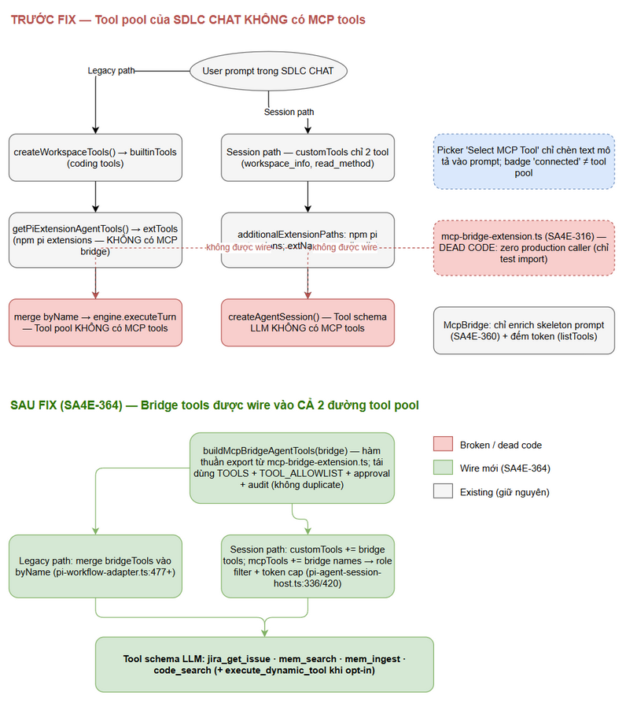
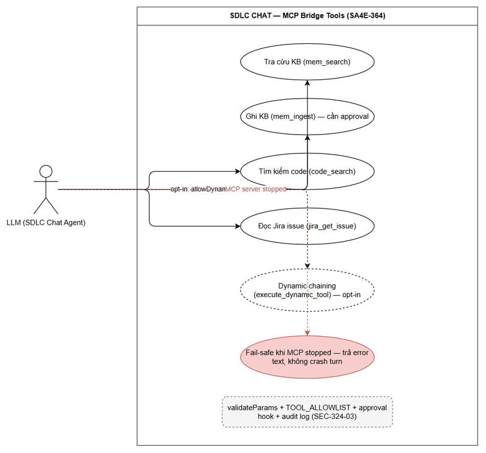

# Business Requirements Document (BRD)

## SA4E-364 — [SDLC Chat] Wire MCP tools của extension vào chat agent (mcp-bridge-extension là dead code)

---

## Document Information

| Field | Value |
|-------|-------|
| Jira Ticket | SA4E-364 |
| Type / Priority | Bug / High |
| Title | [SDLC Chat] MCP tools của extension không được wire vào chat agent — mcp-bridge-extension (SA4E-316) là dead code |
| Author | BA Agent |
| Version | 1.0 |
| Date | 2026-10-15 |
| Status | Ready for review |
| Related documents | `SA4E-364-FINDINGS.md` (repo root — điều tra + verify bằng code ngày 2026-10-15) |
| Diagrams | `documents/SA4E-364/diagrams/` (business-flow, use-case) |

---

## Revision History

| Version | Date | Author | Changes |
|---------|------|--------|---------|
| 1.0 | 2026-10-15 | BA Agent | Bản đầu — chuyển hóa findings đã verify (SA4E-364-FINDINGS.md) thành BRD bug fix |

---

## 1. Problem Statement

Cửa sổ chat **SDLC CHAT** (webview của extension) hiển thị badge `SDLC PIPELINE connected`, nhưng LLM chạy trong chat **không có bất kỳ MCP tool nào của extension** trong tool schema gửi lên model:

- Không gọi được `mem_search`, `mem_ingest`, `code_search` (KB / code-intelligence) và `jira_get_issue` (Jira).
- Không có `execute_dynamic_tool`.
- Picker "Select MCP Tool" (`ChatContextPicker`) chỉ chèn **text mô tả** tool vào prompt — LLM "thấy tên" nhưng không invoke được.
- Badge "connected" chỉ phản ánh trạng thái `McpServerManager` (server MCP đang chạy) — không liên quan tới tool pool của agent.

**Impact (vì sao là Bug/High):**

| Diện | Hậu quả |
|------|---------|
| Năng lực SDLC trong chat | LLM mất khả năng **zero-context SDLC**: không tra được KB (rules, patterns, lessons learned), không đọc được Jira, không search được code → câu trả lời về dự án phải làm "mù", người dùng phải tự fetch context ra ngoài |
| Đầu tư đã chi | Bridge extension SA4E-316 (5 tool bridge + allowlist + approval + audit) đã xây đúng chuẩn bảo mật nhưng là **dead code** — 0% giá trị kinh doanh |
| Tin cậy UI | Badge "connected" + picker MCP tạo ảo giác tools khả dụng — gây hiểu nhầm cho người dùng, khó debug |

---

## 2. Root Cause Summary

Tool pool của chat agent được lắp từ **2 đường độc lập** — cả 2 đều không có MCP tools; bridge extension (SA4E-316) tồn tại nhưng **không được gọi ở bất kỳ đâu trong production** (đã verify bằng code, ngày 2026-10-15).

| # | Thành phần | Vị trí (file:line) | Vấn đề | Trạng thái |
|---|-----------|--------------------|--------|------------|
| RC-1 | **Legacy path** — merge `builtinTools` + `extTools` | `extension/src/pi-workflow/pi-workflow-adapter.ts:477-494` | Nguồn `getPiExtensionAgentTools()` chỉ tải npm pi extension packages (`pi-extension-loader.ts:13-20`: billion-context-pi, pi-web-access, rpiv-todo, rpiv-ask-user-question, pi-subagents, aft-pi) — **không có MCP bridge** | Đứt |
| RC-2 | **Session path** — `createAgentSession` | `extension/src/pi-workflow/pi-agent-session-host.ts:310-426` | `customTools` chỉ có 2 tool (workspace_info, read_method — dòng 421-424); `extNames` (dòng 321-322) chỉ lấy tên tool npm extensions; `tools: allowlist` lọc theo các tên đó | Đứt |
| RC-3 | **Bridge extension** `mcpBridgeExtension` | `extension/src/pi-agent/extensions/mcp-bridge-extension.ts` | Viết đúng chuẩn (5 tool bridge, allowlist, approval, audit — SEC-324-03) nhưng grep toàn `extension/src` → chỉ test import, **zero production caller** | Dead code |
| RC-4 | `McpBridge` instance có sẵn | `pi-workflow-adapter.ts:78`; dùng tại `pi-agent-session-host.ts:313` và `pi-workflow-adapter.ts:159` | Chỉ dùng để (1) enrich skeleton system prompt (SA4E-360) và (2) `listTools()` **đếm token** cho context-usage meter — không register tool | Dùng sai mục đích |

Ngoài ra: Picker MCP (`ChatContextPicker.ts:148-174`) fetch `tools/list` rồi trả `ContextItem` dạng text — không callable.

*[Edit in draw.io](diagrams/business-flow.drawio)*

---

## 3. Business Goals & Objectives

| # | Goal | Objective đo được | Gắn AC |
|---|------|-------------------|--------|
| G-1 | Khôi phục năng lực zero-context SDLC trong chat | LLM trong SDLC CHAT gọi được ≥4 tool bridge (KB / Jira / code search) từ tool schema, ở cả 2 đường | AC-1, AC-2 |
| G-2 | Sử dụng lại tài sản đã xây (no-workaround) | Bridge SA4E-316 được wire qua hàm thuần export — KHÔNG duplicate allowlist, KHÔNG tạo wrapper mới | AC-6 |
| G-3 | Giữ nguyên posture bảo mật | `execute_dynamic_tool` deny-by-default; approval + audit hoạt động như hiện trạng | AC-3 |
| G-4 | Ổn định khi MCP degraded | MCP server stopped → chat không crash, tool call trả error text rõ ràng | AC-4 |
| G-5 | Tương thích governance hiện có | Bridge tools chịu role filter + schema-token cap ở session path (SA4E-355) | AC-5 |

### Success Metrics

- 100% suite test extension pass sau fix, không regression (AC-6).
- Từ chat: lệnh *"search KB: personalized rules"* → LLM gọi `mem_search` thành công, kết quả hiển thị qua `MCP_TOOL_RESULT` trên webview (AC-2).
- Tool schema gửi LLM chứa ≥4 bridge tools ở **cả 2 đường** legacy + session (AC-1).
- 0 trường hợp `execute_dynamic_tool` xuất hiện trong schema khi chưa opt-in (AC-3).

*[Edit in draw.io](diagrams/use-case.drawio)*

---

## 4. Scope

### 4.1 In Scope

| # | Hạng mục | Chi tiết |
|---|----------|----------|
| S-1 | Export hàm thuần từ bridge extension | `buildMcpBridgeAgentTools(bridge: McpBridge, options?: BridgeOptions): AgentTool[]` — trả `AgentTool[]` (shape khớp `getPiExtensionAgentTools().tools`); tái dùng `TOOLS`, `validateParams`, `TOOL_ALLOWLIST`, `DYNAMIC_TOOL_NAME`, `bridgeRequiresApproval`, audit log; `execute` gọi `bridge.callTool()`, bắt `McpServerNotRunningError` → error text (fail-safe, không crash turn) |
| S-2 | Wire legacy path | `pi-workflow-adapter.ts` sau dòng 477: build bridge tools từ `this.mcpBridge`, merge vào `byName` cùng `builtinTools` + `extTools` |
| S-3 | Wire session path | `pi-agent-session-host.ts`: thêm bridge tools vào `customTools` (dòng 420-423) qua `toSessionToolDefinition`; thêm tên bridge tools vào `mcpTools` của `buildSessionToolLoadout` (dòng 329-336) → tự chịu role filter + schema-token cap |
| S-4 | Unit tests | Wiring cả 2 path; suite hiện có không regression |

Thay đổi giới hạn trong **3 file**: `mcp-bridge-extension.ts`, `pi-workflow-adapter.ts`, `pi-agent-session-host.ts` (+ tests).

### 4.2 Out of Scope

| # | Hạng mục | Lý do |
|---|----------|-------|
| O-1 | `WrapperServer.MAX_BODY_SIZE` (1MB → nâng + trả 413 JSON-RPC sạch) | Đã điều tra riêng ngày 2026-10-15 (thử nghiệm: 1MB ✅, 1.5MB ✅, 2MB ❌; backend bodyLimit 100MB + MCP SDK transport 4MB không phải thủ phạm). Là defect riêng — đề xuất fix ở ticket riêng, **không gộp vào SA4E-364** để giữ scope sạch (findings §7) |
| O-2 | Duplicate allowlist / validation logic | Bắt buộc tái dùng `TOOL_ALLOWLIST` + `validateParams` sẵn có (no-workaround-rule) |
| O-3 | Tạo wrapper/service mới quanh McpBridge | Dùng đúng mechanism hiện có |
| O-4 | Thay đổi UI picker / badge | Root cause không nằm ở UI; picker vẫn là context text |
| O-5 | Điều tra lại root cause | Findings đã verify bằng code ngày 2026-10-15 (branch `SA4E-363`, commit `cdccd97`) |

---

## 5. Acceptance Criteria

Y nguyên từ `SA4E-364-FINDINGS.md` §4 (không thêm, không bớt):

| # | Tiêu chí |
|---|----------|
| AC-1 | Session SDLC CHAT (cả 2 path) expose ≥4 tool bridge `jira_get_issue, mem_search, mem_ingest, code_search` trong tool schema gửi LLM |
| AC-2 | Từ chat, LLM gọi được `mem_search` và kết quả hiển thị qua `MCP_TOOL_RESULT` trên webview |
| AC-3 | `execute_dynamic_tool` KHÔNG có trong tool schema trừ khi opt-in |
| AC-4 | MCP server stopped → chat vẫn hoạt động; tool call trả error text rõ ràng |
| AC-5 | Bridge tools chịu role filter + schema-token cap ở session path |
| AC-6 | Unit test cho wiring cả 2 path; suite hiện có không regression |

---

## 6. Non-Functional Requirements

Posture bảo mật **giữ nguyên hiện trạng** của bridge extension — fix chỉ wire, không nới lỏng:

| Category | Requirement | Details | Ref |
|----------|-------------|---------|-----|
| Security | Dynamic chaining deny-by-default | `execute_dynamic_tool` chỉ register/callable khi opt-in `allowDynamicChaining=true`; chained target phải nằm trong `TOOL_ALLOWLIST` | SEC-324-03 |
| Security | Approval + audit | Approval hook cho tool nhạy cảm (`mem_ingest`, dynamic chaining); mọi invocation decision được ghi audit log (không log param values) | SEC-324-03 |
| Security | Fail-closed transport | `McpBridge` require `IServerManager` thật — không fallback hardcoded URL (legacy factory đã xóa) | SEC-332-09 |
| Reliability | Fail-safe khi MCP stopped | `McpServerNotRunningError` → trả error text cho LLM; không crash turn, không treo chat | AC-4 |
| Performance | Schema-token cap | Bridge tools đi qua role filter + schema-token cap của `buildSessionToolLoadout` (SA4E-355); budget gate `runSessionBudgetGate` chạy TRƯỚC `createAgentSession` — provider không bao giờ nhận request quá hạn mức | AC-5 |
| Compatibility | Không duplicate mechanism | Tái dùng `TOOLS`, `TOOL_ALLOWLIST`, `validateParams`, approval classifier hiện có | G-2 |

---

## 7. Stakeholders & Impact

| Role / Team | Vai trò | Impact |
|-------------|---------|--------|
| Người dùng SDLC CHAT (dev/BA/QA/SM trong pipeline) | End user của chat | Dùng đầy đủ KB / Jira / code-search ngay trong hội thoại — zero-context SDLC hoạt động |
| Product Owner | Chấp nhận business value | Tài sản SA4E-316 chuyển từ dead code thành capability hữu dụng |
| Dev (extension team) | Implement theo findings | Chỉnh 3 file + tests; không đụng security posture |
| SM / Pipeline agents | Người tiêu dùng gián tiếp | Agent chạy qua chat có KB-first, Jira, code intelligence — giảm thời gian xử lý ticket |

---

## 8. Dependencies & Related Tickets

| Ticket | Quan hệ | Ảnh hưởng tới SA4E-364 |
|--------|---------|------------------------|
| SA4E-316 | Bridge extension gốc | Cung cấp `mcp-bridge-extension.ts` + tool definitions — hiện dead code, được wire bởi ticket này |
| SA4E-333 / SA4E-334 | Pi extension runtime — 2 đường tool assembly | Định nghĩa 2 điểm wire (legacy + session) |
| SA4E-355 | Role-aware loadout + schema-token cap | Session path phải đưa bridge tools qua loadout governance |
| SA4E-360 | Skeleton runtime + Pi SDK gateway | `McpBridge` hiện chỉ dùng cho skeleton prompt enrichment — giữ nguyên hành vi này |

Dependency kỹ thuật: `McpBridge` instance đã có sẵn ở `pi-workflow-adapter.ts:78` (từ `opts.mcpManager`); `IServerManager` là dependency bắt buộc (fail-closed).

---

## 9. Risks & Mitigations

| # | Risk | Impact | Likelihood | Mitigation |
|---|------|--------|------------|------------|
| R-1 | **Schema-token cap khi thêm 4+ tools**: tool schema tăng → session path có thể vượt budget / escalate sớm (drop tools — BR-08) | Medium | Medium | Đưa bridge tools vào `mcpTools` của `buildSessionToolLoadout` để tự chịu cap (AC-5); đo `schemaTokens` qua budget gate trước `createAgentSession`; theo dõi `PI_GATE_DECISION` sau fix |
| R-2 | **MCP server stopped** lúc chat đang chạy → tool call fail | Medium | High (máy dev thường restart MCP) | `execute` bắt `McpServerNotRunningError` → trả error text rõ ràng; chat tiếp tục hoạt động (AC-4); khớp nguyên tắc fail-safe "bridge-absent ⇒ DEGRADED" của SA4E-360 |
| R-3 | **Regression tool pool hiện có**: merge sai thứ tự / tên trùng có thể ghi đè builtin tools hoặc phá AFT hoist | High | Low | Giữ merge semantics hiện có (extension wins; bridge merge sau, không đè core tools); dedupe theo tên như hiện trạng; unit test cả 2 path (AC-6); "suite không regression" là điều kiện merge |
| R-4 | Approval hook chưa được truyền khi wire ở production → `mem_ingest` / dynamic chaining auto-approve | Medium | Low | Giữ `bridgeRequiresApproval` + `defaultAuditLog` sẵn có; FSD/TDD phải ghi rõ yêu cầu truyền `approvalHook`/`auditLog` (hoặc document hiện trạng auto-approve như behavior đã review bảo mật) |
| R-5 | Trùng tên tool nếu npm extensions sau này thêm tool trùng bridge | Low | Low | Giữ Business Rule BR-1 của bridge: tên trùng → skip + warn |

---

## 10. Verification Approach

4 steps từ findings §5:

1. **Unit tests** — `npm test` trong `extension/`: toàn bộ pass (đặc biệt `mcp-bridge-extension.test.ts`, `tool-loadout-*.test.ts`, `pi-agent-session-host.test.ts`) → AC-6, AC-3, AC-5 ở mức test.
2. **E2E manual** — build + load extension vào Kiro/VSCode, mở SDLC CHAT, yêu cầu *"search KB: personalized rules"* → LLM gọi `mem_search` thành công, kết quả về webview qua `MCP_TOOL_RESULT` → AC-1, AC-2.
3. **Debug log** — `[PiWorkflowAdapter]` / `[PiSessionHost]` hiển thị bridge tools trong allowlist / tool count → xác nhận wiring cả 2 đường.
4. **Degraded mode** — stop MCP server → chat vẫn trả lời; tool call trả error text thay vì treo/crash → AC-4.

---

## 11. Diagram Index

| Image | Source (.drawio) |
|-------|------------------|
|  | `documents/SA4E-364/diagrams/business-flow.drawio` |
|  | `documents/SA4E-364/diagrams/use-case.drawio` |

---

## 12. Appendix

### Glossary

| Term | Definition |
|------|------------|
| SDLC CHAT | Webview chat của extension, chạy LLM qua Pi runtime (2 đường tool assembly: legacy + session) |
| Tool pool / tool schema | Tập tool + JSON schema gửi kèm request tới LLM — quyết định LLM có thể invoke gì |
| McpBridge | Class proxy gọi MCP tools qua `IServerManager` (`extension/src/mcp/mcp-bridge.ts`) |
| Bridge tools | 5 tool do `mcp-bridge-extension.ts` định nghĩa: `jira_get_issue`, `mem_search`, `mem_ingest`, `code_search`, `execute_dynamic_tool` (opt-in) |
| Zero-context SDLC | Nguyên tắc agent tra KB/Jira/code qua tools thay vì nhồi context đầy đủ vào prompt |
| Role filter / schema-token cap | Governance của SA4E-355: lọc tool theo role/phase dưới hạn mức token schema |
| MCP_TOOL_RESULT | Loại message webview hiển thị kết quả tool call trong chat |

### Reference Documents

| Document | Location |
|----------|----------|
| Findings (root cause đã verify + thiết kế fix) | `SA4E-364-FINDINGS.md` (repo root) |
| Bridge extension (dead code hiện tại) | `extension/src/pi-agent/extensions/mcp-bridge-extension.ts` |
| Legacy tool assembly | `extension/src/pi-workflow/pi-workflow-adapter.ts:477-494` |
| Session tool assembly | `extension/src/pi-workflow/pi-agent-session-host.ts:310-426` |
| Pi extension loader (npm packages) | `extension/src/pi-workflow/pi-extension-loader.ts:13-20` |
| MCP Picker (context text only) | `extension/src/chat-panel/ChatContextPicker.ts:148-174` |
