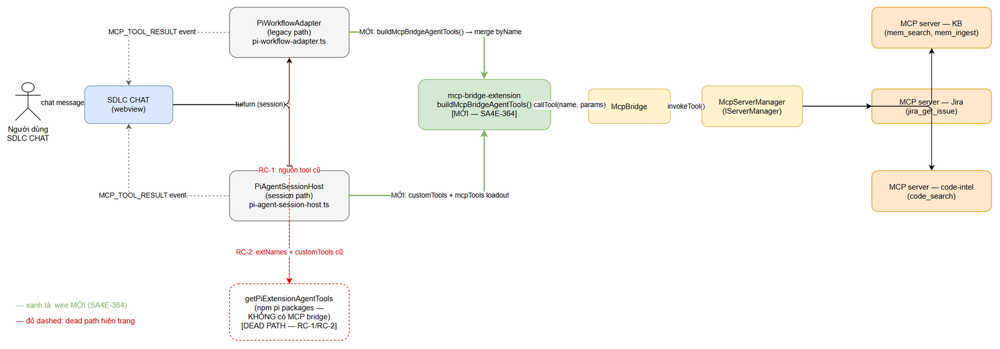
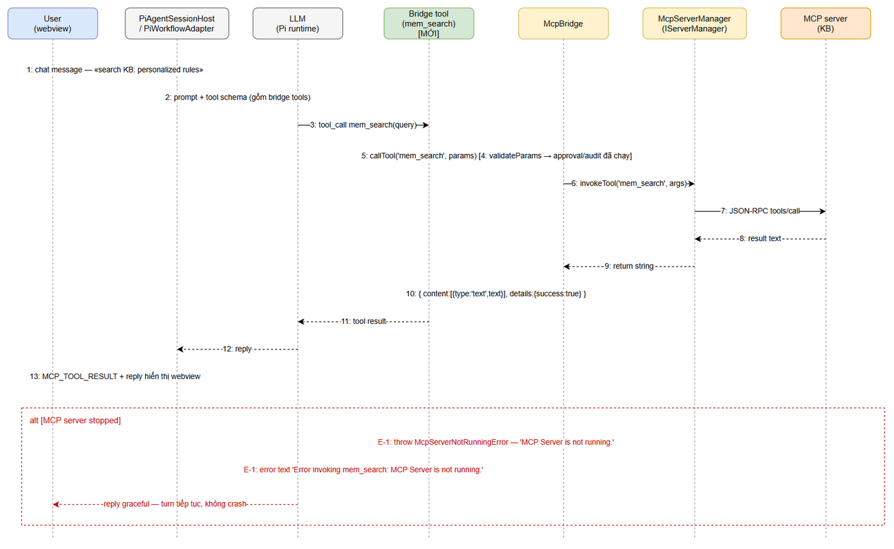
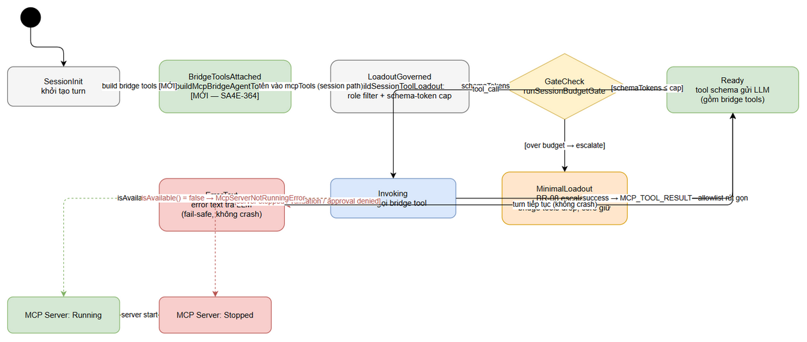

# Functional Specification Document (FSD)

## SDLC Chat Extension — SA4E-364: Wire MCP tools của extension vào chat agent (mcp-bridge-extension là dead code)

---

## Document Information

| Field | Value |
|-------|-------|
| Jira Ticket | SA4E-364 |
| Type / Priority | Bug / High |
| Title | [SDLC Chat] MCP tools của extension không được wire vào chat agent — mcp-bridge-extension (SA4E-316) là dead code |
| Author | BA Agent (FSD draft); TA Agent (technical enrichment v1.1) |
| Reviewer kế tiếp | SA Agent (TDD) |
| Version | 1.1 |
| Date | 2026-10-16 |
| Status | TA enrichment complete — ready for TDD |
| Related BRD | `documents/SA4E-364/BRD.md` |
| Related Findings | `SA4E-364-FINDINGS.md` (repo root — root cause đã verify bằng code ngày 2026-10-15, branch `SA4E-363`, commit `cdccd97`) |

---

## Revision History

| Version | Date | Author | Changes |
|---------|------|--------|---------|
| 1.0 | 2026-10-15 | BA Agent | FSD draft — đầy đủ nghiệp vụ + luồng + data + lỗi. Section API contracts kỹ thuật sâu để dành cho TA enrichment |
| 1.1 | 2026-10-16 | TA Agent | Enrichment kỹ thuật: chốt 6 Open Issues (dựa trên code thực tế, không đoán); thêm Section 3.5 API Contracts + pseudocode (3 hàm) + error contract; verify Data Model khớp code (pi-agent-core AgentTool, SDK ToolDefinition, BridgeOptions); FR-09 mới (override prompt metadata session path); NFR định lượng (TOOL_SCHEMA_BUDGET_RATIO=0.25, schema-token ước tính, fail-safe latency); bổ sung verification notes cho AC-3/AC-5. Giữ nguyên 3 diagrams — không đổi luồng |

---

## 1. Feature Overview

### 1.1 Mục tiêu fix

Khôi phục năng lực **zero-context SDLC** cho LLM chạy trong SDLC CHAT: wire 5 tool bridge đã xây ở SA4E-316 (hiện là dead code — grep toàn bộ `extension/src` chỉ thấy test import) vào **cả 2 đường tool pool** của chat agent. Nguyên tắc: tái dùng mechanism sẵn có, KHÔNG duplicate allowlist, KHÔNG tạo wrapper mới, KHÔNG nới lỏng security posture (SEC-324-03 / SEC-332-09).

| # | Mục tiêu | Gắn AC |
|---|----------|--------|
| F-1 | LLM thấy + gọi được ≥4 tool bridge (`jira_get_issue`, `mem_search`, `mem_ingest`, `code_search`) ở cả legacy path và session path | AC-1, AC-2 |
| F-2 | Tái sử dụng nguyên vẹn `TOOLS` / `TOOL_ALLOWLIST` / `validateParams` / `bridgeRequiresApproval` / audit của bridge extension — KHÔNG duplicate | AC-6 |
| F-3 | `execute_dynamic_tool` deny-by-default — chỉ xuất hiện trong schema khi opt-in `allowDynamicChaining=true` | AC-3 |
| F-4 | MCP server stopped → tool call trả error text rõ ràng; chat không crash, không treo | AC-4 |
| F-5 | Bridge tools ở session path chịu role filter + schema-token cap của `buildSessionToolLoadout` (SA4E-355) | AC-5 |

### 1.2 Phạm vi chức năng (In Scope)

| # | Hạng mục | File |
|---|----------|------|
| S-1 | Export hàm thuần `buildMcpBridgeAgentTools(bridge: McpBridge, options?: BridgeOptions): AgentTool[]` — trả mảng tool shape khớp `getPiExtensionAgentTools().tools`; tái dùng `TOOLS`, `validateParams`, `TOOL_ALLOWLIST`, `DYNAMIC_TOOL_NAME`, `bridgeRequiresApproval`, audit log; `execute` gọi `bridge.callTool()`, bắt `McpServerNotRunningError` → error text fail-safe | `extension/src/pi-agent/extensions/mcp-bridge-extension.ts` |
| S-2 | Wire legacy path — sau `getPiExtensionAgentTools`, build bridge tools từ `this.mcpBridge` và merge vào map `byName` cùng `builtinTools` + `extTools` | `extension/src/pi-workflow/pi-workflow-adapter.ts` (vùng ~477-494) |
| S-3 | Wire session path — thêm bridge tools vào `customTools` của `createAgentSession` qua `toSessionToolDefinition`; thêm tên bridge tools vào `mcpTools` của `buildSessionToolLoadout` | `extension/src/pi-workflow/pi-agent-session-host.ts` (vùng ~330-426) |
| S-4 | Unit test wiring cả 2 path; suite hiện có không regression | `extension/src/**/__tests__` |

### 1.3 Out of Scope

- `WrapperServer.MAX_BODY_SIZE` (1MB) — defect riêng, đã điều tra ngày 2026-10-15 (findings §7), fix ở ticket khác.
- UI picker / badge — không đổi (root cause không nằm ở UI).
- Duplicate allowlist / validation / wrapper service mới quanh McpBridge.
- Điều tra lại root cause (đã verify).

### 1.4 Kiến trúc ngữ cảnh

Tool pool của chat agent được lắp từ 2 đường độc lập; fix thêm đường thứ 3 (bridge tools) vào **cả hai**:

- **Legacy path** — `PiWorkflowAdapter.runTurn`: `createWorkspaceTools` + `getPiExtensionAgentTools` → merge theo tên vào map `byName` ("extension wins") → `engine.executeTurn`. Trước provider call có budget gate `governLegacyTurnOrReject` đo full request gồm tool schemas.
- **Session path** — `createAgentSession` trong `pi-agent-session-host.ts`: loadout governance (`buildSessionToolLoadout` theo role/phase + `schemaTokenCap`) → `runSessionBudgetGate` (REJECT/WARN) → `customTools` + `tools: allowlist`.
- **Bridge** — `mcp-bridge-extension.ts` định nghĩa 5 tool, `McpBridge.callTool()` proxy qua `IServerManager.invokeTool()` tới MCP server (timeout protection, `_as_path` → base64 interception). Kết quả tool hiển thị webview qua event `MCP_TOOL_RESULT` (mapping `chat:toolCallUpdate` trong `StreamProtocolAdapter`).


*[Edit in draw.io](diagrams/system-context.drawio)*

> **Đọc diagram:** đường **xanh lá** = wire MỚI (SA4E-364); đường **đỏ nét đứt** = dead path hiện trạng (getPiExtensionAgentTools chỉ tải npm pi packages — không có MCP bridge). `MCP_TOOL_RESULT` là event webview sẵn có, không đổi.

---

## 2. Use Cases

### UC-01 — LLM gọi bridge tool qua legacy path

| | |
|---|---|
| **Actor** | LLM trong SDLC CHAT (chạy qua `PiWorkflowEngine.executeTurn`) |
| **Precondition** | Extension host chạy; `McpServerManager` đã init (adapter `opts.mcpManager`); turn rơi vào legacy path (session path không khả dụng hoặc `trySessionTurn` fail) |
| **Trigger** | User gửi chat message cần KB / Jira / code context (vd: *"search KB: personalized rules"*) |
| **Postcondition** | Tool result (hoặc error text) về LLM; turn tiếp tục; kết quả hiển thị webview qua `MCP_TOOL_RESULT` |
| **Linked AC** | AC-1, AC-2, AC-4 |

**Main Flow:**

| Step | Actor | Hành động / Phản hồi |
|------|-------|----------------------|
| 1 | User | Gửi message trong SDLC CHAT |
| 2 | PiWorkflowAdapter | `trySessionTurn` fail → fallback legacy: `buildWorkspaceSystemPrompt`, `createWorkspaceTools`, `getPiExtensionAgentTools` |
| 3 | PiWorkflowAdapter | **[MỚI]** `buildMcpBridgeAgentTools(this.mcpBridge)` → bridge tools merge vào `byName` (tên trùng → skip + warn) |
| 4 | PiWorkflowAdapter | `governLegacyTurnOrReject` — budget gate đo full request (gồm tool schemas của bridge tools) |
| 5 | LLM | Nhận tool schema gồm bridge tools → quyết định tool_call `mem_search(query)` |
| 6 | Bridge tool | `validateParams` → approval/audit (nếu cần) → `bridge.callTool("mem_search", params)` |
| 7 | McpServerManager | `invokeTool()` → MCP server (KB) → result text |
| 8 | Bridge tool | Trả `{ content: [{type:'text', text}], details: { toolName, success: true } }` |
| 9 | Webview | `MCP_TOOL_RESULT` hiển thị kết quả; LLM soạn reply cho user |

**Alternative Flows:**

| ID | Condition | Steps |
|----|-----------|-------|
| AF-1 | Tên bridge tool trùng tool builtin/ext có sẵn | Skip bridge tool + warn (BR-06); pool giữ nguyên tool hiện có — không đè AFT hoist |
| AF-2 | Extension runtime fail (`getPiExtensionAgentTools` throw) | `extTools = []`; bridge tools vẫn được merge độc lập (wiring không phụ thuộc npm extensions) |

**Exception Flows:**

| ID | Condition | Steps |
|----|-----------|-------|
| EF-1 | MCP server stopped khi gọi tool | `bridge.callTool` throw `McpServerNotRunningError` → execute handler bắt → error text (UC-04); turn không crash |
| EF-2 | Request over budget | `governLegacyTurnOrReject` REJECT → `PI_CONTEXT_BUDGET_EXCEEDED`; provider không được gọi |

---

### UC-02 — LLM gọi bridge tool qua session path

| | |
|---|---|
| **Actor** | LLM trong SDLC CHAT (chạy qua Pi `createAgentSession`) |
| **Precondition** | `pi-agent-session-host.ts` khởi tạo session thành công; role/phase được truyền vào host (SA4E-355) |
| **Trigger** | User gửi chat message được handle qua session turn |
| **Postcondition** | Session có bridge tools trong tool schema (sau role filter + token cap); tool call kết quả về webview |
| **Linked AC** | AC-1, AC-2, AC-5 |

**Main Flow:**

| Step | Actor | Hành động / Phản hồi |
|------|-------|----------------------|
| 1 | User | Gửi message; `PiWorkflowAdapter` gọi `trySessionTurn` |
| 2 | PiAgentSessionHost | `resolveSessionGovernance` → budget / tier / shouldCompress |
| 3 | PiAgentSessionHost | `createSkeletonRuntime(opts.mcpBridge)` + `buildSkeletonSections` (SA4E-360 — giữ nguyên) |
| 4 | PiAgentSessionHost | **[MỚI]** `buildMcpBridgeAgentTools(bridge)` → `bridgeTools: AgentTool[]` |
| 5 | PiAgentSessionHost | **[MỚI]** Tên bridge tools ghép vào `mcpTools` của `buildSessionToolLoadout` (cùng `extNames`) → role filter + schema-token cap tự áp dụng |
| 6 | PiAgentSessionHost | `runSessionBudgetGate` với `toolSchemaTokens = loadout.schemaTokens` (REJECT/WARN) |
| 7 | PiAgentSessionHost | `createAgentSession({ customTools: [...2 tool hiện có, ...bridge tools qua toSessionToolDefinition + override promptSnippet/promptGuidelines = undefined (FR-09)], tools: allowlist })` |
| 8 | LLM | Nhận schema gồm bridge tools (theo role/phase) → tool_call (vd `jira_get_issue("SA4E-364")`) |
| 9 | Webview | `MCP_TOOL_RESULT` hiển thị kết quả |

**Alternative Flows:**

| ID | Condition | Steps |
|----|-----------|-------|
| AF-1 | Gate escalate (BR-08 — minimal loadout) | Allowlist rơi về core file tools; bridge tools bị drop — session vẫn chạy không bridge tools |
| AF-2 | Role filter loại tool theo role/phase | Tool không phù hợp role không vào schema (SA4E-355 — hành vi mong muốn) |

**Exception Flows:**

| ID | Condition | Steps |
|----|-----------|-------|
| EF-1 | Over budget sau escalate | `PI_CONTEXT_BUDGET_EXCEEDED` (BR-09 SA4E-355) — provider không được gọi |
| EF-2 | MCP server stopped khi gọi tool | Error text fail-safe (UC-04) |

---

### UC-03 — Gọi `execute_dynamic_tool` (opt-in)

| | |
|---|---|
| **Actor** | LLM trong SDLC CHAT |
| **Precondition** | Bridge tools được build với `allowDynamicChaining=true` (opt-in tường minh) |
| **Trigger** | LLM cần gọi một MCP tool cụ thể bằng cách chain qua dynamic tool |
| **Postcondition** | Tool đích (nằm trong `TOOL_ALLOWLIST`) được thực thi qua bridge; audit ghi "approved" |
| **Linked AC** | AC-3 |

**Main Flow:**

| Step | Actor | Hành động / Phản hồi |
|------|-------|----------------------|
| 1 | LLM | Thấy `execute_dynamic_tool` trong schema (chỉ khi opt-in) |
| 2 | LLM | tool_call `{ tool_name: "mem_ingest", arguments: {...} }` |
| 3 | Bridge tool | `validateParams` (schema của dynamic tool) — pass |
| 4 | Bridge tool | `validateChainedTarget`: `tool_name` ∈ `TOOL_ALLOWLIST` (BR-02) — pass |
| 5 | Bridge tool | `bridgeRequiresApproval("execute_dynamic_tool") = true` → approvalHook → audit `"approved"` |
| 6 | McpServerManager | `bridge.callTool("mem_ingest", arguments)` → result text |

**Alternative Flows:**

| ID | Condition | Steps |
|----|-----------|-------|
| AF-1 | `allowDynamicChaining !== true` | Tool **không được register / không có trong schema** (AC-3); nếu vẫn bị gọi → deny text |

**Exception Flows:**

| ID | Condition | Steps |
|----|-----------|-------|
| EF-1 | Chained target không thuộc `TOOL_ALLOWLIST` | Deny + audit: *"Dynamic tool chaining denied: '{x}' is not allowlisted"* — `details.error = 'chaining_denied'` |
| EF-2 | approvalHook trả `false` | Deny + audit: *"Tool call denied by approval: execute_dynamic_tool"* — `details.error = 'approval_denied'` |

---

### UC-04 — MCP server stopped → error text fail-safe

| | |
|---|---|
| **Actor** | LLM trong SDLC CHAT; MCP server (trạng thái stopped) |
| **Precondition** | `McpServerManager.isAvailable() = false` (server stopped); bridge tools vẫn trong schema (wiring không phụ thuộc trạng thái server) |
| **Trigger** | LLM gọi một bridge tool bất kỳ |
| **Postcondition** | LLM nhận error text rõ ràng; turn tiếp tục; chat không crash, không treo |
| **Linked AC** | AC-4 |

**Main Flow:**

| Step | Actor | Hành động / Phản hồi |
|------|-------|----------------------|
| 1 | LLM | tool_call `mem_search(query)` như bình thường |
| 2 | McpBridge | `callTool` → `!isAvailable()` → throw `McpServerNotRunningError` ("MCP Server is not running.") |
| 3 | Bridge tool | Catch trong execute handler → trả `{ content: [{ text: "Error invoking mem_search: MCP Server is not running." }], details: { error: 'mcp_error', toolName: 'mem_search', cause } }` |
| 4 | LLM | Nhận error text → trả lời user một cách graceful (vd: gợi ý start MCP server rồi thử lại) |
| 5 | Webview | Chat hiển thị reply; turn kết thúc bình thường |

**Alternative Flows:**

| ID | Condition | Steps |
|----|-----------|-------|
| AF-1 | Tool call vượt timeout | `McpToolTimeoutError` → error text tương tự dạng *"Error invoking {tool}: MCP tool '{tool}' timed out after {ms}ms."* |

**Exception Flows:**

| ID | Condition | Steps |
|----|-----------|-------|
| EF-1 | MCP server start lại giữa conversation | Tool call kế tiếp thành công bình thường (không cần restart chat) |

**Sequence tổng quát** (luồng tool call thành công + nhánh exception `McpServerNotRunningError`):


*[Edit in draw.io](diagrams/sequence-tool-call.drawio)*

---

## 3. Functional Requirements

> Trace đầy đủ FR ↔ UC ↔ AC xem **Section 11 — Traceability**.

| ID | Requirement | Chi tiết kỹ thuật (file / hàm) | Trace AC |
|----|-------------|-------------------------------|----------|
| FR-01 | Export API `buildMcpBridgeAgentTools(bridge: McpBridge, options?: BridgeOptions): AgentTool[]` từ `mcp-bridge-extension.ts` — trả mảng tool shape khớp `pi-agent-core` (giống `getPiExtensionAgentTools().tools`) | Tái dùng `TOOLS`, `validateParams`, `TOOL_ALLOWLIST`, `DYNAMIC_TOOL_NAME`, `bridgeRequiresApproval`, audit log sẵn có; `execute` gọi `bridge.callTool(name, params)`; KHÔNG duplicate logic — chỉ gói lại thành hàm thuần | AC-1 (nền tảng) |
| FR-02 | Wire legacy path: build bridge tools từ `this.mcpBridge` và merge vào map `byName` cùng `builtinTools` + `extTools` | `pi-workflow-adapter.ts` sau dòng `getPiExtensionAgentTools` (~477-494); **merge order chốt (OI-06): builtin → ext (last-wins, giữ AFT hoist hiện có) → bridge cuối cùng với skip-if-exists** (tên trùng → skip + debug warn, bridge KHÔNG đè — khác semantics last-wins của vòng builtin/ext hiện có); bridge tools đi qua `governLegacyTurnOrReject` như mọi tool khác (đo `tools[]` gồm bridge schemas) | AC-1, AC-2 |
| FR-03 | Wire session path: thêm bridge tools vào `customTools` của `createAgentSession` qua `toSessionToolDefinition`; thêm tên vào `mcpTools` của `buildSessionToolLoadout` | `pi-agent-session-host.ts` (~330-426): `customTools` hiện có 2 tool (workspace_info, read_method) — thêm bridge tools; `mcpTools` hiện chỉ có `nameTools(extNames)` (dòng 336) — ghép thêm tên bridge tools. **Đã verify SDK** (`pi-coding-agent/dist/core/agent-session.js` `_refreshToolRegistry`): `customTools` bị lọc bởi allowlist `tools` (`isAllowedTool`) → tên bridge tools PHẢI có trong `loadout.loadout` → `allowlist` thì tool mới được expose; role filter + cap trên `mcpTools` thực sự có hiệu lực | AC-1, AC-2 |
| FR-04 | Role filter + schema-token cap áp dụng lên bridge tools ở session path | Vì tên bridge tools nằm trong `mcpTools` của `buildSessionToolLoadout` (SA4E-355) → tự chịu role/phase filter + `schemaTokenCap` + escalation BR-08; `runSessionBudgetGate` đo trước `createAgentSession`. Lưu ý ước tính: `nameTools()` ước tính **name-only** (~4-5 token/tool — under-estimate so với schema thật ~35-40 token/tool, nhất quán với cách xử lý `extNames` hiện có); escalation/minimal loadout (`[...baseTools]`) làm rơi tên bridge → SDK lọc customTools → bridge tools bị drop đúng thiết kế | AC-5 |
| FR-05 | `execute_dynamic_tool` deny-by-default — chỉ register/callable khi opt-in `allowDynamicChaining=true`; khi opt-in, chained target phải ∈ `TOOL_ALLOWLIST` | `buildMcpBridgeAgentTools` chỉ emit dynamic tool khi opt-in (tương đương logic skip hiện có của `mcpBridgeExtension`); `validateChainedTarget` giữ nguyên | AC-3 |
| FR-06 | Approval + audit cho tool nhạy cảm (`execute_dynamic_tool`, `mem_ingest`) | `bridgeRequiresApproval` + `approvalHook`/`auditLog` của `BridgeOptions`; `defaultAuditLog` ghi console line có cấu trúc, KHÔNG log param values | SEC-324-03; hỗ trợ AC-3 |
| FR-07 | Fail-safe `McpServerNotRunningError` → error text | `bridge.callTool` throw khi `!isAvailable()`; execute handler bắt mọi error → trả `{ content: [{type:'text', text: "Error invoking {tool}: {cause}"}], details: { error: 'mcp_error' } }` | AC-4 |
| FR-08 | Không crash turn, không phá tool pool hiện có | Merge không đè tool trùng tên; exception luôn return result object (không re-throw); suite hiện có pass — điều kiện merge | AC-6 |
| FR-09 | Session path: override prompt metadata của bridge tools khi qua `toSessionToolDefinition` | **Gap phát hiện khi verify code**: converter hiện có (`workspace-info-tool.ts:172-192`) hardcode `promptSnippet: 'Workspace orientation'` + `promptGuidelines: ['Call get_workspace_info first for exploration or review tasks.']` — nếu dùng nguyên bản, cả 4 bridge tools sẽ mang guidance sai ("gọi get_workspace_info trước") vào system prompt. Fix tại **call site** trong `pi-agent-session-host.ts` (giữ nguyên giới hạn 3 file của BRD): spread kết quả converter rồi ghi đè `promptSnippet: undefined, promptGuidelines: undefined` (SDK `_normalizePromptSnippet` bỏ qua undefined → không inject gì). KHÔNG sửa `workspace-info-tool.ts` | AC-1, AC-2 (chất lượng schema) |

**State diagram tool pool của chat session** (khởi tạo → bridge tools attached → role/token filter → ready; ảnh hưởng của MCP server running/stopped):


*[Edit in draw.io](diagrams/state-tool-pool.drawio)*

<!-- TA enrichment v1.1 -->
### 3.5 API Contracts & Pseudocode (TA enrichment)

> Toàn bộ signature dưới đây đối chiếu trực tiếp với code ngày 2026-10-16: `mcp-bridge-extension.ts` (196 dòng), `tool-definitions.ts`, `mcp-bridge.ts`, `pi-workflow-adapter.ts:28,78,477-494`, `pi-agent-session-host.ts:36-61,300-426`, `workspace-info-tool.ts:172-192`, SDK `@earendil-works/pi-agent-core` `AgentTool` + `@earendil-works/pi-coding-agent` `ToolDefinition` / `_refreshToolRegistry`. Developer có thể implement từ section này mà không cần hỏi thêm.

#### 3.5.1 API — `buildMcpBridgeAgentTools`

```ts
// extension/src/pi-agent/extensions/mcp-bridge-extension.ts (export mới, cùng file với extension entry point)
import type { AgentTool } from '@earendil-works/pi-agent-core';

export type BridgeToolOptions = Pick<
  BridgeOptions,
  'allowDynamicChaining' | 'approvalHook' | 'auditLog'
>;

export function buildMcpBridgeAgentTools(
  bridge: McpBridge,
  options?: BridgeToolOptions
): AgentTool[];
```

| Thành phần | Contract | Ghi chú code-verified |
|---|---|---|
| `bridge: McpBridge` | Instance **đã constructed** — legacy path truyền `this.mcpBridge` (adapter:78, từ `opts.mcpManager` bắt buộc); session path truyền `opts.mcpBridge` (host:313, do adapter inject tại :286) | Vì bridge đã bind `IServerManager`, options **không cần** `serverManager` — dùng `Pick<>` thay vì `BridgeOptions` nguyên bản (interface hiện có bắt buộc `serverManager: IServerManager`) → tránh yêu cầu caller truyền manager thừa |
| `options?: BridgeToolOptions` | `allowDynamicChaining?: boolean` (mặc định deny); `approvalHook?: (toolName, params) => boolean \| Promise<boolean>`; `auditLog?: (entry: BridgeAuditEntry) => void` (mặc định `defaultAuditLog` — console.info, không log param values) | Khớp `BridgeOptions` hiện có (mcp-bridge-extension.ts:32-41); wiring production **không truyền** `allowDynamicChaining` (OI-04) và **không truyền** `approvalHook` (OI-02) |
| Return | `AgentTool[]` — 4 tool (`jira_get_issue`, `mem_search`, `mem_ingest`, `code_search`); 5 nếu `allowDynamicChaining === true` (thêm `execute_dynamic_tool`) | Map 1-1 từ `TOOLS` (tool-definitions.ts:13-79); KHÔNG gọi network, sync, O(n) nhỏ |
| Throw | **Không throw** khi wiring bình thường. Guard riêng: session path phải type-guard `opts.mcpBridge` (typed `unknown` tại host:61) — absent/sai kiểu → trả `[]` (fail-safe degraded, nhất quán "bridge-absent ⇒ DEGRADED" SA4E-360) | Khác entry point `mcpBridgeExtension` (throw fail-closed khi thiếu serverManager — mcp-bridge-extension.ts:158-160) vì hàm này nhận bridge có sẵn |

Shape `AgentTool` trả ra (đối chiếu `pi-agent-core/dist/types.d.ts` — `AgentTool<TParameters, TDetails> extends Tool`):

```ts
{
  name: string;                     // vd 'mem_search' — identity cho byName / allowlist
  label: string;                    // vd 'Memory Search'
  description: string;              // mô tả LLM thấy trong schema
  parameters: unknown;              // JSON schema — truyền THẲNG từ TOOLS[i].parameters
  execute: (
    toolCallId: string,
    params: Record<string, unknown>,   // Static<TParameters> — cast từ Record, khớp pattern hiện có
    signal?: AbortSignal,              // bỏ qua (bridge tự quản timeout 60s)
    onUpdate?: AgentToolUpdateCallback // bỏ qua (không streaming update)
  ) => Promise<AgentToolResult<unknown>>;
}
// AgentToolResult = { content: [{ type: 'text', text: string }], details?: Record<string, unknown>, isError?: boolean }
```

> **TA Note:** `execute` của `createExecuteHandler` hiện có signature `(id, params)` — tương thích vị trí với `(toolCallId, params, signal?, onUpdate?)` của pi-agent-core (tham số thừa bị bỏ qua). Cast kiểu dùng pattern `as unknown as AgentTool` như `workspace-info-tool.ts:168` — không đổi signature handler hiện có.

#### 3.5.2 Pseudocode (a) — `buildMcpBridgeAgentTools` (map TOOLS → AgentTool)

```ts
function buildMcpBridgeAgentTools(bridge, options?): AgentTool[] {
  const audit = options?.auditLog ?? defaultAuditLog;
  const out: AgentTool[] = [];
  const seen = new Set<string>();                    // BR-1: tên unique trong session
  for (const tool of TOOLS) {                        // tool-definitions.ts — nguồn duy nhất
    if (seen.has(tool.name)) { warn(`duplicate: ${tool.name}`); continue; }
    // SEC-324-03: dynamic tool chỉ emit khi opt-in tường minh (khác !== true)
    if (tool.name === DYNAMIC_TOOL_NAME && options?.allowDynamicChaining !== true) continue;
    out.push({
      name: tool.name, label: tool.label,
      description: tool.description, parameters: tool.parameters,
      execute: createExecuteHandler(bridge, tool.name, tool.parameters, { ...options, audit }),
    });
    seen.add(tool.name);
  }
  return out;
}
```

> Reuse 100% `createExecuteHandler` hiện có (mcp-bridge-extension.ts:95-150) — validation/approval/audit/error handling không viết lại. `tools` không được filter theo `TOOL_ALLOWLIST` lúc register (khớp entry point hiện có: `TOOL_ALLOWLIST` chỉ dùng cho `validateChainedTarget`).

#### 3.5.3 Pseudocode (b) — Wiring legacy path (`pi-workflow-adapter.ts`, sau dòng 493)

```ts
// SA4E-364: bridge tools join the pool AFTER builtin + ext; skip-if-exists (BR-06).
const bridgeTools = buildMcpBridgeAgentTools(this.mcpBridge);   // OI-01: luôn bật; OI-02/04: default options
for (const t of bridgeTools) {
  const name = (t as { name?: unknown }).name;
  if (typeof name !== 'string' || !name) continue;
  if (byName.has(name)) {                                       // KHÔNG đè — khác last-wins vòng trên
    debugLog(`[PiWorkflowAdapter] bridge tool skipped (exists): ${name}`);
    continue;
  }
  byName.set(name, t);
}
// byName sau đó → tools[] → governLegacyTurnOrReject đo schemas gồm bridge tools (không đổi)
```

Merge order chốt (OI-06): `builtinTools` → `extTools` (vòng hiện có, last-wins — AFT hoist giữ nguyên) → bridge (skip-if-exists). Bridge tool trùng tên builtin/ext → tool hiện có thắng.

#### 3.5.4 Pseudocode (c) — Wiring session path (`pi-agent-session-host.ts`, vùng 319-426)

```ts
// SA4E-364 OI-03: reuse opts.mcpBridge (typed unknown → narrow trước khi build).
const bridgeTools: AgentTool[] =
  opts.mcpBridge instanceof McpBridge ? buildMcpBridgeAgentTools(opts.mcpBridge) : [];
// (319-329 giữ nguyên) …
const bridgeNames = bridgeTools.map((t) => t.name);
const loadout = buildSessionToolLoadout({
  …, mcpTools: nameTools([...extNames, ...bridgeNames]),   // ← bridge names vào pool chịu role filter + cap
});
// … allowlist không đổi (loadout.loadout | [...baseTools] khi minimal — bridge tự rơi khi escalate)
customTools: [
  toSessionToolDefinition(createWorkspaceInfoTool(…)),      // giữ nguyên 2 tool hiện có
  toSessionToolDefinition(createReadMethodTool(…)),
  …bridgeTools.map((t) => ({                                // FR-09: override prompt metadata
    …toSessionToolDefinition(t as unknown as AgentTool),
    promptSnippet: undefined, promptGuidelines: undefined,  // converter hardcode 'Workspace orientation' → bỏ
  })),
] as never,
```

> **TA Note:** SDK `_refreshToolRegistry` filter `isAllowedTool` trên **cả** customTools (verify trong `pi-coding-agent/dist/core/agent-session.js`) → bridge tools chỉ expose khi tên nằm trong `allowlist`; khi escalation BR-08 rơi về `[...baseTools]`, tên bridge vắng → SDK tự lọc — đúng AF-1 UC-02.

#### 3.5.5 Error Contract (chốt hành vi từng nhánh lỗi — code-verified từ `createExecuteHandler`)

Mỗi nhánh lỗi đều **return result object trong execute handler** — không re-throw ra ngoài turn (BR-08). Audit entry (`BridgeAuditEntry`) luôn ghi **trước** khi return ở mọi nhánh deny/approve:

| # | Điều kiện | Text trả LLM (`content[0].text`) | `details` | Audit `decision` | Ảnh hưởng turn |
|---|---|---|---|---|---|
| EC-1 | `execute_dynamic_tool` khi `allowDynamicChaining !== true` | `Dynamic tool chaining is disabled: execute_dynamic_tool requires explicit opt-in` | `{ error: 'chaining_denied', toolName }` | `denied` (argKeys `[]`) | Không gọi bridge; LLM tiếp tục |
| EC-2 | `validateParams` fail (không object / thiếu required / string > 4000 chars) | `Validation failed: {error}` | `{ error: 'validation', toolName }` | **không audit** (fail trước approval — khớp dòng lệnh hiện có :109-115) | Không gọi bridge |
| EC-3 | Đã opt-in nhưng `params.tool_name` ∉ `TOOL_ALLOWLIST` | `Dynamic tool chaining denied: '{x}' is not allowlisted` | `{ error: 'chaining_denied', toolName: 'execute_dynamic_tool', target }` | `denied` | Không gọi bridge |
| EC-4 | Tool cần approval (`bridgeRequiresApproval`), hook resolve `false` | `Tool call denied by approval: {tool}` | `{ error: 'approval_denied', toolName }` | `denied` | Không gọi bridge |
| EC-5 | `bridge.callTool` throw `McpServerNotRunningError` (`status !== 'running'`) | `Error invoking {tool}: MCP Server is not running.` | `{ error: 'mcp_error', toolName, cause }` | `auto-approved`/`approved` (đã ghi trước call) | LLM nhận error text → trả lời graceful; turn chạy tiếp |
| EC-6 | `bridge.callTool` vượt `DEFAULT_TOOL_TIMEOUT_MS` (60 000ms) → `McpToolTimeoutError` | `Error invoking {tool}: MCP tool '{tool}' timed out after {ms}ms.` | `{ error: 'mcp_error', toolName, cause }` | như EC-5 | Như EC-5 |
| EC-7 | Lỗi khác từ `bridge.callTool` (HTTP, network…) | `Error invoking {tool}: {message}` | `{ error: 'mcp_error', toolName, cause }` | như EC-5 | Như EC-5 |

> **Không có nhánh nào throw** ra ngoài handler — catch-all cuối (:141-148) bọc mọi rejection. `McpServerNotRunningError` throw tức thì (check `isAvailable()` local, không network) — độ trễ error path < 50ms (xem NFR N-3).

---

## 4. Business Rules

| ID | Rule | Nguồn |
|----|------|-------|
| BR-01 | Bắt buộc tái dùng `TOOL_ALLOWLIST` + `TOOLS` + `validateParams` + `bridgeRequiresApproval` hiện có của `tool-definitions.ts` / `mcp-bridge-extension.ts` — cấm duplicate allowlist hoặc validation logic | SEC-324-03; no-workaround-rule; BRD G-2 |
| BR-02 | `execute_dynamic_tool` chỉ tồn tại khi opt-in `allowDynamicChaining=true`; kể cả khi opt-in, `tool_name` đích phải ∈ `TOOL_ALLOWLIST` — vi phạm → deny text `chaining_denied` | SEC-324-03; AC-3 |
| BR-03 | `McpBridge` fail-closed: require `IServerManager` thật khi build — không fallback hardcoded URL (legacy factory đã xóa) | SEC-332-09 |
| BR-04 | Tool nhạy cảm (`execute_dynamic_tool`, `mem_ingest`, hoặc tool mà `requiresApproval` classifier trả true) phải đi qua approval hook; **mọi** invocation decision (auto-approved / approved / denied) được ghi audit log — không log param values | SEC-324-03 |
| BR-05 | Mọi params trước khi gọi bridge phải qua `validateParams`: object shape, đủ required fields, string field ≤ `MAX_STRING_PARAM_LENGTH` (4000 chars) | SEC-324-03 |
| BR-06 | Bridge tools KHÔNG đè tool trùng tên trong pool (skip + warn); merge không phá AFT hoist / core tools hiện có | BRD R-3, R-5 |
| BR-07 | Session path: bridge tools PHẢI đi qua `buildSessionToolLoadout` (role filter + schema-token cap); core file tools không bao giờ bị drop (BR-06/07/08 SA4E-355) — bridge tools CÓ THỂ bị drop khi escalate | SA4E-355; BRD G-5 |
| BR-08 | Fail-safe: mọi lỗi bridge (server stopped, timeout, validation, approval, chaining) → error text trả LLM; tuyệt đối không crash turn, không treo chat | AC-4 |

---

## 5. Data Specifications

> Data model không có thay đổi DB — mọi data là tool schemas in-memory. Chi tiết technical (typing chính xác, conversion) do TA/TDD bổ sung.

### 5.1 Tool schemas của 4+1 bridge tools (tóm tắt từ `TOOLS` trong `tool-definitions.ts`)

| Tool | Input params (JSON schema) | Required | Output (trả LLM) | Ghi chú |
|------|---------------------------|----------|------------------|---------|
| `jira_get_issue` | `issue_key: string` | `issue_key` | Text (JSON nội dung issue) | Không cần approval |
| `mem_search` | `query: string`, `limit: number` | `query` | Text (kết quả search KB) | Không cần approval |
| `mem_ingest` | `content: string`, `type: string`, `tags: string` | `content` | Text (xác nhận ingest) | **Cần approval** (BR-04) |
| `code_search` | `query: string`, `limit: number` | `query` | Text (kết quả search symbols) | Không cần approval |
| `execute_dynamic_tool` | `tool_name: string`, `arguments: object` | `tool_name` | Text (kết quả tool đích) | **Chỉ khi opt-in** (BR-02); **cần approval** (BR-04) |

Validation chung (`validateParams`): params phải là object; đủ required fields; string field ≤ 4000 chars → vi phạm → error text `Validation failed: {error}`.

### 5.2 Shape `AgentTool` cần khớp (legacy path — `pi-agent-core`)

`buildMcpBridgeAgentTools` trả mảng object shape giống tool từ `getPiExtensionAgentTools().tools`:

| Field | Kiểu | Mô tả |
|-------|------|-------|
| `name` | string | Tên tool (vd `mem_search`) — dùng cho map `byName` và allowlist |
| `label` | string | Nhãn hiển thị (vd "Memory Search") |
| `description` | string | Mô tả cho LLM |
| `parameters` | unknown (JSON schema) | Schema của `TOOLS` — truyền thẳng |
| `execute(id, params, signal?, onUpdate?)` | async | Trả `{ content: [{type:'text', text}], details? }` |

<!-- TA enrichment v1.1 -->
> **TA Note (verify 2026-10-16):** Bảng trên khớp chính xác `AgentTool` của `@earendil-works/pi-agent-core@0.99.1` (`dist/types.d.ts`): `AgentTool extends Tool` với `{ name, label, description, parameters: TSchema, execute(toolCallId, params: Static<TParameters>, signal?: AbortSignal, onUpdate?: AgentToolUpdateCallback): Promise<AgentToolResult<TDetails>>, prepareArguments?, outputSchema?, replay?, executionMode? }`. Các field optional (`prepareArguments`, `outputSchema`, `executionMode`) **không set** cho bridge tools. `AgentToolResult` cho phép `isError?: boolean` — hiện trạng handler trả error text **không set `isError`** (error text như content thường): giữ nguyên hiện trạng, không đổi trong ticket wire-only.

### 5.3 Shape `ToolDefinition` (session path — `toSessionToolDefinition`)

`toSessionToolDefinition(tool: AgentTool)` (đã có tại `workspace-info-tool.ts:172`) chuyển sang shape `createAgentSession.customTools`: `{ name, label, description, parameters, promptSnippet, promptGuidelines, execute(toolCallId, params, signal?, onUpdate?) }`. Bridge tools tái dùng đúng converter này — không viết converter mới.

<!-- TA enrichment v1.1 -->
> **TA Note (gap FR-09):** Converter hardcode `promptSnippet: 'Workspace orientation'` + `promptGuidelines: ['Call get_workspace_info first for exploration or review tasks.']` — chỉ đúng cho workspace-info tool. Bridge tools dùng nguyên bản sẽinject guidance sai vào system prompt (SDK `_normalizePromptSnippet`/`_normalizePromptGuidelines` bỏ qua `undefined` — verify trong `agent-session.js`). Chốt: tại call site trong `pi-agent-session-host.ts`, spread kết quả converter và ghi đè 2 field thành `undefined` (FR-09) — không sửa `workspace-info-tool.ts`, giữ giới hạn 3 file.

### 5.4 `BridgeOptions` — options lúc wire (từ code hiện có)

| Field | Kiểu | Required | Mô tả |
|-------|------|----------|-------|
| `serverManager` | `IServerManager` | Y | Transport cho `McpBridge` — fail-closed khi thiếu (BR-03) |
| `allowDynamicChaining` | boolean | N | Opt-in `execute_dynamic_tool` (mặc định deny) |
| `approvalHook` | `(toolName, params) => boolean \| Promise<boolean>` | N | Consent cho tool nhạy cảm; resolve `false` = deny |
| `auditLog` | `(entry: BridgeAuditEntry) => void` | N | Audit sink; mặc định `defaultAuditLog` (console) |

`BridgeAuditEntry = { toolName: string; argKeys: string[]; decision: "auto-approved" \| "approved" \| "denied" }` — chỉ log tên tool + keys của args, không log giá trị.

<!-- TA enrichment v1.1 -->
> **TA Note:** `BridgeOptions` nguyên bản (required `serverManager`) dùng cho entry point `mcpBridgeExtension` — tự construct `McpBridge`. Hàm mới `buildMcpBridgeAgentTools(bridge, options?)` nhận bridge có sẵn nên options là `Pick<BridgeOptions, 'allowDynamicChaining' | 'approvalHook' | 'auditLog'>` (đặt tên `BridgeToolOptions`, xem 3.5.1) — không sửa interface hiện có, không duplicate type. Decision wiring production: **không truyền field nào** (default: deny dynamic, auto-approve có audit — OI-02/OI-04).

### 5.5 Kết quả tool call (`bridge.callTool`)

| Field | Kiểu | Mô tả |
|-------|------|-------|
| return | `Promise<string>` | Text result từ MCP server (sau `interceptResponse`); execute handler bọc thành `content[0].text` |
| Throw | `McpServerNotRunningError` | Message: *"MCP Server is not running."* — khi `isAvailable() = false` |
| Throw | `McpToolTimeoutError` | Message: *"MCP tool '{name}' timed out after {ms}ms."* — quá `DEFAULT_TOOL_TIMEOUT_MS` |

<!-- TA enrichment v1.1 -->
> **TA Note (verify 2026-10-16):** Khớp code — `McpServerNotRunningError` tại `types/server-types.ts:54-55`; `McpToolTimeoutError` tại `mcp-bridge.ts:177-182`; `DEFAULT_TOOL_TIMEOUT_MS = 60_000` (mcp-bridge.ts:16); `isAvailable() = this.mcpManager.status === 'running'` (mcp-bridge.ts:169-171); `callTool` deep-clone args + intercept `_as_path` → base64 (:38) và `interceptResponse` lưu `_base64_file` → `documents/tmp/` (:82-109). Thêm 1 throw path: `listTools()` khi `!port` (mcp-bridge.ts:120-123) — không liên quan wiring tools.

---

## 6. UI Specifications

**KHÔNG có UI mới.** Root cause không nằm ở UI — fix chỉ wiring tool pool. Hành vi hiển thị hiện có giữ nguyên:

| No. | Element | Type | Behavior | Ghi chú |
|-----|---------|------|----------|---------|
| 1 | `MCP_TOOL_RESULT` | Webview event | Kết quả tool call (gồm bridge tools) hiển thị trong chat như tool call hiện có. Event shape sẵn có: `{ type: 'MCP_TOOL_RESULT'; toolId: string; result: ToolResult; error?: string }` — mapping từ `chat:toolCallUpdate` trong `StreamProtocolAdapter` (FIX F) | Không đổi code |
| 2 | Error text khi MCP stopped | Assistant content | Error text *"Error invoking {tool}: …"* hiển thị như text thường trong reply của LLM | Không đổi code |
| 3 | Badge "SDLC PIPELINE connected" + Picker "Select MCP Tool" | Webview | **Không đổi** (Out of Scope O-4). Badge vẫn phản ánh trạng thái `McpServerManager`; picker vẫn là context text | Hiểu nhầm "connected = tools khả dụng" được khắc phục gián tiếp: sau fix LLM thực sự có tools |

---

## 7. Error Handling

Mọi lỗi bridge đều được xử lý **bên trong execute handler** — luôn trả result object cho LLM, không re-throw, không crash turn (BR-08):

| # | Lỗi | Trigger / Điểm phát sinh | Behavior | Message (text trả LLM) | details.error |
|---|-----|--------------------------|----------|------------------------|---------------|
| E-1 | MCP server stopped | `bridge.callTool` khi `!isAvailable()` → `McpServerNotRunningError` | Bắt trong catch → error text; turn tiếp tục | `Error invoking {tool}: MCP Server is not running.` | `mcp_error` |
| E-2 | Tool timeout | `callTool` quá `DEFAULT_TOOL_TIMEOUT_MS` → `McpToolTimeoutError` | Bắt trong catch → error text | `Error invoking {tool}: MCP tool '{tool}' timed out after {ms}ms.` | `mcp_error` |
| E-3 | Params invalid | `validateParams` fail (thiếu required / string > 4000 chars) | Trả error text, KHÔNG gọi bridge | `Validation failed: {error}` | `validation` |
| E-4 | Dynamic chaining chưa opt-in | `toolName === 'execute_dynamic_tool'` và `allowDynamicChaining !== true` | Deny + audit `"denied"` | `Dynamic tool chaining is disabled: execute_dynamic_tool requires explicit opt-in` | `chaining_denied` |
| E-5 | Chained target ngoài allowlist | Đã opt-in nhưng `tool_name` ∉ `TOOL_ALLOWLIST` | Deny + audit | `Dynamic tool chaining denied: '{x}' is not allowlisted` | `chaining_denied` |
| E-6 | Approval denied | Tool cần approval và `approvalHook` resolve `false` | Deny + audit `"denied"` | `Tool call denied by approval: {tool}` | `approval_denied` |
| E-7 | Bridge misconfigured | Thiếu `IServerManager` lúc build bridge tools | Throw lúc wiring (fail-closed) — lỗi nhìn thấy qua log/PI_GATE_DECISION; không để turn chạy với bridge hỏng | `[Security] McpBridge requires IServerManager (no hardcoded fallback)` | — |
| E-8 | Trùng tên tool | Tên bridge tool đã tồn tại trong pool | Skip + warn; tool hiện có giữ nguyên | console warn (không tới LLM) | — |

---

## 8. Acceptance Criteria

Liệt kê lại nguyên văn từ BRD Section 5 (= findings §4):

| # | Tiêu chí |
|---|----------|
| AC-1 | Session SDLC CHAT (cả 2 path) expose ≥4 tool bridge `jira_get_issue, mem_search, mem_ingest, code_search` trong tool schema gửi LLM |
| AC-2 | Từ chat, LLM gọi được `mem_search` và kết quả hiển thị qua `MCP_TOOL_RESULT` trên webview |
| AC-3 | `execute_dynamic_tool` KHÔNG có trong tool schema trừ khi opt-in |
| AC-4 | MCP server stopped → chat vẫn hoạt động; tool call trả error text rõ ràng |
| AC-5 | Bridge tools chịu role filter + schema-token cap ở session path |
| AC-6 | Unit test cho wiring cả 2 path; suite hiện có không regression |

<!-- TA enrichment v1.1 -->
### 8.1 Test path cho từng AC (TA enrichment)

| AC | Test path | Lưu ý khi viết test |
|----|-----------|---------------------|
| AC-1 | Unit: gọi `buildMcpBridgeAgentTools(mockBridge)` → assert 4 tên; legacy: mock `runTurn` tới vùng merge → assert `byName`/`tools` chứa 4 bridge tools; session: mock host tới `createAgentSession` → assert `customTools` names. E2E: findings §5 step 2 | Mock `McpBridge` chỉ cần `callTool` (pattern test hiện có `mcp-bridge-extension.test.ts:35-37`) |
| AC-2 | E2E manual (findings §5 step 2) + unit assert `details.success = true` + `content[0].type === 'text'` | `MCP_TOOL_RESULT` là mapping sẵn có — không đổi code |
| AC-3 | Unit: `buildMcpBridgeAgentTools(mockBridge)` (không options) → assert **không** chứa `execute_dynamic_tool`; có `{allowDynamicChaining: true}` → assert có. ⚠️ Assert trên **danh sách tool được build/registered**, KHÔNG assert trên mảng allowlist string của session host — `DISCOVERY_TOOLS` (tool-loadout.ts:18) luôn chứa tên `execute_dynamic_tool` trong allowlist dù tool không register (OI-04) | KHÔNG truyền `allowDynamicChaining` ở wiring production |
| AC-4 | Unit: mock `bridge.callTool` reject `McpServerNotRunningError` → assert text `Error invoking mem_search: MCP Server is not running.` + `details.error === 'mcp_error'` + không throw; E2E: stop MCP server (findings §5 step 4) | Pattern có sẵn `mcp-bridge-extension.test.ts:66-70` |
| AC-5 | Unit: `buildSessionToolLoadout({mcpTools: nameTools([...ext, ...bridge])})` → assert bridge names trong `loadout`; minimal mode → assert bridge names bị drop; role 'BA' → assert `code_search` bị lọc (prefix `code_` không có trong ROLE_TOOL_PREFIXES.BA) + `jira_/mem_` giữ | Verify SDK đã filter customTools theo allowlist — assert `tools` param của `createAgentSession` |
| AC-6 | `npm test` toàn suite pass — đặc biệt `mcp-bridge-extension.test.ts`, `tool-loadout-*.test.ts`, `pi-agent-session-host.test.ts` | Điều kiện merge (BRD G-1/AC-6) |

---

## 9. Non-Functional Requirements

Posture bảo mật **giữ nguyên hiện trạng** của bridge extension — fix chỉ wire, không nới lỏng:

| Category | Requirement | Details | Ref |
|----------|-------------|---------|-----|
| Security | Dynamic chaining deny-by-default | `execute_dynamic_tool` chỉ register/callable khi opt-in `allowDynamicChaining=true`; chained target phải ∈ `TOOL_ALLOWLIST` | SEC-324-03 |
| Security | Approval + audit | Approval hook cho tool nhạy cảm (`mem_ingest`, dynamic chaining); mọi invocation decision ghi audit log (không log param values) | SEC-324-03 |
| Security | Fail-closed transport | `McpBridge` require `IServerManager` thật — không fallback hardcoded URL | SEC-332-09 |
| Reliability | Fail-safe khi MCP degraded | `McpServerNotRunningError` → error text cho LLM; không crash turn, không treo chat; khớp nguyên tắc "bridge-absent ⇒ DEGRADED" của SA4E-360 | AC-4 |
| Performance | Schema-token cap | Bridge tools đi qua role filter + schema-token cap của `buildSessionToolLoadout` (SA4E-355); budget gate `runSessionBudgetGate` chạy TRƯỚC `createAgentSession` — provider không bao giờ nhận request quá hạn mức | AC-5 |
| Compatibility | Không duplicate mechanism | Tái dùng `TOOLS`, `TOOL_ALLOWLIST`, `validateParams`, approval classifier hiện có | G-2, BR-01 |

<!-- TA enrichment v1.1 -->
### 9.1 NFR định lượng (TA enrichment — đo từ code 2026-10-16)

| # | Chỉ số | Target | Căn cứ code |
|---|--------|--------|-------------|
| N-1 | Schema-token cap ratio | `TOOL_SCHEMA_BUDGET_RATIO = 0.25` — schemaTokenCap = 25% `staticBudget` (floor) | `tool-loadout.ts:21,80-82`; test invariant `tool-loadout-invariants.test.ts:59` |
| N-2 | Tool schema thêm vào pool | **+4 tools** (legacy: 4 AgentTool trong `byName`; session: 4 ToolDefinition trong customTools); +1 nếu opt-in dynamic (không xảy ra trong wiring production) | `TOOLS` 5 phần tử; OI-04 chốt không opt-in → 4 |
| N-3 | Chi phí schema-token của 4 bridge tools | Name-only estimate (cách `nameTools` tính ở session path): ~15 token tổng (4 tên + `"\n{}"`); schema thật khi tới LLM: ~145 token tổng (~36 tok/tool — name+description+JSON schema, chars/4). Chênh lệch under-estimate này **giống hệt** cách `extNames` hiện có được đo — chấp nhận theo SA4E-355 OI-4; tổng ~145 token ≪ cap (25% staticBudget — hàng nghìn token cho nCtx ≥ 32k) | `tool-schema-tokens.ts:29-49`; đo trực tiếp JSON.stringify của `TOOLS` |
| N-4 | Độ trễ fail-safe error path (MCP stopped) | **< 50ms** — `isAvailable()` check local (so sánh `status` string) → throw → catch → return text; không network | `mcp-bridge.ts:33-35,169-171`; `mcp-bridge-extension.ts:141-148` |
| N-5 | Độ trễ tool call timeout | Giữ nguyên `DEFAULT_TOOL_TIMEOUT_MS = 60 000ms` (không đổi trong ticket này) | `mcp-bridge.ts:16` |
| N-6 | Cold-start | **Không tăng đáng kể**: `buildMcpBridgeAgentTools` sync, thuần map từ mảng `TOOLS` tĩnh, 0 network/0 I/O — gọi 1 lần/turn (legacy) hoặc 1 lần/session (session path); độ phức tạp O(5) | `mcp-bridge-extension.ts:164-190` (pattern của entry point hiện có) |
| N-7 | Audit log volume | 1 dòng console.info / invocation (`[Pi Extension] bridge call {json}`) — cả auto-approved; không log param values (chỉ `argKeys`) | `mcp-bridge-extension.ts:50-52,102,126` |
| N-8 | Regression surface | 0 thay đổi hành vi tool hiện có: builtin/ext merge semantics giữ nguyên; AFT hoist giữ nguyên; skeleton/runtime SA4E-360 giữ nguyên; `listAvailableTools()` meter không đổi (OI-05) | `pi-workflow-adapter.ts:489-493` hiện trạng + merge skip-if-exists mới |

---

## 10. Resolved Decisions (Open Issues — TA v1.1)

6 Open Issues của draft v1.0 đã chốt dựa trên **code thực tế** (verify 2026-10-16, đọc trực tiếp source — code index không đầy đủ với `extension/src`). Không còn issue mở.

| # | Vấn đề | Decision | Rationale (code-verified) |
|---|--------|----------|---------------------------|
| OI-01 | Bridge tools cần config bật/tắt riêng hay luôn bật khi có `mcpManager`? | **Luôn bật — không thêm config** | `AdapterOptions.mcpManager: IServerManager` bắt buộc (adapter:29); `this.mcpBridge = new McpBridge(opts.mcpManager)` đã vô điều kiện (adapter:78). Mục tiêu ticket là khôi phục capability; fail-safe khi server stopped đã có sẵn (EC-5); build tools sync/0-network (N-6) nên không cần công tắc config. Thêm setting = thêm surface cho wire-only ticket, vi phạm tinh thần "no new mechanism" |
| OI-02 | `approvalHook`/`auditLog` khi wiring production — giữ auto-approve hay nối UI approval? | **Giữ auto-approve có audit — không nối UI approval** (wire-only, giữ nguyên hành vi bridge) | `checkApproval`: không hook → `{approved: true, decision: "auto-approved"}` (mcp-bridge-extension.ts:81-90); **mọi** invocation vẫn ghi audit (dòng 126 — cả auto-approved). Hành vi này đã duyệt ở SA4E-316/SEC-324-03; đổi chính sách approval = scope creep + regression risk. Legacy path còn có lớp `ToolApprovalGate` riêng phía engine (adapter:88-102, autopilot/supervised). Nối UI approval (nếu cần) làm enhancement riêng sau |
| OI-03 | Session path dùng `McpBridge` instance nào? | **Tái dùng `opts.mcpBridge`** — không tạo mới | Verified tồn tại: `SessionHostOptions.mcpBridge?: unknown` (host:61); adapter inject `mcpBridge: this.mcpBridge` (adapter:286, SA4E-360 §6.4); host dùng tại :313 (`createSkeletonRuntime`). Cùng 1 `IServerManager` duy nhất từ `opts.mcpManager`. Việc tạo instance `McpBridge` thứ 2 là duplicate stateless wrapper — không có lợi. Type-guard `instanceof McpBridge` trước khi build; absent → `[]` (fail-safe degraded) |
| OI-04 | Nguồn `allowDynamicChaining` ở session path? | **Không có nguồn → không truyền → dynamic tool vắng mặt cả 2 path — AC-3 tự thỏa** | Grep toàn `extension/src`: `allowDynamicChaining` chỉ xuất hiện trong `BridgeOptions` (mcp-bridge-extension.ts:36) + test (:120,:129) — **không có setting `sdlcAgents.*` nào** đọc nó. Wiring không truyền field này ở cả 2 path → `buildMcpBridgeAgentTools` không emit `execute_dynamic_tool` → schema không chứa nó. Lưu ý test (AC-3): `DISCOVERY_TOOLS` của tool-loadout.ts luôn giữ *tên* `execute_dynamic_tool` trong allowlist string — assert phải trên **tool registry/schema** (SDK lọc customTools theo isAllowedTool; tool không register → không expose), KHÔNG assert trên mảng allowlist string |
| OI-05 | `listAvailableTools()` có gồm bridge tools không? | **Không đổi — meter đọc catalog server, không thêm bridge tools** | Verified: `listAvailableTools()` (adapter:157-164) → `mcpBridge.listTools()` → HTTP POST `tools/list` tới MCP server (mcp-bridge.ts:115-164) — trả **catalog phía server**; chỉ tiêu thụ bởi context-usage meter (chat-panel-provider:70,203 — estimate chars/4, cosmetic). Bridge tools là agent-side proxy **trùng tên** với server tools (`callTool` delegate `invokeTool` cùng tên) → thêm vào = double-count. Governance thật đã đo pool thật: `governLegacyTurnOrReject` đo `tools[]` gồm bridge schemas (adapter:502); `buildSessionToolLoadout` + `runSessionBudgetGate` đo ở session path. Meter chính xác hoá = ticket cosmetic riêng, out of scope |
| OI-06 | Merge order legacy path | **builtin → ext (last-wins, giữ AFT hoist) → bridge cuối với skip-if-exists (bridge không đè)** | Vòng hiện có (adapter:489-493) set last-wins builtin→ext — giữ nguyên. Bridge thêm vòng riêng sau đó với guard `!byName.has(name)` + debug warn — khớp BR-06 ("bridge không đè tool trùng tên") + AF-1 UC-01. Nếu bridge tham gia vòng last-wins chung, bridge sẽ đè ngược ext — sai BR-06. Pseudocode: 3.5.3 |

---

## 11. Traceability

| FR | UC | AC | Ghi chú |
|----|----|----|---------|
| FR-01 | UC-01, UC-02, UC-03 | AC-1 | Nền tảng — hàm export dùng chung cả 2 path |
| FR-02 | UC-01 | AC-1, AC-2 | Legacy wiring |
| FR-03 | UC-02 | AC-1, AC-2 | Session wiring |
| FR-04 | UC-02 | AC-5 | Loadout governance |
| FR-05 | UC-03 | AC-3 | Dynamic opt-in |
| FR-06 | UC-01, UC-02, UC-03 | (SEC-324-03; hỗ trợ AC-3) | Approval + audit |
| FR-07 | UC-04 | AC-4 | Fail-safe error text |
| FR-08 | UC-01, UC-02, UC-03, UC-04 | AC-6 | Ổn định pool + regression |
| FR-09 | UC-02 | AC-1, AC-2 | Override prompt metadata session path — tránh guidance sai từ converter |

Mọi AC đều được phủ bởi ít nhất 1 FR; mọi FR đều trace về AC hoặc security ref.

---

## 12. Appendix

### Diagram Index

| Diagram | Source (.drawio) | Nội dung |
|---------|------------------|----------|
|  | `documents/SA4E-364/diagrams/system-context.drawio` | SDLC CHAT ↔ PiWorkflowAdapter/PiAgentSessionHost ↔ McpBridge ↔ McpServerManager ↔ MCP servers; wire MỚI (xanh lá) + dead path cũ (đỏ dashed) |
|  | `documents/SA4E-364/diagrams/sequence-tool-call.drawio` | Sequence tool call `mem_search` → `McpBridge.callTool` → MCP server → `MCP_TOOL_RESULT`; nhánh exception `McpServerNotRunningError` |
|  | `documents/SA4E-364/diagrams/state-tool-pool.drawio` | State tool pool: init → bridge tools attached → loadout filter → ready → invoke → result/error-text |

### Change Log from BRD

- Không thay đổi nghiệp vụ so với BRD — FSD cụ thể hóa thành FR/BR/UC/Data.
- Bổ sung chi tiết từ code đã verify: tên hàm `toSessionToolDefinition`, `buildSessionToolLoadout`, `createWorkspaceTools`, `getPiExtensionAgentTools`, `McpServerNotRunningError`; event `MCP_TOOL_RESULT` (shape tại `chat/types/messages.ts:107`); message lỗi chính xác từ code.

<!-- TA enrichment v1.1 -->
### TA Verification Notes (v1.1 — 2026-10-16)

- **Phạm vi verify:** đọc trực tiếp 10 file nguồn (code-intel index không đầy đủ với `extension/src`): `mcp-bridge-extension.ts` (toàn bộ 196 dòng), `tool-definitions.ts`, `mcp-bridge.ts`, `pi-workflow-adapter.ts` (:28-78, :157-164, :251-309, :375-421, :440-549), `pi-agent-session-host.ts` (:36-61, :215, :300-449), `workspace-info-tool.ts` (:160-192), `tool-loadout.ts` (toàn bộ), `tool-schema-tokens.ts`, `ToolApprovalClassifier.ts` (:50-69), `types/server-types.ts` (:54-55); SDK typings `pi-agent-core` (`AgentTool`) + `pi-coding-agent` (`ToolDefinition`, implementation `_refreshToolRegistry`). Working tree có thay đổi đánh dấu `// SA4E-THINKING:` — bỏ qua, không dùng làm căn cứ.
- **Giữ nguyên:** 3 diagrams (system-context, sequence-tool-call, state-tool-pool) — các decision v1.1 đều là annotation/guard, không đổi luồng nào đã vẽ.
- **Giới hạn scope giữ nguyên:** chỉ 3 file code + tests (BRD §4.1); FR-09 resolve gap prompt metadata **tại call site** trong `pi-agent-session-host.ts` (spread + override) — không thêm file thứ 4.
- **Security posture không đổi:** deny-by-default (không nguồn opt-in — OI-04), fail-closed `IServerManager`, auto-approve + audit như hiện trạng bridge (OI-02). Không có thay đổi chính sách bảo mật trong ticket wire-only.

### Glossary

| Term | Definition |
|------|------------|
| Legacy path | Đường tool assembly trong `PiWorkflowAdapter.runTurn` — `createWorkspaceTools` + `getPiExtensionAgentTools` → merge `byName` → `engine.executeTurn` |
| Session path | Đường tool assembly qua `piCoding.createAgentSession` trong `pi-agent-session-host.ts` — loadout governance + `customTools` + `tools: allowlist` |
| Bridge tools | 5 tool do `mcp-bridge-extension.ts`/`tool-definitions.ts` định nghĩa: `jira_get_issue`, `mem_search`, `mem_ingest`, `code_search`, `execute_dynamic_tool` (opt-in) |
| `TOOL_ALLOWLIST` | Allowlist 4 tool concrete được phép qua bridge không cần dynamic opt-in (SEC-324-03) |
| `McpServerNotRunningError` | Error throw khi `McpBridge.callTool`/`listTools` gọi khi server không running — message "MCP Server is not running." |
| `MCP_TOOL_RESULT` | Webview event `{ type: 'MCP_TOOL_RESULT'; toolId; result: ToolResult; error? }` hiển thị kết quả tool call |
| `buildMcpBridgeAgentTools` | Hàm thuần export mới từ `mcp-bridge-extension.ts` (3.5.1) — map `TOOLS` → `AgentTool[]` cho cả 2 path; tái dùng `createExecuteHandler` |
| `BridgeToolOptions` | `Pick<BridgeOptions, 'allowDynamicChaining' \| 'approvalHook' \| 'auditLog'>` — options của `buildMcpBridgeAgentTools`; bỏ `serverManager` vì bridge instance đã bind manager |
| `TOOL_SCHEMA_BUDGET_RATIO` | 0.25 — tỷ lệ staticBudget dành cho tool schemas (tool-loadout.ts:21); schemaTokenCap = floor(staticBudget × 0.25) |
| `ROLE_TOOL_PREFIXES` | Map role → prefix MCP tool được phép (tool-loadout.ts:27-36); role lạ/`*` → fail-open giữ full pool (BR-07 SA4E-355) |
| `isAllowedTool` (SDK) | Filter trong `pi-coding-agent` `_refreshToolRegistry` — áp cho cả builtin + customTools theo allowlist `tools` của `createAgentSession` |

### Reference Documents

| Document | Location |
|----------|----------|
| BRD | `documents/SA4E-364/BRD.md` |
| Findings (root cause verify + thiết kế fix) | `SA4E-364-FINDINGS.md` (repo root) |
| Bridge extension | `extension/src/pi-agent/extensions/mcp-bridge-extension.ts` |
| Tool definitions + allowlist | `extension/src/pi-agent/extensions/tool-definitions.ts` |
| Legacy tool assembly | `extension/src/pi-workflow/pi-workflow-adapter.ts` (~477-494) |
| Session tool assembly + loadout | `extension/src/pi-workflow/pi-agent-session-host.ts` (~310-426) |
| McpBridge | `extension/src/mcp/mcp-bridge.ts` |
| Session tool converter | `extension/src/pi-workflow/workspace-info-tool.ts` (`toSessionToolDefinition`) |
| MCP tool result event | `extension/src/chat/types/messages.ts` (`MCP_TOOL_RESULT`), `extension/src/chat/engine/StreamProtocolAdapter.ts` |
| Tool loadout + cap | `extension/src/pi-agent/tool-loadout.ts` (`buildSessionToolLoadout`, `TOOL_SCHEMA_BUDGET_RATIO`, `ROLE_TOOL_PREFIXES`), `extension/src/pi-agent/tool-schema-tokens.ts` (`estimateToolSchemaTokens`) |
| AgentTool type | `@earendil-works/pi-agent-core@0.99.1` — `dist/types.d.ts` (`AgentTool`, `AgentToolResult`) |
| SDK session tool registry | `@earendil-works/pi-coding-agent@0.99.1` — `dist/core/agent-session.d.ts` (`tools`, `customTools`), `dist/core/agent-session.js` (`_refreshToolRegistry` — isAllowedTool filter) |
| Bridge error types | `extension/src/types/server-types.ts:54` (`McpServerNotRunningError`), `extension/src/mcp/mcp-bridge.ts:177` (`McpToolTimeoutError`) |
| Approval classifier | `extension/src/chat/engine/ToolApprovalClassifier.ts` (`requiresApproval` — dùng bởi `bridgeRequiresApproval`) |
