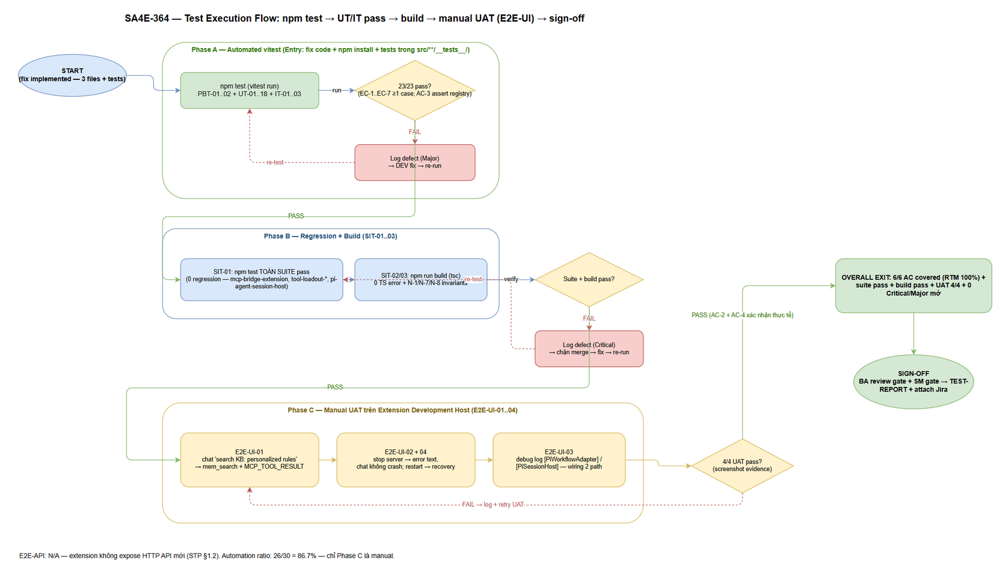
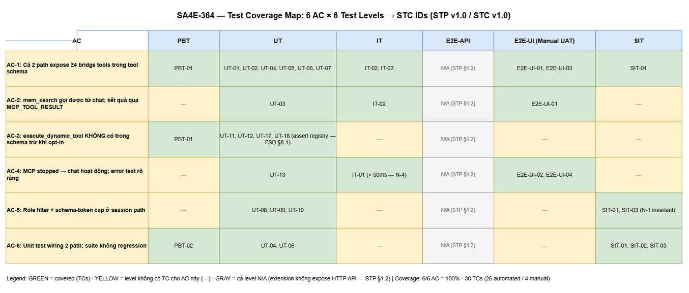

# Software Test Plan (STP)

## SDLC Agents 4 Enterprise — SA4E-364: [SDLC Chat] Wire MCP tools của extension vào chat agent (mcp-bridge-extension là dead code)

---

## Document Information

| Field | Value |
|-------|-------|
| Jira Ticket | SA4E-364 |
| Title | [SDLC Chat] MCP tools của extension không được wire vào chat agent — mcp-bridge-extension (SA4E-316) là dead code |
| Type / Priority | Bug / High |
| Author | QA Agent |
| Version | 1.0 |
| Date | 2026-10-16 |
| Status | Draft (pending BA review gate) |
| Branch | SA4E-364 (QA không commit code — chỉ documents/SA4E-364/) |
| Related documents | BRD.md v1.0, FSD.md v1.1, SA4E-364-FINDINGS.md (repo root), TDD.md v1.0 (SA hoàn thành song song — đã cross-check, xem §1.5) |

## Revision History

| Version | Date | Author | Changes |
|---------|------|--------|---------|
| 1.0 | 2026-10-16 | QA Agent | Initiate STP — 6 test levels cho extension bug fix (PBT 2 + UT 18 + IT 3 + E2E-UI manual 4 + SIT 3, E2E-API N/A); RTM 100% trên AC-1..AC-6, FR-01..FR-09, BR-01..BR-08, EC-1..EC-7; TDD cross-check hoàn tất (TDD ra mắt giữa chừng): 8/10 điểm aligned, 2 deviation (tên file test + module mock name) đã sync vào STC |

## Sign-Off

| Name | Signature and date |
|------|--------------------|
| BA Agent (business coverage review) | ☐ |
| SM Agent (gate) | ☐ |

---

## 1. Introduction

### 1.1 Purpose

STP định nghĩa chiến lược kiểm thử cho fix SA4E-364: bridge extension SA4E-316 (5 tool MCP: `jira_get_issue`, `mem_search`, `mem_ingest`, `code_search`, `execute_dynamic_tool`) là dead code — LLM trong SDLC CHAT không thấy tool nào trong tool schema. Fix wire bridge tools vào **cả 2 đường tool pool**: legacy path (`pi-workflow-adapter.ts` — merge `byName`) và session path (`pi-agent-session-host.ts` — `customTools` + `buildSessionToolLoadout`), qua hàm thuần export mới `buildMcpBridgeAgentTools(bridge, options?)`.

Plan kiểm tra hành vi SAU fix (6 AC):

1. **AC-1** — cả 2 path expose ≥4 tool bridge trong tool schema gửi LLM.
2. **AC-2** — từ chat, LLM gọi được `mem_search`, kết quả hiển thị qua `MCP_TOOL_RESULT` trên webview.
3. **AC-3** — `execute_dynamic_tool` KHÔNG có trong schema trừ khi opt-in `allowDynamicChaining=true`.
4. **AC-4** — MCP server stopped → chat vẫn hoạt động; tool call trả error text rõ ràng (fail-safe, không crash turn).
5. **AC-5** — bridge tools ở session path chịu role filter + schema-token cap (SA4E-355).
6. **AC-6** — unit test wiring cả 2 path; suite hiện có không regression.

### 1.2 References

| Document | Location |
|----------|----------|
| BRD v1.0 (AC + scope + risks R-1..R-5) | documents/SA4E-364/BRD.md |
| FSD v1.1 (UC-01..04, FR-01..09, BR-01..08, API Contracts §3.5, Error Contract EC-1..EC-7, Test path per AC §8.1, NFR §9.1) | documents/SA4E-364/FSD.md |
| Findings (root cause verified + thiết kế fix + verification steps §5) | SA4E-364-FINDINGS.md (repo root) |
| TDD | documents/SA4E-364/TDD.md — **chưa tồn tại lúc STP v1.0 viết** (SA viết song song); xem §1.5 TDD cross-check |
| Test pattern nguồn | extension/src/pi-agent/extensions/__tests__/mcp-bridge-extension.test.ts (mockBridge `{ callTool: vi.fn() }` + STC: TC-xxx naming); extension/src/pi-workflow/__tests__/adapter-wiring-session.test.ts (vi.hoisted + vi.mock('vscode') + fauxProvider); extension/src/pi-workflow/__tests__/adapter-legacy-governance.test.ts (legacy turn driver) |
| Governance test nguồn | extension/src/pi-agent/__tests__/tool-loadout-{roles,invariants,cap,estimator}.test.ts |
| Vitest discovery | extension/vitest.config.ts — include `src/**/__tests__/**/*.test.ts`, environment node, fileParallelism: false, retry: 2 |

### 1.3 Test Objectives (map Success Metrics BRD §3)

| # | Objective | Metric BRD |
|---|-----------|-----------|
| O-1 | Tool schema gửi LLM chứa ≥4 bridge tools ở cả 2 path legacy + session | Success Metrics #3 |
| O-2 | Từ chat: *"search KB: personalized rules"* → `mem_search` chạy, kết quả về webview qua `MCP_TOOL_RESULT` | Success Metrics #2 |
| O-3 | 0 trường hợp `execute_dynamic_tool` xuất hiện trong schema khi chưa opt-in | Success Metrics #4 |
| O-4 | MCP stopped → error text rõ ràng, chat không crash/treo; error path < 50ms (N-4) | BRD NFR Reliability |
| O-5 | Bridge tools chịu role filter + schema-token cap như mọi MCP tool khác | BRD NFR Performance |
| O-6 | 100% suite extension pass, build pass, 0 regression (điều kiện merge) | Success Metrics #1 |

---

## 1. Test Strategy

### 1.1 Test Levels (6 levels) — mapping cho EXTENSION bug fix

Ticket này là **VS Code extension bug fix** (không phải web API) — mapping 6 level chuẩn như sau:

| Level | Scope | Automation | Tools | TCs |
|-------|-------|------------|-------|-----|
| **PBT** | Property hẹp, đúng chất extension wiring: (1) `buildMcpBridgeAgentTools` với MỌI tổ hợp options → luôn chứa 4 tool concrete, KHÔNG chứa `execute_dynamic_tool` khi `allowDynamicChaining !== true`, tên unique, không throw; (2) merge skip-if-exists: với MỌI pool tên có sẵn, bridge KHÔNG BAO GIỜ đè entry hiện có (BR-06) | Automated | vitest + fast-check ^4.9.0 (đã có trong extension/package.json devDependencies) | PBT-01, PBT-02 |
| **UT** | Unit wiring cả 2 path: `buildMcpBridgeAgentTools` (shape AgentTool, execute handler), merge legacy (skip-if-exists, merge order), session customTools + loadout (mcpTools), FR-09 promptSnippet override, AC-3 assert registry, role filter/token cap (AC-5), error contract EC-1..EC-7 | Automated | vitest — mockBridge `{ callTool: vi.fn() }` (pattern mcp-bridge-extension.test.ts:35-37), vi.hoisted + vi.mock('vscode') (pattern adapter-wiring-session.test.ts) | UT-01..UT-18 |
| **IT** | Integration: `McpBridge` THẬT + mock `IServerManager` — fail-closed khi server stopped (EC-5), success path qua bridge thật (interceptResponse), type-guard `instanceof McpBridge` ở session host (absent → `[]` fail-safe) | Automated | vitest — real `McpBridge` instance + mock manager (`status` field) | IT-01..IT-03 |
| **E2E-API** | **N/A** — justification §1.2 | — | — | 0 |
| **E2E-UI** | Manual UAT theo findings §5: build + load extension vào Kiro/VSCode → SDLC CHAT → "search KB: personalized rules" → `mem_search` chạy, `MCP_TOOL_RESULT` hiển thị; stop server → error text; debug log wiring | **Manual** | Kiro/VSCode + Extension Development Host | E2E-UI-01..04 |
| **SIT** | Regression toàn bộ: `npm test` trong extension/ (đặc biệt mcp-bridge-extension.test.ts, tool-loadout-*.test.ts, pi-agent-session-host.test.ts) + `npm run build` pass | Automated (suite run) | npm / vitest / tsc | SIT-01..03 |

*[Edit in draw.io](diagrams/test-execution-flow.drawio)*

### 1.2 E2E-API — N/A (justification)

Extension **không expose HTTP API mới**: fix chỉ wire tool pool in-process trong extension host (`buildMcpBridgeAgentTools` → merge `byName` / `customTools`). `McpBridge` gọi ra MCP server qua `IServerManager.invokeTool()` — transport này đã được cover bởi (a) IT-01/IT-02 với bridge thật + mock manager, (b) suite hiện có `mcp-bridge.test.ts`. Không có endpoint REST nào thay đổi hành vi → không có gì để test ở tầng E2E-API.

### 1.3 E2E-UI — Manual UAT (justification)

Cửa sổ chat SDLC CHAT là webview chạy trong Extension Development Host — cần LLM provider thật + MCP server thật để LLM *quyết định* gọi tool (không thể deterministic-mock quyết định của LLM). 4 kịch bản UAT theo findings §5 (steps 2, 3, 4 + recovery EF-1 UC-04): kích hoạt thật end-to-end, xác nhận `MCP_TOOL_RESULT` hiển thị, error text graceful. Đây là phần MANUAL duy nhất của ticket — chi tiết steps ở STC.

### 1.4 PBT — đánh giá phù hợp

PBT **phù hợp có phạm vi hẹp** cho ticket này: 2 property thuần trên hàm `buildMcpBridgeAgentTools` + vòng merge (đều là hàm sync, 0 network, input nhỏ) — chạy nhanh, bắt được edge case tổ hợp tên trùng mà test case viết tay dễ sót. KHÔNG mở rộng PBT sang adapter/host (phụ thuộc vscode mock + async turn — PBT sẽ flaky, không đáng chi phí).

### 1.5 TDD Cross-check (lưu ý cho SM)

TDD.md **đã ra mắt giữa chừng** khi STP/STC v1.0 viết (SA hoàn thành song song; STATUS.json phase design = in_progress → TDD v1.0 có đủ §5 Implementation Checklist + §8 Test Design). QA đã thực hiện **TDD cross-check** — kết quả:

### 1.5.1 Kết quả đối chiếu (2026-10-16)

| Điểm đối chiếu | FSD v1.1 / STC baseline | TDD v1.0 | Verdict |
|----------------|--------------------------|----------|---------|
| Signature `buildMcpBridgeAgentTools(bridge, options?): AgentTool[]` + `BridgeToolOptions = Pick<BridgeOptions, ...>` | STC UT-01..03, PBT-01 | TDD §3.1-3.4 khớp 100% | ✅ Aligned |
| Merge order legacy (OI-06: builtin → ext last-wins → bridge skip-if-exists) | STC UT-04, UT-05, PBT-02 | TDD §3.5 khớp — "tool hiện có thắng" | ✅ Aligned |
| Type-guard `instanceof McpBridge` session path (OI-03), absent → `[]` | STC IT-03 | TDD §3.6 + W-1 khớp; TDD R-7: session test PHẢI dùng `new McpBridge()` thật từ cùng module (không vi.mock) | ✅ Aligned — STC IT-03 precondition đúng |
| FR-09 override `promptSnippet/promptGuidelines = undefined` tại call site | STC UT-07 | TDD §2.3 A4 + checklist #9 khớp | ✅ Aligned |
| Bẫy AC-3 (assert registry, không assert allowlist string) | STC UT-11/12/17/18 | TDD §5 warning box khớp 100% | ✅ Aligned |
| Error contract EC-1..EC-7 | STC UT-13..18, IT-01 | TDD §6 khớp từng text/details/audit decision | ✅ Aligned |
| **Tên file test** | STC đề xuất ban đầu: mcp-bridge-agent-tools / adapter-bridge-wiring / session-bridge-wiring / mcp-bridge-agent-it | TDD checklist: file #10 `bridge-wiring-legacy.test.ts`, file #11 `bridge-wiring-session.test.ts`, file #12 append describe trong `mcp-bridge-extension.test.ts` | ⚠️ Deviation — **STC đã sync** theo TDD; IT-01/02 (bridge thật) về `mcp-bridge.test.ts` (append, test-only ngoài 3 file TDD — bổ sung của QA, không đụng production) |
| **Module mock name** | STC ban đầu viết `../pi-extension-loader` | TDD checklist #4/#10: `getPiExtensionAgentTools` nằm ở `../pi-extension-runtime` | ⚠️ Deviation — **STC đã sync** |
| AC-5 assert seam | STC UT-08..10 (buildSessionToolLoadout unit + session seam) | TDD §8.2: assert `tools` param của `createAgentSession` + loadout unit — khớp | ✅ Aligned |
| Manual UAT scope | STC E2E-UI-01..04 | TDD §8.4: 4 steps (= E2E-UI-01..03 + SIT-01); STC thêm E2E-UI-04 recovery (EF-1 UC-04) — bổ sung hợp lý, không trái TDD | ✅ Aligned (+1 case) |

### 1.5.2 Hành động sau cross-check

1. STC target files + conventions đã cập nhật theo TDD (chi tiết trong STC §3 target files table + Revision History). Test intent, counts (30 TCs), RTM — KHÔNG đổi.
2. DEV implement theo đúng TDD checklist #10/#11/#12; QA verify implementation khớp STC steps trong Phase 6 (Test Implementation Review — so sánh test technique: engineSpy seam, real McpBridge, assert registry).
3. Điểm DEV cần lưu ý từ QA: file #10 collision case dùng builtin tool trùng tên (mock `createWorkspaceTools` trả `mem_search`) — STC UT-04 chấp nhận cả builtin/ext collision (cùng merge semantics "tool hiện có thắng").

### 1.6 Test Cases Summary

| Level | Count | Automated | Manual |
|-------|-------|-----------|--------|
| PBT | 2 | 2 | 0 |
| UT | 18 | 18 | 0 |
| IT | 3 | 3 | 0 |
| E2E-API | 0 (N/A) | 0 | 0 |
| E2E-UI | 4 | 0 | 4 |
| SIT | 3 | 3 | 0 |
| **Total** | **30** | **26 (86.7%)** | **4 (13.3%)** |

---

## 2. Scope

### 2.1 In Scope

| # | Hạng mục test | Chi tiết | Priority |
|---|---------------|----------|----------|
| T-1 | `buildMcpBridgeAgentTools` (FR-01) | Trả 4 AgentTool shape khớp `pi-agent-core`; tái dùng `TOOLS`/`validateParams`/`TOOL_ALLOWLIST` (BR-01); execute gọi `bridge.callTool()` | P1 |
| T-2 | Legacy wiring (FR-02) | Merge vào `byName` sau builtin→ext; skip-if-exists (BR-06); bridge không đè tool trùng tên; extTools rỗng → bridge vẫn merge (AF-2 UC-01) | P1 |
| T-3 | Session wiring (FR-03, FR-09) | Bridge tools vào `customTools` qua `toSessionToolDefinition`; tên vào `mcpTools` của `buildSessionToolLoadout`; override `promptSnippet/promptGuidelines = undefined` | P1 |
| T-4 | Dynamic opt-in (FR-05, AC-3) | Không opt-in → tool KHÔNG được build (assert trên tool list — bẫy `DISCOVERY_TOOLS` FSD §8.1); opt-in → có; chained target phải ∈ `TOOL_ALLOWLIST` | P1 |
| T-5 | Fail-safe MCP stopped (FR-07, BR-08, AC-4) | `McpServerNotRunningError` → error text `Error invoking {tool}: MCP Server is not running.`; không throw; latency < 50ms (N-4); timeout + generic error cùng dạng text | P1 |
| T-6 | Loadout governance (FR-04, AC-5) | Bridge names chịu role filter (BA lọc `code_search`, giữ `jira_/mem_`), schema-token cap (25% staticBudget — N-1), escalation minimal drop bridge, core giữ nguyên | P1 |
| T-7 | Approval + audit (FR-06, BR-04) | `mem_ingest`/dynamic cần approval; mọi decision ghi audit; KHÔNG log param values (chỉ `argKeys`) | P2 |
| T-8 | Integration bridge thật (IT) | Real `McpBridge` + mock `IServerManager`: stopped → fail-closed EC-5; running → success path; type-guard absent → `[]` | P1 |
| T-9 | Regression suite (FR-08, AC-6) | `npm test` toàn suite + `npm run build` pass; 3 nhóm file trọng điểm xanh | P1 |
| T-10 | Manual UAT (E2E-UI) | 4 kịch bản findings §5 trên Extension Development Host | P1 |

*[Edit in draw.io](diagrams/test-coverage.drawio)*

### 2.2 Out of Scope

| # | Hạng mục | Lý do |
|---|----------|-------|
| X-1 | `WrapperServer.MAX_BODY_SIZE` (1MB, trả 413 JSON-RPC) | Defect riêng đã điều tra (findings §7): 1MB OK, 1.5MB OK, 2MB FAIL — fix ở ticket khác, không gộp để giữ scope sạch |
| X-2 | UI picker / badge "connected" | BRD O-4 — root cause không nằm ở UI; chỉ verify hành vi hiển thị hiện có (MCP_TOOL_RESULT, error text) như FSD §6 |
| X-3 | `listAvailableTools()` context-usage meter | OI-05/N-8 — meter đọc catalog phía server, không thêm bridge tools (double-count); chính xác hoá = ticket cosmetic riêng |
| X-4 | Đổi policy approval (nối UI approval) | OI-02 — wire-only giữ auto-approve + audit như hiện trạng SA4E-316 đã duyệt bảo mật |
| X-5 | Hành vi MCP server thật (KB/Jira content chính xác) | Tool result content thuộc trách nhiệm MCP server (backend) — extension chỉ proxy; IT dùng mock `IServerManager` trả payload cố định |
| X-6 | Performance load-testing schema-token | N-3 đã định lượng ~145 token ≪ cap; chỉ assert invariant cap 25% qua suite (SIT-03), không benchmark riêng |

---

## 3. Test Environment

| Item | Giá trị |
|------|---------|
| OS | Windows (workspace phát triển hiện tại); UAT trên cùng máy |
| Node.js | ≥ 20 (máy hiện tại: v24.8.0; extension không pin .nvmrc; `@types/node` ^22) |
| VS Code / Kiro engine | `engines.vscode` ^1.85.0 (extension/package.json) |
| Test framework | vitest 4.1.8 (pinned) + fast-check ^4.9.0 (PBT) + @vitest/coverage-v8 4.1.8 |
| Vitest config | extension/vitest.config.ts — include `src/**/__tests__/**/*.test.ts`; environment node; alias `vscode` → src/test/mocks/vscode.ts; fileParallelism: false; retry: 2 |
| Lệnh test | `npm test` (= `vitest run`) trong extension/; targeted: `npx vitest run src/pi-agent/extensions/__tests__/mcp-bridge-extension.test.ts` |
| Lệnh build | `npm run build` (= `tsc -p ./`) trong extension/ |
| UAT host | Extension Development Host (F5) hoặc VSIX cài vào Kiro/VSCode; SDLC CHAT panel; LLM provider configured (sdlcAgents.llmProvider + API key); MCP server (code-intel) running/stopped theo scenario |
| Mock/stub | `vscode` module mock (pattern adapter-wiring-session.test.ts:38-45); `McpBridge` mock `{ callTool: vi.fn() }` (pattern mcp-bridge-extension.test.ts:35-37); mock `IServerManager` cho IT (status + invokeTool) |

---

## 4. RTM — Requirements Traceability Matrix

### 4.1 AC → Test Cases

| AC | Tiêu chí | Test Cases | Coverage |
|----|----------|------------|----------|
| AC-1 | Cả 2 path expose ≥4 bridge tools trong tool schema | UT-01, UT-02, UT-04, UT-05, UT-06, UT-07, IT-02, IT-03, PBT-01, E2E-UI-01, E2E-UI-03 | ✅ |
| AC-2 | `mem_search` gọi được từ chat; kết quả qua `MCP_TOOL_RESULT` | UT-03, IT-02, E2E-UI-01 | ✅ |
| AC-3 | `execute_dynamic_tool` không có trong schema trừ khi opt-in | UT-11, UT-12, UT-17, UT-18, PBT-01 | ✅ |
| AC-4 | Server stopped → chat hoạt động; error text rõ ràng | UT-13, IT-01, E2E-UI-02, E2E-UI-04 | ✅ |
| AC-5 | Role filter + schema-token cap ở session path | UT-08, UT-09, UT-10, SIT-01 (tool-loadout-invariants), SIT-03 | ✅ |
| AC-6 | Unit test wiring 2 path; suite không regression | UT-04, UT-06, PBT-02, SIT-01, SIT-02, SIT-03 | ✅ |

### 4.2 FR → Test Cases

| FR | Requirement | Test Cases | Coverage |
|----|-------------|------------|----------|
| FR-01 | Export `buildMcpBridgeAgentTools` trả AgentTool[] khớp pi-agent-core | UT-01, UT-02, UT-03, SIT-02 (compile) | ✅ |
| FR-02 | Legacy wiring — merge builtin → ext (last-wins) → bridge (skip-if-exists) | UT-04, UT-05, PBT-02 | ✅ |
| FR-03 | Session wiring — customTools + mcpTools; SDK lọc theo allowlist | UT-06, UT-08, IT-03 | ✅ |
| FR-04 | Role filter + schema-token cap lên bridge tools | UT-08, UT-09, UT-10 | ✅ |
| FR-05 | Dynamic deny-by-default; opt-in + allowlist target | UT-11, UT-12, UT-17, UT-18, PBT-01 | ✅ |
| FR-06 | Approval + audit mọi invocation, không log param values | UT-03, UT-15, SIT-01 (audit tests hiện có) | ✅ |
| FR-07 | Fail-safe `McpServerNotRunningError` → error text | UT-03, UT-13, UT-16, IT-01, IT-02 | ✅ |
| FR-08 | Không crash turn, không phá pool hiện có | UT-04, UT-13, UT-16, SIT-01, SIT-02, E2E-UI-02 | ✅ |
| FR-09 | Override prompt metadata session path (promptSnippet/promptGuidelines = undefined) | UT-07 | ✅ |

### 4.3 BR → Test Cases

| BR | Rule | Test Cases | Coverage |
|----|------|------------|----------|
| BR-01 | Tái dùng TOOLS/TOOL_ALLOWLIST/validateParams — cấm duplicate | UT-01, UT-02 (parameters passthrough từ TOOLS), SIT-01 | ✅ |
| BR-02 | Dynamic chỉ khi opt-in; chained target ∈ TOOL_ALLOWLIST | UT-12, UT-18 | ✅ |
| BR-03 | McpBridge fail-closed — require IServerManager thật | IT-01, IT-03, SIT-01 (SEC-332-09 tests hiện có) | ✅ |
| BR-04 | Approval + audit mọi decision, không log param values | UT-03, UT-15 | ✅ |
| BR-05 | validateParams: object, required, string ≤ 4000 chars | UT-14 | ✅ |
| BR-06 | Bridge không đè tool trùng tên (skip + warn); giữ AFT hoist | UT-04, UT-05, PBT-02 | ✅ |
| BR-07 | Session path qua buildSessionToolLoadout; core không bao giờ drop | UT-08, UT-10 | ✅ |
| BR-08 | Fail-safe: mọi lỗi bridge → error text, không crash turn | UT-13, UT-16, IT-01, E2E-UI-02 | ✅ |

### 4.4 Error Contract (EC-1..EC-7) → Test Cases

| EC | Điều kiện | Test Cases | Coverage |
|----|-----------|------------|----------|
| EC-1 | `execute_dynamic_tool` khi chưa opt-in → chaining_denied | UT-11 (không emit), UT-17 (defense-in-depth handler) | ✅ |
| EC-2 | validateParams fail → "Validation failed: ..." | UT-14 | ✅ |
| EC-3 | Opt-in nhưng target ∉ TOOL_ALLOWLIST → chaining_denied | UT-18 | ✅ |
| EC-4 | approvalHook trả false → approval_denied | UT-15 | ✅ |
| EC-5 | `McpServerNotRunningError` → "Error invoking {tool}: MCP Server is not running." | UT-13, IT-01, E2E-UI-02 | ✅ |
| EC-6 | `McpToolTimeoutError` → "...timed out after {ms}ms." | UT-16 | ✅ |
| EC-7 | Lỗi khác từ callTool → "Error invoking {tool}: {message}" | UT-16 | ✅ |

### 4.5 UC → Test Cases (coverage rollup)

| UC | Luồng chính/AF/EF trọng yếu | Test Cases | Coverage |
|----|------------------------------|------------|----------|
| UC-01 Legacy path | Main (merge + tool call); AF-1 trùng tên; AF-2 extTools rỗng; EF-2 over budget | UT-03, UT-04, UT-05, PBT-02, IT-02, E2E-UI-01 | ✅ |
| UC-02 Session path | Main (loadout + customTools); AF-1 escalate drop; AF-2 role filter | UT-06, UT-07, UT-08, UT-09, UT-10, IT-03, E2E-UI-01 | ✅ |
| UC-03 Dynamic opt-in | Main (opt-in + allowlisted); AF-1 không opt-in; EF-1/EF-2 deny | UT-12, UT-17, UT-18 | ✅ |
| UC-04 MCP stopped | Main (error text); AF-1 timeout; EF-1 server start lại | UT-13, UT-16, IT-01, E2E-UI-02, E2E-UI-04 | ✅ |

**Coverage tổng: 6/6 AC, 9/9 FR, 8/8 BR, 7/7 EC, 4/4 UC = 100%.** Mọi test case đều trace được về ít nhất 1 requirement (ngược lại: không có TC ngoài scope — STC §3 thể hiện cột Requirement từng TC).

---

## 5. Test Data Approach

Không có DB/data persistence — mọi test data là **tool schemas in-memory + mock objects**. Chi tiết giá trị cụ thể từng TC nằm trong STC §3 và CSV `documents/SA4E-364/testdata/`:

| Nguồn data | Dùng cho | Ghi chú |
|------------|----------|---------|
| `TOOLS` thật từ `tool-definitions.ts` (5 schema) | UT-01, UT-02, UT-11, UT-12, PBT-01 — assert tên/shape | Nguồn sự thật duy nhất (BR-01) — không hardcode schema trong test |
| mockBridge `{ callTool: vi.fn() }` | UT-03, UT-13..UT-18 — điều khiển resolve/reject | Pattern mcp-bridge-extension.test.ts:35-37 |
| Mock `IServerManager` (`status: 'running'|'stopped'`, `invokeTool: vi.fn()`) | IT-01, IT-02 — bridge THẬT wrapper quanh manager giả | IT-01: status='stopped' → `McpServerNotRunningError` thật từ bridge (không mock reject) |
| Fixture pool tên builtin/ext (vd `read`, `edit`, `aft_hoist_tool`, `mem_search` trùng) | UT-04, UT-05, PBT-02 — merge skip-if-exists | PBT sinh pool tên arbitrary bằng fast-check |
| Role/phase fixtures ('BA', 'QA', 'SM', undefined) | UT-08..UT-10 — role filter qua `ROLE_TOOL_PREFIXES` | Xem testdata/loadout-role-scenarios.csv |
| MCP server thật (UAT) | E2E-UI-01..04 | Start/stop qua điều khiển server MCP workspace |

**CSV files:** `bridge-tool-inventory.csv` (shape/expectations từng tool), `bridge-tool-call-params.csv` (params JSON + expected text/details cho EC-1..EC-7), `wiring-merge-scenarios.csv` (legacy/session wiring), `loadout-role-scenarios.csv` (role filter + cap), `uat-steps.csv` (4 manual UAT). Mọi TC ID (30/30) xuất hiện trong ít nhất 1 CSV.

---

## 6. Entry / Exit Criteria

### Phase A — Automated unit/integration (PBT + UT + IT)

| | Tiêu chí |
|---|----------|
| **Entry** | Fix code đã implement (3 file + tests); `npm install` xong trong extension/; các file test mới nằm đúng `src/**/__tests__/` để vitest auto-discover |
| **Exit** | 23/23 case PBT+UT+IT pass; AC-3 assert trên tool registry (không phải allowlist string); mọi EC-1..EC-7 có ≥1 case pass |

### Phase B — Regression suite + build (SIT)

| | Tiêu chí |
|---|----------|
| **Entry** | Phase A pass; không có thay đổi code đang treo (working tree sạch các hunk SA4E-THINKING) |
| **Exit** | `npm test` toàn suite pass (0 fail, 0 skip mới) — đặc biệt mcp-bridge-extension.test.ts, tool-loadout-*.test.ts (4 file), pi-agent-session-host.test.ts; `npm run build` 0 lỗi TS |

### Phase C — Manual UAT (E2E-UI)

| | Tiêu chí |
|---|----------|
| **Entry** | Phase A+B pass; extension build xong; LLM provider + MCP server available; UAT steps + evidence paths chuẩn bị theo testdata/uat-steps.csv |
| **Exit** | 4/4 kịch bản UAT pass với screenshot evidence (documents/SA4E-364/evidence/); AC-2 xác nhận qua `MCP_TOOL_RESULT` thực tế |

### Overall Exit (điều kiện merge)

1. **6/6 AC covered** bởi test pass (RTM §4 — 100%).
2. **Suite pass**: `npm test` toàn bộ xanh, không regression (AC-6).
3. **Build pass**: `npm run build` 0 lỗi (FR-01 signature compile).
4. Manual UAT 4/4 (findings §5 steps 2-4 + recovery).
5. Defect Critical/Major = 0 mở.

---

## 7. Risks & Mitigation

| # | Risk | Impact | Likelihood | Mitigation |
|---|------|--------|------------|------------|
| RS-1 | **Flaky manual UAT** — LLM không quyết định gọi `mem_search` (prompt-dependent), MCP server chiếm port, Extension Host chậm | Medium | Medium | Prompt UAT cố định ("search KB: personalized rules" — findings §5 step 2); pre-check badge SDLC PIPELINE connected + log `[McpServerManager]` trước khi chạy; retry tối đa 2 lần; nếu LLM vẫn không gọi tool → kiểm tra schema trước qua debug log (E2E-UI-03) để tách lỗi wiring vs lỗi LLM |
| RS-2 | **Test order dependency / vi.mock hoisting** — mock `vscode`/`pi-extension-loader` module-level có thể leak giữa các test file (fileParallelism:false giúp nhưng không loại trừ) | Medium | Medium | Mỗi test file tự chứa vi.mock + vi.hoisted riêng (pattern adapter-wiring-session.test.ts); afterEach restoreAllMocks; không phụ thuộc thứ tự chạy file |
| RS-3 | **Assert sai mục tiêu cho AC-3** — `DISCOVERY_TOOLS` (tool-loadout.ts:18) luôn chứa tên `execute_dynamic_tool` trong allowlist string dù tool không register → assert nhầm sẽ fail ảo/pass ảo | High (bẫy đã ghi trong FSD §8.1) | Medium | UT-11/UT-12/UT-17 assert trên **tool list được build/registered** (tool registry/schema); cấm assert trên mảng allowlist string của session host — ghi rõ trong STC từng step |
| RS-4 | **Adapter test nặng mock** — legacy turn cần mock vscode + engine + store + extension loader; sai 1 mock → test đỏ không phải do fix | Medium | Medium | Tái dùng pattern adapter-legacy-governance.test.ts / adapter-wiring-session.test.ts (đã chạy ổn trong suite); assert qua seam rõ (engine.executeTurn input.tools / debugLog) thay vì private state |
| RS-5 | **`nameTools` under-estimate token** (name-only ~4-5 tok/tool vs schema thật ~36 tok/tool — N-3) → lo ngại cap sai | Low | Low | Đây là hành vi hiện có của `extNames` (nhất quán SA4E-355 OI-4) — không phải defect của ticket; chỉ assert invariant cap 25% staticBudget (SIT-03) |
| RS-6 | **TDD xuất hiện giữa chừng** lệch FSD (tên hàm/options khác) | Low | Medium | STP §1.5 TDD cross-check table; STC sync pass sau DEV (convention SA4E-362) — test intent không đổi |
| RS-7 | **Collision tên tool tương lai** (npm extension thêm tool trùng bridge) | Low | Low | BR-06 skip-if-exists + PBT-02 property đảm bảo bridge không bao giờ đè — property giữ đúng ngay cả khi pool thay đổi |

---

## 8. Automation Ratio

| Nhóm | Số TC | Automated | Manual | Ghi chú |
|------|-------|-----------|--------|---------|
| PBT | 2 | 2 | 0 | vitest + fast-check |
| UT | 18 | 18 | 0 | vitest |
| IT | 3 | 3 | 0 | vitest (real McpBridge + mock manager) |
| SIT | 3 | 3 | 0 | npm test + npm run build |
| E2E-UI | 4 | 0 | 4 | Manual UAT — Extension Development Host (§1.3) |
| **Tổng** | **30** | **26** | **4** | **86.7% automated** |

Target đạt được: mọi case **trừ 4 manual UAT** đều chạy trong `npm test` (hoặc `npm run build`) — đáp ứng yêu cầu "mọi case trừ E2E-UI manual đều automated". 4 case manual là phần bắt buộc của findings §5 verification (cần LLM thật + Extension Host thật), không thể deterministic-mock.

---

## 9. Diagram Index

| Image | Source (.drawio) | Nội dung |
|-------|------------------|----------|
|  | documents/SA4E-364/diagrams/test-execution-flow.drawio | Pipeline chạy test: npm test (PBT+UT+IT) → build → manual UAT (E2E-UI) → sign-off; vòng defect feedback fail → fix → retest |
|  | documents/SA4E-364/diagrams/test-coverage.drawio | 6 AC × 6 test levels → STC IDs; green = covered, red = N/A |
