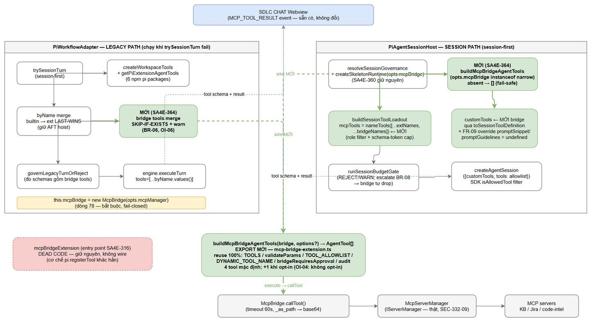
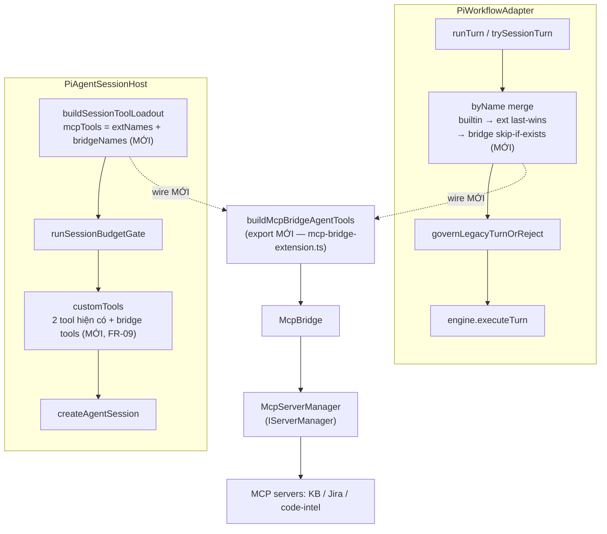
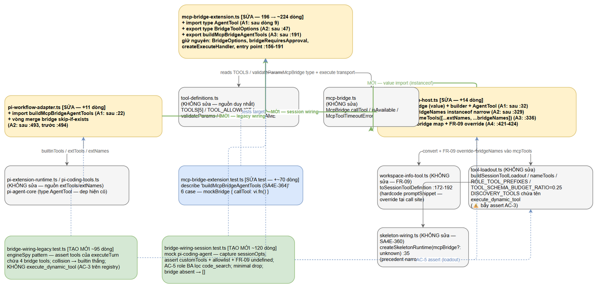
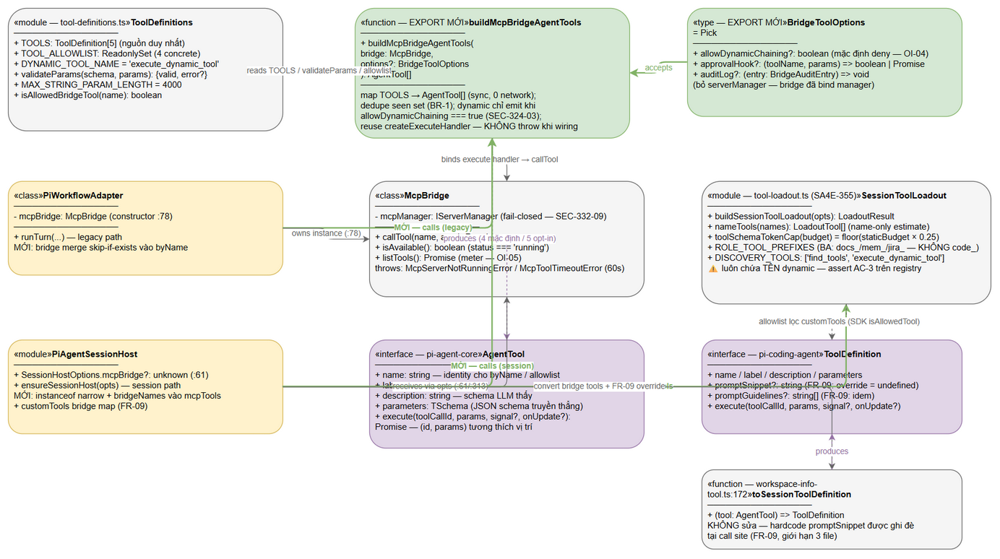
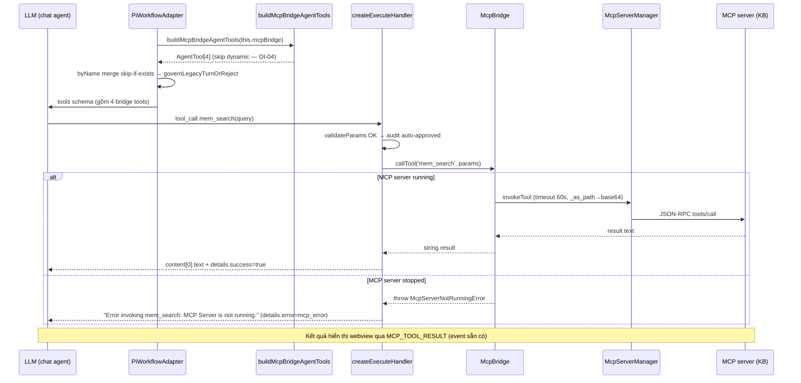
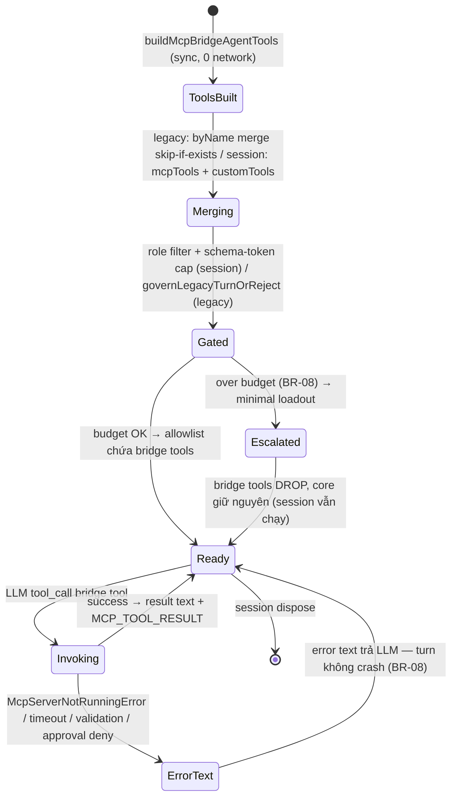

# Technical Design Document (TDD)

## SDLC Chat Extension — SA4E-364: Wire MCP tools của extension vào chat agent (mcp-bridge-extension là dead code)

---

## Document Information

| Field | Value |
|-------|-------|
| Jira Ticket | SA4E-364 |
| Type / Priority | Bug / High |
| Title | [SDLC Chat] MCP tools của extension không được wire vào chat agent — mcp-bridge-extension (SA4E-316) là dead code |
| Author | SA Agent |
| Reviewer kế tiếp | SM Agent (review + attach Jira) → DEV Agent (implement) |
| Version | 1.0 |
| Date | 2026-10-16 |
| Status | Ready for review |
| Related FSD | `documents/SA4E-364/FSD.md` (v1.1 — TA enrichment complete) |
| Related BRD | `documents/SA4E-364/BRD.md` (v1.0) |
| Related Findings | `SA4E-364-FINDINGS.md` (repo root — root cause verify bằng code 2026-10-15, branch `SA4E-363`, commit `cdccd97`) |
| Related CI/CD Check | `documents/SA4E-364/CICD-CHECK.md` (verdict N/A — build/test qua npm scripts hiện có, §9) |

**Nguyên tắc thiết kế:** TDD này nhất quán 100% với FSD v1.1 — đặc biệt Section 3.5 (API Contracts), Section 3.5.5 (Error Contract EC-1..EC-7) và Section 10 (Resolved Decisions OI-01..OI-06). Mọi tham chiếu dòng code đã verify trực tiếp trên source ngày 2026-10-16 (code-intel index không đầy đủ với `extension/src` — đọc trực tiếp file). Bỏ qua các hunk đánh dấu `// SA4E-THINKING:` (công việc khác, không thuộc ticket).

---

## Revision History

| Version | Date | Author | Changes |
|---------|------|--------|---------|
| 1.0 | 2026-10-16 | SA Agent | Bản đầu — thiết kế wire-only fix: export thuần `buildMcpBridgeAgentTools` + wiring cả 2 đường tool pool (legacy + session); 3 diagrams (architecture, component, class-tool-bridge); checklist 12 mục (3 file production + 3 file test); error contract EC-1..EC-7; test design map 6 AC |

---

## 1. Architecture Overview

### 1.1 Kiến trúc sau fix

Tool pool của chat agent LLM được lắp từ **2 đường độc lập** (mutually exclusive theo từng turn — session-first, legacy fallback). Fix SA4E-364 thêm **đường bridge tools** vào **cả hai**, thông qua một hàm thuần export duy nhất `buildMcpBridgeAgentTools` từ bridge extension hiện có (SA4E-316 — hiện dead code).

**LEGACY PATH** — `PiWorkflowAdapter.runTurn` (chỉ chạy khi `trySessionTurn` fail):

1. `createWorkspaceTools` → `builtinTools` (pi-workflow-adapter.ts:478)
2. `getPiExtensionAgentTools` → `extTools` (:481 — chỉ 6 npm pi packages, không có MCP bridge)
3. Merge `byName`: builtin → ext **last-wins** (:489-493 — giữ AFT hoist)
4. **[MỚI]** `buildMcpBridgeAgentTools(this.mcpBridge)` → merge bridge tools vào `byName` **skip-if-exists** (BR-06)
5. `tools = [...byName.values()]` (:494) → `governLegacyTurnOrReject` (:502) → `engine.executeTurn` (:504)

**SESSION PATH** — `PiAgentSessionHost` → `createAgentSession`:

1. `resolveSessionGovernance` → budget/tier; `createSkeletonRuntime(opts.mcpBridge)` + `buildSkeletonSections` (pi-agent-session-host.ts:302-314 — SA4E-360, giữ nguyên)
2. **[MỚI]** `buildMcpBridgeAgentTools(opts.mcpBridge)` (sau instanceof narrow) → `bridgeTools` + `bridgeNames`
3. **[MỚI]** `mcpTools: nameTools([...extNames, ...bridgeNames])` vào `buildSessionToolLoadout` (:330-337) → role filter + schema-token cap tự áp dụng (SA4E-355)
4. `runSessionBudgetGate` (:343-352) → allowlist (escalate BR-08 → bridge tools tự drop — AF-1 UC-02)
5. **[MỚI]** bridge tools vào `customTools` (:421-424) qua `toSessionToolDefinition` + FR-09 override prompt metadata
6. `createAgentSession({ customTools, tools: allowlist })` (:411-426) — SDK `_refreshToolRegistry` lọc customTools theo `isAllowedTool` (allowlist)

Cả 2 path gọi chung hàm thuần `buildMcpBridgeAgentTools` — **reuse 100%** `TOOLS` / `validateParams` / `TOOL_ALLOWLIST` / `DYNAMIC_TOOL_NAME` / `bridgeRequiresApproval` / `defaultAuditLog` / `createExecuteHandler` sẵn có của bridge extension (BR-01 — KHÔNG duplicate allowlist).

Điểm mấu chốt: **không tạo mechanism mới** — bridge instance `McpBridge` đã tồn tại sẵn ở adapter (dòng 78, từ `opts.mcpManager` bắt buộc) và đã được inject vào session host (adapter :286 → host :313 cho skeleton — SA4E-360). Fix chỉ là **đem 5 tool bridge đã định nghĩa trong `TOOLS` (tool-definitions.ts) ra ngoài tool pool** của LLM qua một hàm map thuần, sync, 0 network (NFR N-6).

### 1.2 So sánh trước / sau

| Khía cạnh | Trước fix (dead code) | Sau fix |
|-----------|----------------------|---------|
| Legacy path tool pool | `builtinTools` + `extTools` (6 npm pi packages — không có MCP bridge) | + 4 bridge tools (`jira_get_issue`, `mem_search`, `mem_ingest`, `code_search`) merge cuối, skip-if-exists |
| Session path customTools | 2 tool (get_workspace_info, read_method) | + 4 bridge tools (qua `toSessionToolDefinition`, prompt metadata override — FR-09) |
| Session path allowlist | `mcpTools = nameTools(extNames)` | `mcpTools = nameTools([...extNames, ...bridgeNames])` → chịu role filter + schema-token cap (SA4E-355) |
| `mcpBridgeExtension` entry point | Dead code (chỉ test import) | **Giữ nguyên dead code** — không wire entry point (cơ chế `pi.registerTool` khác hẳn), chỉ thêm hàm thuần export song song |
| `execute_dynamic_tool` | Không có trong schema | Vẫn không có (deny-by-default — OI-04: không có nguồn `allowDynamicChaining` trong settings) |
| `McpBridge` instance | Dùng cho skeleton prompt (SA4E-360) + `listTools` meter | Giữ nguyên 2 vai trò đó + thêm vai trò tool transport cho LLM |
| Security posture | SEC-324-03 / SEC-332-09 | **Không đổi** — deny-by-default, fail-closed, approval + audit như hiện trạng |
| UI | Badge "connected" + picker MCP | Không đổi (out of scope — BRD O-4) |

### 1.3 Component Architecture Diagram


*[Edit in draw.io](diagrams/architecture.drawio)*

> **Đọc diagram:** đường **xanh lá** = wire MỚI (SA4E-364 — buildMcpBridgeAgentTools + 2 điểm merge); ô **đỏ nét đứt** = dead path cũ (`mcpBridgeExtension` entry point — giữ nguyên, không wire); đường xám = hiện trạng không đổi. `MCP_TOOL_RESULT` là event webview sẵn có, không đổi.

### 1.4 Mermaid — tổng quan kiến trúc



---

## 2. Component Design

### 2.0 Component Diagram


*[Edit in draw.io](diagrams/component.drawio)*

### 2.1 `extension/src/pi-agent/extensions/mcp-bridge-extension.ts` (196 dòng hiện tại)

| | |
|---|---|
| **Responsibility** | Nguồn duy nhất của bridge tool building: map `TOOLS` → `AgentTool[]` (export MỚI) + giữ nguyên entry point `mcpBridgeExtension` (dead code, không đụng). Execute handler hiện có (`createExecuteHandler` :95-150) đảm nhiệm validation/approval/audit/error — **không viết lại** |
| **Dependencies** | `tool-definitions.ts` (TOOLS, validateParams, TOOL_ALLOWLIST, DYNAMIC_TOOL_NAME), `../../mcp/mcp-bridge` (McpBridge), `../../chat/engine/ToolApprovalClassifier` (requiresApproval), `../../types/server-types` (IServerManager — type-only), **MỚI**: `@earendil-works/pi-agent-core` (AgentTool — type-only) |
| **Public API thay đổi** | + `export type BridgeToolOptions = Pick<BridgeOptions, 'allowDynamicChaining' \| 'approvalHook' \| 'auditLog'>` · + `export function buildMcpBridgeAgentTools(bridge, options?): AgentTool[]`. Không đổi: `BridgeOptions`, `BridgeAuditEntry`, `bridgeRequiresApproval`, default export `mcpBridgeExtension`, export test `{ createExecuteHandler, TOOLS }` (dòng 193-196 giữ nguyên) |

**Vị trí chốt (anchor theo code pattern + dòng hiện tại):**

| # | Vị trí | Thay đổi |
|---|--------|----------|
| A1 | Import block, sau dòng 9 (`import { McpBridge } ...`) | Thêm `import type { AgentTool } from '@earendil-works/pi-agent-core';` |
| A2 | Sau `interface BridgeAuditEntry` (:43-47), trước `defaultAuditLog` (:50) | Thêm `export type BridgeToolOptions = ...` + JSDoc (SEC-324-03 note) |
| A3 | Cuối file — sau `mcpBridgeExtension` (:191), **trước** khối export test (:193-196) | Thêm hàm `buildMcpBridgeAgentTools` (pseudocode §3.4, ~22 dòng incl. JSDoc) |

> **Ghi chú file-size:** file sẽ tăng từ 196 → ~224 dòng (>200). Theo code standard: file hiện tại đã gần 200 — **chỉ ghi thêm đúng phần cần, KHÔNG refactor ngoài scope** (entry point :156-191 giữ nguyên y nguyên).

### 2.2 `extension/src/pi-workflow/pi-workflow-adapter.ts`

| | |
|---|---|
| **Responsibility** | Wire legacy path: build bridge tools từ `this.mcpBridge` (:78, đã constructed từ `opts.mcpManager` bắt buộc — :29) và merge vào map `byName` |
| **Dependencies** | `./pi-coding-tools` (createWorkspaceTools), `./pi-extension-runtime` (getPiExtensionAgentTools), `../mcp/mcp-bridge` (McpBridge — đã import :8), **MỚI**: `../pi-agent/extensions/mcp-bridge-extension` (buildMcpBridgeAgentTools) |
| **Public API thay đổi** | Không đổi surface nào (runTurn/invoke/dispose giữ nguyên). Thay đổi nội bộ hàm `runTurn` vùng merge |

**Vị trí chốt:**

| # | Vị trí | Thay đổi |
|---|--------|----------|
| A1 | Import block, sau dòng 22 (`import { governLegacyTurn } ...`) | Thêm `import { buildMcpBridgeAgentTools } from '../pi-agent/extensions/mcp-bridge-extension';` |
| A2 | Sau vòng last-wins `byName` (:490-493), **trước** dòng 494 (`const tools = [...byName.values()]`) | Vòng merge bridge skip-if-exists (pseudocode §3.5, ~10 dòng incl. comment SA4E-364) |

### 2.3 `extension/src/pi-workflow/pi-agent-session-host.ts`

| | |
|---|---|
| **Responsibility** | Wire session path: (a) build bridge tools từ `opts.mcpBridge` (typed `unknown` tại :61 — phải instanceof narrow), (b) ghép `bridgeNames` vào `mcpTools` của loadout, (c) thêm bridge tools vào `customTools` với FR-09 override |
| **Dependencies** | `./workspace-info-tool` (toSessionToolDefinition — đã import :29), `../pi-agent/tool-loadout` (buildSessionToolLoadout, nameTools — đã import :22), `./skeleton/skeleton-wiring` (createSkeletonRuntime — đã import :30), **MỚI**: `../mcp/mcp-bridge` (McpBridge — **value import** cho instanceof; precedent cast pattern: skeleton-wiring.ts:42 `mcpBridge as McpBridge`), `../pi-agent/extensions/mcp-bridge-extension`, `@earendil-works/pi-agent-core` (type AgentTool — optional cho annotation) |
| **Public API thay đổi** | `SessionHostOptions` không đổi (đã có `mcpBridge?: unknown` :61). Nội bộ `ensureSessionHost` vùng loadout + createAgentSession |

**Vị trí chốt:**

| # | Vị trí | Thay đổi |
|---|--------|----------|
| A1 | Import block, sau dòng 32 (`import { getPiExtensionEntries, ... }`) | +3 dòng: `import { McpBridge } from '../mcp/mcp-bridge';` (value — cho instanceof), `import { buildMcpBridgeAgentTools } from '../pi-agent/extensions/mcp-bridge-extension';`, `import type { AgentTool } from '@earendil-works/pi-agent-core';` |
| A2 | Sau try/catch extNames (:321-329), **trước** `const loadout` (:330) | `const bridgeTools: AgentTool[] = opts.mcpBridge instanceof McpBridge ? buildMcpBridgeAgentTools(opts.mcpBridge) : [];` + `const bridgeNames = bridgeTools.map((t) => t.name);` (~4 dòng incl. comment SA4E-364 OI-03) |
| A3 | Dòng 336 | `mcpTools: nameTools(extNames)` → `mcpTools: nameTools([...extNames, ...bridgeNames])` |
| A4 | `customTools` (:421-424) | Append bridge tools: `...bridgeTools.map((t) => ({ ...toSessionToolDefinition(t as unknown as AgentTool), promptSnippet: undefined, promptGuidelines: undefined }))` (FR-09 — ~6 dòng incl. comment) |

> **Lý do FR-09 bắt buộc:** `toSessionToolDefinition` (workspace-info-tool.ts:172-192) hardcode `promptSnippet: 'Workspace orientation'` + `promptGuidelines: ['Call get_workspace_info first for exploration or review tasks.']` — chỉ đúng cho workspace-info tool. Bridge tools dùng nguyên bản sẽ inject guidance sai vào system prompt. Override tại **call site** (giới hạn 3 file — BRD §4.1), KHÔNG sửa `workspace-info-tool.ts`. SDK `_normalizePromptSnippet`/`_normalizePromptGuidelines` bỏ qua `undefined` (verify trong `agent-session.js`).

### 2.4 Test files

| File | Loại | Responsibility |
|------|------|----------------|
| `extension/src/pi-agent/extensions/__tests__/mcp-bridge-extension.test.ts` | Modify | Suite hiện có (167 dòng) giữ nguyên + describe mới `buildMcpBridgeAgentTools` (~70 dòng): 4 tên tool, dynamic conditional, execute proxy qua mockBridge, schema passthrough |
| `extension/src/pi-workflow/__tests__/bridge-wiring-legacy.test.ts` | Create (~95 dòng) | Assert bridge tools có trong `tools` truyền vào `engine.executeTurn` (pattern `engineSpy` từ adapter-legacy-governance.test.ts:77-83) |
| `extension/src/pi-workflow/__tests__/bridge-wiring-session.test.ts` | Create (~120 dòng) | Assert bridge tools trong `customTools` + allowlist của `createAgentSession` opts (pattern mock `@earendil-works/pi-coding-agent` từ pi-agent-session-host.test.ts:34-58) + AC-5 role filter/minimal + bridge-absent → [] |

Chi tiết test design xem **Section 8**.

---

## 3. API Design

> Đây là API nội bộ extension (TypeScript export) — không phải HTTP API. Contract giữ nhất quán tuyệt đối với FSD §3.5.1.

### 3.1 Signature

```ts
// extension/src/pi-agent/extensions/mcp-bridge-extension.ts (export MỚI, cùng file với extension entry point)
import type { AgentTool } from '@earendil-works/pi-agent-core';

export type BridgeToolOptions = Pick<
  BridgeOptions,
  'allowDynamicChaining' | 'approvalHook' | 'auditLog'
>;

export function buildMcpBridgeAgentTools(
  bridge: McpBridge,
  options?: BridgeToolOptions
): AgentTool[];
```

### 3.2 `BridgeToolOptions` fields

| Field | Kiểu | Default khi không truyền | Ghi chú |
|-------|------|--------------------------|---------|
| `allowDynamicChaining` | `boolean \| undefined` | Deny — `execute_dynamic_tool` **không** được emit | OI-04: không có nguồn setting nào đọc field này → wiring production **không truyền** |
| `approvalHook` | `(toolName, params) => boolean \| Promise<boolean> \| undefined` | Không hook → `checkApproval` trả `{approved: true, decision: 'auto-approved'}` | OI-02: wiring production không truyền — giữ auto-approve có audit như hiện trạng bridge (đã duyệt SA4E-316/SEC-324-03) |
| `auditLog` | `(entry: BridgeAuditEntry) => void \| undefined` | `defaultAuditLog` — console.info structured line, KHÔNG log param values (chỉ `argKeys`) | NFR N-7 |

**Lý do `Pick<>` thay vì `BridgeOptions` nguyên bản:** `BridgeOptions` bắt buộc `serverManager: IServerManager` (mcp-bridge-extension.ts:34 — fail-closed SEC-332-09 cho entry point tự construct bridge). Hàm mới nhận **bridge đã constructed** nên không cần manager — tránh yêu cầu caller truyền dependency thừa. Không sửa interface `BridgeOptions` hiện có.

### 3.3 Behavior table

| Tool (`TOOLS`) | Emit mặc định | Chỉ emit khi | Approval (`bridgeRequiresApproval`) | Execute handler behavior |
|----------------|---------------|--------------|-------------------------------------|--------------------------|
| `jira_get_issue` | ✅ | — | false → auto-approved | `validateParams` → audit → `bridge.callTool('jira_get_issue', params)` |
| `mem_search` | ✅ | — | false → auto-approved | idem |
| `mem_ingest` | ✅ | — | **true** → qua approvalHook (không hook = auto-approved + audit) | idem |
| `code_search` | ✅ | — | false → auto-approved | idem |
| `execute_dynamic_tool` | ❌ | `options.allowDynamicChaining === true` (chính xác `=== true`) | **true** | Khi emit: `validateParams` → `validateChainedTarget` (`params.tool_name` ∈ `TOOL_ALLOWLIST` — BR-02) → approval → `bridge.callTool('execute_dynamic_tool', params)` |

Lưu ý quan trọng (code-verified):
- Danh sách tool được build **KHÔNG filter theo `TOOL_ALLOWLIST`** lúc register — `TOOL_ALLOWLIST` chỉ dùng cho `validateChainedTarget` của dynamic tool (khớp entry point hiện có :164-174: 4 tool concrete luôn register, dynamic theo opt-in).
- Hàm **không gọi network, sync, O(5)** (NFR N-6) — chỉ map mảng tĩnh `TOOLS`.
- **Không throw** khi wiring bình thường. Guard riêng ở **session path** (call site): `opts.mcpBridge` typed `unknown` (host :61) → phải `instanceof McpBridge`; absent/sai kiểu → `[]` (fail-safe degraded, nhất quán "bridge-absent ⇒ DEGRADED" SA4E-360). Khác entry point `mcpBridgeExtension` (throw fail-closed khi thiếu serverManager :158-160) vì hàm này nhận bridge có sẵn.
- Legacy path KHÔNG cần guard: `this.mcpBridge` luôn tồn tại (constructor :78 vô điều kiện từ `opts.mcpManager` bắt buộc :29).

### 3.4 Pseudocode — `buildMcpBridgeAgentTools` (≤20 dòng, map TOOLS → AgentTool, reuse `createExecuteHandler`)

```ts
function buildMcpBridgeAgentTools(bridge, options?): AgentTool[] {
  const audit = options?.auditLog ?? defaultAuditLog;
  const out: AgentTool[] = [];
  const seen = new Set<string>();                    // BR-1: tên unique trong session
  for (const tool of TOOLS) {                        // tool-definitions.ts — nguồn duy nhất
    if (seen.has(tool.name)) { warn(`duplicate: ${tool.name}`); continue; }
    // SEC-324-03: dynamic tool chỉ emit khi opt-in tường minh (chính xác === true)
    if (tool.name === DYNAMIC_TOOL_NAME && options?.allowDynamicChaining !== true) continue;
    out.push({
      name: tool.name, label: tool.label,
      description: tool.description, parameters: tool.parameters,
      execute: createExecuteHandler(bridge, tool.name, tool.parameters, { ...options, audit }),
    });
    seen.add(tool.name);
  }
  return out;
}
```

### 3.5 Pseudocode — wiring legacy path (`pi-workflow-adapter.ts`, sau dòng 493)

```ts
// SA4E-364: bridge tools join the pool AFTER builtin + ext; skip-if-exists (BR-06).
const bridgeTools = buildMcpBridgeAgentTools(this.mcpBridge);   // OI-01: luôn bật; OI-02/04: default options
for (const t of bridgeTools) {
  const name = (t as { name?: unknown }).name;
  if (typeof name !== 'string' || !name) continue;
  if (byName.has(name)) {                                       // KHÔNG đè — khác last-wins vòng trên
    debugLog(`[PiWorkflowAdapter] bridge tool skipped (exists): ${name}`);
    continue;
  }
  byName.set(name, t);
}
// byName sau đó → tools[] (:494) → governLegacyTurnOrReject đo schemas gồm bridge tools (không đổi)
```

**Merge order chốt (OI-06):** `builtinTools` → `extTools` (vòng hiện có :490-493, last-wins — AFT hoist giữ nguyên) → bridge (vòng mới, skip-if-exists). Bridge tool trùng tên builtin/ext → **tool hiện có thắng**.

### 3.6 Pseudocode — wiring session path (`pi-agent-session-host.ts`, vùng 319-426)

```ts
// SA4E-364 OI-03: reuse opts.mcpBridge (typed unknown → narrow trước khi build).
const bridgeTools: AgentTool[] =
  opts.mcpBridge instanceof McpBridge ? buildMcpBridgeAgentTools(opts.mcpBridge) : [];
// (319-329 giữ nguyên) ...
const bridgeNames = bridgeTools.map((t) => t.name);
const loadout = buildSessionToolLoadout({
  ..., mcpTools: nameTools([...extNames, ...bridgeNames]),   // ← bridge names vào pool chịu role filter + cap
});
// ... allowlist không đổi (:406) — escalation minimal `[...baseTools]` làm bridge names vắng → SDK lọc
customTools: [
  toSessionToolDefinition(createWorkspaceInfoTool(...)),      // giữ nguyên 2 tool hiện có
  toSessionToolDefinition(createReadMethodTool(...)),
  ...bridgeTools.map((t) => ({                                // FR-09: override prompt metadata
    ...toSessionToolDefinition(t as unknown as AgentTool),
    promptSnippet: undefined, promptGuidelines: undefined,    // converter hardcode 'Workspace orientation' → bỏ
  })),
] as never,
```

### 3.7 Shape `AgentTool` trả ra (đối chiếu `pi-agent-core@0.99.1` `dist/types.d.ts` :407-424, :370-392)

```ts
{
  name: string;                     // vd 'mem_search' — identity cho byName / allowlist
  label: string;                    // vd 'Memory Search'
  description: string;              // mô tả LLM thấy trong schema
  parameters: unknown;              // JSON schema — truyền THẲNG từ TOOLS[i].parameters
  execute: (
    toolCallId: string,
    params: Record<string, unknown>,   // Static<TParameters> — cast từ Record, khớp pattern hiện có
    signal?: AbortSignal,              // bỏ qua (bridge tự quản timeout 60s — NFR N-5)
    onUpdate?: AgentToolUpdateCallback // bỏ qua (không streaming update)
  ) => Promise<AgentToolResult<unknown>>;
}
// AgentToolResult = { content: [{ type: 'text', text: string }], details?: Record<string, unknown>, isError?: boolean }
```

> **TA Note (giữ nguyên theo FSD):** `execute` của `createExecuteHandler` hiện có signature `(id, params)` — tương thích vị trí với `(toolCallId, params, signal?, onUpdate?)` của pi-agent-core (tham số thừa bị bỏ qua). Cast kiểu dùng pattern `as unknown as AgentTool` như `workspace-info-tool.ts:168`. Các field optional của AgentTool (`prepareArguments`, `outputSchema`, `executionMode`) **không set**. Handler trả error text **không set `isError`** (giữ nguyên hiện trạng — wire-only ticket, FSD §5.2 TA Note).

### 3.8 Ví dụ request/response (tool call qua bridge)

- LLM tool_call: `{ "name": "mem_search", "arguments": { "query": "personalized rules", "limit": 5 } }`
- Success result: `{ content: [{ type: 'text', text: '<KB search result text>' }], details: { toolName: 'mem_search', success: true } }`
- MCP stopped result: `{ content: [{ type: 'text', text: 'Error invoking mem_search: MCP Server is not running.' }], details: { error: 'mcp_error', toolName: 'mem_search', cause: 'MCP Server is not running.' } }`
- Kết quả hiển thị webview qua event sẵn có `MCP_TOOL_RESULT` (mapping `chat:toolCallUpdate` trong `StreamProtocolAdapter`) — không đổi code.

---

## 4. Class/Module Design

### 4.1 Class Diagram


*[Edit in draw.io](diagrams/class-tool-bridge.drawio)*

```mermaid
classDiagram
    class McpBridge {
        -mcpManager: IServerManager
        +callTool(name, args) Promise~string~
        +isAvailable() boolean
        +listTools() Promise~McpToolDefinition[]~
    }
    class BuildMcpBridgeAgentTools {
        <<function export MỚI>>
        +buildMcpBridgeAgentTools(bridge, options?) AgentTool[]
    }
    class ToolDefinitions {
        <<tool-definitions.ts>>
        +TOOLS: ToolDefinition[5]
        +TOOL_ALLOWLIST: ReadonlySet~string~
        +DYNAMIC_TOOL_NAME: 'execute_dynamic_tool'
        +validateParams(schema, params)
        +MAX_STRING_PARAM_LENGTH: 4000
    }
    class BridgeToolOptions {
        <<type Pick BridgeOptions>>
        +allowDynamicChaining?: boolean
        +approvalHook?: Function
        +auditLog?: Function
    }
    class AgentTool {
        <<pi-agent-core interface>>
        +name: string
        +label: string
        +description: string
        +parameters: TSchema
        +execute(toolCallId, params, signal?, onUpdate?)
    }
    class ToolDefinition {
        <<pi-coding-agent interface>>
        +promptSnippet?: string
        +promptGuidelines?: string[]
    }
    class ToSessionToolDefinition {
        <<workspace-info-tool.ts:172>>
        +toSessionToolDefinition(tool: AgentTool) ToolDefinition
    }
    class SessionToolLoadout {
        <<tool-loadout.ts>>
        +buildSessionToolLoadout(opts) LoadoutResult
        +nameTools(names) LoadoutTool[]
        +TOOL_SCHEMA_BUDGET_RATIO: 0.25
        +ROLE_TOOL_PREFIXES: Record
    }
    class PiWorkflowAdapter {
        -mcpBridge: McpBridge (dòng 78)
        +runTurn(... )
    }
    class PiAgentSessionHost {
        +ensureSessionHost(opts) — mcpBridge?: unknown (dòng 61)
    }
    BuildMcpBridgeAgentTools --> ToolDefinitions : reads TOOLS / allowlist
    BuildMcpBridgeAgentTools --> BridgeToolOptions : accepts
    BuildMcpBridgeAgentTools ..> AgentTool : produces
    PiWorkflowAdapter --> BuildMcpBridgeAgentTools : calls (legacy, MỚI)
    PiAgentSessionHost --> BuildMcpBridgeAgentTools : calls (session, MỚI)
    PiAgentSessionHost --> ToSessionToolDefinition : converts bridge tools + FR-09 override
    ToSessionToolDefinition ..> ToolDefinition : produces
    PiWorkflowAdapter --> McpBridge : owns instance (:78)
    PiAgentSessionHost --> McpBridge : receives via opts (:61/:313)
    McpBridge --> ToolDefinitions : execute handler validates via validateParams
    PiAgentSessionHost --> SessionToolLoadout : bridgeNames into mcpTools (MỚI)
```

### 4.2 Data flow — legacy path (UC-01)

1. `runTurn` → `trySessionTurn` fail (:453) → legacy
2. `builtinTools` (:478) + `extTools` (:479-488, try/catch — fail → `[]`, bridge tools vẫn merge độc lập — AF-2 UC-01)
3. `byName` vòng last-wins (:489-493)
4. **[MỚI]** bridge vòng skip-if-exists (§3.5)
5. `tools` (:494) → `governLegacyTurnOrReject` (:502 — đo full request GỒM bridge schemas) → `engine.executeTurn` (:504-515)
6. LLM tool_call → execute handler → `bridge.callTool` → `McpServerManager.invokeTool` → MCP server → result → `MCP_TOOL_RESULT` webview



### 4.3 Data flow — session path (UC-02)

1. `ensureSessionHost` → `resolveSessionGovernance` → skeleton (:302-314, giữ nguyên)
2. **[MỚI]** `bridgeTools`/`bridgeNames` (instanceof narrow — absent → `[]`)
3. `loadout = buildSessionToolLoadout({ mcpTools: nameTools([...extNames, ...bridgeNames]) })` (:330-337) — role filter (`ROLE_TOOL_PREFIXES`, fail-open cho role lạ — BR-07 SA4E-355) + `trimToCap` (schemaTokenCap = floor(staticBudget × 0.25) — NFR N-1)
4. `runSessionBudgetGate` (:343-352, REJECT/WARN) → escalation minimal → allowlist `[...baseTools]` → bridge names vắng → SDK lọc customTools (AF-1 UC-02)
5. `createAgentSession({ customTools: [2 hiện có + bridge (FR-09 override)], tools: allowlist })` (:411-426)
6. SDK `_refreshToolRegistry` filter `isAllowedTool` trên cả customTools → chỉ tool có tên trong allowlist được expose

**Chú ý name-only estimate:** `nameTools()` ước tính ~4-5 token/tool (under-estimate so với schema thật ~36 tok/tool — NFR N-3) — nhất quán với cách `extNames` hiện có được đo, chấp nhận theo SA4E-355 OI-4.

### 4.4 State diagram — tool pool lifecycle



---

## 5. Implementation Checklist

### Files to Modify (production — đúng 3 file, theo BRD §4.1)

| # | File | Vị trí chính xác (anchor) | Thay đổi | Ước lượng dòng |
|---|------|---------------------------|----------|----------------|
| 1 | `extension/src/pi-agent/extensions/mcp-bridge-extension.ts` | Import block, sau dòng 9 | `import type { AgentTool } from '@earendil-works/pi-agent-core';` | +1 |
| 2 | (như trên) | Sau `BridgeAuditEntry` (:43-47), trước `defaultAuditLog` (:50) | `export type BridgeToolOptions = Pick<BridgeOptions, 'allowDynamicChaining' \| 'approvalHook' \| 'auditLog'>;` + JSDoc SEC-324-03 | +5 |
| 3 | (như trên) | Cuối file — sau `mcpBridgeExtension` (:191), trước khối export test (:193-196) | `buildMcpBridgeAgentTools` (§3.4 — reuse `createExecuteHandler`; KHÔNG đổi export :193-196, KHÔNG đụng entry point :156-191) | +22 |
| 4 | `extension/src/pi-workflow/pi-workflow-adapter.ts` | Import block, sau dòng 22 | `import { buildMcpBridgeAgentTools } from '../pi-agent/extensions/mcp-bridge-extension';` | +1 |
| 5 | (như trên) | Sau vòng last-wins (:490-493), trước dòng 494 | Vòng merge bridge skip-if-exists + `debugLog` warn (§3.5) | +10 |
| 6 | `extension/src/pi-workflow/pi-agent-session-host.ts` | Import block, sau dòng 32 | +3 import: `McpBridge` (value — instanceof), `buildMcpBridgeAgentTools`, `type AgentTool` | +3 |
| 7 | (như trên) | Sau try/catch extNames (:329), trước `const loadout` (:330) | `bridgeTools` (instanceof narrow — absent → `[]`) + `bridgeNames` (§3.6) | +4 |
| 8 | (như trên) | Dòng 336 | `mcpTools: nameTools(extNames)` → `nameTools([...extNames, ...bridgeNames])` | ±1 |
| 9 | (như trên) | `customTools` (:421-424) | Append bridge map qua `toSessionToolDefinition` + FR-09 override `promptSnippet/promptGuidelines = undefined` | +6 |

Tổng production: **~+53 dòng** trên 3 file. File `pi-workflow-adapter.ts` và `pi-agent-session-host.ts` hiện đã >200 dòng — chỉ ghi thêm đúng phần cần, không refactor ngoài scope (code standard exception cho wire-only fix). File `mcp-bridge-extension.ts` 196 → ~224 dòng (tương tự — chỉ thêm, không refactor entry point).

### Files to Create (tests)

| # | File | Nội dung | Ước lượng dòng |
|---|------|----------|----------------|
| 10 | `extension/src/pi-workflow/__tests__/bridge-wiring-legacy.test.ts` | Legacy wiring test — pattern `engineSpy` (adapter-legacy-governance.test.ts:77-83): mock vscode + faux provider → legacy path; `vi.spyOn(engine, 'executeTurn')`; assert `calls[0][1].tools` chứa 4 bridge tools + KHÔNG `execute_dynamic_tool` (AC-3 trap — xem §8.2) + tên trùng builtin → builtin thắng (BR-06) | ~95 |
| 11 | `extension/src/pi-workflow/__tests__/bridge-wiring-session.test.ts` | Session wiring test — pattern mock `@earendil-works/pi-coding-agent` (pi-agent-session-host.test.ts:34-58): `createAgentSession` capture opts; assert `customTools` names + allowlist + `promptSnippet === undefined` cho bridge tools (FR-09) + AC-5 (role 'BA' lọc `code_search`, minimal drop bridge) + `mcpBridge: undefined` → `[]` | ~120 |

### Files to Modify (tests)

| # | File | Nội dung | Ước lượng dòng |
|---|------|----------|----------------|
| 12 | `extension/src/pi-agent/extensions/__tests__/mcp-bridge-extension.test.ts` | Describe mới `buildMcpBridgeAgentTools (SA4E-364)` cuối file: 6 test case (bảng §8.2) — mockBridge pattern `:35-37` hiện có | +~70 |

⚠️ **Bẫy AC-3 (OI-04 / DISCOVERY_TOOLS):** assert phải trên **danh sách tool được build / registered** (return của `buildMcpBridgeAgentTools`, `customTools` của `createAgentSession`, tool schema) — **KHÔNG** assert trên mảng allowlist string của session host: `DISCOVERY_TOOLS` (tool-loadout.ts:18) luôn chứa *tên* `execute_dynamic_tool` trong allowlist dù tool không register.

---

## 6. Error Handling Design

Mọi lỗi bridge đều xử lý **bên trong execute handler** — luôn trả result object cho LLM, không re-throw ra ngoài turn (BR-08). Contract giữ nguyên 100% từ FSD §3.5.5 (code-verified từ `createExecuteHandler` :95-150). Audit entry luôn ghi **trước** khi return ở mọi nhánh deny/approve.

| # | Điều kiện | Text trả LLM (`content[0].text`) | `details` | Audit `decision` | Ảnh hưởng turn |
|---|-----------|----------------------------------|-----------|------------------|----------------|
| EC-1 | `execute_dynamic_tool` khi `allowDynamicChaining !== true` | `Dynamic tool chaining is disabled: execute_dynamic_tool requires explicit opt-in` | `{ error: 'chaining_denied', toolName }` | `denied` (argKeys `[]`) | Không gọi bridge; LLM tiếp tục |
| EC-2 | `validateParams` fail (không object / thiếu required / string > 4000 chars) | `Validation failed: {error}` | `{ error: 'validation', toolName }` | **không audit** (fail trước approval — khớp :109-115) | Không gọi bridge |
| EC-3 | Đã opt-in nhưng `params.tool_name` ∉ `TOOL_ALLOWLIST` | `Dynamic tool chaining denied: '{x}' is not allowlisted` | `{ error: 'chaining_denied', toolName: 'execute_dynamic_tool', target }` | `denied` | Không gọi bridge |
| EC-4 | Tool cần approval, hook resolve `false` | `Tool call denied by approval: {tool}` | `{ error: 'approval_denied', toolName }` | `denied` | Không gọi bridge |
| EC-5 | `bridge.callTool` throw `McpServerNotRunningError` (`status !== 'running'` — mcp-bridge.ts:169-171, types/server-types.ts:54-55) | `Error invoking {tool}: MCP Server is not running.` | `{ error: 'mcp_error', toolName, cause }` | `auto-approved`/`approved` (đã ghi trước call) | LLM nhận error text → trả lời graceful; turn chạy tiếp — **fail-safe khi server stopped (AC-4)** |
| EC-6 | `bridge.callTool` vượt `DEFAULT_TOOL_TIMEOUT_MS` (60 000ms — mcp-bridge.ts:16) → `McpToolTimeoutError` (:177-182) | `Error invoking {tool}: MCP tool '{tool}' timed out after {ms}ms.` | `{ error: 'mcp_error', toolName, cause }` | như EC-5 | Như EC-5 |
| EC-7 | Lỗi khác từ `bridge.callTool` (HTTP, network…) | `Error invoking {tool}: {message}` | `{ error: 'mcp_error', toolName, cause }` | như EC-5 | Như EC-5 |

**Lỗi mức wiring (không tới LLM):**

| # | Điều kiện | Behavior |
|---|-----------|----------|
| E-7 (FSD) | Bridge misconfigured — `McpBridge` thiếu `IServerManager` | Không đổi: entry point throw fail-closed (:158-160). `buildMcpBridgeAgentTools` nhận bridge có sẵn nên không có nhánh này; session path guard `instanceof` → `[]` (degraded) thay vì throw |
| E-8 (FSD) | Trùng tên tool trong pool | Legacy: skip + `debugLog('[PiWorkflowAdapter] bridge tool skipped (exists): ...')`; tool hiện có giữ nguyên (BR-06). Trong builder: dedupe `seen` set + warn |
| W-1 (MỚI — TDD) | `opts.mcpBridge` absent / sai kiểu ở session path | `bridgeTools = []` — session chạy không bridge tools (fail-safe degraded, khớp SA4E-360); `debugLog` ghi nhận |

> **Không có nhánh nào throw** ra ngoài handler — catch-all cuối (:141-148) bọc mọi rejection. `McpServerNotRunningError` throw tức thì (check `isAvailable()` local, không network) — độ trễ error path < 50ms (NFR N-4). MCP server start lại giữa conversation → tool call kế tiếp thành công (EF-1 UC-04).

---

## 7. Security Design

Posture bảo mật **giữ nguyên 100% hiện trạng** của bridge extension — fix chỉ wire, không nới lỏng. Không có thay đổi chính sách trong ticket wire-only.

| # | Nguyên tắc | Thiết kế | Ref |
|---|-----------|----------|-----|
| S-1 | **Deny-by-default dynamic chaining** | `execute_dynamic_tool` chỉ emit khi `options?.allowDynamicChaining === true` (chính xác `=== true`, khác `!== false`). OI-04: grep toàn `extension/src` — `allowDynamicChaining` chỉ tồn tại trong `BridgeOptions` (:36) + test — **không có setting `sdlcAgents.*` nào đọc nó** → wiring cả 2 path KHÔNG truyền → tool vắng mặt trong schema ở cả 2 path (AC-3 tự thỏa) | SEC-324-03; OI-04 |
| S-2 | **Fail-closed transport** | `McpBridge` require `IServerManager` thật (adapter :78 từ `opts.mcpManager` bắt buộc :29) — không fallback hardcoded URL (legacy factory đã xóa). Hàm mới nhận bridge instance — không tạo đường bypass | SEC-332-09; BR-03 |
| S-3 | **Approval + audit** | Giữ `bridgeRequiresApproval` (:55-58 — mem_ingest + dynamic + `requiresApproval` classifier) + `checkApproval` (:81-90). OI-02: wiring production KHÔNG truyền `approvalHook` → tool nhạy cảm auto-approved **có audit** (mọi invocation ghi `defaultAuditLog` — cả auto-approved; không log param values, chỉ `argKeys`). Legacy path còn có lớp `ToolApprovalGate` riêng phía engine (adapter :88-102) | SEC-324-03; BR-04; OI-02 |
| S-4 | **Không duplicate allowlist** | `buildMcpBridgeAgentTools` reuse nguyên `TOOLS` / `TOOL_ALLOWLIST` / `validateParams` / `DYNAMIC_TOOL_NAME` — single source of truth. Cấm copy allowlist ra nơi khác | BR-01; no-workaround-rule |
| S-5 | **Input validation** | Mọi params qua `validateParams` (object shape, required fields, string ≤ `MAX_STRING_PARAM_LENGTH` = 4000) trước khi gọi bridge | SEC-324-03; BR-05 |
| S-6 | **Chained target allowlist** | Khi opt-in dynamic: `validateChainedTarget` — `params.tool_name` ∈ `TOOL_ALLOWLIST` (4 tool concrete), vi phạm → deny + audit `chaining_denied` | SEC-324-03; BR-02 |
| S-7 | **Không âm thầm nới pool** | Merge skip-if-exists — bridge không đè tool hiện có; escalation minimal loadout drop bridge tools nhưng core file tools không bao giờ drop | BR-06; BR-07 |

**Threat model tóm tắt:** (a) prompt-injection qua tool output → bị chặn bởi string-length cap + result text pass-through như hiện trạng (không thay đổi); (b) LLM tự ý gọi tool lạ qua dynamic chaining → deny-by-default + allowlist; (c) MCP server giả mạo → không change transport (IServerManager thật); (d) audit trail đầy đủ mọi invocation decision.

---

## 8. Test Design

### 8.1 E2E / Test Architecture (kiến trúc test hiện có — knowledge transfer cho DEV)

- **Framework**: vitest (`extension/package.json` — `test: vitest run`, `test:watch`, `test:e2e`); ngôn ngữ TypeScript.
- **Cấu trúc**: unit/integration tests đặt cạnh module trong `extension/src/**/__tests__/*.test.ts` (per-module `__tests__` dir); e2e regression riêng (`*.e2e.test.ts`, `*.e2e.integration.test.ts`).
- **Mock patterns chuẩn của repo** (DEV tái dùng, không viết lại):
  - `vi.mock('vscode', ...)` — mock workspace config (adapter-legacy-governance.test.ts:23-30)
  - `engineSpy` — `vi.spyOn((adapter as any).engine, 'executeTurn')` capture input (adapter-legacy-governance.test.ts:77-83)
  - `vi.mock('@earendil-works/pi-coding-agent', ...)` — capture `createAgentSession` opts qua `mocks.sessionOpts` (pi-agent-session-host.test.ts:34-58)
  - mockBridge: `{ callTool: vi.fn() } as any` (mcp-bridge-extension.test.ts:35-37)
- **Ticket này KHÔNG có E2E-UI (Playwright) mới** — verification ngoài unit là manual UAT trên Kiro/VSCode (§8.4, findings §5) vì cần extension host + MCP server thật.

### 8.2 AC → test case mapping

| AC | Automated test | Assert then chốt |
|----|----------------|------------------|
| AC-1 (≥4 bridge tools ở cả 2 path) | **Builder unit** (file #12): `buildMcpBridgeAgentTools(mockBridge)` → names chứa đủ `jira_get_issue, mem_search, mem_ingest, code_search`; mỗi tool có `name/label/description/parameters/execute`. **Legacy wiring** (file #10): `engineSpy` capture `executeTurn` args → `tools` chứa 4 bridge tools. **Session wiring** (file #11): `mocks.sessionOpts.customTools` chứa 4 bridge tools + `tools` (allowlist) chứa 4 names | Mock `McpBridge` chỉ cần `callTool` (pattern :35-37) |
| AC-2 (LLM gọi mem_search, result hiển thị) | **Builder unit**: execute handler trả `{ content: [{type:'text', ...}], details.success === true }` khi `callTool` resolve. **Manual UAT** step 2 (§8.4) — `MCP_TOOL_RESULT` là mapping sẵn có, không đổi code | Assert `content[0].type === 'text'` |
| AC-3 (`execute_dynamic_tool` không có khi chưa opt-in) | **Builder unit**: default options → names **KHÔNG** chứa `execute_dynamic_tool`; `{ allowDynamicChaining: true }` → chứa. **Legacy + session wiring tests**: assert trên `tools`/`customTools` — KHÔNG assert trên mảng allowlist string (⚠️ bẫy `DISCOVERY_TOOLS` — tool-loadout.ts:18) | Assert trên **tool registry/schema** |
| AC-4 (MCP stopped → error text, không crash) | **Builder unit**: `mockBridge.callTool` reject `Error('MCP Server is not running.')` → text `Error invoking mem_search: MCP Server is not running.` + `details.error === 'mcp_error'` + **không throw** (pattern :66-74). Test thêm timeout variant (`McpToolTimeoutError`) | Error text format chính xác từ code |
| AC-5 (role filter + schema-token cap ở session path) | **Session wiring test** (file #11): (a) `buildSessionToolLoadout({ mcpTools: nameTools([...extNames, ...bridgeNames]) })` — bridge names trong `loadout`; (b) `minimal: true` → bridge names bị drop; (c) role `'BA'` → `code_search` bị lọc (prefix `code_` không có trong `ROLE_TOOL_PREFIXES.BA` — tool-loadout.ts:29) + `jira_get_issue`/`mem_search` giữ | Verify SDK filter customTools theo allowlist — assert `tools` param của `createAgentSession` |
| AC-6 (unit test cả 2 path + suite không regression) | `npm test` toàn suite pass — đặc biệt: `mcp-bridge-extension.test.ts`, `tool-loadout-roles/invariants/cap/estimator.test.ts`, `pi-agent-session-host.test.ts`, `adapter-wiring-session.test.ts`, `adapter-legacy-governance.test.ts` | Điều kiện merge (BRD G-1) |

### 8.3 Chi tiết 3 file test

**File #12 — `mcp-bridge-extension.test.ts` (append describe):** 6 case — (1) default trả đúng 4 names, đủ fields AgentTool, schema passthrough từ `TOOLS`; (2) opt-in `allowDynamicChaining: true` → 5 names; (3) execute proxy: `callTool` resolve → success details; (4) `callTool` reject → error text + `mcp_error`, không throw (EC-5/EC-7); (5) validation fail → `Validation failed` + không gọi bridge (EC-2); (6) audit ghi `auto-approved` cho read-only, không log param values.

**File #10 — `bridge-wiring-legacy.test.ts`:** mock vscode + faux provider (`llmProvider: 'faux'`, `llmModel: 'faux-1'`, không secrets → legacy path, như adapter-legacy-governance.test.ts:52-58); `vi.spyOn(engine, 'executeTurn')` mock resolve minimal result; **mock `../pi-extension-runtime.js`** (`getPiExtensionAgentTools` → `{ tools: [], loaded: [], skipped: [] }`) để isolate; drive `adapter.invoke('KEY-1', 'requirements', 'prompt')`; assert: `tools` capture chứa 4 bridge names; khi inject builtin/ext tool trùng tên bridge (mock `createWorkspaceTools` trả tool name `mem_search`) → builtin version thắng trong `tools` (BR-06/OI-06); KHÔNG `execute_dynamic_tool`.

**File #11 — `bridge-wiring-session.test.ts`:** copy mock `@earendil-works/pi-coding-agent` (pi-agent-session-host.test.ts:34-58) + mock `../pi-extension-runtime.js`; pass `mcpBridge: new McpBridge({ status: 'running' } as any)` (instance **thật** — bắt buộc cho `instanceof` narrow, OI-03); drive `ensureSessionHost(...)`; assert: `sessionOpts.customTools` — 2 tool hiện có + 4 bridge; bridge entries có `promptSnippet === undefined` && `promptGuidelines === undefined` (FR-09); `sessionOpts.tools` (allowlist) chứa 4 bridge names; không `execute_dynamic_tool`. Case phụ: (a) `mcpBridge: undefined` → customTools chỉ 2 tool, không crash; (b) role `'BA'` → allowlist không có `code_search` (AC-5c); (c) escalate/minimal → allowlist `[...baseTools]` không bridge names + customTools bị SDK filter (mô phỏng assert names ∉ allowlist).

### 8.4 Manual UAT (tách khỏi automated — findings §5; SA cần extension host + MCP server thật)

1. `npm test` trong `extension/` — toàn bộ pass (điều kiện merge, AC-6).
2. Build (`npm run compile` / esbuild) + load extension vào Kiro/VSCode → mở SDLC CHAT → yêu cầu *"search KB: personalized rules"* → LLM gọi `mem_search` thành công, kết quả về webview qua `MCP_TOOL_RESULT` (AC-1, AC-2).
3. Debug log `[PiWorkflowAdapter]` / `[PiSessionHost]` hiển thị bridge tools trong allowlist/tool count.
4. Stop MCP server → chat vẫn trả lời; tool call trả error text thay vì treo/crash (AC-4).

---

## 9. Deployment / Config Impact

| Hạng mục | Impact |
|----------|--------|
| Config / settings | **Không đổi** — không thêm setting mới (OI-01: luôn bật khi có `mcpManager`; không nguồn `allowDynamicChaining` — OI-04). Không đụng `sdlcAgents.*` |
| Dependencies | **Không có NEW DEPENDENCY** — `@earendil-works/pi-agent-core` đã là dependency hiện có (workspace-info-tool.ts:13 đã import type từ nó) |
| Build | Dùng npm scripts extension hiện có: `npm run compile` (tsc), `npm run esbuild` / `vscode:prepublish` cho package. Không đổi build config |
| DB / schema | Không có (mọi data là tool schemas in-memory) |
| Feature flags | Không có — wire là mặc định-on theo thiết kế (OI-01); rollback = revert commit |
| Rollout | Extension build mới → user reload window. Không migration, không breaking change API nội bộ |

---

## 10. Risks & Mitigations

| # | Risk | Impact / Likelihood | Mitigation |
|---|------|---------------------|------------|
| R-1 | **Schema-token budget tăng** khi thêm 4 tools: session path có thể escalate sớm (drop bridge tools — BR-08) hoặc gate REJECT | Medium / Medium | Bridge names vào `mcpTools` → tự chịu cap (AC-5); `runSessionBudgetGate` đo TRƯỚC `createAgentSession` — provider không bao giờ nhận request quá hạn mức; name-only estimate ~15 token cho 4 names (under-estimate nhất quán với `extNames` — NFR N-3); schema thật ~145 token ≪ cap 25% staticBudget. Theo dõi `PI_GATE_DECISION` sau fix (UAT step 3) |
| R-2 | **Tool name collision** — npm pi extension sau này expose tool trùng tên bridge (vd AFT hoist) | Low / Low | OI-06 merge order: builtin → ext last-wins → bridge skip-if-exists + debug warn — tool hiện có thắng (BR-06); unit test collision case (file #10) |
| R-3 | **Double-registration khi cả 2 path chạy** | Low / Low | Không thể xảy ra: 2 path **mutually exclusive theo turn** (session-first :453, legacy chỉ chạy khi session fail). Bridge tools build stateless mỗi lần gọi; session host cached (`hosts` Map :70) nên build 1 lần/session. Legacy build mỗi turn — không có registry chia sẻ giữa 2 context |
| R-4 | **Order of init** — bridge chưa ready khi build tools | Low / Low | `this.mcpBridge = new McpBridge(opts.mcpManager)` chạy trong constructor (:78) TRƯỚC mọi runTurn; session host nhận bridge qua opts (:286) TRƯỚC `createSkeletonRuntime` (:313) và trước điểm wire mới; bridge absent → `[]` fail-safe (W-1). MCP server stopped không chặn wiring — chỉ fail per-call (EC-5) |
| R-5 | **Regression tool pool hiện có** — merge sai phá AFT hoist / core tools | High / Low | Merge semantics hiện có giữ nguyên (last-wins vòng cũ :490-493 không đụng); bridge thêm vòng riêng skip-if-exists; skeleton/runtime SA4E-360 giữ nguyên; `listAvailableTools()` meter không đổi (OI-05); full suite pass là điều kiện merge (AC-6) |
| R-6 | **FR-09 quên override prompt metadata** → guidance sai "gọi get_workspace_info trước" lọt vào system prompt | Medium / Low | Bắt buộc trong checklist mục 9 (§5) + test assert `promptSnippet === undefined` (file #11 case chính) |
| R-7 | **Instanceof narrow sai khi bridge từ mock/test khác realm** (dual package instance) | Low / Low | Session test dùng `new McpBridge(...)` thật từ cùng module (không vi.mock `../mcp/mcp-bridge`); production chỉ có 1 import path duy nhất |

---

## Appendix

### Diagram Index

| Image | Source (.drawio) | Nội dung |
|-------|------------------|----------|
|  | `documents/SA4E-364/diagrams/architecture.drawio` | Kiến trúc sau fix — 2 đường tool pool + wire MỚI (xanh lá) + dead path cũ (đỏ dashed) |
|  | `documents/SA4E-364/diagrams/component.drawio` | 3 file sửa + test files + dependency graph |
|  | `documents/SA4E-364/diagrams/class-tool-bridge.drawio` | McpBridge ↔ buildMcpBridgeAgentTools ↔ TOOLS/allowlist ↔ AgentTool ↔ SessionToolLoadout |

### Traceability FSD → TDD

| FSD | TDD section |
|-----|-------------|
| FR-01 (export API) | §3.1-3.4, checklist #1-3 |
| FR-02 (legacy wiring) | §3.5, checklist #4-5 |
| FR-03 (session wiring) | §3.6, checklist #6-9 |
| FR-04 (role filter + cap) | §4.3, §8.2 AC-5 |
| FR-05 (dynamic opt-in) | §3.3, §7 S-1 |
| FR-06 (approval + audit) | §7 S-3, §6 EC-4 |
| FR-07 (fail-safe error text) | §6 EC-5..EC-7 |
| FR-08 (không crash, không phá pool) | §3.5, §10 R-5 |
| FR-09 (prompt metadata override) | §2.3 A4, §3.6, §10 R-6 |
| BR-01..BR-08 | §7, §3.3, §3.5, §6 |
| OI-01..OI-06 | §1.2, §3.3, §3.5 (OI-06), §7 (OI-02/OI-04), §2.3 (OI-03) |
| NFR N-1..N-8 | §4.3 (N-1/N-3), §6 (N-4), §3.3 (N-6), §7 (N-7), §10 (N-8) |

### Reference Documents

| Document | Location |
|----------|----------|
| FSD v1.1 (yêu cầu nguồn) | `documents/SA4E-364/FSD.md` |
| BRD v1.0 | `documents/SA4E-364/BRD.md` |
| Findings | `SA4E-364-FINDINGS.md` |
| CI/CD Check (build/test commands) | `documents/SA4E-364/CICD-CHECK.md` |
| Bridge extension (sửa) | `extension/src/pi-agent/extensions/mcp-bridge-extension.ts` |
| Tool definitions + allowlist | `extension/src/pi-agent/extensions/tool-definitions.ts` |
| Legacy tool assembly (sửa) | `extension/src/pi-workflow/pi-workflow-adapter.ts` (:475-494) |
| Session tool assembly (sửa) | `extension/src/pi-workflow/pi-agent-session-host.ts` (:310-426) |
| McpBridge | `extension/src/mcp/mcp-bridge.ts` |
| Session tool converter (không sửa) | `extension/src/pi-workflow/workspace-info-tool.ts` (:172-192) |
| Tool loadout + cap | `extension/src/pi-agent/tool-loadout.ts` |
| AgentTool type | `@earendil-works/pi-agent-core@0.99.1` — `dist/types.d.ts` |
| SDK tool registry | `@earendil-works/pi-coding-agent@0.99.1` — `_refreshToolRegistry` (isAllowedTool filter) |
| Test patterns tham chiếu | `extension/src/pi-workflow/__tests__/adapter-legacy-governance.test.ts` (:68-83), `extension/src/pi-workflow/__tests__/pi-agent-session-host.test.ts` (:34-58), `extension/src/pi-agent/extensions/__tests__/mcp-bridge-extension.test.ts` |
