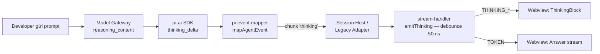
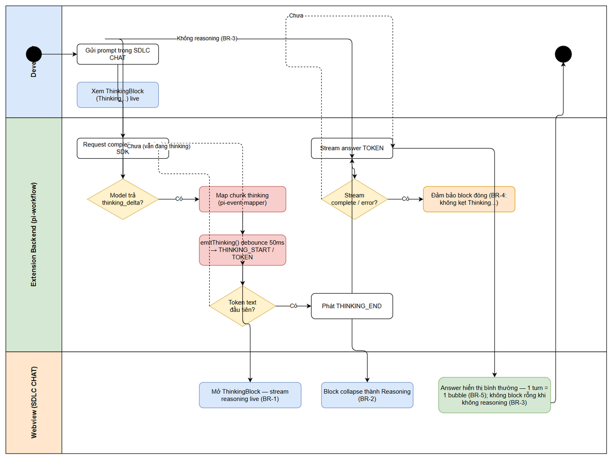
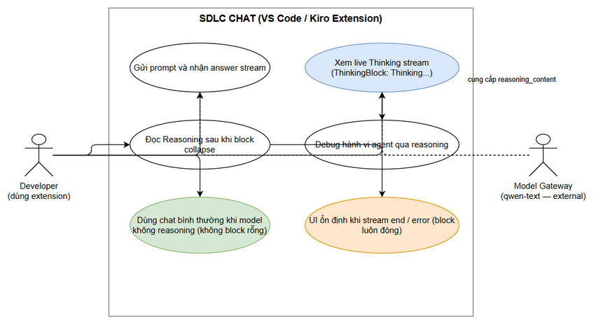
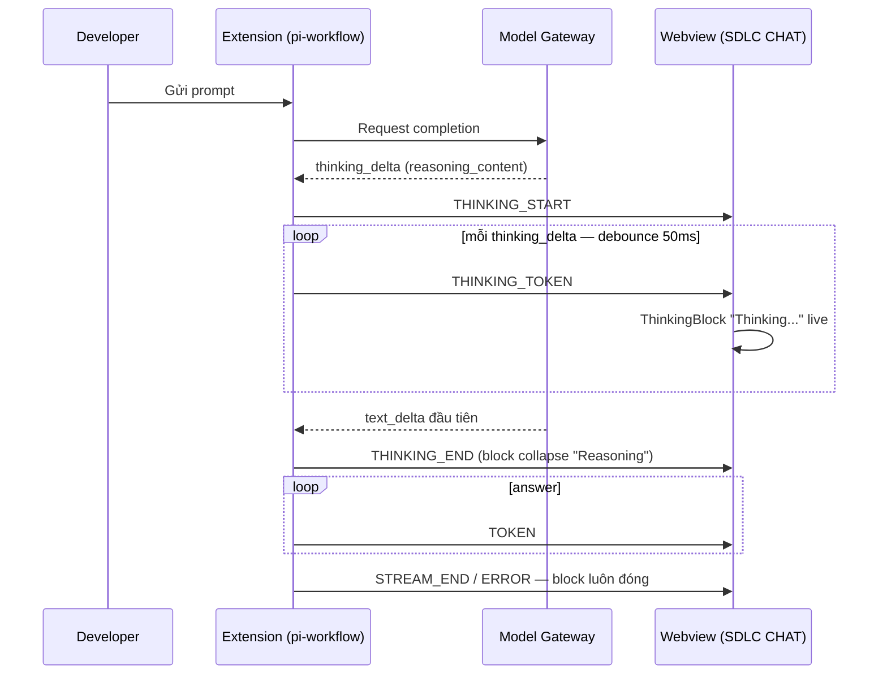

# Business Requirements Document (BRD)

## SDLC Agents 4 Enterprise — SA4E-365: [SDLC Chat] Thinking section không hiển thị — thinking_delta của reasoning model bị drop trong pi-event-mapper

---

## Document Information

| Field | Value |
|-------|-------|
| Jira Ticket | [SA4E-365](https://jiraassist.atlassian.net/browse/SA4E-365) |
| Title | [SDLC Chat] Thinking section không hiển thị — thinking_delta của reasoning model bị drop trong pi-event-mapper |
| Type / Priority | Bug / High |
| Ticket Status | In Progress |
| Labels | chat, pi-workflow, reasoning, streaming, thinking, ui |
| Author | BA Agent |
| Version | 1.0 |
| Date | 2026-10-15 |
| Status | Draft |

---

## Author Tracking

| Role | Name - Position | Responsibility |
|------|-----------------|----------------|
| Author | BA Agent – Business Analyst | Create document |
| Peer Reviewer | Scrum Master – Pipeline Coordinator | Review document |

---

## Revision History

| Version | Date | Author | Changes |
|---------|------|--------|---------|
| 1.0 | 2026-10-15 | BA Agent | Initiate document — auto-generated from Jira ticket SA4E-365 (description + code-trace investigation) |

---

## Sign-Off

| Name | Signature and date |
|------|--------------------|
| Scrum Master | ☐ I agree and confirm all criteria on this BRD as expected requirements |
| Tech Lead | ☐ I agree and confirm all criteria on this BRD as expected requirements |

---

## 1. Introduction

### 1.1 Scope

Cửa sổ chat "SDLC CHAT" (webview panel của VS Code/Kiro extension) phải hiển thị section **"Thinking"** — stream reasoning trực tiếp (live) của reasoning model — để developer hiểu và tin tưởng output của AI agent, cũng như debug được hành vi của agent khi chạy SDLC pipeline.

Về mặt kỹ thuật: pi-ai SDK **đã phát** event `thinking_delta` (parse `reasoning_content` / `reasoning` / `reasoning_text` từ OpenAI-compatible gateway; các adapter anthropic/bedrock/google/mistral cũng phát), nhưng **toàn bộ chuỗi forward trong extension đều drop** event này, nên component `ThinkingBlock` (deliver sẵn từ SA4E-85) không bao giờ render.

Scope của CR này:
- Forward thinking qua **2 đường streaming**: session path (`pi-agent-session-host`) và legacy path (`pi-workflow-adapter`).
- Mapping protocol `THINKING_START` / `THINKING_TOKEN` / `THINKING_END` ở engine/stream layer tới webview.
- Unit tests cho mapper + adapter, không regress vitest suite hiện tại.

Chi tiết thiết kế kỹ thuật (8 điểm sửa F1–F8 trên Jira) thuộc FSD/TDD, không thuộc BRD này.

### 1.2 Out of Scope

- Persist thinking content vào session file (không lưu lịch sử thinking sau khi turn kết thúc).
- UI cấu hình thinking level / bật-tắt reasoning cho từng model.
- Hỗ trợ model/provider **không** trả reasoning (UI giữ nguyên hành vi hiện tại — xem BR-3).
- Thay đổi giao diện/thiết kế của `ThinkingBlock.svelte` (component đã hoàn chỉnh từ SA4E-85).
- Sửa SA4E-364 (MCP tools dead code — cùng chat panel nhưng khác hành vi, separate ticket).

### 1.3 Preliminary Requirement

- pi-ai SDK ổn định phát `thinking_delta` cho các reasoning model (đã xác nhận qua code trace).
- Downstream UI stack **đã sẵn sàng, không cần sửa** (source ticket SA4E-365):
  - `ThinkingBlock.svelte` (SA4E-85) và `ChatMessage.svelte` (`{#if message.thinking}`).
  - `chatStore`: `startThinking` / `appendThinkingToken` / `endThinking`.
  - `messageListener.ts`: handlers `THINKING_START`/`THINKING_TOKEN`/`THINKING_END`.
  - `chat/types/messages.ts` + `messageValidator.ts`: protocol types + validation đã có `THINKING_*`.
- Ít nhất một model gateway hỗ trợ reasoning (vd `qwen-text` trả `reasoning_content`) để verification.

---
## 2. Business Requirements

### 2.0 Problem Statement

> **ThinkingBlock không bao giờ render** dù UI stack downstream đã hoàn chỉnh: pi-ai SDK phát `thinking_delta`, nhưng toàn bộ chuỗi forward trong extension drop event này — `mapAgentEvent()` chỉ xử lý `text_delta`, `promptTurn()` chỉ forward chunk `'text'`, legacy loop chỉ emit `'text'`/`'error'`, `StreamEventType` thiếu `"thinking"`, engine layer filter mất eventType `'thinking'`. Hệ quả: developer không thấy reasoning của model → thiếu minh bạch, khó tin tưởng và khó debug hành vi AI agent khi chạy SDLC pipeline.

### 2.1 High Level Process Map

Luồng business mong muốn: model gateway trả `reasoning_content` → pi-ai SDK phát `thinking_delta` → extension map thành chunk `thinking` → stream-handler phát `THINKING_*` (buffer + debounce 50ms) → webview render `ThinkingBlock` live → tự collapse thành "Reasoning" khi answer bắt đầu.

*[Edit in draw.io](diagrams/business-flow.drawio)*

*[Edit in draw.io](diagrams/use-case.drawio)*

**Bảng Business Requirements:**

| ID | Requirement | Priority | Mapping AC |
|----|-------------|----------|------------|
| BR-1 | Khi model trả reasoning, extension phải forward `thinking_delta` qua cả 2 đường streaming (session path + legacy path) và webview hiển thị ThinkingBlock "Thinking..." stream live | MUST | AC1 |
| BR-2 | Khi token **text đầu tiên** của answer đến, hệ thống phát `THINKING_END`; block tự collapse thành nhãn "Reasoning"; answer stream chạy bình thường | MUST | AC2 |
| BR-3 | Turn không có reasoning (model thường, tool-only): không phát `THINKING_*`, không hiển thị block rỗng, UI không thay đổi | MUST | AC3 |
| BR-4 | Khi stream **complete hoặc error**, thinking block luôn ở trạng thái đóng (không kẹt "Thinking...") | MUST | AC4 |
| BR-5 | Giữ nguyên streaming identity hiện tại: **1 turn = 1 bubble**; thinking là thuộc tính của message hiện tại, không tạo bubble mới, không đổi thứ tự message | MUST | AC1–AC4 |

### 2.2 List of User Stories / Use Cases

| # | Story / Use Case | Priority | Source Ticket |
|---|------------------|----------|---------------|
| 1 | As a developer dùng extension, I want xem reasoning live của model (ThinkingBlock "Thinking...") trong khi agent trả lời so that tôi hiểu và tin tưởng output của AI agent | MUST HAVE | SA4E-365 |
| 2 | As a developer, I want thinking block tự collapse thành "Reasoning" khi answer bắt đầu so that màn hình tập trung vào answer, không bị chiếm chỗ | MUST HAVE | SA4E-365 |
| 3 | As a developer dùng model không hỗ trợ reasoning, I want UI giữ nguyên hành vi (không block rỗng) so that trải nghiệm không bị nhiễu | MUST HAVE | SA4E-365 |
| 4 | As a developer, I want thinking block luôn đóng khi stream end/error so that UI không kẹt trạng thái "Thinking..." | MUST HAVE | SA4E-365 |

### 2.3 Details of User Stories

#### Business Flow

**Step 1:** Developer gửi prompt trong cửa sổ SDLC CHAT.

**Step 2:** Extension backend gọi model gateway qua pi-ai SDK; với reasoning model, gateway trả `reasoning_content` trong stream.

**Step 3:** pi-ai SDK phát event `thinking_delta`.

**Step 4:** `pi-event-mapper.mapAgentEvent()` map `thinking_delta` thành chunk type `'thinking'` (hiện tại: bị drop — root cause).

**Step 5:** Chunk được forward qua **một trong 2 đường**: session path (`promptTurn()` → callback `onThinking`) hoặc legacy path (`pi-workflow-adapter` emit chunk `thinking`).

**Step 6:** `stream-handler` gọi `emitThinking()` — buffer + debounce 50ms (cùng pattern với `emitToken`) — postMessage `THINKING_START` (lần đầu) và `THINKING_TOKEN` (từng delta).

**Step 7:** Webview: `chatStore.startThinking` → `appendThinkingToken` → `ThinkingBlock` hiển thị "Thinking..." stream live trong bubble của turn hiện tại.

**Step 8:** Token text đầu tiên đến → phát `THINKING_END` → block collapse thành "Reasoning"; answer stream (`TOKEN`) chạy bình thường; khi stream complete/error → block luôn đóng.

> **Note:** Step 4–6 là phần hệ thống **đang thiếu** (điểm drop F1–F8 trên Jira); Step 7–8 đã sẵn sàng từ SA4E-85.

---

#### STORY 1: Xem live reasoning stream trong SDLC CHAT (BR-1, BR-2)

> As a developer dùng extension, I want xem reasoning live của model (ThinkingBlock "Thinking...") trong khi agent trả lời so that tôi hiểu và tin tưởng output của AI agent.

**Requirement Details:**

1. Extension phải forward `thinking_delta` **trên cả 2 đường streaming** (session path và legacy path) — bỏ sót một đường sẽ làm bug tái xuất trên path còn lại (BR-1).
2. Engine layer map chunk `thinking` → protocol events: `THINKING_START` (thinking token đầu tiên của turn), `THINKING_TOKEN` (từng delta), `THINKING_END` (token text đầu tiên HOẶC stream complete).
3. Webview render `ThinkingBlock` trạng thái live "Thinking..." bên trong bubble của turn hiện tại — **không tạo bubble mới** (BR-5).

**Data Fields (protocol events — đã có sẵn phía webview):**

| Field | Type | Required | Description | Example |
|-------|------|----------|-------------|---------|
| THINKING_START | event | Yes | Mở thinking block cho turn hiện tại | `{ type: THINKING_START, nodeId, streamId }` |
| THINKING_TOKEN.text | string | Yes | Delta reasoning (sau debounce 50ms) | "Đang phân tích ticket..." |
| THINKING_END | event | Yes | Đóng thinking, block collapse | `{ type: THINKING_END }` |

**Acceptance Criteria:**

1. (AC1) Model trả reasoning (`thinking_delta`) → SDLC CHAT hiển thị ThinkingBlock "Thinking..." stream live.
2. (AC2) Token text đầu tiên đến → `THINKING_END` phát, block tự collapse thành "Reasoning", answer stream bình thường.

**UI Specifications (trạng thái ThinkingBlock — component có sẵn từ SA4E-85, không đổi design):**

| No. | State | Trigger | Behavior |
|-----|-------|---------|----------|
| 1 | "Thinking..." (live) | THINKING_START | Block mở, stream token liên tục |
| 2 | "Reasoning" (collapsed) | THINKING_END (text đầu tiên) | Collapse lại, giữ nội dung xem lại được |
| 3 | Hidden | Không có reasoning | Không render block |

**Validation Rules:**

- Token thinking rỗng (empty delta) không được append vào block.
- Event `THINKING_*` phải thuộc `streamId`/`nodeId` của turn hiện tại — không cross-turn.

**Error Handling:**

- Gateway không trả reasoning → không phát `THINKING_*` → UI không đổi (xem STORY 2).
- Stream error giữa lúc thinking → vẫn phải kết thúc thinking state → block đóng (xem STORY 3).

---

#### STORY 2: Không reasoning → UI không thay đổi (BR-3)

> As a developer dùng model không hỗ trợ reasoning, I want UI giữ nguyên hành vi (không block rỗng) so that trải nghiệm không bị nhiễu.

**Requirement Details:**

1. Với turn không có `thinking_delta` (model thường, tool-only turn, hoặc gateway không hỗ trợ), hệ thống **không phát** `THINKING_START`/`THINKING_TOKEN`/`THINKING_END`.
2. Không được render ThinkingBlock rỗng / trạng thái loading vô nghĩa.

**Acceptance Criteria:**

1. (AC3) Turn không có reasoning → UI không đổi, không hiện block rỗng.

---

#### STORY 3: Độ tin cậy — block luôn đóng & giữ streaming identity (BR-4, BR-5)

> As a developer, I want thinking block luôn đóng khi stream end/error và streaming identity giữ nguyên so that UI không kẹt trạng thái "Thinking..." và hội thoại không bị phá vỡ layout.

**Requirement Details:**

1. Khi stream **complete hoặc error** mà thinking vẫn đang mở, hệ thống phải phát `THINKING_END` để block luôn ở trạng thái đóng (BR-4).
2. Streaming identity không đổi: 1 turn = 1 bubble; thinking gắn vào message hiện tại (BR-5) — backward compatible với các luồng `TOKEN`/`ERROR` hiện có.
3. Unit tests phải cover: `mapAgentEvent` với `thinking_delta`, mapping `THINKING_*` của StreamProtocolAdapter; toàn bộ vitest suite hiện tại không regress (AC5).

**Error Handling:**

- Stream error: thinking block đóng cùng error handling hiện tại (không kẹt live state).
- Legacy path và session path phải có hành vi end-of-thinking **nhất quán**.

---
## 3. Dependencies

| Dependency | Type | Related Ticket | Description |
|------------|------|----------------|-------------|
| pi-ai SDK thinking_delta | System | N/A | SDK đã phát event cho reasoning model (đã xác nhận code trace) — điều kiện tiên quyết |
| Model gateway hỗ trợ reasoning | External | N/A | Vd qwen-text trả reasoning_content — cần để verification AC1/AC2 |
| ThinkingBlock UI component | System | SA4E-85 | ThinkingBlock.svelte + ChatMessage.svelte + chatStore + messageListener đã sẵn sàng, không cần sửa |
| THINKING_* protocol types | System | SA4E-85 | messages.ts + messageValidator.ts đã có event types + validation |
| 2 đường streaming hiện có | System | N/A | Session path (pi-agent-session-host) và legacy path (pi-workflow-adapter) đều phải được sửa |

---

## 4. Stakeholders

| Role | Name / Team | Responsibility | Source |
|------|-------------|----------------|--------|
| Reporter / Ticket Creator | SDLC team | Báo bug, cung cấp root cause + proposed fix + AC | SA4E-365 (creator) |
| Assignee / Developer | Chưa phân công (unassigned trên Jira) | Implement forward thinking + tests | SA4E-365 (assignee = null) |
| Scrum Master | SM Agent | Điều phối pipeline, review quality gates | Pipeline |
| End Users | Developer / BA / Dev / QA dùng extension | Sử dụng SDLC CHAT, xem reasoning | Project SA4E |

**User Personas:**

- **Persona 1 — SDLC Pipeline Developer (chính):** Developer chạy pipeline multi-agent qua extension hằng ngày; cần thấy model "đang nghĩ gì" để đánh giá output agent có đáng tin trước khi áp dụng vào code/docs.
- **Persona 2 — Scrum Master / Tech Lead:** Theo dõi agent chạy SDLC pipeline; cần minh bạch hành vi agent để debug khi kết quả sai — reasoning stream là công cụ chẩn đoán nhanh không cần đọc log.

---

## 5. Risks and Assumptions

### 5.1 Risks

| Risk | Impact | Likelihood | Mitigation |
|------|--------|------------|------------|
| Sửa sót 1 trong 2 đường streaming (session vs legacy) → bug tái xuất trên path còn lại | High | Medium | BR-1 yêu cầu cả 2 đường; unit test cover mapper + adapter; verification chạy cả 2 path |
| postMessage storm khi reasoning token dày → webview lag | Medium | Medium | Buffer + debounce 50ms theo pattern emitToken hiện có (NFR-1) |
| THINKING_END bị miss khi stream error giữa thinking → block kẹt "Thinking..." | Medium | Medium | BR-4: end-of-thinking phải nằm trong cả complete lẫn error path |
| Model/gateway trả reasoning ở format khác (reasoning / reasoning_text) | Low | Low | pi-ai SDK đã chuẩn hóa về thinking_delta — extension chỉ xử lý 1 event type |

### 5.2 Assumptions

- pi-ai SDK phát thinking_delta ổn định cho các reasoning model và không đổi contract trong scope này.
- Downstream UI (ThinkingBlock, chatStore, messageListener, protocol validator) hoạt động đúng như đã deliver ở SA4E-85 — không cần regression test UI mới ngoài suite hiện có.
- Thinking content không cần lưu vào session file trong scope này (persist là out-of-scope).

---

## 6. Non-Functional Requirements

| Category | Requirement | Details |
|----------|-------------|---------|
| Performance (NFR-1) | Không postMessage storm | emitThinking() buffer + debounce 50ms — cùng pattern emitToken; webview không lag khi reasoning dài |
| Backward Compatibility (NFR-2) | Model không reasoning → UI không đổi | Không phát THINKING_*, không block rỗng, các luồng TOKEN/ERROR hiện có giữ nguyên (BR-3, AC3) |
| Consistency (NFR-3) | Streaming identity giữ nguyên | 1 turn = 1 bubble; thinking là thuộc tính message hiện tại (BR-5) |
| Reliability (NFR-4) | Không kẹt UI state | Thinking block luôn đóng khi stream complete/error (BR-4, AC4) |
| Testability (NFR-5) | Regression-safe | Unit tests mapAgentEvent + StreamProtocolAdapter; toàn bộ vitest suite hiện tại pass (AC5) |

---

## 7. Related Tickets

| Ticket Key | Summary | Status | Type | Relationship |
|------------|---------|--------|------|--------------|
| SA4E-365 | [SDLC Chat] Thinking section không hiển thị — thinking_delta bị drop trong pi-event-mapper | In Progress | Bug | Main ticket |
| SA4E-85 | ThinkingBlock (Task 2.5) — UI component gốc của block Thinking | Done | Task | relates to — downstream UI đã sẵn sàng từ ticket này |
| SA4E-364 | [SDLC Chat] MCP tools dead code | Open | Bug | relates to — cùng pipeline chat panel, khác hành vi |

---

## 8. Appendix

### Root Cause Chain (tóm tắt từ ticket SA4E-365 — chi tiết fix F1–F8 thuộc FSD)

Các điểm drop thinking_delta trong chuỗi forward (đã xác nhận bằng code trace):

| # | File | Vấn đề |
|---|------|--------|
| 1 | pi-workflow/pi-event-mapper.ts | mapAgentEvent() chỉ xử lý text_delta; thinking_delta bị bỏ qua hoàn toàn |
| 2 | pi-workflow/pi-agent-session-host.ts | promptTurn() chỉ forward chunk 'text' (cả 2 subscribe loop) |
| 3 | pi-workflow/pi-workflow-adapter.ts | Legacy chunk loop chỉ emit 'text'/'error' |
| 4 | mcp/stream-handler.ts | Không có emitThinking() |
| 5 | mcp/state-types.ts | StreamEventType thiếu "thinking" |
| 6 | chat/engine/ChatEngineAdapter.ts | toStreamEvent() filter mất eventType 'thinking' |
| 7 | chat/engine/IStreamProtocolAdapter.ts | StreamChunkEvent.eventType thiếu 'thinking' |
| 8 | chat/engine/StreamProtocolAdapter.ts | Không map sang THINKING_START/TOKEN/END |

### Verification Steps (từ ticket)

1. Build extension (npm run compile) + reload IDE host.
2. Chọn model gateway hỗ trợ reasoning (vd qwen-text).
3. Gửi prompt trong SDLC CHAT → quan sát ThinkingBlock stream live.
4. Answer bắt đầu → block collapse thành "Reasoning".
5. Run npx vitest run (chat engine + webview suites).
6. Turn tool-only (không reasoning) → không block; turn error → block đóng.

### Glossary

| Term | Definition |
|------|------------|
| thinking_delta | Stream event do pi-ai SDK phát khi model trả reasoning (được parse từ reasoning_content / reasoning / reasoning_text) |
| reasoning_content | Field reasoning trong response của OpenAI-compatible gateway |
| ThinkingBlock | Svelte component hiển thị thinking/reasoning trong chat (SA4E-85) |
| THINKING_START / TOKEN / END | Protocol events webview để mở / append / đóng thinking block |
| Session path | Đường streaming qua pi-agent-session-host.promptTurn() với callback onThinking |
| Legacy path | Đường streaming qua loop pi-workflow-adapter |
| stream-handler | Layer phát protocol events tới webview (buffer + debounce 50ms) |
| Debounce 50ms | Gộp buffer token rồi mới postMessage, tránh postMessage storm |
| Streaming identity | Nguyên tắc 1 turn chat = 1 message bubble |

### Reference Documents

| Document | Link / Location |
|----------|-----------------|
| Jira Ticket SA4E-365 | https://jiraassist.atlassian.net/browse/SA4E-365 |
| Jira Ticket SA4E-85 (ThinkingBlock) | https://jiraassist.atlassian.net/browse/SA4E-85 |
| Jira Ticket SA4E-364 (MCP tools dead code) | https://jiraassist.atlassian.net/browse/SA4E-364 |
| BRD Template | documents/templates/BRD-TEMPLATE.md |

---

### Business Flow Overview (sequence — bổ trợ)

*[Edit in draw.io](diagrams/sequence-thinking-stream.drawio)*

---

*End of Document — SA4E-365 BRD v1.0 (BA Agent, 2026-10-15)*

