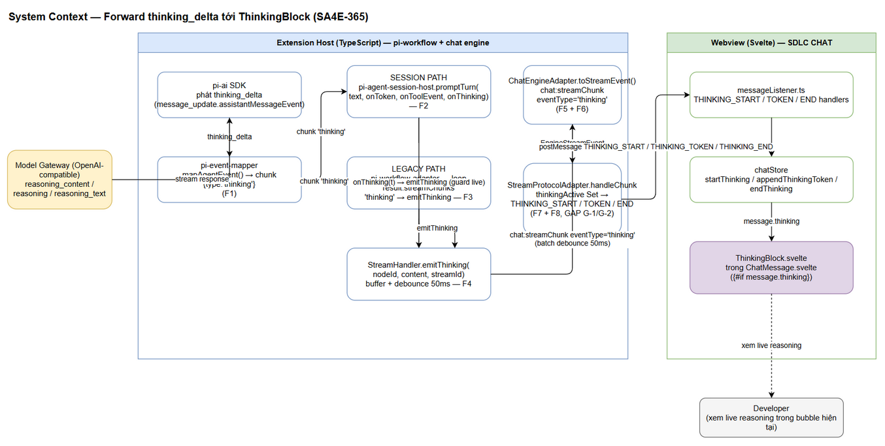
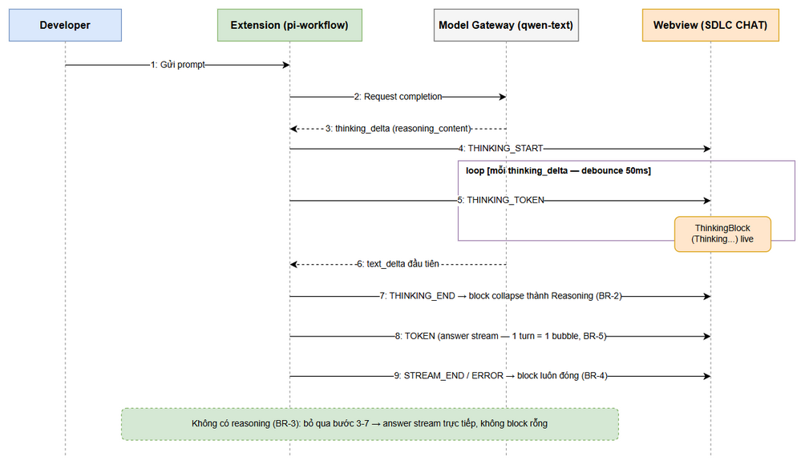
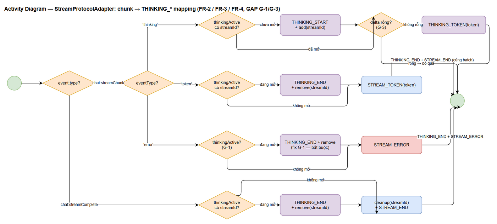
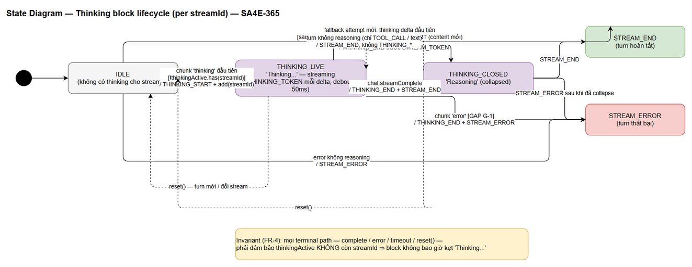

# Functional Specification Document (FSD)

## SDLC Chat Extension — SA4E-365: Forward thinking_delta tới ThinkingBlock trên 2 đường streaming

---

## Document Information

| Field | Value |
|-------|-------|
| Jira Ticket | [SA4E-365](https://jiraassist.atlassian.net/browse/SA4E-365) |
| Title | [SDLC Chat] Thinking section không hiển thị — thinking_delta của reasoning model bị drop trong pi-event-mapper |
| Author | BA Agent (draft v0.1); TA Agent (technical enrichment v1.0) |
| Version | 1.0 (TA Enriched) |
| Date | 2026-10-16 |
| Status | In Review — Phase 2 (TA enriched → SA review) |
| Related BRD | documents/SA4E-365/BRD.md (v1.0, Approved) |

---

## Revision History

| Version | Date | Author | Changes |
|---------|------|--------|---------|
| 0.1 | 2026-10-16 | BA Agent | FSD draft từ BRD + code trace: chuỗi forward 8 điểm F1–F8, gaps G-1..G-5, data contracts, edge cases, test scenarios. Chờ TA enrich |
| 1.0 | 2026-10-16 | TA Agent | TA enrichment (đối chiếu code 2026-10-16): quyết định G-2 (§6.6 — continuation semantics, so sánh 3 phương án); business rules kỹ thuật G-1/G-3/G-4 (FR4-R3, FR3-R3, FR4-R4); pseudocode handleChunk (§6.4.1); review tính khả thi 14 TC + điều chỉnh test plan (§10.3). Diagrams giữ nguyên (SA cập nhật khi cần) |

---

## 1. Introduction

### 1.1 Purpose

Tài liệu này spec chức năng cho bug fix SA4E-365: hoàn thiện chuỗi forward event `thinking_delta` từ pi-ai SDK đến webview `ThinkingBlock`, sao cho developer thấy reasoning stream live của model trong SDLC CHAT. Đây là spec cấp chức năng (WHAT + luồng dữ liệu qua các layer); thiết kế chi tiết (tách file, pattern refactor) thuộc TDD của SA agent.

FSD draft đã được đối chiếu với codebase (code trace 2026-10-16): happy path F1–F8 đã được wire trong code (đánh dấu `SA4E-THINKING`), còn **5 gaps G-1..G-5** cần hoàn thiện (mục 2.1, 6.4, 6.5, 9, 10).

### 1.2 Scope

**In scope (technical clarification từ BRD §1.1):**

1. Forward `thinking_delta` qua **cả 2 đường streaming**: session path (`pi-agent-session-host.promptTurn`) và legacy path (`pi-workflow-adapter` loop `result.streamChunks`).
2. Mapping protocol ở engine layer: chunk `'thinking'` → `THINKING_START` / `THINKING_TOKEN` / `THINKING_END` (`StreamProtocolAdapter`).
3. Data contracts: `PiStreamChunk` thêm `'thinking'`; `StreamEventType` thêm `"thinking"`; `StreamChunkEvent.eventType` thêm `'thinking'`; `StreamHandler.emitThinking(nodeId, content, streamId)` buffer + debounce 50ms; `thinkingActive` Set per streamId.
4. Edge cases: turn tool-only; error giữa thinking; fallback model chain reset per attempt; orphan complete; `reset()`.
5. Unit tests cho mapper + adapter (NFR-5 / AC5).

**Out of Scope (từ BRD §1.2 — không thay đổi):**

| # | Loại trừ | Lý do |
|---|----------|-------|
| 1 | Persist thinking content vào session file | Không lưu lịch sử thinking sau khi turn kết thúc |
| 2 | UI cấu hình thinking level / bật-tắt reasoning per model | Out of scope CR |
| 3 | Model/provider không trả reasoning | UI giữ nguyên hành vi hiện tại (BR-3) |
| 4 | Thay đổi design `ThinkingBlock.svelte` | Component hoàn chỉnh từ SA4E-85 |
| 5 | Sửa SA4E-364 (MCP tools dead code) | Separate ticket, cùng panel khác hành vi |

### 1.3 Definitions & Acronyms

| Term | Definition |
|------|------------|
| thinking_delta | Stream event pi-ai SDK phát khi model trả reasoning (SDK parse từ `reasoning_content` / `reasoning` / `reasoning_text`); dạng `message_update.assistantMessageEvent = { type: 'thinking_delta', delta }` |
| PiStreamChunk | Chunk type nội bộ pi-workflow: type là 'text' / 'thinking' / 'tool_call' / 'error' |
| Session path | Đường streaming qua `promptTurn(text, onToken, onToolEvent, onThinking)` — callback `onThinking` |
| Legacy path | Đường streaming qua loop `result.streamChunks` trong `pi-workflow-adapter` |
| StreamHandler | Layer phát protocol event tới webview (buffer + debounce 50ms, MAX_BUFFER_SIZE 100) |
| thinkingActive | Set chứa streamId trong StreamProtocolAdapter — track stream đang có thinking block mở |
| Streaming identity | 1 turn = 1 streamId = 1 messageId = 1 bubble (BR-5) |
| Fallback chain | Cơ chế thử model thay thế khi attempt lỗi; mỗi attempt có thể phát thinking riêng |
| Attempt boundary | Điểm chuyển giữa 2 attempt trong 1 turn (fallback chain / session→legacy fallback). Hiện KHÔNG có event protocol cho ranh giới này — xem §6.6 |
| Terminal path | Điểm kết thúc logic của stream: complete / error / timeout / reset — mọi terminal phải để `thinkingActive` rỗng (FR4-R1) |

### 1.4 References

| Document | Location |
|----------|----------|
| BRD SA4E-365 | documents/SA4E-365/BRD.md |
| Jira Ticket SA4E-365 (proposed fix F1–F8) | https://jiraassist.atlassian.net/browse/SA4E-365 |
| SA4E-85 (ThinkingBlock + protocol types — downstream sẵn sàng) | https://jiraassist.atlassian.net/browse/SA4E-85 |
| FSD Template | documents/templates/FSD-TEMPLATE.md |

---

## 2. System Overview

### 2.1 System Context


*[Edit in draw.io](diagrams/system-context.drawio)*

Hệ thống liên quan 3 vùng: **Model Gateway** (external, trả `reasoning_content` trong stream), **Extension Host** (TypeScript — chuỗi forward 8 điểm F1–F8), **Webview** (Svelte — render `ThinkingBlock`, đã sẵn sàng từ SA4E-85, không sửa).

**Chuỗi forward F1–F8 — trạng thái tại thời điểm draft (code trace 2026-10-16):**

| # | File (extension/src/…) | Điểm spec | Trạng thái |
|---|------------------------|-----------|------------|
| F1 | pi-workflow/pi-event-mapper.ts | `mapAgentEvent()`: `thinking_delta` → chunk `{ type:'thinking', content: delta }` | ✅ Đã có |
| F2 | pi-workflow/pi-agent-session-host.ts | `promptTurn(..., onThinking)` — cả 2 subscribe loop forward `'thinking'` | ✅ Đã có |
| F3 | pi-workflow/pi-workflow-adapter.ts | Wiring `onThinking` → `emitThinking` (guard `live`) + legacy loop `'thinking'` | ✅ Đã có |
| F4 | mcp/stream-handler.ts | `emitThinking()` buffer + debounce 50ms, chung `bufferChunk` với `emitToken` | ✅ Đã có |
| F5 | mcp/state-types.ts | `StreamEventType` có `"thinking"` | ✅ Đã có |
| F6 | chat/engine/ChatEngineAdapter.ts | `toStreamEvent()` pass eventType `'thinking'` | ✅ Đã có |
| F7 | chat/engine/IStreamProtocolAdapter.ts | `StreamChunkEvent.eventType` có `'thinking'` | ✅ Đã có |
| F8 | chat/engine/StreamProtocolAdapter.ts | `thinkingActive` Set + mapping `THINKING_*` (happy path) | ⚠️ Còn gaps G-1..G-3 |

**Gaps cần hoàn thiện (phát hiện từ code trace — chi tiết ở §6.4, §6.5, §9, §10):**

| Gap | Mô tả | Mức độ |
|-----|-------|--------|
| G-1 | `handleChunk` eventType `'error'` chỉ push `STREAM_ERROR`, **không đóng** `thinkingActive` → turn lỗi giữa thinking mà không có `chat:streamComplete` theo sau → block kẹt "Thinking..." — vi phạm BR-4 | High |
| G-2 | Fallback model chain: các attempt dùng chung streamId; `thinkingActive` còn giữ streamId của attempt trước → THINKING_START không phát lại + nội dung thinking attempt cũ **leak** sang attempt sau | High |
| G-3 | `StreamProtocolAdapter` push `THINKING_TOKEN` không guard content rỗng (upstream đã guard — cần defense-in-depth) | Low |
| G-4 | Orphan complete (complete cho streamId chưa start): hiện no-op an toàn — cần verify + test khóa hành vi | Low |
| G-5 | Chưa có unit tests cho thinking path (mapAgentEvent, StreamProtocolAdapter, session host onThinking, legacy loop, emitThinking debounce) — bắt buộc theo NFR-5/AC5 | High |

<!-- TA enrichment -->
> **TA Note (đối chiếu code 2026-10-16):** Cả 5 gaps được xác nhận trên code hiện hành, với 2 điều chỉnh về **cách giải quyết**:
> - **G-1** xác nhận là kịch bản thật: `handleChunk` eventType `'error'` không đóng `thinkingActive` (StreamProtocolAdapter.ts:88-97). Trigger cụ thể nhất: session path throw giữa turn → `chat:error` `PI_TURN_FAILED` (pi-workflow-adapter.ts catch cuối — **không** `emitComplete` theo sau) → error chunk đính vào stream đang mở → block kẹt "Thinking...". Fix bắt buộc tại adapter (FR4-R3).
> - **G-2** KHÔNG cần cơ chế reset per attempt như draft giả định: verify code cho thấy (a) legacy path **discard** chunk của attempt failed trước khi replay (per-attempt collector trong `PiProvider.runOnce`), (b) không có event ranh giới attempt trong event stream hiện tại (`toStreamEvent` drop `retry`/`strategy_switch`). Quyết định thiết kế: **continuation semantics** — phân tích + justification đầy đủ ở §6.6.
> - **G-4** xác nhận an toàn end-to-end: adapter skip THINKING_END cho stream lạ; webview `endStream(unknownId)` chỉ reset `isStreaming` (no-op trên messages — chatStore.ts:79-85); `endThinking(unknownId)` tương tự. Cần test khóa (TC-10).

### 2.2 System Architecture

Hai đường streaming song song, hội tụ tại `StreamHandler`:

- **Session path**: `host.promptTurn(text, onToken, onToolEvent, onThinking)` → callback `onThinking(t)` → `streamHandler.emitThinking('pi', t, streamId)` (có guard `live` chống event trễ sau timeout).
- **Legacy path**: `engine.executeTurn()` → `result.streamChunks` → loop: `'text'`→`emitToken`, `'thinking'`→`emitThinking`, `'error'`→`emitError`.

Sau đó chung 1 chuỗi: `StreamHandler` (buffer + debounce 50ms) → `chat:streamChunk` (eventType `'thinking'`) → `ChatEngineAdapter.toStreamEvent()` → `StreamProtocolAdapter.handleChunk()` → `THINKING_*` postMessage → webview `messageListener` → `chatStore` → `ThinkingBlock.svelte`.

Luồng tổng quan 2 đường (sequence — tái sử dụng từ BRD):


*[Edit in draw.io](diagrams/sequence-thinking-stream.drawio)*

---

## 3. Functional Requirements

**Mapping tổng quan FR ↔ BR ↔ AC:**

| FR | Business Requirement (BRD) | Acceptance Criteria | Tóm tắt |
|----|---------------------------|---------------------|---------|
| FR-1 | BR-1 | AC1 | Forward thinking_delta trên cả 2 đường → ThinkingBlock live |
| FR-2 | BR-2 | AC2 | THINKING_END khi token text đầu tiên hoặc streamComplete → collapse "Reasoning" |
| FR-3 | BR-3 | AC3 | Turn không reasoning → không phát THINKING_*, không block rỗng |
| FR-4 | BR-4 | AC4 | Block luôn đóng khi complete / error / timeout / reset |
| FR-5 | BR-5 | AC1–AC4 | Streaming identity: 1 turn = 1 bubble; debounce 50ms; fallback reset per attempt |

### 3.1 FR-1 — Forward thinking_delta trên cả 2 đường streaming (BR-1, AC1)

**Source:** BRD STORY 1.

#### 3.1.1 Use Case UC-1

- **Use Case ID:** UC-1
- **Actor:** Developer (người dùng extension); Hệ thống (extension host + webview)
- **Preconditions:** Extension hoạt động; model gateway hỗ trợ reasoning (vd `qwen-text` trả `reasoning_content`); pi-ai SDK phát `thinking_delta` cho reasoning model.
- **Postconditions:** ThinkingBlock hiển thị "Thinking..." stream live bên trong bubble của turn hiện tại; không tạo bubble mới.

**Main Flow:**

| Step | Actor | System | Description |
|------|-------|--------|-------------|
| 1 | Developer | — | Gửi prompt trong SDLC CHAT |
| 2 | — | Model Gateway | Trả reasoning_content trong stream response |
| 3 | — | pi-ai SDK | Phát `message_update` với `assistantMessageEvent = { type: 'thinking_delta', delta }`, delta khác rỗng |
| 4 | — | pi-event-mapper.mapAgentEvent (F1) | Push chunk `{ type: 'thinking', content: delta }` vào collector; tích lũy `collector.thinking` |
| 5 | — | Session host hoặc legacy adapter (F2/F3) | Chunk `'thinking'` → `streamHandler.emitThinking(nodeId, content, streamId)` với **cùng streamId** của turn |
| 6 | — | StreamHandler (F4) | Buffer chunk, flush theo debounce 50ms → postMessage `chat:streamChunk` eventType `'thinking'` |
| 7 | — | ChatEngineAdapter.toStreamEvent (F6) | Map thành EngineStreamEvent `chat:streamChunk` (không filter mất `'thinking'`) |
| 8 | — | StreamProtocolAdapter.handleChunk (F8) | Lần đầu với streamId: push `THINKING_START` + add vào `thinkingActive`; mọi delta: push `THINKING_TOKEN` |
| 9 | — | Webview | `messageListener` → `chatStore.startThinking` / `appendThinkingToken` → ThinkingBlock "Thinking..." live |

**Alternative Flows:**

| ID | Condition | Steps |
|----|-----------|-------|
| AF-1 | Turn chạy session path | `promptTurn(text, onToken, onToolEvent, onThinking)` — callback thứ 4 `onThinking(t)`; cả 2 subscribe loop trong host forward `last.type === 'thinking' && last.content` → `onThinking(last.content)`. Wiring ở adapter: guard `if (!live) return` trước khi emit |
| AF-2 | Turn chạy legacy path | Loop `result.streamChunks`: `'text'`→`emitToken`, `'thinking'`→`emitThinking`, `'error'`→`emitError`, `'tool_call'`→tool flow hiện có |

**Exception Flows:**

| ID | Condition | Steps |
|----|-----------|-------|
| EF-1 | Gateway/SDK không phát thinking_delta (model thường) | Không có chunk `'thinking'` → không THINKING_* → FR-3 |
| EF-2 | Delta rỗng | Mapper guard `ame.delta` truthy → chunk không được tạo; không THINKING_TOKEN rỗng |
| EF-3 | Event đến sau khi turn kết thúc (timeout/abort) | Guard `live` ở wiring: drop — thinking không bleed sang turn sau (FR-5) |

#### 3.1.2 Data Contracts (đầu vào/đầu ra từng layer)

| Layer | Contract | Thay đổi so với hiện trạng |
|-------|----------|---------------------------|
| pi-ai SDK → mapper | `AgentEvent message_update` + `assistantMessageEvent { type: 'thinking_delta', delta: string }` | Không đổi (SDK đã phát) |
| PiStreamChunk (pi-provider) | Thêm type `'thinking'`: `{ type: 'thinking', content: string }` | Đã có trong code — spec khóa contract |
| Session host API | `promptTurn(text: string, onToken?: (t) => void, onToolEvent?: (e) => void, onThinking?: (t) => void)` | Đã có — spec khóa contract |
| StreamEventType (mcp/state-types) | `"token" \| "thinking" \| ...` | Đã có — spec khóa contract |
| StreamHandler | `emitThinking(nodeId: string, content: string, streamId: string): void` — buffer + debounce 50ms | Đã có — spec khóa contract |
| StreamChunkEvent (IStreamProtocolAdapter) | eventType thêm `'thinking'` | Đã có — spec khóa contract |
| ExtensionMessage (webview protocol) | `THINKING_START { messageId }`, `THINKING_TOKEN { messageId, token }`, `THINKING_END { messageId }` | Đã có từ SA4E-85 — không đổi |

#### 3.1.3 Business Rules FR-1

| Rule ID | Rule | Source |
|---------|------|--------|
| FR1-R1 | Mọi `thinking_delta` khác rỗng phải được forward trên **cả 2 đường**; thiếu một đường = fail (bug tái xuất trên path còn lại) | BR-1 |
| FR1-R2 | Thinking events dùng cùng `streamId` + `messageId` với turn hiện tại — không cross-turn | BR-5 |
| FR1-R3 | Extension chỉ xử lý 1 event type chuẩn hóa (`thinking_delta`) — không parse reasoning fields ở tầng extension (SDK đã chuẩn hóa) | BRD §5.1 |

### 3.2 FR-2 — THINKING_END khi token text đầu tiên hoặc streamComplete (BR-2, AC2)

**Source:** BRD STORY 1.

#### 3.2.1 Use Case UC-2

- **Use Case ID:** UC-2
- **Actor:** Hệ thống (StreamProtocolAdapter + webview)
- **Preconditions:** `thinkingActive` đang chứa streamId (thinking block đang mở).
- **Postconditions:** THINKING_END đã phát đúng 1 lần; block collapse nhãn "Reasoning"; answer stream chạy bình thường.

**Main Flow:**

| Step | Actor | System | Description |
|------|-------|--------|-------------|
| 1 | — | pi-ai SDK | Phát `text_delta` đầu tiên của answer |
| 2 | — | Chuỗi forward | Chunk `'token'` đến `StreamProtocolAdapter.handleChunk` |
| 3 | — | StreamProtocolAdapter | Nếu `thinkingActive.has(streamId)`: delete khỏi set + push `THINKING_END` **trước** `STREAM_TOKEN` (cùng batch, thứ tự bắt buộc) |
| 4 | — | Webview | `endThinking(messageId)` → ThinkingBlock collapse thành "Reasoning", giữ nội dung xem lại được |
| 5 | — | Webview | `STREAM_TOKEN` tiếp theo stream answer bình thường |

**Alternative Flows:**

| ID | Condition | Steps |
|----|-----------|-------|
| AF-1 | Stream complete trước khi có text (turn chỉ thinking + tool calls, không answer) | `handleComplete`: nếu `thinkingActive` → THINKING_END + cleanup + STREAM_END — block collapse |
| AF-2 | Fallback attempt mới bắt đầu thinking sau khi đã collapse | Ranh giới attempt phải reset thinking state (G-2, §6.5): THINKING_START mới với content của attempt mới |

**Exception Flows:**

| ID | Condition | Steps |
|----|-----------|-------|
| EF-1 | THINKING_END bị miss (lỗi mapping) | Cấm xảy ra — invariant FR4-R1; test TC-04 khóa |
| EF-2 | THINKING_END phát trùng lặp | Adapter chỉ emit THINKING_END khi `thinkingActive.has(streamId)` (idempotent); webview `endThinking` cũng idempotent |

#### 3.2.2 Business Rules FR-2

| Rule ID | Rule | Source |
|---------|------|--------|
| FR2-R1 | THINKING_END phát khi: token `'text'` đầu tiên **HOẶC** `chat:streamComplete` **HOẶC** chunk `'error'` (xem FR-4) | BR-2, BR-4 |
| FR2-R2 | Thứ tự batch bắt buộc: `THINKING_END` trước `STREAM_TOKEN` | BR-2 |
| FR2-R3 | Sau THINKING_END, THINKING_START chỉ được phát lại khi có attempt/stream mới (reset per attempt) | BR-4, BR-5 |

<!-- TA enrichment -->
> **TA Note (cập nhật FR2-R3 theo quyết định §6.6):** THINKING_START được phát lại ngay trong cùng turn khi có delta thinking mới khác rỗng sau THINKING_END (vd: reasoning tiếp sau tool call, hoặc ranh giới auto-chunk) — webview `startThinking` reset `thinking: ''` và mở lại block (chatStore.ts:146-153, hành vi SA4E-85 có sẵn, không đổi). Điều kiện duy nhất: THINKING_START luôn kèm THINKING_TOKEN khác rỗng (FR3-R4). THINKING_START KHÔNG gắn với ranh giới attempt.

### 3.3 FR-3 — Turn không reasoning: không phát THINKING_* (BR-3, AC3)

**Source:** BRD STORY 2.

#### 3.3.1 Use Case UC-3

- **Use Case ID:** UC-3
- **Actor:** Hệ thống
- **Preconditions:** Turn không có reasoning (model thường, tool-only turn, gateway không hỗ trợ).
- **Postconditions:** 0 message `THINKING_*`; UI không thay đổi; không block rỗng.

**Guard chain (mỗi layer phải guard độc lập — defense in depth):**

| Layer | Guard | File |
|-------|-------|------|
| pi-ai SDK | Chỉ phát thinking_delta khi model trả reasoning | Dependency (không sửa) |
| mapAgentEvent | `ame.type === 'thinking_delta' && ame.delta` (truthy) | pi-event-mapper.ts |
| Session host | `last.type === 'thinking' && last.content` (cả 2 loop) | pi-agent-session-host.ts |
| Legacy loop | `chunk.type === 'thinking' && chunk.content` | pi-workflow-adapter.ts |
| StreamProtocolAdapter | Chỉ mở THINKING_START khi nhận chunk `'thinking'`; **G-3:** guard content khác rỗng trước khi push THINKING_TOKEN | StreamProtocolAdapter.ts |

**Main Flow:** Turn tool-only (chỉ `tool_call` chunks + text) → không có chunk `'thinking'` → `thinkingActive` không bao giờ chứa streamId → không THINKING_* → `chatStore` không có thinking state → `ChatMessage.svelte` `{#if message.thinking}` false → không render block.

**Alternative Flows:**

| ID | Condition | Steps |
|----|-----------|-------|
| AF-1 | Turn có reasoning + tool calls xen kẽ | THINKING_* theo delta; tool events theo flow hiện có; THINKING_END theo FR-2 |

**Exception Flows:**

| ID | Condition | Steps |
|----|-----------|-------|
| EF-1 | THINKING_START phát mà không có token nào theo sau (block rỗng) | Cấm — THINKING_START chỉ phát kèm delta đầu tiên khác rỗng; test TC-08 khóa |

#### 3.3.2 Business Rules FR-3

| Rule ID | Rule | Source |
|---------|------|--------|
| FR3-R1 | Không phát THINKING_* khi không có thinking_delta | BR-3 |
| FR3-R2 | Không render block rỗng — thinking state webview chỉ tồn tại khi có ≥ 1 token khác rỗng | BR-3 |

<!-- TA enrichment -->
**Rules bổ sung (TA — G-3, defense-in-depth):**

| Rule ID | Rule | Source |
|---------|------|--------|
| FR3-R3 | `StreamProtocolAdapter` phải **idempotent với token rỗng**: chunk `'thinking'` với `content` rỗng/undefined KHÔNG được push `THINKING_TOKEN`; nếu block chưa mở thì cũng KHÔNG mở THINKING_START (no-op tuyệt đối). Upstream đã guard (`ame.delta` truthy ở mapper; `last.content` truthy ở host/legacy loop) nhưng adapter là ranh giới cuối trước webview — guard độc lập bắt buộc | BR-3, G-3 |
| FR3-R4 | THINKING_START chỉ được phát **kèm** THINKING_TOKEN đầu tiên khác rỗng trong cùng batch handleChunk — cấm phát THINKING_START "trống" chờ token sau | FR3-R2, EF-1 UC-3 |

### 3.4 FR-4 — Thinking block luôn đóng khi complete / error (BR-4, AC4)

**Source:** BRD STORY 3.

#### 3.4.1 Use Case UC-4

- **Use Case ID:** UC-4
- **Actor:** Hệ thống
- **Preconditions:** Turn đang chạy, thinking có thể đang mở.
- **Postconditions:** Mọi terminal path để `thinkingActive` rỗng cho streamId — block không bao giờ kẹt "Thinking...".

**Main Flow (complete):** `chat:streamComplete` → `handleComplete`: nếu `thinkingActive.has(streamId)` → delete + push `THINKING_END`; → `cleanup(streamId)`; → push `STREAM_END`.

**Alternative Flows:**

| ID | Condition | Steps |
|----|-----------|-------|
| AF-1 | **Error giữa thinking (G-1 — fix bắt buộc)** | `handleChunk` eventType `'error'`: trước khi push `STREAM_ERROR`, nếu `thinkingActive.has(streamId)` → delete + push `THINKING_END` (cùng batch, THINKING_END trước STREAM_ERROR). Hiện trạng code CHƯA có bước này |
| AF-2 | Timeout session (`PI_SESSION_TIMEOUT`) | Wiring set `live = false` + `emitComplete` được gọi → block đóng qua complete path |
| AF-3 | Orphan complete (streamId chưa start — G-4) | Lookup `thinkingActive` = false → skip THINKING_END (no-op an toàn); vẫn push STREAM_END như hiện có; không tạo block rỗng |
| AF-4 | `reset()` (turn mới / đổi stream) | `reset()` xóa cả 3 state: `streamToMessage`, `startedStreams`, `thinkingActive` (đã có) — đảm bảo không leak state sang turn sau |

**Exception Flows:**

| ID | Condition | Steps |
|----|-----------|-------|
| EF-1 | Error không có complete theo sau | Invariant FR4-R1 + fix G-1 đảm bảo block vẫn đóng tại error mapping |
| EF-2 | THINKING_END trùng lặp (error rồi complete) | Adapter chỉ emit THINKING_END khi còn trong set → tối đa 1 lần |

#### 3.4.2 Business Rules FR-4

| Rule ID | Rule | Source |
|---------|------|--------|
| FR4-R1 | Mọi terminal path (complete / error / timeout / reset) phải đảm bảo `thinkingActive` rỗng cho streamId | BR-4 |
| FR4-R2 | THINKING_END idempotent per streamId — tối đa 1 lần cho mỗi chu kỳ thinking | BR-4 |

<!-- TA enrichment -->
**Rules bổ sung (TA — G-1, G-4):**

| Rule ID | Rule | Source |
|---------|------|--------|
| FR4-R3 | Chunk `'error'` đến khi thinking đang mở: adapter PHẢI emit `THINKING_END` **trước** `STREAM_ERROR` (cùng batch) + xóa streamId khỏi `thinkingActive` — error là terminal path, KHÔNG được dựa vào giả định "sẽ có complete theo sau". Bằng chứng: catch `PI_TURN_FAILED` (pi-workflow-adapter.ts:545-548) KHÔNG emitComplete; ngược lại catch `PI_SESSION_TIMEOUT` (331-339) emitComplete **trước** chat:error nên error thành orphan — chỉ rule "error-path tự đóng block" cover được cả 2 flow | BR-4, G-1 |
| FR4-R4 | Orphan terminal (complete/error cho streamId adapter chưa biết): hành vi khóa = **no-op an toàn** — THINKING_END bị skip (lookup miss), không crash, không tạo block/bubble rỗng phía webview (`endStream`/`endThinking` với messageId lạ chỉ no-op map — đã verify chatStore.ts). Orphan error giữ nguyên hành vi hiện có: cleanup ngay để id tổng hợp không tích lũy | G-4, BR-4 |

### 3.5 FR-5 — Streaming identity: 1 turn = 1 bubble (BR-5)

**Source:** BRD STORY 1, 3.

#### 3.5.1 Requirements

1. 1 turn = 1 `turnStreamId` ổn định (đã fix streaming identity) — thinking phải dùng **cùng streamId** với token/complete của turn.
2. `messageId` stable per streamId (`ensureMessageId`) — THINKING_* dùng cùng messageId với STREAM_* → `chatStore` gắn thinking vào message hiện tại, không tạo bubble mới, không đổi thứ tự message.
3. Debounce 50ms + MAX_BUFFER_SIZE 100 (flush cưỡng bức khi đầy) — chung pattern với `emitToken`.
4. Guard `live`: callback bỏ qua mọi event sau khi turn kết thúc — thinking không bleed sang turn sau.
5. **Fallback reset per attempt (G-2 — fix bắt buộc):** các attempt trong 1 turn dùng chung streamId; tại ranh giới attempt (fallback switch — kèm `emitRetry` / `emitStrategySwitch`), hệ thống phải reset thinking state cho streamId: emit THINKING_END (đóng block attempt cũ) + xóa streamId khỏi `thinkingActive` — để delta đầu của attempt mới mở THINKING_START mới với content mới. Phương án kỹ thuật (per-attempt reset call, hoặc key = streamId + attemptId) — TA/SA quyết định, behavior bắt buộc như trên.

   <!-- TA enrichment -->
   > **TA Note — Quyết định G-2 (2026-10-16):** Sau khi đối chiếu code, yêu cầu "reset per attempt" ở trên được thay bằng **continuation semantics** (Phương án B — §6.6): KHÔNG có cơ chế reset tại ranh giới attempt; thinking của các attempt trong cùng turn nối tiếp vào cùng block; rò rỉ giữa các attempt bị chặn ở tầng provider (discard chunk attempt failed trước khi replay — cơ chế đã có sẵn). Lý do: không tồn tại event ranh giới attempt trong event stream hiện tại (`toStreamEvent` drop `retry`/`strategy_switch`; session→legacy fallback không emit event nào), nên "reset khi chunk đầu của attempt mới" **không thể implement** mà không thêm protocol event mới — vi phạm mục tiêu thay đổi tối thiểu và có risk phá FR-5. Phân tích 3 phương án + justification: §6.6.

#### 3.5.2 Business Rules FR-5

| Rule ID | Rule | Source |
|---------|------|--------|
| FR5-R1 | 1 turn = 1 bubble; THINKING_* không tạo message mới, không đổi thứ tự message | BR-5 |
| FR5-R2 | Debounce 50ms + MAX_BUFFER_SIZE 100 cho token và thinking | NFR-1 |
| FR5-R3 | Guard `live`: event sau turn-end bị drop | BR-5 |
| FR5-R4 | Reset thinking state tại ranh giới fallback attempt — thinking attempt trước không leak sang attempt sau | BR-4, BR-5 |

<!-- TA enrichment -->
> **TA Note (sửa FR5-R4 theo quyết định §6.6):** Rule giữ nguyên MỤC TIÊU ("thinking attempt trước không leak sang attempt sau") nhưng **cơ chế đảm bảo** đổi như sau:
>
> **FR5-R4' (thay thế FR5-R4):** (1) Thinking content của attempt FAILED không bao giờ được phát tới webview — đảm bảo bởi provider discard, verify bằng TC-12a; (2) trong cùng turn, thinking của attempt/khoảng reasoning kế tiếp nối tiếp vào cùng block cho tới terminal (FR4-R1, FR4-R3); (3) không cross-TURN leak — streamId mới per turn (`crypto.randomUUID` trong `runTurnOnce`) + guard `live` + `reset()`; (4) THINKING_START chỉ mở lại sau THINKING_END khi có delta thinking mới khác rỗng, luôn kèm token (FR3-R4). | BR-4, BR-5, G-2

---

## 4. Data Model

> Không có database — toàn bộ là in-memory streaming contracts. Physical types đã tồn tại trong code; phần này khóa logical contract.

### 4.1 Logical Entities

#### Entity: PiStreamChunk (pi-workflow/pi-provider.ts)

| Attribute | Type | Required | Business Rule | Description |
|-----------|------|----------|---------------|-------------|
| type | 'text' / 'thinking' / 'tool_call' / 'error' | Y | FR1-R1 | `'thinking'` là giá trị mới do F1 thêm |
| content | string | N (Y với thinking) | FR3-R1 | Delta text; phải khác rỗng khi type='thinking' |
| toolCall | ToolCall | N | — | Với type='tool_call' |
| error | string | N | — | Với type='error' |

#### Entity: assistantMessageEvent (pi-ai SDK event)

| Attribute | Type | Required | Description |
|-----------|------|----------|-------------|
| type | 'text_delta' / 'thinking_delta' | Y | thinking_delta khi model trả reasoning |
| delta | string | Y | Nội dung delta (SDK chuẩn hóa từ reasoning_content / reasoning / reasoning_text) |

#### Entity: chat:streamChunk (ChatExtToWebviewMessage — chat-panel/message-protocol.ts)

| Attribute | Type | Required | Description |
|-----------|------|----------|-------------|
| type | 'chat:streamChunk' | Y | Message type |
| streamId | string | Y | Identity của turn — ổn định suốt turn |
| nodeId | string | Y | Node/agent phát ('pi' cho pi-workflow) |
| eventType | 'token' / 'thinking' / 'status' / 'error' | Y | `'thinking'` do F5 thêm |
| content | string | Y | Delta content |
| timestamp | ISO string | Y | Thời điểm flush |

#### Entity: ExtensionMessage THINKING_* (chat/types/messages.ts — có sẵn SA4E-85)

| Message | Fields | Description |
|---------|--------|-------------|
| THINKING_START | type, messageId | Mở thinking block cho message |
| THINKING_TOKEN | type, messageId, token | Append delta (đã qua debounce) |
| THINKING_END | type, messageId | Đóng block → collapse "Reasoning" |

#### Entity: Adapter state (StreamProtocolAdapter — in-memory)

| Attribute | Type | Description |
|-----------|------|-------------|
| streamToMessage | Map<streamId, messageId> | Correlation stable per stream |
| startedStreams | Set<streamId> | STREAM_START đã phát |
| thinkingActive | Set<streamId> | Thinking block đang mở (SA4E-THINKING) |

#### Entity: StreamHandler state (mcp/stream-handler.ts)

| Attribute | Type | Description |
|-----------|------|-------------|
| buffer | ChatExtToWebviewMessage[] | Buffer token/thinking giữa 2 flush |
| flushTimer | timeout handle | Debounce 50ms |
| MAX_BUFFER_SIZE | 100 | Flush cưỡng bức chống tràn |

### 4.2 Relationships

| From | To | Cardinality | Description |
|------|----|-----------|-------------|
| message_update (thinking_delta) | PiStreamChunk 'thinking' | 1 → 0..1 | Mapper tạo chunk khi delta khác rỗng |
| Turn | streamId | 1 → 1 | Streaming identity |
| streamId | messageId | 1 → 1 | ensureMessageId stable |
| Turn (bubble) | thinking content | 1 → 0..1 | Thinking là thuộc tính message hiện tại |

---

## 5. Integration Specifications

### 5.1 External System: pi-ai SDK (inbound)

| Attribute | Value |
|-----------|-------|
| Purpose | Nguồn sự kiện stream của model, gồm reasoning (thinking_delta) |
| Direction | Inbound (extension subscribe) |
| Data Format | AgentEvent objects: `message_update.assistantMessageEvent` |
| Frequency | Real-time stream (mỗi delta) |

**Data Exchange:**

| Our Data | External Data | Direction | Business Rule |
|----------|--------------|-----------|---------------|
| chunk 'thinking'.content | assistantMessageEvent.delta (thinking_delta) | Receive | Chỉ forward khi delta khác rỗng (FR3-R1) |

### 5.2 External System: Webview postMessage protocol (outbound)

| Attribute | Value |
|-----------|-------|
| Purpose | Stream thinking tới ThinkingBlock live |
| Direction | Outbound (extension → webview) |
| Data Format | THINKING_START / THINKING_TOKEN / THINKING_END (validated bởi messageValidator.ts) |
| Frequency | Batch mỗi 50ms (debounce), max 100 msg/buffer |

**Data Exchange:**

| Our Data | Webview Data | Direction | Business Rule |
|----------|-------------|-----------|---------------|
| THINKING_START { messageId } | chatStore.startThinking | Send | Chỉ khi chunk 'thinking' đầu tiên của streamId |
| THINKING_TOKEN { messageId, token } | chatStore.appendThinkingToken | Send | Token khác rỗng (G-3) |
| THINKING_END { messageId } | chatStore.endThinking | Send | Theo FR2-R1; idempotent (FR4-R2) |

### 5.3 External System: Model Gateway (external dependency)

| Attribute | Value |
|-----------|-------|
| Purpose | Cung cấp reasoning_content cho reasoning model (vd qwen-text) |
| Direction | Inbound (qua pi-ai SDK) |
| Data Format | OpenAI-compatible stream fields: reasoning_content / reasoning / reasoning_text |
| Frequency | Real-time stream |

---

## 6. Processing Logic

### 6.1 Session Path (pi-agent-session-host → StreamHandler)

**Trigger:** Chat turn routed qua AgentSession.
**Input:** chatInput + streamId của turn.
**Output:** Token/thinking/complete/error events tới StreamHandler.

| Step | Description | Error Handling |
|------|-------------|----------------|
| 1 | Adapter gọi `host.promptTurn(chatInput, onToken, onToolEvent, onThinking)` — callback thinking emit `emitThinking('pi', t, streamId)` với guard `live` | Timeout: `live=false` + emitComplete (AF-2 FR-4) |
| 2 | Host subscribe loop: `mapAgentEvent` (F1) → collector.chunks | Delta rỗng bị guard ở mapper |
| 3 | Loop forward: `last.type === 'thinking' && last.content` → `onThinking(last.content)` (cả 2 loop — F2) | Event sau turn-end: guard `live` drop |
| 4 | StreamHandler buffer + debounce → `chat:streamChunk` eventType 'thinking' | Buffer đầy (>100): flush ngay |

### 6.2 Legacy Path (pi-workflow-adapter loop)

**Trigger:** Turn chạy qua `engine.executeTurn()`.
**Input:** `result.streamChunks` (PiStreamChunk[]).
**Output:** emitToken / emitThinking / emitError + tool events.

| Step | Description | Error Handling |
|------|-------------|----------------|
| 1 | Sau khi executeTurn trả kết quả, loop `result.streamChunks` | — |
| 2 | `'text'` → `emitToken('pi', content, turnStreamId)` | Guard content khác rỗng |
| 3 | `'thinking'` → `emitThinking('pi', content, turnStreamId)` (F3) | Guard content khác rỗng |
| 4 | `'error'` → `emitError('pi', error, turnStreamId)` | Chunk error không kèm complete → G-1 fix đóng block ở adapter |

### 6.3 StreamHandler Buffering (mcp/stream-handler.ts)

| Step | Description | Error Handling |
|------|-------------|----------------|
| 1 | `emitThinking(nodeId, content, streamId)` → `bufferChunk('thinking', ...)` (chung path với emitToken — F4) | — |
| 2 | Push `chat:streamChunk` eventType 'thinking' vào buffer | — |
| 3 | Nếu buffer > MAX_BUFFER_SIZE (100) → flush ngay; ngược lại scheduleFlush 50ms | Chống postMessage storm (NFR-1) |
| 4 | `flush()`: splice toàn bộ buffer, emit từng message | `dispose()`: flush + clear timer |

### 6.4 StreamProtocolAdapter Chunk Mapping

**Activity flow:** 
*[Edit in draw.io](diagrams/activity-thinking-forward.drawio)*

**State transitions của thinking block (per streamId):** 
*[Edit in draw.io](diagrams/state-thinking-block.drawio)*

| Input eventType | Điều kiện | Output messages | Ghi chú |
|-----------------|-----------|-----------------|---------|
| 'thinking' | streamId chưa trong thinkingActive | THINKING_START + THINKING_TOKEN | Add vào set; STREAM_START đã/cũng phát theo flow chunk hiện có |
| 'thinking' | đã trong set | THINKING_TOKEN | **G-3:** skip nếu content rỗng |
| 'token' | đang trong set | THINKING_END + STREAM_TOKEN (thứ tự bắt buộc) | Remove khỏi set (FR-2) |
| 'token' | không trong set | STREAM_TOKEN | Hành vi hiện có |
| 'error' | đang trong set | **THINKING_END** + STREAM_ERROR | **G-1 fix bắt buộc** — hiện chỉ có STREAM_ERROR |
| 'error' | không trong set | STREAM_ERROR | Hành vi hiện có (orphan cleanup giữ nguyên) |
| complete (handleComplete) | đang trong set | THINKING_END + STREAM_END (+ cleanup) | Đã có |
| complete (handleComplete) | không trong set | STREAM_END (+ cleanup) | Orphan — G-4 no-op an toàn |
| reset() | bất kỳ | Clear cả 3 state | Đã có — gọi khi turn mới/đổi stream |

#### 6.4.1 Pseudocode — handleChunk / handleComplete với thinkingActive (TA enrichment)

<!-- TA enrichment -->
> Đủ chi tiết để SA vẽ TDD sequence diagram và DEV implement không cần đoán. TypeScript — đối chiếu hiện trạng `extension/src/chat/engine/StreamProtocolAdapter.ts`. Chú thích `hiện có` = code đã đúng, giữ nguyên; `G-x fix` = thay đổi bắt buộc.

```ts
// Pseudocode cho FR2-R1, FR2-R2, FR4-R1..FR4-R4, FR3-R3, FR3-R4 [Implements: BR-2, BR-4]
private handleChunk(event: StreamChunkEvent): ExtensionMessage[] {
  const messages: ExtensionMessage[] = [];
  const isOrphan = !this.streamToMessage.has(event.streamId) && !this.startedStreams.has(event.streamId);
  const messageId = this.ensureMessageId(event.streamId);

  if (!this.startedStreams.has(event.streamId)) {            // STREAM_START lần đầu (hiện có)
    this.startedStreams.add(event.streamId);
    messages.push({ type: 'STREAM_START', messageId, agentId: event.nodeId });
  }

  switch (event.eventType) {
    case 'error': {                                          // ── G-1 fix bắt buộc (FR4-R3)
      if (this.thinkingActive.has(event.streamId)) {         //   1. đóng block TRƯỚC STREAM_ERROR
        this.thinkingActive.delete(event.streamId);          //      (hiện trạng: thiếu 3 dòng này)
        messages.push({ type: 'THINKING_END', messageId });  //      thứ tự bắt buộc trong cùng batch
      }
      messages.push({ type: 'STREAM_ERROR', messageId,
        error: { code: 'ENGINE_ERROR', message: event.content, retryable: true } });
      if (isOrphan) this.cleanup(event.streamId);            //   orphan: one-shot cleanup (hiện có)
      break;
    }
    case 'thinking': {                                       // ── happy path (hiện có) + G-3 guard
      const content = event.content;
      if (!content) break;                                   //   FR3-R3: delta rỗng → no-op tuyệt đối
      if (!this.thinkingActive.has(event.streamId)) {        //   FR3-R4: mở block KÈM token đầu tiên
        this.thinkingActive.add(event.streamId);
        messages.push({ type: 'THINKING_START', messageId });
      }
      messages.push({ type: 'THINKING_TOKEN', messageId, token: content });
      break;
    }
    case 'token': {                                          // ── FR-2 (hiện có — giữ nguyên)
      if (this.thinkingActive.has(event.streamId)) {         //   token text đầu tiên → đóng block
        this.thinkingActive.delete(event.streamId);
        messages.push({ type: 'THINKING_END', messageId });  //   THINKING_END TRƯỚC STREAM_TOKEN (FR2-R2)
      }
      messages.push({ type: 'STREAM_TOKEN', messageId, token: event.content });
      break;
    }
    // 'status' / eventTypes khác: no protocol mapping (hiện có — switch falls through)
  }
  return messages;
}

private handleComplete(event: StreamCompleteEvent): ExtensionMessage[] {  // ── terminal: complete
  const messageId = this.ensureMessageId(event.streamId);
  const messages: ExtensionMessage[] = [];
  if (this.thinkingActive.has(event.streamId)) {             //   orphan (G-4): lookup miss → skip END
    this.thinkingActive.delete(event.streamId);              //   (hiện có — giữ nguyên)
    messages.push({ type: 'THINKING_END', messageId });
  }
  this.cleanup(event.streamId);                              //   idempotent với orphan (hiện có)
  messages.push({ type: 'STREAM_END', messageId });
  return messages;
}

reset(): void {                                             // ── terminal: turn mới (hiện có)
  this.streamToMessage.clear();
  this.startedStreams.clear();
  this.thinkingActive.clear();                              //   invariant FR4-R1: 3 state clear cùng lúc
}
```

**Invariants adapter (DEV phải giữ khi implement G-1/G-3 — SA dùng làm acceptance cho TDD):**

| # | Invariant | Kiểm chứng |
|---|-----------|-----------|
| INV-1 | Sau `handleChunk(error)`, `handleComplete`, hoặc `reset()`: `thinkingActive` KHÔNG còn chứa streamId | TC-05, TC-06, TC-10, TC-11 |
| INV-2 | `THINKING_END` tối đa 1 lần per chu kỳ thinking (mở→đóng); chỉ emit khi lookup hit | TC-04, TC-06, TC-10 |
| INV-3 | Mọi `THINKING_START` đi kèm ≥ 1 `THINKING_TOKEN` khác rỗng trong cùng batch | TC-08, TC-09, TC-15 |
| INV-4 | Thứ tự trong batch: `THINKING_END` trước `STREAM_TOKEN` (FR2-R2) và trước `STREAM_ERROR` (FR4-R3) | TC-04, TC-06 |
| INV-5 | Content thinking rỗng không tạo state mới và không append (no-op tuyệt đối) | TC-09, TC-15 |

### 6.5 Fallback Model Chain — Reset per Attempt (G-2)

**Trigger:** Attempt lỗi → fallback chuyển sang model/attempt kế tiếp trong cùng turn (cùng streamId).

| Step | Description | Error Handling |
|------|-------------|----------------|
| 1 | Attempt N lỗi giữa/khi đang thinking | Emit retry/strategy_switch (flow hiện có) |
| 2 | **Ranh giới attempt: reset thinking state của streamId** — emit THINKING_END (đóng block attempt N) + xóa streamId khỏi thinkingActive | G-2 fix bắt buộc |
| 3 | Attempt N+1 bắt đầu: delta thinking đầu tiên → THINKING_START mới, content chỉ chứa thinking của attempt N+1 | Không nối tiếp nội dung attempt cũ |
| 4 | attempt trước không có THINKING_END kịp phát (lỗi ở adapter) | reset() / invariant FR4-R1 tại attempt switch phải cover cả case này |

### 6.6 Technical Approach — G-2 Fallback Model Chain (TA enrichment — DECIDED)

<!-- TA enrichment -->
**Bối cảnh đã verify trên code (2026-10-16):**

| Sự kiện kỹ thuật | Bằng chứng code | Hệ quả |
|------------------|-----------------|--------|
| Legacy fallback: mỗi attempt có collector riêng; chunk của attempt FAILED không bao giờ được replay | `PiProvider.runOnce` (pi-provider.ts:320-349): `promptOnCurrentModel` tạo `collector` mới per attempt (379); loop chỉ trả result của attempt thành công hoặc `lastResult` (attempt cuối); `pi-workflow-adapter` loop `result.streamChunks` (520-525) chạy **sau khi** executeTurn trả về | Rò rỉ thinking giữa các attempt của fallback chain **không thể xảy ra** trên legacy path — ranh giới nằm trước stream loop |
| Session path không dùng fallback chain của provider | `trySessionTurn` → `host.promptTurn` → `session.prompt()` (pi-coding-agent) — không qua `PiProvider.runOnce` | Fallback chain chỉ thuộc legacy path |
| Không có event ranh giới attempt trong event stream | `ChatEngineAdapter.toStreamEvent` (241) chỉ pass `token\|thinking\|status\|error`; `retry`/`strategy_switch` (KSA-233 — chỉ LangGraph self-correction, pi-workflow không emit) bị **drop**; session→legacy fallback (`trySessionTurn` false → legacy chạy lại turn) không emit event ranh giới nào | Adapter **không thể** detect "attempt mới" từ event stream hiện có |
| Session→legacy fallback dùng chung streamId | `runTurnOnce` (449): `turnStreamId` tạo 1 lần, truyền vào `trySessionTurn`; legacy loop dùng lại cùng id | Kịch bản DUY NHẤT thinking của 2 attempt cùng turn có thể gặp nhau trên stream: session attempt stream thinking live → throw → legacy attempt replay chunks cùng streamId |

**So sánh 3 phương án:**

| Phương án | Mô tả | Thay đổi cần | Ưu | Nhược |
|-----------|-------|--------------|----|-------|
| **A — Per-attempt ThinkingBlock** (reset tại ranh giới attempt) | Mỗi attempt mở block riêng: emit THINKING_END + xóa `thinkingActive` khi attempt mới bắt đầu | **Bắt buộc thêm protocol event ranh giới attempt**: mở rộng `StreamChunkEvent.eventType` + `state-types.StreamEventType` + thêm emit tại 2 điểm fallback + nhánh mới trong adapter | Semantics sạch nhất — 1 block = 1 attempt | 4 layer phải đổi cùng lúc; không detect được ranh giới từ stream hiện có; phình scope một bug fix; risk phá FR-5 (streaming identity) nếu làm sai |
| **B — Continuation semantics** (nối tiếp 1 block) ✅ **CHỌN** | Không có cơ chế reset; thinking của mọi attempt/khoảng reasoning trong cùng turn nối tiếp vào cùng block; block đóng tại mọi terminal (FR4-R1 + fix G-1); chống rò rỉ attempt failed bằng provider discard (đã có sẵn) | **0 thay đổi protocol** — chỉ fix G-1 + G-3 ở adapter + test khóa | Thay đổi tối thiểu; không đụng FR-5; tận dụng cơ chế hiện có (discard, guard `live`, `reset()`); G-2 biến từ "fix bắt buộc" thành "behavior cần khóa bằng test" | Kịch bản hiếm (session→legacy fallback giữa thinking) nối thinking 2 attempt vào 1 block — chấp nhận được: cùng turn/cùng prompt, content ephemeral (persist là out-of-scope BRD), UI vẫn đúng "1 turn = 1 bubble" |
| **C — Adapter-local heuristic** (tự đoán ranh giới không cần event mới) | Đoán ranh giới từ pattern (vd: thinking xuất hiện sau STREAM_TOKEN = attempt mới → reset) | Chỉ sửa adapter | Không đổi protocol | **Loại — không khả thi**: text/thinking đan xen tự do trong 1 attempt agentic (thinking sau tool call là hành vi chuẩn của pi-agent loop) → heuristic mở/đóng block sai, phá AC2 |

**Quyết định: Phương án B.** Justification: (1) mục tiêu thay đổi tối thiểu của CR — fix bắt buộc duy nhất ở adapter là G-1; (2) bằng chứng hàng 1 bảng trên: mối lo chính của G-2 (leak giữa các attempt fallback chain) đã được chặn ở tầng provider từ trước; (3) mọi terminal path đều đóng block (FR4-R1, FR4-R3) → không có trạng thái kẹt; (4) giữ trọn vẹn FR-5: 1 turn = 1 streamId = 1 bubble, thinking là thuộc tính message hiện tại.

**Hành vi khóa (behavior spec) cho Phương án B:**

| Tình huống | Hành vi bắt buộc |
|------------|------------------|
| Attempt failed (legacy fallback chain) | Chunk thinking của nó **không bao giờ** tới webview (provider discard) — verify TC-12a |
| Attempt thành công sau fallback | Chỉ chunks của attempt này được replay; thinking mở block bình thường, đóng tại terminal |
| Session→legacy fallback giữa thinking (hiếm) | Thinking legacy nối tiếp vào block đang mở của session attempt (nếu block còn mở); nếu block đã đóng (đã có text/END) → mở block mới kèm token (FR3-R4). Không kẹt state: mọi terminal đóng (FR4-R1/FR4-R3) |
| Cross-TURN | Không bao giờ leak: streamId mới per turn + guard `live` + `reset()` giữa các turn |

---

## 7. Security Requirements

### 7.1 Authentication & Authorization

Không thay đổi — thinking stream đi trong chat panel hiện có, cùng quyền với answer stream.

### 7.2 Data Sensitivity Classification

| Data Type | Classification | Business Requirement |
|-----------|---------------|---------------------|
| Thinking content (reasoning) | Internal | Có thể chứa chi tiết code/ticket nội bộ; không persist (out-of-scope BRD), không log full content (chỉ metadata/độ dài nếu cần debug) |

### 7.3 Audit Trail

Không có yêu cầu audit mới — stream là dữ liệu runtime, không lưu trữ.

---

## 8. Non-Functional Requirements

| Category | Business Requirement | Acceptance Criteria |
|----------|---------------------|---------------------|
| Performance (NFR-1) | Không postMessage storm: emitThinking buffer + debounce 50ms, MAX_BUFFER_SIZE 100 — cùng pattern emitToken | Webview không lag khi reasoning dài (reasoning vài nghìn token) |
| Backward Compatibility (NFR-2) | Model không reasoning → 0 message THINKING_*; luồng TOKEN/ERROR hiện có giữ nguyên | AC3 |
| Consistency (NFR-3) | 1 turn = 1 bubble; thinking là thuộc tính message hiện tại | AC1–AC4 |
| Reliability (NFR-4) | Block luôn đóng khi complete/error — invariant thinkingActive rỗng tại terminal | AC4 |
| Testability (NFR-5) | Unit tests mapper + adapter; toàn bộ vitest suite không regress | AC5 |

---

## 9. Error Handling (User-Facing)

### 9.1 Error Scenarios

| Scenario | Severity | User Message | Expected Behavior |
|----------|----------|-------------|-------------------|
| ES-1: Turn error giữa thinking, không complete theo sau (G-1) | High | STREAM_ERROR hiện có (ENGINE_ERROR, retryable) | THINKING_END phát trước STREAM_ERROR — block đóng, không kẹt |
| ES-2: PI_SESSION_TIMEOUT giữa thinking | High | chat:error PI_SESSION_TIMEOUT (hiện có) | `live=false` drop event trễ; emitComplete → block đóng |
| ES-3: Orphan complete (stream chưa start — G-4) | Low | Không có | THINKING_END skip (lookup false); STREAM_END như hiện có; không bubble rỗng |
| ES-4: Delta rỗng | Low | Không có | Drop tại mapper/host/legacy; adapter guard G-3 — không THINKING_TOKEN rỗng |
| ES-5: Fallback leak thinking giữa attempts (G-2) | Medium | Không có (đúng nghĩa là không được xảy ra) | Reset per attempt — block attempt cũ đóng, block mới chỉ chứa content attempt mới |

<!-- TA enrichment -->
> **TA Note (cập nhật ES-5 theo quyết định §6.6):** Expected behavior sửa thành: "Attempt failed không phát thinking tới webview (provider discard — verify TC-12a); trong cùng turn thinking nối tiếp 1 block, mọi terminal đóng block (FR4-R1/FR4-R3); không cross-turn leak (streamId per turn + guard `live` + `reset()`)". Cơ chế "reset per attempt" không còn tồn tại trong spec.
| ES-6: eventType lạ | Info | Không có | Bỏ qua (switch default) — giữ hành vi hiện có |

### 9.2 Notification Requirements

Không có notification mới — UI response dùng đúng các event hiện có (STREAM_ERROR / chat:error / ThinkingBlock collapse).

---

## 10. Testing Considerations

### 10.1 Mapping AC → Test Targets

| AC | Mô tả | Unit test targets |
|----|-------|-------------------|
| AC1 | ThinkingDelta → ThinkingBlock live cả 2 đường | pi-event-mapper test (mới): thinking_delta → chunk 'thinking'; pi-agent-session-host test (mở rộng): onThinking forwarding; pi-workflow-adapter test (mở rộng): legacy loop emitThinking |
| AC2 | Text đầu tiên → THINKING_END + collapse; answer bình thường | StreamProtocolAdapter test (mới): token-first mapping + thứ tự THINKING_END trước STREAM_TOKEN |
| AC3 | Turn không reasoning → không THINKING_*, không block rỗng | Mapper test (delta rỗng / không thinking_delta); Adapter test (tool-only turn) |
| AC4 | Block luôn đóng khi complete/error | Adapter test: handleComplete; **error path (G-1)**; timeout flow; reset(); orphan complete (G-4) |
| AC5 | Vitest suite không regress | `npx vitest run` toàn bộ pass |

### 10.2 Test Scenarios

| ID | Scenario | Input | Expected Output | Priority |
|----|----------|-------|-----------------|----------|
| TC-01 | Mapper: thinking_delta chuẩn | message_update + thinking_delta "abc" | collector có chunk {type:'thinking', content:'abc'}; collector.thinking tích lũy | High |
| TC-02 | Mapper: delta rỗng | thinking_delta delta="" | Không tạo chunk (EF-2) | High |
| TC-03 | Session path: onThinking forwarding | promptTurn với mock stream có thinking chunks | onThinking được gọi với content từng delta (cả 2 loop) | High |
| TC-04 | Adapter: token đầu tiên khi thinking mở | thinking×3 rồi token "hello" | [.., THINKING_START, THINKING_TOKEN×3, THINKING_END, STREAM_TOKEN] đúng thứ tự | High |
| TC-05 | Adapter: complete khi thinking mở | thinking×2 rồi streamComplete | THINKING_END + STREAM_END; thinkingActive rỗng | High |
| TC-06 | Adapter: **error khi thinking mở (G-1)** | thinking×2 rồi chunk error | THINKING_END + STREAM_ERROR; thinkingActive rỗng (fix G-1) | High |
| TC-07 | Adapter: error/complete khi KHÔNG thinking | token + error | Chỉ STREAM_ERROR, không THINKING_* | Medium |
| TC-08 | Adapter: turn tool-only | chỉ tool_call chunks | 0 THINKING_*; không block (AC3) | High |
| TC-09 | Adapter: THINKING_TOKEN content rỗng (G-3) | chunk 'thinking' content="" | Không push THINKING_TOKEN rỗng | Medium |
| TC-10 | Adapter: orphan complete (G-4) | streamComplete cho streamId lạ | STREAM_END; không THINKING_END; không crash | Medium |
| TC-11 | Adapter: reset() | thinking mở rồi reset() | thinkingActive + maps rỗng; turn sau sạch state | High |
| TC-12 | Fallback: reset per attempt (G-2) | attempt1: thinking×2 → fail → attempt2: thinking "new" | THINKING_END đóng block cũ; THINKING_START mới; token không chứa content cũ | High |
| TC-13 | StreamHandler: emitThinking debounce | 10 emitThinking trong 50ms | 1 flush batch, đúng thứ tự; MAX_BUFFER_SIZE flush cưỡng bức | Medium |
| TC-14 | Regression: cả suite | npx vitest run | Toàn bộ pass, không regress (AC5) | High |

#### 10.3 TA Enrichment — Test Feasibility Review (G-5)

<!-- TA enrichment -->
Review tính khả thi của 14 TC so với vitest setup hiện có (đã đối chiếu `extension/src/chat/engine/__tests__/`, `extension/src/pi-workflow/__tests__/`, `extension/src/mcp/__tests__/`). **Hiện không có test nào cover thinking path** (grep `onThinking|emitThinking|THINKING_` trên `*.test.ts` = 0 match) — G-5 xác nhận.

**Kết luận khả thi theo từng TC:**

| TC | Khả thi | Ghi chú mock/setup (pattern đã có sẵn trong repo) |
|----|---------|---------------------------------------------------|
| TC-01, TC-02 (mapper) | ✅ Dễ | `mapAgentEvent` là pure function — gọi trực tiếp với AgentEvent fake + collector. File mới: `pi-workflow/__tests__/pi-event-mapper.test.ts` |
| TC-03 (session host onThinking) | ✅ Khả thi (effort trung bình) | Dùng **đúng pattern** `pi-agent-session-host.auto-chunk.test.ts`: `vi.mock('@earendil-works/pi-coding-agent')` + `createAgentSession` trả fake session; nâng cấp mock: `subscribe` **capture listener**, `prompt` **emit sự kiện thinking tổng hợp** → assert `onThinking` nhận đủ delta. Phải test cả 2 loop (normal + auto-chunk) vì forwarding lặp 2 chỗ trong `promptTurn` |
| TC-04…TC-11 (adapter) | ✅ Dễ | Pattern proven trong `stream-error-mapping.test.ts`: fake deps (bridge push vào mảng) + `StreamProtocolAdapter` thật. Khuyến nghị: gọi **trực tiếp** `new StreamProtocolAdapter().handleEngineEvent(...)` với object `EngineStreamEvent` cho các TC mapping thuần; thêm **1 test qua `ChatEngineAdapter.handleEngineEvent`** để khóa filter F6 (eventType `'thinking'` không bị drop) |
| TC-12 (fallback reset per attempt) | ⚠️ **Điều chỉnh** | Premise cũ (reset per attempt) bị thay bởi quyết định §6.6 — tách thành TC-12a/TC-12b (bảng dưới) |
| TC-13 (emitThinking debounce) | ✅ Dễ | Pattern `stream-handler-events.test.ts`: `new StreamHandler(vi.fn())` + `vi.useFakeTimers()` + `vi.advanceTimersByTime(50)`; case MAX_BUFFER_SIZE: emit 101 events → flush đồng bộ ngay (không cần timer) |
| TC-14 (full suite) | ✅ | `npx vitest run` |

**Điều chỉnh TC-12 (theo quyết định §6.6 — Phương án B):**

| ID | Scenario | Input | Expected Output | Priority |
|----|----------|-------|-----------------|----------|
| TC-12a | Provider discard attempt failed (chống rò rỉ G-2 — kiểm chứng FR5-R4') | `PiProvider` với mock stream: attempt 1 trả `errorMessage` retryable + collector có thinking "B1"; attempt 2 thành công có thinking "B2" | `runOnce` trả result chứa **chỉ** chunks attempt 2 (không có "B1"). Mở rộng `pi-workflow/__tests__/pi-model-fallback.test.ts` (pattern có sẵn) | High |
| TC-12b | Adapter continuation: thinking → token (END) → thinking lần 2 (mở lại block) | thinking "a" → token "x" → thinking "b" → streamComplete | `[THINKING_START, TOKEN(a), THINKING_END, STREAM_TOKEN(x), THINKING_START, TOKEN(b), THINKING_END, STREAM_END]` — THINKING_START mở lại KHÔNG phải ranh giới attempt (webview `startThinking` reset content — hành vi SA4E-85 có sẵn) | High |

**TC bổ sung (khóa invariant mới từ TA):**

| ID | Scenario | Input | Expected Output | Priority |
|----|----------|-------|-----------------|----------|
| TC-15 | THINKING_START luôn kèm token (FR3-R4) | chunk 'thinking' content="" (block chưa mở) | Không push THINKING_START, không THINKING_TOKEN; `thinkingActive` không đổi | Medium |
| TC-16 | Engine fan-out: eventType 'thinking' qua filter (F6) | `ChatEngineAdapter.handleEngineEvent` với chat:streamChunk eventType 'thinking' | Webview nhận THINKING_START/THINKING_TOKEN (không bị `toStreamEvent` drop) | High |
| TC-17 | Orphan THINKING_* phía webview (G-4 defense) | THINKING_TOKEN/THINKING_END cho messageId lạ | `chatStore` no-op (map miss), không crash, không tạo message | Low |

**File targets tổng hợp (NFR-5/AC5):**

| File | Trạng thái | Cover |
|------|-----------|-------|
| `extension/src/pi-workflow/__tests__/pi-event-mapper.test.ts` | Mới | TC-01, TC-02 |
| `extension/src/chat/engine/__tests__/stream-thinking-mapping.test.ts` | Mới | TC-04…TC-11, TC-12b, TC-15 |
| `extension/src/chat/engine/__tests__/stream-error-mapping.test.ts` | Mở rộng (tùy chọn) | TC-16 (hoặc gộp vào file mới) |
| `extension/src/pi-workflow/__tests__/pi-agent-session-host.auto-chunk.test.ts` (hoặc file test host mới) | Mở rộng | TC-03 |
| `extension/src/pi-workflow/__tests__/pi-model-fallback.test.ts` | Mở rộng | TC-12a |
| `extension/src/mcp/__tests__/stream-handler-events.test.ts` | Mở rộng | TC-13 |
| Webview (`chat-store.test.ts`) | Không cần test mới | THINKING_* handlers đã có từ SA4E-85; TC-17 tùy chọn — không bắt buộc (assumption BRD §5.2) |

**Manual verification (từ ticket SA4E-365):** build extension + reload IDE host; chọn model qwen-text; gửi prompt → ThinkingBlock live; answer bắt đầu → collapse "Reasoning"; turn tool-only → không block; turn error → block đóng.

---

## 11. Appendix

### Diagrams

| Diagram | File |
|---------|------|
| System Context | [system-context.png](diagrams/system-context.png) / [system-context.drawio](diagrams/system-context.drawio) |
| State — Thinking Block lifecycle | [state-thinking-block.png](diagrams/state-thinking-block.png) / [state-thinking-block.drawio](diagrams/state-thinking-block.drawio) |
| Activity — Chunk → THINKING_* mapping | [activity-thinking-forward.png](diagrams/activity-thinking-forward.png) / [activity-thinking-forward.drawio](diagrams/activity-thinking-forward.drawio) |
| Sequence — Thinking Stream (từ BRD) | [sequence-thinking-stream.png](diagrams/sequence-thinking-stream.png) |

### Change Log from BRD (technical clarifications)

1. Spec hóa chuỗi 8 điểm F1–F8 thành data contracts cụ thể (§2.1, §3.1.2) với trạng thái code thực tế (đã trace 2026-10-16).
2. Bổ sung 5 gaps G-1..G-5 chưa thể hiện trong BRD: error path không đóng block (G-1), fallback leak (G-2), empty-token guard (G-3), orphan verify (G-4), thiếu unit tests (G-5).
3. Ranh giới THINKING_END mở rộng: BR-2 nêu "token text đầu tiên HOẶC streamComplete" — FSD bổ sung trường hợp error (theo BR-4) thành 3 trigger (FR2-R1).
4. Thêm yêu cầu reset thinking per attempt cho fallback chain (FR5-R4) — BRD chỉ nêu ở mức risk.
5. Test file targets cụ thể cho AC5 (§10.1): 2 file test mới (pi-event-mapper, StreamProtocolAdapter) + 3 file mở rộng.
6. **(TA v1.0)** Quyết định G-2 (§6.6): chọn Phương án B — continuation semantics; chống rò rỉ bằng provider discard (cơ chế đã có) + KHÔNG thêm protocol event ranh giới attempt. FR5-R4 thay bằng FR5-R4'; FR2-R3 cập nhật semantics THINKING_START lặp lại trong cùng turn.
7. **(TA v1.0)** Rules mới: FR3-R3/FR3-R4 (G-3 — guard delta rỗng ở adapter, defense-in-depth), FR4-R3 (G-1 — error path tự đóng thinking block, bắt buộc), FR4-R4 (G-4 — orphan terminal no-op an toàn, đã verify cả adapter lẫn webview chatStore).
8. **(TA v1.0)** Pseudocode handleChunk/handleComplete + 5 invariants (§6.4.1) — đầu vào trực tiếp cho TDD sequence diagram của SA và implementation của DEV.
9. **(TA v1.0)** Điều chỉnh test plan (§10.3): TC-12 tách thành TC-12a (provider discard) + TC-12b (adapter continuation); thêm TC-15/TC-16/TC-17; xác nhận tính khả thi của 14 TC với pattern mock có sẵn trong repo; không cần test webview mới.
