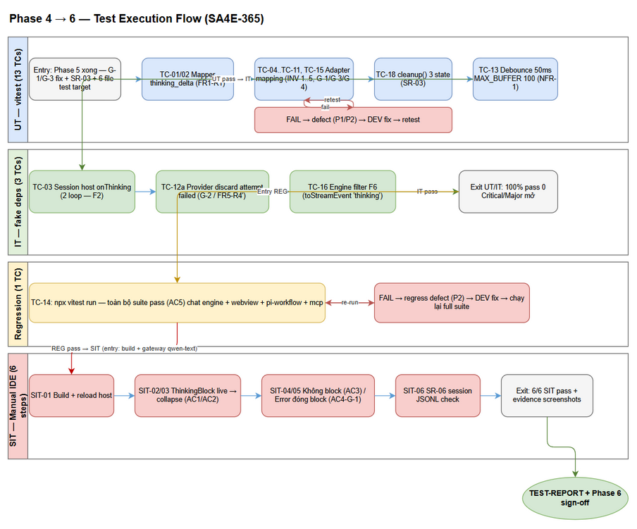
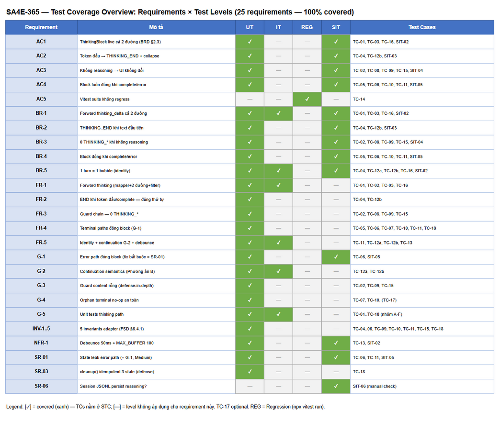

# Software Test Plan (STP)

## SDLC Chat Extension — SA4E-365: Forward `thinking_delta` tới ThinkingBlock trên 2 đường streaming

---

## Document Information

| Field | Value |
|-------|-------|
| Jira Ticket | [SA4E-365](https://jiraassist.atlassian.net/browse/SA4E-365) |
| Title | [SDLC Chat] Thinking section không hiển thị — thinking_delta của reasoning model bị drop trong pi-event-mapper |
| Author | QA Agent |
| Version | 1.0 |
| Date | 2026-10-16 |
| Status | Draft — Phase 4 (Test Planning) |
| Related BRD | documents/SA4E-365/BRD.md (v1.0, Approved) |
| Related FSD | documents/SA4E-365/FSD.md (v1.0 TA Enriched) |
| Related TDD | documents/SA4E-365/TDD.md (v1.0) |
| Related Security Review | documents/SA4E-365/SECURITY-REVIEW.md (v1.0 — Verdict PASS) |
| Related STC | documents/SA4E-365/STC.md (v1.0) |

---

## Author Tracking

| Role | Name - Position | Responsibility |
|------|-----------------|----------------|
| Author | QA Agent – QA Engineer | Create document |
| Peer Reviewer | Scrum Master – Pipeline Coordinator | Review document |
| Business Reviewer | BA Agent – Business Analyst | Business coverage review (Phase 4 gate) |

---

## Revision History

| Version | Date | Author | Changes |
|---------|------|--------|---------|
| 1.0 | 2026-10-16 | QA Agent | Initiate document — test plan từ BRD v1.0 + FSD v1.0 (§10.3 test plan 17 TCs / 18 ID) + TDD v1.0 (§12 test design, §9 error matrix 11 terminal paths) + SECURITY-REVIEW v1.0 (SR-03 → thêm TC-18; SR-06 → manual check SIT-06) |

---

## Sign-Off

| Name | Signature and date |
|------|--------------------|
| Scrum Master | ☐ I agree and confirm the test plan in this STP |
| BA Agent (business coverage) | ☐ I agree and confirm the test plan in this STP |

---

## 1. Introduction

### 1.1 Purpose

Tài liệu này định nghĩa kế hoạch kiểm thử cho bug fix SA4E-365: hoàn thiện chuỗi forward event `thinking_delta` từ pi-ai SDK đến webview `ThinkingBlock` sao cho developer thấy reasoning stream live của model trong SDLC CHAT, trên **cả 2 đường streaming** (session path + legacy path), với invariant "thinking block luôn đóng ở mọi terminal path".

Test plan bám sát hiện trạng code (đã đối chiếu 2026-10-16): happy path F1–F8 **đã wire** (mark `SA4E-THINKING`); phần còn lại của fix là **G-1** (error path không đóng `thinkingActive` — đồng thời là remediation security SR-01), **G-3** (guard content rỗng), **G-2** (continuation semantics — Phương án B, khóa bằng test), **G-4** (orphan terminal no-op an toàn), **G-5** (thiếu unit tests cho thinking path — bắt buộc theo NFR-5/AC5), cộng **SR-03** (cleanup() xóa `thinkingActive` — defense-in-depth, SM đã chấp nhận gộp PR G-1).

### 1.2 Test Objectives

1. **FR-1 / BR-1 / AC1** — Verify `thinking_delta` được map thành chunk `'thinking'` (mapper), forward qua **cả 2 đường** (session host `onThinking` + legacy loop), qua filter engine (F6), và mapping thành `THINKING_START`/`THINKING_TOKEN` ở adapter.
2. **FR-2 / BR-2 / AC2** — Verify `THINKING_END` phát khi token text đầu tiên hoặc complete, **trước** `STREAM_TOKEN` (INV-4); block collapse "Reasoning".
3. **FR-3 / BR-3 / AC3** — Verify turn không reasoning (tool-only, delta rỗng, model thường) phát **0** message `THINKING_*`, không block rỗng; guard chain defense-in-depth (FR3-R1..R4).
4. **FR-4 / BR-4 / AC4** — Verify **mọi terminal path** (complete / error / timeout / reset / orphan) để `thinkingActive` rỗng (INV-1); đặc biệt **G-1 fix**: error giữa thinking phải emit `THINKING_END` trước `STREAM_ERROR` (FR4-R3 = SR-01 remediation).
5. **FR-5 / BR-5** — Verify streaming identity (1 turn = 1 bubble, cùng streamId/messageId), continuation semantics G-2 Phương án B (provider discard TC-12a + continuation sequence TC-12b), debounce 50ms + MAX_BUFFER_SIZE 100 (NFR-1).
6. **NFR-5 / AC5** — Verify toàn bộ vitest suite hiện tại **không regress** (`npx vitest run` pass toàn bộ).
7. **SR-03** — Verify `cleanup()` idempotent trên cả 3 state (`streamToMessage`, `startedStreams`, `thinkingActive`) — defense-in-depth.
8. **SR-06** — Manual check: SDK session JSONL có persist reasoning hay không (data-at-rest classification).

### 1.3 References

| Document / Code | Location |
|-----------------|----------|
| BRD SA4E-365 (BR-1..BR-5, NFR-1/5, AC1–AC5) | documents/SA4E-365/BRD.md |
| FSD SA4E-365 v1.0 (FR-1..FR-5, rules, §6.4.1 pseudocode + INV-1..5, §6.6 G-2, §10.3 test plan) | documents/SA4E-365/FSD.md |
| TDD SA4E-365 v1.0 (§5.2 G-1/G-3, §8 G-2, §9 error matrix 11 terminal paths, §12 test design 17 TCs) | documents/SA4E-365/TDD.md |
| Security Review v1.0 (SR-01=G-1, SR-03, SR-06; Verdict PASS) | documents/SA4E-365/SECURITY-REVIEW.md |
| Source fix | extension/src/chat/engine/StreamProtocolAdapter.ts (G-1: line 88-97, G-3: line 103); 9 file còn lại đã wire (TDD §6.1) |
| Test pattern — adapter | extension/src/chat/engine/__tests__/stream-error-mapping.test.ts (fake deps + StreamProtocolAdapter thật, bridge push vào mảng posted) |
| Test pattern — session host | extension/src/pi-workflow/__tests__/pi-agent-session-host.auto-chunk.test.ts (vi.mock pi-coding-agent + vi.hoisted) |
| Test pattern — StreamHandler | extension/src/mcp/__tests__/stream-handler-events.test.ts (new StreamHandler(emitFn)) |
| Test pattern — provider fallback | extension/src/pi-workflow/__tests__/pi-model-fallback.test.ts (PiProvider mock stream 2 attempts) |
| STC (chi tiết 24 test cases) | documents/SA4E-365/STC.md |
| Test data CSVs | documents/SA4E-365/testdata/*.csv |

---
## 2. Test Strategy

### 2.1 Test Levels

Feature là **VS Code/Kiro extension** (không REST API, không DB; webview Svelte không có Playwright harness — TDD §13.1). Do đó test levels được hiệu chỉnh so với chuẩn web:

| Level | Scope | Automation | Tools |
|-------|-------|------------|-------|
| **UT** | Pure function + class mapping thuần: `mapAgentEvent` (TC-01/02), `StreamProtocolAdapter.handleChunk/handleComplete/reset/cleanup` (TC-04..TC-11, TC-15, TC-18), `StreamHandler.emitThinking` buffer/debounce/flush (TC-13) | ✅ Automated | vitest |
| **IT** | Tương tác giữa các component với fake deps: session host `promptTurn` → `onThinking` với mock SDK (TC-03), `PiProvider.runOnce` fallback 2 attempts (TC-12a), `ChatEngineAdapter.handleEngineEvent` fan-out qua filter F6 (TC-16) | ✅ Automated | vitest + fake deps / vi.mock |
| **E2E-ADAPTER** (optional) | Full chat path `PiWorkflowAdapter.invokeChat()` với faux pi-ai model phát `thinking_delta` (TDD §13.2 — **không bắt buộc**, defense bổ sung) | ⚙️ Optional | vitest + faux provider |
| **Regression** | Toàn bộ vitest suite (chat engine + webview + pi-workflow + mcp) | ✅ Automated | `npx vitest run` |
| **SIT** | Manual IDE verification — chỉ còn **visual/UX** (ThinkingBlock live/collapse/kẹt-state trong webview thật) | ❌ Manual | VS Code/Kiro + model gateway qwen-text |

### 2.2 Test Types

| Type | Description | Applicable |
|------|-------------|------------|
| Functional | Mapping protocol THINKING_* theo FSD §6.4 mapping table + INV-1..INV-5 | Yes — 18 TCs |
| Regression | Full vitest suite không regress (AC5); turn không reasoning giữ hành vi (FR-3) | Yes |
| Performance (NFR-1) | Debounce 50ms, MAX_BUFFER_SIZE 100 flush cưỡng bức, flush-trước-terminal | Yes — TC-13 (fake timers) |
| Security follow-up | SR-03 cleanup defense-in-depth (TC-18); SR-06 session JSONL data-at-rest check (SIT-06, manual) | Yes |
| UI/UX | Chỉ qua SIT manual (webview Svelte, không E2E harness) | Manual only |
| Compatibility | Không áp dụng — không đổi platform/browser surface | No |

### 2.3 Test Approach

1. **Risk-based, unit-first:** toàn bộ logic mới nằm ở `StreamProtocolAdapter` (G-1/G-3) + hành vi khóa G-2/G-4 → 13 UT + 3 IT automate được, không cần mock pi-ai SDK cho mapping thuần.
2. **Mock strategy theo nhóm** (TDD §12.1 — pattern đã proven trong repo):

| Nhóm | Mock strategy | Pattern tham chiếu |
|------|---------------|--------------------|
| Mapper (TC-01/02) | Không mock — `mapAgentEvent` pure function, gọi trực tiếp với AgentEvent fake + EventCollector fresh | — |
| Adapter (TC-04..TC-11, 12b, 15, 18) | Fake deps (router/bridge push vào mảng posted) + `StreamProtocolAdapter` thật; gọi `handleEngineEvent()` với object `EngineStreamEvent` | stream-error-mapping.test.ts |
| Engine fan-out (TC-16) | `ChatEngineAdapter.handleEngineEvent` + deps fake (khóa filter F6) | stream-error-mapping.test.ts |
| Session host (TC-03) | `vi.mock('@earendil-works/pi-coding-agent')`: subscribe **capture listener**, prompt **emit sự kiện thinking tổng hợp**; test **cả 2 loop** (normal + auto-chunk) | pi-agent-session-host.auto-chunk.test.ts |
| Provider fallback (TC-12a) | `PiProvider` + mock stream 2 attempts (attempt 1 fail retryable + thinking "B1"; attempt 2 success + thinking "B2") | pi-model-fallback.test.ts |
| StreamHandler (TC-13) | `new StreamHandler(vi.fn())` + `vi.useFakeTimers()` + `vi.advanceTimersByTime(50)` | stream-handler-events.test.ts |

3. **Invariant-driven assertions:** black-box behavioral chính (thứ tự message trong batch, không THINKING_END lặp) + white-box state check khi cần khóa INV-1 (cast `thinkingActive` — TS private, runtime truy cập được) cho TC-18.
4. **3 điều CẤM (TDD §8.4) ảnh hưởng test design** — QA phải FAIL bất kỳ implementation nào vi phạm:
   - Cấm thêm protocol event ranh giới attempt (không mở rộng `StreamChunkEvent.eventType`, không thêm emit tại fallback).
   - Cấm thêm heuristic đoán ranh giới attempt ở adapter (text/thinking đan xen tự do trong 1 attempt agentic → heuristic phá AC2).
   - Cấm đổi streamId giữa các attempt trong cùng turn.
5. **Verification traceability:** mỗi expected result map thẳng sang FSD rule ID (FRx-Ry) / INV-x / G-x / SR-xx — xem RTM ở STC.

### 2.4 E2E Automation Coverage

Mục tiêu: **giảm manual SIT xuống tối thiểu — chỉ còn visual/UX không automate được.**

| Loại SIT scenario | Phân loại | Lý do |
|-------------------|-----------|-------|
| Mapping protocol, state transitions, terminal paths | **UT/IT automated** (18 TCs) | Deterministic, pattern proven |
| Debounce/buffer timing | **UT automated** (TC-13, fake timers) | vi.useFakeTimers điều khiển thời gian chính xác |
| Fallback giữa attempts | **IT automated** (TC-12a) | Mock stream per attempt |
| ThinkingBlock live stream trong webview | **SIT manual** (SIT-02/03) | Webview Svelte không có Playwright harness (TDD §13.1) — cần mắt người |
| Block kẹt "Thinking..." sau error trong IDE | **SIT manual** (SIT-05) | Cần turn thật qua model gateway + reload host |
| Session JSONL persist reasoning (SR-06) | **SIT manual** (SIT-06) | Cần session file thật từ model reasoning |

Kết quả: **75% test cases automated**; 6 manual SIT chỉ còn visual/UX + data-at-rest check — không thể automate trong phạm vi infra hiện có.

### 2.5 Test Cases Summary

| Level | Count | Automated | Manual |
|-------|-------|-----------|--------|
| UT | 14 | 14 | 0 |
| IT | 3 | 3 | 0 |
| Regression (full suite) | 1 | 1 | 0 |
| E2E-ADAPTER (optional) | 0 bắt buộc | — | — |
| SIT (manual IDE) | 6 | 0 | 6 |
| **Total** | **24** | **18 (75%)** | **6 (25%)** |

> TC-17 (orphan THINKING_* phía webview) là **optional** theo TDD §6.2/§10.3 — không tính trong tổng bắt buộc; nếu DEV làm, tổng automated = 19 (76%).

Phân bổ theo nhóm (chi tiết ở STC):

| Nhóm | TCs | Level | File test target |
|------|-----|-------|------------------|
| A — Mapper thinking_delta | TC-01, TC-02 | UT | pi-workflow/__tests__/pi-event-mapper.test.ts (MỚI) |
| B — StreamProtocolAdapter mapping | TC-04, TC-05, TC-06, TC-07, TC-09, TC-10, TC-11, TC-15, TC-18 | UT | chat/engine/__tests__/stream-thinking-mapping.test.ts (MỚI) |
| C — Engine filter F6 | TC-16 | IT | chat/engine/__tests__/stream-error-mapping.test.ts (mở rộng) |
| D — StreamHandler emitThinking | TC-13 | UT | mcp/__tests__/stream-handler-events.test.ts (mở rộng) |
| E — Session host onThinking | TC-03 | IT | pi-workflow/__tests__/pi-agent-session-host.auto-chunk.test.ts (mở rộng) |
| F — Fallback/continuation (G-2) | TC-12a, TC-12b | IT / UT | pi-model-fallback.test.ts (mở rộng) / stream-thinking-mapping.test.ts |
| G — Regression | TC-08, TC-14, (TC-17 optional) | UT / Regression | stream-thinking-mapping.test.ts / full suite |
| SIT — Manual IDE | SIT-01..SIT-06 | Manual | IDE |

**Tổng: 6 file test (2 mới + 4 mở rộng)** — khớp TDD §6.2.

### 2.6 Entry Criteria

| Level | Entry Criteria |
|-------|----------------|
| UT/IT | Phase 5 (DEV) hoàn tất: G-1 + G-3 fix trong `StreamProtocolAdapter.ts`, SR-03 +1 dòng `cleanup()`; 6 file test target đã tạo/mở rộng theo STC; `npm run compile` pass |
| Regression | UT/IT pass 100% |
| SIT | Regression pass; extension build + load được vào IDE host; model gateway qwen-text khả dụng |

### 2.7 Exit Criteria

| Level | Exit Criteria |
|-------|---------------|
| UT/IT | 100% TCs pass; INV-1..INV-5 được khóa bởi ít nhất 1 test mỗi invariant; 0 Critical/Major defect mở |
| Regression | `npx vitest run` toàn suite pass (AC5) |
| SIT | 6/6 SIT pass (5 bước manual TDD §12.3 + SR-06 check); không có block kẹt "Thinking..." trong mọi kịch bản |
| Overall | RTM coverage 100% (STC); BA review APPROVED; TEST-REPORT phát hành |



---
## 3. Test Scope

### 3.1 Features In Scope

| # | Feature / Yêu cầu | Priority | FSD Reference | Test Type |
|---|-------------------|----------|---------------|-----------|
| 1 | FR-1: Forward thinking_delta trên cả 2 đường streaming (mapper → host/legacy → handler → engine → adapter) | High | FSD §3.1 (UC-1, FR1-R1..R3) | UT + IT (TC-01, TC-02, TC-03, TC-16) |
| 2 | FR-2: THINKING_END khi token text đầu tiên / complete — thứ tự trước STREAM_TOKEN | High | FSD §3.2 (UC-2, FR2-R1..R3) | UT (TC-04, TC-12b) |
| 3 | FR-3: Turn không reasoning → 0 THINKING_*, không block rỗng (guard chain) | High | FSD §3.3 (UC-3, FR3-R1..R4) | UT (TC-02, TC-08, TC-09, TC-15) |
| 4 | FR-4: Block luôn đóng ở mọi terminal path — **G-1 fix error path** | High | FSD §3.4 (UC-4, FR4-R1..R4) | UT (TC-05, TC-06, TC-10, TC-11, TC-18) |
| 5 | FR-5: Streaming identity + continuation semantics G-2 (Phương án B) + debounce 50ms | High | FSD §3.5 (FR5-R1..R4') | UT + IT (TC-12a, TC-12b, TC-13) |
| 6 | NFR-1: Không postMessage storm — buffer + debounce 50ms + MAX_BUFFER_SIZE 100 + flush-trước-terminal | Medium | FSD §8, TDD §10 | UT (TC-13) |
| 7 | NFR-5/AC5: Regression-safe — full vitest suite pass | High | FSD §8, TDD §11 | Regression (TC-14) |
| 8 | SR-03: cleanup() idempotent trên cả 3 state (defense-in-depth, gộp PR G-1) | Medium | SECURITY-REVIEW SR-03 | UT (TC-18) |
| 9 | SR-06: Session JSONL có persist reasoning? (data-at-rest classification) | Low | SECURITY-REVIEW SR-06 | SIT manual (SIT-06) |
| 10 | Manual IDE verification 5 bước (ticket SA4E-365) | High | TDD §12.3 | SIT manual (SIT-01..SIT-05) |

### 3.2 Features Out of Scope

| # | Feature | Reason |
|---|---------|--------|
| 1 | Persist thinking content vào session file | Out of scope BRD §1.2 |
| 2 | UI cấu hình thinking level / bật-tắt reasoning per model | Out of scope BRD §1.2 |
| 3 | Model/provider không trả reasoning — hành vi mới | Không đổi — chỉ verify UI giữ nguyên (FR-3) |
| 4 | Thay đổi design `ThinkingBlock.svelte` / chatStore / messageListener | Downstream sẵn sàng từ SA4E-85, assumption BRD §5.2 — không test UI mới bắt buộc |
| 5 | SA4E-364 (MCP tools dead code) | Separate ticket |
| 6 | SR-02 (MAX_THINKING_CHARS khi persist) + SR-04 (wire reset() ranh giới turn) | Backlog — ngoài blast-radius change (SECURITY-REVIEW Remediation Priority 3-4) |
| 7 | Dynamic pentest / runtime memory profiling | Thuộc Phase 6 security review, không phải test plan chức năng này |

### 3.3 Test Coverage Overview



Ma trận coverage chi tiết Requirements × Test Levels — xem RTM ở STC.

---

## 4. Test Environment

### 4.1 Environment Requirements

| Item | Giá trị |
|------|---------|
| OS | Windows (dev máy hiện tại) — suite cross-platform vì không I/O hệ thống |
| Runtime | Node.js ≥ 18 (vitest chạy trong môi trường extension repo) |
| Test runner | vitest — lệnh: `npx vitest run` (chạy toàn suite, AC5); `npx vitest run <file>` cho 1 file |
| Build | `npm run compile` (extension) — điều kiện entry SIT |
| IDE | VS Code / Kiro — reload host sau khi build ("Developer: Reload Window") |
| Model gateway | OpenAI-compatible hỗ trợ reasoning — **qwen-text** (trả `reasoning_content`) cho SIT |
| DB / Migration | Không có — toàn bộ state in-memory |

### 4.2 Test Data Requirements

Không DB, không seed — mọi test data là **in-memory event sequences**. Dữ liệu chuẩn hóa trong CSV (documents/SA4E-365/testdata/):

| File | Nội dung | Cover |
|------|----------|-------|
| mapper-agent-events.csv | AgentEvent fake (thinking_delta chuẩn / delta rỗng) | TC-01, TC-02 |
| adapter-chunk-sequences.csv | Chuỗi EngineStreamEvent per kịch bản + expected message sequence | TC-04..TC-11, TC-12b, TC-15, TC-18 |
| engine-filter-events.csv | chat:streamChunk eventType 'thinking' qua ChatEngineAdapter | TC-16 |
| streamhandler-emit-sequences.csv | emitThinking/emitComplete sequences + timing | TC-13 |
| session-host-thinking-events.csv | Sự kiện thinking tổng hợp cho mock session (2 loop) | TC-03 |
| provider-fallback-attempts.csv | 2 attempts (B1 fail / B2 success) | TC-12a |
| sit-checklist.csv | 6 bước manual IDE + SR-06 check | SIT-01..SIT-06 |

Fake data chuẩn (TDD §13.3): AgentEvent `{ type:'message_update', assistantMessageEvent: { type:'thinking_delta', delta:'…' } }`; EngineStreamEvent `{ type:'chat:streamChunk', streamId:'turn-1', nodeId:'pi', eventType:'thinking', content:'…', timestamp:'' }`.

### 4.3 Mock/Stub Strategy

Xem §2.3 bảng mock strategy theo nhóm. Không mock: `StreamProtocolAdapter`, `StreamHandler`, `mapAgentEvent` (SUT thật). Mock: `@earendil-works/pi-coding-agent` (TC-03), pi-ai stream per attempt (TC-12a), bridge/router deps (adapter + engine TCs), `vscode` (nếu mở rộng E2E-adapter — optional).

### 4.4 External Dependencies

| System | Dependency | Mock/Stub Available |
|--------|-----------|---------------------|
| pi-ai SDK | Phát `thinking_delta` ổn định (assumption BRD §5.2) | UT/IT: không cần SDK thật (fake events); SIT: SDK thật |
| Model gateway qwen-text | Trả reasoning_content cho SIT | Không mock — cần gateway thật; fallback: faux provider (optional E2E) |
| VS Code/Kiro IDE host | Load extension cho SIT | Không |

### 4.5 Manual Verification & Security Follow-up Checks

**5 bước manual từ ticket (TDD §12.3)** — chi tiết hóa thành SIT-01..SIT-05 trong STC:

1. Build extension (`npm run compile`) + reload IDE host.
2. Chọn model gateway hỗ trợ reasoning (qwen-text) → gửi prompt → ThinkingBlock "Thinking..." stream live.
3. Answer bắt đầu → block collapse "Reasoning".
4. Turn tool-only (không reasoning) → không block.
5. Turn error → block đóng (không kẹt "Thinking...").

**SR-06 manual check (Security Review — Informational, unverified):** sau khi chạy model reasoning, mở session JSONL (`getSessionFile()` — đường dẫn được debugLog ghi ở pi-workflow-adapter.ts:353) và kiểm tra có chứa reasoning content không:
- Nếu CÓ → ghi nhận classification **Internal** cho session file vào docs + notify SM (follow-up cap khi persist — SR-02).
- Nếu KHÔNG → đóng SR-06 với evidence đường dẫn file + grep result.
→ Chi tiết steps ở SIT-06 (STC). **Không blocking** với verdict PASS.

---

## 5. Test Schedule

| Phase | Start Date | End Date | Duration | Milestone |
|-------|-----------|----------|----------|-----------|
| Test Planning (Phase 4) | 2026-10-16 | 2026-10-16 | 0.5 ngày | STP + STC approved (BA review) |
| Test Implementation (Phase 5 — DEV viết test theo STC) | 2026-10-16 | 2026-10-17 | 1 ngày | 6 file test hoàn tất, UT/IT pass |
| Regression Execution | 2026-10-17 | 2026-10-17 | 0.5 ngày | `npx vitest run` pass (AC5) |
| SIT Manual Execution | 2026-10-17 | 2026-10-18 | 0.5 ngày | 6/6 SIT pass + evidence screenshots |
| Defect Fix & Retest | 2026-10-18 | 2026-10-19 | 1 ngày (buffer) | 0 Critical/Major mở |
| TEST-REPORT + Sign-off | 2026-10-19 | 2026-10-19 | 0.5 ngày | Phase 6 hoàn tất |

---

## 6. Resources & Responsibilities

| Role | Name | Responsibility |
|------|------|----------------|
| Test Lead | QA Agent | Test planning (STP/STC), review test implementation vs STC spec (Phase 6), TEST-REPORT |
| QA Engineer | QA Agent | Thiết kế test data CSV, execute SIT manual, evidence, defect reporting |
| Developer | DEV Agent | Implement G-1/G-3/SR-03 + 6 file test theo STC/TDD §12; fix defect |
| BA | BA Agent | Business coverage review STC/STP (Phase 4 gate), UAT criteria clarification |
| DevOps | DevOps Agent | CI chạy `npx vitest run` (AC5 gate) |
| SM | SM Agent | Điều phối, Jira status, quality gates |

---

## 7. Risk & Mitigation

| # | Risk | Impact | Likelihood | Mitigation |
|---|------|--------|------------|------------|
| 1 | DEV implement G-1 sai thứ tự (STREAM_ERROR trước THINKING_END) → INV-4 fail | High | Medium | TC-06 khóa thứ tự trong cùng batch; STC spec expected sequence tường minh |
| 2 | White-box access private state (`thinkingActive`) giòn với refactor | Low | Medium | Ưu tiên black-box behavioral (replay terminal → không THINKING_END lặp); white-box chỉ cho TC-18 |
| 3 | Mock session host (TC-03) phức tạp — 2 loop phải cover đủ | Medium | Medium | Dùng đúng pattern auto-chunk.test.ts; STC spec riêng case normal + auto-chunk |
| 4 | Sự kiện thinking format gateway khác (reasoning/reasoning_text) | Low | Low | SDK đã chuẩn hóa `thinking_delta` — extension chỉ xử lý 1 event type (FR1-R3); SIT xác nhận trên qwen-text |
| 5 | postMessage storm khi reasoning dài → webview lag (NFR-1) | Medium | Medium | TC-13 debounce + MAX_BUFFER; SIT-02 quan sát reasoning dài |
| 6 | Suite hiện tại regress vì sửa adapter | High | Low | TC-14 full suite; adapter change +5 dòng theo TDD §5.2 pseudocode |
| 7 | Model gateway qwen-text không khả dụng khi SIT | Medium | Low | Schedule buffer; faux provider E2E (optional) làm fallback kiểm chứng protocol |
| 8 | QA review Phase 6: test code dùng mock thay real deps trái STC | Medium | Medium | Phase 6 checklist: so sánh test implementation với mock strategy §2.3 — mock chỉ cho external (SDK/gateway), local adapters phải thật |

---

## 8. Defect Management

### 8.1 Severity Levels

| Severity | Definition | Example (SA4E-365 context) |
|----------|-----------|----------------------------|
| Critical | Crash extension host, mất chức năng streaming hiện có (TOKEN/ERROR) | Adapter throw khi nhận chunk 'thinking' |
| Major | Feature không hoạt động theo AC / invariant vi phạm | G-1 không fix → block kẹt "Thinking..." sau error; THINKING_END sai thứ tự (INV-4) |
| Minor | Hành vi lệch nhỏ, có workaround | THINKING_TOKEN rỗng append (G-3 thiếu) — cosmetic |
| Trivial | Cosmetic/log | Log thừa metadata thinking |

### 8.2 Priority Levels

| Priority | Definition | SLA (Fix Time) |
|----------|-----------|----------------|
| P1 | Chặn AC1–AC4 / invariant INV-1..INV-5 | 4 giờ |
| P2 | Chặn AC5 (regress) hoặc SR-03 | 1 business day |
| P3 | Lệch behavior không chặn AC | 3 business days |
| P4 | Nice to fix | Next release |

### 8.3 Defect Lifecycle

```
New → Open → In Progress → Fixed → Ready for Retest → Verified → Closed
                                                 → Reopened → In Progress
```

Defect ghi vào TEST-REPORT-SA4E-365.csv (cột Defect_ID) + Jira SA4E-365 comment.

---

## 9. Test Metrics & Reporting

### 9.1 Metrics

| Metric | Formula | Target |
|--------|---------|--------|
| Test Execution Rate | Executed / Total × 100% | 100% (24/24 bắt buộc; 25/25 với optional) |
| Pass Rate (automated) | Passed / Executed × 100% | 100% — bug fix phải 0 fail |
| Requirement Coverage | Requirements có ≥1 TC / Total × 100% | 100% (RTM) |
| Invariant Coverage | INV-1..5 có ≥1 test khóa | 5/5 |
| Terminal Path Coverage | 11 terminal paths (TDD §9) có ≥1 test hoặc ghi chú cover gián tiếp | 11/11 |
| Defect Density | Defects / Test Cases | ≤ 0.1 |
| Critical/Major Defect Count | Count | 0 |

### 9.2 Reporting Schedule

| Report | Frequency | Audience |
|--------|-----------|----------|
| Test execution status (CSV) | Mỗi lần chạy | SM |
| Defect summary | Khi có fail | SM + DEV |
| TEST-REPORT.md (template documents/templates/TEST-REPORT-TEMPLATE.md) | End of Phase 6 | All stakeholders |

---

## 10. Appendix

### 10.1 Terminal Path → Test Mapping (TDD §9 Error Handling Matrix)

| # | Terminal path | THINKING_END? | Test |
|---|---------------|---------------|------|
| 1 | Complete sau answer | Không (lookup miss) | TC-04 (gián tiếp) |
| 2 | Complete khi thinking mở | Có + STREAM_END | TC-05 |
| 3 | Error giữa thinking, không complete (G-1) | Có TRƯỚC STREAM_ERROR | TC-06 |
| 4 | Error sau khi thinking đóng | Không | TC-07 |
| 5 | PI_SESSION_TIMEOUT giữa thinking | Có (qua complete) | SIT-05 (flow thật) + TC-05 (complete path) |
| 6 | Orphan complete (G-4) | Skip | TC-10 |
| 7 | Orphan error | Skip + one-shot cleanup | TC-07 (orphan variant) |
| 8 | reset() | Clear trực tiếp | TC-11 |
| 9 | Delta rỗng | Không | TC-09, TC-15 |
| 10 | Event sau turn-end (guard live) | — | TC-03 (host guard) + SIT-05 |
| 11 | eventType lạ | — | TC-08 (tool_call không phát THINKING_*) |

### 10.2 Glossary

| Term | Definition |
|------|------------|
| thinking_delta | Stream event pi-ai SDK phát khi model trả reasoning |
| THINKING_START/TOKEN/END | Protocol events webview mở/append/đóng thinking block |
| thinkingActive | Set<streamId> trong StreamProtocolAdapter — track block đang mở |
| INV-1..INV-5 | 5 invariants adapter (FSD §6.4.1) |
| G-1..G-5 | 5 gaps từ FSD §2.1 |
| SR-01..SR-06 | Findings Security Review v1.0 |
| Session path / Legacy path | 2 đường streaming (promptTurn onThinking / loop streamChunks) |
| Continuation semantics (G-2) | Phương án B — thinking nối tiếp 1 block, chống leak bằng provider discard |
| SIT | Manual System Integration Test trong IDE |

### 10.3 Assumptions

1. pi-ai SDK giữ contract `thinking_delta` ổn định (BRD §5.2).
2. Downstream webview (ThinkingBlock, chatStore, messageListener, messageValidator) đúng như SA4E-85 — không test webview mới bắt buộc.
3. Không persist thinking — content ephemeral; SR-06 chỉ là classification check.
4. Suite vitest hiện tại đang pass trước khi bắt đầu Phase 5 (baseline AC5).

---

*End of Document — SA4E-365 STP v1.0 (QA Agent, 2026-10-16)*