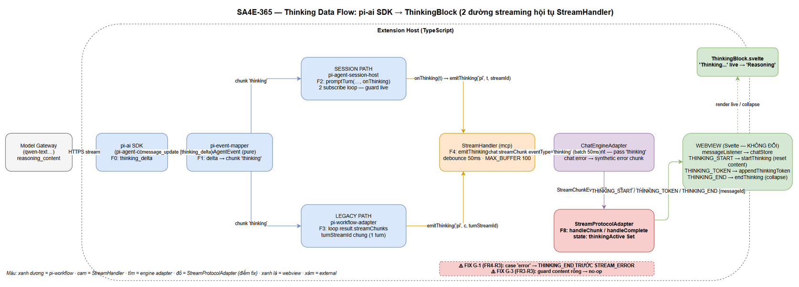
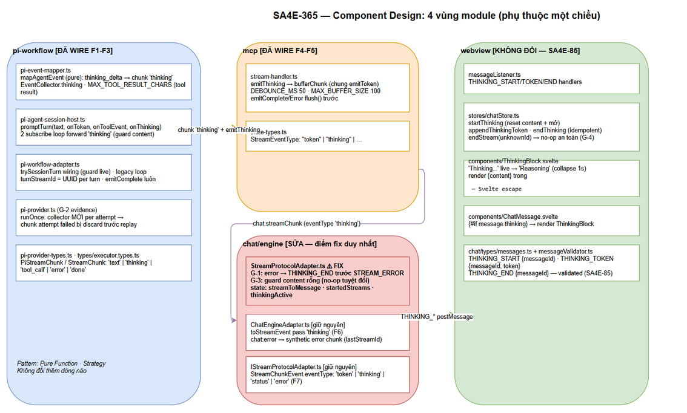
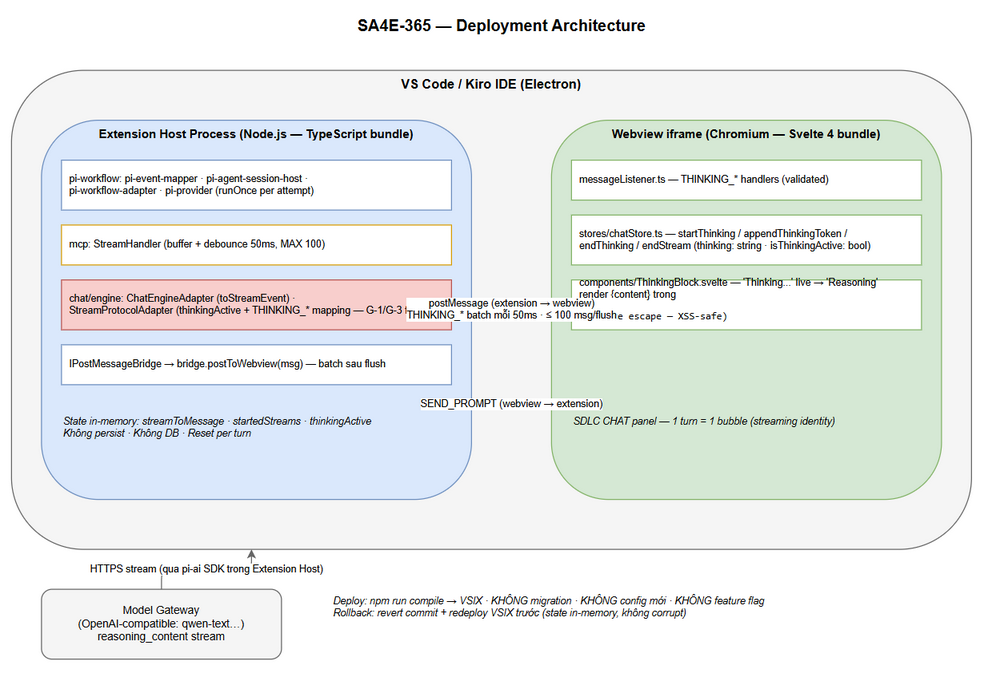
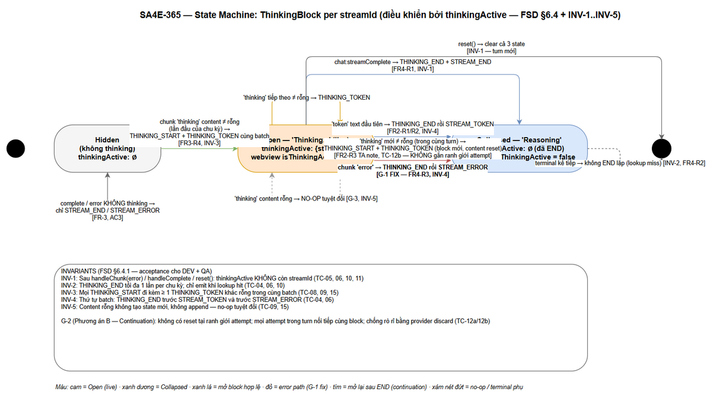
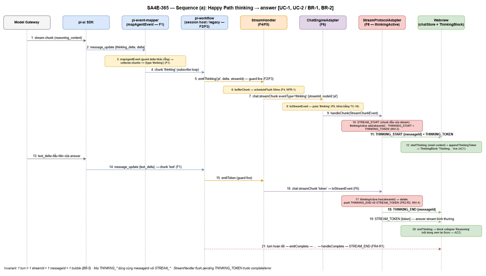
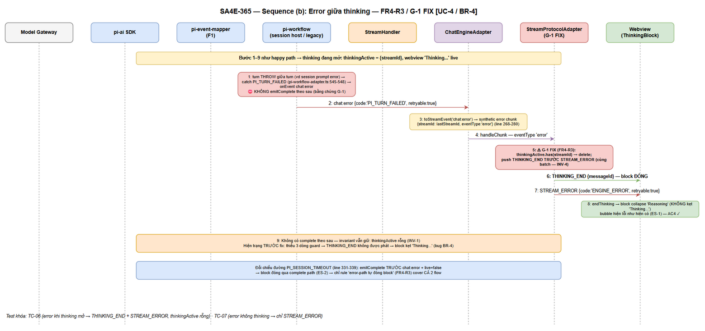
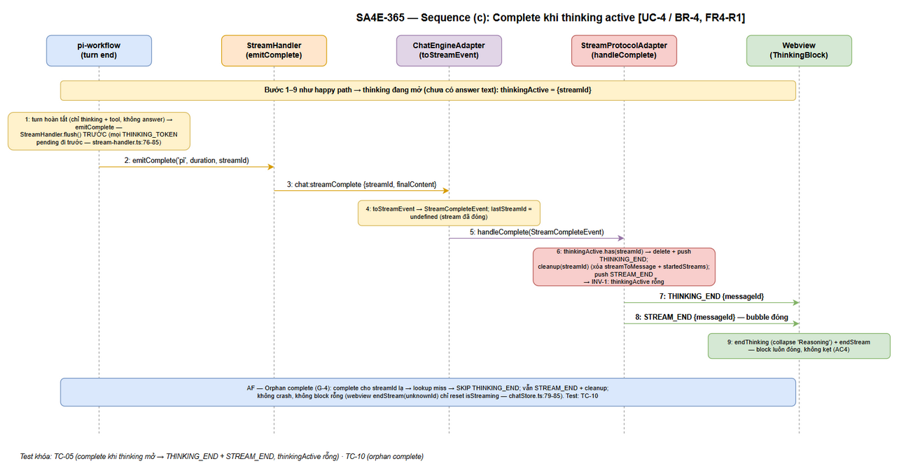

# Technical Design Document (TDD)

## SDLC Chat Extension — SA4E-365: Forward thinking_delta tới ThinkingBlock trên 2 đường streaming

---

## Document Information

| Field | Value |
|-------|-------|
| Jira Ticket | [SA4E-365](https://jiraassist.atlassian.net/browse/SA4E-365) |
| Title | [SDLC Chat] Thinking section không hiển thị — thinking_delta của reasoning model bị drop trong pi-event-mapper |
| Author | SA Agent |
| Version | 1.0 |
| Date | 2026-10-16 |
| Status | In Review — Phase 3 (Design) |
| Related BRD | documents/SA4E-365/BRD.md (v1.0, Approved) |
| Related FSD | documents/SA4E-365/FSD.md (v1.0 TA Enriched) — đầu vào trực tiếp: §6.4.1 (pseudocode + INV-1..INV-5), §6.6 (G-2 = Phương án B Continuation semantics) |

---

## Revision History

| Version | Date | Author | Changes |
|---------|------|--------|---------|
| 1.0 | 2026-10-16 | SA Agent | Initial TDD từ BRD v1.0 + FSD v1.0 (TA enriched). Đối chiếu code hiện trạng 2026-10-16: happy path F1–F8 đã wire (mark SA4E-THINKING); thiết kế fix còn lại = G-1 (FR4-R3) + G-3 (FR3-R3/R4) tại StreamProtocolAdapter + G-2 khóa bằng test (Phương án B, zero protocol change) + 17 TCs (G-5) |

---

## Sign-Off

| Name | Signature and date |
|------|--------------------|
| Scrum Master | ☐ |
| Tech Lead | ☐ |

---

## 1. Introduction

### 1.1 Purpose

Tài liệu này định nghĩa thiết kế kỹ thuật cho bug fix SA4E-365: hoàn thiện chuỗi forward event \`thinking_delta\` từ pi-ai SDK đến webview \`ThinkingBlock\` sao cho developer thấy reasoning stream live của model trong SDLC CHAT, trên **cả 2 đường streaming** (session path + legacy path), với invariant "thinking block luôn đóng ở mọi terminal path".

Thiết kế bám sát code hiện trạng (đã đối chiếu 2026-10-16): happy path F1–F8 **đã được wire** trong code (đánh dấu \`SA4E-THINKING\`). Fix còn lại theo FSD:

- **G-1 (High — fix bắt buộc):** \`handleChunk\` eventType \`'error'\` phải đóng \`thinkingActive\` trước \`STREAM_ERROR\` (FR4-R3).
- **G-3 (Low — defense-in-depth):** guard content rỗng trước \`THINKING_TOKEN\` (FR3-R3/FR3-R4).
- **G-2 (High → chuyển thành behavior khóa bằng test):** Continuation semantics — Phương án B theo FSD §6.6, **zero protocol change**.
- **G-4 (Low — verify + test khóa):** orphan terminal no-op an toàn (FR4-R4).
- **G-5 (High):** 17 unit tests cho thinking path (NFR-5/AC5).

### 1.2 Scope

In scope: 10 file source theo \`fixFiles\` (STATUS.json) — 9 file đã wire đúng, \`StreamProtocolAdapter.ts\` còn 2 điểm fix G-1/G-3; 6 file test (2 mới + 4 mở rộng). Out of scope: theo BRD §1.2 (persist thinking, cấu hình thinking level, model không reasoning, đổi design ThinkingBlock, SA4E-364). Chi tiết: §6 (Change Design by File).

### 1.3 References

| Document | Location |
|----------|----------|
| BRD SA4E-365 | documents/SA4E-365/BRD.md |
| FSD SA4E-365 v1.0 | documents/SA4E-365/FSD.md — §3 (FR + rules), §6.4/§6.4.1 (mapping + pseudocode + invariants), §6.6 (G-2 quyết định), §10.3 (test plan) |
| SA4E-85 (downstream UI + protocol đã sẵn sàng) | Jira SA4E-85 |
| Code trace | extension/src/pi-workflow/*, extension/src/mcp/stream-handler.ts, extension/src/chat/engine/*, extension/src/webview/stores/chatStore.ts |

### 1.4 Technology Stack

| Layer | Technology | Ghi chú |
|-------|-----------|---------|
| Extension Host | TypeScript (VS Code Extension API) | Build \`npm run compile\` |
| Streaming SDK | @earendil-works/pi-ai + pi-agent-core | Nguồn \`thinking_delta\` (SDK chuẩn hóa reasoning_content/reasoning/reasoning_text) |
| Webview | Svelte 4 + Vite | ThinkingBlock.svelte, chatStore.ts — **không đổi** |
| Protocol | postMessage ExtensionMessage union (chat/types/messages.ts) + messageValidator.ts | THINKING_* đã có từ SA4E-85 |
| Test | vitest | Suite hiện tại phải pass (AC5) |
| Database | Không có | Toàn bộ in-memory streaming contracts (FSD §4) |

### 1.5 Design Principles & Constraints

| # | Principle | Áp dụng |
|---|-----------|---------|
| P-1 | **Thay đổi tối thiểu** — chỉ fix adapter + tests; không thêm protocol event mới | G-2 Phương án B (§8); FSD §6.6 |
| P-2 | **Defense-in-depth** — mỗi layer guard độc lập với delta rỗng | FR3-R3; guard chain FSD §3.3 |
| P-3 | **Idempotent terminal** — THINKING_END tối đa 1 lần per chu kỳ; mọi terminal path để \`thinkingActive\` rỗng | FR4-R1/R2/R3; INV-1, INV-2 |
| P-4 | **Streaming identity** — 1 turn = 1 streamId = 1 messageId = 1 bubble; thinking là thuộc tính message hiện tại | FR-5; BR-5 |
| P-5 | **Giữ pattern hiện có** — buffer + debounce 50ms + MAX_BUFFER_SIZE 100 chung path \`bufferChunk\` với \`emitToken\` | NFR-1; stream-handler.ts:38-60 |
| P-6 | **Không parse reasoning fields ở extension** — chỉ xử lý 1 event chuẩn hóa \`thinking_delta\` | FR1-R3 |

### 1.6 Traceability (BR → FR → TDD)

| BR | FR | Thiết kế trong TDD | Test |
|----|----|--------------------|------|
| BR-1 (AC1) | FR-1 | §2 (2 đường), §3.2, §6 | TC-01, TC-02, TC-03, TC-16 |
| BR-2 (AC2) | FR-2 | §5.2 (THINKING_END trước STREAM_TOKEN), §7.1 | TC-04, TC-12b |
| BR-3 (AC3) | FR-3 | §5.2 (G-3 guard), §3.2 | TC-02, TC-08, TC-09, TC-15 |
| BR-4 (AC4) | FR-4 | §9 (Error Handling Matrix), §5.2 (G-1 fix) | TC-05, TC-06, TC-10, TC-11 |
| BR-5 (AC1–AC4) | FR-5 | §4 (state), §8 (G-2), §10 (perf) | TC-12a, TC-12b, TC-13 |
| NFR-1 | FR5-R2 | §10 | TC-13 |
| NFR-5 | G-5 | §11 | TC-01…TC-17 + `npx vitest run` |

---
## 2. System Architecture

### 2.1 High-Level Data Flow — thinking_delta → ThinkingBlock

Hai đường streaming song song trong Extension Host, hội tụ tại \`StreamHandler\`, sau đó đi chung 1 chuỗi engine → webview. Sơ đồ thành phần:


*[Edit in draw.io](diagrams/architecture.drawio)*

**Chuỗi forward 8 điểm F1–F8 (trạng thái code hiện hành — đã trace 2026-10-16):**

| # | Layer | File | Điểm spec | Trạng thái |
|---|-------|------|-----------|------------|
| F1 | pi-workflow | pi-event-mapper.ts | \`mapAgentEvent\`: \`thinking_delta\` → chunk \`{ type:'thinking', content: delta }\` + tích lũy \`collector.thinking\` | ✅ Đã có (line 121-124) |
| F2 | pi-workflow | pi-agent-session-host.ts | \`promptTurn(text, onToken, onToolEvent, onThinking)\` — cả 2 subscribe loop forward \`last.type==='thinking' && last.content\` → \`onThinking(last.content)\` | ✅ Đã có (line 477, 524) |
| F3 | pi-workflow | pi-workflow-adapter.ts | Wiring \`onThinking\` → \`emitThinking\` (guard \`live\`, line 310-313) + legacy loop \`'thinking'\` (line 523) | ✅ Đã có |
| F4 | mcp | stream-handler.ts | \`emitThinking(nodeId, content, streamId)\` — \`bufferChunk\` chung với \`emitToken\`, debounce 50ms, MAX_BUFFER_SIZE 100 | ✅ Đã có (line 33-60) |
| F5 | mcp | state-types.ts | \`StreamEventType\` có \`"thinking"\` | ✅ Đã có (line 12) |
| F6 | chat/engine | ChatEngineAdapter.ts | \`toStreamEvent()\` pass eventType \`'thinking'\` (line 241); \`chat:error\` → synthetic error chunk gắn \`lastStreamId ?? 'error-stream'\` (line 268-280) | ✅ Đã có |
| F7 | chat/engine | IStreamProtocolAdapter.ts | \`StreamChunkEvent.eventType\` có \`'thinking'\` | ✅ Đã có (line 36) |
| F8 | chat/engine | StreamProtocolAdapter.ts | \`thinkingActive\: Set + mapping THINKING_* happy path | ⚠️ Còn gaps **G-1** (error path không đóng block, line 88-97) + **G-3** (không guard content rỗng, line 103) |

**Điểm hội tụ:** từ F4 trở đi (StreamHandler → webview), cả 2 đường dùng **cùng streamId của turn** (\`turnStreamId = crypto.randomUUID()\` tạo 1 lần trong \`runTurnOnce\`, pi-workflow-adapter.ts:449) → webview nhận THINKING_* và STREAM_* gắn cùng 1 \`messageId\` → 1 bubble (P-4).

### 2.2 Component Diagram — Module Design


*[Edit in draw.io](diagrams/component.drawio)*

Bốn vùng module, phụ thuộc một chiều (không circular):

| Module | Thành phần | Trách nhiệm trong tính năng |
|--------|-----------|------------------------------|
| \`pi-workflow\` | pi-event-mapper, pi-agent-session-host, pi-workflow-adapter, pi-provider | Bắt \`thinking_delta\` từ SDK, map thành chunk \`'thinking'\`, forward tới StreamHandler trên 2 đường |
| \`mcp\` | stream-handler, state-types | Buffer + debounce 50ms; emit \`chat:streamChunk\` eventType \`'thinking'\` |
| \`chat/engine\` | ChatEngineAdapter, IStreamProtocolAdapter, StreamProtocolAdapter | Filter F6; map chunk → protocol THINKING_START/TOKEN/END; state \`thinkingActive\` |
| \`webview\` (không đổi) | messageListener, chatStore, ChatMessage.svelte, ThinkingBlock.svelte | Render block live "Thinking..." / collapsed "Reasoning" |

### 2.3 Deployment Architecture


*[Edit in draw.io](diagrams/deployment.drawio)*

| Node | Công nghệ | Chứa gì |
|------|-----------|---------|
| VS Code / Kiro IDE | Electron | — |
| └ Extension Host process | Node.js (extension bundle) | pi-workflow, StreamHandler, ChatEngineAdapter, StreamProtocolAdapter |
| └ Webview iframe | Chromium + Svelte bundle | messageListener, chatStore, ThinkingBlock |
| External | Model Gateway (OpenAI-compatible, vd qwen-text) | Nguồn \`reasoning_content\` |

**Communication:** Extension Host → Webview qua \`postMessage\` (bridge \`IPostMessageBridge\`), batch debounce 50ms; Webview → Extension Host qua \`vscode.postMessage\` (SEND_PROMPT...). Không thay đổi so với hiện trạng.

---
## 3. Protocol / API Contract

Không có REST API — "API" của tính năng là **postMessage protocol** (Extension Host → Webview) và **internal stream contracts** (giữa các layer extension). Toàn bộ contract dưới đây đã tồn tại trong code; TDD khóa contract, DEV không được đổi shape.

### 3.1 Webview Protocol Events — THINKING_* (chat/types/messages.ts, có sẵn SA4E-85)

| Message | Payload (TypeScript) | Bắt buộc | Ý nghĩa |
|---------|----------------------|----------|---------|
| \`THINKING_START\` | \`{ type: 'THINKING_START'; messageId: string }\` | Y | Mở thinking block cho message. messages.ts line 102 |
| \`THINKING_TOKEN\` | \`{ type: 'THINKING_TOKEN'; messageId: string; token: string }\` | Y | Append delta reasoning (đã qua debounce 50ms). Line 103 |
| \`THINKING_END\` | \`{ type: 'THINKING_END'; messageId: string }\` | Y | Đóng block → collapse "Reasoning". Line 104 |

Ví dụ batch thực tế (token text đầu tiên đến khi thinking đang mở — thứ tự bắt buộc trong cùng lần push, INV-4):

\`\`\`json
[
  { "type": "THINKING_END", "messageId": "9f1c...-msg" },
  { "type": "STREAM_TOKEN", "messageId": "9f1c...-msg", "token": "Hello" }
]
\`\`\`

Ràng buộc: \`messageId\` của THINKING_* **bằng** messageId của STREAM_* cùng turn (\`ensureMessageId\` stable per streamId — StreamProtocolAdapter.ts:174-181) → webview gắn thinking vào message hiện tại, không tạo bubble mới (FR5-R1).

### 3.2 Internal Stream Contracts

| Contract | Shape | Trạng thái |
|----------|-------|------------|
| \`PiStreamChunk\` (pi-provider-types.ts:43-48) | \`{ type: 'text' \| 'thinking' \| 'tool_call' \| 'error' \| 'done'; content?: string; toolCall?: ToolCall; error?: string }\` — \`'thinking'\` là giá trị F1 thêm | ✅ Khóa |
| \`StreamChunk\` (types/executor.types.ts:25-30) | \`{ type: 'text' \| 'thinking' \| 'tool_call' \| 'error' \| 'done'; ... }\` — mirror của PiStreamChunk cho \`PiAgentExecutionResult.streamChunks\` | ✅ Khóa |
| \`StreamEventType\` (mcp/state-types.ts:12) | \`"token" \| "thinking" \| "status" \| "progress" \| "complete" \| "error" \| ...\` | ✅ Khóa |
| \`StreamHandler.emitThinking\` (mcp/stream-handler.ts:33-35) | \`emitThinking(nodeId: string, content: string, streamId: string): void\` — buffer + debounce 50ms | ✅ Khóa |
| Session host API (pi-agent-session-host.ts:456-461) | \`promptTurn(text: string, onToken?, onToolEvent?, onThinking?: (t: string) => void)\` | ✅ Khóa |
| \`StreamChunkEvent.eventType\` (IStreamProtocolAdapter.ts:32-39) | \`'token' \| 'thinking' \| 'status' \| 'error'\` | ✅ Khóa |
| \`chat:streamChunk\` (ChatExtToWebviewMessage) | \`{ type, streamId, nodeId, eventType, content, timestamp }\` | ✅ Khóa |

### 3.3 Mapping Table — chunk eventType → protocol messages (StreamProtocolAdapter)

Bảng trung tâm của thiết kế (từ FSD §6.4, cập nhật G-1/G-3):

| Input eventType | Điều kiện | Output messages (thứ tự bắt buộc) | Fix |
|-----------------|-----------|-----------------------------------|-----|
| \`'thinking'\` | content rỗng/undefined | **(không có gì — no-op tuyệt đối)** | **G-3 (FR3-R3)** — hiện trạng line 103 push token không guard |
| \`'thinking'\` | content ≠ rỗng, streamId chưa trong \`thinkingActive\` | \`THINKING_START\` + \`THINKING_TOKEN\` (cùng batch — INV-3, FR3-R4) | Đã có |
| \`'thinking'\` | content ≠ rỗng, đã trong set | \`THINKING_TOKEN\` | Đã có |
| \`'token'\` | đang trong set | \`THINKING_END\` **rồi** \`STREAM_TOKEN\` (INV-4, FR2-R2) | Đã có |
| \`'token'\` | không trong set | \`STREAM_TOKEN\` | Đã có |
| \`'error'\` | đang trong set | \`THINKING_END\` **rồi** \`STREAM_ERROR\` (INV-4, FR4-R3) | **G-1 fix bắt buộc** |
| \`'error'\` | không trong set | \`STREAM_ERROR\` (+ orphan one-shot cleanup như hiện có) | FR4-R4 |
| \`complete\` (handleComplete) | đang trong set | \`THINKING_END\` + \`STREAM_END\` + cleanup | Đã có |
| \`complete\` (handleComplete) | không trong set (orphan — G-4) | \`STREAM_END\` + cleanup; skip THINKING_END | FR4-R4 |
| \`'status'\` / eventType khác | — | không mapping (switch falls through) | Đã có |
| \`reset()\` | bất kỳ | clear cả 3 state (streamToMessage, startedStreams, thinkingActive) | Đã có |

### 3.4 Webview Handlers (không đổi — tham chiếu cho DEV/QA)

| Message | Handler (messageListener.ts) | Store action (chatStore.ts) | Hành vi |
|---------|------------------------------|------------------------------|---------|
| THINKING_START | có sẵn | \`startThinking(messageId)\` (line 146-153): set \`thinking: ''\`, \`isThinkingActive: true\` | Reset content + mở block |
| THINKING_TOKEN | có sẵn | \`appendThinkingToken\` (line 156-163) | Append; map miss → no-op (G-4 defense) |
| THINKING_END | có sẵn | \`endThinking\` (line 166-173): \`isThinkingActive: false\` | Collapse; idempotent |
| STREAM_END / STREAM_ERROR | có sẵn | \`endStream\` / \`setStreamError\` | Đóng bubble; map miss → chỉ reset \`isStreaming\` (chatStore.ts:79-85) |

---
## 4. Data Model (In-Memory State) & State Machine

> Không có database — toàn bộ state là in-memory (FSD §4). Physical types đã có trong code; phần này khóa logical state + vòng đời.

### 4.1 State Entities

| Entity | Vị trí | Shape | Vòng đời |
|--------|--------|-------|----------|
| `streamToMessage` | StreamProtocolAdapter | `Map<streamId, messageId>` | Tạo tại chunk đầu; xóa tại `cleanup(streamId)` (complete/error-orphan) hoặc `reset()` |
| `startedStreams` | StreamProtocolAdapter | `Set<streamId>` | Add tại STREAM_START; xóa tại cleanup/reset |
| `thinkingActive` | StreamProtocolAdapter | `Set<streamId>` | Add tại THINKING_START; delete tại THINKING_END (token/error/complete) — **G-1 bổ sung delete tại error**; clear tại reset |
| `buffer` + `flushTimer` | StreamHandler | `ChatExtToWebviewMessage[]` + timeout handle | Push mỗi token/thinking; splice tại flush (debounce 50ms hoặc buffer > 100); `dispose()` flush + clear timer |
| `thinking`, `isThinkingActive` | Webview message (chatStore) | `string`, `boolean` | `startThinking` reset + mở; `appendThinkingToken` append; `endThinking` đóng (ephemeral — không vào session file) |

### 4.2 State Machine — ThinkingBlock per streamId

Vòng đời của thinking block theo `streamId`, điều khiển bởi `thinkingActive` (adapter) và `isThinkingActive` (webview):


*[Edit in draw.io](diagrams/state-thinking-machine.drawio)*

| Từ | Trigger | Tới | Protocol output | Rule |
|----|---------|-----|-----------------|------|
| Hidden | chunk `'thinking'` content ≠ rỗng (lần đầu của chu kỳ) | Open | `THINKING_START + THINKING_TOKEN` cùng batch | FR3-R4, INV-3 |
| Hidden | complete/error, không bao giờ có thinking | Hidden | chỉ `STREAM_END/STREAM_ERROR` | FR-3 (AC3) |
| Open | chunk `'thinking'` tiếp theo (content ≠ rỗng) | Open | `THINKING_TOKEN` | — |
| Open | chunk `'thinking'` content rỗng | Open (không đổi) | không có gì | **G-3**, INV-5 |
| Open | `'token'` text đầu tiên | Collapsed | `THINKING_END` trước `STREAM_TOKEN` | FR2-R1/R2, INV-4 |
| Open | chunk `'error'` | Collapsed (đóng) | `THINKING_END` trước `STREAM_ERROR` | **G-1**, FR4-R3, INV-4 |
| Open | `chat:streamComplete` | Collapsed (đóng) | `THINKING_END` + `STREAM_END` | FR4-R1 |
| Open | `reset()` | Hidden (turn sau) | không có | FR4-R1 (INV-1) |
| Collapsed | chunk `'thinking'` mới content ≠ rỗng (trong cùng turn) | Open (block mới, content reset) | `THINKING_START + THINKING_TOKEN` | FR2-R3 (TA note), TC-12b |
| Collapsed | terminal kế tiếp | Collapsed | không THINKING_END lặp (lookup miss) | INV-2, FR4-R2 |

**Invariants (từ FSD §6.4.1 — acceptance criteria cho DEV + QA):**

| # | Invariant | Kiểm chứng |
|---|-----------|-----------|
| INV-1 | Sau `handleChunk(error)`, `handleComplete`, hoặc `reset()`: `thinkingActive` KHÔNG còn chứa streamId | TC-05, TC-06, TC-10, TC-11 |
| INV-2 | `THINKING_END` tối đa 1 lần per chu kỳ thinking (mở→đóng); chỉ emit khi lookup hit | TC-04, TC-06, TC-10 |
| INV-3 | Mọi `THINKING_START` đi kèm ≥ 1 `THINKING_TOKEN` khác rỗng trong cùng batch | TC-08, TC-09, TC-15 |
| INV-4 | Thứ tự trong batch: `THINKING_END` trước `STREAM_TOKEN` và trước `STREAM_ERROR` | TC-04, TC-06 |
| INV-5 | Content thinking rỗng không tạo state mới và không append (no-op tuyệt đối) | TC-09, TC-15 |

---

## 5. Class / Module Design

### 5.1 Package Structure & Patterns

```text
extension/src/
├── pi-workflow/                    # [ĐÃ WIRE F1-F3 — giữ nguyên]
│   ├── pi-event-mapper.ts          # mapAgentEvent (pure) + EventCollector.thinking
│   ├── pi-agent-session-host.ts    # promptTurn(..., onThinking) — 2 subscribe loop
│   ├── pi-workflow-adapter.ts      # trySessionTurn wiring + legacy loop + emitComplete
│   ├── pi-provider.ts              # runOnce per-attempt collector (chống leak G-2)
│   ├── pi-provider-types.ts        # PiStreamChunk 'thinking'
│   └── types/executor.types.ts     # StreamChunk 'thinking'
├── mcp/                            # [ĐÃ WIRE F4-F5 — giữ nguyên]
│   ├── stream-handler.ts           # emitThinking → bufferChunk (debounce 50ms, MAX 100)
│   └── state-types.ts              # StreamEventType "thinking"
├── chat/engine/                    # [SỬA — G-1 + G-3 tại StreamProtocolAdapter]
│   ├── IStreamProtocolAdapter.ts   # StreamChunkEvent.eventType 'thinking' (F7)
│   ├── ChatEngineAdapter.ts        # toStreamEvent pass 'thinking' (F6) — giữ nguyên
│   └── StreamProtocolAdapter.ts    # thinkingActive + THINKING_* mapping (G-1/G-3 fix)
└── webview/                        # [KHÔNG ĐỔI]
    ├── messageListener.ts          # THINKING_* handlers (SA4E-85)
    ├── stores/chatStore.ts         # startThinking/appendThinkingToken/endThinking
    └── components/ThinkingBlock.svelte, ChatMessage.svelte
```

**Design patterns:** Adapter (`StreamProtocolAdapter` dịch engine event → webview protocol), Buffered Emitter (`StreamHandler.bufferChunk`), Strategy (switch theo eventType), Pure Function (`mapAgentEvent` — test được không mock), DI qua constructor deps (`ChatEngineAdapterDeps` — pattern test proven trong stream-error-mapping.test.ts).

### 5.2 StreamProtocolAdapter — Thiết kế handleChunk / handleComplete (G-1 + G-3)

Pseudocode từ FSD §6.4.1 (đầu vào trực tiếp; chú thích `hiện có` = giữ nguyên, `G-x fix` = thay đổi):

```ts
// FR2-R1, FR2-R2, FR4-R1..FR4-R4, FR3-R3, FR3-R4 [Implements: BR-2, BR-4]
private handleChunk(event: StreamChunkEvent): ExtensionMessage[] {
  const messages: ExtensionMessage[] = [];
  const isOrphan = !this.streamToMessage.has(event.streamId) && !this.startedStreams.has(event.streamId);
  const messageId = this.ensureMessageId(event.streamId);

  if (!this.startedStreams.has(event.streamId)) {            // STREAM_START lần đầu (hiện có)
    this.startedStreams.add(event.streamId);
    messages.push({ type: 'STREAM_START', messageId, agentId: event.nodeId });
  }

  switch (event.eventType) {
    case 'error': {                                          // ── G-1 fix bắt buộc (FR4-R3)
      if (this.thinkingActive.has(event.streamId)) {         //   1. đóng block TRƯỚC STREAM_ERROR
        this.thinkingActive.delete(event.streamId);          //      (hiện trạng StreamProtocolAdapter.ts:88-97 thiếu 3 dòng này)
        messages.push({ type: 'THINKING_END', messageId });  //      thứ tự bắt buộc trong cùng batch (INV-4)
      }
      messages.push({ type: 'STREAM_ERROR', messageId,
        error: { code: 'ENGINE_ERROR', message: event.content, retryable: true } });
      if (isOrphan) this.cleanup(event.streamId);            //   orphan: one-shot cleanup (hiện có — FR4-R4)
      break;
    }
    case 'thinking': {                                       // ── happy path (hiện có) + G-3 guard
      const content = event.content;
      if (!content) break;                                   //   FR3-R3: delta rỗng → no-op tuyệt đối (INV-5)
      if (!this.thinkingActive.has(event.streamId)) {        //   FR3-R4: mở block KÈM token đầu tiên (INV-3)
        this.thinkingActive.add(event.streamId);
        messages.push({ type: 'THINKING_START', messageId });
      }
      messages.push({ type: 'THINKING_TOKEN', messageId, token: content });
      break;
    }
    case 'token': {                                          // ── FR-2 (hiện có — giữ nguyên)
      if (this.thinkingActive.has(event.streamId)) {         //   token text đầu tiên → đóng block
        this.thinkingActive.delete(event.streamId);
        messages.push({ type: 'THINKING_END', messageId });  //   THINKING_END TRƯỚC STREAM_TOKEN (FR2-R2, INV-4)
      }
      messages.push({ type: 'STREAM_TOKEN', messageId, token: event.content });
      break;
    }
    // 'status' / eventTypes khác: no protocol mapping (hiện có — switch falls through)
  }
  return messages;
}

private handleComplete(event: StreamCompleteEvent): ExtensionMessage[] {  // ── terminal: complete
  const messageId = this.ensureMessageId(event.streamId);
  const messages: ExtensionMessage[] = [];
  if (this.thinkingActive.has(event.streamId)) {             //   orphan (G-4): lookup miss → skip END
    this.thinkingActive.delete(event.streamId);              //   (hiện có — giữ nguyên)
    messages.push({ type: 'THINKING_END', messageId });
  }
  this.cleanup(event.streamId);                              //   idempotent với orphan (hiện có)
  messages.push({ type: 'STREAM_END', messageId });
  return messages;
}

reset(): void {                                             // ── terminal: turn mới (hiện có)
  this.streamToMessage.clear();
  this.startedStreams.clear();
  this.thinkingActive.clear();                              //   invariant FR4-R1: 3 state clear cùng lúc (INV-1)
}
```

**Tổng kích thước thay đổi source:** 1 file (StreamProtocolAdapter.ts) — +5 dòng (3 dòng guard error path + 2 dòng guard content). Không đổi interface, không đổi protocol, không đổi file nào khác.

### 5.3 Error Handling Strategy

- **Không exception mới.** Adapter là pure translation (event → messages), không throw. Event lạ → no mapping (switch default).
- Guard chuỗi upstream (mapper/host/legacy loop) giữ nguyên; adapter guard độc lập (P-2).
- Orphan (G-4): no-op an toàn — THINKING_END skip khi lookup miss; STREAM_ERROR orphan giữ one-shot cleanup hiện có (để id tổng hợp không tích lũy).

---

## 6. Change Design by File

### 6.1 Source Files — 10 fixFiles (STATUS.json context.fixFiles)

| # | File | Change | Rationale | Trạng thái code 2026-10-16 |
|---|------|--------|-----------|---------------------------|
| 1 | extension/src/pi-workflow/pi-event-mapper.ts | **Không đổi thêm** — `mapAgentEvent` map `thinking_delta` → chunk `{type:'thinking'}` + tích lũy `collector.thinking`; guard `ame.delta` truthy | F1 — nguồn duy nhất của chunk thinking; pure function | ✅ Đã wire (line 121-124) |
| 2 | extension/src/pi-workflow/pi-provider-types.ts | **Không đổi thêm** — `PiStreamChunk.type` có `'thinking'` | F1 contract — khóa shape chunk | ✅ Đã có (line 44) |
| 3 | extension/src/pi-workflow/types/executor.types.ts | **Không đổi thêm** — `StreamChunk.type` có `'thinking'` | Mirror contract cho `PiAgentExecutionResult.streamChunks` | ✅ Đã có (line 26) |
| 4 | extension/src/pi-workflow/pi-agent-session-host.ts | **Không đổi thêm** — `promptTurn(..., onThinking)`; cả 2 subscribe loop (normal + auto-chunk) forward `last.type==='thinking' && last.content` | F2 — session path; guard content rỗng tại host | ✅ Đã wire (line 477, 524) |
| 5 | extension/src/pi-workflow/pi-workflow-adapter.ts | **Không đổi thêm** — wiring `onThinking` → `emitThinking` (guard `live` line 310-313); legacy loop `'thinking'` (line 523); `turnStreamId` chung (line 449); `emitComplete` sau legacy loop (line 529) | F3 — cả 2 đường dùng cùng streamId | ✅ Đã wire |
| 6 | extension/src/mcp/stream-handler.ts | **Không đổi thêm** — `emitThinking` → `bufferChunk('thinking', ...)` chung path với `emitToken`; debounce 50ms; MAX_BUFFER_SIZE 100 | F4 — chống postMessage storm (NFR-1) | ✅ Đã wire (line 33-60) |
| 7 | extension/src/mcp/state-types.ts | **Không đổi thêm** — `StreamEventType` có `"thinking"` | F5 — type union | ✅ Đã có (line 12) |
| 8 | extension/src/chat/engine/IStreamProtocolAdapter.ts | **Không đổi thêm** — `StreamChunkEvent.eventType` có `'thinking'` | F7 — contract adapter | ✅ Đã có (line 36) |
| 9 | extension/src/chat/engine/ChatEngineAdapter.ts | **Không đổi thêm** — `toStreamEvent` pass `'thinking'` (line 241); `chat:error` → synthetic error chunk gắn `lastStreamId ?? 'error-stream'` (line 268-280) | F6 — khóa filter (test TC-16); đảm bảo error PI_TURN_FAILED tới adapter với đúng streamId | ✅ Đã wire |
| 10 | extension/src/chat/engine/StreamProtocolAdapter.ts | **FIX G-1 (FR4-R3):** nhánh `case 'error'` thêm: nếu `thinkingActive.has(streamId)` → `delete` + push `THINKING_END` TRƯỚC `STREAM_ERROR` (cùng batch). **FIX G-3 (FR3-R3):** nhánh `'thinking'` thêm guard `if (!content) break;` trước mở block/push token | BR-4 — error là terminal path, KHÔNG được dựa vào giả định "sẽ có complete theo sau" (bằng chứng: catch `PI_TURN_FAILED` pi-workflow-adapter.ts:545-548 KHÔNG emitComplete; ngược lại `PI_SESSION_TIMEOUT` 331-339 emitComplete trước chat:error). BR-3 — defense-in-depth ranh giới cuối trước webview | ⚠️ **2 điểm fix duy nhất của CR** (+5 dòng) |

### 6.2 Test Files — 2 mới + 4 mở rộng (FSD §10.3, G-5)

| # | File | Trạng thái | Cover | Mock strategy (pattern repo) |
|---|------|-----------|-------|------------------------------|
| T1 | extension/src/pi-workflow/__tests__/pi-event-mapper.test.ts | **MỚI** | TC-01, TC-02 | `mapAgentEvent` pure function — gọi trực tiếp với AgentEvent fake + `EventCollector` fresh; không cần mock SDK |
| T2 | extension/src/chat/engine/__tests__/stream-thinking-mapping.test.ts | **MỚI** | TC-04…TC-11, TC-12b, TC-15 | Pattern proven `stream-error-mapping.test.ts`: fake deps (bridge push vào mảng `posted`) + `StreamProtocolAdapter` thật; gọi trực tiếp `new StreamProtocolAdapter().handleEngineEvent(...)` với object `EngineStreamEvent` cho các TC mapping thuần |
| T3 | extension/src/chat/engine/__tests__/stream-error-mapping.test.ts | Mở rộng (tùy chọn) | TC-16 | Thêm 1 test qua `ChatEngineAdapter.handleEngineEvent` với `chat:streamChunk` eventType `'thinking'` — khóa filter F6 (không bị drop); tái dùng router/bridge/sessionManager fakes đã có trong file |
| T4 | extension/src/pi-workflow/__tests__/pi-agent-session-host.auto-chunk.test.ts (hoặc file host mới) | Mở rộng | TC-03 | Pattern `vi.mock('@earendil-works/pi-coding-agent')` + `createAgentSession` trả fake session; nâng cấp mock: `subscribe` **capture listener**, `prompt` **emit sự kiện thinking tổng hợp** → assert `onThinking` nhận đủ delta. Phải test cả 2 loop (normal + auto-chunk) vì forwarding lặp 2 chỗ trong `promptTurn` |
| T5 | extension/src/pi-workflow/__tests__/pi-model-fallback.test.ts | Mở rộng | TC-12a | Pattern có sẵn: `PiProvider` với mock stream — attempt 1 trả `errorMessage` retryable + collector có thinking "B1"; attempt 2 thành công có thinking "B2" → assert `runOnce` trả result chỉ chứa chunks attempt 2 |
| T6 | extension/src/mcp/__tests__/stream-handler-events.test.ts | Mở rộng | TC-13 | Pattern có sẵn: `new StreamHandler(vi.fn())` + `vi.useFakeTimers()` + `vi.advanceTimersByTime(50)`; case MAX_BUFFER_SIZE: emit 101 events → flush đồng bộ ngay (không cần timer) |

Không cần test webview mới — THINKING_* handlers webview đã có từ SA4E-85; TC-17 (orphan webview) tùy chọn, không bắt buộc (assumption BRD §5.2).

---

## 7. Sequence Designs

### 7.1 (a) Happy Path — thinking → answer (UC-1, UC-2 / BR-1, BR-2)


*[Edit in draw.io](diagrams/sequence-thinking-happy-path.drawio)*

| Step | Từ → Tới | Hành động | Contract |
|------|----------|-----------|----------|
| 1 | Gateway → pi-ai SDK | Stream chunk chứa `reasoning_content` | OpenAI-compatible stream |
| 2 | SDK → Mapper | `message_update` + `assistantMessageEvent {type:'thinking_delta', delta}` | F1 input |
| 3 | Mapper | Push chunk `{type:'thinking', content: delta}` (guard delta truthy) | F1 |
| 4 | pi-workflow → StreamHandler | `emitThinking('pi', delta, streamId)` — session path qua `onThinking` (guard `live`) hoặc legacy loop qua `result.streamChunks` | F2/F3 |
| 5 | StreamHandler | `bufferChunk` → flush theo debounce 50ms (hoặc buffer > 100) | F4, NFR-1 |
| 6 | StreamHandler → ChatEngineAdapter | `chat:streamChunk {eventType:'thinking', streamId, nodeId:'pi'}` | F5/F6 input |
| 7 | ChatEngineAdapter | `toStreamEvent` pass `'thinking'` (không drop) | F6 |
| 8 | StreamProtocolAdapter | `handleChunk`: chunk 'thinking' đầu tiên của streamId → push `THINKING_START` + add `thinkingActive` + push `THINKING_TOKEN` | F8, INV-3 |
| 9 | Adapter → Webview | postMessage `THINKING_START`/`THINKING_TOKEN` → `startThinking` + `appendThinkingToken` → ThinkingBlock "Thinking..." live | FR-1, AC1 |
| 10 | (loop) | Delta tiếp theo → `THINKING_TOKEN` (debounced) | — |
| 11 | Gateway → … | `text_delta` đầu tiên của answer | — |
| 12 | Adapter | `thinkingActive.has(streamId)` → delete + push `THINKING_END` **rồi** `STREAM_TOKEN` | FR2-R2, INV-4 |
| 13 | Webview | `endThinking` → block collapse "Reasoning"; answer stream bình thường | AC2 |
| 14 | Turn end | `emitComplete` → `handleComplete` → `STREAM_END` | FR4-R1 |

### 7.2 (b) Error giữa thinking — FR4-R3 / G-1 fix (UC-4 / BR-4)


*[Edit in draw.io](diagrams/sequence-thinking-error-path.drawio)*

| Step | Từ → Tới | Hành động | Contract |
|------|----------|-----------|----------|
| 1–9 | Như happy path | Thinking đang mở (`thinkingActive` chứa streamId) | — |
| 10 | Session/Legacy turn | **Throw giữa turn** (vd session prompt error) → catch `PI_TURN_FAILED` (pi-workflow-adapter.ts:545-548) → `onEvent chat:error` — **KHÔNG emitComplete theo sau** | Bằng chứng G-1 |
| 11 | ChatEngineAdapter | `toStreamEvent('chat:error')` → synthetic error chunk `{streamId: lastStreamId, eventType:'error'}` | F6 hiện có |
| 12 | StreamProtocolAdapter | **G-1 FIX:** `thinkingActive.has(streamId)` → delete + push `THINKING_END` **trước** `STREAM_ERROR` (cùng batch — INV-4) | FR4-R3 |
| 13 | Adapter → Webview | `THINKING_END` → block đóng (collapse "Reasoning", KHÔNG kẹt "Thinking...") | BR-4, AC4 |
| 14 | Adapter → Webview | `STREAM_ERROR {code:'ENGINE_ERROR', retryable:true}` → bubble hiện lỗi như hiện có | ES-1 |
| 15 | (không có complete theo sau) | Block vẫn đã đóng tại step 13 — invariant giữ | INV-1 |

Đối chiếu đường timeout: `PI_SESSION_TIMEOUT` (pi-workflow-adapter.ts:331-339) `emitComplete` **trước** `chat:error` → error là orphan → block đóng qua complete path (ES-2). Cả 2 flow chỉ được cover bởi rule "error-path tự đóng block" (FR4-R3).

### 7.3 (c) Complete khi thinking active (UC-4 AF / BR-4)


*[Edit in draw.io](diagrams/sequence-thinking-complete-path.drawio)*

| Step | Từ → Tới | Hành động | Contract |
|------|----------|-----------|----------|
| 1–9 | Như happy path | Thinking đang mở, chưa có answer text | — |
| 10 | Turn end | `emitComplete('pi', duration, streamId)` — StreamHandler `flush()` buffer TRƯỚC khi emit complete (stream-handler.ts:76-85) → mọi THINKING_TOKEN pending đi trước | F4 |
| 11 | StreamHandler → ChatEngineAdapter | `chat:streamComplete {streamId}` | — |
| 12 | ChatEngineAdapter | `toStreamEvent` → `StreamCompleteEvent`; set `lastStreamId = undefined` | F6 |
| 13 | StreamProtocolAdapter | `handleComplete`: `thinkingActive.has(streamId)` → delete + push `THINKING_END`; `cleanup(streamId)`; push `STREAM_END` | FR4-R1, INV-1 |
| 14 | Adapter → Webview | `THINKING_END` + `STREAM_END` → block collapse + bubble đóng | AC4 |
| AF | Orphan complete (streamId lạ — G-4) | Lookup miss → skip THINKING_END; vẫn `STREAM_END` + cleanup; không crash, không block rỗng | FR4-R4, TC-10 |

---

## 8. G-2 Continuation Semantics Design (Phương án B — FSD §6.6, DECIDED)

### 8.1 Quyết định

**Chọn Phương án B — Continuation semantics: KHÔNG có cơ chế reset tại ranh giới attempt.** Thinking của mọi attempt/khoảng reasoning trong cùng turn **nối tiếp vào cùng block**; block đóng tại mọi terminal (FR4-R1 + fix G-1); chống rò rỉ attempt failed bằng **provider discard** (cơ chế đã có sẵn).

**Zero protocol change** — thiết kế không thêm event, không đổi contract, không đổi bất kỳ file nào cho G-2. G-2 chuyển từ "fix bắt buộc" thành **behavior cần khóa bằng test** (TC-12a/TC-12b).

### 8.2 Cơ sở thiết kế (bằng chứng code — đã verify 2026-10-16)

| Sự kiện kỹ thuật | Bằng chứng code | Hệ quả thiết kế |
|------------------|-----------------|-----------------|
| Legacy fallback: mỗi attempt có collector riêng; chunk của attempt FAILED không bao giờ được replay | `PiProvider.runOnce` (pi-provider.ts:320-348): `promptOnCurrentModel` tạo `collector` mới per attempt (line 379); loop trả result của attempt thành công hoặc `lastResult` (attempt cuối); legacy loop `result.streamChunks` (pi-workflow-adapter.ts:520-525) chạy **sau khi** executeTurn trả về | Leak thinking giữa các attempt của fallback chain **không thể xảy ra** trên legacy path — ranh giới nằm trước stream loop. **Không cần cơ chế reset.** |
| Không có event ranh giới attempt trong event stream | `ChatEngineAdapter.toStreamEvent` (line 241) chỉ pass `token|thinking|status|error`; `retry`/`strategy_switch` bị **drop**; session→legacy fallback (`trySessionTurn` false → legacy chạy lại turn) không emit event ranh giới nào | Adapter **không thể** detect "attempt mới" từ event stream hiện có → "reset khi chunk đầu của attempt mới" không thể implement mà không thêm protocol event mới — vi phạm P-1 (thay đổi tối thiểu) và có risk phá FR-5 |
| Session→legacy fallback dùng chung streamId | `runTurnOnce` (line 449): `turnStreamId` tạo 1 lần, truyền vào `trySessionTurn`; legacy loop dùng lại cùng id | Kịch bản DUY NHẤT thinking của 2 attempt cùng turn có thể gặp nhau trên stream: session attempt stream thinking live → throw → legacy attempt replay chunks cùng streamId |

### 8.3 Behavior Spec (khóa cho DEV + QA)

| Tình huống | Hành vi bắt buộc | Verify |
|------------|------------------|--------|
| Attempt failed (legacy fallback chain) | Chunk thinking của nó **không bao giờ** tới webview (provider discard) | TC-12a |
| Attempt thành công sau fallback | Chỉ chunks của attempt này được replay; thinking mở block bình thường, đóng tại terminal | TC-12a |
| Session→legacy fallback giữa thinking (hiếm) | Thinking legacy nối tiếp vào block đang mở của session attempt (nếu block còn mở); nếu block đã đóng (đã có text/END) → mở block mới kèm token (FR3-R4). Không kẹt state: mọi terminal đóng (FR4-R1/FR4-R3) | TC-12b |
| THINKING_START mở lại trong cùng turn | Webview `startThinking` reset `thinking: ''` và mở lại block (chatStore.ts:146-153 — hành vi SA4E-85 có sẵn, không đổi). THINKING_START KHÔNG gắn với ranh giới attempt | TC-12b |
| Cross-TURN | Không bao giờ leak: `turnStreamId` mới per turn (`crypto.randomUUID` trong `runTurnOnce`) + guard `live` + `reset()` giữa các turn | TC-11 |

### 8.4 Ràng buộc cho DEV (cấm)

1. **Cấm** thêm protocol event ranh giới attempt (không mở rộng `StreamChunkEvent.eventType`, không thêm emit tại fallback).
2. **Cấm** thêm heuristic đoán ranh giới attempt ở adapter (Phương án C bị loại — FSD §6.6: text/thinking đan xen tự do trong 1 attempt agentic, thinking sau tool call là hành vi chuẩn của pi-agent loop → heuristic mở/đóng block sai, phá AC2).
3. **Cấm** đổi streamId giữa các attempt trong cùng turn.

---

## 9. Error Handling Matrix — Terminal Paths → THINKING_END Invariant

Bảng tổng hợp mọi terminal path; cột cuối = trạng thái `thinkingActive` sau path (phải rỗng — INV-1):

| # | Terminal path | Trigger nguồn | Event tới adapter | THINKING_END? | `thinkingActive` sau | Test | Ghi chú |
|---|---------------|---------------|-------------------|---------------|---------------------|------|---------|
| 1 | Complete sau answer | Turn thành công | `chat:streamComplete` (thinking đã đóng bởi token trước đó) | Không (lookup miss — INV-2) | Rỗng | TC-04 | Happy path |
| 2 | Complete khi thinking mở | Turn chỉ thinking + tool, không answer | `chat:streamComplete` (StreamHandler flush pending THINKING_TOKEN trước — stream-handler.ts:76-85) | **Có** + `STREAM_END` | Rỗng | TC-05 | FR4-R1 |
| 3 | **Error giữa thinking, KHÔNG complete theo sau (G-1)** | `PI_TURN_FAILED` catch (pi-workflow-adapter.ts:545-548) chỉ emit `chat:error` | Synthetic error chunk (`toStreamEvent` line 268-280, streamId = `lastStreamId`) | **Có** (G-1 fix) TRƯỚC `STREAM_ERROR` | Rỗng | TC-06 | **Fix bắt buộc** — hiện trạng thiếu → block kẹt |
| 4 | Error sau khi thinking đã đóng | Stream error thông thường | Error chunk, lookup miss | Không (INV-2) | Rỗng | TC-07 | Hành vi hiện có |
| 5 | `PI_SESSION_TIMEOUT` giữa thinking | Catch line 331-339: `emitComplete` **trước** `chat:error`; `live=false` drop event trễ | Complete (rồi error orphan) | **Có** (qua complete path) | Rỗng | — (ES-2) | Error thành orphan; `live=false` chống bleed |
| 6 | Orphan complete (streamId lạ — G-4) | Complete cho stream adapter chưa biết | `chat:streamComplete` | Skip (lookup miss) | Không đổi (không chứa id lạ) | TC-10 | No-op an toàn; không bubble rỗng (webview `endStream(unknownId)` chỉ reset `isStreaming` — chatStore.ts:79-85) |
| 7 | Orphan error (streamId lạ) | `chat:error` không stream mở | Synthetic chunk `streamId='error-stream'` | Skip | Không đổi | TC-07 (orphan) | One-shot cleanup giữ nguyên hiện có |
| 8 | `reset()` (turn mới / đổi stream) | Gọi khi turn mới | — | Không (state clear trực tiếp) | Rỗng (clear cả 3) | TC-11 | INV-1 |
| 9 | Delta rỗng | SDK/mapper guard | Chunk không được tạo (mapper); nếu lọt tới adapter → G-3 guard | Không | Không đổi | TC-09, TC-15 | No-op tuyệt đối (INV-5) |
| 10 | Event sau turn-end (timeout/abort) | Guard `live` ở wiring | Không emit | — | Không đổi | — (FR5-R3) | Chống bleed sang turn sau |
| 11 | eventType lạ (`'status'`, `retry`, `strategy_switch`...) | F6 filter drop hoặc switch default | Không tới mapping | Không | Không đổi | — (ES-6) | Giữ hành vi hiện có |

**Invariant tổng (FR4-R1):** không tồn tại terminal path nào để một streamId còn trong `thinkingActive` sau khi path hoàn tất. DEV phải giữ invariant này; QA verify bằng TC-05, TC-06, TC-10, TC-11.

---

## 10. Performance & Scalability

### 10.1 Buffering — Debounce 50ms + MAX_BUFFER_SIZE 100

| Cơ chế | Giá trị | Vị trí | Ý nghĩa |
|--------|---------|--------|---------|
| `DEBOUNCE_MS` | 50ms | stream-handler.ts:15 | Gộp buffer token/thinking rồi mới postMessage — webview nhận batch mỗi 50ms thay vì từng delta |
| `MAX_BUFFER_SIZE` | 100 | stream-handler.ts:10 | Flush cưỡng bức khi buffer vượt 100 (sync, không chờ timer) — chống tràn bộ nhớ khi reasoning token dày (stream-handler.ts:54-57) |
| Flush trước terminal | — | `emitComplete`/`emitError` gọi `flush()` trước khi emit (line 64, 77, 89) | Đảm bảo mọi THINKING_TOKEN pending đi TRƯỚC complete/error — thứ tự đúng ở adapter (điều kiện để INV-4 hoạt động) |
| Shared path | — | `bufferChunk` chung cho `emitToken` + `emitThinking` | Thinking không mở đường postMessage riêng — cùng 1 buffer, cùng 1 flush |

### 10.2 Risk — postMessage Storm (NFR-1)

| Risk | Đánh giá | Mitigation hiện có | Kết luận |
|------|----------|--------------------|----------|
| Reasoning dài (vài nghìn token) → nhiều `emitThinking` | Medium likelihood | Debounce 50ms → max ~20 postMessage batch/giây bất kể tần suất delta; MAX_BUFFER_SIZE chặn tràn | Đủ — không cần thay đổi thêm; verify bằng TC-13 |
| Webview re-render mỗi batch | Low | `appendThinkingToken` chỉ update message hiện tại (Svelte keyed map); ThinkingBlock render `{content}` trong `<pre>` | Đủ (NFR-1 AC: webview không lag) |
| Buffer giữ thinking content lớn trong Extension Host giữa 2 flush | Low | Buffer chỉ tối đa 100 message; flush cưỡng bức | Đủ |

### 10.3 Load Considerations

- Không có endpoint server — không cần load test HTTP. Load test thay bằng: TC-13 (debounce chính xác) + manual verification reasoning dài (model qwen-text, prompt yêu cầu reasoning sâu).
- Mục tiêu định lượng (từ NFR-1): ≤ 20 batch postMessage/giây; không tăng memory không giới hạn (buffer ≤ 100).

---

## 11. Security Considerations

### 11.1 Data Sensitivity — Thinking Content

| Khía cạnh | Phân loại | Thiết kế |
|-----------|-----------|----------|
| Classification | **Internal** (FSD §7.2) — có thể chứa chi tiết code/ticket nội bộ | Không persist vào session file (out-of-scope BRD); không log full content — chỉ metadata/độ dài nếu cần debug |
| Vòng đời | Ephemeral runtime | Content sống trong `collector.thinking` (pi-workflow), buffer StreamHandler (< 100 msg), webview message object — biến mất khi turn mới/reload |
| Secret leak (model echo secret vào reasoning) | Risk Low | Đánh giá vs pattern `MAX_TOOL_RESULT_CHARS = 16000` (pi-event-mapper.ts:31 — cap cho tool result): **quyết định trong scope này KHÔNG cap thinking content**, vì (1) reasoning là ephemeral trong 1 bubble, không persist không forward ra ngoài IDE; (2) cap giữa stream sẽ cắt đục nội dung đang stream (tệ UX, phá INV-3 nếu cắt trước token đầu); (3) trust boundary không đổi — webview cùng trust với answer stream hiện có (answer cũng chưa cap). Ghi nhận作 follow-up可选 nếu sau này persist thinking (out-of-scope) |

### 11.2 XSS — Rendering Thinking Content

| Vectors | Đánh giá | Bảo vệ |
|---------|----------|--------|
| Model trả HTML/JS trong reasoning (`<script>`, ``) | Neutralized | `ThinkingBlock.svelte` render `{content}` trong `<pre class="thinking-text">` (ThinkingBlock.svelte:74) — **Svelte escape mặc định** cho text interpolation; không có `{@html}` trong component; webview CSP của VS Code chặn script inline |
| postMessage spoofing từ webview | Không đổi | Protocol validator (`messageValidator.ts`) đã validate THINKING_* từ SA4E-85 — message không hợp lệ bị drop trước khi tới chatStore |

### 11.3 Authentication / Authorization

Không thay đổi (FSD §7.1) — thinking stream đi trong chat panel hiện có, cùng quyền với answer stream. Không có audit trail mới (FSD §7.3 — stream là dữ liệu runtime, không lưu trữ).

---

## 12. Test Design — 17 TCs (FSD §10.3, G-5)

### 12.1 Framework & Mock Strategy tổng quát

- **Framework:** vitest (suite hiện có của extension). **Ngôn ngữ:** TypeScript (khớp project).
- **Mock strategy theo từng nhóm:**
  - **Mapper (TC-01/02):** pure function — gọi trực tiếp `mapAgentEvent(fakeAgentEvent, freshCollector())`; không mock.
  - **Adapter (TC-04…TC-11, TC-12b, TC-15):** pattern proven `stream-error-mapping.test.ts` — fake deps (router/bridge push vào mảng `posted`) + `StreamProtocolAdapter` thật; gọi trực tiếp `handleEngineEvent()` với object `EngineStreamEvent`.
  - **Engine fan-out (TC-16):** `ChatEngineAdapter.handleEngineEvent` với deps fake như stream-error-mapping.test.ts — khóa filter F6.
  - **Session host (TC-03):** `vi.mock('@earendil-works/pi-coding-agent')` + `createAgentSession` trả fake session; `subscribe` capture listener, `prompt` emit sự kiện thinking tổng hợp; test cả 2 loop (normal + auto-chunk).
  - **Provider fallback (TC-12a):** pattern `pi-model-fallback.test.ts` — `PiProvider` với mock stream 2 attempts.
  - **StreamHandler (TC-13):** `new StreamHandler(vi.fn())` + `vi.useFakeTimers()` + `vi.advanceTimersByTime(50)`.
  - **Cleanup:** không có data bền vững — mọi test state in-memory; `reset()` giữa các test khi cần (beforeEach mới instance).

### 12.2 Bảng 17 TCs

> 17 kịch bản logic = TC-01…TC-11 + TC-12 (tách thành TC-12a/TC-12b) + TC-13…TC-17 (tổng 18 ID test vật lý).

| ID | Scenario | Input | Expected Output | INV / Rule | File | Priority |
|----|----------|-------|-----------------|-----------|------|----------|
| TC-01 | Mapper: thinking_delta chuẩn | `message_update` + `thinking_delta "abc"` | collector có chunk `{type:'thinking', content:'abc'}`; `collector.thinking === 'abc'` | FR1-R1 | T1 | High |
| TC-02 | Mapper: delta rỗng | `thinking_delta delta=""` | Không tạo chunk (EF-2) | FR3-R1 | T1 | High |
| TC-03 | Session path: onThinking forwarding | `promptTurn` với mock stream có thinking chunks | `onThinking` gọi với content từng delta — **cả 2 loop** (normal + auto-chunk) | FR1-R1 | T4 | High |
| TC-04 | Adapter: token đầu tiên khi thinking mở | thinking×3 rồi token "hello" | `[.., THINKING_START, THINKING_TOKEN×3, THINKING_END, STREAM_TOKEN]` đúng thứ tự | INV-2/3/4 | T2 | High |
| TC-05 | Adapter: complete khi thinking mở | thinking×2 rồi streamComplete | `THINKING_END + STREAM_END`; `thinkingActive` rỗng | INV-1/2 | T2 | High |
| TC-06 | Adapter: **error khi thinking mở (G-1)** | thinking×2 rồi chunk error | `THINKING_END + STREAM_ERROR` đúng thứ tự; `thinkingActive` rỗng (fix G-1) | INV-1/4, FR4-R3 | T2 | High |
| TC-07 | Adapter: error/complete khi KHÔNG thinking | token + error | Chỉ `STREAM_ERROR`, không THINKING_* | FR-3 | T2 | Medium |
| TC-08 | Adapter: turn tool-only | chỉ `tool_call` chunks | 0 THINKING_*; không block (AC3) | INV-3, FR3-R1 | T2 | High |
| TC-09 | Adapter: THINKING_TOKEN content rỗng (G-3) | chunk 'thinking' `content=""` | Không push THINKING_TOKEN rỗng | INV-5, FR3-R3 | T2 | Medium |
| TC-10 | Adapter: orphan complete (G-4) | streamComplete cho streamId lạ | `STREAM_END`; không THINKING_END; không crash | INV-2, FR4-R4 | T2 | Medium |
| TC-11 | Adapter: reset() | thinking mở rồi `reset()` | `thinkingActive` + maps rỗng; turn sau sạch state | INV-1 | T2 | High |
| TC-12a | Provider discard attempt failed (chống rò rỉ G-2 — FR5-R4') | `PiProvider` mock stream: attempt 1 = `errorMessage` retryable + thinking "B1"; attempt 2 thành công thinking "B2" | `runOnce` trả result **chỉ** chứa chunks attempt 2 (không "B1") | FR5-R4' | T5 | High |
| TC-12b | Adapter continuation: thinking → token (END) → thinking lần 2 (mở lại block) | thinking "a" → token "x" → thinking "b" → streamComplete | `[THINKING_START, TOKEN(a), THINKING_END, STREAM_TOKEN(x), THINKING_START, TOKEN(b), THINKING_END, STREAM_END]` — THINKING_START mở lại KHÔNG phải ranh giới attempt | INV-1…4, FR2-R3 | T2 | High |
| TC-13 | StreamHandler: emitThinking debounce | 10 `emitThinking` trong 50ms | 1 flush batch, đúng thứ tự; MAX_BUFFER_SIZE: 101 events → flush sync ngay | FR5-R2, NFR-1 | T6 | Medium |
| TC-14 | Regression: cả suite | `npx vitest run` | Toàn bộ pass, không regress (AC5) | NFR-5 | all | High |
| TC-15 | THINKING_START luôn kèm token (FR3-R4) | chunk 'thinking' `content=""` (block chưa mở) | Không push THINKING_START, không THINKING_TOKEN; `thinkingActive` không đổi | INV-3/5, FR3-R4 | T2 | Medium |
| TC-16 | Engine fan-out: eventType 'thinking' qua filter (F6) | `ChatEngineAdapter.handleEngineEvent` với `chat:streamChunk` eventType 'thinking' | Webview nhận THINKING_START/THINKING_TOKEN (không bị `toStreamEvent` drop) | FR1-R1 | T3 | High |
| TC-17 | Orphan THINKING_* phía webview (G-4 defense) — tùy chọn | THINKING_TOKEN/END cho messageId lạ | `chatStore` no-op (map miss), không crash, không tạo message | FR4-R4 | webview (không bắt buộc) | Low |

### 12.3 Manual Verification (từ ticket SA4E-365)

1. Build extension (`npm run compile`) + reload IDE host.
2. Chọn model gateway hỗ trợ reasoning (vd qwen-text).
3. Gửi prompt trong SDLC CHAT → ThinkingBlock "Thinking..." stream live.
4. Answer bắt đầu → block collapse "Reasoning".
5. Turn tool-only (không reasoning) → không block; turn error → block đóng.

---

## 13. E2E / Integration Test Architecture (Knowledge Transfer cho DEV)

> Feature không có REST API; "E2E" của extension = adapter-level E2E qua full chat path + manual webview verification. Pattern hiện có:

### 13.1 Test Structure hiện tại

| Loại | Vị trí | Ví dụ pattern |
|------|--------|---------------|
| Unit tests | `extension/src/**/__tests__/*.test.ts` | collocated với source (chat/engine/__tests__, pi-workflow/__tests__, mcp/__tests__) |
| Adapter-level E2E (full chat path) | `extension/src/pi-workflow/__tests__/pi-workflow-adapter.e2e.test.ts` | `PiWorkflowAdapter.invokeChat()` → engine → executor → provider.run() với **faux pi-ai model** (`fauxProvider`, `fauxAssistantMessage` từ `@earendil-works/pi-ai/providers/faux`) + `vi.mock('vscode')` |
| Integration | `extension/src/pi-workflow/__tests__/pi-workflow-e2e.integration.test.ts` | Mock `vscode` qua `vi.mock` với `mockConfigValues` hoisted |
| UI manual | Manual verification (§12.3) | Không Playwright — webview Svelte không có E2E harness trong project |

### 13.2 Thêm test E2E (tùy chọn — khuyến nghị)

Nếu cần khóa happy path end-to-end qua full chat path: mở rộng `pi-workflow-adapter.e2e.test.ts` với faux model trả `thinking_delta` (faux provider hiện chỉ trả text — cần faux assistantMessageEvent với `type:'thinking_delta'`). Assert `onEvent` nhận chuỗi `chat:streamChunk {eventType:'thinking'}` trước `token`. **Không bắt buộc** — TC-01…TC-17 đã cover từng layer; E2E này là defense bổ sung.

### 13.3 Dữ liệu test

- AgentEvent fake: `{ type:'message_update', assistantMessageEvent: { type:'thinking_delta', delta:'…' } }`.
- EngineStreamEvent fake: `{ type:'chat:streamChunk', streamId:'turn-1', nodeId:'pi', eventType:'thinking', content:'…', timestamp:'' }`.
- Không fixture file, không DB, không seed — mọi state in-memory per test.

---

## 14. Deployment

### 14.1 Environment Configuration

| Item | Giá trị |
|------|---------|
| Migration DB | **Không có** — không đụng database |
| Config mới | **Không có** — không thêm setting `sdlcAgents.*` |
| Feature flag | **Không có** — hành vi bật theo model gateway (model không reasoning → không THINKING_* tự nhiên, FR-3) |
| Build | `npm run compile` (extension) + build webview nếu bundle tách |

### 14.2 Rollout Steps

1. Merge code + tests; CI chạy `npx vitest run` (AC5 — toàn suite pass).
2. Ship extension version mới qua kênh hiện có (VSIX / marketplace nội bộ).
3. User reload IDE host (Developer: Reload Window) — extension activation mới.

### 14.3 Rollback

- Revert commit + redeploy VSIX phiên bản trước. Không có migration/state cần rollback (toàn bộ in-memory).
- Behavior khi rollback: quay về hiện trạng (thinking không hiển thị) — không corrupt state, không ảnh hưởng answer stream.

### 14.4 Verification sau deploy

Manual verification 5 bước (§12.3) trên model qwen-text; smoke test model không reasoning (UI không đổi).

---

## 15. Appendix

### 15.1 Diagrams

| Diagram | Mô tả | File |
|---------|-------|------|
| Architecture | Data flow thinking_delta → ThinkingBlock, 2 đường hội tụ StreamHandler | [architecture.png](diagrams/architecture.png) / [architecture.drawio](diagrams/architecture.drawio) |
| Component | 4 module vùng + phụ thuộc | [component.png](diagrams/component.png) / [component.drawio](diagrams/component.drawio) |
| Deployment | Extension Host process + Webview iframe + Gateway | [deployment.png](diagrams/deployment.png) / [deployment.drawio](diagrams/deployment.drawio) |
| Sequence (a) | Happy path thinking → answer | [sequence-thinking-happy-path.png](diagrams/sequence-thinking-happy-path.png) / [sequence-thinking-happy-path.drawio](diagrams/sequence-thinking-happy-path.drawio) |
| Sequence (b) | Error giữa thinking — FR4-R3 (G-1 fix) | [sequence-thinking-error-path.png](diagrams/sequence-thinking-error-path.png) / [sequence-thinking-error-path.drawio](diagrams/sequence-thinking-error-path.drawio) |
| Sequence (c) | Complete khi thinking active | [sequence-thinking-complete-path.png](diagrams/sequence-thinking-complete-path.png) / [sequence-thinking-complete-path.drawio](diagrams/sequence-thinking-complete-path.drawio) |
| State Machine | ThinkingBlock per streamId + INV-1..5 | [state-thinking-machine.png](diagrams/state-thinking-machine.png) / [state-thinking-machine.drawio](diagrams/state-thinking-machine.drawio) |

### 15.2 Requirement Traceability — FSD → TDD

| FSD mục | TDD mục |
|---------|---------|
| §2.1 F1–F8 + gaps | §2.1 (bảng trạng thái code), §6.1 |
| §3.1 FR-1 (FR1-R1..R3) | §2, §3.2, §7.1 |
| §3.2 FR-2 (FR2-R1..R3) | §3.3, §4.2, §5.2, §7.1 |
| §3.3 FR-3 (FR3-R1..R4) | §3.3 (G-3), §4.2, §9 (row 9) |
| §3.4 FR-4 (FR4-R1..R4) | §5.2 (G-1), §9 (matrix) |
| §3.5 FR-5 (FR5-R1..R4') | §4.1, §8, §10 |
| §6.4.1 pseudocode + INV-1..INV-5 | §5.2, §4.2 |
| §6.6 G-2 Phương án B | §8 |
| §9 ES-1..ES-6 | §9 (matrix rows) |
| §10.3 test plan | §6.2, §12 |

### 15.3 Assumptions

1. pi-ai SDK giữ contract `thinking_delta` ổn định (BRD §5.2) — extension không parse reasoning fields (FR1-R3).
2. Downstream webview (ThinkingBlock, chatStore, messageListener, messageValidator) đúng như deliver SA4E-85 — không sửa, không test mới bắt buộc.
3. Không persist thinking (BRD §1.2) — content ephemeral.

---

*End of Document — SA4E-365 TDD v1.0 (SA Agent, 2026-10-16)*

