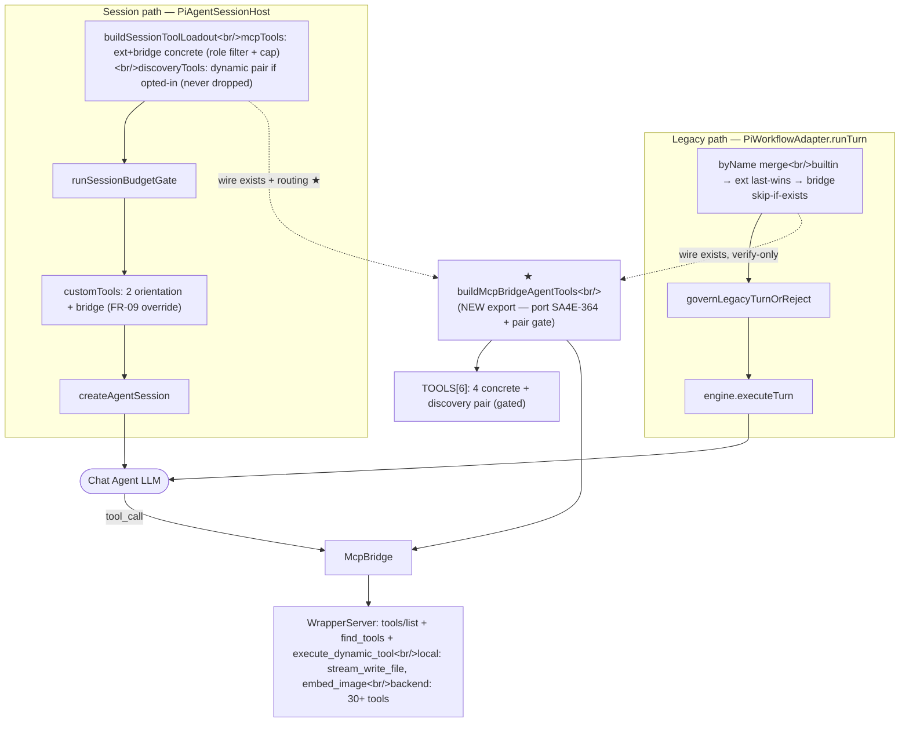
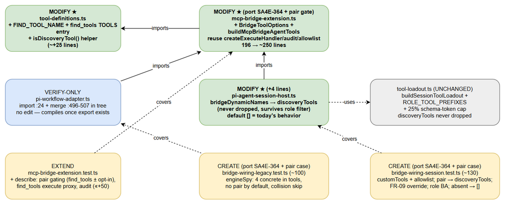
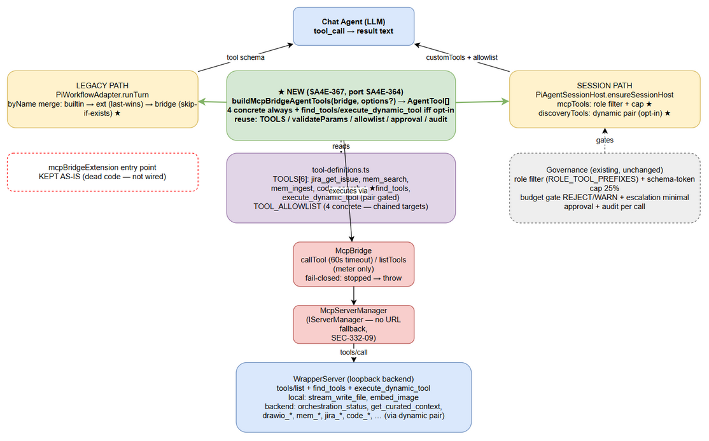
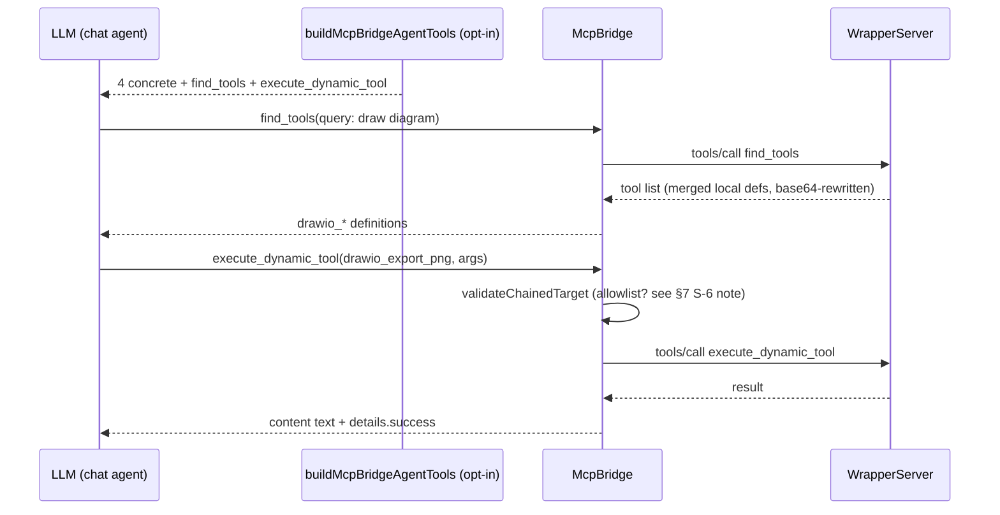
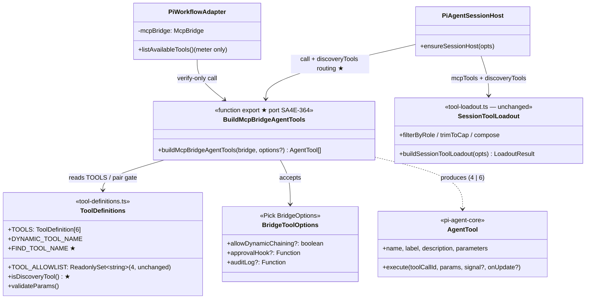
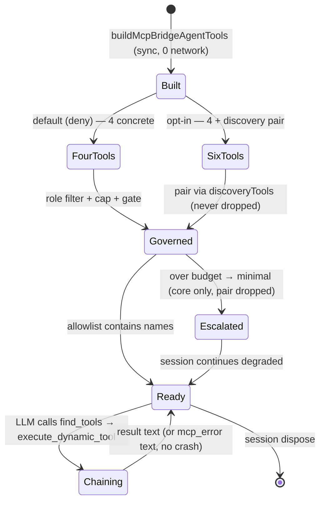

# Technical Design Document (TDD)

## Chatbox Dynamic Tool Exposure — SA4E-367: missing export buildMcpBridgeAgentTools + first-class find_tools / execute_dynamic_tool (gated pair)

---

## Document Information

| Field | Value |
|-------|-------|
| Jira Ticket | SA4E-367 |
| Type / Priority | Bug (hotfix, SLA < 1h) / High |
| Title | [BUG] Chatbox extension only exposes 12 hardcoded tools — missing find_tools/execute_dynamic_tool/dynamic chaining + missing export buildMcpBridgeAgentTools |
| Author | SA Agent |
| Version | 1.0 |
| Date | 2026-10-16 |
| Status | Draft (L3 autonomy — ready for DEV) |
| Related TDD | documents/SA4E-364/TDD.md (v1.0 — wiring design reused) |
| Related BRD/FSD | documents/SA4E-364/BRD.md (v1.0), documents/SA4E-364/FSD.md (v1.1, TA-enriched) |
| Related findings | documents/SA4E-365/SECURITY-ASSESSMENT.md (F-1: cross-branch missing export), SA4E-364-FINDINGS.md, documents/SA4E-365/RUN-LOG.md (row 24: merge 78b667b) |
| Port source | Branch SA4E-364 (commit 180b150 — reference implementation of buildMcpBridgeAgentTools) |

> **Jira access note:** Jira MCP is not connected in this session (verified: tool discovery returns no Jira tools; orchestration status shows only markdown-exporter connected; MCP resource list is empty). Requirements are sourced from the SM handoff (ticket AC in the task brief), documents/SA4E-367/STATUS.json, and direct code verification on 2026-10-16. Ticket-text vs codebase deltas are recorded in DISCREPANCY.md.

---

## Author Tracking

| Role | Name - Position | Responsibility |
|------|-----------------|----------------|
| Author | SA Agent – Solution Architect | Create document |
| Next reviewer | DEV Agent | Implement per checklist §10.4 |

---

## Revision History

| Version | Date | Author | Changes |
|---------|------|--------|---------|
| 1.0 | 2026-10-16 | SA Agent | Initial — hotfix design: port SA4E-364 export + first-class discovery pair (find_tools new, execute_dynamic_tool gated) + discoveryTools routing; 2 draw.io diagrams; per-file checklist; decision records A-vs-B and Req-5 tool routing |

---

## Sign-Off

| Name | Signature and date |
|------|--------------------|
| | ☐ I agree and confirm the technical design in this TDD |
| | ☐ I agree and confirm the technical design in this TDD |

---

## 1. Introduction

> **Scope Boundary:** Functional requirements for bridge wiring (FR-01..FR-09, BR-01..BR-08, EC-1..EC-7, AC-1..AC-6) are defined in SA4E-364 BRD/FSD and reused here by reference. This TDD specifies HOW to fix SA4E-367: the missing export (compile blocker), the new find_tools first-class definition, the gated discovery-pair design, session-path discoveryTools routing, and the explicit rejection of runtime tool generation.

### 1.1 Purpose

The chatbox tool pool is statically frozen: both wiring call sites (legacy adapter :24/:497, session host :36/:338) import buildMcpBridgeAgentTools, which does not exist in mcp-bridge-extension.ts (file exports only default mcpBridgeExtension, bridgeRequiresApproval, createExecuteHandler, TOOLS) — a certain TS2305 compile error and runtime TypeError on the legacy path (SA4E-365 F-1 verified the same failure class). Additionally, the static TOOLS catalog has no find_tools entry, so the chat agent can never discover backend tools (orchestration_status, get_curated_context, stream_write_file, drawio_*, embed_image, …) even though WrapperServer already serves find_tools + execute_dynamic_tool server-side. This TDD designs the minimal hotfix that (a) restores the build, (b) exposes the discovery pair as first-class AgentTools behind the existing opt-in gate, and (c) routes the pair through governance so role filter + schema-token cap apply — without changing the security posture (SEC-324-03 deny-by-default, SEC-332-09 fail-closed).

### 1.2 Scope

**In scope (production — 3 files, 1 verify-only):**

- extension/src/pi-agent/extensions/tool-definitions.ts — add FIND_TOOL_NAME + find_tools TOOLS entry + isDiscoveryTool() helper.
- extension/src/pi-agent/extensions/mcp-bridge-extension.ts — add BridgeToolOptions + buildMcpBridgeAgentTools (port SA4E-364 branch verbatim, one-line gate extension to the discovery pair).
- extension/src/pi-workflow/pi-agent-session-host.ts — route opted-in dynamic names via discoveryTools (+4 lines).
- extension/src/pi-workflow/pi-workflow-adapter.ts — VERIFY-ONLY (import :24 + merge :496-507 already in tree; compiles once the export exists).

**Out of scope:**

- New vscode settings key (e.g. sdlcAgents.allowDynamicChaining) — follow-up ticket (Open Question OQ-1). Wiring passes no options (deny by default).
- Backend changes (WrapperServer, backend-local-tools, REST API) — untouched.
- Entry point mcpBridgeExtension — kept as-is (still dead code, not wired).
- UI (badge, picker) — unchanged.

### 1.3 Technology Stack

| Layer | Technology | Version |
|-------|-----------|---------|
| Language | TypeScript (strict, ESM) | extension tsconfig |
| Runtime | VS Code / Kiro extension host (Node) | — |
| Agent SDK | @earendil-works/pi-agent-core (AgentTool type), @earendil-works/pi-coding-agent (session ToolDefinition) | 0.99.1 (per SA4E-364 TDD §3.7) |
| Backend transport | McpBridge → McpServerManager.invokeTool (loopback JSON-RPC) | in-tree |
| Tests | vitest, TypeScript | extension/package.json (test: vitest run) |
| Diagrams | draw.io CLI export | local install |

### 1.4 Design Principles

- **Reuse, don't duplicate (no-workaround-rule)** — single source of truth stays in tool-definitions.ts (TOOLS / TOOL_ALLOWLIST / validateParams / DYNAMIC_TOOL_NAME); the builder only maps.
- **Deny-by-default (SEC-324-03)** — the discovery pair travels together and is emitted only on explicit allowDynamicChaining === true.
- **Sync wiring (NFR N-6)** — builder stays pure/sync/O(TOOLS)/0-network; no async tools/list inside the turn path.
- **Minimal hotfix diff** — port the proven SA4E-364 implementation verbatim; deltas limited to the pair gate + discoveryTools routing + tests.
- **Self-contained commit (lesson SA4E-365 F-1)** — hotfix branch must contain all hunks; verify with git merge-base + tsc + full suite before merge.

### 1.5 Constraints

- No NEW DEPENDENCY (@earendil-works/pi-agent-core already imported by workspace-info-tool.ts:13).
- No settings-schema change in this hotfix (fail-closed default).
- tsc -p ./ AND esbuild production build must pass (vitest alone is insufficient — it does not typecheck; F-1 lesson).
- File-size standard: mcp-bridge-extension.ts grows 196 → ~250 lines (wire-only exception, same as SA4E-364); no unrelated refactor.

### 1.6 References

| Document | Location |
|----------|----------|
| SA4E-364 TDD (wiring design reused) | documents/SA4E-364/TDD.md |
| SA4E-364 BRD / FSD | documents/SA4E-364/BRD.md, documents/SA4E-364/FSD.md |
| SA4E-365 Security Assessment (F-1) | documents/SA4E-365/SECURITY-ASSESSMENT.md |
| Discrepancy report | documents/SA4E-367/DISCREPANCY.md |
| Port source | Branch SA4E-364, commit 180b150 (function body), BridgeToolOptions type |

---
## 2. System Architecture

### 2.1 Architecture Overview

The chat agent LLM tool pool is assembled from **two mutually exclusive paths per turn** (session-first, legacy fallback). SA4E-367 keeps the SA4E-364 wiring shape and fixes it:

- **Static curated pool (default, unchanged behavior):** 4 concrete bridge tools (jira_get_issue, mem_search, mem_ingest, code_search) mapped synchronously from TOOLS into both paths. The ticket's "12 hardcoded tools" observation refers to the frozen legacy pool (builtin workspace tools + ext tools + bridge tools once compiled) — no runtime refresh exists, by design (§3.2 Decision A-vs-B).
- **Dynamic discovery pair (NEW capability, deny-by-default):** find_tools (NEW TOOLS entry) + execute_dynamic_tool travel as a pair, emitted only when options.allowDynamicChaining === true. Once opted in, the pair reaches every backend/local tool (orchestration_status, get_curated_context, stream_write_file, drawio_*, embed_image, …) through the already-existing server-side handlers (WrapperServer routeToolCall :272-275, handleFindTools :287-290, handleDynamic :292-306).
- **Governance (unchanged):** session path applies role filter (ROLE_TOOL_PREFIXES) + 25% schema-token cap + budget gate; concrete bridge names flow via mcpTools (filterable), dynamic pair names flow via discoveryTools (never dropped — required, because no role prefix matches find_/execute_ and filterByRole drops unmatched names).



### 2.2 Component Diagram


*[Edit in draw.io](diagrams/component.drawio)*

| Component | Responsibility | Change (SA4E-367) |
|-----------|---------------|-------------------|
| tool-definitions.ts | Single source of truth: TOOLS, TOOL_ALLOWLIST, DYNAMIC_TOOL_NAME, validateParams, MAX_STRING_PARAM_LENGTH | MODIFY: + FIND_TOOL_NAME, + find_tools entry, + isDiscoveryTool() |
| mcp-bridge-extension.ts | Bridge entry point (kept) + pure builder (new) + execute handler reuse | MODIFY: + BridgeToolOptions, + buildMcpBridgeAgentTools (port SA4E-364, gate extended to pair) |
| pi-workflow-adapter.ts | Legacy pool merge (skip-if-exists) | VERIFY-ONLY — no edit |
| pi-agent-session-host.ts | Session loadout + customTools + allowlist | MODIFY (+4): dynamic names → discoveryTools |
| tool-loadout.ts | Role filter + schema-token cap + never-drop sets | UNCHANGED |
| McpBridge / WrapperServer / backend-local-tools | Transport + server-side discovery/chaining + local tools | UNCHANGED |


*[Edit in draw.io](diagrams/architecture.drawio)*

> **Reading the diagram:** ★ green = NEW/changed in SA4E-367 (builder export, find_tools entry, discoveryTools routing); red dashed = kept dead code (mcpBridgeExtension entry point); grey dashed = unchanged governance.

### 2.3 Deployment Architecture

No deployment change. Extension host + loopback WrapperServer topology is untouched: no new process, no new port, no config key, no migration. Rollout = new extension build → user reloads window. Rollback = revert single commit.

### 2.4 Communication Patterns

| From | To | Protocol | Pattern | Description |
|------|----|----------|---------|-------------|
| Builder execute handler | McpBridge.callTool | in-process call | Sync-async | validateParams → approval → audit → callTool (60s timeout, McpToolTimeoutError) |
| McpBridge | McpServerManager.invokeTool | in-process | Sync-async | Fail-fast when status !== 'running' (McpServerNotRunningError, local check, <50ms) |
| McpBridge.listTools | WrapperServer tools/list | loopback HTTP POST 127.0.0.1 | Request/response (10s abort) | Meter/UI only (listAvailableTools :159-166) — NOT the LLM pool |
| Chat agent (opted-in) | Backend tools | via execute_dynamic_tool chaining | Two-hop | find_tools (discover) → execute_dynamic_tool (invoke any backend/local tool) |

---
## 3. API Design

> Internal TypeScript API (not HTTP). Contract extends SA4E-364 FSD §3.5.1 with the discovery pair.

### 3.1 Decision — Phương án A (chosen) vs Phương án B (rejected)

| Criterion | A: First-class gated pair (find_tools + execute_dynamic_tool as AgentTools, opt-in) ✅ | B: Generate bridge tools dynamically from restGetTools / listTools at wiring time ❌ |
|-----------|------|------|
| Wiring timing | Sync, O(6), 0 network — fits runTurn merge + ensureSessionHost (NFR N-6 preserved) | Async fetch (10s abort) inside turn startup — blocks first turn, breaks N-6, needs new async plumbing in 2 paths |
| Token budget (SA4E-355) | Static cost: 4 schemas default (~145 tok); pair adds ~2 schemas (~75 tok) only when opted in — cap 25% staticBudget holds | Backend exposes 30+ tools × ~36 tok ≈ 1000+ tok static — forces escalation/minimal, bridge self-drops (BR-08), defeats the purpose |
| Mechanism reuse | Reuses server-side find_tools/execute_dynamic_tool (already shipped, tested) — no-workaround-rule satisfied | Duplicates discovery client-side: needs schema normalization (inputSchema → AgentTool parameters → session ToolDefinition), a new layer + new failure modes |
| Security (SEC-324-03) | Static 4-tool allowlist remains the enforcement point; pair is deny-by-default with chained-target allowlist unchanged | Runtime tool list includes admin/local tools; static allowlist guarantee evaporates; needs a new dynamic policy engine (out of hotfix scope) |
| Role filter + cap | Concrete names via mcpTools (filterable per ROLE_TOOL_PREFIXES); pair via discoveryTools (never dropped) — composes with existing governance | Dynamic names bypass prefix design (no prefixes defined) — either all dropped or never filtered; governance needs redesign |

**Verdict: Phương án A.** The "dynamic" in dynamic chaining comes from the server-side pair (discover-then-invoke at runtime), not from generating static schemas at wiring time.

### 3.2 Signature (port SA4E-364 + pair gate)

```ts
// extension/src/pi-agent/extensions/mcp-bridge-extension.ts (NEW exports)
import type { AgentTool } from '@earendil-works/pi-agent-core';

export type BridgeToolOptions = Pick<
  BridgeOptions,
  'allowDynamicChaining' | 'approvalHook' | 'auditLog'
>;

export function buildMcpBridgeAgentTools(
  bridge: McpBridge,
  options?: BridgeToolOptions
): AgentTool[];
```

Reference implementation: branch SA4E-364 commit 180b150 (function body, verified 2026-10-16). **One-line delta vs the port source:** the skip-guard extends from the single dynamic tool to the discovery pair:

```ts
// SA4E-364 port source:
if (tool.name === DYNAMIC_TOOL_NAME && options?.allowDynamicChaining !== true) continue;
// SA4E-367 (pair gate — isDiscoveryTool covers find_tools + execute_dynamic_tool):
if (isDiscoveryTool(tool.name) && options?.allowDynamicChaining !== true) continue;
```

Full builder pseudocode (port + delta, ~24 lines incl. JSDoc):

```ts
export function buildMcpBridgeAgentTools(bridge, options?): AgentTool[] {
  const audit = options?.auditLog ?? defaultAuditLog;
  const out: AgentTool[] = [];
  const seen = new Set<string>();                       // BR-1: unique names per session
  for (const tool of TOOLS) {                           // tool-definitions.ts — single source
    if (seen.has(tool.name)) {
      console.warn(`[Pi Extension] Tool name already exists: ${tool.name}`);
      continue;
    }
    // SEC-324-03: discovery pair (find_tools + execute_dynamic_tool) only on explicit opt-in (=== true).
    if (isDiscoveryTool(tool.name) && options?.allowDynamicChaining !== true) continue;
    out.push({
      name: tool.name, label: tool.label,
      description: tool.description, parameters: tool.parameters,
      execute: createExecuteHandler(bridge, tool.name, tool.parameters,
        { ...options, audit } as unknown as BridgeOptions),
    } as unknown as AgentTool);
    seen.add(tool.name);
  }
  return out;
}
```

### 3.3 Behavior table (TOOLS now has 6 entries)

| Tool | Default emit | Opt-in emit | Approval (bridgeRequiresApproval) | Execute path |
|------|-------------|------------|-----------------------------------|--------------|
| jira_get_issue | ✅ | ✅ | false → auto-approved + audit | validateParams → bridge.callTool |
| mem_search | ✅ | ✅ | false → auto-approved + audit | idem |
| mem_ingest | ✅ | ✅ | **true** → approvalHook (absent = auto-approved + audit) | idem |
| code_search | ✅ | ✅ | false → auto-approved + audit | idem |
| ★ find_tools (NEW entry) | ❌ | ✅ | false (read-only discovery; result is metadata, no side effects) | validateParams → bridge.callTool('find_tools') → rewriteFindToolsResponse merges local defs server-side |
| execute_dynamic_tool | ❌ | ✅ | **true** | validateParams → validateChainedTarget (target ∈ TOOL_ALLOWLIST, unchanged 4) → approval → bridge.callTool |

Notes (code-verified): TOOLS is NOT pre-filtered by TOOL_ALLOWLIST at build time — the allowlist governs only chained targets (matches entry-point behavior :164-174). Builder never throws on normal wiring; never calls network. Wiring production passes NO options → default 4 tools, pair absent (AC-3 self-satisfies; assert on built tool arrays, never on allowlist name strings — DISCOVERY_TOOLS trap, SA4E-364 STC §8.1).

### 3.4 NEW — find_tools ToolDefinition (tool-definitions.ts)

```ts
/** SEC-324-03 — discovery pair gate. Both travel together, denied by default. */
export const FIND_TOOL_NAME = "find_tools";

export function isDiscoveryTool(toolName: string): boolean {
  return toolName === FIND_TOOL_NAME || toolName === DYNAMIC_TOOL_NAME;
}
```

TOOLS entry (insert after code_search, before execute_dynamic_tool). Schema mirrors the backend find_tools input surface (WrapperServer.handleFindTools forwards args to restCallTool); validateParams only enforces required + 4000-char caps, so unknown optional fields pass through safely:

```json
{
  "name": "find_tools",
  "label": "Find Tools",
  "description": "Discover available MCP tools by semantic query (dynamic chaining: pair with execute_dynamic_tool)",
  "parameters": {
    "type": "object",
    "properties": {
      "query": { "type": "string", "description": "Semantic search query for tools" },
      "threshold": { "type": "number", "description": "Match threshold 0..1" },
      "top_k": { "type": "number", "description": "Max results" },
      "limit": { "type": "number", "description": "Max results (alias)" }
    },
    "required": ["query"]
  }
}
```

DEV must confirm exact backend field names against the backend /api/tools schema at implementation (OQ-2); permissive extra fields are harmless.

### 3.5 Req-5 routing decision — direct vs dynamic chaining

| Tool | Expose directly as AgentTool? | Decision + rationale |
|------|-------------------------------|---------------------|
| orchestration_status | ❌ No | Diagnostic, rare use; static schema cost unjustified; reachable via pair when opted in |
| get_curated_context | ❌ No | Large result payloads; on-demand discovery beats static registration (token budget) |
| stream_write_file | ❌ No | Already served via tools/list + LOCAL_TOOL_REGISTRY (backend-local-tools.ts:53); direct exposure would duplicate WrapperServer's merge mechanism (no-workaround-rule); PathResolver containment enforced server-side |
| drawio_* | ❌ No | Design-phase only; heavy XML-param schemas would blow the 25% cap; role prefixes (SA/QA/UI drawio_) apply at loadout-name level once discovered dynamically |
| embed_image | ❌ No | Pairs with stream_write_file in the DOCX flow; same rationale; reachable via pair |

**Rule: the static bridge surface stays at 4 concrete + gated pair. Everything else is dynamic-only.** Without opt-in, the chat agent cannot call Req-5 tools — accepted hotfix scope; full enablement requires the settings-gated opt-in follow-up (OQ-1).

### 3.6 Wiring — legacy path (VERIFY-ONLY, adapter :24/:496-507)

No edit. Import + skip-if-exists merge already in tree; compiles once §3.2 export exists. Merge order unchanged (OI-06): builtin → ext (last-wins, AFT hoist) → bridge (skip-if-exists + debugLog warn).

### 3.7 Wiring — session path (MODIFY, +4 lines, host :335-348)

After bridgeNames, split dynamic names into the never-dropped set so they survive filterByRole (which drops prefix-less names for known roles):

```ts
// SA4E-367: opted-in dynamic pair bypasses the role filter via discoveryTools
// (never dropped — no role prefix matches find_/execute_). Default [] = today's behavior.
const bridgeDynamicNames = bridgeTools.map((t) => t.name).filter(isDiscoveryTool);
const bridgeConcreteNames = bridgeTools.map((t) => t.name).filter((n) => !isDiscoveryTool(n));
const loadout = buildSessionToolLoadout({
  ...,
  discoveryTools: nameTools(bridgeDynamicNames),          // was: []
  mcpTools: nameTools([...extNames, ...bridgeConcreteNames]),
});
```

customTools append (FR-09 override) and allowlist composition need no change — SDK filters customTools by the allowlist, which now includes dynamic names via discoveryTools. Import isDiscoveryTool from tool-definitions (type-only not needed — value import, zero runtime cost concern).



> §7 S-6 caveat: chained targets are limited to the 4 concrete tools today; Req-5 tools reached via the pair use their own first-class or backend-routed path per WrapperServer.handleDynamic (local tools + proxy + base64). If DEV enables direct chaining of Req-5 names, TOOL_ALLOWLIST extension needs a separate security review — NOT in this hotfix.

---
## 4. Database Design

Not applicable. No persistence is added or changed: tool schemas are in-memory constants, execution is stateless per call, audit sink is console.info (no param values, only argKeys). Session transcripts (.pi/sessions) and KB storage are owned by other components and untouched.

## 5. Class / Module Design

### 5.1 Package Structure (relevant subtree)

```
extension/src/
├── pi-agent/extensions/
│   ├── tool-definitions.ts          # ★ +FIND_TOOL_NAME, +find_tools entry, +isDiscoveryTool()
│   ├── mcp-bridge-extension.ts      # ★ +BridgeToolOptions, +buildMcpBridgeAgentTools (port SA4E-364)
│   └── __tests__/mcp-bridge-extension.test.ts  # EXTEND: pair-gating suite
├── pi-workflow/
│   ├── pi-workflow-adapter.ts       # VERIFY-ONLY (:24 import, :496-507 merge)
│   ├── pi-agent-session-host.ts     # ★ +discoveryTools routing (:341-348)
│   └── __tests__/
│       ├── bridge-wiring-legacy.test.ts   # CREATE (port SA4E-364 + pair case)
│       └── bridge-wiring-session.test.ts  # CREATE (port SA4E-364 + pair case)
├── pi-agent/tool-loadout.ts         # UNCHANGED (role filter + cap + never-drop)
├── mcp/mcp-bridge.ts                # UNCHANGED (callTool/listTools/isAvailable)
└── services/WrapperServer.ts        # UNCHANGED (tools/list, find_tools, dynamic)
```

### 5.2 Key Interfaces

```typescript
// tool-definitions.ts — additions
export const FIND_TOOL_NAME = "find_tools";
export function isDiscoveryTool(toolName: string): boolean;

// mcp-bridge-extension.ts — additions (port SA4E-364)
export type BridgeToolOptions = Pick<
  BridgeOptions, 'allowDynamicChaining' | 'approvalHook' | 'auditLog'
>;
export function buildMcpBridgeAgentTools(bridge: McpBridge, options?: BridgeToolOptions): AgentTool[];
```

BridgeOptions itself is NOT modified (serverManager stays required for the entry point — SEC-332-09 fail-closed).



### 5.3 Design Patterns

| Pattern | Where Used | Rationale |
|---------|-----------|-----------|
| Pure builder function | buildMcpBridgeAgentTools | Sync, testable, shared by both paths; no instance state |
| Single-source allowlist | Reuse TOOLS/TOOL_ALLOWLIST/validateParams | No duplicate policy (no-workaround-rule, BR-01) |
| Pair gate (opt-in === true) | isDiscoveryTool + allowDynamicChaining | SEC-324-03 deny-by-default; find_tools and execute_dynamic_tool travel together |
| Fail-safe degrade | instanceof narrow → [] ; stopped bridge → error text | Turn/session never crash (BR-08, W-1) |
| Skip-if-exists merge | Legacy byName loop | Bridge never overrides builtin/ext (BR-06, OI-06) |
| Never-drop set | discoveryTools routing | Dynamic pair survives role filter + minimal escalation |

### 5.4 Error Handling

EC-1..EC-7 reused verbatim from SA4E-364 TDD §6 (handler unchanged). Additions:

| # | Condition | LLM text | details | Audit |
|---|-----------|----------|---------|-------|
| EC-8 | find_tools params invalid (missing query / string > 4000) | Validation failed: {error} | { error: 'validation', toolName: 'find_tools' } | none (pre-approval, matches :109-115) |
| EC-9 | execute_dynamic_tool opted-in but target ∉ TOOL_ALLOWLIST (unchanged) | Dynamic tool chaining denied: '{x}' is not allowlisted | { error: 'chaining_denied', ... } | denied |

Wiring-level: W-1 (bridge absent/wrong type → []) unchanged; W-2 (NEW): bridgeDynamicNames empty by default → discoveryTools: [] identical to today's call — zero behavior delta until opt-in.



---
## 6. Integration Design

> Business integration requirements are in SA4E-364 FSD §5. Only the transport facts relevant to the pair are restated here (all code-verified 2026-10-16).

### 6.1 McpBridge → Backend transport (unchanged)

| Attribute | Value |
|-----------|-------|
| Protocol | In-process McpServerManager.invokeTool; listTools via loopback HTTP POST http://127.0.0.1:{port}/mcp (JSON-RPC tools/list) |
| Authentication | None (loopback); IServerManager instance required — no hardcoded URL fallback (SEC-332-09) |
| Timeouts | callTool 60s (McpToolTimeoutError); listTools 10s abort; restCallTool 30s; restGetTools 5s (fallback: local defs only) |
| Retry | None — fail-fast to error text (BR-08). Path errors become agent-readable results, never JSON-RPC -32603 (SA4E-356) |
| Fallback | restGetTools failure → getVisibleLocalToolDefinitions() (stream_write_file, embed_image) so tools/list never empties |

**Data mapping:** TOOLS[i].parameters passed through verbatim as AgentTool.parameters (schema passthrough — SA4E-364 STC UT-01 asserts identity). No normalization layer (rejected Phương án B needs none).

### 6.2 Server-side pair flow (already shipped — reused, not reimplemented)

1. LLM → execute handler (find_tools) → bridge.callTool → routeToolCall.handleFindTools → restCallTool("find_tools") → rewriteFindToolsResponse merges LOCAL_TOOL_REGISTRY defs + base64 schema rewrite.
2. LLM → execute handler (execute_dynamic_tool) → validateChainedTarget → bridge.callTool → routeToolCall.handleDynamic → base64 unwrap → local-tool short-circuit (isLocalTool) or restCallTool("execute_dynamic_tool") with proxy in/out.

## 7. Security Design

Posture unchanged from SA4E-316/SEC-324-03 — the hotfix wires, never loosens.

| # | Principle | Design | Ref |
|---|-----------|--------|-----|
| S-1 | Deny-by-default discovery pair | isDiscoveryTool gate with strict === true; wiring passes no options → pair absent in both paths | SEC-324-03 |
| S-2 | Fail-closed transport | Bridge requires real IServerManager (adapter :29-78); no URL fallback; entry-point throw kept | SEC-332-09 |
| S-3 | Approval + audit | bridgeRequiresApproval + checkApproval + defaultAuditLog reused untouched; mem_ingest + execute_dynamic_tool need approval; audit logs every decision with argKeys only (never values) | SEC-324-03, NFR N-7 |
| S-4 | No duplicated allowlist | Builder imports TOOLS/TOOL_ALLOWLIST/DYNAMIC_TOOL_NAME/FIND_TOOL_NAME/isDiscoveryTool/validateParams — zero copies | BR-01 |
| S-5 | Input validation | validateParams on every call incl. find_tools (query required, strings ≤ 4000) — prompt-injection hygiene | SEC-324-03, BR-05 |
| S-6 | Chained-target allowlist unchanged | validateChainedTarget still 4 concrete tools; extending it to Req-5 names needs separate security review (out of hotfix) | BR-02 |
| S-7 | No silent pool growth | Legacy skip-if-exists; session role filter + cap + minimal escalation can still drop bridge tools; pair via never-drop set ONLY when explicitly opted in | BR-06/07/08 |

Threat notes: (a) tool-output injection → length cap + text pass-through (unchanged); (b) LLM self-chaining → pair absent by default + target allowlist; (c) rogue MCP server → transport unchanged; (d) find_tools result poisoning (malicious tool descriptions) → capped strings, and execution still gated by S-1/S-6.

## 8. Performance & Scalability

### 8.1 Schema-token budget (SA4E-355 25% cap)

| Item | Estimate (name-only OI-4) | Real schema | Notes |
|------|--------------------------|-------------|-------|
| 4 concrete tools | ~20 tok names | ~145 tok schemas | Default — unchanged from SA4E-364 |
| Discovery pair (opted in) | ~10 tok names | ~75 tok schemas | Only when opted in; discoveryTools still counted in loadout.schemaTokens → gate-measured |
| Rejected Alt B (30+ dynamic) | — | ~1000+ tok | Would force escalation — quantified rejection reason |
| Builder CPU | O(6) map, <1 ms | 1×/turn legacy, 1×/session host | NFR N-6 holds |

### 8.2 Targets

| Operation | Target | Measurement |
|-----------|--------|-------------|
| buildMcpBridgeAgentTools | < 5 ms, 0 network, never throws (wiring) | Unit assert + callTool 0 calls (SA4E-364 PBT-01 pattern) |
| Stopped-bridge error path | < 50 ms error text (NFR N-4) | IT-01 pattern (real McpBridge, stopped manager) |
| tsc -p ./ + production esbuild | exit 0 | SIT-02 gate (vitest alone insufficient — F-1 lesson) |

### 8.3 Caching / Pooling

None added. Bridge instance is constructed once per adapter (:78) and shared per session host (cached hosts map); builder output is intentionally rebuilt per call (stateless, cheap) so opt-in changes take effect without cache invalidation.

---
## 9. Monitoring & Observability

### 9.1 Logging (all existing — reused)

| Log Event | Level | Fields | Destination |
|-----------|-------|--------|-------------|
| Bridge tool skipped (duplicate/collision) | warn/debug | tool name | console / debugLog ([PiWorkflowAdapter] / [Pi Extension]) |
| Bridge invocation decision | info | { toolName, argKeys, decision } — never param values | console.info (defaultAuditLog) |
| Bridge absent (session degraded) | debug | — | debugLog [PiSessionHost] |
| Schema-cap unreachable | warn | { tokens, cap } PI_TOOL_SCHEMA_CAP | logger (tool-loadout trimToCap) |
| listAvailableTools failure | error | err | debugError (meter only, pool unaffected) |

### 9.2 Metrics / Health

No new metrics. Gate decisions (PI_GATE_DECISION) remain the observable signal for budget pressure after the fix (UAT step). Health: listAvailableTools (:159-166) unchanged — meter only, never the LLM pool.

## 10. Deployment Considerations

### 10.1 Environment Configuration

| Property | DEV | SIT | UAT | PROD |
|----------|-----|-----|-----|------|
| All sdlcAgents.* | unchanged | unchanged | unchanged | unchanged |

No new setting in this hotfix (OQ-1 follow-up). No DB, no migration, no feature flag — wiring is default-on for the 4 concrete tools (OI-01), default-off for the pair (OI-04).

### 10.2 Rollback Strategy

Single-commit revert restores the previous (broken-build) tree — therefore the hotfix branch must be self-contained: port source (SA4E-364 commit 180b150 hunks) + pair delta + routing + tests in ONE commit series on the hotfix branch. Pre-merge gates: git merge-base --is-ancestor check, npm run compile (tsc), production esbuild, full vitest suite (lesson SA4E-365 F-1: a commit that only passes vitest is not shippable).

### 10.3 Branch Note (current tree = SA4E-362)

Verified 2026-10-16: working tree already contains the SA4E-364 wiring hunks (adapter import :24 + merge :496-507; host imports :35-37 + narrow :337-340 + loadout :347 + customTools :438-442) but NOT the builder export, NOT the wiring tests (bridge-wiring-*.test.ts absent; mcp-bridge-extension.test.ts has no builder suite). DEV ports from branch SA4E-364 (local branch exists) — do NOT re-derive from pseudocode alone.

### 10.4 Implementation Checklist (per file / line)

**Production:**

| # | File | Anchor | Change | Δ lines |
|---|------|--------|--------|---------|
| 1 | tool-definitions.ts | After DYNAMIC_TOOL_NAME (:113) | + export const FIND_TOOL_NAME = "find_tools" + isDiscoveryTool() + JSDoc (pair-gate note) | +8 |
| 2 | tool-definitions.ts | TOOLS array, after code_search entry (:64), before execute_dynamic_tool (:66) | + find_tools entry (§3.4 schema) | +14 |
| 3 | mcp-bridge-extension.ts | Import block, after :9 (McpBridge import) | + import type { AgentTool } from '@earendil-works/pi-agent-core'; extend :10-15(tool-definitions import) with FIND_TOOL_NAME, isDiscoveryTool | +1 / +1 |
| 4 | mcp-bridge-extension.ts | After BridgeAuditEntry (:43-47), before defaultAuditLog (:50) | + BridgeToolOptions (Pick<...>) + JSDoc SEC-324-03 | +6 |
| 5 | mcp-bridge-extension.ts | End of file, after mcpBridgeExtension (:191), before test export (:193-196) | + buildMcpBridgeAgentTools — PORT VERBATIM from SA4E-364:180b150, with the single pair-gate delta (§3.2). Do NOT touch :156-191 or :193-196 | +28 |
| 6 | pi-agent-session-host.ts | Import block, after :37 | + import { FIND_TOOL_NAME?, isDiscoveryTool } — import { isDiscoveryTool } from '../pi-agent/extensions/tool-definitions'; | +1 |
| 7 | pi-agent-session-host.ts | After const bridgeNames (:340), loadout block (:341-348) | + bridgeDynamicNames / bridgeConcreteNames split; discoveryTools: nameTools(bridgeDynamicNames) (was []); mcpTools: nameTools([...extNames, ...bridgeConcreteNames]) (§3.7) | +4 / ±2 |
| 8 | pi-workflow-adapter.ts | :24, :496-507 | VERIFY-ONLY — no edit; tsc must resolve the import after #5 | 0 |

**Tests (port SA4E-364 suites from branch SA4E-364 + pair cases):**

| # | File | Action | Key asserts |
|---|------|--------|-------------|
| 9 | pi-agent/extensions/__tests__/mcp-bridge-extension.test.ts | EXTEND describe buildMcpBridgeAgentTools | default → 4 names, no find_tools/execute_dynamic_tool; opt-in → 6 names; find_tools execute proxies bridge.callTool('find_tools'); validation-fail (missing query); audit decisions; schema passthrough identity |
| 10 | pi-workflow/__tests__/bridge-wiring-legacy.test.ts | CREATE (~100 lines; engineSpy pattern) | tools passed to executeTurn contain 4 concrete; no pair by default; builtin-name collision → builtin wins (BR-06) |
| 11 | pi-workflow/__tests__/bridge-wiring-session.test.ts | CREATE (~130 lines; createAgentSession-capture pattern) | customTools = 2 + 4 with FR-09 undefined override; allowlist contains concrete; default discoveryTools empty; opt-in (unit-level buildSessionToolLoadout with discoveryTools) → pair survives role 'BA' filter + cap; mcpBridge absent → [] |

**Gates:** tsc -p ./ exit 0 · production esbuild exit 0 · full vitest suite green (esp. tool-loadout-*, session-host, adapter-governance suites — AC-6).

---
## 11. E2E Test Architecture & Test Design

### 11.1 Framework & Language

- **Framework**: vitest (unit/integration, co-located __tests__); no Playwright UI for this ticket.
- **Language**: TypeScript (matches project).
- **Manual UAT** in Kiro/VSCode IDE host (extension host + real MCP server required) — steps in §11.5.

### 11.2 Test Structure

- Unit: extension/src/**/__tests__/*.test.ts (per-module).
- Wiring integration: extension/src/pi-workflow/__tests__/bridge-wiring-*.test.ts (NEW).
- Regression: full npm test suite must stay green (AC-6).

### 11.3 Reusable Components (existing patterns — DEV reuses, no rewrite)

- mockBridge: { callTool: vi.fn() } (mcp-bridge-extension.test.ts:35-37).
- engineSpy: vi.spyOn(engine, 'executeTurn') capture (adapter-legacy-governance.test.ts:77-83).
- createAgentSession mock capture (pi-agent-session-host.test.ts:34-58).
- vscode mock (adapter-legacy-governance.test.ts:23-30); real new McpBridge({status:'running'} as any) for instanceof-narrow tests.

### 11.4 AC → Test Mapping (extends SA4E-364 AC-1..AC-6)

| AC (SA4E-367) | Test | Key assert |
|---------------|------|------------|
| AC-1 tsc/esbuild pass, export resolves | SIT-02 gate | buildMcpBridgeAgentTools present in compile output; 0 TS errors |
| AC-2 Default pool = 4 concrete in both paths | #9, #10, #11 | Built arrays contain jira_get_issue/mem_search/mem_ingest/code_search; customTools + allowlist wired |
| AC-3 Pair absent by default; present as pair on opt-in | #9, #10, #11 | Assert on BUILT TOOL ARRAYS (never allowlist strings — DISCOVERY_TOOLS trap) |
| AC-4 Stopped MCP → error text, no crash | #9 (EC-5/IT-01 pattern) | 'Error invoking mem_search: MCP Server is not running.', details.error mcp_error, invokeTool 0 calls, <50ms |
| AC-5 Role filter + cap honored; pair survives via discoveryTools when opted in | #11 | Role 'BA' drops code_search but keeps pair (discoveryTools never dropped); minimal escalation drops pair, keeps core |
| AC-6 find_tools end-to-end (mocked bridge) | #9 | find_tools execute → bridge.callTool called with ('find_tools', params); result text passthrough |

### 11.5 Manual UAT (IDE host required)

1. npm run compile + production build green; load extension; open SDLC CHAT.
2. Prompt requiring KB/Jira/code lookup → LLM calls concrete bridge tool; result renders via MCP_TOOL_RESULT.
3. Stop MCP server → tool call returns error text; chat continues (fail-safe).
4. (Post-opt-in follow-up only) Enable chaining → find_tools discovers drawio_*/orchestration_status → execute_dynamic_tool invokes; audit lines present; role-filtered roles behave per §3.7.

---

## Appendix

### Glossary

| Term | Definition |
|------|------------|
| Discovery pair | find_tools + execute_dynamic_tool traveling together under one opt-in gate |
| TOOLS | Static catalog in tool-definitions.ts (6 entries after this fix) |
| TOOL_ALLOWLIST | 4 concrete names allowed as chained targets (unchanged) |
| DISCOVERY_TOOLS | tool-loadout constant ['find_tools','execute_dynamic_tool'] (loadout-name level) |
| FR-09 | Session converter prompt-metadata override (promptSnippet/Guidelines → undefined for bridge tools) |
| OI-01/02/04 | SA4E-364 open items: always-on wiring / no approval hook / no opt-in source |

### Open Questions

| # | Question | Status | Answer / Follow-up |
|---|----------|--------|-------------------|
| OQ-1 | Which setting feeds allowDynamicChaining (e.g. sdlcAgents.allowDynamicChaining) + approval UX? | Open | Follow-up ticket; hotfix ships deny-by-default with capability + tests |
| OQ-2 | Exact backend find_tools input fields (threshold/top_k/limit)? | Open | DEV confirms vs backend /api/tools schema; permissive schema is safe |

### Traceability (ticket requirements → TDD)

| Ticket requirement | TDD section | Checklist |
|--------------------|-------------|-----------|
| 1. Export buildMcpBridgeAgentTools, reuse, no duplicate allowlist | §3.2, §5.2, §7 S-4 | #3-5 |
| 2. Pair (A) vs runtime generation (B) + trade-off | §3.1 (Decision) | — |
| 3. Wire both paths + role filter + schema-token cap | §2.1, §3.6, §3.7, §8.1 | #6-8 |
| 4. Keep SEC-324-03 + SEC-332-09 | §7 S-1..S-7 | #1-5 |
| 5. Route orchestration_status/get_curated_context/stream_write_file/drawio_*/embed_image | §3.5 (dynamic-only rule) | — |
| 6. Per-file/line checklist | §10.4 | #1-11 |
| 7. draw.io architecture + component, PNG, embed | §2.1, §2.2, Appendix index | — |

### Diagram Index

| Image | Source (.drawio) | Content |
|-------|------------------|---------|
|  | documents/SA4E-367/diagrams/architecture.drawio | Tool pool after fix — 2 paths + builder + backend pair flow |
|  | documents/SA4E-367/diagrams/component.drawio | Files: 2 modify + 1 micro-modify + 1 verify-only + 3 test files |

---

## ⛔ Diagram Requirements — compliance

- [x] architecture.drawio + .png (§2.1) — exported via draw.io CLI, embedded + edit link
- [x] component.drawio + .png (§2.2) — exported via draw.io CLI, embedded + edit link
- [x] Inline Mermaid (in addition): architecture graph (§2.1), dynamic-chaining sequence (§3.7), class diagram (§5.2), state diagram (§5.4)
- Scope note: deployment/api-sequence/db-schema/class draw.io files are N/A for this no-DB, no-HTTP, no-infra hotfix (template minimum adjusted; Mermaid covers sequence/class/state inline).
