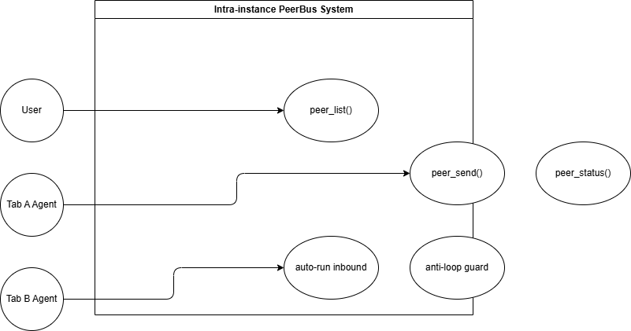
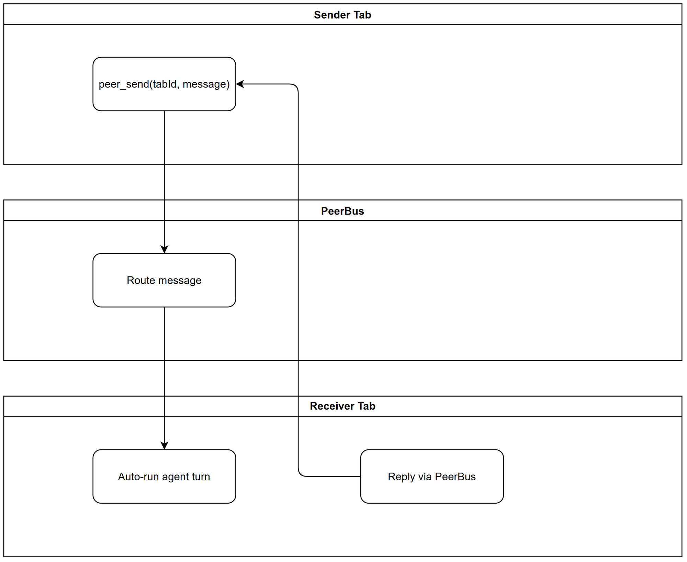

# Business Requirements Document (BRD)

## SA4E-369 — Intra-instance agent-to-agent messaging between chatbox tabs (local PeerBus, zero-config)

---

## Document Information

| Field | Value |
|-------|-------|
| Jira Ticket | SA4E-369 |
| Title | Intra-instance agent-to-agent messaging between chatbox tabs (local PeerBus, zero-config) |
| Author | BA Agent |
| Version | 1.0 |
| Date | 2026-10-19 |
| Status | Draft |

---

## Author Tracking

| Role | Name - Position | Responsibility |
|------|-----------------|----------------|
| Author | BA Agent – Business Analyst | Create document |
| Peer Reviewer | – | Review document |

---

## Revision History

| Version | Date | Author | Changes |
|---------|------|--------|---------|
| 1.0 | 2026-10-19 | BA Agent | Initiate document — auto-generated from Jira ticket SA4E-369 and linked tickets |

---

## Sign-Off

| Name | Signature and date |
|------|--------------------|
| | ☐ I agree and confirm all criteria on this BRD as expected requirements |
| | ☐ I agree and confirm all criteria on this BRD as expected requirements |

---

## 1. Introduction

### 1.1 Scope
Intra-instance agent-to-agent messaging between chatbox tabs within the same VS Code extension host / Pi instance. Each chatbox tab becomes an independent agent with per-tab session isolation. Tabs can communicate directly via in-process local PeerBus with zero configuration, no network sockets, no ports, no tokens.

### 1.2 Out of Scope
- Cross-machine / cross-window transport – non-goal D5
- Replacing pi-subagents or acp_delegate
- mDNS / HTTP / gateway transport
- Human inbox approval for peer tasks – auto-run model per D2

### 1.3 Preliminary Requirement
- D1 prerequisite: refactor tabs → per-tab sessions. Registry key changes workspaceRoot → workspaceRoot+tabId; per-tab token accounting + per-tab compaction
- Epic SA4E-370 S3 per-tab/per-agent session isolation must be completed

---

## 2. Business Requirements

### 2.1 High Level Process Map
User opens multiple chat tabs. Each tab registers as peer in in-memory PeerRegistry. User/agent in Tab A invokes peer_send to Tab B. PeerBus routes message in-process. Receiving tab auto-triggers agent turn with anti-loop guards. Reply flows back.

*[Edit in draw.io](diagrams/use-case.drawio)*

*[Edit in draw.io](diagrams/business-flow.drawio)*

### 2.2 List of User Stories

| # | Story | Priority | Source |
|---|-------|----------|--------|
| 1 | As a developer with multiple chat tabs, I want tabs to communicate directly via local PeerBus so agents can collaborate without external configuration | MUST HAVE | SA4E-369 |
| 2 | As a system, I want per-tab sessions and registry so each tab has isolated history and token accounting | MUST HAVE | SA4E-369 D1 |
| 3 | As a user, I want inbound peer messages auto-run with guards so collaboration is seamless | MUST HAVE | SA4E-369 D2 |
| 4 | As a system, I want anti-loop and rate limits per pair | MUST HAVE | SA4E-369 AC3 |

### 2.3 Details

#### STORY 1: Intra-instance Peer Messaging
**Acceptance Criteria:**
- AC1: Two tabs complete blocking peer task exchange with zero configuration
- AC2: Async dispatch returns task id; peer_status polls to terminal state
- AC7: Zero new config files/keys; no network sockets
- AC8: Existing suites stay green

#### STORY 2: Per-tab Session Isolation
**Acceptance Criteria:**
- AC6: Per-tab sessions with isolated history + per-tab token accounting/compaction

#### STORY 3: Auto-run Delivery with Guards
**Acceptance Criteria:**
- AC3: Anti-loop guard per-pair turn cap + per-tab rate limit
- AC4: Peer-inbound activity visible in UI badge/indicator
- AC5: Peer messages pass through context governance, no bypass

---

## 3. Dependencies
| Dependency | Type | Related Ticket | Description |
|------------|------|----------------|-------------|
| Per-tab session refactor | System | SA4E-370 S3 | Prerequisite D1 |
| Custom tool plug-in | System | SA4E-360 | Proven pattern |
| Extension loader/host | System | SA4E-333 / SA4E-334 | |

## 4. Stakeholders
| Role | Name | Responsibility |
|------|------|----------------|
| Reporter | Duc Nguyen Minh | Requirement owner |
| Epic | SA4E-370 | Parent epic |

## 5. Risks and Assumptions
### Risks
- Anti-loop guard insufficient – enforce maxPingpongTurns=5
- Context governance bypass – ensure pipeline intact
### Assumptions
- Tabs mapped to per-tab sessions after D1
- Extension host single process

## 6. Non-Functional Requirements
| Category | Requirement | Details |
|----------|-------------|---------|
| Performance | In-process latency | Negligible |
| Security | No network exposure | In-memory only |
| Scalability | Bounded history | Per-pair threads bounded |

## 7. Related Tickets
SA4E-370 Parent Epic, SA4E-333, SA4E-334, SA4E-360, SA4E-364, KSA-240

## 8. Appendix
Design Decisions D1-D5 locked. See STATUS.json.
