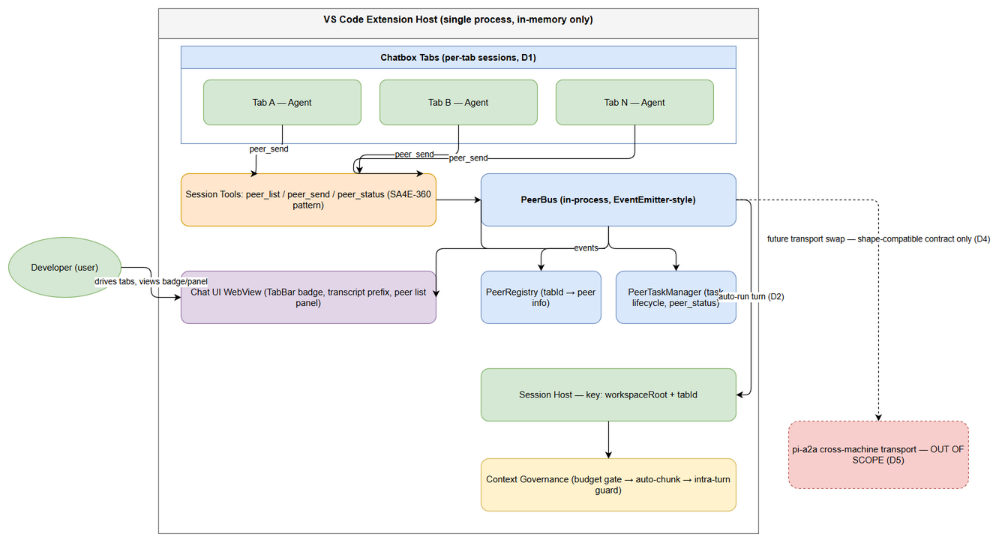
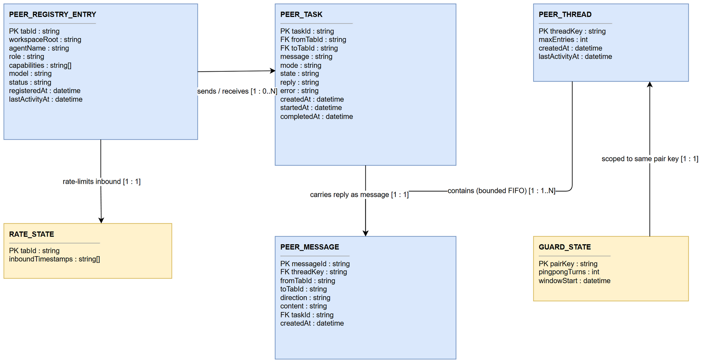
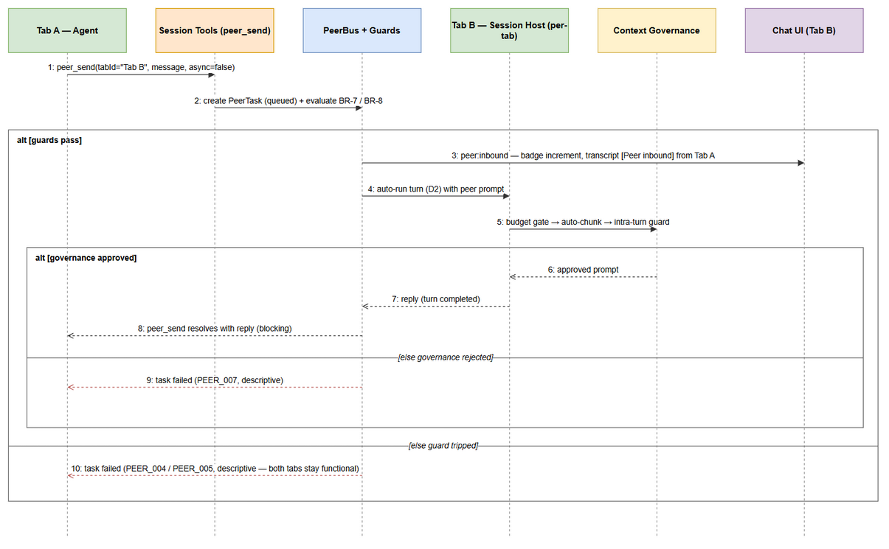
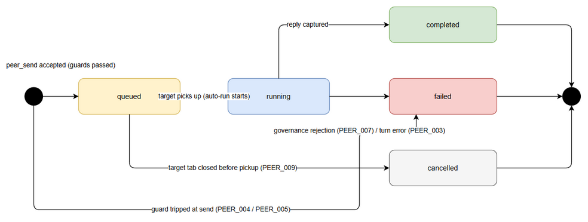

# Functional Specification Document (FSD)

## Pi Chatbox Extension — SA4E-369: Intra-instance agent-to-agent messaging between chatbox tabs (local PeerBus, zero-config)

---

## Document Information

| Field | Value |
|-------|-------|
| Jira Ticket | SA4E-369 |
| Title | Intra-instance agent-to-agent messaging between chatbox tabs (local PeerBus, zero-config) |
| Author | BA Agent |
| Version | 1.2 (ground-truth harmonized per DISCREPANCY.md) |
| Date | 2026-10-20 |
| Status | Draft |
| Related BRD | documents/SA4E-369/BRD.md |
| UI Specification | documents/SA4E-369/UI-SPEC.md |
| Locked Design Decisions | documents/SA4E-369/STATUS.json (D1–D5 — locked 2026-10-18, do not reopen) |

---

## Revision History

| Version | Date | Author | Changes |
|---------|------|--------|---------|
| 1.0 | 2026-10-19 | BA Agent | Initiate document — derived from BRD v1.0, STATUS.json (D1–D5, AC1–AC8) and UI-SPEC.md |
| 1.1 | 2026-10-20 | TA Agent | Technical enrichment (additive only): §2.2.1–2.2.2 PeerRegistry lifecycle/thread-safety + PeerBus blocking/async + bounded history/backpressure; §3.4.4 AC3 guard pseudocode (maxPingpongTurns=5, rate limit, PEER_004/005); §3.5.3 D1 session-host integration map + extension/src files; §3.6.3 AC5 governance hook points; §5.5.1 peer_* ↔ pi-a2a field-level mapping. No BA content removed; diagrams and §11 untouched. |
| 1.2 | 2026-10-20 | BA Agent | Ground-truth harmonization per DISCREPANCY.md (DISC-1/2/3): D1 landed in session-host, consume-not-modify, separator +, tab lifecycle conversation-manager |

---

## 1. Introduction

### 1.1 Purpose

This FSD specifies HOW the intra-instance agent-to-agent messaging feature works: the in-memory PeerRegistry, the in-process PeerBus, the three new session tools (peer_list, peer_send, peer_status), the auto-run delivery model with anti-loop guards, the per-tab session prerequisite, context-governance pass-through, and the UI visibility changes.

It is the functional contract for downstream agents: SA (TDD), QA (STP/STC), DEV (implementation). Design decisions D1–D5 are LOCKED (STATUS.json, 2026-10-18) and treated as fixed inputs — this document details them, it does not reopen them.

### 1.2 Scope

Reference BRD §1.1: tabs within the same VS Code extension host / Pi instance communicate directly via an in-process local PeerBus with zero configuration. Technical scope clarifications:

**In scope:**
1. In-memory PeerRegistry and in-process PeerBus bound to a single VS Code extension host process (D3).
2. Three new session tools — peer_list(), peer_send(tabId, message, async?), peer_status(taskId) — registered via the existing custom tool plug-in pattern (SA4E-360) (D4).
3. Blocking request/response AND async dispatch (fire + poll) delivery modes (D3).
4. Auto-run delivery of inbound peer tasks with mandatory anti-loop guards (D2, AC3).
5. Per-tab session prerequisite: session-host registry key workspaceRoot+tabId, per-tab token accounting, per-tab compaction, removal of hardcoded tabId='default' (D1, AC6).
6. Context-governance pass-through for every peer prompt — budget gate, auto-chunk, intra-turn guard (AC5).
7. UI visibility of peer-inbound activity: tab badge, transcript prefix, optional peer list panel (AC4, UI-SPEC.md).

**Out of scope — Non-Goals (locked D5 + BRD §1.2):**

| # | Non-goal | Rationale / Source |
|---|----------|--------------------|
| NG-1 | Cross-machine / cross-window transport | pi-a2a's job; this feature only preserves a shape-compatible contract for a future swap (D4) |
| NG-2 | mDNS / HTTP / gateway transport of any kind | D5 |
| NG-3 | Network sockets, ports, tokens, new config files or keys | AC7, D5 |
| NG-4 | Replacing pi-subagents or acp_delegate | D5 |
| NG-5 | Human inbox approval for peer tasks | Replaced by auto-run model (D2) |
| NG-6 | Persistence of peer tasks, threads or registry | In-memory only (BR-12); state dies with the tab / extension host |

### 1.3 Definitions & Acronyms

| Term | Definition |
|------|------------|
| PeerBus | In-process, EventEmitter-style message bus routing peer tasks between chat tabs of the same extension host (D3) |
| PeerRegistry | In-memory map: tabId -> {agentName, role, capabilities, model, status} (D3) |
| Peer | A chatbox tab registered as an agent messaging endpoint |
| PeerTask | Unit of peer work created by peer_send; carries message, mode, state, reply/error |
| PeerThread | Per-pair conversation history with bounded entry count (D3) |
| tabId | Unique identifier of a chat tab within the instance; no legacy 'default' value (D1) |
| Auto-run | Inbound peer task automatically triggers the receiving tab's agent turn without human approval (D2) |
| Ping-pong chain | Sequence of consecutive agent-to-agent turns between one pair without user interaction |
| maxPingpongTurns | Per-pair cap on consecutive agent-to-agent turns = 5, ported from pi-a2a pattern (AC3) |
| Context governance | Existing prompt pipeline: budget gate, auto-chunk, intra-turn guard (AC5) |
| Session host | Component owning per-tab sessions; registry key workspaceRoot+tabId (D1) |
| Blocking mode | peer_send waits for the receiving tab's completed turn and returns the reply (async=false) |
| Async mode | peer_send returns taskId immediately; peer_status polls to terminal state (async=true) |
| Terminal state | Task state that ends the lifecycle: completed, failed, cancelled (AC2) |

### 1.4 References

| Document | Location |
|----------|----------|
| BRD v1.0 | documents/SA4E-369/BRD.md |
| UI Specification | documents/SA4E-369/UI-SPEC.md |
| STATUS.json (D1–D5, AC1–AC8) | documents/SA4E-369/STATUS.json |
| FSD Template | documents/templates/FSD-TEMPLATE.md |
| Parent Epic | SA4E-370 (S3 per-tab/per-agent session isolation = prerequisite D1) |
| Related tickets | SA4E-333, SA4E-334, SA4E-360, SA4E-364, KSA-240 (see §11.3) |
---

## 2. System Overview

### 2.1 System Context

All messaging happens inside ONE VS Code extension host process. There is no server, no socket, no port. The only actors are the developer user and the agents running in each chat tab. pi-a2a (cross-machine transport) sits OUTSIDE this feature boundary — only its calling-contract shape is mirrored (D4).


*[Edit in draw.io](diagrams/use-case.drawio)*


*[Edit in draw.io](diagrams/business-flow.drawio)*


*[Edit in draw.io](diagrams/system-context.drawio)*

### 2.2 System Architecture

| # | Component | Responsibility | Source |
|---|-----------|----------------|--------|
| 1 | PeerRegistry | In-memory map tabId -> {agentName, role, capabilities, model, status}; auto register on tab open, deregister on tab close | D3 |
| 2 | PeerBus | In-process EventEmitter-style router: accepts peer_send calls, evaluates guards, delivers tasks, emits UI events | D3 |
| 3 | PeerTaskManager | Owns PeerTask store and lifecycle; serves peer_status(taskId); resolves blocking callers | D3, D4 |
| 4 | Session tools (peer_list, peer_send, peer_status) | Agent-facing tools registered per tab via the custom tool plug-in pattern | D4, SA4E-360 |
| 5 | Per-tab Session Host | Executes agent turns; registry key workspaceRoot+tabId; per-tab token accounting + per-tab compaction | D1, AC6 |
| 6 | Context Governance pipeline | Budget gate, auto-chunk, intra-turn guard — unchanged semantics; peer prompts pass through (AC5) | AC5 |
| 7 | Chat UI (WebView) | TabBar badge, transcript prefix rendering, optional peer list panel | AC4, UI-SPEC.md |

**PeerBus events (EventEmitter-style, D3):**

| Event | Payload | Subscribers |
|-------|---------|-------------|
| peer:registered | tabId, peerInfo | UI peer list panel, PeerTaskManager |
| peer:deregistered | tabId | UI peer list panel, PeerTaskManager (cancels queued tasks) |
| peer:inbound | tabId, fromTabId, taskId | Receiving tab UI (badge + transcript prefix) |
| peer:task-updated | taskId, state, reply?, error? | PeerTaskManager, blocking caller resolution, badge clearing |

**High-level flow:** agent in Tab A calls peer_send -> PeerBus evaluates guards -> PeerTask created -> delivery event -> Tab B auto-runs a governed agent turn in its per-tab session -> reply captured -> task reaches terminal state -> blocking caller resolved or async caller polls peer_status -> UI events update badge/transcript.

<!-- TA enrichment (v1.1): PeerRegistry lifecycle & thread-safety; PeerBus delivery modes, bounded history, backpressure -->

#### 2.2.1 TA Enrichment — PeerRegistry Lifecycle & Thread-Safety (D3)

**Registry lifecycle contract:**

| Transition | Trigger | Action | Invariant |
|------------|---------|--------|-----------|
| register(tabId, peerInfo) | Tab created (UC-5 steps 2–3) | Map.set(tabId, peerInfo); emit peer:registered | tabId unique — collision -> regenerate tabId BEFORE insert (BR-2); re-register on same tabId is idempotent (update in place, no duplicate event) |
| setStatus(tabId, idle/busy) | Turn start / turn end of that tab | In-place field update; no event (status read via peer_list snapshot) | busy set BEFORE first token of the turn; idle set only after terminal state captured |
| deregister(tabId) | Tab closed / webview panel disposed | Map.delete; cancel queued tasks targeting it (PEER_009, BR-15); drop pair threads + guard state involving tabId; emit peer:deregistered | Deregister is the SINGLE cleanup point for derived state — no orphan registry entries, no orphan guards |

**Thread-safety model:** the VS Code extension host is single-threaded JavaScript — PeerRegistry is a plain in-memory `Map` and needs no locks. Guarantees required from DEV:

1. All check-then-mutate sequences (guard evaluation §6.2, register/deregister) run synchronously inside one event-loop tick — no `await` between the check and the commit.
2. State mutations broadcast on PeerBus only AFTER the map is updated (update-then-emit) so subscribers never observe stale registry state.
3. No shared mutable objects escape the module: peer_list() returns deep-copied PeerInfo snapshots (defensive copy), so callers cannot corrupt registry state.
4. PeerBus/PeerRegistry/PeerTaskManager are singletons per extension host (created in extension.ts activation, §5.4) — never per-tab instances.

#### 2.2.2 TA Enrichment — PeerBus Delivery Semantics (blocking vs async), Bounded History, Backpressure

**Blocking mode (async=false):** peer_send returns a Promise resolved by exactly one peer:task-updated event where taskId matches and state ∈ {completed, failed}:

```
// Pseudocode (TypeScript) — final module layout in TDD (new extension/src/peer/)
send(target: tabId, message: string, mode: 'blocking' | 'async'): Promise<SendResult> {
  const task = this.tasks.create(target, message, mode);  // guard eval §6.2 runs BEFORE creation
  if (mode === 'blocking') {
    return new Promise((resolve, reject) => {
      this.bus.once(`task:${task.taskId}`, (t: PeerTask) =>
        t.state === 'completed' ? resolve(toResult(t)) : reject(toError(t)));
      setTimeout(() => reject(peerErr('PEER_006', task.taskId)), BLOCKING_TIMEOUT_MS); // BR-13 (300s); task NOT cancelled
    });
  }
  return Promise.resolve({ taskId: task.taskId, state: 'queued' }); // async fire (AC2)
}
```

- Blocking timeout (BR-13) rejects the CALLER promise only — the task keeps running and peer_status stays valid (PEER_006 semantics, §6.3).
- Teardown: on host deactivation every pending `task:<id>` waiter is rejected with a descriptive failure (§5.4).
- Async mode (async=true): fire-and-forget; caller polls peer_status(taskId) to a terminal state (AC2, FR-3). No callback registration is kept for async senders.

**Bounded history + backpressure (BR-8, BR-11, §8 NFR):**

| Mechanism | Bound | Behavior at bound | Enforcement point |
|-----------|-------|-------------------|-------------------|
| Per-pair thread history | 50 entries (default, TDD-tunable) | FIFO eviction of oldest PEER_MESSAGE before append | §6.5 |
| Per-tab inbound FIFO queue | depth bounded in practice by the rate limit (10 inbound/60s, BR-8) | TDD may add a hard queue cap (suggested 20) rejecting with PEER_005 on overflow | §6.1 step 3 |
| Rate limiter | 10 timestamps / rolling 60s per tab | Reject with PEER_005 BEFORE task creation — no task, no thread entry, no badge | §6.2 step 4 |

Backpressure principle: guards run BEFORE a PeerTask object exists — a rejected send leaves zero state behind. Only tasks that pass guard evaluation enter the bounded structures, so memory stays bounded regardless of chatter.
---

## 3. Functional Requirements

### 3.0 Requirement & Business Rule Summary

#### 3.0.1 Functional Requirements and AC Traceability

| FR | Title | Source (AC / Locked Decision) | Use Case |
|----|-------|-------------------------------|----------|
| FR-1 | Peer registration & discovery (peer_list) | AC1, AC6, AC7; D3 | UC-1 |
| FR-2 | Blocking peer task exchange (peer_send, async=false) | AC1; D3, D4 | UC-2 |
| FR-3 | Async dispatch & status polling (peer_send async=true + peer_status) | AC2; D3, D4 | UC-3 |
| FR-4 | Auto-run delivery with anti-loop guards | AC3; D2 | UC-4 |
| FR-5 | Per-tab session isolation (D1 prerequisite) | AC6; D1 | UC-5 |
| FR-6 | Context governance pass-through | AC5 | UC-4 |
| FR-7 | Peer activity visibility in UI | AC4 | UC-6 |
| FR-8 | Zero-config, no-network operation (constraint) | AC7; D5 | — |
| FR-9 | Per-pair conversation threads with bounded history | D3 | — |
| FR-10 | Regression compatibility (constraint) | AC8 | — |

#### 3.0.2 Consolidated Business Rules

| Rule ID | Rule | Source |
|---------|------|--------|
| BR-1 | One PeerRegistry entry per open tab; entries are created automatically on tab open and removed on tab close — zero registration configuration | D3, AC1, AC7 |
| BR-2 | Session-host registry key is workspaceRoot+tabId; the hardcoded fallback tabId=default is removed; every tab has a unique tabId | D1, AC6 |
| BR-3 | peer_send to the caller own tabId is rejected (PEER_002) | D4 |
| BR-4 | peer_send to a tabId not present in the registry fails immediately (PEER_001) | D4 |
| BR-5 | Inbound peer tasks auto-trigger the receiving tab agent turn — no human inbox approval | D2 |
| BR-6 | If the receiving tab is mid-turn, the inbound task is queued FIFO per tab and executes when the current turn completes | D2, D3 |
| BR-7 | Per-pair ping-pong turn cap: maxPingpongTurns = 5 consecutive agent-to-agent turns without user interaction in the pair; exceeding the cap fails the task with a descriptive error (PEER_004) and both tabs remain functional | AC3, ported from pi-a2a |
| BR-8 | Per-tab inbound rate limit: default 10 inbound auto-run tasks per rolling 60s window (internal constant); exceeding fails the task (PEER_005) | AC3 |
| BR-9 | Guard counters (pair ping-pong chain, rate window) reset when the user sends a message in either tab of the pair, or when the rate window rolls off | AC3 |
| BR-10 | Every peer-inbound prompt passes the full context governance pipeline (budget gate, auto-chunk, intra-turn guard). No bypass path exists in code | AC5 |
| BR-11 | Per-pair conversation threads keep bounded history: default 50 entries, FIFO eviction (internal constant) | D3 |
| BR-12 | All peer state (registry, tasks, threads, guards) is in-memory only; no persistence, no files, no sockets | D5, AC7 |
| BR-13 | Blocking peer_send has a timeout: default 300s (internal constant); on timeout the call fails (PEER_006) while the task may still complete and remains pollable via peer_status | Derived from D3/D4 — clarification |
| BR-14 | peer_status for an unknown taskId returns PEER_008 | D4 |
| BR-15 | Tasks queued for a tab that closes are cancelled (PEER_009) | D3 |

Note: maxPingpongTurns=5 is LOCKED by AC3. Rate-limit, thread-bound and timeout values are internal constants (zero user configuration, per AC7); TDD may tune the defaults — see Change Log (§11.4).
### 3.1 FR-1: Peer Registration & Discovery

**Source:** BRD Story 1/2; AC1, AC6, AC7; D3. **Use Case:** UC-1.

#### 3.1.1 Description

Every open chatbox tab automatically registers as a peer in the PeerRegistry on tab creation and is deregistered on tab close (BR-1). Registration requires zero configuration — no settings, no config file, no key (AC7). The tool peer_list() exposes a snapshot of the registry so an agent (or the optional UI panel) can discover reachable peers before sending.

#### 3.1.2 Use Case UC-1: List Available Peers

**Actor:** Agent running in any registered tab (also consumed read-only by the UI peer list panel).
**Preconditions:** Extension host active; at least one chat tab open (the caller).
**Postconditions:** Caller receives an accurate snapshot of registered peers; no state is modified.

**Main Flow:**

| Step | Actor | System | Description |
|------|-------|--------|-------------|
| 1 | Agent | | Calls peer_list() with no arguments |
| 2 | | PeerBus / PeerRegistry | Reads the in-memory registry snapshot (synchronous, no I/O) |
| 3 | | | Returns the array of peer entries (see Output Data); the caller own entry is included with self=true so agents can exclude it when addressing |

**Alternative Flows:**

| ID | Condition | Steps |
|----|-----------|-------|
| AF-1 | Only the calling tab is open | Step 3 returns a single entry (self=true); agent decides there is no one to message |

**Exception Flows:**

| ID | Condition | Steps |
|----|-----------|-------|
| EF-1 | Registry read fails unexpectedly | Tool returns an error result; no partial data is returned; tab remains functional |

#### 3.1.3 Data Specifications

**Input Data:** none.

**Output Data (array of PeerInfo):**

| Field | Type | Description |
|-------|------|-------------|
| tabId | string | Unique tab identifier within the instance (never the legacy value default — BR-2) |
| agentName | string | Display/agent name configured for that tab |
| role | string | Role of the peer agent (e.g., coder, reviewer, orchestrator) |
| capabilities | string[] | Capability tags the peer advertises |
| model | string | Model backing the peer agent |
| status | enum | idle or busy (mid-turn) |
| self | boolean | true when the entry is the calling tab itself |

**Rules applied:** BR-1, BR-2, BR-12.

### 3.2 FR-2: Blocking Peer Task Exchange

**Source:** BRD Story 1; AC1; D3, D4. **Use Case:** UC-2.

#### 3.2.1 Description

peer_send(tabId, message, async=false) performs a blocking request/response: the call does not return until the receiving tab has auto-run a governed agent turn and produced a reply, or the task has failed. Two tabs in the same window complete this exchange with zero configuration (AC1). The result envelope is shape-compatible with pi-a2a a2a_call (D4, see §5.5).

#### 3.2.2 Use Case UC-2: Send Blocking Peer Task

**Actor:** Agent in Tab A.
**Preconditions:** Tab A and Tab B registered; pair (A,B) not currently blocked by a guard trip (BR-7/BR-8 reset per BR-9).
**Postconditions:** Task reaches terminal state completed or failed; caller receives reply or descriptive error; both tabs remain functional.

**Main Flow:**

| Step | Actor | System | Description |
|------|-------|--------|-------------|
| 1 | Agent (Tab A) | | Calls peer_send(tabId=B, message, async=false) |
| 2 | | PeerBus | Validates target: B exists in PeerRegistry (BR-4), B is not self (BR-3) |
| 3 | | PeerBus | Evaluates guards synchronously: pair ping-pong cap (BR-7), per-tab rate limit (BR-8) |
| 4 | | PeerTaskManager | Creates PeerTask (mode=blocking, state=queued) |
| 5 | | PeerBus | Emits peer:inbound to Tab B; auto-run starts (BR-5) — governed turn in B per-tab session (FR-4, FR-6) |
| 6 | | PeerTaskManager | Captures B turn output as reply; state=completed; emits peer:task-updated |
| 7 | | | peer_send resolves and returns the reply to Tab A |

**Alternative Flows:**

| ID | Condition | Steps |
|----|-----------|-------|
| AF-1 | Tab B is busy (mid-turn) | Step 5: task stays queued FIFO in B inbound queue (BR-6); blocking call continues waiting; execution resumes at step 6 when B finishes its current turn |
| AF-2 | Tab B idle | Step 5 executes immediately |

**Exception Flows:**

| ID | Condition | Steps |
|----|-----------|-------|
| EF-1 | Target tabId unknown | Task fails immediately (PEER_001); call returns descriptive error; no delivery |
| EF-2 | Self-send | Task fails immediately (PEER_002) |
| EF-3 | Guard trip (cap or rate) | Task fails (PEER_004 / PEER_005) with descriptive error; both tabs remain functional (AC3) |
| EF-4 | Governance rejects B turn | Task fails (PEER_007); governance decision is authoritative, no retry bypass (AC5) |
| EF-5 | Blocking timeout reached (default 300s, BR-13) | Call fails with PEER_006; underlying task REMAINS running/pending and stays pollable via peer_status |
| EF-6 | B turn execution error | Task fails (PEER_003) with the underlying reason |

#### 3.2.3 Tool Contract: peer_send (blocking mode)

**Input Parameters:**

| Parameter | Type | Required | Business Rule | Description |
|-----------|------|----------|---------------|-------------|
| tabId | string | Y | BR-3, BR-4 | Target tab identifier as listed by peer_list() |
| message | string | Y | BR-10 | Task instruction/prompt; non-empty; passes through governance in the receiving turn |
| async | boolean | N (default false) | — | false = blocking request/response |

**Output Data:**

| Field | Type | Description |
|-------|------|-------------|
| taskId | string | Task identifier (same id as async mode would return) |
| state | enum | completed or failed (terminal) |
| reply | string | Final agent output of the receiving turn (present when completed) |
| error | object | Descriptive failure info: code (PEER_0xx), message (present when failed) |

**Business Error Scenarios:** PEER_001, PEER_002, PEER_003, PEER_004, PEER_005, PEER_006, PEER_007 — see §9.1.
### 3.3 FR-3: Async Dispatch & Status Polling

**Source:** BRD Story 1; AC2; D3, D4. **Use Case:** UC-3.

#### 3.3.1 Description

peer_send(tabId, message, async=true) returns immediately with a taskId (fire); the caller then polls peer_status(taskId) until the task reaches a terminal state (poll) — completed, failed or cancelled (AC2). This lets the sending tab continue other work while the receiving tab processes the task.

#### 3.3.2 Use Case UC-3: Dispatch Async Peer Task and Poll

**Actor:** Agent in Tab A.
**Preconditions:** Same as UC-2 (target registered, guards clear).
**Postconditions:** Caller holds a taskId; repeated peer_status calls track the task to a terminal state.

**Main Flow:**

| Step | Actor | System | Description |
|------|-------|--------|-------------|
| 1 | Agent (Tab A) | | Calls peer_send(tabId=B, message, async=true) |
| 2 | | PeerTaskManager | Guards evaluated (as UC-2 steps 2–3); task created state=queued |
| 3 | | | Call returns { taskId, state: queued } immediately — no waiting |
| 4 | | PeerBus | Delivery + auto-run proceed exactly as FR-4 (asynchronous to the caller) |
| 5 | Agent (Tab A) | | Polls peer_status(taskId) at will; each call returns the current task snapshot |
| 6 | | | Polls observe queued -> running -> terminal (completed with reply, or failed with error) |

**Alternative Flows:**

| ID | Condition | Steps |
|----|-----------|-------|
| AF-1 | Caller performs other work between polls | peer_status is side-effect free; polling frequency is unrestricted |

**Exception Flows:**

| ID | Condition | Steps |
|----|-----------|-------|
| EF-1 | Unknown taskId | peer_status returns PEER_008 (BR-14) |
| EF-2 | Target tab closed before pickup | Task transitions queued -> cancelled (PEER_009, BR-15); polls observe terminal cancelled |
| EF-3 | Guard trip / governance rejection / turn error | Polls observe terminal failed with PEER_004 / PEER_005 / PEER_007 / PEER_003 |

#### 3.3.3 Tool Contracts

**peer_send (async mode):** same input parameters as §3.2.3 with async=true. Output: { taskId, state: queued }.

**peer_status(taskId):**

| Parameter | Type | Required | Business Rule | Description |
|-----------|------|----------|---------------|-------------|
| taskId | string | Y | BR-14 | Identifier returned by async peer_send |

Output:

| Field | Type | Description |
|-------|------|-------------|
| taskId | string | Echoed identifier |
| state | enum | queued / running / completed / failed / cancelled (terminal: completed, failed, cancelled) |
| reply | string | Present when state=completed |
| error | object | Present when state=failed: code (PEER_0xx), descriptive message |
| fromTabId, toTabId | string | Pair addressing |
| createdAt, startedAt, completedAt | timestamp | Lifecycle timestamps |

### 3.4 FR-4: Auto-run Delivery with Anti-loop Guards

**Source:** BRD Story 3; AC3; D2. **Use Case:** UC-4.

#### 3.4.1 Description

Inbound peer tasks AUTO-TRIGGER the receiving tab agent turn — there is no human inbox and no approval step (D2, BR-5). Because agent-to-agent turns can ping-pong forever, every delivery passes mandatory guards (AC3): a per-pair ping-pong turn cap (maxPingpongTurns=5, ported from the pi-a2a pattern) and a per-tab inbound rate limit. A tripped guard fails the task with a DESCRIPTIVE error and leaves both tabs fully functional.

#### 3.4.2 Use Case UC-4: Auto-run Inbound Peer Task (system)

**Actor:** PeerBus on behalf of the receiving tab.
**Preconditions:** Task passed send-time validation and guards; target tab registered.
**Postconditions:** Reply captured into the task; transcript entry added with peer prefix; badge updated; counters maintained.

**Main Flow:**

| Step | Actor | System | Description |
|------|-------|--------|-------------|
| 1 | | PeerBus | Emits peer:inbound for the target tab |
| 2 | | Chat UI | Badge increments on the target tab; transcript shows the message prefixed [Peer inbound] from <fromTabId> (AC4) |
| 3 | | PeerBus | Target idle -> start turn now; target busy -> keep queued FIFO (BR-6) |
| 4 | | Session Host | Starts the turn with the peer message as the turn prompt in the target per-tab session |
| 5 | | Governance | Prompt passes budget gate -> auto-chunk -> intra-turn guard — no bypass (BR-10, AC5) |
| 6 | | Session Host | Agent turn executes; final output captured as task reply |
| 7 | | PeerTaskManager | Appends to per-pair thread (FR-9); updates guard counters; state=completed; emits peer:task-updated; blocking caller resolved / async polls observe |

**Exception Flows:**

| ID | Condition | Steps |
|----|-----------|-------|
| EF-1 | Pair cap exceeded at send time | Task fails PEER_004 (descriptive, names the pair and cap 5); auto-run suspended for the pair until reset (BR-9) |
| EF-2 | Tab rate limit exceeded | Task fails PEER_005; recovers automatically after the rolling window |
| EF-3 | Governance rejection | Task fails PEER_007; no bypass, no retry-through-side-door (AC5) |
| EF-4 | Turn execution error | Task fails PEER_003 with underlying reason |

#### 3.4.3 Guard Parameter Specification

| Guard | Parameter | Value | Behavior on trip | Source |
|-------|-----------|-------|------------------|--------|
| Ping-pong cap | maxPingpongTurns (per pair) | 5 (LOCKED) | Task fails PEER_004 with descriptive error naming pair and cap; pair auto-run suspended until reset; BOTH tabs remain functional | AC3, ported from pi-a2a |
| Rate limit | max inbound auto-run tasks per tab per rolling 60s | 10 (default constant, TDD-tunable) | Task fails PEER_005; tab recovers when the window rolls off | AC3 |
| Reset trigger | user message in either tab of the pair | — | Resets the pair ping-pong chain to 0 (user-driven exchange may proceed) | BR-9 |
| Reset trigger | rolling window | 60s | Aged rate-limit entries pruned | BR-9 |

Chain counting definition: an agent-originated send A->B when the previous exchange in the pair was also agent-originated (no user message in between) increments the pair chain; a user-originated message in either tab resets it to 0. A send that would push the chain beyond 5 is rejected.

<!-- TA enrichment (v1.1): AC3 guard evaluation pseudocode + counter ownership -->

#### 3.4.4 TA Enrichment — Guard Evaluation Pseudocode (AC3)

```
// Pseudocode — evaluated SYNCHRONOUSLY before any PeerTask creation (§6.2); one event-loop tick
evaluateGuards(from: tabId, to: tabId, origin: 'agent' | 'user'): GuardResult {
  const pairKey = normalizePair(from, to);             // sorted 'tabA|tabB' (order-independent, §3.9)
  const guard   = this.guardState.get(pairKey);        // { pingpongTurns, lastOrigin }

  // BR-7: per-pair ping-pong cap — maxPingpongTurns = 5 (LOCKED by AC3)
  const nextTurns = (origin === 'agent' && guard.lastOrigin === 'agent')
    ? guard.pingpongTurns + 1
    : (origin === 'agent' ? 1 : 0);                    // user-originated does not build the chain
  if (nextTurns > 5) return reject('PEER_004', {
    pair: pairKey, cap: 5,
    hint: 'Send a message in either tab to reset the chain (BR-9)' });

  // BR-8: per-tab inbound rate limit — rolling 60s window, default 10
  const window = (this.rateState.get(to) ?? []).filter(ts => now() - ts < 60_000);
  if (window.length >= 10) return reject('PEER_005', { tabId: to, windowSec: 60 });

  // Commit — check+commit is ONE synchronous block (single-threaded host, §2.2.1)
  window.push(now()); this.rateState.set(to, window);
  guard.pingpongTurns = nextTurns; guard.lastOrigin = origin;
  return PASS;
}
// Reset (BR-9): user message in EITHER tab of the pair -> guard.pingpongTurns = 0, lastOrigin = 'user'.
// A PEER_004/PEER_005 rejection mutates NO state (no task, no counter, no thread entry) — both tabs fully functional (AC3).
```

Counter ownership: GUARD_STATE / RATE_STATE live in PeerBus — NOT in sessions, NOT in threads. They are process-global (§4.2), reset on tab close (§6.4 step 2) and discarded on host teardown (BR-12). `lastOrigin` per pair is what distinguishes an agent→agent chain (increment) from a user-initiated exchange (reset); the 5th turn is allowed, the 6th consecutive agent-to-agent send is rejected (TC-03).

**Rules applied:** BR-5, BR-6, BR-7, BR-8, BR-9, BR-10.

### 3.5 FR-5: Per-tab Session Isolation (D1 Prerequisite)

**Source:** BRD Story 2; AC6; D1; parent epic SA4E-370 S3. **Use Case:** UC-5.

#### 3.5.1 Description

Peer messaging REQUIRES per-tab sessions (D1 is a hard prerequisite). The session host registry key changes from workspaceRoot to workspaceRoot+tabId, so each tab owns an isolated session with its own history, its own token accounting and its own compaction. The hardcoded fallback tabId=default is REMOVED — every tab receives a unique tabId at creation (BR-2).

#### 3.5.2 Use Case UC-5: Per-tab Session Lifecycle

**Actor:** Session host.
**Preconditions:** A chat tab is opened in the instance.
**Postconditions:** The tab has a dedicated session; no state is shared with other tabs.

**Main Flow:**

| Step | Actor | System | Description |
|------|-------|--------|-------------|
| 1 | User | | Opens a new chatbox tab |
| 2 | | Session Host | Assigns a unique tabId; creates/keys the session as workspaceRoot+tabId |
| 3 | | PeerRegistry | Auto-registers the peer entry (BR-1) |
| 4 | | Session Host | All turns of this tab — user-driven AND peer-inbound — run in this per-tab session; token usage is accounted per tab; compaction triggers per tab independently (AC6) |

**Exception Flows:**

| ID | Condition | Steps |
|----|-----------|-------|
| EF-1 | Session creation fails | Peer task targeting this tab fails PEER_003; the tab still works for user input where possible |

**Rules applied:** BR-2, BR-12.

<!-- TA enrichment (v1.1) — ground-truth harmonized v1.2 per DISCREPANCY.md (DISC-2/DISC-3): peer feature CONSUMES the LANDED session-host API -->

#### 3.5.3 TA Enrichment — Session Host Integration (D1 implementation map)

**D1 is ALREADY LANDED (ground truth — see TDD §6.1–6.2):** the per-tab session host exists under `extension/src/pi-workflow/session-host/` (parent epic SA4E-370 S3). This peer feature **CONSUMES the existing session-host API as-is — it does NOT modify `pi-agent/session-factory` or any session-routing code** (an earlier draft described building that stack; superseded by DISCREPANCY.md DISC-2).

**Registry key (code-actual):** every per-tab session is keyed `workspaceRoot+tabId` — `sessionKey(workspaceRoot, tabId) = workspaceRoot+tabId` (BR-2, DISC-3). `validateTabId` throws on empty/`'default'` (TC-409) — a missing tabId is an internal invariant violation (throw), never silently coerced. Host lifecycle: `ensureSessionHost(...) → Promise<SessionHost>` is cached per key (create-on-miss, never per send); `evictSessionHost(workspaceRoot, tabId)` disposes the host on tab close (TC-315).

**Consumed API (peer → session-host):** `SessionHost.promptTurn(text) → Promise<SessionTurnResult { text, toolCalls, sessionFile }>` — the peer message is passed as the turn prompt through the SAME entry as user prompts (AC5); `result.text` is the reply captured by PeerTaskManager (TDD §6.2). Governance rejection of a peer prompt surfaces as promptTurn rejection → PEER_007 (§3.6.3); other errors → PEER_003.

**Per-tab token accounting (AC6) & per-tab compaction (AC6):** inherited from the landed session host — budget tracker and compaction state are scoped per session key (per tab) inside the host stack, not per workspace. Peer-inbound turns consume the receiving tab's per-tab budget exactly like user turns (§3.6); Tab A compacting never resets or blocks Tab B's compaction state. No additional wiring is added by this feature.

**Files touched in `extension/src/` (orientation for SA/DEV; exact diff ownership in TDD §6.1):**

| File | Change |
|------|--------|
| `pi-workflow/session-host/*` | **No change — consumed as-is** via `ensureSessionHost` / `promptTurn` / `evictSessionHost`; any gap found during DEV is logged against D1/SA4E-370, not patched here (D1, FR-10) |
| `chat-panel/conversation-manager.ts` (`ConversationManager`) | Tab lifecycle source of truth (UUID tabIds; `createTab/switchTab/closeTab/renameTab`): wire tab-created/tab-closed events to PeerRegistry register/deregister + `evictSessionHost` on close; feed tab→host identity (agentName/role/capabilities) into the PeerRegistry entry (FR-1, FR-7) — DISC-1 |
| `chat-panel/message-handler.ts` | Forward tab lifecycle messages (`tab:switch/tab:close/tab:rename`, per `chat-panel/message-protocol.ts`) and peer events to the webview (UC-5, UI badge) |
| `extension.ts` | Host activation: construct PeerBus / PeerRegistry / PeerTaskManager singletons; wire tab open/close lifecycle events (§5.4) |
| NEW `peer/` module (`registry.ts`, `bus.ts`, `task-manager.ts`, `guards.ts`) | New additive modules (FR-10: no semantic change to existing paths) |
| NEW `peer/tools.ts` | peer_list / peer_send / peer_status registration via the SA4E-360 custom tool plug-in pattern (§5.6) |

Regression constraint (AC8/FR-10): the peer module never modifies session-routing or governance code semantically — `promptTurn` is the shared entry point; existing suites (`context-governance.*`, `auto-chunk`, `pi-workflow/session-host` tests TC-313/314/315/407/409) stay green unchanged.

### 3.6 FR-6: Context Governance Pass-through

**Source:** BRD Story 3; AC5. **Use Case:** covered inside UC-4 step 5.

#### 3.6.1 Description

A peer-inbound prompt is treated EXACTLY like any other turn prompt with respect to context governance: it passes the budget gate, is subject to auto-chunk, and is subject to the intra-turn guard. There is NO bypass path — the feature must not add a side door that injects peer content after governance (BR-10). A governance rejection propagates to the sender as PEER_007 and the task fails.

#### 3.6.2 Pass-through Contract

| Governance stage | Applies to peer prompts | Failure semantics |
|------------------|-------------------------|-------------------|
| Budget gate | Yes — consumes the receiving tab per-tab token budget | Task fails PEER_007 with the governance reason; sender sees descriptive failure |
| Auto-chunk | Yes — oversized peer prompts are chunked by existing rules | No new error; chunking is transparent |
| Intra-turn guard | Yes — guards within the receiving turn unchanged | Turn fails; task fails PEER_007 |

Regression requirement: existing suites context-governance.* and auto-chunk must remain green unchanged (AC8) — the pipeline semantics are untouched; only the prompt source is new.

<!-- TA enrichment (v1.1): AC5 concrete hook points — peer prompt enters the existing pipeline -->

#### 3.6.3 TA Enrichment — Concrete Governance Hook Points (AC5)

Peer prompts are injected at the SAME pipeline entry as user prompts — the session-orchestrator turn entry — so every existing stage runs with unchanged semantics (BR-10):

| Stage | Existing module (`extension/src/pi-agent/`) | Hook point for peer prompt | Bypass forbidden |
|-------|----------------------------------------------|----------------------------|------------------|
| Turn entry | `session-orchestrator.ts` | PeerBus auto-run calls the orchestrator's turn API with the peer message as the turn prompt — identical code path to a user prompt (§6.1 step 4–5) | No separate peer entry function |
| Budget gate | `session-budget-gate.ts` (+ `budget-gate.ts`) | Runs first on the peer prompt against the receiving tab's per-tab budget (D1, §3.5.3) | No skip flag on turn options |
| Auto-chunk | `context-budget-auto-split.ts` (+ `prompt-compressor.ts`) | Oversized peer prompts are chunked by existing rules; chunking is transparent to the sender | No size pre-trim before the gate |
| Intra-turn guard | orchestrator in-turn guard stages | Unchanged; a guard trip aborts the turn -> PeerTaskManager maps it to PEER_007 | No retry-around-guard |

Failure mapping (authoritative, AC5): governance rejection at ANY stage -> turn aborted -> task state=failed with error.code=PEER_007 carrying the governance reason verbatim. The sender cannot opt out; PeerBus must NOT catch-and-retry the prompt through any alternate path. Verification: existing `context-governance.*` and `auto-chunk` suites unchanged green (AC8) + new peer-prompt pass-through test (TC-06).

### 3.7 FR-7: Peer Activity Visibility in UI

**Source:** BRD Story 3; AC4; UI-SPEC.md (authoritative for visual design). **Use Case:** UC-6.

#### 3.7.1 Description

Peer-inbound activity must be visible in the receiving tab WITHOUT any user action (auto-run means no approval UI is needed): a badge/indicator on the tab and a prefixed transcript message. An optional read-only peer list panel shows registry state. Zero new settings UI (AC7).

#### 3.7.2 Use Case UC-6: Observe Peer Activity

**Actor:** Developer user.
**Main Flow:** Tab B receives a peer task while unfocused -> badge increments -> hovering shows tooltip "Inbound from Tab A" -> transcript displays the message prefixed [Peer inbound] from Tab A -> badge clears when the user focuses/acks the tab.

#### 3.7.3 UI Specifications

**Screen: Chat Tab Header / Tab Bar** (per UI-SPEC.md §1)


*[Edit in draw.io](diagrams/wireframe-chat-tab-header-badge.drawio)*

| No. | Element | Type | Required | Behavior | Validation |
|-----|---------|------|----------|----------|------------|
| 1 | Peer inbound badge | Badge (circular/numeric), CSS class .peer-inbound-badge, top-right of tab pill | Y | Increments on each inbound peer message; clears on user focus/ack; reuses existing Badge component | — |
| 2 | Tab label | Existing TabBar element | Y | Unchanged | — |
| 3 | Peer status dot | Indicator (optional) | N | Color = active/idle from PeerRegistry status | — |
| 4 | Tooltip | Tooltip on hover | Y | Text: Inbound from Tab X | — |

**Screen: Transcript** (per UI-SPEC.md §2)


*[Edit in draw.io](diagrams/wireframe-transcript-peer-inbound.drawio)*

| No. | Element | Type | Required | Behavior | Validation |
|-----|---------|------|----------|----------|------------|
| 1 | Peer inbound message | Message row in existing transcript renderer | Y | Auto-inserted with prefix [Peer inbound] from <tabId>; subtle background tint to distinguish from user/agent messages; no interaction required (auto-run, D2) | — |

**Screen: Peer List Panel (optional)** (per UI-SPEC.md §3)


*[Edit in draw.io](diagrams/wireframe-peer-list-panel.drawio)*

| No. | Element | Type | Required | Behavior | Validation |
|-----|---------|------|----------|----------|------------|
| 1 | Peer registry table | Collapsible read-only side panel/dropdown | N | Columns: Tab ID, Agent Name, Status, Last Activity; auto-updates from peer:registered / peer:deregistered events | Zero configuration |


*[Edit in draw.io](diagrams/wireframe-user-flow.drawio)*

**State consumed by UI:** inboundPeerCount per tab; peerRegistry snapshot; task state changes for badge clearing (see UI-SPEC.md Implementation Handoff Notes).

### 3.8 FR-8: Zero-config, No-network Operation (Constraint)

**Source:** BRD Story 1; AC7; D5. **Non-goals NG-1..NG-6 (§1.2).**

The local bus requires NO new config files, NO new config keys, NO settings UI, and opens NO network sockets, ports or tokens. The feature is functional the moment a second tab is open. Verification points: (a) no new entries in extension configuration after install/enable; (b) no socket/port activity during a peer exchange; (c) all peer state is process memory only (BR-12).

### 3.9 FR-9: Per-pair Conversation Threads with Bounded History

**Source:** D3. **Rules:** BR-11, BR-12.

Every pair of tabs has ONE conversation thread keyed by the normalized (order-independent) pair key, e.g., sorted "tabA|tabB" — so A->B and B->A share one thread. Each thread stores the exchanged messages (direction, taskId reference, content, timestamps) and is BOUNDED: default 50 entries, FIFO eviction of the oldest (internal constant, TDD-tunable). Threads are per-pair isolated (A-B thread is separate from A-C) and live in memory only.

### 3.10 FR-10: Regression Compatibility (Constraint)

**Source:** BRD Story 1; AC8.

Existing suites stay green: context-governance.*, auto-chunk, session routing tests. Requirements: (a) governance pipeline semantics unchanged (FR-6); (b) session routing changes are additive — single-tab behavior is unaffected by the registry-key change once the legacy default fallback is removed (FR-5); (c) the feature adds new modules/tools and must not modify existing governance or session-routing code paths semantically.

---

## 4. Data Model

> Logical, in-memory model only (BR-12). There is NO physical persistence, no DDL, no database. TDD specifies implementation structures.

### 4.1 Entity Relationship Diagram


*[Edit in draw.io](diagrams/er-peer-data.drawio)*

### 4.2 Logical Entities

#### Entity: PEER_REGISTRY_ENTRY (D3)

| Attribute | Type | Required | Business Rule | Description |
|-----------|------|----------|---------------|-------------|
| tabId | string | Y | BR-1, BR-2 | Unique per tab; never the legacy value default |
| workspaceRoot | string | Y | D1 | Part of the session-host registry key workspaceRoot+tabId |
| agentName | string | Y | D3 | Peer agent display name |
| role | string | Y | D3 | Peer role |
| capabilities | string[] | N | D3 | Advertised capability tags |
| model | string | Y | D3 | Backing model |
| status | enum | Y | D3 | idle / busy |
| registeredAt, lastActivityAt | datetime | Y | BR-1 | Lifecycle timestamps |

#### Entity: PEER_TASK

| Attribute | Type | Required | Business Rule | Description |
|-----------|------|----------|---------------|-------------|
| taskId | string | Y | D4 | Unique; returned by async dispatch; used by peer_status |
| fromTabId / toTabId | string | Y | BR-3, BR-4 | Pair addressing; toTabId must exist, must not equal fromTabId |
| message | string | Y | BR-10 | Prompt content passed through governance |
| mode | enum | Y | D4 | blocking / async |
| state | enum | Y | AC2 | queued / running / completed / failed / cancelled |
| reply | string | N | D3 | Final agent output (completed) |
| error | object | N | AC3 | code + descriptive message (failed) |
| createdAt / startedAt / completedAt | datetime | Y | AC2 | Lifecycle timestamps |

#### Entity: PEER_THREAD / PEER_MESSAGE (D3)

| Attribute | Type | Required | Business Rule | Description |
|-----------|------|----------|---------------|-------------|
| threadKey | string | Y | BR-11 | Normalized unordered pair key |
| maxEntries | int | Y | BR-11 | Bound, default 50; FIFO eviction |
| PEER_MESSAGE.direction | enum | Y | D3 | inbound / outbound (relative to a tab) |
| PEER_MESSAGE.content | string | Y | BR-12 | In-memory only |
| PEER_MESSAGE.taskId | string | N | — | Link to originating/answering task |

#### Entity: GUARD_STATE / RATE_STATE (AC3)

| Attribute | Type | Required | Business Rule | Description |
|-----------|------|----------|---------------|-------------|
| pairKey | string | Y | BR-7 | Ping-pong chain counter per pair |
| pingpongTurns | int | Y | BR-7, BR-9 | Consecutive agent-to-agent turns; cap 5; reset on user message |
| tabId (RATE_STATE) | string | Y | BR-8 | Rolling 60s window of inbound timestamps |

**Relationships:** Registry 1:N Tasks (a tab sends/receives many tasks); Thread 1:N Messages (bounded); Task 1:1 Message (reply recorded as a thread message); Guard/Rate state 1:1 with pair/tab respectively.

---

## 5. Integration Specifications

> All integrations are IN-PROCESS within the single extension host. No external system is contacted (NG-2, NG-3, AC7).

### 5.1 Per-tab Session Host (D1 prerequisite)

| Attribute | Value |
|-----------|-------|
| Purpose | Execute agent turns for each tab in an isolated session — the foundation peers message into |
| Direction | PeerBus -> Session Host (invoke turn); Session Host -> PeerBus (reply) |
| Data Format | In-process structures (prompt string, reply string, token usage) |
| Frequency | Real-time, per task |

**Contract changes required by D1 (must land BEFORE this feature):**

| Change | From | To | Source |
|--------|------|----|--------|
| Session registry key | workspaceRoot | workspaceRoot+tabId | D1, BR-2 |
| Token accounting | per workspace | per tab | AC6 |
| Compaction | shared | per tab, independent triggers | AC6 |
| Legacy fallback | hardcoded tabId=default | removed; unique tabId per tab | D1, AC6 |

### 5.2 Context Governance Pipeline (AC5)

Peer prompts enter the EXISTING pipeline (budget gate -> auto-chunk -> intra-turn guard). No new stage, no skip flag, no alternate entry point. Rejections propagate as PEER_007. Regression suites context-governance.* and auto-chunk must pass unchanged (AC8, FR-10).

### 5.3 Chat UI (WebView)

| Attribute | Value |
|-----------|-------|
| Purpose | Make peer-inbound activity visible (AC4) and surface registry state (optional panel) |
| Direction | PeerBus -> UI (events); UI -> user (badge, transcript, panel) |
| Data Format | In-process event payloads (see §2.2 event table) |
| Frequency | Real-time, event-driven |

Consumed per UI-SPEC.md: badge (inboundPeerCount per tab), transcript prefix rendering, peer list panel refresh, badge clearing on task/focus ack.

### 5.4 Extension Host Lifecycle (SA4E-333 / SA4E-334)

PeerBus, PeerRegistry, PeerTaskManager are created on extension-host activation and torn down on deactivation. All in-memory state (tasks, threads, guards) is discarded on teardown (BR-12). In-flight blocking callers resolve with a descriptive failure on teardown; queued tasks are cancelled (PEER_009 semantics).

### 5.5 pi-a2a Shape Compatibility Contract (D4, KSA-240 context)

The local tools mirror the pi-a2a calling-contract SHAPE so a future cross-machine transport swap does not change the calling code (D4). This is a CONTRACT-ONLY relationship: no runtime dependency, no network call (NG-1, NG-3).

| SA4E-369 tool | pi-a2a counterpart | Shape compatibility note |
|---------------|--------------------|--------------------------|
| peer_send(tabId, message, async?) | a2a_call(agent, message, async_dispatch?) | Same positional shape: (string target, string message, boolean async flag). First param semantics differ (local tabId vs remote agent name) but type and role are identical. Result envelope identical: { taskId, state, reply?, error? } |
| peer_status(taskId) | a2a_status(taskId) | Identical signature (string taskId) and compatible result/state machine |
| peer_list() | — (no remote counterpart) | Local discovery only; needed for zero-config addressing |

<!-- TA enrichment (v1.1): D4 field-level contract mapping peer_* <-> pi-a2a -->

#### 5.5.1 TA Enrichment — Field-Level Contract Mapping (D4)

Per-field mapping so a future transport swap (NG-1) touches only the PeerBus adapter layer, never calling code:

| peer_* (local) | pi-a2a counterpart | Mapping / divergence note |
|----------------|--------------------|---------------------------|
| peer_send.tabId | a2a_call.agent | Same positional slot (string target); local value = tabId from peer_list(), remote = agent name (§5.5 shape note) |
| peer_send.message | a2a_call.message | Identical: instruction string, passed verbatim through governance in the receiving turn |
| peer_send.async | a2a_call.async_dispatch | Identical boolean: false = block to terminal, true = fire + poll |
| peer_send result { taskId, state, reply?, error? } | a2a_call result | Identical envelope: taskId string; state enum; reply optional string (completed); error optional object { code, message } (failed) |
| peer_status.taskId | a2a_status.taskId | Identical opaque string (local UUID / remote token — callers treat it as opaque) |
| peer_status state machine queued → running → completed / failed / cancelled | a2a_status state machine | Same terminal set (AC2); local adds NO extra terminal states (PEER_006 is caller-side only, §6.3) |
| peer_status timestamps createdAt / startedAt / completedAt | a2a_status timestamps | Same lifecycle timestamps; remote may return null for not-yet-started fields |
| peer_list() | — (local-only, D4) | No remote counterpart; excluded from the compatibility contract |

Error-code mapping: PEER_0xx codes are LOCAL to this feature — they do not exist in pi-a2a. The envelope shape (`error.code` + `error.message`) mirrors pi-a2a so a future transport adapter can translate codes 1:1.

### 5.6 Session Tool Registration (SA4E-360 pattern)

peer_list, peer_send, peer_status are registered as session tools using the proven custom tool plug-in pattern from SA4E-360, made available to the agent in every tab. Registration is automatic — no configuration (AC7).

---

## 6. Processing Logic

### 6.1 Inbound Delivery & Auto-run Pipeline

**Trigger:** peer_send accepted (guards passed). **Schedule:** real-time, event-driven. **Input:** PeerTask (queued). **Output:** terminal task state + reply / error; UI events.

**Processing Steps:**

| Step | Description | Error Handling |
|------|-------------|----------------|
| 1 | PeerBus emits peer:inbound to target tab | — |
| 2 | UI updates: badge increment + transcript message prefixed [Peer inbound] from <fromTabId> | UI failure does not block delivery (log only) |
| 3 | Target idle -> start turn; target busy -> FIFO queue (BR-6) | Target closed while queued -> cancel task (PEER_009) |
| 4 | Session host starts turn with peer prompt in per-tab session (workspaceRoot+tabId) | Session error -> PEER_003 |
| 5 | Prompt passes governance: budget gate -> auto-chunk -> intra-turn guard (BR-10) | Governance rejection -> PEER_007 |
| 6 | Agent turn executes; final output captured as reply | Turn error -> PEER_003 |
| 7 | Reply appended to per-pair thread; guard counters updated; state=completed; peer:task-updated emitted; blocking caller resolved / async polls observe | — |

**Sequence Diagram (component interaction, blocking exchange):**


*[Edit in draw.io](diagrams/sequence-peer-delivery.drawio)*

### 6.2 Anti-loop Guard Evaluation (AC3)

**Trigger:** every peer_send, evaluated synchronously before delivery. **Input:** task pair, origin kind (agent vs user), rate history. **Output:** pass / reject with descriptive error.

| Step | Description | Error Handling |
|------|-------------|----------------|
| 1 | Pair key P = normalized {fromTabId, toTabId}; load GUARD_STATE(P) | — |
| 2 | If send is agent-originated and previous exchange in P was agent-originated (no user message between): chain++ ; else chain = 1 (or 0 for user-originated) | — |
| 3 | If chain would exceed 5 (BR-7): reject | Task fails PEER_004 — message names the pair and the cap; pair auto-run suspended until reset (BR-9); both tabs remain functional |
| 4 | Rate check: append now to RATE_STATE(toTabId), prune entries older than 60s; if count > 10 (BR-8): reject | Task fails PEER_005; recovers when window rolls off |
| 5 | Pass -> proceed to delivery (§6.1) | — |

### 6.3 PeerTask Lifecycle


*[Edit in draw.io](diagrams/state-peertask.drawio)*

Terminal states: completed, failed, cancelled (AC2 — peer_status polls to terminal). Note: a blocking timeout (PEER_006) is a CALLER-SIDE failure — the task itself continues and may still complete (BR-13).

### 6.4 PeerRegistry Lifecycle & Cleanup

**Trigger:** tab open / close; extension host activation / deactivation.

| Step | Description | Error Handling |
|------|-------------|----------------|
| 1 | Tab open -> auto-register entry (BR-1), emit peer:registered | Duplicate tabId -> regenerate id (must never collide, BR-2) |
| 2 | Tab close -> deregister, emit peer:deregistered; cancel queued tasks targeting it (PEER_009, BR-15); thread and guard state for pairs involving the tab are dropped | — |
| 3 | Host deactivation -> all in-memory state discarded (BR-12); blocking callers resolved with descriptive failure | — |

### 6.5 Thread History Maintenance (FR-9)

**Trigger:** task completion (reply) and dispatch (outbound record). Append the message to the pair thread; if size exceeds the bound (default 50), evict oldest entries FIFO (BR-11). Threads are never persisted (BR-12).

---

## 7. Security Requirements

### 7.1 Access Model

| Role | Permissions | Scope |
|------|-------------|-------|
| Agent in a registered tab | Can list peers and send tasks to tabs of the SAME instance only | In-process |
| Developer user | Full control via normal tab interaction (badges, transcript, focus) | In-process |

There is no network auth surface: no sockets, no ports, no tokens (AC7). Agents CANNOT address tabs in other windows or machines (NG-1, D5) — the registry only contains tabs of this extension host. Any future cross-machine reach goes through pi-a2a, NOT through this feature (§5.5).

### 7.2 Data Sensitivity

| Data Type | Classification | Business Requirement |
|-----------|---------------|---------------------|
| Peer messages / replies | Internal–Confidential (workspace content) | Never leaves process memory (BR-12); no telemetry/export of full content |
| PeerRegistry entries | Internal | In-memory only; cleared on tab close / host teardown |
| Guard & rate state | Internal | In-memory only |

### 7.3 Audit Trail

| Event | Logged Fields | Retention | Business Reason |
|-------|--------------|-----------|-----------------|
| Guard trip (PEER_004 / PEER_005) | taskId, pair, reason, timestamp | Session-scoped (in-memory / existing output channel) | Diagnose runaway agent loops (AC3) |
| Task failure (any PEER_0xx) | taskId, code, message, pair, timestamps | Session-scoped | Supportability |
| Task state transitions | taskId, from -> to state | Session-scoped | Traceability of exchanges (D3 threads serve the same purpose) |

---

## 8. Non-Functional Requirements

| Category | Business Requirement | Acceptance Criteria |
|----------|---------------------|---------------------|
| Performance | In-process dispatch overhead negligible | Bus dispatch + guard evaluation <= 50 ms (excluding agent turn execution); BRD NFR: in-process latency negligible |
| Availability | Feature failures never take tabs down | After any guard trip or task failure BOTH tabs remain fully functional (AC3); bus errors are isolated per task |
| Scalability | Bounded memory regardless of chatter | Registry scales with open tabs (tens); per-pair threads bounded (default 50, FIFO); per-tab rate limit caps inbound load |
| Data Retention | No residual peer state | All state in-memory; discarded on tab close / host deactivation (BR-12) |

---

## 9. Error Handling (User-Facing)

### 9.1 Error Scenarios

| Code | Scenario | Severity | User / Agent Message (descriptive) | Expected Behavior |
|------|----------|----------|-------------------------------------|-------------------|
| PEER_001 | Target tabId not in registry | Warning | Peer tab <tabId> is not available. Open the target tab and retry. | Task fails; sender functional (BR-4) |
| PEER_002 | Self-send | Warning | Cannot send a peer task to the same tab. | Task fails; no delivery (BR-3) |
| PEER_003 | Target session / turn execution error | Warning | Peer task failed in <tabId>: <underlying reason>. | Task fails; both tabs functional |
| PEER_004 | Per-pair ping-pong cap (5) exceeded | Warning | Anti-loop guard: ping-pong cap (5) reached for pair <A> <-> <B>. Send a message in either tab to continue. | Task fails; pair auto-run suspended until reset (BR-9); both tabs functional (AC3) |
| PEER_005 | Per-tab rate limit exceeded | Warning | Rate limit: tab <tabId> received too many peer tasks in the last 60s. Retry shortly. | Task fails; automatic recovery after window (BR-8) |
| PEER_006 | Blocking timeout (default 300s) | Warning | Peer task <taskId> did not complete in time. It may still finish — check with peer_status. | Call fails; task remains pollable (BR-13) |
| PEER_007 | Context governance rejection in receiving turn | Warning | Peer task rejected by context governance in <tabId>: <governance reason>. | Task fails; governance decision authoritative; NO bypass (AC5) |
| PEER_008 | peer_status with unknown taskId | Info | Unknown peer task <taskId>. | Tool returns error state (BR-14) |
| PEER_009 | Target closed before pickup / teardown cancel | Info | Peer task <taskId> cancelled: target tab closed. | Terminal state cancelled (BR-15) |

### 9.2 Notification Requirements

| Event | Who is Notified | Channel | Timing |
|-------|-----------------|---------|--------|
| Inbound peer message | Receiving tab user | Tab badge + transcript prefix (in-app) — AC4 | Immediate |
| Guard trip | Sender (and pair context) | Descriptive error in transcript / tool result; output-channel log | Immediate |
| Task state change (async) | Sending tab agent | peer_status result on poll | On poll |
| Registry change | Peer list panel (if open) | Panel refresh via peer:registered / peer:deregistered | Immediate |

---

## 10. Testing Considerations

### 10.1 Test Scenarios

| ID | Scenario | Input | Expected Output | Priority | AC / FR |
|----|----------|-------|-----------------|----------|---------|
| TC-01 | Blocking exchange, two tabs, zero config | Tab A agent: peer_send(Tab B, task, async=false) | B auto-runs governed turn; A receives reply; no config touched | High | AC1; FR-1, FR-2 |
| TC-02 | Async dispatch + poll to terminal | peer_send(async=true) then repeated peer_status | taskId returned immediately; polls reach completed with reply | High | AC2; FR-3 |
| TC-03 | Turn cap trip | Force 6th consecutive agent-to-agent turn in one pair | 6th rejected PEER_004 descriptive; BOTH tabs still accept user input | High | AC3; FR-4, BR-7 |
| TC-04 | Per-tab rate limit | More than 10 inbound tasks/60s to one tab | Excess rejected PEER_005; recovery after window | Medium | AC3; BR-8 |
| TC-05 | UI visibility | Inbound while Tab B unfocused | Badge increments; transcript shows [Peer inbound] from Tab A; badge clears on focus | High | AC4; FR-7 |
| TC-06 | Governance pass-through | Peer prompt that trips budget gate | Rejection propagates PEER_007; governance tests unchanged green | High | AC5; FR-6, BR-10 |
| TC-07 | Per-tab isolation | Two tabs, different histories/tokens | No shared default session; per-tab token accounting; per-tab compaction fires independently | High | AC6; FR-5, BR-2 |
| TC-08 | Zero-config & no network | Inspect process during exchange | No new config files/keys; no sockets/ports opened | High | AC7; FR-8, BR-12 |
| TC-09 | Regression | Run existing suites context-governance.*, auto-chunk, session routing | All green | High | AC8; FR-10 |
| TC-10 | Thread bound | More than 50 messages in one pair thread | Oldest evicted FIFO; thread capped | Low | FR-9, BR-11 |
| TC-11 | Registry lifecycle | Open/close tabs; call peer_list() | Entries appear/disappear; queued tasks cancelled on close (PEER_009) | Medium | FR-1, BR-1, BR-15 |
| TC-12 | Unknown task id | peer_status(nonexistent) | PEER_008 | Low | FR-3, BR-14 |

---

## 11. Appendix

### 11.1 Diagram Index

| Diagram | File | Used in |
|---------|------|---------|
| Use Case Diagram | [use-case.png](diagrams/use-case.png) / [use-case.drawio](diagrams/use-case.drawio) | §2.1 |
| Business Flow | [business-flow.png](diagrams/business-flow.png) / [business-flow.drawio](diagrams/business-flow.drawio) | §2.1 |
| Wireframe — Tab Badge | [wireframe-chat-tab-header-badge.png](diagrams/wireframe-chat-tab-header-badge.png) / [.drawio](diagrams/wireframe-chat-tab-header-badge.drawio) | §3.7.3 |
| Wireframe — Transcript Prefix | [wireframe-transcript-peer-inbound.png](diagrams/wireframe-transcript-peer-inbound.png) / [.drawio](diagrams/wireframe-transcript-peer-inbound.drawio) | §3.7.3 |
| Wireframe — Peer List Panel | [wireframe-peer-list-panel.png](diagrams/wireframe-peer-list-panel.png) / [.drawio](diagrams/wireframe-peer-list-panel.drawio) | §3.7.3 |
| Wireframe — User Flow | [wireframe-user-flow.png](diagrams/wireframe-user-flow.png) / [.drawio](diagrams/wireframe-user-flow.drawio) | §3.7.3 |
| System Context | [system-context.png](diagrams/system-context.png) / [system-context.drawio](diagrams/system-context.drawio) | §2.1 |
| Delivery Sequence | [sequence-peer-delivery.png](diagrams/sequence-peer-delivery.png) / [sequence-peer-delivery.drawio](diagrams/sequence-peer-delivery.drawio) | §6.1 |
| Task Lifecycle State | [state-peertask.png](diagrams/state-peertask.png) / [state-peertask.drawio](diagrams/state-peertask.drawio) | §6.3 |
| ER Diagram | [er-peer-data.png](diagrams/er-peer-data.png) / [er-peer-data.drawio](diagrams/er-peer-data.drawio) | §4.1 |

Note: draw.io sources exist for use-case, business-flow, the four UI wireframes (Requirements/UI phases) and system-context, sequence-peer-delivery, state-peertask, er-peer-data (created during Specification feedback loop it.1). All diagrams are embedded as PNG exports with draw.io sources linked inline.

### 11.2 Requirement Traceability (AC -> FR -> UC -> TC)

| AC | FR | Use Case | Test Cases |
|----|----|----------|------------|
| AC1 | FR-1, FR-2, FR-8 | UC-1, UC-2 | TC-01, TC-08 |
| AC2 | FR-3 | UC-3 | TC-02 |
| AC3 | FR-4 | UC-4 | TC-03, TC-04 |
| AC4 | FR-7 | UC-6 | TC-05 |
| AC5 | FR-6 | UC-4 | TC-06 |
| AC6 | FR-5 | UC-5 | TC-07 |
| AC7 | FR-8 | — | TC-08 |
| AC8 | FR-10 | — | TC-09 |
| D3 (threads/bounded history) | FR-9 | — | TC-10 |

### 11.3 Ticket Traceability

| Ticket | Relationship | Where reflected in this FSD |
|--------|--------------|------------------------------|
| SA4E-370 | Parent epic | S3 per-tab/per-agent session isolation = prerequisite D1 -> FR-5, §5.1 |
| SA4E-333 | Extension loader | PeerBus/Registry init on activation -> §5.4 |
| SA4E-334 | Extension host | Lifecycle & teardown semantics -> §5.4 |
| SA4E-360 | Custom tool plug-in | Registration pattern for peer_* session tools -> §5.6 |
| SA4E-364 | Related (BRD §7) | Listed for context; no additional scope derived in this FSD |
| KSA-240 | Related (BRD §7) | Listed for context; pi-a2a contract shape reference -> §5.5 |

### 11.4 Change Log from BRD

No BRD requirement is changed. The following FSD-level clarifications were introduced to make D2/D3/D4 implementable; they are internal constants/behaviors (zero user configuration, per AC7) and are subject to SA confirmation in the TDD:

1. Guard/rate/thread/timeout defaults: rate limit 10 tasks/60s per tab; thread bound 50 entries FIFO; blocking timeout 300s (BR-8, BR-11, BR-13). maxPingpongTurns=5 is LOCKED by AC3.
2. FIFO per-tab queue for busy targets (BR-6) — operationalizes D2.
3. Guard reset semantics: user message in either tab resets the pair chain; rolling window for rate state (BR-9) — operationalizes AC3 "both tabs still functional".
4. peer_list() includes the caller entry with self=true (UC-1) — D4 left the exact shape open.
5. Blocking timeout fails the CALL but the task continues and stays pollable (BR-13, PEER_006).
6. Queued tasks are cancelled when the target tab closes (BR-15, PEER_009).
7. Section 4 data model is logical and in-memory only — no persistence layer exists (per D5/AC7).

---

*End of FSD — SA4E-369 v1.1 (TA-enriched, 2026-10-20)*