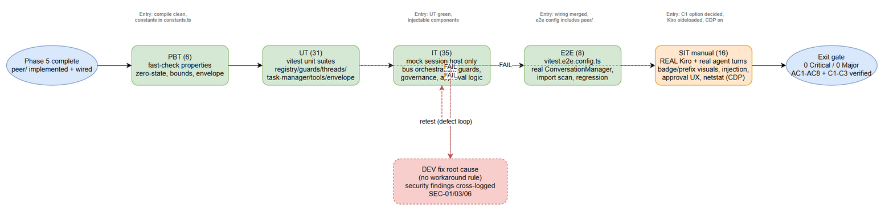

# Software Test Plan (STP)

## Pi Chatbox Extension — SA4E-369: Intra-instance agent-to-agent messaging between chatbox tabs (local PeerBus, zero-config)

---

## Document Information

| Field | Value |
|-------|-------|
| Jira Ticket | SA4E-369 |
| Title | Intra-instance agent-to-agent messaging between chatbox tabs (local PeerBus, zero-config) |
| Author | QA Agent |
| Version | 1.0 |
| Date | 2026-10-20 |
| Status | Draft |
| Related BRD | documents/SA4E-369/BRD.md (v1.0) |
| Related FSD | documents/SA4E-369/FSD.md (v1.2 — ground-truth harmonized, D1 consumed-as-is) |
| Related TDD | documents/SA4E-369/TDD.md (v1.1 — security-amended: PEER_001–010, bounds, §7.6 provenance/approval) |
| Related UI Spec | documents/SA4E-369/UI-SPEC.md (v1.0 — badge, transcript prefix, peer list panel) |
| Related Security Review | documents/SA4E-369/SECURITY-REVIEW.md (v1.0 — GO-WITH-CONDITIONS, blocking conditions C1–C3) |
| Manual Test Guide | documents/KB/MANUAL-TEST-GUIDE.md (SIT evidence discipline: file:line, screenshots, no fabrication) |

---

## Revision History

| Version | Date | Author | Changes |
|---------|------|--------|---------|
| 1.0 | 2026-10-20 | QA Agent | Initiate document — derived from BRD v1.0 (AC1–AC8), FSD v1.2 (UC-1..6, BR-1..15), TDD v1.1 (PEER_001–010, bounds, §7.6 L1/L2/L3), UI-SPEC v1.0, SECURITY-REVIEW C1–C3 |

---

## Sign-Off

| Name | Signature and date |
|------|--------------------|
| | ☐ I agree and confirm the test plan in this STP |
| | ☐ I agree and confirm the test plan in this STP |

---

## 1. Introduction

### 1.1 Purpose

This Test Plan defines the verification strategy for SA4E-369: intra-instance agent-to-agent messaging between chatbox tabs of ONE VS Code extension host (Kiro) via an in-process PeerBus with zero configuration. Test scope covers:

1. The new additive module `extension/src/peer/` (PeerRegistry, PeerBus, PeerTaskManager, AntiLoopGuards, PeerThreadStore, envelope, session tools).
2. Session-host integration — D1 is ALREADY LANDED in `pi-workflow/session-host/` (key `workspaceRoot+tabId`); the peer feature CONSUMES `ensureSessionHost` / `promptTurn` / `evictSessionHost` as-is (FSD v1.2 §3.5.3, DISC-2).
3. Conversation-manager wiring — tab lifecycle (`onTabCreated`/`onTabClosed`) → registry register/deregister (DISC-1).
4. Auto-run delivery (D2) with anti-loop guards (AC3): per-pair cap `maxPingpongTurns=5`, per-tab rate `10/60s`, inbound queue cap 20, thread bound 50 FIFO, blocking timeout 300s, post-terminal retention 60s.
5. Context-governance pass-through (AC5) — no bypass path.
6. UI visibility (AC4): tab badge, transcript prefix `[Peer inbound] from <tab>`, optional peer list panel.
7. Security conditions C1–C3 (SECURITY-REVIEW v1.0): C1 = provenance envelope (L1) + `turnOrigin` (L2) + ToolApprovalGate for peer turns Option A/B (L3); C2 = `PEER_MESSAGE_MAX_CHARS=16000` + PEER_010 pre-creation rejection; C3 = prune-then-check invariant I-6a.

### 1.2 Test Objectives

- **O1** — Verify every acceptance criterion AC1–AC8 with at least one traceable test case.
- **O2** — Verify the complete error matrix PEER_001–PEER_010, including zero-state semantics (send-time rejections create NO task, NO counter change, NO thread entry).
- **O3** — Verify all business rules BR-1..BR-15 and all bounds (cap 5 LOCKED, rate 10/60s, queue 20, thread 50, timeout 300s, retention 60s, message ≤ 16,000 chars).
- **O4** — Verify security conditions C1–C3 end-to-end: peer message injection attempt → provenance envelope shown + approval gate/loadout per option (BOTH options A and B specified independently); oversized 16k+ rejection pre-creation; prune-then-check invariant; envelope spoof attempt (prefix derived from envelope header, never from message content).
- **O5** — Verify negative flows: tab closed mid-task (PEER_009), tab rename continuity, registry/host eviction (`evictSessionHost`), host teardown.
- **O6** — Verify zero-config/no-network (AC7): no new config files/keys, no sockets/ports, all peer state memory-only (BR-12) — automated import scan + real-instance verification.
- **O7** — Verify regression compatibility (AC8): existing suites stay green — reference baseline from hotfix v1.53.9: **389 test files / 3,066 tests green** (current workspace holds 406 `*.test.ts` files under `extension/src`; the actual run count is recorded at TC-800 execution time).

### 1.3 References

| Document | Location |
|----------|----------|
| BRD v1.0 | documents/SA4E-369/BRD.md |
| FSD v1.2 | documents/SA4E-369/FSD.md |
| TDD v1.1 | documents/SA4E-369/TDD.md |
| UI-SPEC v1.0 | documents/SA4E-369/UI-SPEC.md |
| SECURITY-REVIEW v1.0 | documents/SA4E-369/SECURITY-REVIEW.md |
| STATUS.json (D1–D5, AC1–AC8 locked) | documents/SA4E-369/STATUS.json |
| Manual Test Guide | documents/KB/MANUAL-TEST-GUIDE.md |
| STC | documents/SA4E-369/STC.md |
| Test data | documents/SA4E-369/test-data/*.csv |

---

## 2. Test Strategy

### 2.1 Test Levels

SA4E-369 is a VS Code extension feature: **no HTTP endpoints exist** (session tools only, TDD §3) and **the chat UI is a webview** (TDD §11.1 explicitly rules out Playwright; visual QA follows MANUAL-TEST-GUIDE). The standard 6-level model is therefore adapted:

| Level | Scope | Automation | Tools |
|-------|-------|------------|-------|
| PBT | Correctness properties with randomized inputs: zero-state rejection on any guard-rejecting sequence, thread FIFO bound 50 under any append load, rate-window pruning (I-6a) under any evaluate sequence, envelope header always stamped from Registry regardless of message content claims, FIFO queue order under any interleaving, terminal-state closure | ✅ Automated | fast-check (already in devDependencies) + vitest |
| UT | Units: registry (I-1/I-4), guards (BR-7/8/9, I-2, I-6a), threads (I-5), task-manager (state machine §5.4, waiter exactly-once, PEER_006 timer, disposeAll), tools envelopes, message-size (PEER_010 pre-guard), payload mapping (TC-504) | ✅ Automated | vitest — `extension/src/__tests__/peer/*.unit.test.ts` |
| IT | PeerBus orchestration with mocked session host: Tick-1 atomicity, FIFO busy-target queue (BR-6), governance pass-through + PEER_007, guard trips, blocking timeout (fake timers), approval-gate logic Option A/B, event ordering, conversation-manager wiring | ✅ Automated | vitest + `vi.mock(ensureSessionHost)` (proven pattern: `pi-workflow/__tests__/adapter-wiring-session.test.ts`) |
| E2E | In-process extension e2e (real ConversationManager + real module graph; ONLY the model-backed turn is mocked): blocking AC1, async AC2, guard trips AC3, provenance e2e (C1), no-network import scan (AC7), regression sweep (AC8) | ✅ Automated | vitest — `vitest run --config vitest.e2e.config.ts` (`*.e2e.test.ts`) |
| E2E-API | **N/A** — no REST endpoints exist (in-process session tools; D5/NG-2/NG-3) | — | — |
| E2E-UI | **N/A as browser automation** — webview UI; automated coverage = event→payload mapping unit tests (TC-504); visual verification delegated to SIT manual | ❌ Manual | — |
| SIT | Manual on REAL Kiro instance with REAL agent turns: two-tab blocking/async exchanges, badge/transcript visuals, tooltip, peer list panel, injection attempt end-to-end, approval UX (Option A/B), tab close/rename/evict UX, zero-config (no sockets via netstat, no new config entries) | ❌ Manual | Kiro + Chrome DevTools Protocol (CDP) on webview — per documents/KB/MANUAL-TEST-GUIDE.md (evidence: file:line + screenshots) |

**Mock policy (QA-enforced):** only the LLM-backed session turn is mockable (`ensureSessionHost` → fake `promptTurn` returning canned `SessionTurnResult` or throwing governance-shaped errors) — a real model cannot run deterministically in CI. All local infrastructure MUST be real in IT/E2E: ConversationManager (headless `new ConversationManager(10)`), registry/guards/threads/task-manager singletons, vitest fake timers for 60s/300s windows. Tests that mock the local state stores or the bus itself are reclassified as UT. On SIT, NOTHING is mocked — real Kiro, real agent turns.

### 2.2 Test Cases Summary

| Level | Count | Automated | Manual |
|-------|-------|-----------|--------|
| PBT | 6 | 6 | 0 |
| UT | 31 | 31 | 0 |
| IT | 35 | 35 | 0 |
| E2E (in-process extension) | 8 | 8 | 0 |
| E2E-API | 0 | 0 | 0 |
| E2E-UI (browser) | 0 | 0 | 0 |
| SIT (manual, real Kiro + CDP) | 16 | 0 | 16 |
| **Total** | **96** | **80 (83.3%)** | **16 (16.7%)** |

(96 = 83 TCs + 6 PBT properties + 7 SIT supplement scenarios for TCs already automated at IT/E2E. Full case list in STC.md.)

### 2.3 Test Types

| Type | Description | Applicable |
|------|-------------|------------|
| Functional | UC-1..UC-6 main/alternative/exception flows; blocking + async modes; auto-run delivery | Yes |
| Business Rule | BR-1..BR-15 (registration, self-send, guards, reset, governance, bounds, teardown) | Yes |
| Security | C1 injection/provenance/approval (Option A AND Option B), C2 oversized rejection, C3 pruning, envelope spoofing, no-network scan, ownership check, safe error reasons, registry single-source | Yes |
| Regression | AC8: existing suites green (context-governance.*, auto-chunk, session routing, session-host per-tab tests); user-turn path unchanged | Yes |
| Performance | Bus dispatch + guard eval ≤ 50 ms p95; peer_list/peer_status ≤ 1 ms (FSD §8, TDD §8.3) | Yes |
| Usability / UI | Badge increment/clear, transcript prefix + tint, tooltip, peer list panel (SIT manual CDP) | Yes |
| Compatibility | Single instance only — cross-window/machine is NG-1 (out of scope); verified as NEGATIVE (other-window tabId unreachable) | Yes (negative only) |

### 2.4 Test Approach

1. **Automation-first, risk-based.** All deterministic logic (guards, bounds, validation order, state machine, envelopes, payloads) is automated at PBT/UT/IT/E2E. Manual SIT is reserved for what genuinely needs human eyes/real agents: visual badge/prefix behavior, real-model turn exchanges, approval UX, netstat/no-socket evidence, injection defense-in-depth on a real instance.
2. **Zero-state assertion discipline.** Every rejection test (PEER_001/002/004/005/010) asserts BOTH the error envelope AND zero residue: no task in store, no rate-timestamp appended, no thread entry, no badge event.
3. **Options A/B dual-track (C1).** ToolApprovalGate decision is deferred to Phase 5 (user). Test cases are specified for BOTH options independently — TC-107/TC-108 (Option A: full approval gate, approve + reject paths) and TC-109 (Option B: read-only loadout). Phase-6 execution runs the track matching the implemented option; the other track is marked BLOCKED (not failed).
4. **Evidence discipline (MANUAL-TEST-GUIDE).** Every SIT result carries file:line or screenshot evidence; results recorded in `documents/SA4E-369/TEST-REPORT-SA4E-369.csv`; no fabricated outcomes.
5. **Fake timers for time-based bounds.** Rate window (60s), blocking timeout (300s), post-terminal retention (60s) are exercised with `vi.useFakeTimers()` — no real waiting in CI.
6. **Traceability.** Every test case cites AC/UC/BR/PEER_0xx/SEC IDs; RTM in STC §12 must show 100% coverage.

### 2.5 Entry Criteria

| Level | Entry Criteria |
|-------|---------------|
| PBT/UT | `peer/` modules compiled (`npm run compile` clean); constants per TDD §5.1 in `peer/constants.ts`; types per TDD §4.2 |
| IT | UT green; PeerBus/TaskManager constructor-injectable (TDD §5.6); mock session host helper available |
| E2E | IT green; conversation-manager wiring (`onTabCreated`/`onTabClosed`) and `registerPeerTools` merged; `vitest.e2e.config.ts` includes `__tests__/peer/` |
| SIT | E2E green; Kiro instance with the extension sideloaded; workspace with ≥2 openable chat tabs; CDP debugging enabled; C1 option (A or B) decided and implemented; STC test data CSVs loaded |

### 2.6 Exit Criteria

| Level | Exit Criteria |
|-------|--------------|
| PBT/UT/IT/E2E | 100% executed, 100% pass, no skipped security cases (C1/C2/C3 all exercised) |
| SIT | 100% of the 16 manual scenarios executed with evidence; 0 Critical, 0 Major open; ≤2 Minor open with workaround documented |
| Feature gate | AC1–AC8 all verified; PEER_001–010 all verified; C1–C3 all verified (chosen option); AC8 regression baseline green (≥ v1.53.9 reference: 389 files / 3,066 tests) |


*[Edit in draw.io](diagrams/qa-test-execution-flow.drawio)*

---

## 3. Test Scope

### 3.1 Features In Scope

| # | Feature / Story | Priority | FSD Reference | Test Type |
|---|----------------|----------|---------------|-----------|
| 1 | Peer registration & discovery — peer_list(), auto register/deregister (BR-1, BR-2) | High | UC-1, FR-1 | Functional + UT |
| 2 | Blocking peer task exchange — peer_send(async=false), zero config (AC1) | High | UC-2, FR-2 | Functional + IT/E2E/SIT |
| 3 | Async dispatch + polling — peer_send(async=true) + peer_status to terminal (AC2) | High | UC-3, FR-3 | Functional + IT/E2E/SIT |
| 4 | Auto-run delivery with anti-loop guards — cap 5 LOCKED, rate 10/60s, both-tabs-functional (AC3) | High | UC-4, FR-4 | Functional + IT/E2E |
| 5 | Per-tab session isolation — workspaceRoot+tabId, per-tab tokens/compaction, no 'default' (AC6, D1 consumed-as-is) | High | UC-5, FR-5 | Functional + IT/SIT |
| 6 | Context governance pass-through — budget gate, auto-chunk, intra-turn guard, no bypass (AC5) | High | UC-4, FR-6 | Functional + IT |
| 7 | Peer activity visibility — badge, transcript prefix, tooltip, peer list panel (AC4) | High | UC-6, FR-7 | UI (payload UT + SIT manual) |
| 8 | Zero-config & no-network — no config files/keys, no sockets, memory-only state (AC7, BR-12) | High | FR-8 | Security + E2E scan + SIT |
| 9 | Error matrix PEER_001–PEER_010 with zero-state rejection | High | §9.1, TDD §5.8 | Exception + UT/IT |
| 10 | Security conditions C1–C3 (envelope, turnOrigin, approval gate Option A/B, 16k bound, I-6a) | High | TDD §7.6, §7.4, §4.3 | Security + IT/E2E/SIT |
| 11 | Bounded structures — queue 20, thread 50 FIFO, timeout 300s, retention 60s | Medium | FR-9, BR-11/13 | Boundary + UT/PBT |
| 12 | Negative lifecycle — tab close mid-task, tab rename, registry evict, host teardown | Medium | UC-5, §6.4 | Negative + IT/SIT |
| 13 | Regression compatibility — existing suites green (AC8) | High | FR-10 | Regression |

### 3.2 Features Out of Scope

| # | Feature | Reason |
|---|---------|--------|
| 1 | Cross-machine / cross-window transport | Non-goal NG-1/D5 — pi-a2a's job; only contract shape preserved (negative test only) |
| 2 | mDNS / HTTP / gateway transport of any kind | Non-goal NG-2/D5 |
| 3 | Network sockets, ports, tokens, new config keys | Non-goal NG-3/AC7 — verified absent, not tested as features |
| 4 | Replacing pi-subagents or acp_delegate | Non-goal NG-4 |
| 5 | Human inbox approval for peer tasks (as a delivery model) | Superseded by auto-run D2; approval exists ONLY as C1-L3 security gate |
| 6 | Persistence of peer tasks/threads/registry | NG-6/BR-12 — in-memory only; verified absent |
| 7 | pi-a2a runtime behavior | Related ticket KSA-240 — contract-shape comparison only (D4), no runtime dependency |
| 8 | VS Code webview postMessage bridge security; provider API-key handling | Pre-existing infrastructure outside feature scope (SECURITY-REVIEW §B) |
| 9 | Real-LLM answer quality of peer turns | Model behavior, not feature logic — SIT verifies plumbing, not answer correctness |
| 10 | SEC-02 visibility toggle UI polish | Optional post-MVP (TDD §7.7); PEER_001-masking behavior tested (TC-610), panel polish out of scope |

---

## 4. Test Environment

### 4.1 Environment Requirements

| Environment | Location | Purpose |
|-------------|----------|---------|
| DEV (automated) | Local workspace, `extension/` — vitest `test:unit` + `test:e2e` | PBT/UT/IT/E2E — no VS Code host needed (headless ConversationManager, mock session host) |
| SIT (manual) | Real Kiro instance, extension sideloaded from local build; workspace with `.pi/` support and ≥2 chat tabs | Real agent turns, UI visuals, CDP webview inspection, netstat verification |

### 4.2 Browser / Device Requirements

| Component | Version | OS | Required |
|-----------|---------|-----|----------|
| Kiro / VS Code host | current internal build (extension compatible) | Windows (dev machines) | Yes (SIT) |
| CDP debugging | webview inspector via Chrome DevTools Protocol (puppeteer-core already shipped in extension deps) | Windows | Yes (SIT evidence) |
| Node.js | ≥ 18 (vitest 4.1.8) | Windows | Yes (DEV) |

### 4.3 Test Data Requirements

| Data Type | Description | Source | File |
|-----------|-------------|--------|------|
| Pre-seeded tabs | tabA (coder, idle), tabB (reviewer, idle), tabC (orchestrator, busy-capable) — UUID tabIds, agentName/role/capabilities/model | CSV → ConversationManager setup | test-data/pre-seeded-tabs.csv |
| peer_send payloads | valid/invalid targets, boundary sizes (16,000 / 16,001 / 10× oversized), empty message | CSV | test-data/peer-send-testdata.csv |
| Guard sequences | ping-pong chains (5th/6th), rate bursts (10th/11th), queue fill (20/21), reset triggers | CSV | test-data/peer-guard-testdata.csv |
| peer_status cases | known/unknown taskId, non-owner access, poll-to-terminal | CSV | test-data/peer-status-testdata.csv |
| Security payloads | injection attempt text, envelope spoof content, oversized 16k+, safe-error probes | CSV | test-data/security-testdata.csv |
| Lifecycle scenarios | tab close mid-task, rename, evict, teardown | CSV | test-data/lifecycle-testdata.csv |

Placeholders `{tabA}`, `{tabB}`, `{taskId}` are resolved at runtime (UUID v4 generated by ConversationManager / PeerTaskManager — never hardcoded).

### 4.4 External Dependencies

| System | Dependency | Mock/Stub Available |
|--------|-----------|---------------------|
| LLM provider (model turns) | Required only for SIT real exchanges | Yes — IT/E2E mock `ensureSessionHost` with fake `promptTurn` (TDD §11.3); SIT uses real model |
| VS Code extension host | SIT only | No — real instance required |
| Network / DB | **None by design (AC7/BR-12)** — absence itself is a verified property (TC-307, TC-609, SIT-04) | N/A |

---

## 5. Test Schedule

| Phase | Start | End | Duration | Milestone |
|-------|-------|-----|----------|-----------|
| Test Planning (Phase 4) | 2026-10-20 | 2026-10-20 | 0.5 d | STP + STC + test data + diagram delivered |
| Implementation support (Phase 5) | after DEV start | DEV complete | — | QA reviews test-suite implementation vs STC (IT level: real deps, no illegal mocks) |
| Automated execution (Phase 6) | DEV complete | +1 d | 1 d | PBT/UT/IT/E2E 100% green |
| SIT manual execution (real Kiro + CDP) | +1 d | +2 d | 2 d | 16 SIT scenarios executed with evidence |
| Defect fix & retest | +2 d | +3 d | 1 d | 0 Critical/Major open |
| Test report & sign-off | +3 d | +3 d | 0.5 d | TEST-REPORT v1.0, AC gate pass |

---

## 6. Resources & Responsibilities

| Role | Name | Responsibility |
|------|------|---------------|
| Test Lead | QA Agent | STP/STC authorship, execution coordination, TEST-REPORT, quality gate |
| QA Engineer | QA Agent | Automated suites review (IT mock discipline), SIT manual execution with CDP evidence |
| BA | ba-agent | AC/BR clarification, test-planning business coverage review (review gate) |
| Developer | dev-agent | Bug fixing, unit test implementation per TDD §11.2 suite list |
| SA | sa-agent | Design clarification (guards/envelope/approval-gate wiring) |
| Security | security-agent | Re-verification of C1–C3 closures at Phase 6 |
| SM | sm-agent | Orchestration, Jira updates, KB ingest |

Tools: vitest 4.1.8 (+ fast-check), vi.mock + fake timers, Kiro + CDP (puppeteer-core), TEST-REPORT-SA4E-369.csv for execution tracking.

---

## 7. Risk & Mitigation

| # | Risk | Impact | Likelihood | Mitigation |
|---|------|--------|------------|------------|
| 1 | C1 L3 option (A vs B) undecided until Phase 5 | Test execution blocked on one track | High | Dual-track cases specified (TC-107/108 vs TC-109); run matching track, mark other BLOCKED |
| 2 | Approval-gate wiring gap in session-host path (create-host.ts:149-172 — verified ungated) | C1 cannot close; High finding stays open | Medium | TC-602/peer-provenance.e2e asserts gate routing; DEV must wire `createToolApprovalGateHandler` per TDD §6.1; gap logged against D1/SA4E-370 |
| 3 | Guard constants drift (cap 5 LOCKED, others tunable) | Wrong bounds tested | Medium | All bounds read from `peer/constants.ts` in tests; TC-302 asserts cap==5 explicitly |
| 4 | Fake-timer drift across rate/timeout/retention windows | Flaky time-based tests | Medium | Single `vi.useFakeTimers()` harness per suite; advance deterministically; no real sleeps |
| 5 | Real-model SIT turns slow / nondeterministic | SIT schedule slip | Medium | SIT asserts plumbing (delivery, badge, prefix, guards), not answer quality; use short prompts |
| 6 | Regression baseline drift (v1.53.9: 389 files/3,066 tests vs current 406 files) | False AC8 alarms | Low | TC-800 records actual counts at run time; compare against pre-change baseline captured on the feature branch |
| 7 | CDP webview inspection instability (webview teardown on reload) | Evidence loss | Medium | Capture screenshots immediately; re-attach CDP per scenario; MANUAL-TEST-GUIDE evidence rules |
| 8 | `peer/` module absent (design phase) | Nothing executable to test yet | Certain (now) | Phase-4 gate = planning artifacts; execution gated on DEV completion (entry criteria §2.5) |

---

## 8. Defect Management

### 8.1 Severity Levels

| Severity | Definition | Example (SA4E-369) |
|----------|-----------|--------------------|
| Critical | Feature takes tabs/host down; governance bypass; injection reaches tool execution ungated | Peer turn executes destructive tool with no approval under Option A; governance bypass path exists |
| Major | Feature not working, workaround exists | PEER_004 not tripped at 6th turn; oversized message enters chunk loop (C2 breach); badge never shown |
| Minor | Degraded behavior, cosmetic | Tooltip text mismatch; badge clears late; thread eviction off-by-one under load |
| Trivial | Typo, alignment | Log field naming, doc typo |

### 8.2 Priority Levels

| Priority | Definition | SLA (Fix Time) |
|----------|-----------|----------------|
| P1 | Security condition C1–C3 breach; guard failure; both-tabs-broken | 4 hours |
| P2 | AC1–AC8 unmet; error matrix wrong; regression red | 1 business day |
| P3 | UI polish, NFR target miss (≤50 ms budget) | 3 business days |
| P4 | Nice to fix | Next release |

### 8.3 Defect Lifecycle

```
New → Open → In Progress → Fixed → Ready for Retest → Verified → Closed
                                                    → Reopened → In Progress
```

Security findings affecting C1–C3 are also cross-logged against SECURITY-REVIEW.md remediation priority (SEC-01, SEC-03, SEC-06).

---

## 9. Test Metrics & Reporting

### 9.1 Metrics

| Metric | Formula | Target |
|--------|---------|--------|
| Test Execution Rate | Executed / Total × 100% | 100% (96 items) |
| Pass Rate | Passed / Executed × 100% | ≥ 95% (0 for security C1–C3 cases) |
| AC Coverage | ACs with ≥1 executed pass / 8 | 100% |
| Error-Matrix Coverage | PEER codes verified / 10 | 100% |
| Defect Density | Defects / Test Cases | ≤ 0.1 |
| Regression Stability | Existing suites green / total suites | 100% (baseline v1.53.9: 389 files / 3,066 tests) |
| Automation Ratio | Automated / Total | ≥ 80% (planned 83.3%) |

### 9.2 Reporting Schedule

| Report | Frequency | Audience | Location |
|--------|-----------|----------|----------|
| Execution tracking (SIT) | Per scenario | QA + SM | documents/SA4E-369/TEST-REPORT-SA4E-369.csv |
| Automated suite results | Per CI run | QA + DEV | vitest output (+ coverage optional) |
| Test Completion Report | End of Phase 6 | All stakeholders | documents/SA4E-369/TEST-REPORT.md (per template) |
| Defect summary | Daily during fix cycle | DEV + SM | RUN-LOG.md (SM-managed) |

---

## 10. Appendix

### 10.1 Test Suite Mapping (TDD §11.2 ↔ levels)

| Planned suite (`extension/src/__tests__/peer/`) | Level | Covers |
|--------------------------------------------------|-------|--------|
| registry.unit.test.ts | UT | TC-300, TC-301, TC-411, TC-412 |
| guards.unit.test.ts | UT | TC-302, TC-303, TC-304(UT half), TC-402, TC-410 |
| threads.unit.test.ts | UT | TC-306, TC-403, TC-414 |
| task-manager.unit.test.ts | UT | TC-205(state machine), TC-404, TC-413, TC-212(waiters) |
| tools.unit.test.ts | UT | TC-003, TC-200, TC-201, TC-207, TC-209, TC-210, TC-607, TC-610 |
| envelope.unit.test.ts | UT | TC-007(UT half), TC-603(logic), PBT-04 |
| message-size.unit.test.ts | UT | TC-209, TC-210, TC-400, TC-604 |
| no-network.e2e.test.ts | E2E | TC-307, TC-609 |
| bus.integration.test.ts | IT | TC-004, TC-005, TC-100, TC-101, TC-103, TC-104, TC-105, TC-106, TC-202, TC-206, TC-304, TC-305, TC-308, TC-310, TC-401, TC-409, TC-608 |
| governance-passthrough.it.test.ts | IT | TC-206, TC-305, TC-702 |
| peer-bus.e2e.test.ts | E2E | TC-001, TC-002, TC-504(payload assertions) |
| peer-guards.e2e.test.ts | E2E | TC-203, TC-204 |
| peer-provenance.e2e.test.ts | E2E | TC-602 (+ TC-107/108/109 logic) |
| peer-regression.e2e.test.ts | E2E | TC-800, TC-801 |
| PBT properties (property-* or inside unit suites) | PBT | PBT-01..PBT-06 |
| SIT manual scenarios (this plan §2.2) | SIT | SIT-01..SIT-16 |

### 10.2 Glossary

| Term | Definition |
|------|------------|
| PBT | Property-Based Testing (fast-check randomized inputs) |
| IT | Integration test — real peer components, mocked LLM session turn only |
| E2E | In-process extension e2e via vitest.e2e.config.ts |
| SIT | System Integration Testing — manual, real Kiro instance + CDP |
| Zero-state rejection | Guard/validation failure creating no task, no counter change, no thread entry (I-2/I-7) |
| C1/C2/C3 | Blocking security conditions from SECURITY-REVIEW v1.0 |
| CDP | Chrome DevTools Protocol — webview inspection for SIT evidence |

### 10.3 Assumptions

- D1 per-tab session host is LANDED and its existing tests (per-tab-session.test.ts) keep passing — peer feature consumes it as-is (DISC-2).
- ConversationManager works headless (`new ConversationManager(10)`) for automated tests (TDD §11.3).
- Option A vs B for C1-L3 is decided before SIT; both tracks are specified in STC.
- The reference regression baseline (389 files / 3,066 tests, hotfix v1.53.9) is used as the AC8 floor; actual current counts are recorded at execution.

*End of STP — SA4E-369 v1.0 (2026-10-20)*

