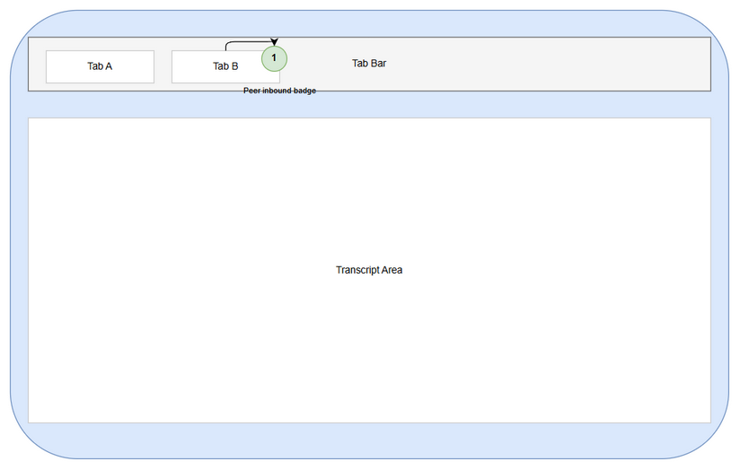
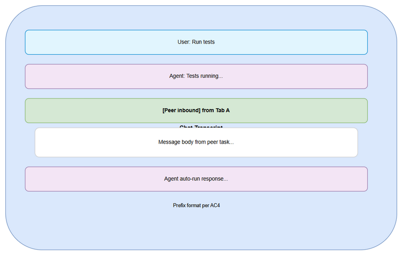
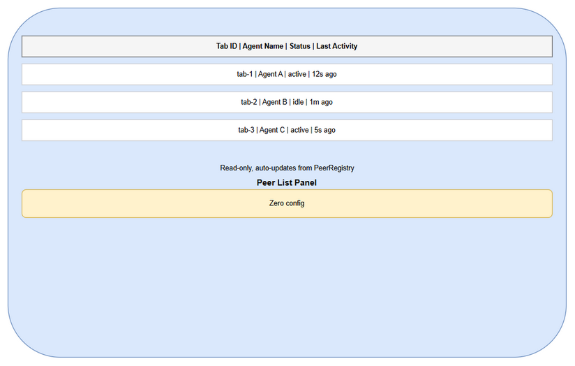
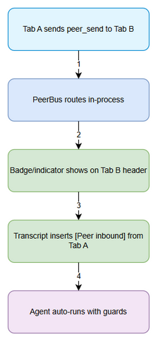

# UI Specification — SA4E-369 Intra-instance Agent-to-Agent Messaging

## Overview
UI changes required to make peer-inbound activity visible per AC4 and design decisions D1-D5 locked. Zero new config files, zero network exposure. All UI elements reuse existing chatbox layout patterns.

## Design Constraints
- Frontend stack: VS Code WebView chatbox (existing)
- Design system: existing chat UI, no new theme variables
- Zero-config: no new settings UI
- Reuse existing components: ChatPanel, Transcript, TabBar, Badge, Tooltip

## Screens / Components Affected

### 1. Chat Tab Header / Tab Bar
**Purpose:** Show inbound peer activity via badge/indicator.

**UI Elements:**
- Tab label (existing)
- Peer inbound badge (new): small circular indicator or numeric badge on tab
- Peer status icon (optional): dot color = active/idle

**Behavior:**
- On receiving peer message, badge increments/counters for that tab
- Badge clears on user focus / ack
- Tooltip on hover: "Inbound from Tab X"

**Implementation Notes:**
- Reuse existing Badge component
- Position: top-right of tab pill

### 2. Transcript Message Rendering
**Purpose:** Distinguish peer-inbound messages.

**UI Elements:**
- Message bubble / row
- Prefix text: `[Peer inbound] from <tabId>`
- Optional sender avatar/icon

**Behavior:**
- Peer messages auto-insert into transcript with prefix
- Styling: subtle background tint to differentiate from user/agent messages
- No user interaction required (auto-run per D2)

### 3. Peer List / Status Panel (Optional Visibility)
**Purpose:** Allow users to see active peers in instance.

**UI Elements:**
- Collapsible side panel or dropdown showing peer registry entries
- Columns: Tab ID, Agent Name, Status, Last Activity

**Behavior:**
- Read-only, auto-updates on PeerRegistry changes
- Zero configuration

## Wireframes

*[Edit in draw.io](diagrams/wireframe-chat-tab-header-badge.drawio)*

*[Edit in draw.io](diagrams/wireframe-transcript-peer-inbound.drawio)*

*[Edit in draw.io](diagrams/wireframe-peer-list-panel.drawio)*

*[Edit in draw.io](diagrams/wireframe-user-flow.drawio)*

## UI Specifications per AC4
- AC4 Visibility: badge/indicator + transcript prefix `[Peer inbound] from <tab>`
- No new config UI
- Consistent with existing chat UI patterns

## Implementation Handoff Notes
### Reuse
- ChatPanel container
- Transcript rendering pipeline
- TabBar component

### New Visual Elements
- Badge indicator CSS class: `.peer-inbound-badge`
- Message prefix rendering logic in transcript renderer

### State
- Page state: inboundPeerCount per tab, peerRegistry snapshot
- API: peer_list() for panel, peer_status(taskId) for badge clearing

### Responsive
- Desktop primary, WebView width adapts

## Diagram Index

| # | Diagram | Image | Source |
|---|---------|-------|--------|
| 1 | Chat Tab Header Badge | [wireframe-chat-tab-header-badge.png](diagrams/wireframe-chat-tab-header-badge.png) | [wireframe-chat-tab-header-badge.drawio](diagrams/wireframe-chat-tab-header-badge.drawio) |
| 2 | Transcript Peer Inbound | [wireframe-transcript-peer-inbound.png](diagrams/wireframe-transcript-peer-inbound.png) | [wireframe-transcript-peer-inbound.drawio](diagrams/wireframe-transcript-peer-inbound.drawio) |
| 3 | Peer List Panel | [wireframe-peer-list-panel.png](diagrams/wireframe-peer-list-panel.png) | [wireframe-peer-list-panel.drawio](diagrams/wireframe-peer-list-panel.drawio) |
| 4 | User Flow | [wireframe-user-flow.png](diagrams/wireframe-user-flow.png) | [wireframe-user-flow.drawio](diagrams/wireframe-user-flow.drawio) |
