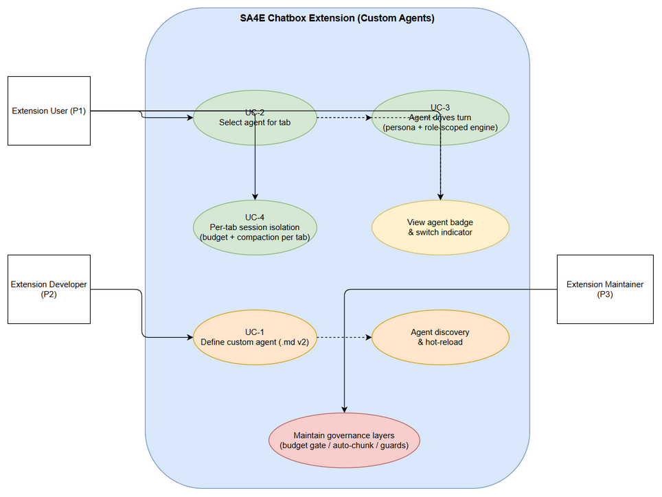
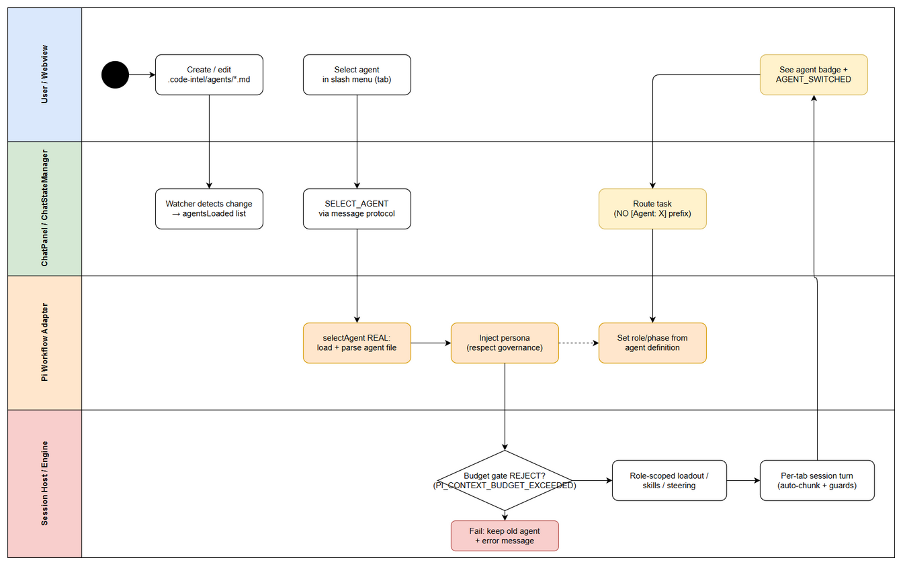
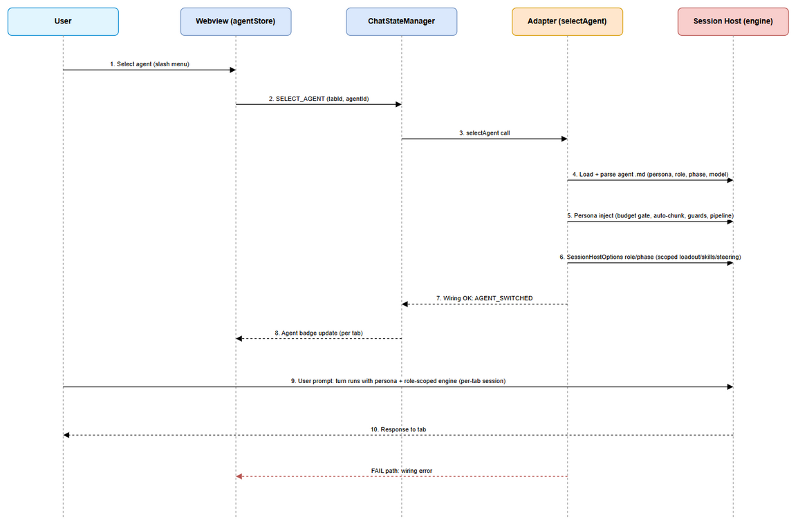

# Business Requirements Document (BRD)

## SDLC Agents 4 Enterprise — SA4E-370: Custom Agents — real file-defined agent personas wired into the chat engine (identity, role scoping, per-tab sessions)

---

## Document Information

| Field | Value |
|-------|-------|
| Jira Ticket | SA4E-370 (Epic, High) |
| Title | Custom Agents — real file-defined agent personas wired into the chat engine (identity, role scoping, per-tab sessions) |
| Author | BA Agent |
| Version | 1.0 |
| Date | 2026-10-18 |
| Status | Draft |
| Child Story | SA4E-369 (Intra-instance PeerBus — parent-linked to this Epic) |

---

## Author Tracking

| Role | Name - Position | Responsibility |
|------|-----------------|----------------|
| Author | BA Agent – Business Analyst | Create document |
| Peer Reviewer | Duc Nguyen Minh – Product Owner (Reporter) | Review document |

---

## Revision History

| Version | Date | Author | Changes |
|---------|------|--------|---------|
| 1.0 | 2026-10-18 | BA Agent | Initiate document — auto-generated from Jira tickets SA4E-370 (Epic) + SA4E-369 (child Story), verified code evidence (code exploration 2026-10-18), and KB entries #706/#707 |

---

## Sign-Off

| Name | Signature and date |
|------|--------------------|
| | ☐ I agree and confirm all criteria on this BRD as expected requirements |
| | ☐ I agree and confirm all criteria on this BRD as expected requirements |

---

## 1. Introduction

### 1.1 Vision / Problem Statement

Hiện tại chatbox của VS Code extension chỉ có "custom agent" **COSMETIC**:

- Agent là file markdown user-definable `.code-intel/agents/*.md` (YAML frontmatter `name`, `description`) — parse tại `chat-panel/ChatStateManager/fs-helpers.ts:105-121` (`readAgentInfos`).
- Chọn agent trong UI (slash menu SA4E-186, hot-reload SA4E-189) **KHÔNG thay đổi gì trong engine**: `selectAgent` là STUB (`pi-workflow/pi-workflow-adapter/adapter-core.ts:159-162` — chỉ emit `chat:agentSwitched`); selection chỉ là text prefix `[Agent: ${agentName}] ${task}` (`chat-panel/message-routing.ts:66`); engine role **hardcoded `'sm-agent'`** mỗi turn (`pi-workflow/pi-workflow-adapter/adapter-legacy-turns.ts:83`).
- **MỘT** `AgentSession` shared per `workspaceRoot` (`pi-workflow/session-host/registry.ts` keyed by `workspaceRoot` only) — tabs chỉ là history buckets (`pi-workflow/pi-workflow-state-store.ts`), chia sẻ cùng một "bộ não".
- Agent `.md` body (nội dung persona) **không được engine dùng** — chỉ parse frontmatter.

**Vision:** Epic này giao **REAL custom agents**: file-defined agent điều khiển (1) persona = system prompt, (2) role-scoped tool/skill loadout, (3) per-tab session riêng. Đây là **agent-identity layer** mà intra-instance PeerBus (SA4E-369) và SDLC multi-agent pipeline phụ thuộc.

### 1.2 Objectives & Measurable Goals

| # | Objective | Measurable Goal |
|---|-----------|-----------------|
| O1 | Persona thật thay cho cosmetic | 100% lượt chọn agent → engine dùng persona body làm system prompt context; không còn cơ chế prefix `[Agent: X]` là cơ chế chính |
| O2 | Role scoping effective | `SessionHostOptions.role/phase` lấy từ agent definition; 0 turn chạy với hardcoded `'sm-agent'` khi agent khác được chọn; tool loadout / skills / steering thay đổi theo role |
| O3 | Session isolation per tab | Mỗi tab có `AgentSession` riêng (registry key `workspaceRoot+tabId`); per-tab token accounting + compaction; 0 leak history giữa tabs |
| O4 | UI truthfulness | Agent badge per tab + switch indicator phản ánh đúng agent active; AGENT_SWITCHED only sau khi engine đã wire xong |
| O5 | Context governance intact | 100% turns (kể cả có persona injection) đi qua budget gate / auto-chunk / TurnBudgetGuard / context pipeline — 0 bypass |
| O6 | Zero regression | Existing suites green: `role-scope-wiring.test.ts`, `tool-loadout-roles.test.ts`, `context-governance.*`, auto-chunk, session routing tests |

### 1.3 Scope

Bổ sung vào extension chatbox (extension/src):

1. **S1 — Agent definition format v2**: `.code-intel/agents/*.md` thêm persona body semantics (system prompt section, role, phase defaults, model override optional); mở rộng parser trong `chat-panel/ChatStateManager/fs-helpers`.
2. **S2 — selectAgent real wiring**: agent switch load file, inject persona vào session context (respecting skeleton/governance), set `SessionHostOptions.role/phase` từ agent definition thay vì hardcode `'sm-agent'` (`adapter-legacy-turns.ts:83`).
3. **S3 — Per-tab / per-agent session isolation**: registry keying + per-tab budget/compaction. **Locked coordination rule: S3 tại đây = D1 trong SA4E-369 (per-tab sessions) — design ONCE, không duplicate.**
4. **S4 — UI truthfulness**: agent switch indicator, per-tab agent badge, per-agent conversation identity trong history.

### 1.4 Out of Scope (Non-Goals)

| # | Non-Goal | Lý do |
|---|----------|-------|
| NG-1 | Cross-machine agent calls (`@bacnh85/pi-a2a`) | Track riêng. PeerBus tool signatures giữ shape-compatibility với `a2a_call`/`a2a_status` để sau này swap transport không đổi contract |
| NG-2 | Thay thế `pi-subagents` parent→child delegation / `acp_delegate` | Feature bổ trợ, không thay thế |
| NG-3 | MCP tool registration | Track riêng SA4E-364 |
| NG-4 | PeerBus tab↔tab messaging (peer_list / peer_send / peer_status, auto-run delivery) | SA4E-369 thực hiện; epic này chỉ deliver prerequisite S3 + agent identity cho peer registry |
| NG-5 | Human inbox approval flow cho peer tasks | SA4E-369 đã chốt D2 = AUTO-RUN (locked by user) |
| NG-6 | UI chính thức quản lý agent (editor form) | Agent vẫn là file-based; UI chỉ đọc + hiển thị |

### 1.5 Preliminary Requirements

- Building blocks đã có (verified): agent definition format + parser (`fs-helpers.ts:105-121`), hot-reload watcher (`dir-watchers.ts:60-70`, SA4E-189), UI selection dual-path (`chat:agentsLoaded` `ChatStateManager.ts:108-117`, slash menu `SlashMenuController.ts:51`, messages `SELECT_AGENT`/`AGENT_SWITCHED` `chat/types/messages.ts:98,115,146` + `chat-panel/message-protocol.ts:82`, SA4E-186).
- Role-aware engine mechanisms ĐÃ BUILD nhưng chưa wire cho user agents (SA4E-355): `loadout.ts:69-76` `buildSessionToolLoadout`, `create-host.ts:103` `applyScopedSkills`, `create-host.ts:123` `scopedSteering`; tests `role-scope-wiring.test.ts`, `tool-loadout-roles.test.ts`.
- OS-aware base loadout (SA4E-336) đã có.

---

## 2. Business Requirements

### 2.1 High Level Process Map

Custom-agent lifecycle: **(1) Định nghĩa agent** (developer tạo `.code-intel/agents/*.md`) → **(2) Discovery & hot-reload** (watcher re-send agent list lên webview) → **(3) Chọn agent cho tab** (user chọn trong slash menu → SELECT_AGENT) → **(4) Engine wiring** (adapter load file, inject persona respecting governance, set role/phase) → **(5) Turn thực thi** (role-scoped loadout/skills/steering + per-tab session) → **(6) UI truthfulness** (badge + indicator đúng agent per tab).

*[Edit in draw.io](diagrams/use-case.drawio)*

*[Edit in draw.io](diagrams/business-flow.drawio)*

*[Edit in draw.io](diagrams/sequence-select-agent-turn.drawio)*

### 2.2 List of Functional Requirements (refined from candidate stories S1–S4, MoSCoW)

| # | FR | Summary | Story | Priority |
|---|-----|---------|-------|----------|
| FR-01 | Persona body semantics | Agent `.md` body = persona (system prompt content) được engine sử dụng | S1 | MUST |
| FR-02 | Extended frontmatter | Frontmatter mở rộng: `role`, `phase` defaults, `model` override (optional) | S1 | MUST |
| FR-03 | Backward compatibility | Agent file cũ (chỉ `name`+`description`) vẫn load được; thiếu role → fallback mặc định | S1 | MUST |
| FR-04 | Hot-reload mở rộng | Thay đổi file agent (kể cả extended fields) propagate ngay lên webview | S1 | SHOULD |
| FR-05 | Real selectAgent | `selectAgent` đọc + parse agent file thật (không còn stub emit-only) | S2 | MUST |
| FR-06 | Persona injection | Persona inject vào session context respecting skeleton/context governance | S2 | MUST |
| FR-07 | Role/phase từ definition | `SessionHostOptions.role/phase` set từ agent definition (bỏ hardcode `'sm-agent'` `adapter-legacy-turns.ts:83`) | S2 | MUST |
| FR-08 | Role-scoped engine effective | Tool loadout / skills / steering scoping phản ánh role của agent đang active | S2 | MUST |
| FR-09 | Per-tab session isolation | Registry key `workspaceRoot+tabId`; mỗi tab một AgentSession | S3 | MUST |
| FR-10 | Per-tab budget & compaction | Per-tab token accounting + compaction; bỏ hardcode `tabId="default"` (`context-compaction.ts:24`, `context-usage.ts:50,127`) | S3 | MUST |
| FR-11 | UI truthfulness | Agent badge per tab + agent switch indicator; AGENT_SWITCHED chỉ phát sau khi wiring thành công | S4 | MUST |
| FR-12 | Per-agent conversation identity | Conversation history gắn agent identity (per-agent conversation identity trong history) | S4 | SHOULD |
| FR-13 | Model override runtime | `model` override áp dụng ở session host khi hợp lệ; invalid → default + warning | S1/S2 | COULD |

**MoSCoW count: MUST = 10, SHOULD = 2, COULD = 1 (tổng 13 FRs).**

### 2.3 Details of User Stories

---

#### STORY 1 (S1): Agent definition format v2

> As an extension developer, I want to define an agent as a markdown file with persona body semantics (system prompt section, role, phase defaults, optional model override) so that the agent's identity is fully described in one file and the engine can consume it.

**Requirement Details:**

1. `.code-intel/agents/*.md` body được hiểu là persona (system prompt content) — FR-01, FR-02
2. Frontmatter v2: `name`, `description` (hiện có) + `role`, `phase`, `model` (optional) — FR-02
3. Parser trong `fs-helpers` mở rộng, backward compatible — FR-03
4. Hot-reload propagate extended fields — FR-04
5. `model` override áp dụng ở session host khi hợp lệ — FR-13

**Data Fields:**

| Field | Type | Required | Description | Example |
|-------|------|----------|-------------|---------|
| name | string | Yes | Tên agent (frontmatter, hiện có) | qa-agent |
| description | string | Yes | Mô tả agent (frontmatter, hiện có) | QA Engineer agent |
| role | string | No | Role của agent dùng cho loadout/skills/steering scoping | qa-agent |
| phase | string | No | Phase default cho session (pipeline phase) | testing |
| model | string | No | Model override (optional) | gpt-4o-mini |
| body (persona) | markdown | Yes | Nội dung persona = system prompt content | "You are the QA agent..." |

**Acceptance Criteria:**

1. Agent file có persona body → parser trả về đủ {id, name, description, role, phase, model, personaBody}
2. Agent file cũ (chỉ name+description) vẫn load — role/phase/model để trống, fallback mặc định
3. Invalid frontmatter → file bị skip khỏi agent list + log diagnostic, không crash (BR-04)
4. Sửa file agent khi extension đang chạy → agent list trên webview cập nhật (hot-reload)

**UI Specifications:**

| No. | Name | Type | Required | Description | Note |
|-----|------|------|----------|-------------|------|
| 1 | Agent List (slash menu) | List | Yes | Hiển thị name + description từ agent files | `SlashMenuController.ts:51` |
| 2 | Agent Badge | Badge | Yes | Hiển thị agent active trên tab | FR-11 |

**Validation Rules:**

- `role` ∈ tập role hợp lệ của role-scoping (SA4E-355 role matrix); giá trị lạ → fallback + warning
- `model` phải là model được hỗ trợ; invalid → bỏ qua override, dùng default (BR-03)
- Frontmatter YAML phải parse được; body không rỗng khi khai báo persona

**Error Handling:**

- File không parse được: skip khỏi danh sách + log; không làm sập agent discovery
- Role/model không hợp lệ: fallback an toàn + warning log

---

#### STORY 2 (S2): Real selectAgent wiring — persona + role vào engine

> As an extension user, I want selecting an agent in a tab to actually wire that agent's persona and role into the engine so that my conversation is truly driven by the chosen agent, not a text prefix.

**Requirement Details:**

1. `selectAgent` load + parse agent file thật (FR-05) — thay stub `adapter-core.ts:159-162`
2. Persona inject vào session context respecting skeleton/context governance (FR-06)
3. `SessionHostOptions.role/phase` từ agent definition (FR-07) — bỏ hardcode `'sm-agent'` `adapter-legacy-turns.ts:83`
4. Role-scoped loadout/skills/steering effective theo agent (FR-08)
5. Không còn cơ chế prefix `[Agent: ${agentName}] ${task}` (`message-routing.ts:66`) là cơ chế chính; AGENT_SWITCHED chỉ phát sau khi wiring thành công (FR-11)

**Business Flow:**

**Step 1:** User chọn agent trong tab (slash menu / agent store).
**Step 2:** Webview gửi `SELECT_AGENT` qua message protocol (`chat-panel/message-protocol.ts:82`).
**Step 3:** Adapter nhận, load + parse agent file `.code-intel/agents/*.md` (FR-05).
**Step 4:** Persona (body) inject vào session context qua các lớp governance: budget gate `runSessionBudgetGate` (`create-host.ts:72-81`, REJECT với `PI_CONTEXT_BUDGET_EXCEEDED`) → auto-chunk (`turn-executor.ts:34-71`) → TurnBudgetGuard → billion-context pipeline (`pi-context-pipeline.ts:83-107`) (FR-06, BR-01/02).
**Step 5:** `SessionHostOptions.role/phase` set từ agent definition (FR-07) → `buildSessionToolLoadout` (`loadout.ts:69-76`), `applyScopedSkills` (`create-host.ts:103`), `scopedSteering` (`create-host.ts:123`) phản ánh role (FR-08, BR-06/07).
**Step 6:** Engine chạy turn với persona + role-scoped engine; kết quả trả về tab.
**Step 7:** Webview nhận `AGENT_SWITCHED` + badge cập nhật (FR-11).

**Data Fields:**

| Field | Type | Required | Description | Example |
|-------|------|----------|-------------|---------|
| tabId | string | Yes | Tab đích của selection | tab-1 |
| agentId | string | Yes | Id agent được chọn | qa-agent |
| personaBody | string | Yes | Nội dung persona inject vào context | "You are the QA agent..." |
| sessionRole | string | Yes | Role set cho SessionHost | qa-agent |
| sessionPhase | string | No | Phase default | testing |

**Acceptance Criteria:**

1. Chọn agent → engine dùng persona body làm system prompt context (verify được qua behavior, không chỉ UI)
2. `sessionRole` = role từ definition; 0 turn chạy `'sm-agent'` khi agent khác active
3. Tool loadout/skills/steering thay đổi theo role (role-scope wiring tests vẫn green)
4. Budget gate REJECT (`PI_CONTEXT_BUDGET_EXCEEDED`) vẫn hoạt động với persona trong context (BR-01/02)
5. `AGENT_SWITCHED` chỉ phát sau khi wiring thành công; wiring fail → giữ agent cũ + thông báo lỗi

**UI Specifications:**

| No. | Name | Type | Required | Description | Note |
|-----|------|------|----------|-------------|------|
| 1 | Slash menu agent entry | MenuItem | Yes | Chọn agent cho tab active | |
| 2 | Agent switch indicator | Indicator | Yes | Báo wiring thành công/thất bại | FR-11 |

**Validation Rules:**

- Persona injection phải qua governance (BR-01) — không inject ngoài pipeline
- Role không hợp lệ → fallback role mặc định + warning, không fail turn (BR-07)

**Error Handling:**

- Agent file đọc lỗi: giữ agent cũ của tab, hiển thị lỗi, không crash turn
- Budget gate REJECT: thông báo theo behavior gate hiện có (`PI_CONTEXT_BUDGET_EXCEEDED`)

---

#### STORY 3 (S3): Per-tab / per-agent session isolation

> As an extension user, I want each chatbox tab to have its own agent session (history, token budget, compaction) so that tabs are truly independent conversations with their own agent identity.

**Requirement Details:**

1. Registry keying `workspaceRoot+tabId` — mỗi tab một `AgentSession` (FR-09) — thay vì key `workspaceRoot` only (`registry.ts:9,13`)
2. Per-tab token accounting + compaction; bỏ hardcode `tabId="default"` (FR-10 — `context-compaction.ts:24`, `context-usage.ts:50,127`)
3. **Locked coordination rule:** S3 tại đây **= D1 trong SA4E-369 (per-tab sessions) — design ONCE, không duplicate** (NG: SA4E-369 hưởng S3 làm prerequisite)
4. Không leak history/token accounting giữa tabs (BR-05)

**Acceptance Criteria:**

1. Hai tabs cùng workspace → 2 session độc lập (history + token accounting tách biệt)
2. Compaction/usage hiển thị đúng theo tab (không còn "default")
3. Switch tab không trộn history giữa tabs
4. Governance layers (budget gate, auto-chunk, TurnBudgetGuard, pipeline) hoạt động per-tab
5. Design S3 = D1 được thực hiện MỘT lần, SA4E-369 tham chiếu (không implement trùng)

**Data Fields:**

| Field | Type | Required | Description | Example |
|-------|------|----------|-------------|---------|
| sessionKey | string | Yes | Key registry: workspaceRoot+tabId | /ws + tab-2 |
| tabTokenUsage | number | Yes | Token accounting per tab | 12500 |

**Validation Rules:**

- `tabId` luôn có giá trị hợp lệ (không "default"); tab đóng → session dispose an toàn

**Error Handling:**

- Session create fail cho tab: báo lỗi trong tab đó, các tab khác không bị ảnh hưởng

---

#### STORY 4 (S4): UI truthfulness

> As an extension user, I want the UI to truthfully reflect the active agent per tab (badge, switch indicator, per-agent conversation identity) so that I always know which agent is driving which tab.

**Requirement Details:**

1. Agent badge per tab (FR-11)
2. Agent switch indicator — AGENT_SWITCHED chỉ sau khi wiring thành công (FR-11)
3. Per-agent conversation identity trong history (FR-12)

**UI Specifications:**

| No. | Name | Type | Required | Description | Note |
|-----|------|------|----------|-------------|------|
| 1 | Tab Agent Badge | Badge | Yes | Agent active trên mỗi tab | FR-11 |
| 2 | Switch Indicator | Indicator | Yes | Trạng thái wiring (đang switch / ok / lỗi) | FR-11 |
| 3 | Conversation Identity | Label | No | History đánh dấu conversation thuộc agent nào | FR-12 (SHOULD) |

**Acceptance Criteria:**

1. Badge hiển thị đúng agent active per tab (không đồng nhất giữa các tab)
2. Không có trạng thái "UI báo đã switch nhưng engine chưa wire" (truthfulness)
3. History có thể phân biệt conversation theo agent (FR-12)

---

### 2.4 Use Case Descriptions (key flows)

#### UC-1: Define custom agent

| Field | Value |
|-------|-------|
| Actor | Extension Developer (P2) |
| Flow | Tạo `.code-intel/agents/<agent>.md` (frontmatter v2 + persona body) → watcher phát hiện → agent list trên webview cập nhật (hot-reload) |
| Main path | File hợp lệ → agent xuất hiện trong slash menu |
| Exception | File invalid → skip + log diagnostic, agent list không hỏng (BR-04) |

#### UC-2: Select agent for tab

| Field | Value |
|-------|-------|
| Actor | Extension User (P1) |
| Flow | Chọn agent trong slash menu → SELECT_AGENT → adapter load file → wiring persona + role/phase → AGENT_SWITCHED |
| Main path | Wiring thành công → badge cập nhật, turn sau chạy với persona + role-scoped engine |
| Exception | Load/parse fail → giữ agent cũ + thông báo lỗi; budget gate REJECT → báo theo behavior gate |

#### UC-3: Agent drives turn with persona + role

| Field | Value |
|-------|-------|
| Actor | Extension User (P1); secondary: Pi Engine |
| Flow | User gửi prompt → turn chạy trên per-tab session với persona + `SessionHostOptions.role/phase` từ agent → role-scoped loadout/skills/steering áp dụng → response về tab |
| Main path | Persona + role-scoped engine đúng agent |
| Exception | Role scoping lỗi → fail-open base loadout (BR-07); governance REJECT → thông báo rõ |

#### UC-4: Per-tab session isolation

| Field | Value |
|-------|-------|
| Actor | Extension User (P1); secondary: Extension Maintainer (P3) |
| Flow | Hai tabs chạy song song, mỗi tab một session (registry key `workspaceRoot+tabId`), token accounting + compaction per-tab |
| Main path | Tabs độc lập hoàn toàn |
| Exception | Session một tab lỗi → không ảnh hưởng tab khác |

---

## 3. Dependencies

| Dependency | Type | Related Ticket | Description |
|------------|------|----------------|-------------|
| Role-aware engine (đã build, chưa wire) | System | SA4E-355 | `loadout.ts:69-76` buildSessionToolLoadout; `create-host.ts:103` applyScopedSkills; `create-host.ts:123` scopedSteering; tests `role-scope-wiring.test.ts`, `tool-loadout-roles.test.ts` |
| Agent UI / discovery (đã có) | System | SA4E-186, SA4E-188, SA4E-189 | Slash menu, hot-reload, dual-path messages SELECT_AGENT / AGENT_SWITCHED |
| SA4E-369 (child Story, PeerBus) | Story | SA4E-369 | **S3 tại đây = D1 tại SA4E-369 (per-tab sessions) — design ONCE, không duplicate**; SA4E-369 hưởng S1/S2 để peer registry hiện real agents (tab bind agent identity) |
| Tool-pool findings | Document | SA4E-364 | Root file `SA4E-364-FINDINGS.md` (repo root) — custom tool plug-in pattern proven (SA4E-360 `read_method`: customTools tại `create-host.ts:150-161` + base allowlist `loadout.ts:29`) |
| OS-aware base loadout | System | SA4E-336 | Base tool loadout theo OS |
| Dead ConversationManager | Cleanup opportunity | KSA-240 | `chat-panel/conversation-manager.ts` là dead code — cơ hội dọn dẹp khi refactor session/tab |

---

## 4. Stakeholders

| Role | Name / Team | Responsibility | Source |
|------|-------------|----------------|--------|
| Product Owner / Reporter | Duc Nguyen Minh | Yêu cầu feature, chốt design decisions (D2 auto-run — locked), sign-off BRD | SA4E-370, SA4E-369 |
| SDLC Pipeline Agents (personas của feature) | SM / BA / TA / SA / QA / DEV / DevOps / UI | Bị điều khiển bởi custom agents trong chatbox — mỗi agent là persona + role-scoped loadout | AGENTS.md role matrix |
| Extension Users (P1) | Developers sử dụng extension | Định nghĩa + chọn agent, chạy pipeline trong chatbox | SA4E-370 |
| Extension Developers (P2) | Maintainer team | Định nghĩa agent files, mở rộng parser/engine | SA4E-370 |
| Extension Maintainers (P3) | Maintainer team | Bảo trì registry/session lifecycle, governance layers | SA4E-370 |

**Personas:**

- **P1 — Extension User / Pipeline Operator:** chạy SDLC pipeline trong chatbox; cần mỗi tab là một agent thật (persona + role đúng), không bị "cosmetic".
- **P2 — Extension Developer:** viết agent `.md`; cần format rõ ràng, backward compatible, hot-reload nhanh.
- **P3 — Extension Maintainer:** giữ governance layers nguyên vẹn, session lifecycle sạch, test suites green.

---

## 5. Risks and Assumptions

### 5.1 Risks

| Risk | Impact | Likelihood | Mitigation |
|------|--------|------------|------------|
| Persona injection tốn token, đụng budget gate (`PI_CONTEXT_BUDGET_EXCEEDED`) | High | Medium | Persona tính trong static budget gate (BR-01/02); persona ngắn gọn; test gate với persona lớn |
| Role filter drop tool quan trọng | High | Low | BR-06: core tools never dropped (base allowlist `loadout.ts:29`); test tool-loadout-roles |
| Prompt injection qua malicious `.code-intel/agents/*.md` | Medium | Medium | Trust posture rõ ràng: agent files là workspace files do user kiểm soát (BR-04) — parser chỉ đọc, không execute code; tài liệu hóa rủi ro; cân nhắc cảnh báo khi persona chứa pattern đáng ngờ |
| S3 trùng lặp design với SA4E-369 D1 | Medium | Medium | Locked rule: design ONCE tại epic, SA4E-369 tham chiếu; không reopen |
| Format v2 break agent files cũ | Medium | Low | FR-03 backward compatibility + fallback an toàn |
| Registry keying `workspaceRoot+tabId` gây churn/leak session | Medium | Medium | Dispose lifecycle khi đóng tab; audit memory (KSA-240 cleanup gộp nếu hợp lý) |
| Sót nơi khác hardcode `tabId="default"` | Medium | Medium | FR-10 + grep audit toàn repo các điểm hardcode (đã biết: `context-compaction.ts:24`, `context-usage.ts:50,127`) |

### 5.2 Assumptions & Constraints

**Constraints (KHÔNG được vi phạm):**

1. **Context governance layers MUST NOT be bypassed** — mọi turn (kể cả persona injection) đi qua:
   - Static budget gate `runSessionBudgetGate` (`create-host.ts:72-81`, REJECT với `PI_CONTEXT_BUDGET_EXCEEDED`)
   - Per-turn auto-chunk (`session-host/turn-executor.ts:34-71`)
   - Intra-turn TurnBudgetGuard (`pi-workflow/turn-budget/`)
   - Billion-context 8-stage context pipeline (`pi-context-pipeline.ts:83-107`, chạy từ `pi-workflow.ts:192-199`)
2. **Locked coordination rules (không reopen):** S3 (epic này) = D1 (SA4E-369) — design ONCE; SA4E-369 delivery model là AUTO-RUN (locked by user); PeerBus tool signatures giữ shape-compatibility với pi-a2a (`a2a_call`/`a2a_status`) cho future cross-machine transport swap.
3. **Business rules:**
   - **BR-01** — Persona injection phải đi qua đủ các lớp governance (constraint 1); không inject ngoài pipeline.
   - **BR-02** — Chi phí token của persona nằm trong static budget gate; vượt gate → REJECT theo behavior hiện có, không silently hạ governance.
   - **BR-03** — `model` override chỉ áp dụng khi model hợp lệ; invalid → fallback default + warning.
   - **BR-04** — Parser agent file fail-safe: file invalid → skip + log, không crash; agent files là workspace files (user-controlled trust posture — không execute code, chỉ parse text).
   - **BR-05** — Session isolation: không leak history/token accounting giữa tabs.
   - **BR-06** — Core tools never dropped khi role filter (base allowlist `loadout.ts:29` bảo đảm budget gate đếm được và role filter không drop tool).
   - **BR-07** — Fail-open: role scoping lỗi → fallback base loadout, turn vẫn chạy, không crash.
4. **Assumptions:**
   - Building blocks SA4E-186/188/189/355 hoạt động ổn định như verified 2026-10-18.
   - Role matrix của role-scoping (SA4E-355) bao phủ các role cần cho SDLC pipeline agents (SM/BA/TA/SA/QA/DEV/DevOps/UI).
   - Jira tooling không có issue-link capability — relationship Epic↔Story ghi qua parent field + cả 2 descriptions (confirmed run 2026-10-18).

---

## 6. Non-Functional Requirements

| Category | Requirement | Details |
|----------|-------------|---------|
| Performance | Agent switch latency | Wiring persona + role hoàn tất < 500ms cảm nhận được trên UI (indicator phản ánh đang switch) |
| Performance | Hot-reload propagate | Thay đổi agent file → webview cập nhật < 2s |
| Reliability | Zero regression | Existing suites green: `role-scope-wiring.test.ts`, `tool-loadout-roles.test.ts`, `context-governance.*`, auto-chunk, session routing tests |
| Security | Trust posture | Agent `.md` chỉ đọc + parse text từ `.code-intel/agents/` (workspace); không execute code; no new network sockets |
| Scalability | Sessions | Registry hỗ trợ nhiều tabs (≥ 10) song song không degrade; session dispose sạch khi đóng tab |
| Maintainability | Single source of design | S3 = D1 design ONCE (epic này), SA4E-369 tham chiếu — không duplicate spec/code |
| Configurability | Zero-config | Không thêm config files/keys mới cho local agent identity |

---

## 7. Related Tickets

| Ticket Key | Summary | Status | Type | Relationship |
|------------|---------|--------|------|--------------|
| SA4E-370 | Custom Agents — real file-defined agent personas wired into the chat engine | In Progress | Epic | Main ticket |
| SA4E-369 | Intra-instance agent-to-agent messaging between chatbox tabs (local PeerBus, zero-config) | To Do | Story | Child (parent-linked); depends on S3 (= D1), benefits from S1/S2 |
| SA4E-186 | Agent selection dual-path messages | — | Story | Building block (UI selection) |
| SA4E-188 | Agent UI/discovery | — | Story | Building block |
| SA4E-189 | Hot-reload agent dir watcher | — | Story | Building block |
| SA4E-355 | Role-aware engine loadout (unwired) | — | Story | Prerequisite mechanism — epic wires nó cho user agents |
| SA4E-364 | Tool-pool findings | — | Task | Reference (`SA4E-364-FINDINGS.md`) |
| SA4E-360 | read_method custom tool pattern | — | Story | Proven customTools plug-in point (`create-host.ts:150-161`, allowlist `loadout.ts:29`) |
| SA4E-336 | OS-aware base loadout | — | Story | Base loadout |
| KSA-240 | Dead ConversationManager | — | Task | Cleanup opportunity khi refactor session/tab |

---

## 8. Epic-Level Acceptance Criteria

| # | Acceptance Criterion | FR mapping |
|---|---------------------|------------|
| AC-1 | Agent `.md` với persona body → chọn agent → engine dùng persona làm system prompt context (behavior verify được, không còn `[Agent: X]` prefix là cơ chế chính) | FR-01, FR-05, FR-06 |
| AC-2 | `SessionHostOptions.role/phase` lấy từ agent definition; tool loadout/skills/steering thay đổi theo role; 0 turn chạy `'sm-agent'` khi agent khác active | FR-07, FR-08 |
| AC-3 | Persona injection đi qua đủ governance layers; `PI_CONTEXT_BUDGET_EXCEEDED` vẫn REJECT khi persona đẩy context vượt budget | FR-06 (BR-01/02) |
| AC-4 | Mỗi tab có session riêng (registry `workspaceRoot+tabId`); per-tab token accounting + compaction; không còn hardcode `"default"`; không leak giữa tabs | FR-09, FR-10 (BR-05) |
| AC-5 | UI truthful: agent badge per tab + switch indicator; AGENT_SWITCHED chỉ sau wiring thành công | FR-11 |
| AC-6 | Agent file cũ (name+description only) vẫn hoạt động (fallback an toàn); model override invalid → default | FR-02, FR-03, FR-13 (BR-03) |
| AC-7 | Existing test suites green (role-scope wiring, tool-loadout-roles, context-governance, auto-chunk, session routing) | O6 |
| AC-8 | Zero config mới; không mở network socket từ feature này | NFR |

---

## 9. Appendix

### Glossary

| Term | Definition |
|------|------------|
| Agent Persona | Nội dung body của agent `.md`, được inject làm system prompt content cho session |
| AgentInfo | Struct parse từ agent file — hiện {id, name, description}, v2 mở rộng thêm role/phase/model/personaBody |
| selectAgent | Handler khi user chọn agent — hiện là STUB (`adapter-core.ts:159-162`), epic này wire thật |
| SessionHostOptions.role/phase | Tham số role/phase truyền vào session host để scoping loadout/skills/steering (SA4E-355) |
| Tool Loadout | Tập tool được expose cho session, scoping theo role dưới schema-token cap (`loadout.ts:69-76`) |
| Budget Gate | Static gate `runSessionBudgetGate` REJECT với `PI_CONTEXT_BUDGET_EXCEEDED` (`create-host.ts:72-81`) |
| Auto-chunk | Chia turn thành chunks khi vượt context (`turn-executor.ts:34-71`) |
| TurnBudgetGuard | Guard chống loop trong turn (`pi-workflow/turn-budget/`) |
| Context Pipeline | Billion-context 8-stage pipeline (`pi-context-pipeline.ts:83-107`) |
| Per-tab Session | AgentSession riêng cho mỗi chatbox tab (key `workspaceRoot+tabId`) — S3/D1 |
| PeerBus | Kênh tab↔tab messaging in-process (SA4E-369) — ngoài scope epic này |
| MoSCoW | Must / Should / Could / Won't — phương pháp ưu tiên requirements |

### Reference Documents

| Document | Link / Location |
|----------|-----------------|
| Jira Epic SA4E-370 | https://jiraassist.atlassian.net/browse/SA4E-370 |
| Jira Story SA4E-369 | https://jiraassist.atlassian.net/browse/SA4E-369 |
| Agent definition parser | extension/src/chat-panel/ChatStateManager/fs-helpers.ts:105-121 |
| Hot-reload watcher | extension/src/chat-panel/ChatStateManager/dir-watchers.ts:60-70 |
| selectAgent stub | extension/src/pi-workflow/pi-workflow-adapter/adapter-core.ts:159-162 |
| Cosmetic agent prefix | extension/src/chat-panel/message-routing.ts:66 |
| Hardcoded role | extension/src/pi-workflow/pi-workflow-adapter/adapter-legacy-turns.ts:83 |
| Session registry | extension/src/pi-workflow/session-host/registry.ts (keyed by workspaceRoot, lines 9,13) |
| Role-aware loadout | extension/src/pi-workflow/session-host/loadout.ts:69-76; create-host.ts:103,123 |
| Governance layers | create-host.ts:72-81; turn-executor.ts:34-71; pi-context-pipeline.ts:83-107 (từ pi-workflow.ts:192-199) |
| Compaction hardcode | chat-panel-provider/context-compaction.ts:24; context-usage.ts:50,127 |
| Tool-pool findings | SA4E-364-FINDINGS.md (repo root) |
| Project conventions | AGENTS.md (role matrix, draw.io only — never Mermaid) |
| Status workspace | documents/SA4E-370/STATUS.json |
