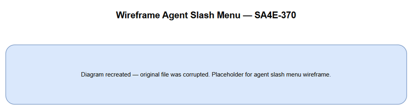
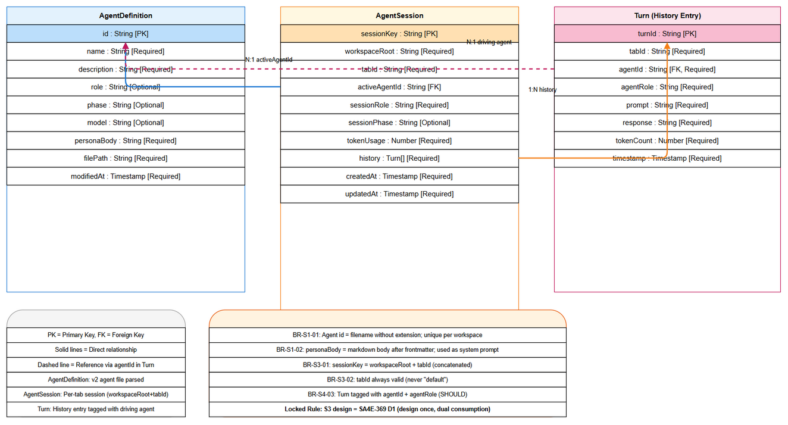
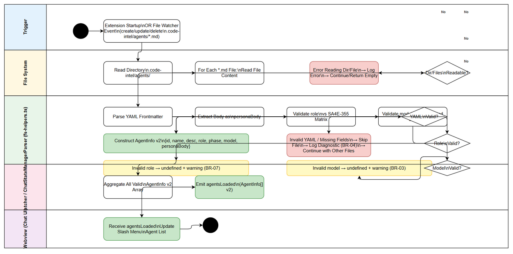
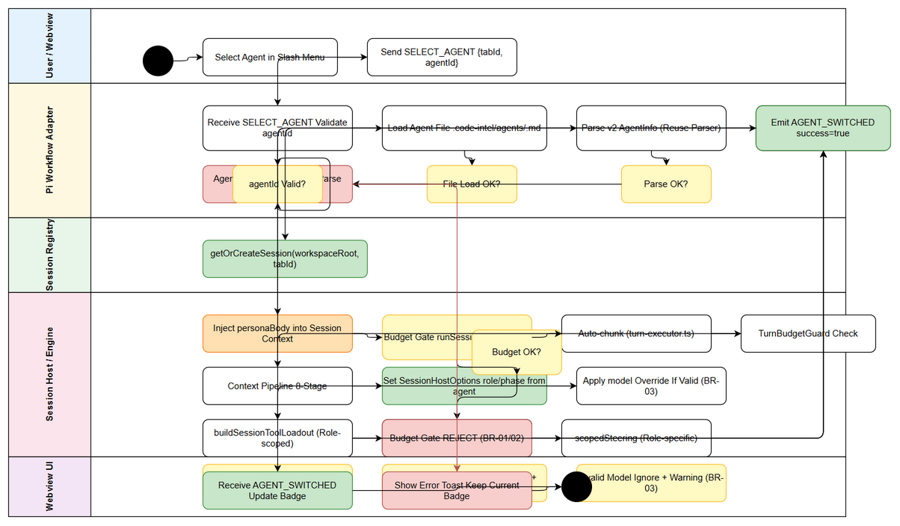
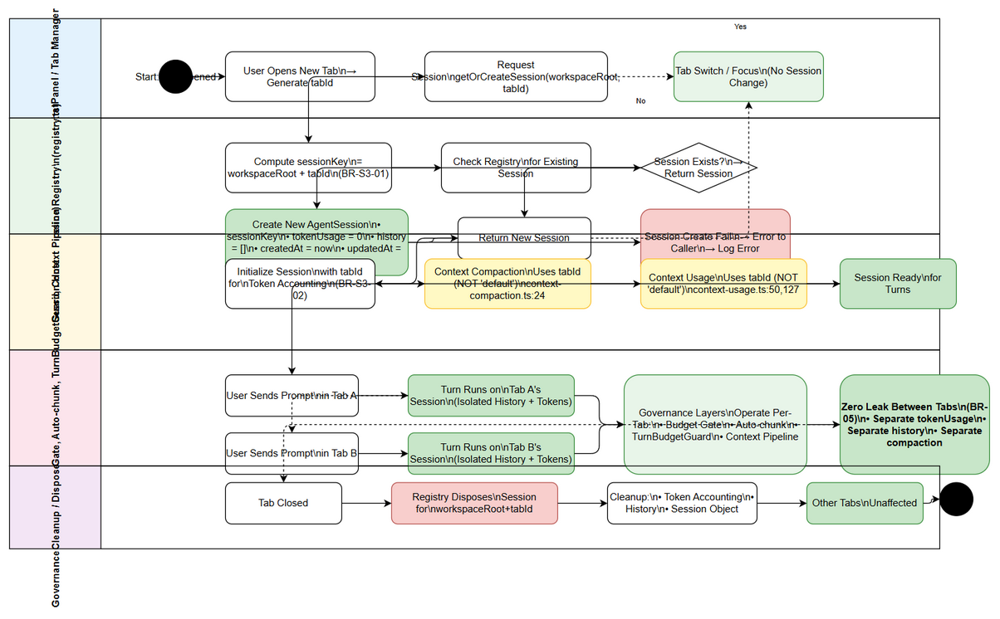
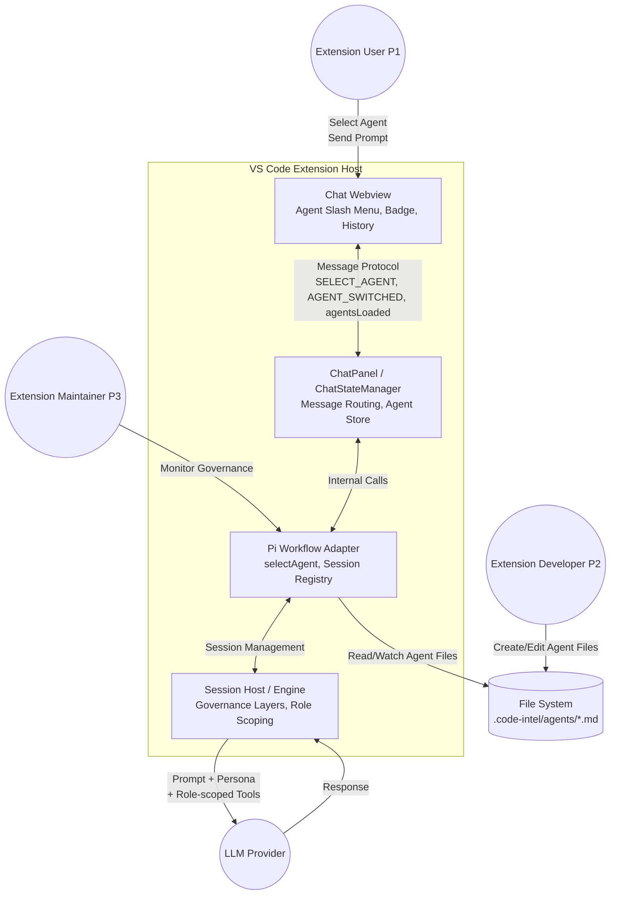
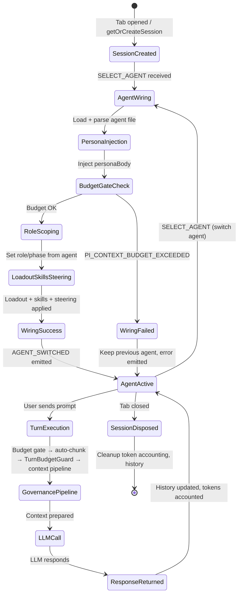
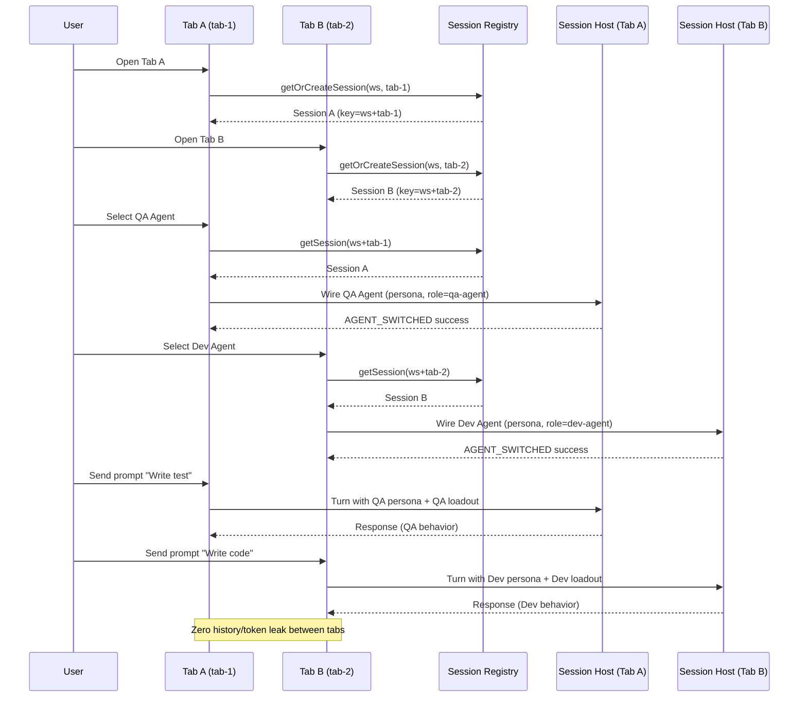
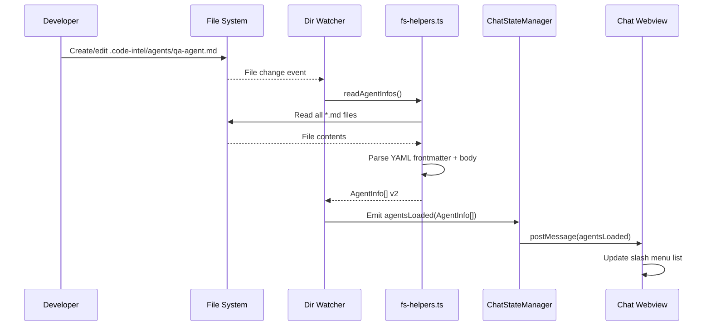

# Functional Specification Document (FSD)

## SDLC Agents 4 Enterprise — SA4E-370: Custom Agents — real file-defined agent personas wired into the chat engine (identity, role scoping, per-tab sessions)

---

## Document Information

| Field | Value |
|-------|-------|
| Jira Ticket | SA4E-370 |
| Title | Custom Agents — real file-defined agent personas wired into the chat engine (identity, role scoping, per-tab sessions) |
| Author | BA Agent |
| Version | 1.0 |
| Date | 2026-10-18 |
| Status | Draft |
| Related BRD | brd/SA4E-370/BRD.md |

---

## Revision History

| Version | Date | Author | Changes |
|---------|------|--------|---------|
| 1.0 | 2026-10-18 | BA Agent | Initiate document — auto-generated from BRD and Jira tickets SA4E-370 (Epic) + SA4E-369 (child Story), verified code evidence (code exploration 2026-10-18) |

---

## 1. Introduction

### 1.1 Purpose

This Functional Specification Document (FSD) specifies the functional behavior of the **Custom Agents** feature (Epic SA4E-370) for the SDLC Agents 4 Enterprise VS Code extension. The feature transforms the current "cosmetic" agent selection (which only prefixes messages with `[Agent: X]`) into **real agent identity wiring** where:

1. Agent definition files (`.code-intel/agents/*.md`) contain full persona semantics (system prompt content, role, phase defaults, optional model override)
2. Selecting an agent loads and parses the file, injects the persona into the session context respecting governance layers, and sets `SessionHostOptions.role/phase` from the agent definition
3. Each chatbox tab maintains its own isolated `AgentSession` (registry keyed by `workspaceRoot+tabId`) with per-tab token accounting and compaction
4. UI truthfully reflects the active agent per tab (badge, switch indicator, per-agent conversation identity)

This FSD derives from the Business Requirements Document (BRD) and provides the functional detail required for the Solution Architect (SA) to produce the Technical Design Document (TDD) and for Developers to implement.

### 1.2 Scope

This FSD covers the four candidate stories from the BRD:

| Story | ID | Description | BRD Reference |
|-------|-----|-------------|---------------|
| S1 | Agent Definition Format v2 | Extend `.code-intel/agents/*.md` with persona body semantics, extended frontmatter (`role`, `phase`, `model`), backward-compatible parser, hot-reload propagation | BRD §1.3 item 1, §2.3 Story 1 |
| S2 | Real selectAgent Wiring | Load/parse agent file on selection, inject persona respecting governance, set role/phase from definition, activate role-scoped loadout/skills/steering, eliminate cosmetic prefix | BRD §1.3 item 2, §2.3 Story 2 |
| S3 | Per-tab / Per-agent Session Isolation | Registry key `workspaceRoot+tabId`, per-tab token accounting + compaction, no history/token leak between tabs | BRD §1.3 item 3, §2.3 Story 3 |
| S4 | UI Truthfulness | Agent badge per tab, switch indicator (AGENT_SWITCHED only after successful wiring), per-agent conversation identity in history | BRD §1.3 item 4, §2.3 Story 4 |

**Out of Scope** (per BRD §1.4):
- Cross-machine agent calls (NG-1, SA4E-369 track)
- Parent→child delegation / ACP delegate (NG-2)
- MCP tool registration (NG-3, SA4E-364)
- PeerBus tab↔tab messaging (NG-4, SA4E-369)
- Human inbox approval (NG-5, SA4E-369 locked AUTO-RUN)
- Official agent management UI editor (NG-6)

### 1.3 Definitions & Acronyms

| Term | Definition |
|------|------------|
| Agent Persona | The markdown body content of an agent `.md` file, injected as system prompt content into the session context |
| AgentInfo | Parsed structure from agent file: v1 = `{id, name, description}`; v2 extends with `role`, `phase`, `model`, `personaBody` |
| selectAgent | Handler invoked when user selects an agent; currently a stub in `adapter-core.ts:159-162`, this feature wires it for real |
| SessionHostOptions.role/phase | Parameters passed to session host to scope tool loadout, skills, and steering (SA4E-355 mechanism) |
| Tool Loadout | Set of tools exposed to a session, scoped by role under schema-token cap (`loadout.ts:69-76`) |
| Budget Gate | Static gate `runSessionBudgetGate` that REJECTs with `PI_CONTEXT_BUDGET_EXCEEDED` (`create-host.ts:72-81`) |
| Auto-chunk | Per-turn context chunking when budget exceeded (`turn-executor.ts:34-71`) |
| TurnBudgetGuard | Intra-turn loop guard (`pi-workflow/turn-budget/`) |
| Context Pipeline | Billion-context 8-stage pipeline (`pi-context-pipeline.ts:83-107`, invoked from `pi-workflow.ts:192-199`) |
| Per-tab Session | Independent `AgentSession` per chatbox tab, registry key = `workspaceRoot+tabId` |
| PeerBus | In-process tab↔tab messaging channel (SA4E-369, out of scope for this epic) |
| MoSCoW | Must / Should / Could / Won't prioritization |

### 1.4 References

| Document | Location |
|----------|----------|
| BRD | documents/SA4E-370/BRD.md |
| Jira Epic SA4E-370 | https://jiraassist.atlassian.net/browse/SA4E-370 |
| Jira Story SA4E-369 | https://jiraassist.atlassian.net/browse/SA4E-369 |
| Agent definition parser (v1) | extension/src/chat-panel/ChatStateManager/fs-helpers.ts:105-121 |
| Hot-reload watcher | extension/src/chat-panel/ChatStateManager/dir-watchers.ts:60-70 |
| selectAgent stub | extension/src/pi-workflow/pi-workflow-adapter/adapter-core.ts:159-162 |
| Cosmetic agent prefix | extension/src/chat-panel/message-routing.ts:66 |
| Hardcoded role | extension/src/pi-workflow/pi-workflow-adapter/adapter-legacy-turns.ts:83 |
| Session registry | extension/src/pi-workflow/session-host/registry.ts (lines 9,13) |
| Role-aware loadout | extension/src/pi-workflow/session-host/loadout.ts:69-76; create-host.ts:103,123 |
| Governance layers | create-host.ts:72-81; turn-executor.ts:34-71; pi-context-pipeline.ts:83-107 |
| Compaction hardcode | chat-panel-provider/context-compaction.ts:24; context-usage.ts:50,127 |
| Tool-pool findings | SA4E-364-FINDINGS.md (repo root) |
| Project conventions | AGENTS.md (role matrix, draw.io only — never Mermaid) |

---

## 2. System Overview

### 2.1 System Context Diagram

*[Edit in draw.io](diagrams/system-context.drawio)*

The Custom Agents feature operates within the VS Code extension host. The extension webview (chat panel) communicates with the Pi Workflow Adapter via a message protocol. The Adapter orchestrates the Session Host which runs the LLM engine with governance layers. Agent definition files reside in the workspace `.code-intel/agents/` directory and are watched for changes.

**External Actors:**
- **Extension User (P1)** — Operates the chatbox, selects agents per tab, sends prompts
- **Extension Developer (P2)** — Creates/edits agent `.md` files in workspace
- **Extension Maintainer (P3)** — Maintains governance layers, session lifecycle, test suites

**External Systems:**
- **VS Code Extension Host** — Provides workspace, webview, file system access, message passing
- **File System** — Stores agent definition files (`.code-intel/agents/*.md`)
- **LLM Provider** — Receives prompts with injected persona and role-scoped tool loadout

### 2.2 System Architecture

The feature modifies the following architectural components:

| Component | Current State | Target State (This Feature) |
|-----------|---------------|----------------------------|
| Agent Definition Parser (`fs-helpers.ts`) | Parses frontmatter only (`name`, `description`) | Parses v2 frontmatter (`role`, `phase`, `model`) + body as `personaBody` |
| Hot-reload Watcher (`dir-watchers.ts`) | Sends `agentsLoaded` with v1 AgentInfo | Sends `agentsLoaded` with v2 AgentInfo (extended fields) |
| selectAgent (`adapter-core.ts`) | Stub — emits `chat:agentSwitched` only | Loads agent file, parses v2, injects persona, sets role/phase |
| Message Routing (`message-routing.ts`) | Prefixes task with `[Agent: X]` | No prefix; persona injected via context governance |
| Session Registry (`registry.ts`) | Key = `workspaceRoot` (shared) | Key = `workspaceRoot+tabId` (per-tab isolation) |
| Context Compaction (`context-compaction.ts`, `context-usage.ts`) | Hardcoded `tabId="default"` | Per-tab token accounting using actual `tabId` |
| Session Host (`create-host.ts`, `loadout.ts`) | Hardcoded `'sm-agent'` role | Role/phase from agent definition → scoped loadout/skills/steering |

---

## 3. Functional Requirements

### 3.1 Feature: Agent Definition Format v2 (Story S1)

**Source:** BRD §2.3 Story 1 (FR-01, FR-02, FR-03, FR-04, FR-13)

#### 3.1.1 Description

The agent definition file format is extended from v1 (frontmatter-only) to v2 (frontmatter + persona body semantics). The parser in `fs-helpers.ts` is enhanced to extract the full v2 structure while maintaining backward compatibility with existing v1 agent files.

#### 3.1.2 Use Case

**Use Case ID:** UC-1
**Actor:** Extension Developer (P2)
**Preconditions:** VS Code extension is running; workspace has `.code-intel/agents/` directory (created on first run if missing)
**Postconditions:** Agent file is parsed and available in the agent list for selection

**Main Flow:**

| Step | Actor | System | Description |
|------|-------|--------|-------------|
| 1 | Developer | | Creates/edits `.code-intel/agents/<agent>.md` with v2 frontmatter and persona body |
| 2 | | Watcher | Detects file change (create/update/delete) via `dir-watchers.ts` |
| 3 | | Parser | `fs-helpers.ts:readAgentInfos` reads all `.md` files, parses frontmatter + body |
| 4 | | Parser | For each file: extracts `id` (filename), `name`, `description`, `role`, `phase`, `model`, `personaBody` |
| 5 | | Parser | Validates: `role` against known role matrix; `model` against supported models; YAML parseable |
| 6 | | Watcher | Emits `agentsLoaded` message with array of v2 AgentInfo to webview |
| 7 | | Webview | Updates slash menu agent list with new/updated agent |

**Alternative Flows:**

| ID | Condition | Steps |
|----|-----------|-------|
| AF-1 | Agent file has invalid YAML frontmatter | Parser logs diagnostic, skips file, continues with other files; file does not appear in agent list |
| AF-2 | Agent file missing `name` or `description` | Parser uses filename as `name`, empty string for `description`; logs warning |
| AF-3 | `role` value not in role matrix (SA4E-355) | Parser sets `role` = undefined (fallback to default in engine); logs warning |
| AF-4 | `model` value not supported | Parser sets `model` = undefined (fallback to default in engine); logs warning |
| AF-5 | Agent file is v1 (only `name` + `description`) | Parser populates `role`, `phase`, `model` = undefined; `personaBody` = body content; backward compatible |

**Exception Flows:**

| ID | Condition | Steps |
|----|-----------|-------|
| EF-1 | `.code-intel/agents/` directory not readable | Watcher logs error, emits empty `agentsLoaded`; no crash |
| EF-2 | File system watcher fails to start | Extension logs error; hot-reload disabled; manual reload required |

#### 3.1.3 Business Rules

| Rule ID | Rule | Source |
|---------|------|--------|
| BR-01 | Persona injection must go through all governance layers (budget gate, auto-chunk, TurnBudgetGuard, context pipeline); no bypass | BRD §5.2 Constraint 1, BR-01 |
| BR-02 | Persona token cost counted in static budget gate; exceed → REJECT with `PI_CONTEXT_BUDGET_EXCEEDED` | BRD §5.2 Constraint 1, BR-02 |
| BR-03 | `model` override only applied if valid; invalid → fallback default + warning log | BRD §5.2 BR-03 |
| BR-04 | Parser fail-safe: invalid file → skip + log, no crash; agent files are workspace files (user-controlled trust) | BRD §5.2 BR-04 |
| BR-06 | Core tools (base allowlist `loadout.ts:29`) never dropped by role filter | BRD §5.2 BR-06 |
| BR-07 | Fail-open: role scoping error → fallback base loadout, turn continues, no crash | BRD §5.2 BR-07 |
| BR-S1-01 | Agent `id` = filename without extension; must be unique within workspace | BRD §2.3 S1 Data Fields |
| BR-S1-02 | `personaBody` = entire markdown body after frontmatter; used as system prompt content | BRD §2.3 S1 Data Fields |
| BR-S1-03 | Hot-reload must propagate extended fields (`role`, `phase`, `model`, `personaBody`) to webview | BRD §2.3 S1 FR-04 |

#### 3.1.4 Data Specifications

**Input Data (Agent File):**

| Field | Type | Required | Validation | Description |
|-------|------|----------|------------|-------------|
| name | string | Yes | Non-empty; YAML string | Agent display name (frontmatter) |
| description | string | Yes | YAML string | Agent description for UI (frontmatter) |
| role | string | No | Must match SA4E-355 role matrix if present | Role for loadout/skills/steering scoping |
| phase | string | No | Must match pipeline phase if present | Default phase for session |
| model | string | No | Must be supported model identifier if present | Optional model override for session |
| personaBody | markdown | Yes | Non-empty when persona declared | System prompt content (file body) |

**Output Data (Parsed AgentInfo v2):**

| Field | Type | Description |
|-------|------|-------------|
| id | string | Filename without extension (e.g., `qa-agent`) |
| name | string | Frontmatter `name` or filename fallback |
| description | string | Frontmatter `description` or empty |
| role | string \| undefined | Frontmatter `role` if valid, else undefined |
| phase | string \| undefined | Frontmatter `phase` if valid, else undefined |
| model | string \| undefined | Frontmatter `model` if valid, else undefined |
| personaBody | string | Full markdown body content (system prompt) |

#### 3.1.5 UI Specifications

**Screen: Agent Slash Menu**

*[Edit in draw.io](diagrams/wireframe-agent-slash-menu.drawio)*

| No. | Element | Type | Required | Behavior | Validation |
|-----|---------|------|----------|----------|------------|
| 1 | Agent List | List | Yes | Shows `name` + `description` from parsed AgentInfo v2 | Updates on `agentsLoaded` message |
| 2 | Agent Badge (per tab) | Badge | Yes | Shows active agent `name` for current tab | Updates on `AGENT_SWITCHED` |
| 3 | Switch Indicator | Indicator | Yes | Shows wiring state: idle / switching / success / error | Updates during selectAgent flow |

#### 3.1.6 API Contract (Functional View)

> **Note:** This section defines the functional message contract between Webview and Adapter. Technical details (WebSocket frames, serialization) are in TDD.

**Message: `agentsLoaded` (Webview ← Adapter)**

**Purpose:** Push updated agent list to webview after discovery/hot-reload

**Payload:**

| Parameter | Type | Required | Business Rule | Description |
|-----------|------|----------|---------------|-------------|
| agents | AgentInfo[] | Yes | BR-S1-01, BR-S1-03 | Array of parsed v2 AgentInfo |

**Message: `SELECT_AGENT` (Adapter ← Webview)**

**Purpose:** User requests agent switch for a specific tab

**Payload:**

| Parameter | Type | Required | Business Rule | Description |
|-----------|------|----------|---------------|-------------|
| tabId | string | Yes | Must be valid tab identifier | Target tab for agent switch |
| agentId | string | Yes | Must exist in current `agentsLoaded` list | Agent to activate |

**Message: `AGENT_SWITCHED` (Webview ← Adapter)**

**Purpose:** Confirm agent switch completed (success or failure)

**Payload:**

| Parameter | Type | Required | Business Rule | Description |
|-----------|------|----------|---------------|-------------|
| tabId | string | Yes | | Tab that was switched |
| agentId | string | Yes | | Agent now active (or previous on failure) |
| success | boolean | Yes | FR-11: only true after wiring complete | Wiring result |
| error | string | No | Present when `success=false` | Error message for UI |

**Business Error Scenarios:**

| Scenario | User Message | Trigger Condition |
|----------|--------------|-------------------|
| Agent file read/parse error | "Failed to load agent: <error>. Keeping current agent." | `selectAgent` cannot read or parse the agent file |
| Invalid role in agent definition | "Agent role '<role>' not recognized. Using default role." | `role` not in SA4E-355 role matrix (BR-07 fallback) |
| Budget gate reject during wiring | "Context budget exceeded. Cannot switch agent with current persona." | `runSessionBudgetGate` rejects persona injection (BR-01/02) |

---

### 3.2 Feature: Real selectAgent Wiring (Story S2)

**Source:** BRD §2.3 Story 2 (FR-05, FR-06, FR-07, FR-08, FR-11)

#### 3.2.1 Description

The `selectAgent` handler in the Pi Workflow Adapter is transformed from a stub (emit-only) to a real implementation that loads the agent file, parses v2 format, injects the persona into the session context through governance layers, sets `SessionHostOptions.role/phase` from the agent definition, and activates role-scoped tool loadout, skills, and steering. The cosmetic `[Agent: X]` prefix mechanism is retired as the primary driver.

#### 3.2.2 Use Case

**Use Case ID:** UC-2
**Actor:** Extension User (P1)
**Preconditions:** Agent list loaded (`agentsLoaded` received); target tab has an active session (or will create one)
**Postconditions:** Tab's session runs with selected agent's persona + role-scoped engine; UI shows agent badge + success indicator

**Main Flow:**

| Step | Actor | System | Description |
|------|-------|--------|-------------|
| 1 | User | | Selects agent in slash menu for current tab |
| 2 | | Webview | Sends `SELECT_AGENT` message with `tabId`, `agentId` |
| 3 | | ChatStateManager | Routes `SELECT_AGENT` to Adapter via message protocol |
| 4 | | Adapter (selectAgent) | Loads agent file `.code-intel/agents/<agentId>.md` |
| 5 | | Adapter (selectAgent) | Parses file using v2 parser → AgentInfo v2 |
| 6 | | Adapter | Injects `personaBody` into target session context: |
| 6a | | | → Static budget gate `runSessionBudgetGate` (REJECT if `PI_CONTEXT_BUDGET_EXCEEDED`) |
| 6b | | | → Auto-chunk (`turn-executor.ts`) if needed |
| 6c | | | → TurnBudgetGuard |
| 6d | | | → Context pipeline 8-stage (`pi-context-pipeline.ts`) |
| 7 | | Adapter | Sets `SessionHostOptions.role` = agent `role` (or default), `phase` = agent `phase` (or default) |
| 8 | | Session Host | `buildSessionToolLoadout` (`loadout.ts:69-76`) scopes tools by role |
| 9 | | Session Host | `applyScopedSkills` (`create-host.ts:103`) loads role-specific skills |
| 10 | | Session Host | `scopedSteering` (`create-host.ts:123`) applies role-specific steering |
| 11 | | Adapter | On success: emits `AGENT_SWITCHED` with `success=true` |
| 12 | | Webview | Updates agent badge + switch indicator to success state |

**Alternative Flows:**

| ID | Condition | Steps |
|----|-----------|-------|
| AF-1 | Agent file not found / read error | Keep current agent; emit `AGENT_SWITCHED` with `success=false`, error message; UI shows error indicator |
| AF-2 | Persona injection rejected by budget gate | Keep current agent; emit `AGENT_SWITCHED` with `success=false`, `PI_CONTEXT_BUDGET_EXCEEDED` message |
| AF-3 | Agent `role` invalid / not in matrix | Use default role (`'sm-agent'` fallback); log warning; continue wiring (BR-07) |
| AF-4 | Agent `model` invalid | Ignore override; use default model; log warning (BR-03) |

**Exception Flows:**

| ID | Condition | Steps |
|----|-----------|-------|
| EF-1 | Session for `tabId` does not exist | Create new session with agent's role/phase; continue wiring |
| EF-2 | Governance layer throws unexpected error | Catch; keep current agent; emit `AGENT_SWITCHED` failure; log error |

#### 3.2.3 Business Rules

| Rule ID | Rule | Source |
|---------|------|--------|
| BR-01 | Persona injection must go through all governance layers; no bypass | BRD §5.2 |
| BR-02 | Persona token cost in static budget gate; exceed → REJECT | BRD §5.2 |
| BR-07 | Fail-open: role scoping error → base loadout, no crash | BRD §5.2 |
| BR-S2-01 | `AGENT_SWITCHED` only emitted after successful wiring (persona + role/phase + loadout) | BRD §2.3 S2 FR-11 |
| BR-S2-02 | Cosmetic `[Agent: X]` prefix no longer primary mechanism; persona injection is | BRD §2.3 S2 FR-05, FR-06 |
| BR-S2-03 | `SessionHostOptions.role/phase` derived from agent definition, not hardcoded | BRD §2.3 S2 FR-07 |

#### 3.2.4 Data Specifications

**Input Data:**

| Field | Type | Required | Validation | Description |
|-------|------|----------|------------|-------------|
| tabId | string | Yes | Valid tab identifier | Target tab |
| agentId | string | Yes | Exists in `agentsLoaded` | Agent to activate |
| AgentInfo v2 | object | Yes | From parsed agent file | Contains personaBody, role, phase, model |

**Output Data:**

| Field | Type | Description |
|-------|------|-------------|
| success | boolean | Wiring result |
| activeAgentId | string | Agent now driving the tab |
| sessionRole | string | Role applied to session |
| sessionPhase | string | Phase applied to session |
| error | string | Error message if `success=false` |

#### 3.2.5 UI Specifications

**Screen: Agent Switch Indicator**

| No. | Element | Type | Required | Behavior | Validation |
|-----|---------|------|----------|----------|------------|
| 1 | Switching Spinner | Spinner | Yes | Shows during wiring (steps 4-10) | Auto-hide on `AGENT_SWITCHED` |
| 2 | Success Checkmark | Icon | Yes | Shows on `success=true` | Timeout 2s then fade |
| 3 | Error Toast | Toast | Yes | Shows on `success=false` with error message | Dismissible |
| 4 | Agent Badge | Badge | Yes | Shows active agent name per tab | Updates on `AGENT_SWITCHED` success |

#### 3.2.6 API Contract (Functional View)

**Endpoint:** `selectAgent` (Adapter internal handler)

**Purpose:** Wire selected agent's persona and role into target tab's session

**Input Parameters:**

| Parameter | Type | Required | Business Rule | Description |
|-----------|------|----------|---------------|-------------|
| tabId | string | Yes | | Target tab identifier |
| agentId | string | Yes | Must exist in agent list | Agent to activate |

**Output Data:**

| Field | Type | Description |
|-------|------|-------------|
| success | boolean | Wiring completed successfully |
| agentInfo | AgentInfo v2 | Activated agent details |
| sessionRole | string | Role applied to session |
| sessionPhase | string | Phase applied to session |

**Business Error Scenarios:**

| Scenario | User Message | Trigger Condition |
|----------|--------------|-------------------|
| Agent file load failed | "Could not load agent file. Please check the file exists and is readable." | FS read error on `.code-intel/agents/<agentId>.md` |
| Persona budget exceed | "Agent persona too large for context budget. Try a shorter persona." | `runSessionBudgetGate` returns REJECT |
| Role scoping failure | "Agent role configuration issue. Using default capabilities." | `buildSessionToolLoadout` throws (caught, BR-07) |

---

### 3.3 Feature: Per-tab / Per-agent Session Isolation (Story S3)

**Source:** BRD §2.3 Story 3 (FR-09, FR-10)

#### 3.3.1 Description

The session registry is changed from a single shared session per `workspaceRoot` to independent sessions per `workspaceRoot+tabId`. Each tab gets its own `AgentSession` with isolated history, token accounting, and compaction. Hardcoded `tabId="default"` references in `context-compaction.ts` and `context-usage.ts` are replaced with actual tab identifiers.

**Locked Coordination Rule:** This story's design **= D1 in SA4E-369 (per-tab sessions)** — design ONCE, do not duplicate. SA4E-369 consumes this as a prerequisite.

#### 3.3.2 Use Case

**Use Case ID:** UC-3
**Actor:** Extension User (P1)
**Preconditions:** Extension running; multiple tabs open in chatbox
**Postconditions:** Each tab has independent session with own history, token budget, compaction

**Main Flow:**

| Step | Actor | System | Description |
|------|-------|--------|-------------|
| 1 | User | | Opens second chatbox tab (new `tabId`) |
| 2 | | ChatPanel | Requests session for `workspaceRoot+tabId` from registry |
| 3 | | Registry (`registry.ts`) | Creates new `AgentSession` keyed by `workspaceRoot+tabId` |
| 4 | | Session Host | Initializes session with `tabId` for token accounting |
| 5 | | Context Compaction | Uses `tabId` (not "default") for `context-compaction.ts:24` |
| 6 | | Context Usage | Uses `tabId` (not "default") for `context-usage.ts:50,127` |
| 7 | User | | Sends prompt in Tab A → turn runs on Tab A's session |
| 8 | User | | Sends prompt in Tab B → turn runs on Tab B's session |
| 9 | | Governance | Budget gate, auto-chunk, TurnBudgetGuard, pipeline operate per-tab |

**Alternative Flows:**

| ID | Condition | Steps |
|----|-----------|-------|
| AF-1 | Tab closed | Registry disposes session for `workspaceRoot+tabId`; cleanup token accounting |
| AF-2 | Tab switched (UI focus) | No session change; each tab retains its session |

**Exception Flows:**

| ID | Condition | Steps |
|----|-----------|-------|
| EF-1 | Session creation fails for tab | Show error in that tab only; other tabs unaffected |
| EF-2 | Token accounting corruption | Reset accounting for affected tab; log error |

#### 3.3.3 Business Rules

| Rule ID | Rule | Source |
|---------|------|--------|
| BR-05 | No leak of history/token accounting between tabs | BRD §5.2 |
| BR-S3-01 | Registry key = `workspaceRoot+tabId` (concatenated with separator) | BRD §2.3 S3 FR-09 |
| BR-S3-02 | `tabId` always valid (never "default"); provided by ChatPanel per tab | BRD §2.3 S3 Validation |
| BR-S3-03 | Session dispose on tab close — cleanup history + token accounting | BRD §2.3 S3 Validation |
| BR-S3-04 | Design shared with SA4E-369 D1 — single implementation, dual consumption | BRD §2.3 S3 Locked Rule |

#### 3.3.4 Data Specifications

**Input Data:**

| Field | Type | Required | Validation | Description |
|-------|------|----------|------------|-------------|
| workspaceRoot | string | Yes | Valid workspace path | Workspace identifier |
| tabId | string | Yes | Non-empty, not "default" | Tab identifier from ChatPanel |

**Output Data (Session Key):**

| Field | Type | Description |
|-------|------|-------------|
| sessionKey | string | `workspaceRoot+tabId` (e.g., `/home/user/project+tab-2`) |
| tabTokenUsage | number | Token count for this tab's session |

#### 3.3.5 UI Specifications

No new UI elements. Existing tab UI automatically reflects per-tab session because each tab maintains its own session state.

#### 3.3.6 API Contract (Functional View)

**Endpoint:** `registry.getOrCreateSession(workspaceRoot, tabId)`

**Purpose:** Retrieve or create per-tab session

**Input Parameters:**

| Parameter | Type | Required | Business Rule | Description |
|-----------|------|----------|---------------|-------------|
| workspaceRoot | string | Yes | | Workspace root path |
| tabId | string | Yes | BR-S3-02: not "default" | Tab identifier |

**Output Data:**

| Field | Type | Description |
|-------|------|-------------|
| session | AgentSession | Session instance for this tab |
| sessionKey | string | Composite key used |

---

### 3.4 Feature: UI Truthfulness (Story S4)

**Source:** BRD §2.3 Story 4 (FR-11, FR-12)

#### 3.4.1 Description

The UI must truthfully reflect the active agent per tab at all times. The agent badge shows the currently wired agent. The switch indicator shows the wiring state (idle/switching/success/error) and `AGENT_SWITCHED` is only emitted after successful wiring. Conversation history is tagged with the agent identity that drove each turn.

#### 3.4.2 Use Case

**Use Case ID:** UC-4
**Actor:** Extension User (P1)
**Preconditions:** Multiple tabs open; agents available
**Postconditions:** UI accurately shows agent per tab; history tagged by agent

**Main Flow:**

| Step | Actor | System | Description |
|------|-------|--------|-------------|
| 1 | User | | Views Tab A → sees badge "QA Agent" |
| 2 | User | | Views Tab B → sees badge "Dev Agent" |
| 3 | User | | Switches Tab A to "SA Agent" via slash menu |
| 4 | | System | Shows switching spinner during wiring |
| 5 | | System | On success: badge updates to "SA Agent"; checkmark indicator |
| 6 | | System | On failure: badge stays "QA Agent"; error toast shown |
| 7 | User | | Reviews history in Tab A → sees turns tagged with driving agent |

**Alternative Flows:**

| ID | Condition | Steps |
|----|-----------|-------|
| AF-1 | Rapid agent switches | Each `SELECT_AGENT` queued; indicator shows current wiring state |
| AF-2 | Tab with no agent selected | Badge shows "No Agent" or default; history tagged accordingly |

**Exception Flows:**

| ID | Condition | Steps |
|----|-----------|-------|
| EF-1 | `AGENT_SWITCHED` lost/dropped | Badge may be stale; next successful switch corrects; implement retry/ack |

#### 3.4.3 Business Rules

| Rule ID | Rule | Source |
|---------|------|--------|
| BR-S4-01 | Agent badge per tab reflects currently wired agent (not pending) | BRD §2.3 S4 FR-11 |
| BR-S4-02 | `AGENT_SWITCHED` only after wiring complete (persona + role + loadout) | BRD §2.3 S4 FR-11 |
| BR-S4-03 | Conversation history entries tagged with driving agent identity | BRD §2.3 S4 FR-12 (SHOULD) |

#### 3.4.4 Data Specifications

**Output Data (History Entry Extension):**

| Field | Type | Description |
|-------|------|-------------|
| agentId | string | Agent that drove this turn |
| agentRole | string | Role of agent at time of turn |
| tabId | string | Tab where turn occurred |

#### 3.4.5 UI Specifications

**Screen: Chat Tab with Agent Identity**

| No. | Element | Type | Required | Behavior | Validation |
|-----|---------|------|----------|----------|------------|
| 1 | Tab Agent Badge | Badge | Yes | Shows active agent name; distinct per tab | Updates on `AGENT_SWITCHED` success |
| 2 | Switch Indicator | Indicator | Yes | States: idle / switching / success / error | Driven by `SELECT_AGENT` → `AGENT_SWITCHED` flow |
| 3 | History Agent Tag | Label | No (SHOULD) | Each history entry shows agent icon/name | Requires history store extension |

---

## 4. Data Model

> **Note:** Logical data model for agent definitions, sessions, and history. Physical implementation (TypeScript interfaces, persistence) in TDD §4.

### 4.1 Entity Relationship Diagram

*[Edit in draw.io](diagrams/er-diagram.drawio)*

### 4.2 Logical Entities

#### Entity: AgentDefinition

| Attribute | Type | Required | Business Rule | Description |
|-----------|------|----------|---------------|-------------|
| id | string | Yes | BR-S1-01: filename without ext, unique | Unique agent identifier |
| name | string | Yes | Non-empty | Display name |
| description | string | Yes | | Description for UI |
| role | string | No | Valid per SA4E-355 matrix | Role for scoping |
| phase | string | No | Valid pipeline phase | Default session phase |
| model | string | No | Valid model identifier | Optional model override |
| personaBody | string | Yes | BR-S1-02: markdown body | System prompt content |
| filePath | string | Yes | `.code-intel/agents/<id>.md` | Source file location |
| modifiedAt | timestamp | Yes | | Last file modification time |

#### Entity: AgentSession

| Attribute | Type | Required | Business Rule | Description |
|-----------|------|----------|---------------|-------------|
| sessionKey | string | Yes | BR-S3-01: workspaceRoot+tabId | Composite key |
| workspaceRoot | string | Yes | | Workspace path |
| tabId | string | Yes | BR-S3-02: not "default" | Tab identifier |
| activeAgentId | string | No | References AgentDefinition.id | Currently wired agent |
| sessionRole | string | Yes | From agent definition or default | Role for loadout scoping |
| sessionPhase | string | No | From agent definition | Phase for session |
| tokenUsage | number | Yes | BR-S3-02: per-tab accounting | Current token count |
| history | Turn[] | Yes | BR-S4-03: tagged with agentId | Conversation history |
| createdAt | timestamp | Yes | | Session creation time |
| updatedAt | timestamp | Yes | | Last activity time |

#### Entity: Turn (History Entry)

| Attribute | Type | Required | Business Rule | Description |
|-----------|------|----------|---------------|-------------|
| turnId | string | Yes | Unique per turn | Turn identifier |
| tabId | string | Yes | | Tab where turn occurred |
| agentId | string | Yes | BR-S4-03: driving agent | Agent identity for this turn |
| agentRole | string | Yes | | Role at time of turn |
| prompt | string | Yes | | User prompt |
| response | string | Yes | | Assistant response |
| tokenCount | number | Yes | | Tokens consumed |
| timestamp | timestamp | Yes | | Turn completion time |

**Relationships:**

| From Entity | To Entity | Cardinality | Description |
|-------------|-----------|-------------|-------------|
| AgentSession | AgentDefinition | N:1 | Session references active agent |
| AgentSession | Turn | 1:N | Session contains ordered turns |
| Turn | AgentDefinition | N:1 | Turn tagged with driving agent |

---

## 5. Integration Specifications

> **Note:** Business-level integration view. Technical details (timeouts, retries, circuit breakers) in TDD §6.

### 5.1 External System: VS Code Extension Host

| Attribute | Value |
|-----------|-------|
| Purpose | Host environment providing workspace, webview, file system, message passing |
| Direction | Bidirectional |
| Data Format | JSON over VS Code message passing (webview `postMessage` / `onDidReceiveMessage`) |
| Frequency | Real-time (user interactions, file watcher events) |

**Data Exchange:**

| Our Data | External Data | Direction | Business Rule |
|----------|---------------|-----------|---------------|
| `agentsLoaded` payload | Webview receives agent list | Outbound | BR-S1-03: includes v2 fields |
| `SELECT_AGENT` | User selection from webview | Inbound | Must contain valid `tabId`, `agentId` |
| `AGENT_SWITCHED` | Webview receives switch result | Outbound | BR-S2-01: only after wiring |
| File watcher events | FS changes to `.code-intel/agents/` | Inbound | Triggers re-parse + `agentsLoaded` |

### 5.2 External System: File System (Workspace)

| Attribute | Value |
|-----------|-------|
| Purpose | Persistent storage for agent definition files |
| Direction | Bidirectional (read agent files; developer writes files) |
| Data Format | Markdown with YAML frontmatter |
| Frequency | On-demand (selection), real-time (hot-reload via watcher) |

**Data Exchange:**

| Our Data | External Data | Direction | Business Rule |
|----------|---------------|-----------|---------------|
| Parse request | Agent `.md` file content | Inbound | BR-04: fail-safe parse |
| N/A | File create/update/delete events | Inbound | Watcher triggers re-discovery |

### 5.3 External System: LLM Provider

| Attribute | Value |
|-----------|-------|
| Purpose | Executes turns with injected persona and role-scoped tool loadout |
| Direction | Outbound (prompts) / Inbound (responses) |
| Data Format | Provider-specific (OpenAI-compatible, Anthropic, etc.) |
| Frequency | Per user turn |

**Data Exchange:**

| Our Data | External Data | Direction | Business Rule |
|----------|---------------|-----------|---------------|
| Prompt + persona + role-scoped tools | LLM request | Outbound | BR-01/02: persona via governance |
| LLM response | Response text/tool calls | Inbound | Returned to originating tab |

---

## 6. Processing Logic

### 6.1 Agent File Discovery & Parsing

**Trigger:** Extension startup, file watcher event (create/update/delete in `.code-intel/agents/`)
**Schedule:** On-demand + real-time watcher
**Input:** Directory `.code-intel/agents/`
**Output:** `AgentInfo[]` (v2) sent via `agentsLoaded`

**Processing Steps:**

| Step | Description | Error Handling |
|------|-------------|----------------|
| 1 | Read directory `.code-intel/agents/` | Log error, return empty array |
| 2 | For each `.md` file: read content | Skip file, log, continue |
| 3 | Parse YAML frontmatter | Skip file, log diagnostic (BR-04) |
| 4 | Extract body as `personaBody` | Empty body → empty string, log warning |
| 5 | Validate `role` against role matrix | Set undefined, log warning (BR-07) |
| 6 | Validate `model` against supported | Set undefined, log warning (BR-03) |
| 7 | Construct AgentInfo v2 | |
| 8 | Emit `agentsLoaded` to webview | |

**Activity Diagram:**

*[Edit in draw.io](diagrams/process-agent-discovery.drawio)*

### 6.2 Agent Selection & Wiring

**Trigger:** `SELECT_AGENT` message received
**Input:** `tabId`, `agentId`
**Output:** `AGENT_SWITCHED` result; updated session state

**Processing Steps:**

| Step | Description | Error Handling |
|------|-------------|----------------|
| 1 | Validate `agentId` exists in current agent list | Return error, keep current agent |
| 2 | Load agent file `.code-intel/agents/<agentId>.md` | Return error, keep current agent |
| 3 | Parse v2 AgentInfo (reuse discovery parser) | Return error, keep current agent |
| 4 | Get/create session for `tabId` (registry) | Create new if not exists |
| 5 | Inject `personaBody` into session context via governance: | |
| 5a | Run static budget gate `runSessionBudgetGate` | REJECT → return error, keep current agent (BR-01/02) |
| 5b | Auto-chunk if needed | Proceed |
| 5c | TurnBudgetGuard check | Proceed |
| 5d | Context pipeline 8-stage | Proceed |
| 6 | Set `SessionHostOptions.role` = agent `role` or default | Invalid role → default + warning (BR-07) |
| 7 | Set `SessionHostOptions.phase` = agent `phase` or default | |
| 8 | Apply `model` override if valid | Invalid → ignore + warning (BR-03) |
| 9 | Rebuild tool loadout via `buildSessionToolLoadout` (role-scoped) | Error → base loadout + warning (BR-07) |
| 10 | Apply scoped skills via `applyScopedSkills` | Error → base skills + warning (BR-07) |
| 11 | Apply scoped steering via `scopedSteering` | Error → base steering + warning (BR-07) |
| 12 | Emit `AGENT_SWITCHED` with `success=true` | |

**Activity Diagram:**

*[Edit in draw.io](diagrams/process-agent-selection.drawio)*

### 6.3 Per-tab Session Lifecycle

**Trigger:** Tab open/close, session access
**Input:** `workspaceRoot`, `tabId`
**Output:** `AgentSession` instance

**Processing Steps:**

| Step | Description | Error Handling |
|------|-------------|----------------|
| 1 | Compute `sessionKey = workspaceRoot + tabId` | |
| 2 | Check registry for existing session | |
| 3 | If exists: return session | |
| 4 | If not: create new `AgentSession` with `sessionKey` | Fail → error to caller |
| 5 | Initialize `tokenUsage = 0`, empty history | |
| 6 | On tab close: dispose session, cleanup token accounting | Log error if dispose fails |
| 7 | On session access: update `updatedAt` | |

**Activity Diagram:**

*[Edit in draw.io](diagrams/process-session-lifecycle.drawio)*

---

## 7. Security Requirements

> **Note:** Business-level security. Technical implementation in TDD §7.

### 7.1 Authentication & Authorization

| Role | Permissions | Screens/Features |
|------|-------------|-------------------|
| Extension User (P1) | Select agents per tab, send prompts, view history | Chat panel, slash menu, history |
| Extension Developer (P2) | Create/edit agent files in workspace | File system (workspace) |
| Extension Maintainer (P3) | View governance metrics, manage test suites | Internal diagnostics (no UI) |

**Note:** No authentication within the feature — relies on VS Code workspace trust model. Agent files are workspace files controlled by the user.

### 7.2 Data Sensitivity Classification

| Data Type | Classification | Business Requirement |
|-----------|---------------|---------------------|
| Agent definition files | Internal | Workspace files; user-controlled; no secrets expected |
| Persona body (injected) | Internal | Becomes part of prompt context; no persistence beyond session |
| Session history | Internal | Per-tab; user-visible in chat UI |
| Token usage metrics | Internal | For governance; not exported |

### 7.3 Audit Trail

| Event | Logged Fields | Retention | Business Reason |
|-------|--------------|-----------|-----------------|
| Agent switch | tabId, agentId, success, timestamp, error? | Session lifetime | Debug wiring issues |
| Budget gate reject | tabId, agentId, tokenCount, limit, timestamp | Session lifetime | Governance monitoring |
| Agent file parse error | filePath, error, timestamp | Session lifetime | Diagnose invalid agent files |
| Session create/dispose | sessionKey, tabId, timestamp | Session lifetime | Lifecycle tracking |

---

## 8. Non-Functional Requirements

> **Note:** Business-level NFR targets. Technical implementation in TDD §8–§9.

| Category | Business Requirement | Acceptance Criteria |
|----------|---------------------|---------------------|
| Performance | Agent switch latency | Wiring (persona + role + loadout) < 500ms perceived; indicator shows "switching" during |
| Performance | Hot-reload propagate | Agent file change → webview `agentsLoaded` < 2s |
| Reliability | Zero regression | Existing suites green: `role-scope-wiring.test.ts`, `tool-loadout-roles.test.ts`, `context-governance.*`, auto-chunk, session routing tests |
| Security | Trust posture | Agent `.md` only read + parse from `.code-intel/agents/` (workspace); no code execution; no new network sockets |
| Scalability | Sessions | Registry supports ≥ 10 concurrent tabs without degradation; session dispose clean on tab close |
| Maintainability | Single source of design | S3 = D1 design ONCE (this epic), SA4E-369 references — no duplicate spec/code |
| Configurability | Zero-config | No new config files/keys for local agent identity |

---

## 9. Error Handling (User-Facing)

> **Note:** User-facing error scenarios. Technical logging in TDD §9.

### 9.1 Error Scenarios

| Scenario | Severity | User Message | Expected Behavior |
|----------|----------|--------------|-------------------|
| Agent file not found | Warning | "Agent '<name>' not found. Please check the agent file exists." | Keep current agent; badge unchanged |
| Agent file parse error (YAML) | Warning | "Failed to parse agent '<name>': <error>. Skipping this agent." | Agent excluded from list; other agents unaffected |
| Persona budget exceed | Error | "Agent persona too large for context budget. Cannot switch." | Keep current agent; switch indicator shows error |
| Invalid role in agent | Warning | "Agent role '<role>' not recognized. Using default capabilities." | Wiring continues with default role (BR-07) |
| Invalid model in agent | Warning | "Agent model '<model>' not supported. Using default." | Wiring continues with default model (BR-03) |
| Session create failed | Error | "Failed to create session for this tab. Please reload." | Tab shows error; other tabs unaffected |
| Governance layer error | Error | "Agent switch failed due to internal error. Please try again." | Keep current agent; log full error for maintainer |

### 9.2 Notification Requirements

| Event | Who is Notified | Channel | Timing |
|-------|----------------|---------|--------|
| Agent switch success | User (current tab) | In-app (badge + indicator) | Immediate |
| Agent switch failure | User (current tab) | In-app (toast + indicator) | Immediate |
| Agent file parse error (hot-reload) | Extension Maintainer (P3) | Console/log | Immediate |
| Budget gate reject | User (current tab) | In-app (toast) | Immediate |

---

## 10. Testing Considerations

### 10.1 Test Scenarios

| ID | Scenario | Input | Expected Output | Priority |
|----|----------|-------|-----------------|----------|
| TC-S1-01 | Parse v2 agent file with all fields | Valid `.md` with role, phase, model, personaBody | AgentInfo v2 with all fields populated | High |
| TC-S1-02 | Parse v1 agent file (backward compat) | `.md` with only name + description | AgentInfo v2 with role/phase/model = undefined, personaBody = body | High |
| TC-S1-03 | Parse invalid YAML frontmatter | `.md` with broken YAML | File skipped, diagnostic logged, other agents loaded | High |
| TC-S1-04 | Hot-reload updates agent list | Modify agent file while running | `agentsLoaded` emitted with updated AgentInfo | High |
| TC-S1-05 | Invalid role falls back | Agent with role="unknown-role" | role=undefined, warning logged, wiring uses default | Medium |
| TC-S1-06 | Invalid model falls back | Agent with model="unsupported-model" | model=undefined, warning logged, wiring uses default | Medium |
| TC-S2-01 | Select agent wires persona + role | SELECT_AGENT with valid agentId | Session has persona in context; role/phase set; loadout scoped | High |
| TC-S2-02 | Budget gate rejects large persona | Agent with huge personaBody | AGENT_SWITCHED success=false; PI_CONTEXT_BUDGET_EXCEEDED | High |
| TC-S2-03 | AGENT_SWITCHED only after wiring | Select agent | Message emitted after loadout/skills/steering applied | High |
| TC-S2-04 | Cosmetic prefix retired | Send prompt after agent switch | No `[Agent: X]` prefix in prompt sent to engine | High |
| TC-S2-05 | Fail-open on role scoping error | Agent with role causing loadout error | Base loadout used; turn succeeds; warning logged | High |
| TC-S3-01 | Two tabs = two sessions | Open tab A and B; send prompts | Separate history, separate token accounting | High |
| TC-S3-02 | Compaction uses tabId not default | Fill context in tab A | context-compaction.ts uses tabId="tab-A" | High |
| TC-S3-03 | Tab close disposes session | Close tab B | Session for tab B removed; tab A unaffected | High |
| TC-S3-04 | No leak between tabs | Tab A uses 50k tokens; Tab B uses 10k | Accounting independent; budget gate per-tab | High |
| TC-S4-01 | Badge shows correct agent per tab | Tab A: qa-agent; Tab B: dev-agent | Tab A badge="QA Agent"; Tab B badge="Dev Agent" | High |
| TC-S4-02 | Switch indicator truthfulness | Select agent → wiring → success | Indicator: idle → switching → success (not success before wiring) | High |
| TC-S4-03 | History tagged with agent | Turn in tab with qa-agent | History entry has agentId="qa-agent" | Medium |
| TC-REG-01 | Regression: role-scope-wiring tests | Run existing test suite | All tests pass | High |
| TC-REG-02 | Regression: tool-loadout-roles tests | Run existing test suite | All tests pass | High |
| TC-REG-03 | Regression: context-governance tests | Run existing test suite | All tests pass | High |
| TC-REG-04 | Regression: auto-chunk tests | Run existing test suite | All tests pass | High |
| TC-REG-05 | Regression: session routing tests | Run existing test suite | All tests pass | High |

---

## 11. Appendix

### Diagrams

| Diagram | File |
|---------|------|
| System Context Diagram | [system-context.png](diagrams/system-context.png) |
| ER Diagram | [er-diagram.png](diagrams/er-diagram.png) |
| Use Case Diagram (from BRD) | [use-case.png](diagrams/use-case.png) |
| Business Flow (from BRD) | [business-flow.png](diagrams/business-flow.png) |
| Sequence - Select Agent & Turn (from BRD) | [sequence-select-agent-turn.png](diagrams/sequence-select-agent-turn.png) |
| Activity - Agent Discovery | [process-agent-discovery.png](diagrams/process-agent-discovery.png) |
| Activity - Agent Selection Wiring | [process-agent-selection.png](diagrams/process-agent-selection.png) |
| Activity - Session Lifecycle | [process-session-lifecycle.png](diagrams/process-session-lifecycle.png) |
| State Diagram - Agent Session | [state-agent-session.png](diagrams/state-agent-session.png) |
| Sequence - Per-tab Isolation | [sequence-per-tab-isolation.png](diagrams/sequence-per-tab-isolation.png) |
| UI Wireframe - Agent Slash Menu | [wireframe-agent-slash-menu.png](diagrams/wireframe-agent-slash-menu.png) |

### Change Log from BRD

| Item | BRD | FSD | Note |
|------|-----|-----|------|
| FR-13 (Model override) | COULD | Included in S1/S2 specs | Implemented as optional override with validation |
| FR-12 (Per-agent conversation identity) | SHOULD | Included in S4 specs | History tagging specified; UI element marked SHOULD |
| Locked rule S3=D1 | Noted in BRD §2.3 S3 | Explicit in §3.3, §5, §6.3 | Design once, dual consumption |
| Governance layer details | BRD §5.2 Constraints | Expanded in §3.2.2, §6.2 steps | Persona injection through all 4 layers |

---

## Mermaid Diagrams (Inline)

### System Context (Graph TB)

### Agent Session State Diagram

### Sequence - Per-tab Isolation

### Sequence - Agent Discovery & Hot Reload

