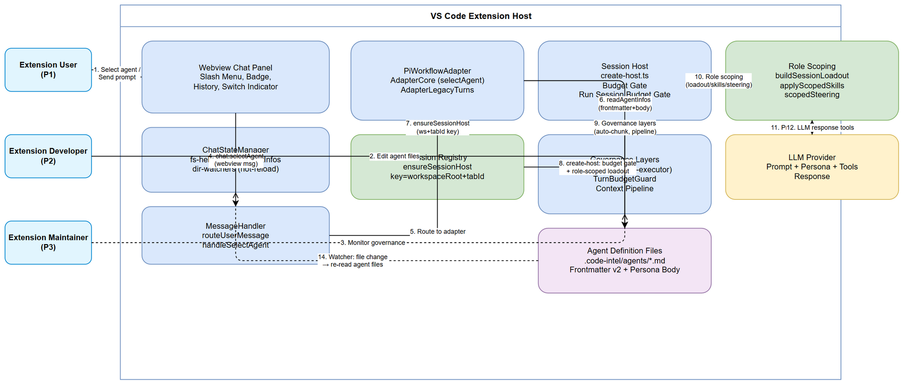
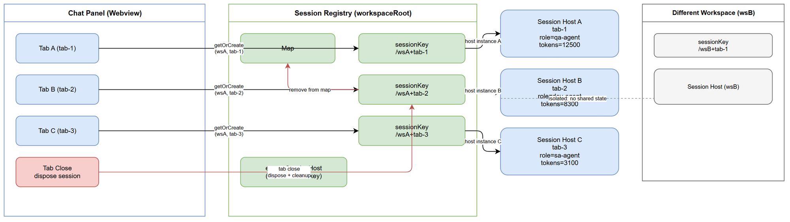
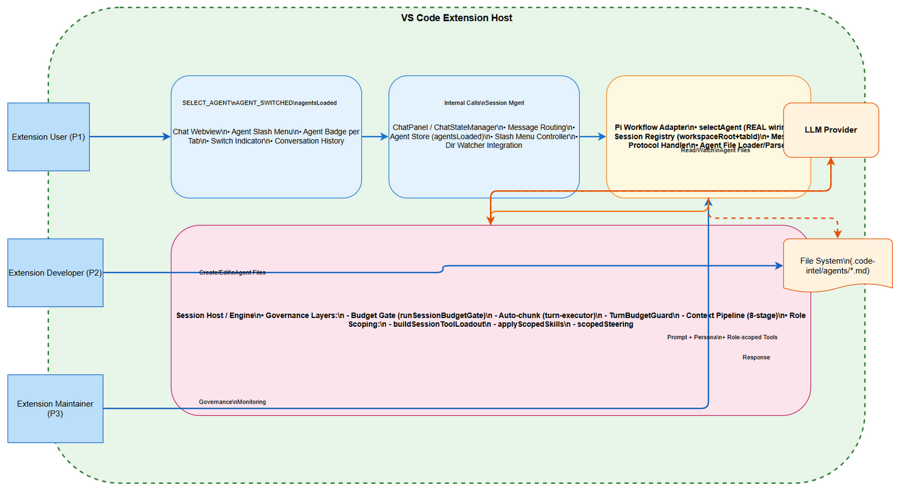
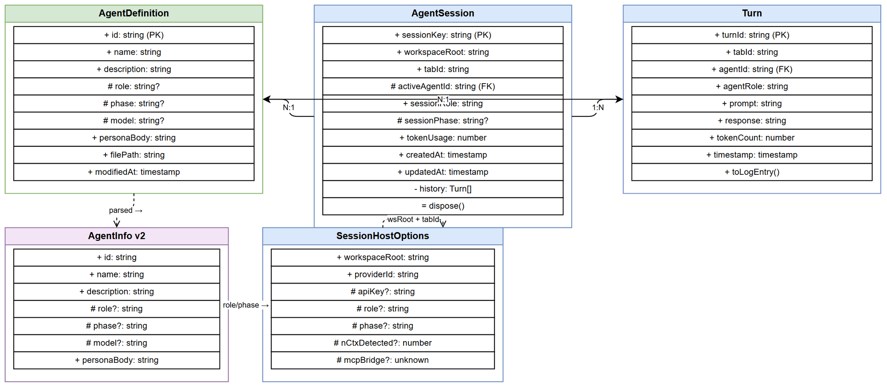
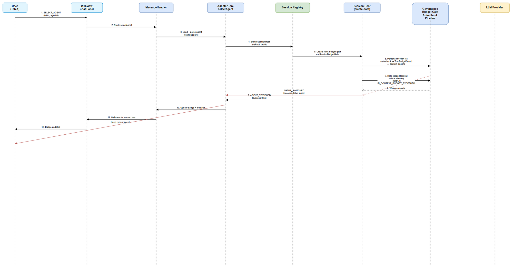

# Technical Design Document (TDD)

## SA4E-370: Custom Agents — real file-defined agent personas wired into the chat engine (identity, role scoping, per-tab sessions)

---

## Document Information

| Field | Value |
|-------|-------|
| Jira Ticket | SA4E-370 |
| Title | Custom Agents — real file-defined agent personas wired into the chat engine (identity, role scoping, per-tab sessions) |
| Author | SA Agent — Solution Architect |
| Version | 1.0 |
| Date | 2026-10-19 |
| Status | Draft |
| Related BRD | documents/SA4E-370/BRD.md |
| Related FSD | documents/SA4E-370/FSD.md |

---

## Author Tracking

| Role | Name - Position | Responsibility |
|------|-----------------|----------------|
| Author | SA Agent – Solution Architect | Create document |
| Peer Reviewer | Duc Nguyen Minh – Product Owner | Review document |

---

## Revision History

| Version | Date | Author | Changes |
|---------|------|--------|---------|
| 1.0 | 2026-10-19 | SA Agent | Initiate document — auto-generated from BRD and FSD |

---

## Sign-Off

| Name | Signature and date |
|------|--------------------|
| | ☐ I agree and confirm the technical design in this TDD |

---

## Diagram Index

| # | Diagram | Image | Source (editable) |
|---|---------|-------|-------------------|
| 1 | Architecture | [architecture.png](diagrams/architecture.png) | [architecture.drawio](diagrams/architecture.drawio) |
| 2 | Sequence — Agent Switch w/ Governance | [api-sequence-agent-switch.png](diagrams/api-sequence-agent-switch.png) | [api-sequence-agent-switch.drawio](diagrams/api-sequence-agent-switch.drawio) |
| 3 | Registry — Per-Tab Isolation | [registry-per-tab.png](diagrams/registry-per-tab.png) | [registry-per-tab.drawio](diagrams/registry-per-tab.drawio) |
| 4 | State Machine — Agent Session Lifecycle | [state-machine-agent-session.png](diagrams/state-machine-agent-session.png) | [state-machine-agent-session.drawio](diagrams/state-machine-agent-session.drawio) |
| 5 | Data Model — ER → TS | [data-model.png](diagrams/data-model.png) | [data-model.drawio](diagrams/data-model.drawio) |

---

## 1. Introduction

### 1.1 Purpose

This TDD specifies **how** to implement the Custom Agents feature defined in BRD/FSD for ticket SA4E-370. It focuses on technology choices, architecture decisions, implementation patterns, and deployment concerns. Functional requirements, business rules, use cases, and UI specifications are defined in the FSD.

### 1.2 Scope

The TDD covers the four locked stories:

- **S1** — Agent definition format v2 (.code-intel/agents/*.md with persona body, extended frontmatter 
ole/phase/model, backward-compatible parser, hot-reload propagation)
- **S2** — Real selectAgent wiring (load/parse agent file, inject persona through governance layers, set SessionHostOptions.role/phase, activate role-scoped loadout/skills/steering, retire cosmetic prefix)
- **S3** — Per-tab / per-agent session isolation (registry key workspaceRoot+tabId, per-tab token accounting + compaction). **Design ONCE — shared with SA4E-369 D1.**
- **S4** — UI truthfulness (agent badge per tab, switch indicator, AGENT_SWITCHED only after successful wiring, per-agent conversation identity in history)

### 1.3 Technology Stack

| Layer | Technology | Version |
|-------|-----------|---------|
| Language | TypeScript | ~5.x |
| Extension Host | VS Code Extension API | 1.x |
| Message Protocol | JSON over VS Code webview postMessage | — |
| Session Host | pi-coding-agent (AgentSession) | @earendil-works/pi-coding-agent |
| Build Tool | vsce / npm | — |
| Testing | vitest | — |
| Lint | ESLint | — |

### 1.4 Design Principles

- **No new dependencies** — reuse existing s-helpers, dir-watchers, create-host, loadout, 
egistry, scopedSteering, 
unSessionBudgetGate
- **Backward compatible** — v1 agent files (name+description only) must continue to load
- **Fail-open** — role scoping errors fall back to base loadout; turn continues
- **Governance intact** — every turn (including persona injection) passes through all 4 governance layers
- **Per-tab isolation** — no history or token accounting leak between tabs
- **Draw.io only** — no Mermaid diagrams (project convention)

### 1.5 Constraints

- Context governance layers MUST NOT be bypassed
- S3 = D1 design ONCE — do not duplicate with SA4E-369
- Zero new config files/keys for local agent identity
- No new network sockets from this feature
- Agent .md files are read + parse only — no code execution

### 1.6 References

| Document | Location |
|----------|----------|
| BRD | documents/SA4E-370/BRD.md |
| FSD | documents/SA4E-370/FSD.md |
| Project conventions | AGENTS.md (draw.io only, never Mermaid) |
| CODE INTELLIGENCE | .analysis/code-intelligence/ (not present — code read directly) |

## 2. System Architecture

### 2.1 Architecture Overview

The Custom Agents feature operates within the VS Code Extension Host. The extension webview (chat panel) communicates with the Pi Workflow Adapter via the message protocol (postMessage). The Adapter orchestrates the Session Host which runs the LLM engine with governance layers. Agent definition files reside in the workspace .code-intel/agents/ directory and are watched for changes.

**Internal Actors:**
- **Extension User (P1)** — Operates chatbox, selects agents per tab, sends prompts
- **Extension Developer (P2)** — Creates/edits agent .md files in workspace
- **Extension Maintainer (P3)** — Maintains governance layers, session lifecycle

**External Systems:**
- **VS Code Extension Host** — workspace, webview, file system access, message passing
- **File System** — stores agent definition files (.code-intel/agents/*.md)
- **LLM Provider** — executes turns with injected persona + role-scoped tool loadout

### 2.2 Component Diagram

The feature modifies the following architectural components:

| Component | Current State | Target State (This Feature) |
|-----------|---------------|------------------------------|
| Agent Definition Parser (s-helpers.ts) | Parses frontmatter only (
ame, description) | Parses v2 frontmatter (
ole, phase, model) + body as personaBody |
| Hot-reload Watcher (dir-watchers.ts) | Sends gentsLoaded with v1 AgentInfo | Sends gentsLoaded with v2 AgentInfo (extended fields) |
| selectAgent (dapter-core.ts) | Stub — emits chat:agentSwitched only | Loads agent file, parses v2, injects persona, sets role/phase |
| Message Routing (message-routing.ts) | Prefixes task with [Agent: X] | No prefix; persona injected via context governance |
| Session Registry (
egistry.ts) | Key = workspaceRoot (shared) | Key = workspaceRoot+tabId (per-tab isolation) |
| Context Compaction (context-compaction.ts, context-usage.ts) | Hardcoded 	abId="default" | Per-tab token accounting using actual 	abId |
| Session Host (create-host.ts, loadout.ts) | Hardcoded 'sm-agent' role | Role/phase from agent definition → scoped loadout/skills/steering |

### 2.3 Deployment Architecture

**Deployment:** VS Code Extension (single process, runs in extension host).
- Webview ↔ Extension Host: JSON over VS Code postMessage
- Extension Host ↔ File System: Node.js s APIs
- Extension Host ↔ LLM Provider: HTTP (provider-specific)

No containerization, no microservices — the extension runs entirely in the VS Code extension host process.

### 2.4 Communication Patterns

| From | To | Protocol | Pattern | Description |
|------|----|----------|---------|-------------|
| Webview | ChatPanel | VS Code postMessage | Sync | chat:selectAgent, chat:userMessage, tab events |
| ChatPanel | AdapterCore | TypeScript method call | Sync | selectAgent(agentId), invokeChat(text) |
| AdapterCore | Session Registry | TypeScript method call | Sync | nsureSessionHost({workspaceRoot, tabId, ...}) |
| Session Host | LLM Provider | HTTP | Async | Prompt with persona + role-scoped tools → response |
| File System Watcher | ChatStateManager | VS Code FileSystemWatcher | Async | File change → re-parse agent files → gentsLoaded |

## 3. API Design

### 3.1 API Overview

The Custom Agents feature uses the existing VS Code webview message protocol (message-protocol.ts). No new HTTP endpoints are created. Messages flow between Webview (frontend) and Extension Host (backend).

| # | Message | Direction | Description | Source |
|---|---------|-----------|-------------|--------|
| 1 | chat:selectAgent | Webview → Extension | User selects agent for tab | UC-2, FR-05 |
| 2 | chat:agentsLoaded | Extension → Webview | Push updated agent list after discovery/hot-reload | UC-1, FR-04 |
| 3 | chat:agentSwitched | Extension → Webview | Confirm agent switch completed (success/failure) | UC-2, FR-11 |
| 4 | 	ab:create / 	ab:switch | Webview → Extension | Tab lifecycle triggers session creation | UC-3, FR-09 |
| 5 | chat:userMessage | Webview → Extension | User sends prompt (runs on per-tab session) | UC-3 |

### 3.2 API: chat:selectAgent

**Implements:** UC-2, FR-05, FR-06, FR-07, FR-08, FR-11

| Attribute | Value |
|-----------|-------|
| Direction | Webview → Extension |
| Message Type | chat:selectAgent |
| Path | N/A (VS Code message protocol) |
| Auth | None (VS Code workspace trust) |
| Rate Limit | None |

**Request Payload:**

`json
{
  "type": "chat:selectAgent",
  "agentId": "qa-agent"
}
`

| Field | Type | Required | Description |
|-------|------|----------|-------------|
| type | string | Yes | "chat:selectAgent" |
| agentId | string | Yes | Agent ID (filename without .md) |

**Response — chat:agentSwitched (success):**

`json
{
  "type": "chat:agentSwitched",
  "agentId": "qa-agent",
  "agentName": "QA Agent",
  "success": true,
  "tabId": "tab-1",
  "sessionRole": "qa-agent",
  "sessionPhase": "testing"
}
`

**Response — chat:agentSwitched (failure):**

`json
{
  "type": "chat:agentSwitched",
  "agentId": "previous-agent",
  "agentName": "Previous Agent",
  "success": false,
  "tabId": "tab-1",
  "error": "Failed to load agent: file not found"
}
`

| Status | Code | Message | When |
|--------|------|---------|------|
| success | — | Wiring complete | Persona injected, role/phase set, loadout applied |
| failure | PI_CONTEXT_BUDGET_EXCEEDED | Persona too large for budget | 
unSessionBudgetGate rejects |
| failure | — | File read/parse error | Agent file missing or invalid YAML |
| failure | — | Role invalid | Fallback to default role + warning (BR-07) |

### 3.3 API: chat:agentsLoaded

**Implements:** UC-1, FR-01, FR-02, FR-03, FR-04

| Attribute | Value |
|-----------|-------|
| Direction | Extension → Webview |
| Message Type | chat:agentsLoaded |

**Response Payload:**

`json
{
  "type": "chat:agentsLoaded",
  "agents": [
    {
      "id": "qa-agent",
      "name": "QA Agent",
      "description": "Quality engineering agent",
      "role": "qa-agent",
      "phase": "testing",
      "model": null,
      "personaBody": "You are the QA agent..."
    }
  ]
}
`

| Field | Type | Required | Description |
|-------|------|----------|-------------|
| agents | AgentInfo[] | Yes | Array of parsed v2 AgentInfo |

### 3.4 API: tab:create / tab:switch

**Implements:** UC-3, FR-09

| Attribute | Value |
|-----------|-------|
| Direction | Webview → Extension |
| Message Type | 	ab:create / 	ab:switch |

**Request Payload:**

`json
{
  "type": "tab:switch",
  "payload": { "tabId": "tab-2" }
}
`

### 3.5 Internal API: ensureSessionHost

**Implements:** UC-3, FR-09, FR-10

`	ypescript
ensureSessionHost(opts: SessionHostOptions): Promise<SessionHost>
`

| Parameter | Type | Required | Description |
|-----------|------|----------|-------------|
| workspaceRoot | string | Yes | Workspace root path |
| tabId | string | Yes | Tab identifier (NOT "default") |
| providerId | string | Yes | LLM provider ID |
| role? | string | No | Role from agent definition |
| phase? | string | No | Phase from agent definition |
| nCtxDetected? | number | No | Detected context window |
| mcpBridge? | unknown | No | MCP bridge for skeleton |

**Returns:** Promise<SessionHost> — per-tab session host with promptTurn, getSessionFile, dispose.

### 3.6 Error Response Format

All error responses follow the existing pattern:

`json
{
  "type": "chat:error",
  "code": "PI_CONTEXT_BUDGET_EXCEEDED",
  "message": "Human readable error message",
  "retryable": false
}
`

**Error Codes:**

| Code | HTTP Equivalent | Description |
|------|-----------------|-------------|
| PI_CONTEXT_BUDGET_EXCEEDED | 413 | Persona + context exceeds budget gate |
| PI_MODEL_UNRESOLVED | 400 | No usable model resolved |
| PI_CREDENTIALS_MISSING | 401 | No API key for provider |
| PI_SESSION_TIMEOUT | 504 | Session turn timed out |
| PI_TURN_FAILED | 500 | Turn execution failed |

## 4. Database Design

### 4.1 Schema Overview

This feature does **not** introduce a persistent database. All data is held in-memory within the extension host process:

| Entity | Storage | Persistence |
|--------|---------|-------------|
| AgentDefinition | In-memory (parsed from .md files) | File system (.code-intel/agents/*.md) |
| AgentSession | In-memory (registry Map) | None (per-session lifetime) |
| Turn | In-memory (AgentSession history) | .pi/sessions/*.jsonl via pi-coding-agent SessionManager |

### 4.2 TypeScript Data Model (ER → TS)

**AgentDefinition** (parsed from agent .md file):

`	ypescript
export interface AgentDefinition {
  id: string;              // filename without extension, unique within workspace
  name: string;            // frontmatter name or filename fallback
  description: string;     // frontmatter description or ""
  role?: string;           // frontmatter role, validated against SA4E-355 matrix
  phase?: string;          // frontmatter phase
  model?: string;          // frontmatter model override (optional)
  personaBody: string;     // markdown body = system prompt content
  filePath: string;        // .code-intel/agents/<id>.md
  modifiedAt: number;      // file mtime timestamp
}
`

**AgentSession** (per-tab, registry keyed by workspaceRoot+tabId):

`	ypescript
export interface AgentSession {
  sessionKey: string;      // workspaceRoot + tabId (composite key)
  workspaceRoot: string;
  tabId: string;           // never "default"
  activeAgentId?: string;  // references AgentDefinition.id
  sessionRole: string;     // from agent definition or default
  sessionPhase?: string;   // from agent definition
  tokenUsage: number;      // per-tab token accounting
  createdAt: number;
  updatedAt: number;
  history: Turn[];         // conversation history, tagged with agentId
  dispose(): void;         // cleanup on tab close
}
`

**Turn** (history entry):

`	ypescript
export interface Turn {
  turnId: string;          // unique per turn
  tabId: string;
  agentId: string;         // driving agent identity (FR-12 / BR-S4-03)
  agentRole: string;       // role at time of turn
  prompt: string;
  response: string;
  tokenCount: number;
  timestamp: number;
}
`

**AgentInfo v2** (parsed output for webview):

`	ypescript
export interface AgentInfo {
  id: string;
  name: string;
  description: string;
  role?: string;
  phase?: string;
  model?: string;
  personaBody: string;
}
`

**SessionHostOptions** (input to create-host.ts):

`	ypescript
export interface SessionHostOptions {
  workspaceRoot: string;
  providerId: string;
  apiKey?: string;
  baseUrl?: string;
  configuredModelId?: string;
  role?: string;
  phase?: string;
  nCtxDetected?: number;
  mcpBridge?: unknown;
}
`

### 4.3 Relationships

| From | To | Cardinality | Description |
|------|----|-------------|-------------|
| AgentSession | AgentDefinition | N:1 | Session references active agent |
| AgentSession | Turn | 1:N | Session contains ordered turns |
| Turn | AgentDefinition | N:1 | Turn tagged with driving agent |

### 4.4 Migration Plan

No database migration required — this feature uses existing in-memory structures and file-system agent definitions. The only migration is the registry key change from workspaceRoot to workspaceRoot+tabId:

| Step | Action | Risk |
|------|--------|------|
| 1 | Change 
egistry.ts key from workspaceRoot to workspaceRoot+tabId | Low — existing sessions discarded |
| 2 | Update context-compaction.ts and context-usage.ts to use real 	abId | Low — per-tab accounting |
| 3 | Update create-host.ts to accept 	abId in options | Low — backward compatible |

### 4.5 Query Patterns

| Operation | Pattern | Expected Performance |
|-----------|---------|---------------------|
| Get session for tab | 
egistry.getOrCreateSession(wsRoot, tabId) | O(1) Map lookup |
| List all agents | s.readdirSync(agentsDir) + parse each | O(N) where N = agent files |
| Agent switch wiring | Load + parse + governance + loadout | < 500ms (NFR) |
| Tab close dispose | session.dispose() + registry delete | O(1) |

## 5. Class / Module Design

### 5.1 Package Structure

`
extension/src/
├── chat-panel/
│   ├── ChatStateManager/
│   │   ├── fs-helpers.ts          # MODIFIED: parseAgentFrontmatter v2, readAgentInfos v2
│   │   └── dir-watchers.ts        # UNCHANGED: createAgentWatcher (SA4E-189)
│   ├── message-routing.ts         # MODIFIED: retire [Agent: X] prefix
│   ├── message-protocol.ts        # MODIFIED: add v2 AgentInfo fields, AGENT_SWITCHED fields
│   └── message-handler.ts         # MODIFIED: handleSelectAgent → success/error response
├── pi-workflow/
│   ├── pi-workflow-adapter/
│   │   ├── adapter-core.ts        # MODIFIED: selectAgent real implementation
│   │   ├── adapter-session-turns.ts # MODIFIED: pass tabId + role/phase to session
│   │   └── adapter-legacy-turns.ts  # MODIFIED: role from agent def, not hardcoded
│   ├── session-host/
│   │   ├── registry.ts            # MODIFIED: key = workspaceRoot + tabId
│   │   ├── create-host.ts         # MODIFIED: accept personaBody, role, phase
│   │   ├── loadout.ts             # UNCHANGED: buildSessionLoadout (role-scoped)
│   │   ├── types.ts               # MODIFIED: SessionHostOptions additions
│   │   └── turn-executor.ts       # UNCHANGED: per-turn auto-chunk
│   ├── pi-context-pipeline.ts     # UNCHANGED: 8-stage context pipeline
│   └── legacy-turn-governance.ts  # UNCHANGED: budget gate + compaction
├── pi-agent/
│   ├── session-budget-gate.ts     # UNCHANGED: runSessionBudgetGate
│   ├── scoped-steering.ts         # UNCHANGED: scopedSteering
│   └── role-scope.ts              # UNCHANGED: RoleScopeFilter
└── chat-panel/
    └── chat-panel-provider/
        ├── context-compaction.ts  # MODIFIED: tabId from context, not "default"
        └── context-usage.ts       # MODIFIED: tabId from context, not "default"
`

### 5.2 Key Interfaces

**AgentInfo v2** (s-helpers.ts):

`	ypescript
export interface AgentInfo {
  id: string;
  name: string;
  description: string;
  role?: string;
  phase?: string;
  model?: string;
  personaBody: string;
}
`

**SessionHostOptions** (session-host/types.ts):

`	ypescript
export interface SessionHostOptions {
  workspaceRoot: string;
  providerId: string;
  apiKey?: string;
  baseUrl?: string;
  configuredModelId?: string;
  role?: string;
  phase?: string;
  nCtxDetected?: number;
  mcpBridge?: unknown;
  personaBody?: string;           // NEW: injected persona for system prompt
  activeAgentId?: string;         // NEW: agent driving this session
}
`

### 5.3 Design Patterns

| Pattern | Where Used | Rationale |
|---------|-----------|-----------|
| Registry | 
egistry.ts | Centralized session lifecycle management, per-tab isolation |
| Factory | create-host.ts | Create SessionHost with governance + loadout wiring |
| Strategy | loadout.ts | Role-scoped tool loadout selection |
| Observer | dir-watchers.ts | File system watcher triggers agent list refresh |
| Fail-open | overrides.ts (ailOpenOverride) | Role scoping errors fall back to base content |
| Chain of Responsibility | Governance layers | Budget gate → auto-chunk → TurnBudgetGuard → context pipeline |

### 5.4 Error Handling

| Exception | Code | When Thrown | Handling |
|-----------|------|-------------|----------|
| PiContextBudgetExceededError | PI_CONTEXT_BUDGET_EXCEEDED | Persona + context exceeds budget | AGENT_SWITCHED success=false, keep current agent |
| File read error | — | Agent file missing/unreadable | AGENT_SWITCHED success=false, keep current agent |
| YAML parse error | — | Invalid frontmatter | Skip file, log diagnostic, continue discovery |
| Invalid role | — | Role not in SA4E-355 matrix | Fallback to default role + warning (BR-07) |
| Invalid model | — | Model not supported | Ignore override, use default + warning (BR-03) |
| Role scoping error | — | uildSessionToolLoadout throws | Fallback to base loadout + warning (BR-07) |

### 5.5 Dependency Injection

- AdapterCore receives onEvent callback for webview messaging
- nsureSessionHost receives SessionHostOptions including mcpBridge (optional, degraded if absent)
- createHost accepts optional sessionManager, settingsManager, 
esourceLoader for test injection

## 6. Integration Design

### 6.1 External System: VS Code Extension Host

| Attribute | Value |
|-----------|-------|
| Protocol | VS Code webview postMessage / onDidReceiveMessage |
| Endpoint | In-process (extension host) |
| Authentication | None (VS Code workspace trust model) |
| Timeout | 30s session ensure timeout (
egistry.ts) |
| Retry Policy | None (fail-fast with error message) |
| Circuit Breaker | None |

**Data Mapping:**

| Source Field | Target Field | Transformation |
|-------------|-------------|----------------|
| chat:selectAgent.agentId | selectAgent(agentId) | Direct pass-through |
| Agent file content | AgentInfo v2 | Parse YAML frontmatter + extract body |
| SELECT_AGENT | AGENT_SWITCHED | Add success/error fields |

### 6.2 External System: File System (Workspace)

| Attribute | Value |
|-----------|-------|
| Protocol | Node.js s APIs (readFileSync, readdirSync, watch) |
| Endpoint | .code-intel/agents/ under workspace root |
| Direction | Read agent files (extension), write agent files (developer) |
| Data Format | Markdown with YAML frontmatter |

### 6.3 External System: LLM Provider

| Attribute | Value |
|-----------|-------|
| Protocol | Provider-specific (OpenAI-compatible, Anthropic, etc.) |
| Endpoint | Configured via sdlcAgents settings |
| Authentication | API key from VS Code secret storage |
| Timeout | Provider-dependent |
| Retry Policy | Provider-dependent |

**Data Mapping:**

| Source Field | Target Field | Transformation |
|-------------|-------------|----------------|
| Prompt + personaBody | LLM request | Prepend persona as system prompt |
| Role-scoped tools | LLM request | Filtered tool allowlist |
| LLM response | Response text | Return to originating tab |

### 6.4 Sequence Diagram: Agent Switch w/ Governance

**Sequence Flow (12 steps):**

1. User selects agent in slash menu → Webview sends chat:selectAgent {tabId, agentId}
2. Webview → MessageHandler routes to adapter
3. AdapterCore.selectAgent loads agent file .code-intel/agents/<agentId>.md
4. Parser extracts v2 AgentInfo (frontmatter + personaBody)
5. Adapter calls nsureSessionHost({workspaceRoot, tabId, role, phase, ...})
6. Session Host runs budget gate 
unSessionBudgetGate with persona injection
7. Persona injected through governance: auto-chunk → TurnBudgetGuard → context pipeline
8. Role-scoped loadout/skills/steering applied
9. Wiring complete → return success to adapter
10. Adapter emits AGENT_SWITCHED {success: true} → webview
11. Webview updates agent badge + switch indicator
12. User sees badge updated with active agent name

**Error Path:** If budget gate rejects (PI_CONTEXT_BUDGET_EXCEEDED) or file load fails, AGENT_SWITCHED {success: false, error: ...} is emitted, current agent is retained, UI shows error toast.

### 6.5 Retry / Timeout / Fallback

| Scenario | Policy |
|----------|--------|
| Session ensure timeout (30s) | Reject with PI_SESSION_TIMEOUT, remove from cache |
| Budget gate reject | Fail — do NOT silently lower governance |
| Role scoping error | Fail-open to base loadout (BR-07) |
| Model override invalid | Ignore + warning, use default (BR-03) |
| MCP bridge absent | Degraded mode — skeleton/read_method omitted |

## 7. Security Design

### 7.1 Authentication

No authentication within the feature — relies on VS Code workspace trust model. Users operate within their own workspace; agent .md files are workspace files controlled by the user.

### 7.2 Authorization

| Role | Permissions |
|------|-------------|
| Extension User (P1) | Select agents per tab, send prompts, view history |
| Extension Developer (P2) | Create/edit agent files in workspace file system |
| Extension Maintainer (P3) | View governance metrics, manage test suites (no UI) |

### 7.3 Data Protection

| Data Type | At Rest | In Transit | In Logs |
|-----------|---------|------------|---------|
| Agent definition files | Plain (workspace files) | N/A (local FS) | Not logged |
| Persona body | In-memory only | N/A (local process) | Not logged |
| Session history | In-memory + .jsonl transcript | N/A | Not logged |
| Token usage metrics | In-memory only | 	ab:contextUpdate to webview | Debug log (counts only) |

### 7.4 Input Validation

| Field | Validation | Sanitization |
|-------|-----------|--------------|
| gentId | Must exist in gentsLoaded list | None (filename-derived) |
| 	abId | Non-empty, never "default" | None |
| 
ole | Must match SA4E-355 role matrix | None (fallback to default) |
| model | Must be supported model identifier | None (fallback to default) |
| personaBody | Non-empty when persona declared | None (trusted workspace file) |

### 7.5 Trust Posture

- Agent .md files are **read + parse only** — no code execution
- No new network sockets from this feature
- Persona injection goes through ALL governance layers (no bypass)
- Malicious agent files can only affect the user's own workspace

### 7.6 Audit Trail

| Event | Logged Fields | Retention |
|-------|--------------|-----------|
| Agent switch | tabId, agentId, success, timestamp, error | Session lifetime |
| Budget gate reject | tabId, agentId, tokenCount, limit, timestamp | Session lifetime |
| Agent file parse error | filePath, error, timestamp | Session lifetime |
| Session create/dispose | sessionKey, tabId, timestamp | Session lifetime |

## 8. Performance & Scalability

### 8.1 Performance Targets

| Operation | Target | Measurement |
|-----------|--------|-------------|
| Agent switch wiring | < 500ms perceived | From chat:selectAgent to AGENT_SWITCHED |
| Hot-reload propagate | < 2s | File change → gentsLoaded on webview |
| Session create | O(1) Map lookup | 
egistry.getOrCreateSession |
| Agent list parse | O(N) where N = agent files | 
eadAgentInfos directory scan |

### 8.2 Caching Strategy

| Cache | What | TTL | Eviction | Technology |
|-------|------|-----|----------|------------|
| Session host cache | Map<sessionKey, Promise<SessionHost>> | Session lifetime | Tab close → dispose + delete | In-memory |
| Agent info cache | Re-parsed on file watcher event | 300ms debounce | File change → re-parse | In-memory |

### 8.3 Scalability

- Registry supports ≥ 10 concurrent tabs without degradation
- Per-tab token accounting — no shared state between tabs
- Session dispose clean on tab close (no memory leak)
- Each tab has independent budget gate, auto-chunk, TurnBudgetGuard, context pipeline

### 8.4 Connection Pooling

Not applicable — no database or external connection pooling. LLM provider connections are managed by the provider SDK.

## 9. Monitoring & Observability

### 9.1 Logging

| Log Event | Level | Fields | Destination |
|-----------|-------|--------|-------------|
| Agent switch | INFO | tabId, agentId, success, latency | Console |
| Budget gate result | INFO/WARN | tabId, tokens, limit, decision | Console + logger |
| Role scoping applied | INFO | role, phase, tool count | Console |
| Agent file parse error | WARN | filePath, error | Console |
| Session create/dispose | INFO | sessionKey, tabId | Console |
| Steering capped | INFO | dropped count, remaining tokens, cap | Console |

### 9.2 Metrics

| Metric | Type | Description | Alert Threshold |
|--------|------|-------------|-----------------|
| Agent switch latency | Histogram | Time from select to AGENT_SWITCHED | > 500ms |
| Budget gate rejects | Counter | Persona/context budget exceeded | Any reject |
| Session count | Gauge | Active per-tab sessions | > 10 concurrent |
| Hot-reload latency | Histogram | File change → agentsLoaded | > 2s |

### 9.3 Health Checks

| Endpoint | Checks | Expected Response |
|----------|--------|-------------------|
| Extension activation | Agent parser loads, registry initializes | Extension activates without error |
| Agent discovery | .code-intel/agents/ readable | gentsLoaded emitted with agent list |

## 10. Deployment Considerations

### 10.1 Environment Configuration

No environment-specific configuration required — zero new config files/keys.

### 10.2 Feature Flags

| Flag | Default | Description |
|------|---------|-------------|
| None | — | Zero-config design (NFR) |

### 10.3 Rollback Strategy

1. Revert 
egistry.ts key to workspaceRoot only
2. Revert context-compaction.ts and context-usage.ts to 	abId="default"
3. Revert dapter-core.ts selectAgent to stub
4. Revert s-helpers.ts parser to v1
5. All changes are in-memory — no database migration to rollback

## 11. E2E Test Architecture

### 11.1 Framework & Language

- **Framework**: vitest (unit/integration) — matches project's existing test setup
- **Language**: TypeScript
- **Test locations**: xtension/src/pi-workflow/__tests__/, xtension/src/chat-panel/__tests__/
- **Note**: All test code uses TypeScript to share types with production code

### 11.2 Test Structure

- Unit tests: xtension/src/**/*.test.ts
- Integration tests: xtension/src/pi-workflow/__tests__/pi-workflow-adapter.e2e.test.ts
- E2E tests: xtension/src/pi-workflow/__tests__/pi-workflow-e2e.integration.test.ts

### 11.3 Reusable Components

- **Test helpers**: ridge-wiring-session-mocks.ts, gate-testdata.ts
- **Fixtures**: Mock agent .md files, mock session hosts, mock LLM providers
- **Setup**: clearSessionHostCache() test hook, clearContextPipelineCache() test hook

### 11.4 E2E Test Design for Custom Agents

**File:** custom-agents.e2e.test.ts (new)

Test cases:
| ID | Scenario | Description |
|----|----------|-------------|
| TC-S1-01 | Parse v2 agent file | Valid .md with role, phase, model, personaBody → AgentInfo v2 |
| TC-S1-02 | Parse v1 agent file | Backward compat: only name+description → role/phase/model undefined |
| TC-S1-03 | Invalid YAML | File skipped, diagnostic logged, other agents loaded |
| TC-S2-01 | Select agent wires persona + role | Session has persona in context; role/phase set; loadout scoped |
| TC-S2-02 | Budget gate rejects large persona | AGENT_SWITCHED success=false, PI_CONTEXT_BUDGET_EXCEEDED |
| TC-S2-03 | AGENT_SWITCHED only after wiring | Message emitted after loadout/skills/steering applied |
| TC-S2-04 | Cosmetic prefix retired | No [Agent: X] prefix in prompt sent to engine |
| TC-S3-01 | Two tabs = two sessions | Separate history, separate token accounting |
| TC-S3-02 | Compaction uses tabId | context-compaction.ts uses real tabId, not "default" |
| TC-S3-03 | Tab close disposes session | Session removed, other tabs unaffected |
| TC-S4-01 | Badge shows correct agent per tab | Different agents on different tabs |
| TC-S4-02 | Switch indicator truthfulness | idle → switching → success (not success before wiring) |

Auth setup: No authentication needed — VS Code workspace trust.
Data cleanup: clearSessionHostCache() after each test; temp agent files cleaned up.

### 11.5 Regression Tests

Existing suites that must remain green:
- 
ole-scope-wiring.test.ts
- 	ool-loadout-roles.test.ts
- context-governance.*
- uto-chunk tests
- Session routing tests

## 12. Processing Logic

### 12.1 Agent File Discovery & Parsing (S1)

**Trigger:** Extension startup, file watcher event (create/update/delete in .code-intel/agents/)
**Input:** Directory .code-intel/agents/
**Output:** AgentInfo[] (v2) sent via chat:agentsLoaded

| Step | Description | Error Handling |
|------|-------------|----------------|
| 1 | Read directory .code-intel/agents/ | Log error, return empty array |
| 2 | For each .md file: read content | Skip file, log, continue |
| 3 | Parse YAML frontmatter | Skip file, log diagnostic (BR-04) |
| 4 | Extract body as personaBody | Empty body -> empty string, log warning |
| 5 | Validate role against role matrix | Set undefined, log warning |
| 6 | Validate model against supported | Set undefined, log warning |
| 7 | Construct AgentInfo v2 | |
| 8 | Emit chat:agentsLoaded to webview | |

### 12.2 Agent Selection & Wiring (S2)

**Trigger:** chat:selectAgent message received
**Input:** tabId, agentId
**Output:** chat:agentSwitched result; updated session state

| Step | Description | Error Handling |
|------|-------------|----------------|
| 1 | Validate agentId exists in current agent list | Return error, keep current agent |
| 2 | Load agent file .code-intel/agents/<agentId>.md | Return error, keep current agent |
| 3 | Parse v2 AgentInfo (reuse discovery parser) | Return error, keep current agent |
| 4 | Get/create session for tabId (registry wsRoot+tabId) | Create new if not exists |
| 5 | Inject personaBody into session context via governance: | |
| 5a | Run static budget gate runSessionBudgetGate | REJECT -> return error, keep current agent |
| 5b | Auto-chunk if needed | Proceed |
| 5c | TurnBudgetGuard check | Proceed |
| 5d | Context pipeline 8-stage | Proceed |
| 6 | Set SessionHostOptions.role = agent role or default | Invalid role -> default + warning (BR-07) |
| 7 | Set SessionHostOptions.phase = agent phase or default | |
| 8 | Apply model override if valid | Invalid -> ignore + warning (BR-03) |
| 9 | Rebuild tool loadout via buildSessionLoadout (role-scoped) | Error -> base loadout + warning (BR-07) |
| 10 | Apply scoped skills via applyScopedSkills | Error -> base skills + warning (BR-07) |
| 11 | Apply scoped steering via scopedSteering | Error -> base steering + warning (BR-07) |
| 12 | Emit chat:agentSwitched with success=true | |

### 12.3 Per-tab Session Lifecycle (S3)

**Trigger:** Tab open/close, session access
**Input:** workspaceRoot, tabId
**Output:** AgentSession instance

| Step | Description | Error Handling |
|------|-------------|----------------|
| 1 | Compute sessionKey = workspaceRoot + tabId | |
| 2 | Check registry for existing session | |
| 3 | If exists: return session | |
| 4 | If not: create new AgentSession with sessionKey | Fail -> error to caller |
| 5 | Initialize tokenUsage = 0, empty history | |
| 6 | On tab close: dispose session, cleanup token accounting | Log error if dispose fails |
| 7 | On session access: update timestamp | |

### 12.4 UI Truthfulness (S4)

**Trigger:** chat:agentSwitched received
**Input:** tabId, agentId, success, error
**Output:** Badge update, indicator state

| Step | Description |
|------|-------------|
| 1 | If success=true: update badge to new agent name, show success indicator |
| 2 | If success=false: keep current badge, show error toast with message |
| 3 | Switch indicator state: idle -> switching -> success/error |
| 4 | History entries tagged with agentId + agentRole |

## 13. Traceability Matrix

| FSD Requirement | TDD Section | Design Element | Status |
|-----------------|-------------|----------------|--------|
| FR-01 Persona body semantics | 5.1, 5.2 | AgentInfo.personaBody | Designed |
| FR-02 Extended frontmatter | 5.2 | AgentInfo.role/phase/model | Designed |
| FR-03 Backward compatibility | 5.4 | Fallback to defaults | Designed |
| FR-04 Hot-reload | 6.1, 12.1 | dir-watchers.ts + agentsLoaded | Designed |
| FR-05 Real selectAgent | 5.1, 5.2 | adapter-core.ts selectAgent | Designed |
| FR-06 Persona injection | 6.4, 12.2 | Governance layers (budget gate -> pipeline) | Designed |
| FR-07 Role/phase from definition | 5.2, 12.2 | SessionHostOptions.role/phase | Designed |
| FR-08 Role-scoped engine | 5.1, 5.3 | buildSessionLoadout, scopedSteering | Designed |
| FR-09 Per-tab session | 5.1, 4.2 | registry.ts key wsRoot+tabId | Designed |
| FR-10 Per-tab budget/compaction | 4.2, 5.1 | context-compaction.ts, context-usage.ts | Designed |
| FR-11 UI truthfulness | 5.1, 12.4 | AGENT_SWITCHED after wiring only | Designed |
| FR-12 Per-agent conversation identity | 4.2 | Turn.agentId, Turn.agentRole | Designed |
| FR-13 Model override | 5.2, 12.2 | SessionHostOptions.model | Designed |
| BR-01 Governance layers | 6.4 | All 4 layers in sequence | Designed |
| BR-02 Persona token cost | 6.4, 12.2 | Budget gate measures persona | Designed |
| BR-03 Model override invalid | 5.4, 12.2 | Fallback + warning | Designed |
| BR-04 Parser fail-safe | 5.4, 12.1 | Skip + log, no crash | Designed |
| BR-05 No leak between tabs | 4.2, 12.3 | Per-tab sessions | Designed |
| BR-06 Core tools never dropped | 5.1 | Base allowlist loadout.ts:29 | Designed |
| BR-07 Fail-open | 5.4, 12.2 | Base loadout fallback | Designed |
| NFR: Agent switch < 500ms | 8.1 | Performance target | Designed |
| NFR: Hot-reload < 2s | 8.1 | Performance target | Designed |
| NFR: Zero regression | 11.5 | Existing test suites | Designed |
| NFR: Zero-config | 10.2 | No new config keys | Designed |
| S3 = D1 design ONCE | 1.2, 4.1 | Shared with SA4E-369 | Designed |

## 14. Appendix

### 14.1 Glossary

| Term | Definition |
|------|------------|
| Agent Persona | Markdown body content of agent .md, injected as system prompt |
| AgentInfo v2 | Parsed structure: {id, name, description, role?, phase?, model?, personaBody} |
| selectAgent | Handler that loads agent file, injects persona, sets role/phase |
| SessionHostOptions | Options passed to session host: workspaceRoot, provider, role, phase, etc. |
| Tool Loadout | Set of tools exposed to session, scoped by role |
| Budget Gate | runSessionBudgetGate - rejects with PI_CONTEXT_BUDGET_EXCEEDED |
| Auto-chunk | Per-turn context chunking when budget exceeded |
| TurnBudgetGuard | Intra-turn loop guard |
| Context Pipeline | 8-stage context pipeline (pi-context-pipeline.ts) |
| Per-tab Session | Independent AgentSession per tab, key workspaceRoot+tabId |

### 14.2 Open Questions

| # | Question | Status | Answer |
|---|----------|--------|--------|
| 1 | Should agent .md files support frontmatter schema validation (JSON Schema)? | Open | Not in MVP — simple field validation suffices |
| 2 | Should model override support dynamic model switching mid-session? | Open | Deferred — override applies at session creation only |

### 14.3 File Change Summary

| File | Action | Changes |
|------|--------|---------|
| fs-helpers.ts | Modify | Extended parseAgentFrontmatter -> v2, readAgentInfos -> AgentInfo[] v2 |
| dir-watchers.ts | Unchanged | Already watches .code-intel/agents/*.md (SA4E-189) |
| adapter-core.ts | Modify | selectAgent real implementation (replace stub) |
| adapter-session-turns.ts | Modify | Pass tabId, role, phase to session host |
| adapter-legacy-turns.ts | Modify | Role from agent def, not hardcoded 'sm-agent' |
| message-routing.ts | Modify | Retire [Agent: X] prefix as primary mechanism |
| message-protocol.ts | Modify | Add v2 fields to chat:agentsLoaded, chat:agentSwitched |
| message-handler.ts | Modify | handleSelectAgent -> await + send success/error response |
| registry.ts | Modify | Key = workspaceRoot + tabId |
| create-host.ts | Modify | Accept personaBody, activeAgentId in options |
| loadout.ts | Unchanged | buildSessionLoadout already role-scoped (SA4E-355) |
| types.ts | Modify | SessionHostOptions add personaBody, activeAgentId |
| context-compaction.ts | Modify | Use real tabId, not "default" |
| context-usage.ts | Modify | Use real tabId, not "default" |

