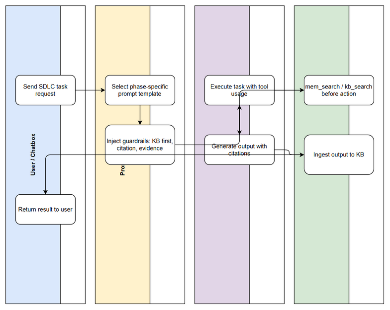
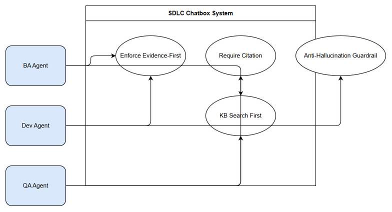

# Business Requirements Document (BRD)

## SA4E-371 — Nâng cấp system prompt của chatbox để thêm anti-hallucination và evidence-first guardrails

---

## Document Information

| Field | Value |
|-------|-------|
| Jira Ticket | SA4E-371 |
| Title | Nâng cấp system prompt của chatbox để thêm anti-hallucination và evidence-first guardrails |
| Author | BA Agent |
| Version | 1.0 |
| Date | 2026-10-18 |
| Status | Draft |

---

## Author Tracking

| Role | Name - Position | Responsibility |
|------|-----------------|----------------|
| Author | BA Agent – Business Analyst | Create document |
| Peer Reviewer |  –  | Review document |

---

## Revision History

| Version | Date | Author | Changes |
|---------|------|--------|---------|
| 1.0 | 2026-10-18 | BA Agent | Initiate document — auto-generated from Jira ticket SA4E-371 and linked tickets |

---

## Sign-Off

| Name | Signature and date |
|------|--------------------|
| | ☐ I agree and confirm all criteria on this BRD as expected requirements |
| | ☐ I agree and confirm all criteria on this BRD as expected requirements |

---

## 1. Introduction

### 1.1 Scope

Nâng cấp system prompt của chatbox trong pipeline SDLC multi-agent để thêm anti-hallucination và evidence-first guardrails. Phạm vi bao trùm toàn bộ SDLC tasks: code review/adversarial, fix bug, implement new CR/feature, tạo document BRD/FSD/TDD/STP/STC/UG/DPG/RLN và các hoạt động hỗ trợ SDLC khác. Prompt được thiết kế riêng cho từng phase với yêu cầu citation, tool usage cụ thể, cấm claim resolved nếu không có edit diff và test evidence.

### 1.2 Out of Scope

- Thay đổi kiến trúc hệ thống chatbox core.
- Thay đổi security gate SEC-326 hiện có.
- Viết FSD/TDD chi tiết – thuộc SA/TA.

### 1.3 Preliminary Requirement

- Knowledge Base phải sẵn sàng cho mem_search / kb_search.
- Hệ thống AGENT_PROMPTS hiện tại tồn tại và có thể cập nhật.
- SDLC guardrails No Workaround Rule đã được định nghĩa.

---

## 2. Business Requirements

### 2.1 High Level Process Map

*[Edit in draw.io](diagrams/business-flow.drawio)*

User gửi yêu cầu SDLC → Prompt Engine chọn template theo phase → Inject guardrails evidence-first → Agent thực thi với tool usage → Kiểm tra KB trước hành động → Tạo output có citation → Ingest vào KB → Trả kết quả.

### 2.2 List of User Stories / Use Cases

| # | Story / Use Case / Epic | Priority | Source Ticket |
|---|-------------------------|----------|---------------|
| 1 | As a BA Agent, I want phase-specific prompt templates with evidence-first guardrails so that BRD/FSD được tạo có citation và traceability | MUST HAVE | SA4E-371 |
| 2 | As a Dev Agent, I want code review prompt yêu cầu read file trước và cấm claim resolved không có diff so that hallucination trong adversarial review được ngăn chặn | MUST HAVE | SA4E-371 |
| 3 | As a QA Agent, I want test planning prompt yêu cầu RTM coverage 100% và citation từ BRD/FSD/TDD so that test cases khớp yêu cầu nghiệp vụ | SHOULD HAVE | SA4E-371 |
| 4 | As a SA Agent, I want design prompt yêu cầu code intelligence evidence và cấm claim thiết kế không có diagram so that TDD có cơ sở | SHOULD HAVE | SA4E-371 |
| 5 | As a System Owner, I want common guardrails KB-first, No Workaround, Ingest, Quality Gates áp dụng cho mọi agent so that pipeline SDLC tuân thủ chuẩn | MUST HAVE | SA4E-371 |

---

### 2.3 Details of User Stories

#### Business Flow

**Step 1:** User nhập yêu cầu SDLC vào chatbox.
**Step 2:** Prompt Engine xác định phase và agent.
**Step 3:** Load template prompt chuyên biệt cho phase + common guardrails.
**Step 4:** Agent thực thi task với bắt buộc mem_search/kb_search trước.
**Step 5:** Agent tạo output kèm citation và evidence.
**Step 6:** Quality gate verify trước khi đánh dấu phase done.
**Step 7:** Ingest kết quả vào Knowledge Base.
**Step 8:** Trả kết quả cho user.

> **Note:** Mọi claim “resolved/fixed” phải kèm edit diff và test result.

---

#### STORY 1: Phase-specific prompt templates with evidence-first guardrails

> As a BA Agent, I want phase-specific prompt templates with evidence-first guardrails so that BRD/FSD được tạo có citation và traceability

**Requirement Details:**

1. Thiết kế prompt template riêng cho Phase 1 Requirements: yêu cầu đọc Jira ticket + KB trước khi viết BRD, citation requirement.
2. Phase 2 Specification: trace BRD→FSD, citation API contracts, diagram evidence.
3. Phase 3 Design: đọc code intelligence + FSD, cấm claim thiết kế nếu không có diagram/arch evidence.
4. Phase 4 Test Planning: RTM coverage 100%, citation từ BRD/FSD/TDD.
5. Phase 5 Implementation: đọc TDD/FSD, không tạo workaround, phải chạy test liên quan.
6. Phase 6 Testing: yêu cầu test evidence, báo kết quả thực thi.
7. Phase 7 Deployment: yêu cầu DPG evidence, sanity test kết quả.

**Data Fields (if applicable):**

| Field | Type | Required | Description | Example |
|-------|------|----------|-------------|---------|
| prompt_template_id | String | Yes | Identifier template | T-BA-01 |
| phase | String | Yes | SDLC phase | Phase 1 Requirements |
| guardrails | Array | Yes | List guardrails | KB-FIRST, CITATION |
| citation_required | Boolean | Yes | Bắt buộc citation | true |

**Acceptance Criteria:**

1. Mọi prompt template phase đều có mục “KB Search First” bắt buộc.
2. Mọi output document phải chứa citation đến ticket nguồn.
3. Prompt code review yêu cầu file:line trích dẫn từ nội dung thực tế.
4. Cấm claim “resolved” nếu không có edit diff và git diff xác nhận.

**UI Specifications (if applicable):**

Không áp dụng.

**Validation Rules (if applicable):**

- Prompt template phải chứa từ khóa “citation”, “evidence”, “mem_search”.
- Không được phép prompt generic không có guardrails.

**Error Handling (if applicable):**

- Missing KB entry: Agent phải báo “No information available from KB” thay vì hallucinate.
- Missing citation: Output bị từ chối quality gate.

---

#### STORY 2: Code review adversarial anti-hallucination

> As a Dev Agent, I want code review prompt yêu cầu read file trước và cấm claim resolved không có diff so that hallucination trong adversarial review được ngăn chặn

**Requirement Details:**

1. Prompt chuyên biệt cho code review/adversarial với luật: phải read file trước khi đưa finding, trích file:line từ nội dung thực tế.
2. Cấm mô phỏng Generator/Critic bằng văn bản nếu không thực hiện edit thật.
3. Phải chạy test liên quan và báo kết quả.

**Acceptance Criteria:**

1. Finding phải có file path và line number trích chính xác.
2. Claim “fixed/resolved” chỉ chấp nhận khi có edit diff và test pass.
3. Không tạo workaround, phải fix root cause.

---

#### STORY 3: QA RTM coverage

> As a QA Agent, I want test planning prompt yêu cầu RTM coverage 100% và citation từ BRD/FSD/TDD

**Requirement Details:**

1. Prompt yêu cầu mapping từ BRD User Story/AC sang test case.
2. Citation nguồn cho mỗi test case.

**Acceptance Criteria:**

1. STP/STC phải có RTM 100% coverage.
2. Mỗi test case trích dẫn BR-XX hoặc US-XX.

---

#### STORY 4: SA design evidence

> As a SA Agent, I want design prompt yêu cầu code intelligence evidence

**Requirement Details:**

1. Prompt yêu cầu đọc project-structure.md và module analysis trước khi mô tả data model.
2. Cấm phát minh tên bảng/cột không có trong code.

**Acceptance Criteria:**

1. Data model trong FSD phải khớp code intelligence.
2. Diagram phải được tạo từ evidence.

---

#### STORY 5: Common guardrails

> As a System Owner, I want common guardrails áp dụng cho mọi agent

**Requirement Details:**

1. Phải kiểm tra knowledge base trước khi hành động.
2. Không được tạo workaround, phải fix root cause.
3. Phải ingest kinh nghiệm mới sau khi hoàn thành task mới.
4. Phải verify output trước khi đánh dấu phase done.

**Acceptance Criteria:**

1. Toàn bộ AGENT_PROMPTS được cập nhật với 4 quy tắc bắt buộc.
2. Security gate SEC-326 giữ nguyên.

---

## 3. Dependencies

| Dependency | Type | Related Ticket | Description |
|------------|------|----------------|-------------|
| AGENT_PROMPTS repository | System | N/A | Lưu trữ prompt templates |
| Knowledge Base mem_search | System | N/A | Yêu cầu KB-first |
| Code Intelligence | System | N/A | Cần cho SA design evidence |

---

## 4. Stakeholders

| Role | Name / Team | Responsibility | Source |
|------|-------------|----------------|--------|
| Reporter | Duc Nguyen Minh | Yêu cầu nâng cấp prompt | SA4E-371 |
| BA | BA Agent | Tạo BRD/FSD | SA4E-371 |

---

## 5. Risks and Assumptions

### 5.1 Risks

| Risk | Impact | Likelihood | Mitigation |
|------|--------|------------|------------|
| Agent vẫn hallucinate khi KB thiếu | High | Medium | Bắt buộc báo “No info” thay vì bịa |
| Prompt quá dài làm chậm response | Medium | Low | Tối ưu template, cache |
| Thiếu citation làm giảm traceability | High | Medium | Quality gate chặn output không citation |

### 5.2 Assumptions

- Knowledge Base đã được ingest các document SDLC trước.
- Các agent tuân thủ tool usage.

---

## 6. Non-Functional Requirements

| Category | Requirement | Details |
|----------|-------------|---------|
| Security | Giữ SEC-326 | Security gate hiện có không thay đổi |
| Performance | Prompt latency | Không tăng >10% so với hiện tại |
| Availability | Prompt service | Available trong pipeline SDLC |
| Scalability | Template matrix | Hỗ trợ 7 phase + 8 agent types |

---

## 7. Related Tickets

| Ticket Key | Summary | Status | Type | Relationship |
|------------|---------|--------|------|--------------|
| SA4E-371 | Nâng cấp system prompt của chatbox để thêm anti-hallucination và evidence-first guardrails | To Do | Enhancement | Main ticket |

---

## 8. Appendix

### Diagram Index

| Diagram | Description | Draw.io Source | PNG Export |
|---------|-------------|----------------|------------|
| Use Case Diagram | Actors và use cases anti-hallucination | diagrams/use-case.drawio | diagrams/use-case.png |
| Business Flow | Swimlane flow SDLC prompt guardrails | diagrams/business-flow.drawio | diagrams/business-flow.png |

### Use Case Diagram

*[Edit in draw.io](diagrams/use-case.drawio)*

### Glossary

| Term | Definition |
|------|------------|
| Evidence-First | Mọi claim phải có citation và evidence từ source |
| Anti-Hallucination | Guardrails ngăn AI bịa thông tin |
| KB-FIRST | Bắt buộc search knowledge base trước khi hành động |

### Reference Documents

| Document | Link / Location |
|----------|-----------------|
| Jira Ticket | SA4E-371 |
| BRD Template | documents/templates/BRD-TEMPLATE.md |
