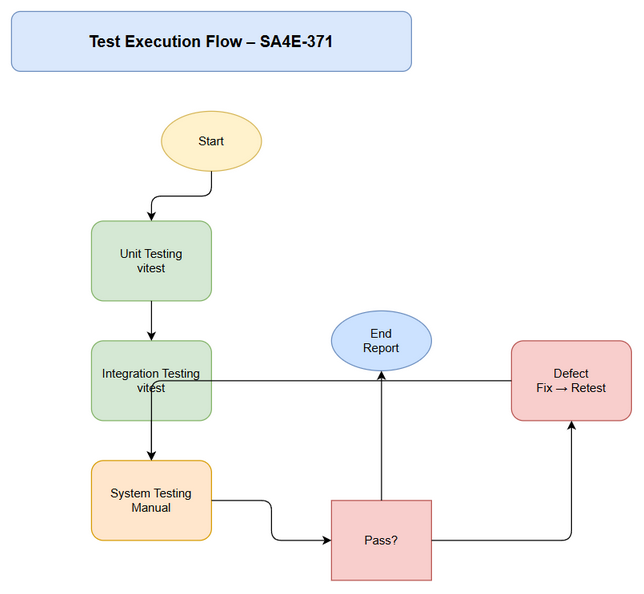
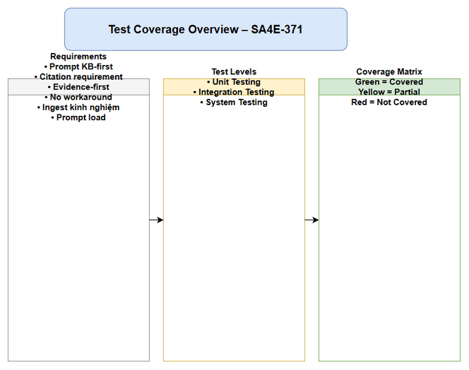

# Software Test Plan (STP)

## SDLC Agents 4 Enterprise — SA4E-371: Nâng cấp system prompt của chatbox để thêm anti-hallucination và evidence-first guardrails

---

## Document Information

| Field | Value |
|-------|-------|
| Jira Ticket | SA4E-371 |
| Title | Nâng cấp system prompt của chatbox để thêm anti-hallucination và evidence-first guardrails |
| Author | QA Agent |
| Version | 1.0 |
| Date | 2026-10-18 |
| Status | Draft |
| Related BRD | BRD-v1.0-SA4E-371.md |
| Related FSD | FSD-v1.0-SA4E-371.md |
| Related TDD | TEMPLATE-DESIGN.md |

---

## Author Tracking

| Role | Name - Position | Responsibility |
|------|-----------------|----------------|
| Author | QA Agent – QA Engineer | Create document |
| Peer Reviewer | BA Agent – Business Analyst | Review document |

---

## Revision History

| Version | Date | Author | Changes |
|---------|------|--------|---------|
| 1.0 | 2026-10-18 | QA Agent | Initiate document — auto-generated from TEMPLATE-DESIGN.md |

---

## 1. Introduction

### 1.1 Purpose
Test Plan này nhằm verify prompt nâng cấp cho toàn bộ SDLC agents chứa anti-hallucination guardrails: KB-first, citation requirement, evidence-first cấm claim resolved không có diff, no workaround rule, và yêu cầu ingest kinh nghiệm.

### 1.2 Test Objectives
- Verify getSystemPromptForRole output chứa KB-first instruction cho các role BA/SA/DEV/QA/DevOps/UI/Security
- Verify prompt chứa citation requirement
- Verify prompt cấm claim resolved/fixed nếu không có edit diff/git diff
- Verify prompt chứa no workaround rule
- Verify prompt yêu cầu ingest kinh nghiệm sau khi hoàn thành task

### 1.3 References
| Document | Location |
|----------|----------|
| TEMPLATE-DESIGN | documents/SA4E-371/TEMPLATE-DESIGN.md |
| Implementation | extension/src/pi-agent/agent-configurator.ts |
| Unit Tests | extension/src/pi-agent/__tests__/agent-configurator.test.ts |

---

## 2. Test Strategy

### 2.1 Test Levels
| Level | Scope | Responsibility | Tools |
|-------|-------|---------------|-------|
| Unit Testing | getSystemPromptForRole keyword validation | Developer/QA | vitest |
| Integration Testing | selectPrompt returns guardrails | Developer/QA | vitest |
| System Testing | Prompt rendering in chatbox | QA | Manual |

### 2.2 Test Types
| Type | Description | Applicable |
|------|-------------|------------|
| Functional Testing | Prompt contains required guardrails | Yes |
| Regression Testing | Existing prompt behavior unchanged | Yes |
| Security Testing | No hallucination risk | Yes |

### 2.3 Test Approach
Automated unit tests verify keywords presence in prompts. Manual review verify TEMPLATE-DESIGN coverage.

### 2.4 Entry Criteria
- TEMPLATE-DESIGN.md reviewed
- agent-configurator.ts updated with guardrails

### 2.5 Exit Criteria
- 100% test cases passed
- All 5 guardrails verified for 7 roles

---

## 3. Test Scope

### 3.1 Features In Scope
| # | Feature / Story | Priority | FSD Reference | Test Type |
|---|----------------|----------|---------------|-----------|
| 1 | Prompt chứa KB-first instruction | High | TEMPLATE-DESIGN §2 | Functional |
| 2 | Prompt chứa citation requirement | High | TEMPLATE-DESIGN §2 | Functional |
| 3 | Prompt cấm claim resolved không có diff | High | TEMPLATE-DESIGN §2 Evidence-First | Functional |
| 4 | Prompt chứa no workaround rule | High | TEMPLATE-DESIGN §2 | Functional |
| 5 | Prompt yêu cầu ingest kinh nghiệm | High | TEMPLATE-DESIGN §2 | Functional |
| 6 | Verify prompt load from file template after DEV refactor | Medium | PromptTemplateService | Integration |

### 3.2 Features Out of Scope
| # | Feature | Reason |
|---|---------|--------|
| 1 | UI rendering test | Out of scope Phase 4 |

---

## 4. Test Environment
| Environment | URL | Purpose |
|-------------|-----|---------|
| Dev | localhost:3000 | Unit test execution |

---

## 5. Test Schedule
| Phase | Start Date | End Date | Duration | Milestone |
|-------|-----------|----------|----------|-----------|
| Test Planning | 2026-10-18 | 2026-10-18 | 1d | STP approved |
| Test Execution | 2026-10-18 | 2026-10-18 | 1d | STC passed |

---

## 6. Resources & Responsibilities
| Role | Name | Responsibility |
|------|------|---------------|
| Test Lead | QA Agent | Test planning |
| QA Engineer | QA Agent | Test case design, execution |
| Developer | DEV Agent | Fix prompt if missing guardrails |

---

## 7. Risk & Mitigation
| # | Risk | Impact | Likelihood | Mitigation |
|---|------|--------|------------|------------|
| 1 | Prompt not updated | High | Low | Verify code before test |

---

## 8. Defect Management
Severity: Critical if guardrail missing.

---

## 9. Test Metrics & Reporting
Pass Rate target ≥ 100%

---

## 10. Appendix

### Glossary
KB-first, Citation, Evidence-first, No Workaround, Ingest

### Appendix Diagram Index
| # | Diagram Name | File Path | Description |
|---|--------------|-----------|-------------|
| 1 | Test Coverage Overview | diagrams/test-coverage.drawio | Test coverage across requirements × test levels with color coding |
| 2 | Test Execution Flow | diagrams/test-execution-flow.drawio | Test execution pipeline with entry/exit criteria and defect feedback loop |
