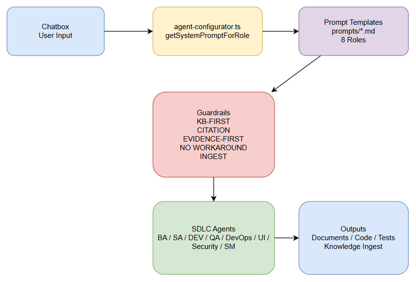
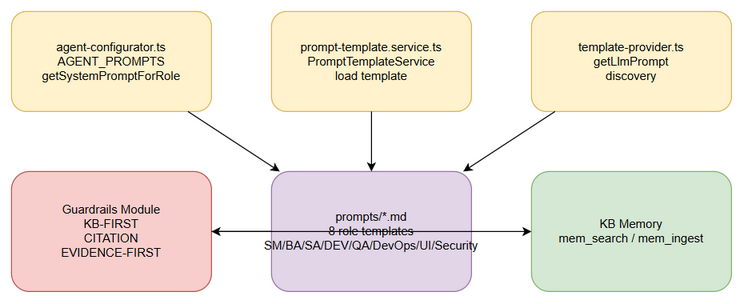

# Technical Design Document (TDD)

## SDLC Agents 4 Enterprise — SA4E-371: Nâng cấp system prompt anti-hallucination

---

## Document Information

| Field | Value |
|-------|-------|
| Jira Ticket | SA4E-371 |
| Title | Nâng cấp system prompt anti-hallucination |
| Author | SA Agent |
| Version | 1.0 |
| Date | 2026-10-18 |
| Status | Draft |
| Related Documents | RESEARCH-PROMPTS.md, TEMPLATE-DESIGN.md, IMPLEMENTATION-NOTES.md |
| Input | documents/SA4E-371/TEMPLATE-DESIGN.md v1.0, documents/SA4E-371/RESEARCH-PROMPTS.md v1.0 |

---

## 1. Introduction

### 1.1 Purpose
Thiết kế kỹ thuật cho việc nâng cấp system prompt của chatbox để áp dụng guardrails anti-hallucination, evidence-first, KB-first, citation bắt buộc, no-workaround và ingest knowledge.

### 1.2 Scope
- Refactor `agent-configurator.ts` từ hardcode `AGENT_PROMPTS` sang load template từ file `prompts/*.md`
- Áp dụng guardrails chung cho 8 role: SM, BA, SA, DEV, QA, DevOps, UI, Security
- Đảm bảo output có thể trace về nguồn và tuân thủ quality gates

### 1.3 References
- RESEARCH-PROMPTS.md:1-186
- TEMPLATE-DESIGN.md:1-273
- IMPLEMENTATION-NOTES.md:1-63

---

## 2. Architecture Overview

Hệ thống prompt mới hoạt động theo luồng:

Chatbox Input → agent-configurator.ts → PromptTemplateService → Template files → Guardrails → SDLC Agents → Output + Knowledge Ingest



*Edit in draw.io: [diagrams/architecture.drawio](diagrams/architecture.drawio)*

**Các thành phần chính:**
- **agent-configurator.ts**: `getSystemPromptForRole(role)` load dynamic từ file template
- **prompts/*.md**: 8 file template role cụ thể chứa guardrails
- **Guardrails core**: KB-FIRST, CITATION, EVIDENCE-FIRST, NO WORKAROUND, INGEST
- **PromptTemplateService**: discovery template từ workspace `.pi/prompts` hoặc `agentDir/prompts`

---

## 3. Component Design



*Edit in draw.io: [diagrams/component.drawio](diagrams/component.drawio)*

**Component breakdown:**

| Component | Responsibility | File |
|-----------|----------------|------|
| AgentConfigurator | Map role → prompt, fallback DEFAULT_AGENT_PROMPT | extension/src/pi-agent/agent-configurator.ts |
| PromptTemplateService | Discover & load template theo tier | extension/src/pi-agent/prompt-template.service.ts |
| TemplateProvider | LLM prompt cung cấp cho agent/hook | extension/src/commands/template-provider.ts |
| Prompt Templates | Chứa guardrails cho từng role | extension/src/pi-agent/prompts/*.md |
| KB Memory | mem_search / mem_ingest | code-intel memory |

---

## 4. Class / Module Design

### 4.1 Module Structure

```
extension/src/pi-agent/
├── agent-configurator.ts          # Prompt loader
├── prompt-template.service.ts     # Template discovery
├── prompts/
│   ├── SM.md
│   ├── BA.md
│   ├── SA.md
│   ├── DEV.md
│   ├── QA.md
│   ├── DevOps.md
│   ├── UI.md
│   └── Security.md
└── __tests__/
    └── agent-configurator.test.ts
```

### 4.2 Key Interfaces

**agent-configurator.ts**
```ts
export const AGENT_PROMPTS: Record<AgentRole, string> // deprecated, kept for compatibility
export function getSystemPromptForRole(role: AgentRole): string
export function selectPrompt(modelId: string, role: AgentRole, options?: PromptOptions): string
```

**PromptTemplateService**
```ts
class PromptTemplateService {
  getPromptForTier(name: string, tier: 'full'|'compressed'): string
  discoverTemplates(): string[]
}
```

### 4.3 Design Patterns
- **Strategy**: Prompt template per role/phase
- **Factory**: `selectPrompt` tạo prompt theo model tier
- **Template Method**: Common guardrails + role-specific sections

---

## 5. API Design

### 5.1 Internal API

**getSystemPromptForRole**
- Input: `role: AgentRole`
- Output: `string` prompt with guardrails
- Side effect: Load file từ `prompts/{role}.md` nếu tồn tại, fallback hardcode

**selectPrompt**
- Input: `modelId`, `role`, `options`
- Output: Prompt merged với tier template + SYSTEM.md
- Guardrails: Pre-flight check prompt chứa keywords anti-hallucination

### 5.2 Prompt Template Contract

Mỗi template phải chứa sections:
1. ROLE IDENTITY
2. SDLC PHASE CONTEXT
3. EVIDENCE-FIRST PROTOCOL
4. KB-FIRST & INGEST PROTOCOL
5. ANTI-HALLUCINATION RULES
6. NO-WORKAROUND RULE
7. OUTPUT FORMAT & CITATION REQUIREMENTS
8. ROLE BOUNDARIES - CANNOT DO
9. QUALITY GATES
10. EXAMPLE

---

## 6. Implementation Checklist

- [ ] Tạo 8 file `prompts/*.md` với guardrails theo TEMPLATE-DESIGN.md
- [ ] Cập nhật `agent-configurator.ts` load dynamic, giữ `DEFAULT_AGENT_PROMPT`
- [ ] Thêm test `SA4E-371: prompt contains anti-hallucination guardrails` kiểm tra 7 keywords
- [ ] Thêm test `selectPrompt returns prompt with guardrails`
- [ ] Đảm bảo `stream_write_file` cho file >50 lines
- [ ] Ingest TDD vào KB sau hoàn thành
- [ ] Quality Gate Phase 3 passed

**Commit reference**: IMPLEMENTATION-NOTES.md:35-37, commit 18de852

---

## 7. Error Handling

| Scenario | Handling |
|----------|----------|
| Template file missing | Fallback to hardcode `AGENT_PROMPTS` |
| Template load failure | Log error, return DEFAULT_AGENT_PROMPT |
| Prompt không chứa guardrails | Pre-flight warning, cảnh báo SM |
| mem_search timeout | Retry 1 lần, nếu fail → return `I don't have enough evidence` |

Evidence-first rule: Không claim "fixed" nếu không có git diff + test log. Cite file:line bắt buộc.

---

## 8. Security Design

- Prompt templates được lưu trong `agentDir/prompts`, chỉ trusted workspace mới cho phép load từ `.pi/prompts`
- Template file size cap 256KB, symlink containment khi `collectTemplateFiles`
- Không expose internal system prompt ra external API
- Guardrails NO WORKAROUND ngăn bypass security check bằng workaround
- Citation requirement giúp audit traceability

---

## 9. Performance & Scalability

- Template load lazy, cache theo role + tier
- Prompt size ước tính token trước khi trả về model
- Compressed variant cho small model tier

---

## 10. Monitoring & Observability

- Log khi prompt fallback
- Metrics: prompt load time, cache hit rate
- Test coverage: `agent-configurator.test.ts` 20 tests passed

---

## Appendix A: Diagram Index

| # | Diagram | File | Purpose |
|---|---------|------|---------|
| 1 | Architecture Overview | diagrams/architecture.drawio | Tổng quan luồng prompt từ chatbox tới agents |
| 2 | Component Design | diagrams/component.drawio | Chi tiết module agent-configurator, template service, prompts |


---

## Appendix B: References

- RESEARCH-PROMPTS.md: Hiện trạng system prompt 1 dòng, thiếu evidence-first
- TEMPLATE-DESIGN.md: Template matrix T-BA-01 .. T-SEC-01
- IMPLEMENTATION-NOTES.md: Thay đổi code agent-configurator.ts

---

**Ingestion note**: Document này sẽ được ingest vào KB với tags: sdlc, tdd, SA4E-371, anti-hallucination, prompt-template
