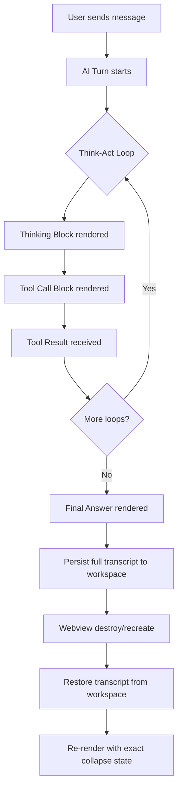
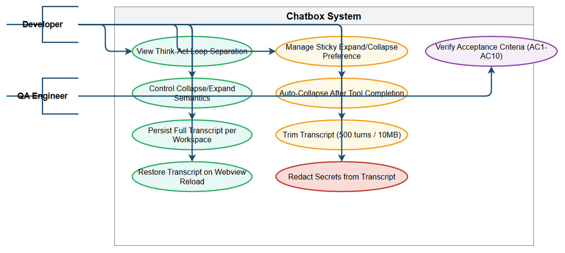
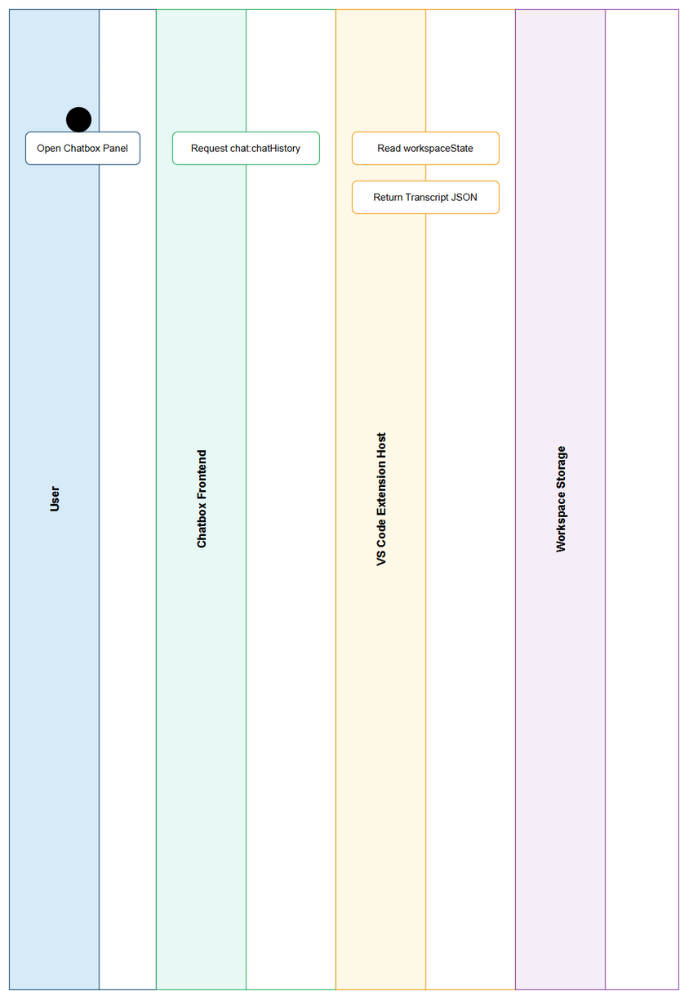

# Business Requirements Document (BRD)

## SDLC-Agents-4-Enterprise — SA4E-372: Chatbox UX/Persistence Improvements (Think-Act Loop Separation, Collapse Semantics, Full Workspace Transcript Persistence)

---

## Document Information

| Field | Value |
|-------|-------|
| Jira Ticket | SA4E-372 |
| Title | Chatbox UX/Persistence Improvements — Think-Act Loop Separation, Correct Collapse Semantics, Full Workspace Transcript Persistence |
| Author | BA Agent |
| Version | 1.0 |
| Date | 2026-10-18 |
| Status | Draft |

---

## Author Tracking

| Role | Name - Position | Responsibility |
|------|-----------------|----------------|
| Author | BA Agent – Business Analyst | Create document |
| Peer Reviewer | SM Agent – Scrum Master | Review document |

---

## Revision History

| Version | Date | Author | Changes |
|---------|------|--------|---------|
| 1.0 | 2026-10-18 | BA Agent | Initiate document — auto-generated from Jira ticket SA4E-372 and linked ticket SA4E-369 |

---

## Sign-Off

| Name | Signature and date |
|------|--------------------|
| | ☐ I agree and confirm all criteria on this BRD as expected requirements |
| | ☐ I agree and confirm all criteria on this BRD as expected requirements |

---

## 1. Introduction

### 1.1 Scope

This Business Requirements Document defines the requirements for improving the chatbox user experience and persistence capabilities in the SDLC-Agents-4-Enterprise webview-based chat interface. The improvements address three critical gaps identified during UAT of version 1.53.9 (ticket SA4E-369):

1. **R1 — Think-Act Loop Separation**: Currently, all tool calls and thinking blocks within a single AI turn are grouped into one container. Users cannot distinguish between sequential think→act loops. Each loop iteration must render as a separate thinking block + tool-call group.

2. **R2 — Correct Collapse Semantics**: The current implementation auto-collapses tool containers while streaming/updating (when tool count ≥ threshold), and lacks sticky user preference (user-expanded blocks auto-collapse again). Correct behavior: no auto-collapse during streaming; default expand when tool call starts; auto-collapse only after ALL tools in a block complete; user expansion preference persists for the session.

3. **R3 — Full Workspace Transcript Persistence**: Current persistence only saves the final chat message. Requirement: entire transcript (user messages, AI responses, thinking blocks, tool-call blocks with full payloads, errors, timestamps) must persist per-workspace and fully restore when webview is destroyed/recreated (tab close/reopen, panel reload, VS Code window restart).

### 1.2 Out of Scope

- Backend/orchestration changes (the Python MCP server and agent logic are not modified)
- Chat protocol changes beyond what's needed for transcript serialization
- Multi-workspace synchronization (each workspace is independent)
- Real-time collaboration between users
- Export/import of transcripts (persistence is local to workspace only)
- Mobile/responsive layouts (webview is desktop-only in VS Code)

### 1.3 Preliminary Requirement

- VS Code webview API available (v1.70+)
- Workspace storage API (context.workspaceState) accessible
- Existing chat infrastructure (chat-tools.js, chat-stream.js, chat-messages.js, chat-tabsync.js) in place
- Message protocol (message-protocol.ts) defines chat:chatHistory — must be implemented for transcript restore

---

## 2. Business Requirements

### 2.1 High Level Process Map

The chatbox operates as a persistent, loop-aware conversation interface within a VS Code webview. Each user message triggers an AI agent turn, which may consist of multiple sequential **think-act loops** (think → tool call → tool result → think → tool call → ... → final answer). The system must:

1. **Render** each think-act loop as visually distinct blocks (thinking + tool group)
2. **Manage** collapse/expand state per-block with sticky user preference
3. **Persist** the complete transcript (all blocks, payloads, errors) to workspace storage
4. **Restore** the full transcript on webview recreation with exact visual state

*[Edit in draw.io](diagrams/use-case.drawio)*

*[Edit in draw.io](diagrams/business-flow.drawio)*

### 2.2 List of User Stories / Use Cases

| # | Story / Use Case / Epic | Priority | Source Ticket |
|---|-------------------------|----------|---------------|
| US-1 | As a **developer using the chatbox**, I want **each think-act loop to render as separate thinking + tool-call blocks** so that **I can follow the AI's reasoning step-by-step and debug tool usage** | MUST HAVE | SA4E-372 (R1) |
| US-2 | As a **developer using the chatbox**, I want **tool containers to stay expanded while streaming and only auto-collapse after all tools complete**, and **my manual expand/collapse preference to stick**, so that **I control what I see without the UI fighting me** | MUST HAVE | SA4E-372 (R2) |
| US-3 | As a **developer using the chatbox**, I want **the entire conversation transcript (messages, thinking, tool calls, errors) to persist per-workspace and fully restore when I reopen the panel**, so that **I never lose context when switching tabs or restarting VS Code** | MUST HAVE | SA4E-372 (R3) |
| US-4 | As a **QA engineer**, I want **acceptance criteria covering loop separation, collapse semantics, and persistence restore** so that **I can verify the implementation meets UAT expectations** | MUST HAVE | SA4E-372 |

---

### 2.3 Details of User Stories

#### Business Flow

**Step 1:** User opens chatbox panel in VS Code (webview loads)

**Step 2:** System checks workspace storage for existing transcript (chat:chatHistory protocol)

**Step 3:** If transcript exists → **Step 3a**: Deserialize and render all messages with original block structure, thinking blocks, tool-call groups, and collapse states. **Step 3b**: If no transcript → render empty chat.

**Step 4:** User sends a message (text or @mention command)

**Step 5:** System renders user message bubble immediately

**Step 6:** AI agent turn begins — may consist of **N sequential think-act loops** (N ≥ 1)

**Step 7 (Loop Start):** AI emits thinking → system creates **new Thinking Block** (distinct from previous loops)

**Step 8 (Loop Continue):** AI calls tool(s) → system creates **new Tool Call Group** associated with current thinking block

**Step 9:** Tool results stream in → system updates Tool Call Group in real-time (no auto-collapse during streaming)

**Step 10:** When ALL tools in current group complete → system **auto-collapses** the Tool Call Group (default) unless user previously expanded it (sticky preference)

**Step 11:** If more loops → return to **Step 7**; else → **Step 12**

**Step 12:** AI emits final answer → system renders Answer Block

**Step 13:** Complete turn (all loops + answer) persisted to workspace storage atomically

**Step 14:** User may expand/collapse any block → preference saved per-block-ID

**Step 15:** User closes panel / reloads VS Code → **Step 2** on next open

> **Note:** A "turn" = one complete AI response cycle. A "loop" = one think→act→result cycle within a turn. Current code conflates turn and loop (single container per turn). This BRD requires separation.

---

#### STORY 1: Think-Act Loop Separation (R1)

> **As a developer using the chatbox, I want each think-act loop to render as separate thinking + tool-call blocks so that I can follow the AI's reasoning step-by-step and debug tool usage**

**Requirement Details:**

1. **Loop Detection**: The frontend must detect loop boundaries from the streaming protocol. Each thinking event followed by one or more tool_call events constitutes a loop. A new thinking event after tool results signals a new loop.

2. **Block Structure per Loop**:
   - **Thinking Block**: Contains the AI's reasoning text for that loop iteration. Rendered as a collapsible block with header "Thinking (Loop N)".
   - **Tool Call Group**: Container for all tool calls made during that loop. Each tool call renders as a child element with: tool name, input parameters (JSON), streaming output/result, status (pending/running/complete/error), timestamp.

3. **Visual Separation**: Each loop's blocks must be visually distinct (separate containers, not merged). Loop number displayed in header.

4. **Sequential Rendering**: Loops render in sequence as they occur. Previous loops remain visible (collapsed or expanded per user preference).

5. **Turn vs Loop**: A single user message → AI turn may produce 1..N loops. Current implementation creates 1 container per turn. New implementation creates 1 thinking block + 1 tool group PER LOOP.

**Data Fields (Loop Block Structure):**

| Field | Type | Required | Description | Example |
|-------|------|----------|-------------|---------|
| loopId | string | Yes | Unique identifier for the loop (e.g., turn-3-loop-2) | turn-3-loop-2 |
| turnId | string | Yes | Parent turn identifier | turn-3 |
| loopIndex | number | Yes | 1-based index within the turn | 2 |
| thinkingContent | string | Yes | Markdown content of AI reasoning | I need to search for... |
| thinkingTimestamp | ISO8601 | Yes | When thinking started | 2026-10-18T10:30:00.123Z |
| toolCalls | ToolCall[] | Yes | Array of tool calls in this loop | [{...}, {...}] |
| isExpanded | boolean | Yes | Current collapse state (user preference) | false |
| userExpanded | boolean | Yes | Sticky flag: true if user manually expanded | true |

**ToolCall Structure:**

| Field | Type | Required | Description | Example |
|-------|------|----------|-------------|---------|
| callId | string | Yes | Unique tool call ID | call_abc123 |
| toolName | string | Yes | Name of the tool | code_search |
| input | object | Yes | Input parameters passed to tool | {"query": "auth"} |
| output | string | No | Streaming output / final result | Found 5 results... |
| status | enum | Yes | pending | running | complete | error | running |
| error | string | No | Error message if status=error | Tool timeout |
| startTime | ISO8601 | Yes | When tool call started | 2026-10-18T10:30:01.000Z |
| endTime | ISO8601 | No | When tool call completed | 2026-10-18T10:30:02.500Z |

**Acceptance Criteria:**

| AC | Description |
|----|-------------|
| AC1.1 | When AI executes 3 think-act loops in one turn, the UI renders 3 distinct Thinking Blocks and 3 distinct Tool Call Groups (not 1 merged container) |
| AC1.2 | Each Thinking Block header shows loop number (e.g., Thinking — Loop 1, Thinking — Loop 2) |
| AC1.3 | Each Tool Call Group contains only the tool calls from its corresponding loop |
| AC1.4 | Loop blocks render sequentially in real-time as the turn progresses |
| AC1.5 | Previous loop blocks remain accessible (collapsed/expanded) while new loops render |
| AC1.6 | Loop structure is preserved in persisted transcript and restored correctly |

**UI Specifications:**

| No. | Name | Type | Required | Description | Note |
|-----|------|------|----------|-------------|------|
| 1 | Thinking Block Header | Label | Yes | Shows Thinking — Loop N with collapse chevron | Click toggles collapse |
| 2 | Thinking Content | Markdown | Yes | Renders AI reasoning with syntax highlighting | Read-only |
| 3 | Tool Call Group Header | Label | Yes | Shows Tool Calls — Loop N (X tools) with collapse chevron | Click toggles collapse |
| 4 | Tool Call Row | Container | Yes | Per-tool: name badge, input JSON (collapsible), streaming output, status icon | Input collapsible by default |
| 5 | Tool Input JSON | Code Block | No | Syntax-highlighted JSON, copy button | Collapsed by default |
| 6 | Tool Output | Pre/Code | Yes | Streaming text, final result, or error | Auto-scroll while streaming |
| 7 | Loop Separator | Visual | Yes | Subtle divider between loops | HR or border |

**Validation Rules:**

- Loop index must be sequential (1, 2, 3...) within a turn
- Each loop must have exactly one Thinking Block and one Tool Call Group (Tool Call Group may be empty if no tools called)
- loopId format: {turnId}-loop-{loopIndex} for traceability

**Error Handling:**

- If thinking event arrives without prior loop close → treat as new loop (close previous implicitly)
- If tool call arrives without active thinking block → create implicit thinking block for current loop
- If protocol violation (malformed events) → render error banner in current block, continue processing

---

#### STORY 2: Correct Collapse Semantics (R2)

> **As a developer using the chatbox, I want tool containers to stay expanded while streaming and only auto-collapse after all tools complete, and my manual expand/collapse preference to stick, so that I control what I see without the UI fighting me**

**Requirement Details:**

1. **No Auto-Collapse During Streaming**: While any tool in a Tool Call Group has status running or pending, the group MUST remain expanded. No threshold-based auto-collapse during updates.

2. **Default Expand on Tool Call Start**: When the first tool call in a group begins (status: running), the Tool Call Group defaults to **expanded** so user sees progress immediately.

3. **Auto-Collapse After Completion**: Only when **ALL** tool calls in a group reach complete or error status, the group may auto-collapse (default behavior). This is a one-time action per group.

4. **Sticky User Preference (Critical)**:
   - If user **manually expands** a collapsed group → set userExpanded = true for that block. Group will **never auto-collapse again** for this session.
   - If user **manually collapses** an expanded group → set userExpanded = false. Group respects this and will not auto-expand on future updates.
   - Preference persists per loopId / blockId in workspace storage.

5. **Thinking Block Collapse**: Same semantics apply to Thinking Blocks — user preference sticky, no auto-collapse during thinking streaming.

6. **Global Collapse All/Expand All**: Toolbar actions to collapse/expand all blocks, which updates userExpanded for all blocks.

**Acceptance Criteria:**

| AC | Description |
|----|-------------|
| AC2.1 | Tool Call Group starts expanded when first tool call begins streaming |
| AC2.2 | Tool Call Group does NOT auto-collapse while any tool is running or pending |
| AC2.3 | Tool Call Group auto-collapses exactly once after ALL tools reach complete/error (if userExpanded === false) |
| AC2.4 | User manual expand → group stays expanded forever (no subsequent auto-collapse) |
| AC2.5 | User manual collapse → group stays collapsed (no auto-expand on new tool calls in same group — but new loops create new groups) |
| AC2.6 | Preference (userExpanded) persists across webview reload/restore |
| AC2.7 | Thinking Blocks follow identical collapse semantics |
| AC2.8 | Collapse All toolbar action sets userExpanded=false for all blocks |
| AC2.9 | Expand All toolbar action sets userExpanded=true for all blocks |

**UI Specifications:**

| No. | Name | Type | Required | Description | Note |
|-----|------|------|----------|-------------|------|
| 1 | Collapse Chevron | Icon Button | Yes | Rotates 90° to indicate state | Click toggles block |
| 2 | Toolbar Collapse All | Button | Yes | Collapses all blocks, sets sticky preference | Top of chat panel |
| 3 | Toolbar Expand All | Button | Yes | Expands all blocks, sets sticky preference | Top of chat panel |
| 4 | Block Header | Container | Yes | Click anywhere on header toggles collapse | Accessible |

**Validation Rules:**

- userExpanded flag only set by explicit user action (click), never by auto-collapse
- Auto-collapse only triggers when userExpanded === false AND all tools complete
- New Tool Call Groups (new loops) always start with userExpanded = false (default expand on first tool, then auto-collapse after completion)

**Error Handling:**

- If workspace storage corrupted → default to userExpanded = false for all blocks
- If block ID mismatch on restore → treat as new block (default behavior)

---

#### STORY 3: Full Workspace Transcript Persistence (R3)

> **As a developer using the chatbox, I want the entire conversation transcript (messages, thinking, tool calls, errors) to persist per-workspace and fully restore when I reopen the panel, so that I never lose context when switching tabs or restarting VS Code**

**Requirement Details:**

1. **Transcript Data Model**: The persisted transcript must include **everything** required to fully reconstruct the chat UI:
   - All user messages (text, @mentions, timestamps)
   - All AI answer blocks (final answers, timestamps)
   - All Thinking Blocks (content, loop metadata, collapse state)
   - All Tool Call Groups (all tool calls with full input/output/error, timestamps, collapse state)
   - Global UI state (scroll position, active turn, toolbar states)

2. **Per-Workspace Isolation**: Each VS Code workspace (folder) has independent transcript storage. Key: chat.transcript.{workspaceHash}.

3. **Atomic Persistence**: After each complete turn (or debounced 2s during streaming), write full transcript to workspaceState. Use JSON serialization.

4. **Restore Protocol**: On webview load, send chat:chatHistory request (defined in message-protocol.ts line 98) to extension host. Extension host reads workspaceState and returns full transcript. Webview deserializes and re-renders.

5. **Webview Lifecycle Handling**:
   - panel.onDidDispose → save current transcript
   - panel.onDidChangeViewState (visible=false) → save transcript
   - Webview message event chat:saveTranscript → explicit save
   - Webview load → request chat:chatHistory from extension

6. **Schema Versioning**: Transcript includes schemaVersion for future migrations.

7. **Size Limits**: Cap transcript at 500 turns or 10MB (whichever first). Older turns trimmed (FIFO) but **current turn always preserved**.

**Data Fields (Transcript Schema):**

| Field | Type | Required | Description | Example |
|-------|------|----------|-------------|---------|
| schemaVersion | number | Yes | Current schema version | 2 |
| workspaceId | string | Yes | Hash of workspace folder path | a1b2c3d4 |
| turns | Turn[] | Yes | Array of all turns in chronological order | [{...}] |
| uiState | UIState | Yes | Scroll position, active turn ID, toolbar states | {scrollTop: 1200} |
| savedAt | ISO8601 | Yes | Last persistence timestamp | 2026-10-18T10:35:00.000Z |

**Turn Structure:**

| Field | Type | Required | Description | Example |
|-------|------|----------|-------------|---------|
| turnId | string | Yes | Unique turn ID | turn-5 |
| userMessage | Message | Yes | User's input message | {role: "user", content: "Fix bug"} |
| loops | Loop[] | Yes | All think-act loops in this turn | [{...}] |
| finalAnswer | Message | Yes | AI's final response | {role: "assistant", content: "Done"} |
| timestamp | ISO8601 | Yes | Turn completion time | 2026-10-18T10:32:00.000Z |
| isComplete | boolean | Yes | True if turn finished (not interrupted) | true |

**Loop Structure:** (as defined in Story 1)

**Message Structure:**

| Field | Type | Required | Description |
|-------|------|----------|-------------|
| role | enum | Yes | user | assistant | system |
| content | string | Yes | Markdown content |
| timestamp | ISO8601 | Yes | Message time |
| metadata | object | No | @mentions, attachments, etc. |

**UIState Structure:**

| Field | Type | Required | Description |
|-------|------|----------|-------------|
| scrollTop | number | Yes | Scroll position in pixels |
| activeTurnId | string | No | Currently focused turn |
| collapseAll | boolean | No | Global collapse state |

**Acceptance Criteria:**

| AC | Description |
|----|-------------|
| AC3.1 | After sending 5 messages with multi-loop turns, closing and reopening the panel restores all 5 turns with all loops, thinking, tool calls, and collapse states |
| AC3.2 | Tool call inputs/outputs/errors are fully preserved (not truncated) in restored view |
| AC3.3 | User's manual expand/collapse preferences for each block are restored |
| AC3.4 | Transcript persists across VS Code window restart (not just panel reload) |
| AC3.5 | Each workspace has isolated transcript (opening different workspace shows different history) |
| AC3.6 | chat:chatHistory protocol is implemented and used for restore (no longer dead protocol) |
| AC3.7 | Transcript size capped at 500 turns / 10MB with FIFO trimming of oldest complete turns |
| AC3.8 | Current in-progress turn is never trimmed |
| AC3.9 | Save debounced (2s) during streaming; immediate on turn completion |
| AC3.10 | Corrupted storage handled gracefully → empty transcript, no crash |

**UI Specifications:**

| No. | Name | Type | Required | Description | Note |
|-----|------|------|----------|-------------|------|
| 1 | Restore Indicator | Label | Yes | Brief toast Restored N turns from workspace on load | Auto-dismiss 3s |
| 2 | Clear History | Button | Yes | Toolbar action to wipe transcript for current workspace | Confirmation dialog |

**Validation Rules:**

- Transcript JSON must validate against schemaVersion
- turnId and loopId must be unique across transcript
- Timestamps must be valid ISO8601
- isComplete=false turns allowed only for most recent turn

**Error Handling:**

- workspaceState quota exceeded → trim oldest turns, retry save
- Deserialization failure → log error, start fresh transcript, notify user
- chat:chatHistory request timeout (5s) → start fresh, log warning

---

## 3. Dependencies

| Dependency | Type | Related Ticket | Description |
|------------|------|----------------|-------------|
| VS Code Webview API | Platform | N/A | Webview lifecycle, messaging, workspaceState |
| Workspace Storage (context.workspaceState) | Platform | N/A | Per-workspace persistence |
| Message Protocol (message-protocol.ts) | Internal | N/A | chat:chatHistory request/response must be implemented |
| Chat Infrastructure (chat-tools.js, chat-stream.js, chat-messages.js, chat-tabsync.js) | Internal | SA4E-369 | Existing code to be modified |
| SA4E-369 (v1.53.9 UAT) | Related | SA4E-369 | Source of UAT findings driving these requirements |

---

## 4. Stakeholders

| Role | Name / Team | Responsibility | Source |
|------|-------------|----------------|--------|
| Product Owner | User (ticket reporter) | Define UX requirements, approve BRD | SA4E-372 reporter |
| BA Agent | BA Agent | Author BRD, validate requirements | This document |
| UI Agent | UI Agent | Implement loop-separated rendering, collapse semantics, persistence restore UI | Phase 2 |
| TA Agent | TA Agent | Enrich FSD with technical details (streaming protocol, storage schema) | Phase 2 |
| SA Agent | SA Agent | Design technical solution (TDD) for loop detection, persistence layer | Phase 3 |
| DEV Agent | DEV Agent | Implement frontend changes in chat-tools.js, chat-stream.js, chat-messages.js, chat-tabsync.js | Phase 5 |
| QA Agent | QA Agent | Create test plan/cases for AC1-AC10 | Phase 4 |
| DevOps Agent | DevOps Agent | Ensure build/pipeline supports webview changes | Phase 7 |

---

## 5. Risks and Assumptions

### 5.1 Risks

| Risk | Impact | Likelihood | Mitigation |
|------|--------|------------|------------|
| Loop detection fails with malformed streaming protocol | High | Medium | Define strict protocol contract; add fallback heuristic (new thinking = new loop) |
| Workspace storage quota exceeded (10MB limit) | Medium | Low | Implement FIFO trimming; compress tool outputs (gzip) if needed |
| Webview destroy during streaming loses in-flight turn | High | Medium | Debounced save (2s) + immediate save on beforeunload / visibilitychange |
| chat:chatHistory protocol not implemented in extension host | High | High | Gap identified: Protocol exists but unused. Must implement in extension host as part of this work. |
| Performance degradation with large transcripts (500 turns) | Medium | Low | Virtualized rendering; lazy-load tool outputs; pagination |
| Sticky preference conflicts across sessions | Low | Low | Preference scoped to loopId + workspaceId; reset on schema migration |

### 5.2 Assumptions

- The streaming protocol from the Python MCP orchestrator emits discrete thinking and tool_call events that can be correlated to loops
- Each AI turn completes within a reasonable time (< 5 min) — no indefinite streaming
- VS Code workspaceState is reliable and persists across window restarts
- Webview message passing (postMessage / onmessage) is the only communication channel
- No concurrent multi-user editing of same workspace transcript
- Existing CSS framework supports collapsible blocks with chevron indicators

---

## 6. Non-Functional Requirements

| Category | Requirement | Details |
|----------|-------------|---------|
| Performance | Transcript restore < 500ms | For 500 turns / 10MB transcript, full deserialize + render must complete in < 500ms on typical dev machine |
| Performance | Streaming render latency < 50ms | Each tool call update must render in < 50ms to avoid UI jank |
| Performance | Workspace save debounce 2s | Debounce saves during streaming; immediate on turn complete |
| Scalability | Max 500 turns / 10MB per workspace | FIFO trim oldest complete turns; current turn never trimmed |
| Availability | 99.9% transcript availability | WorkspaceState is local — no network dependency |
| Security | No sensitive data in transcript | Tool inputs/outputs may contain secrets — implement redaction for known secret patterns (API keys, tokens) before persistence |
| Accessibility | WCAG 2.1 AA | Collapsible blocks keyboard navigable (Tab/Enter/Space), ARIA expanded/collapsed states, focus management |
| Compatibility | VS Code 1.70+ | Webview API, workspaceState API |
| Compatibility | Cross-platform (Win/Mac/Linux) | Path hashing for workspaceId works on all OS |
| Maintainability | Schema versioning | schemaVersion in transcript enables future migrations |

---

## 7. Related Tickets

| Ticket Key | Summary | Status | Type | Relationship |
|------------|---------|--------|------|--------------|
| SA4E-372 | Chatbox UX/Persistence Improvements | Open | Story | Main ticket |
| SA4E-369 | v1.53.9 UAT Follow-up | Done | Story | Related — source of UAT findings |

---

## 8. Appendix

### Glossary

| Term | Definition |
|------|------------|
| Think-Act Loop | One iteration of AI reasoning (thinking) followed by tool execution (act) within a single AI turn |
| Turn | Complete AI response cycle triggered by one user message; may contain 1..N think-act loops |
| Tool Call Group | UI container holding all tool calls belonging to a single think-act loop |
| Thinking Block | UI container holding the AI's reasoning text for a single think-act loop |
| Sticky Preference | User's manual expand/collapse choice that persists and overrides auto-behavior |
| Workspace | VS Code workspace folder (project root); each has isolated transcript storage |
| Webview | VS Code's embedded web content panel hosting the chatbox UI |
| Transcript | Complete serialized conversation history including all blocks, payloads, and UI state |

### Reference Documents

| Document | Link / Location |
|----------|-----------------|
| Jira Ticket SA4E-372 | https://jiraassist.atlassian.net/browse/SA4E-372 |
| Jira Ticket SA4E-369 | https://jiraassist.atlassian.net/browse/SA4E-369 |
| Message Protocol | shared/message-protocol.ts (line 98: chat:chatHistory) |
| Chat Tools Implementation | webview-ui/src/chat/chat-tools.js |
| Chat Stream Implementation | webview-ui/src/chat/chat-stream.js |
| Chat Messages Implementation | webview-ui/src/chat/chat-messages.js |
| Chat Tab Sync Implementation | webview-ui/src/chat/chat-tabsync.js |
| BRD Template | documents/templates/BRD-TEMPLATE.md |

### Known Implementation Gaps (for Phase 5 Fix)

| Gap ID | File | Current Behavior | Required Behavior | Priority |
|--------|------|------------------|-------------------|----------|
| GAP-1 | chat-tools.js | getOrCreateToolContainer creates ONE container per turn | Create container per loop (thinking + tool group) | Critical |
| GAP-2 | chat-tools.js | Lines 112-118: auto-collapse when tool count ≥ threshold during streaming | No auto-collapse during streaming; only after all tools complete | Critical |
| GAP-3 | chat-tools.js | No userExpanded sticky flag | Add userExpanded per block; respect on restore | Critical |
| GAP-4 | chat-stream.js | Lines 53-55: thinking in bubble stream, auto-collapses on answer start | Thinking as separate block per loop; no auto-collapse | Critical |
| GAP-5 | chat-messages.js | Lines 36-53: replay thinking as single block | Replay thinking per loop with loop metadata | Critical |
| GAP-6 | chat-tabsync.js | saveStateToDisk saves partial transcript | Save full transcript (all loops, tools, states) | Critical |
| GAP-7 | message-protocol.ts | Line 98: chat:chatHistory defined but unused | Implement extension host handler for chat:chatHistory | Critical |
| GAP-8 | Extension host | No handler for chat:chatHistory | Add handler to read workspaceState and return transcript | Critical |

---

# End of BRD