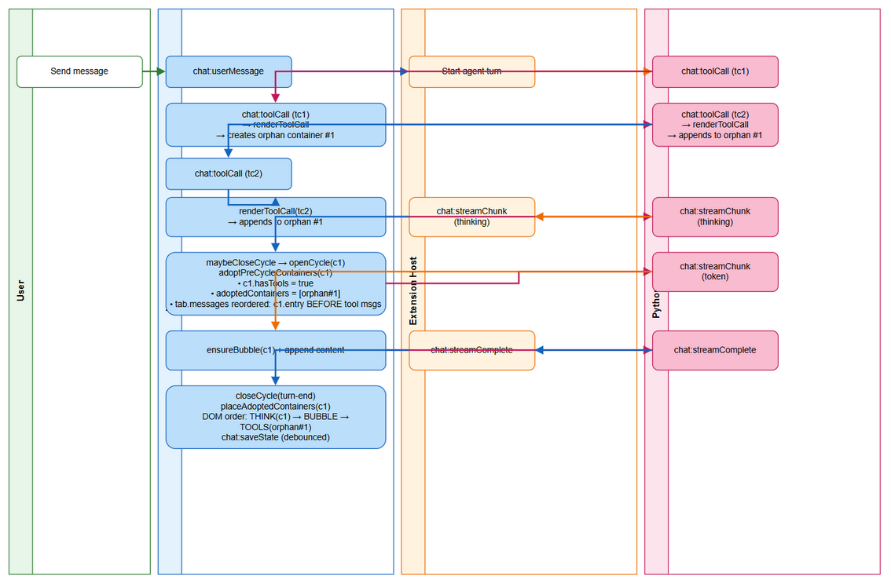
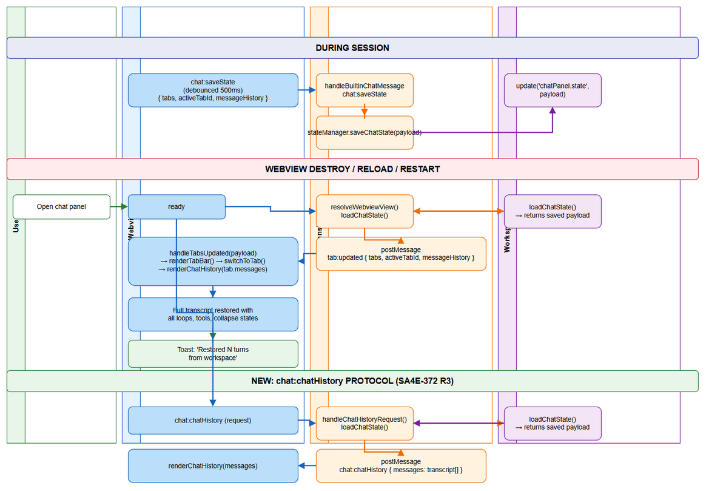
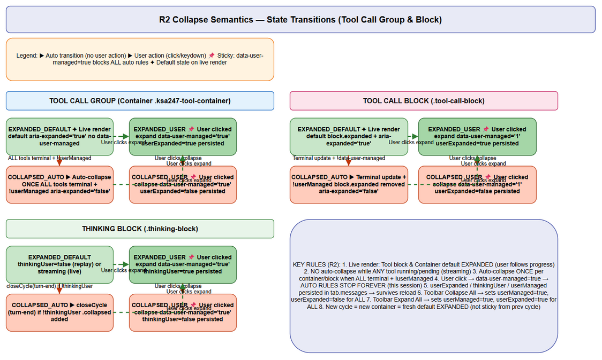

# Functional Specification Document (FSD)

## SDLC-Agents-4-Enterprise — SA4E-372: Chatbox UX/Persistence Improvements

---

## Document Information

| Field | Value |
|-------|-------|
| Jira Ticket | SA4E-372 |
| Title | Chatbox UX/Persistence Improvements — Think-Act Loop Separation, Correct Collapse Semantics, Full Workspace Transcript Persistence |
| Author | BA Agent + UI Agent + TA Agent |
| Version | 1.0 |
| Date | 2026-10-18 |
| Status | Draft |
| Related BRD | documents/SA4E-372/BRD.md (Approved) |
| Related Ticket | SA4E-369 (v1.53.9 UAT) |

---

## Revision History

| Version | Date | Author | Changes |
|---------|------|--------|---------|
| 1.0 | 2026-10-18 | BA/UI/TA Agents | Initial FSD — enterprise-grade specification matching commits 2363101, 07b88e8, eda4c38 |

---

## Sign-Off

| Role | Name | Signature & Date |
|------|------|------------------|
| BA | | ☐ Requirements accurately reflected |
| UI | | ☐ UI specs match design system & implementation |
| TA | | ☐ Technical contracts feasible & complete |
| SA | | ☐ Ready for TDD (Phase 3) |
| QA | | ☐ Testable acceptance criteria |

---

## Table of Contents

1. [System Overview](#1-system-overview)
2. [Functional Flows](#2-functional-flows)
3. [Data Models](#3-data-models)
4. [API Contracts](#4-api-contracts)
5. [Module Specifications](#5-module-specifications)
6. [Configuration Schema](#6-configuration-schema)
7. [Error Handling & Edge Cases](#7-error-handling--edge-cases)
8. [Traceability Matrix](#8-traceability-matrix)
9. [Sequence Diagrams](#9-sequence-diagrams)
10. [Migration & Compatibility](#10-migration--compatibility)
11. [Implementation Gaps](#11-implementation-gaps)
12. [Appendix](#12-appendix)

---

## 1. System Overview

### 1.1 Context Diagram

```
┌─────────────────────────────────────────────────────────────────────────────┐
│                        VS CODE WORKBENCH (Host Process)                     │
│  ┌─────────────────────────┐    ┌─────────────────────────────────────┐    │
│  │   Extension Host        │    │         Workspace Storage           │    │
│  │  ┌───────────────────┐  │    │  context.workspaceState             │    │
│  │  │ ChatPanelProvider │  │◄───│  Key: chatPanel.state               │    │
│  │  │                   │  │    │  Value: { tabs[], activeTabId,     │    │
│  │  │ - message dispatch│  │    │         messageHistory }            │    │
│  │  │ - state persistence│   │    └─────────────────────────────────────┘    │
│  │  │ - webview mgmt    │  │             ▲                    ▲           │
│  │  └─────────┬─────────┘  │             │                    │           │
│  └────────────┼────────────┘             │                    │           │
│               │                          │                    │           │
│    postMessage│                    chat:saveState        tab:updated     │
│               │                          │                    │           │
│               ▼                          │                    │           │
│  ┌─────────────────────────┐             │                    │           │
│  │      Webview Panel      │             │                    │           │
│  │  (chat panel iframe)    │             │                    │           │
│  │  ┌───────────────────┐  │             │                    │           │
│  │  │  Chat Modules     │  │             │                    │           │
│  │  │ (chat-*.js)       │  │             │                    │           │
│  │  │                   │  │             │                    │           │
│  │  │ - chat-core.js    │  │             │                    │           │
│  │  │ - chat-cycle.js   │  │             │                    │           │
│  │  │ - chat-stream.js  │  │             │                    │           │
│  │  │ - chat-tools.js   │  │             │                    │           │
│  │  │ - chat-toolcall.js│  │             │                    │           │
│  │  │ - chat-toolupdate │  │             │                    │           │
│  │  │ - chat-messages.js│  │             │                    │           │
│  │  │ - chat-tabsync.js │──┼─────────────┘                    │           │
│  │  │ - chat-inbox.js   │──┼──────────────────────────────────┘           │
│  │  │ - chat-pipeline.js│  │                                            │
│  │  └───────────────────┘  │                                            │
│  └─────────────────────────┘                                            │
└─────────────────────────────────────────────────────────────────────────────┘
                                    │
                                    │ HTTP/WS (MCP)
                                    ▼
                          ┌─────────────────────┐
                          │  Python MCP Server  │
                          │  (Orchestrator)     │
                          │                     │
                          │ - Agent loops       │
                          │ - Tool execution    │
                          │ - Streaming events  │
                          └─────────────────────┘
```

### 1.2 Module Inventory

| Module | File | Responsibility | Lines | Dependencies |
|--------|------|----------------|-------|--------------|
| **Core Namespace** | `chat-core.js` | `window.ChatState` — shared state, DOM refs, utilities | ~106 | — |
| **Response Cycle Machinery** | `chat-cycle.js` | Open/close cycles (thinking + answer + tools per loop) | ~199 | chat-core.js |
| **Streaming Handler** | `chat-stream.js` | Maps `chat:streamChunk` / `chat:streamComplete` to cycles | ~87 | chat-cycle.js |
| **Tool Container** | `chat-tools.js` | Collapsible container per cycle; R2 collapse semantics | ~154 | chat-core.js |
| **Tool Call Rendering** | `chat-toolcall.js` | Per-tool block: header, request/response, approval bar | ~197 | chat-tools.js, chat-tool-helpers.js |
| **Tool Call Updates** | `chat-toolupdate.js` | Live status/result/duration updates; terminal auto-collapse | ~97 | chat-tools.js |
| **Tool Helpers** | `chat-tool-helpers.js` | Categorization, duration, sticky flags, orphan adoption (R1) | ~198 | chat-core.js |
| **Message Rendering** | `chat-messages.js` | `appendMessage`, `renderChatHistory` (replay) | ~112 | chat-core.js, chat-tools.js |
| **Tab/Context Sync** | `chat-tabsync.js` | `tab:updated`, `tab:contextUpdate`, debounced `saveStateToDisk` | ~80 | chat-core.js |
| **Inbox (Dispatch)** | `chat-inbox.js` | Single `message` listener → dispatches to modules | ~118 | All modules |
| **Pipeline UI** | `chat-pipeline.js` | Status line, approval card, resume prompt, error bubbles | ~144 | chat-core.js |
| **Model Selector** | `chat-model.js` | Dropdown rendering, selection handling | ~120 | chat-core.js |
| **HTML Builder** | `ChatHtmlBuilder.ts` | Script load order (dependency graph), CSP, HTML template | ~98 | — |

### 1.3 Technology Stack

| Layer | Technology | Version |
|-------|------------|---------|
| Extension Host | TypeScript / Node.js | VS Code Extension API |
| Webview Frontend | Vanilla ES5 JavaScript (IIFE modules) | No bundler — script tag order = dependency graph |
| Markdown Rendering | Custom (markdown-renderer.js + highlight.js) | — |
| Persistence | VS Code `workspaceState` API | Per-workspace isolation |
| Backend Checkpoint | Python MCP Server + Knowledge Base | `KbRemoteCheckpointerStore` |

---

## 2. Functional Flows

### 2.1 Turn Execution & Response Cycles (R1)

#### 2.1.1 Terminology

| Term | Definition |
|------|------------|
| **Turn** | One complete AI response cycle triggered by a single user message. Contains 1..N cycles. |
| **Cycle** | One think-act loop iteration: thinking block → answer bubble (optional) → tool call group. |
| **Loop** | Synonym for Cycle in UI context. User sees "Thinking — Loop N" / "Tool Calls — Loop N". |

#### 2.1.2 Cycle State Machine

```
┌─────────────┐     token/thinking      ┌─────────────┐
│   NONE      │ ──────────────────────► │   OPEN      │
│ (no cycle)  │    (first delta)        │ (cycle cN)  │
└─────────────┘                         └──────┬──────┘
                                                │
           tool call arrives                   │
              (hasTools=true)                  │
                                                ▼
         ┌─────────────┐              ┌─────────────────┐
         │   CLOSED    │ ◄─────────── │  STREAMING      │
         │ (finalize)  │  maybeClose  │  (tokens/think) │
         └──────┬──────┘   Cycle()    └────────┬────────┘
                │                              │
                │ turn-end / error             │ different
                │                              │ nodeId delta
                ▼                              ▼
         ┌─────────────┐              ┌─────────────┐
         │   SEALED    │              │   NEXT      │
         │ (entry done)│              │   CYCLE     │
         └─────────────┘              └─────────────┘
```

#### 2.1.3 Detailed Flow: User Message → Multi-Loop Turn

```
1. USER sends message
   │
   ▼
2. chat-inbox.js receives chat:userMessage (from extension host)
   │
   ▼
3. chat-send.js posts chat:userMessage to extension host
   │
   ▼
4. EXTENSION HOST → Python MCP → Agent begins turn
   │
   ▼
5. STREAMING EVENTS arrive via chat:streamChunk:
   ┌────────────────────────────────────────────────────────────┐
   │ eventType="thinking"  ──► S.ensureThinking(c)             │
   │   - Creates/ensures thinking block for CURRENT cycle      │
   │   - Appends delta to c.thinkingText & c.thinkingBody      │
   │   - Live-mutates c.entry.thinking (for replay)            │
   │                                                             │
   │ eventType="token"     ──► S.ensureBubble(c)               │
   │   - Creates/ensures answer bubble for CURRENT cycle       │
   │   - Appends delta to c.content & c.contentEl              │
   │   - Live-mutates c.entry.content                          │
   │                                                             │
   │ eventType="status"    ──► Working bar update only         │
   └────────────────────────────────────────────────────────────┘
   │
   ▼
6. TOOL CALLS arrive via chat:toolCall:
   ┌────────────────────────────────────────────────────────────┐
   │ S.renderToolCall(tc, false, requiresApproval)             │
   │   - Creates tool-call-block with header + request/response │
   │   - Appends to active tool container (getOrCreateToolContainer)│
   │   - Sets S.currentCycle.hasTools = true                   │
   │   - Tracks orphan container if no cycle open yet (R1)     │
   │   - Persists to tab.messages (role="tool")                │
   └────────────────────────────────────────────────────────────┘
   │
   ▼
7. TOOL UPDATES arrive via chat:toolCallUpdate:
   ┌────────────────────────────────────────────────────────────┐
   │ S.updateToolCall(msg)                                     │
   │   - Updates status icon, response content, duration       │
   │   - Terminal status: auto-collapse block if !userManaged  │
   │   - Updates container summary (counts, status dots)       │
   │   - Persists to tab.messages.toolData                     │
   └────────────────────────────────────────────────────────────┘
   │
   ▼
8. CYCLE BOUNDARY DETECTION (chat-stream.js:31-33):
   ┌────────────────────────────────────────────────────────────┐
   │ S.maybeCloseCycle(msg.nodeId)                             │
   │   - If current cycle hasTools OR different nodeId:        │
   │     ► S.closeCycle("cycled") → finalize entry             │
   │     ► S.finalizeToolContainer() → seal container          │
   │     ► Next delta opens NEW cycle via S.openCycle()        │
   └────────────────────────────────────────────────────────────┘
   │
   ▼
9. TURN COMPLETION (chat:streamComplete):
   ┌────────────────────────────────────────────────────────────┐
   │ S.handleStreamComplete()                                  │
   │   - S.closeCycle("turn-end") → finalize last cycle        │
   │   - S.finalizeToolContainer() → seal last container       │
   │   - S.preCycleContainers = [] (drop orphan tracking)      │
   │   - S.isStreaming = false                                 │
   └────────────────────────────────────────────────────────────┘
```

#### 2.1.4 Orphan Container Adoption (R1 — Legacy Turn Fix)

**Problem**: In legacy turns, tool calls arrive LIVE while the streaming buffer is still accumulating (replay only happens at turn end). No cycle is open yet → `hasTools` never fires → tool container lands at transcript ROOT instead of inside a cycle.

**Solution** (`chat-tool-helpers.js:141-189`):

```
LEGACY TURN TIMELINE:
─────────────────────────────────────────────────────────────►
│                                                         │
│  chat:toolCall (tc1)  chat:toolCall (tc2)  streamChunk │
│       │                    │                    │       │
│       ▼                    ▼                    ▼       │
│  renderToolCall      renderToolCall     ensureCycle     │
│  creates container   appends to         (c1 opens)      │
│  (orphan #1)         same container     adopts orphans  │
│       │                    │                    │       │
│       └────────────────────┴────────────────────┘       │
│                        │                                 │
│                        ▼                                 │
│              adoptPreCycleContainers(c1)                 │
│              - c1.hasTools = true                        │
│              - c1.adoptedContainers = [orphan #1]        │
│              - Reorders tab.messages:                    │
│                c1.entry BEFORE tool messages             │
│              - placeAdoptedContainers(c1) at close:      │
│                DOM order: THINK(c1) → BUBBLE → TOOLS     │
```

### 2.2 Collapse Semantics Engine (R2)

#### 2.2.1 Rules Summary

| Scenario | Thinking Block | Tool Call Group | Tool Call Block |
|----------|----------------|-----------------|-----------------|
| Streaming (thinking/token) | **Never** auto-collapse | N/A | N/A |
| Tool running/pending | N/A | **Never** auto-collapse | Expanded by default |
| All tools terminal + userManaged=false | Auto-collapse once | Auto-collapse once | Auto-collapse once |
| User clicks expand | userManaged=true, expanded | userManaged=true, expanded | userManaged=true, expanded |
| User clicks collapse | userManaged=true, collapsed | userManaged=true, collapsed | userManaged=true, collapsed |
| Replay restore | thinkingUser flag → expanded/collapsed | N/A | userManaged + userExpanded flags |

#### 2.2.2 Implementation Points

**Thinking Block** (`chat-cycle.js:32-53`, `chat-messages.js:38-61`):
- `data-user-managed="true"` set on user click
- `c.thinkingUser` persisted in entry → replay honors it
- `collapseThinking(c)` only runs if `!data-user-managed`

**Tool Container** (`chat-tools.js:66-139`):
- `applyContainerCollapse(container)` — all-terminal + !userManaged + no approval bar
- `updateToolContainerSummary` calls `applyContainerCollapse` after every update
- `data-user-managed` set on header click/keydown

**Tool Call Block** (`chat-toolcall.js:63-72`, `chat-toolupdate.js:66-73`):
- Header click/keydown → `data-user-managed="1"` + `markToolUserManaged(tc.id, expanded)`
- `updateToolCall`: terminal status + !userManaged + expanded → collapse block

**Persistence** (`chat-tool-helpers.js:83-95`):
- `markToolUserManaged` writes `toolData.userManaged` + `toolData.userExpanded` to tab.messages
- `saveStateToDisk` debounced 500ms

### 2.3 Persistence & Restore Architecture (R3)

#### 2.3.1 Data Flow

```
WEBVIEW (chat-tabsync.js)                    EXTENSION HOST
─────────────────────────────────────────────────────────────
S.saveStateToDisk() (debounced 500ms)
      │
      ▼
postMessage { type: "chat:saveState", payload: { tabs, activeTabId, messageHistory } }
      │
      ▼
┌─────────────────────────────────────────────────────────────┐
│ ChatPanelProvider.message-dispatch.ts                       │
│   handleBuiltinChatMessage("chat:saveState")               │
│       │                                                     │
│       ▼                                                     │
│   stateManager.saveChatState(payload)                      │
│       │                                                     │
│       ▼                                                     │
│   context.workspaceState.update("chatPanel.state", payload) │
└─────────────────────────────────────────────────────────────┘
      │
      │ (on webview load)
      ▼
┌─────────────────────────────────────────────────────────────┐
│ ChatPanelProvider.resolveWebviewView()                      │
│   stateManager.loadChatState() → returns saved payload      │
│   postMessage { type: "tab:updated", payload }              │
└─────────────────────────────────────────────────────────────┘
      │
      ▼
WEBVIEW (chat-inbox.js → chat-tabsync.js)
      │
      ▼
S.handleTabsUpdated(payload)
      │
      ▼
S.renderTabBar() → S.switchToTab(activeTabId)
      │
      ▼
S.renderChatHistory(tab.messages)  (chat-messages.js:93-111)
      │
      ├── tool messages → S.renderToolCall(m.toolData, true)
      └── others → S.finalizeToolContainer() → S.appendMessage()
```

#### 2.3.2 chat:chatHistory Protocol (BRD Requirement — Currently DEAD)

**Current State**: Protocol defined in `message-protocol.ts:98` but **no extension host handler exists**. Restore uses `tab:updated` instead.

**Required Implementation** (Gap-7, Gap-8):

```
WEBVIEW LOAD                          EXTENSION HOST
─────────────────────────────────────────────────────────────
postMessage { type: "chat:chatHistory" }  (request)
      │                                     │
      ▼                                     ▼
                              ┌─────────────────────────────┐
                              │ ChatPanelProvider           │
                              │   handleChatHistoryRequest() │
                              │       │                      │
                              │       ▼                      │
                              │   stateManager.loadChatState()│
                              │       │                      │
                              │       ▼                      │
                              │   postMessage {              │
                              │     type: "chat:chatHistory",│
                              │     messages: transcript[]   │
                              │   }                          │
                              └─────────────────────────────┘
      │                                     │
      ▼                                     │
S.renderChatHistory(messages)               │
```

#### 2.3.3 Transcript Schema (Persisted in workspaceState)

```typescript
interface WorkspaceChatState {
  schemaVersion: 2;                    // Incremented for SA4E-372
  workspaceId: string;                 // Hash of workspace folder path
  tabs: TabState[];
  activeTabId: string;
  messageHistory: string[];            // Last 50 user messages
  savedAt: string;                     // ISO8601
}

interface TabState {
  id: string;
  name: string;
  messages: PersistedMessage[];
  tokenCount: number;
  maxTokens: number;
}

type PersistedMessage =
  | UserMessage
  | AssistantMessage
  | ToolMessage
  | ErrorMessage
  | SystemMessage;

interface UserMessage {
  role: "user";
  content: string;
  timestamp: string;
  metadata?: Record<string, unknown>;
}

interface AssistantMessage {
  role: "assistant";
  content: string;                      // Final answer (markdown)
  nodeId?: string;                      // e.g., "pi:c3" (cycle ID)
  timestamp: string;
  thinking?: string;                    // Thinking content for think-only cycles
  thinkingUser?: boolean;               // Sticky: user manually expanded
}

interface ToolMessage {
  role: "tool";
  content: "";                          // Always empty (content in toolData)
  toolData: {
    id: string;                         // call_abc123
    name: string;                       // Tool name
    args: Record<string, unknown>;      // Input parameters
    status: "running" | "completed" | "failed" | "interrupted";
    result?: string;                    // Full output
    error?: string;                     // Error message if failed
    duration?: number;                  // ms
    timestamp: string;                  // ISO8601
    userManaged?: boolean;              // Sticky flag
    userExpanded?: boolean;             // Sticky preference
  };
}

interface ErrorMessage {
  role: "error";
  content: string;
  timestamp: string;
}

interface SystemMessage {
  role: "system";
  content: string;
  timestamp: string;
}
```

#### 2.3.4 Size Limits & Trimming

| Limit | Value | Behavior |
|-------|-------|----------|
| Max Turns | 500 | FIFO trim oldest **complete** turns |
| Max Size | 10 MB | Compress if needed; current turn never trimmed |
| Message History | 50 entries | User messages only, for input autocomplete |

### 2.4 Checkpoint Soft-Fail (S1e)

**File**: `extension/src/pi-workflow/remote-checkpointer-store.ts:93-121`

**Behavior**: Remote checkpoint save failure **never kills the turn**. The transcript already lives in webview + workspaceState; remote mirror is best-effort.

```typescript
async saveCheckpoint(threadId: string, checkpoint: PipelineState): Promise<void> {
  try {
    await this.client.saveCheckpoint(validThreadId, { ... });
  } catch (err) {
    debugError(`saveCheckpoint failed (status=${err.status})`, err);
    debugLog('checkpoint save skipped (fail-open)');
    // NO throw — turn continues, local transcript intact
  }
}
```

**Rationale**: Local persistence (workspaceState) is the source of truth for UX. Remote checkpoint is for cross-session/agent resume, not for real-time chat UX.

### 2.5 Think-Only Replay Parity (S1h)

**Requirement**: A tool-first cycle with no token delta (only thinking) must render its Thinking block only — no empty bubble. Live and replay must match.

**Implementation** (`chat-messages.js:24-32`):

```javascript
var thinkOnly = role === "assistant" &&
  !(content && String(content).trim()) && !!(entry && entry.thinking);

if (entry && entry.thinking) {
  // Render thinking block (with thinkingUser sticky)
  ...
}
if (!thinkOnly) {
  // Render answer bubble
  ...
}
```

**Replay path** (`chat-messages.js:93-111`): `renderChatHistory` iterates tab.messages in order. Tool messages render via `renderToolCall(toolData, true)`. Non-tool messages seal container then `appendMessage`. The `thinkOnly` guard ensures parity.

### 2.6 Backward Compatibility (v1.53.9 → v1.53.10)

| Aspect | v1.53.9 | v1.53.10 (SA4E-372) | Migration |
|--------|---------|---------------------|-----------|
| Cycle Model | 1 container per turn | 1 cycle per think-act loop | `schemaVersion: 2`; old transcripts render as single cycle |
| Collapse | Threshold-based auto-collapse | Terminal-only + sticky | `data-user-managed` absent → default behavior |
| Persistence | Partial (final message only) | Full transcript (all blocks) | New fields added; old fields optional |
| Tool Call Group | Single per turn | Per cycle (loop) | Orphan adoption handles legacy |
| chat:chatHistory | Dead protocol | Implemented for restore | Extension host handler added |

---

## 3. Data Models

### 3.1 ChatMessage (Protocol — message-protocol.ts:24)

```typescript
export interface ChatMessage {
  id: string;                    // UUID
  role: "user" | "assistant" | "system";
  content: string;               // Markdown
  nodeId?: string;               // "pi:c3" for assistant cycles
  timestamp: string;             // ISO8601
}
```

### 3.2 CycleState (Runtime — chat-cycle.js:60-88)

```typescript
interface CycleState {
  cycleId: string;               // "c1", "c2", ...
  domId: string;                 // "pi:c1" (nodeId:cycle)
  nodeId: string;                // "pi" (base node)
  thinkingText: string;          // Accumulated thinking delta
  content: string;               // Accumulated answer tokens
  hasTools: boolean;             // True if any tool call rendered
  thinkingUser: boolean;         // Sticky: user manually expanded thinking
  thinkingEl: HTMLElement | null;
  thinkingBody: HTMLElement | null;
  bubbleEl: HTMLElement | null;
  contentEl: HTMLElement | null;
  entry: PersistedEntry;         // Live-mutated, pushed at OPEN
  adoptedContainers?: HTMLElement[]; // Orphan containers adopted (R1)
}
```

### 3.3 WorkspaceState (Persistence — chat-tabsync.js + extension host)

```typescript
interface WorkspaceChatState {
  schemaVersion: number;         // 2
  workspaceId: string;           // SHA256(workspacePath) first 8 chars
  tabs: TabState[];
  activeTabId: string;
  messageHistory: string[];
  savedAt: string;
}

interface TabState {
  id: string;
  name: string;
  messages: PersistedMessage[];
  tokenCount: number;
  maxTokens: number;
}
```

### 3.4 ToolCallDisplay (Protocol — message-protocol.ts:37-44)

```typescript
export interface ToolCallDisplay {
  id: string;
  name: string;
  args?: Record<string, unknown>;
  status: "running" | "completed" | "failed";
  result?: string;
  duration?: number;
}
```

### 3.5 PipelineState (Backend Checkpoint — remote-checkpointer-store.ts:9-20)

```typescript
export interface PipelineState {
  ticketKey: string;
  threadId: string;
  currentPhase: string;
  pipelineStatus?: string;
  chatHistory?: Array<{ role: string; content: unknown }>;
  agentOutputs?: Record<string, unknown>;
  errors?: Array<{ code: string; message: string }>;
}
```

---

## 4. API Contracts

### 4.1 Webview → Extension Host Messages

| Message Type | Payload | Response | Description |
|--------------|---------|----------|-------------|
| `chat:userMessage` | `{ text, context?, attachments? }` | `chat:streamChunk*` | User sends message |
| `chat:approvalAction` | `{ decision, feedback? }` | — | Gate approval response |
| `chat:cancelStream` | `{ streamId? }` | — | Cancel in-flight stream |
| `chat:clearHistory` | `{}` | `tab:updated` | Wipe transcript for workspace |
| `chat:resumePipeline` | `{ threadId }` | `chat:streamChunk*` | Resume paused pipeline |
| `chat:startFresh` | `{}` | `tab:updated` | New conversation |
| `chat:pickContext` | `{ contextType }` | `chat:contextPicked` | Context picker |
| `chat:pickAttachment` | `{}` | `chat:contextPicked` | File attachment |
| `chat:setModel` | `{ model }` | `chat:configUpdate` | Switch model |
| `chat:setMode` | `{ mode }` | `chat:configUpdate` | Autopilot/supervised |
| `chat:applyCode` | `{ code, filePath? }` | — | Apply code edit |
| `chat:insertCode` | `{ code }` | — | Insert at cursor |
| `tab:create` | `{}` | `tab:updated` | New tab |
| `tab:switch` | `{ tabId }` | `tab:updated` | Switch tab |
| `tab:close` | `{ tabId }` | `tab:updated` | Close tab |
| `tab:rename` | `{ tabId, newName }` | `tab:updated` | Rename tab |
| `chat:saveState` | `{ tabs, activeTabId }` | — | **Debounced persist** |
| `chat:selectAgent` | `{ agentId }` | — | Slash agent select |
| `chat:toolApproval` | `{ toolId, decision, rememberPattern? }` | `chat:toolCallUpdate` | Tool consent |
| `chat:exportConversation` | `{ format, tab, model?, mode? }` | File save dialog | Export transcript |
| `chat:copyMessage` | `{ entry }` | Clipboard write | Copy single message |
| `ready` | `{}` | `chat:models`, `tab:updated` | Webview loaded |
| `refresh` | `{}` | `chat:models`, `tab:updated` | Force reload |

### 4.2 Extension Host → Webview Messages

| Message Type | Payload | Handler | Description |
|--------------|---------|---------|-------------|
| `chat:streamChunk` | `{ streamId, nodeId, eventType, content, timestamp, metadata? }` | `S.handleStreamChunk` | Token/thinking/status delta |
| `chat:streamComplete` | `{ streamId, nodeId, finalContent, metadata? }` | `S.handleStreamComplete` | Turn complete |
| `chat:graphUpdate` | `{ nodes: PipelineGraphNode[] }` | (no-op) | Pipeline graph |
| `chat:approvalRequest` | `{ checkpoint: QualityGateCheckpoint }` | `S.renderApprovalCard` | Gate approval UI |
| `chat:chatHistory` | `{ messages: ChatMessage[] }` | `S.renderChatHistory` | **Transcript restore (NEW)** |
| `chat:pipelineStatus` | `{ status, phase, ticketKey }` | `S.handlePipelineStatus` | Pipeline status line |
| `chat:nodeDetails` | `{ node, recentOutputs }` | (debug) | Node details |
| `chat:resumePrompt` | `{ threadId, ticketKey, phase, pausedAt }` | `S.renderResumePrompt` | Resume paused |
| `chat:error` | `{ code, message, retryable }` | `S.renderError` | Error bubble |
| `chat:toolCall` | `{ toolCall: ToolCallDisplay, requiresApproval? }` | `S.renderToolCall` | New tool call |
| `chat:toolCallUpdate` | `{ id, status, result?, duration? }` | `S.updateToolCall` | Tool status update |
| `chat:toolApprovalPending` | `{ toolId, toolName }` | `S.pendingApproval` | Approval bar |
| `chat:contextPicked` | `{ item: ContextItem }` | `S.addContextChip` | Context added |
| `chat:configUpdate` | `{ model, mode, availableModels }` | `S.setModel`, `S.currentMode` | Config sync |
| `chat:models` | `{ provider, models, selected, supportsAuto }` | `S.renderModelDropdown` | Model list |
| `chat:workingStatus` | `{ working, label? }` | `S.setWorking` / `S.setGraphDone` | Working bar |
| `tab:updated` | `{ tabs[], activeTabId }` | `S.handleTabsUpdated` | **Full state restore** |
| `tab:contextUpdate` | `{ tabId, tokenCount, maxTokens, percentage, threshold }` | `S.handleContextUpdate` | Token gauge |
| `chat:steeringLoaded` | `{ rules[] }` | `S.renderSteeringRules` | Steering rules |
| `chat:agentsLoaded` | `{ agents[] }` | `S.populateSlashAgents` | Slash agents |
| `chat:skillsLoaded` | `{ skills[] }` | `S.populateSlashSkills` | Slash skills |
| `chat:hookTriggered` | `{ hook }` | `S.renderHookBadge` | Hook badge |
| `chat:contextUsage` | `{ payload }` | — | Context usage |
| `chat:agentSwitched` | `{ agentId, agentName }` | — | Agent switch |
| `serverStatus` | `{ status }` | `S.updateServerStatus` | Backend status |

### 4.3 Backend Checkpoint API (Python MCP)

| Operation | Method | Request | Response |
|-----------|--------|---------|----------|
| Get Checkpoint | `GET /checkpoint/{threadId}` | `threadId` (UUID v4) | `PipelineState \| null` |
| Save Checkpoint | `POST /checkpoint/{threadId}` | `PipelineState` | `200 OK` or error (fail-open) |

**Authentication**: HMAC-SHA256 derived from workspace root (`deriveHmacKey`). Thread ID mapped to UUID v4 via `ensureUuidV4`.

**Fail-Open Guarantee**: `saveCheckpoint` catches all errors, logs, returns void — never throws.

---

## 5. Module Specifications

### 5.1 chat-core.js — Shared Namespace

**Exports**: `window.ChatState` (global namespace)

**State Properties**:
```typescript
interface ChatState {
  // DOM Refs
  messagesEl: HTMLElement;
  inputEl: HTMLElement;
  sendBtn: HTMLButtonElement;
  statusEl: HTMLElement;
  welcomeEl: HTMLElement;
  workingBar: HTMLElement;
  workingText: HTMLElement;
  // ... (all DOM refs)

  // Mutable State
  isStreaming: boolean;
  hasMessages: boolean;
  currentModel: string;
  currentMode: "autopilot" | "supervised";
  contextItems: ContextItem[];
  toolCalls: Record<string, HTMLElement>;  // id → tool-call-block
  messageHistory: string[];
  historyIndex: number;
  pendingInput: string;
  pendingApproval: { toolId: string; toolName: string } | null;

  // Tabs (KSA-240)
  tabs: TabState[];
  activeTabId: string;
  tabCounter: number;
  MAX_TABS: 10;

  // Models
  availableModels: ChatModelEntry[];
  supportsAuto: boolean;

  // Attachments
  pastedAttachments: Array<{ type, name, dataUrl }>;

  // Tool Containers (KSA-247/290)
  activeToolContainer: HTMLElement | null;

  // Cycles (SA4E-371)
  currentCycle: CycleState | null;
  cycleSeq: number;
  preCycleContainers: HTMLElement[];  // Orphan tracking (R1)
}
```

**Utilities**: `escapeHtml`, `scrollToBottom`, `cycleBadgeText`, `statusIcon`, `formatDuration`, `categorizeTool`, `getTab`, `switchToTab`, `renderTabBar`, `setWorking`, `setGraphDone`, `showMessages`, `saveStateToDisk`.

### 5.2 chat-cycle.js — Response Cycle Machinery

**Functions**:

| Function | Signature | Responsibility |
|----------|-----------|----------------|
| `cycleBadgeText` | `(id: string) => string` | "pi:c3" → "PI", "chat" → "Pipeline Agent" |
| `buildThinkingBlock` | `(c: CycleState) => HTMLElement` | Creates thinking block DOM with header click → sticky |
| `openCycle` | `(nodeId: string) => CycleState` | Creates new cycle, pushes entry to tab.messages, adopts orphans |
| `ensureCycle` | `(nodeId: string) => CycleState` | Returns current or opens new |
| `ensureBubble` | `(c: CycleState) => HTMLElement` | Creates/recycles answer bubble |
| `ensureThinking` | `(c: CycleState) => HTMLElement` | Creates/recycles thinking block |
| `collapseThinking` | `(c: CycleState) => void` | Auto-collapse if !userManaged |
| `settleThinking` | `(c: CycleState) => void` | Remove .streaming class |
| `closeCycle` | `(reason: string) => PersistedEntry \| null` | Finalize: settle, collapse, place adopted, mutate entry, save |
| `maybeCloseCycle` | `(nodeId: string) => void` | Close if hasTools OR different nodeId |
| `finalizeToolContainer` | `() => void` | Seal active container (called from chat-tools.js) |
| `adoptPreCycleContainers` | `(c: CycleState, tab: TabState) => void` | R1: Adopt orphans, reorder tab.messages |
| `placeAdoptedContainers` | `(c: CycleState) => void` | R1: DOM insert after cycle elements |

**Algorithm — Orphan Adoption (R1)**:
```
adoptPreCycleContainers(c, tab):
  if no preCycleContainers: return
  c.hasTools = true
  c.adoptedContainers = copy of preCycleContainers
  clear preCycleContainers
  find firstToolAt = index of first adopted tool message in tab.messages
  find at = index of c.entry in tab.messages
  if at > firstToolAt:
    move c.entry to firstToolAt (splice)
    
placeAdoptedContainers(c):
  refEl = c.bubbleEl || c.thinkingEl (whichever in DOM)
  for each adopted container:
    insertBefore refEl.nextSibling
    refEl = adopted container
```

### 5.3 chat-stream.js — Streaming Handler

**Functions**:

| Function | Signature | Responsibility |
|----------|-----------|----------------|
| `handleStreamChunk` | `(msg: StreamChunkMsg) => void` | Routes eventType to cycle machinery |
| `handleStreamComplete` | `() => void` | Closes cycle, seals container, clears orphans |
| `renderCycleError` | `(msg: StreamChunkMsg) => void` | Error bubble in cycle, closes cycle |

**StreamChunkMsg**:
```typescript
interface StreamChunkMsg {
  streamId: string;
  nodeId: string;        // e.g., "pi", "sm", "ba"
  eventType: "token" | "thinking" | "status" | "error" | "progress" | ...
  content: string;
  timestamp: string;
  metadata?: Record<string, unknown>;
}
```

**Logic**:
- `status` → working bar only
- `error` → renderCycleError
- `token` → ensureBubble, append content, render markdown
- `thinking` → ensureThinking, append text, no auto-collapse
- **Before processing**: `maybeCloseCycle(msg.nodeId)` — detects cycle boundary

### 5.4 chat-tools.js — Tool Container & Collapse Engine

**Functions**:

| Function | Signature | Responsibility |
|----------|-----------|----------------|
| `getOrCreateToolContainer` | `() => HTMLElement` | Creates/reuses active container; header click → sticky |
| `allTerminal` | `(body: HTMLElement) => boolean` | All tool blocks in container are completed/failed |
| `applyContainerCollapse` | `(container: HTMLElement) => void` | R2: collapse if all-terminal + !userManaged + no approval bar |
| `updateToolContainerSummary` | `(container: HTMLElement) => void` | Updates counts, categories, status dots; calls applyContainerCollapse |
| `finalizeToolContainer` | `() => void` | Seals container: data-sealed=true, update summary, collapse, null active |

**Container DOM Structure**:
```html
<div class="ksa247-tool-container" data-turn="turn-..." data-tool-count="N" data-user-managed? data-sealed?>
  <div class="tool-container-summary" role="button" tabindex="0" aria-expanded="true">
    <span class="tc-chevron">▼</span>
    <span class="tc-summary-text">5 FILE, 3 MEM</span>
    <span class="tc-count-badge">8</span>
    <span class="tc-status-dots"><span class="tc-dot running">⏳</span>...</span>
  </div>
  <div class="tool-container-body">
    <!-- tool-call-block elements appended here -->
  </div>
</div>
```

**R2 Collapse Logic** (`applyContainerCollapse`):
```javascript
function applyContainerCollapse(container) {
  if (container.hasAttribute("data-user-managed")) return;  // Sticky
  if (container.classList.contains("tc-collapsed")) return; // Already collapsed
  if (container.querySelector(".tool-approval-bar")) return; // Approval visible
  if (!allTerminal(container.querySelector(".tool-container-body"))) return;
  container.classList.add("tc-collapsed");
  header.setAttribute("aria-expanded", "false");
}
```

### 5.5 chat-toolcall.js — Tool Call Block Rendering

**Function**: `renderToolCall(tc, isReplay, requiresApproval)`

**DOM Structure**:
```html
<div class="tool-call-block" id="tc-{id}" tabindex="0" role="button" aria-expanded="false" aria-label="Tool call: name - status" data-user-managed?="1">
  <div class="tool-call-header">
    <span class="tool-chevron">▶</span>
    <span class="tool-icon">{icon}</span>
    <span class="tool-cat cat-{cls}">{label}</span>
    <span class="tool-name">{name}</span>
    <span class="tool-status {status}">{glyph}</span>
    <span class="tool-duration">{formatted}</span>  <!-- if completed -->
  </div>
  <div class="tool-call-body">
    <div class="tool-section tool-section-request">
      <div class="tool-section-label">Request</div>
      <pre class="tool-section-content">{JSON.stringify(args, null, 2)}</pre>
    </div>
    <div class="tool-section tool-section-response">
      <div class="tool-section-label">Response</div>
      <pre class="tool-section-content">{result | error | (waiting...) | (interrupted)}</pre>
    </div>
    <!-- tool-approval-bar appended if requiresApproval -->
  </div>
</div>
```

**Behavior**:
- Live render: block.expanded = true, aria-expanded="true"
- Replay: if userManaged → honor userExpanded; else if running/interrupted → expanded; else collapsed
- Header click/keydown → toggle expanded, set data-user-managed, call `markToolUserManaged(tc.id, expanded)`
- Appends to active tool container's `.tool-container-body`
- Persists to tab.messages (role="tool", toolData={...})

### 5.6 chat-toolupdate.js — Live Tool Updates

**Function**: `updateToolCall(msg)`

**Updates**:
- Status icon + aria-label
- Response section content (result/error/(no output)/(failed — no output))
- Duration display (guard against duplicates)
- **Terminal auto-collapse** (R2): if completed/failed + !data-user-managed + expanded → collapse block
- Container summary update
- Tab model sync + `saveStateToDisk`

### 5.7 chat-tool-helpers.js — Helpers & Orphan Adoption (R1)

**Functions**:

| Function | Signature | Responsibility |
|----------|-----------|----------------|
| `categorizeTool` | `(name: string) => {icon, label, cls}` | Prefix → category mapping |
| `formatDuration` | `(ms: number) => string` | "123ms" or "1.2s" |
| `markToolUserManaged` | `(toolCallId: string, expanded: boolean) => void` | Persist sticky flag to tab.messages + save |
| `buildToolApprovalBar` | `(tc, block, isReplay) => void` | Creates approval buttons, posts chat:toolApproval |
| `trackPreCycleContainer` | `(container, isReplay) => void` | R1: Track orphan containers before cycle opens |
| `adoptPreCycleContainers` | `(c, tab) => void` | R1: Adopt orphans into cycle, reorder messages |
| `placeAdoptedContainers` | `(c) => void` | R1: DOM reorder at cycle close |
| `statusIcon` | `(status: string) => string` | Glyph mapping |

### 5.8 chat-messages.js — Message Rendering & Replay

**Functions**:

| Function | Signature | Responsibility |
|----------|-----------|----------------|
| `showMessages` | `() => void` | Hide welcome, show messages container |
| `appendMessage` | `(role, content, nodeId, entry) => void` | Render single message (user/assistant/error/system) |
| `renderChatHistory` | `(messages: PersistedMessage[]) => void` | Full re-render from persisted state |

**appendMessage Logic**:
```javascript
// Think-only cycle guard (S1h)
var thinkOnly = role === "assistant" && 
  !(content && String(content).trim()) && !!(entry && entry.thinking);

if (entry && entry.thinking) {
  // Render thinking block
  // thinkingUser → expanded; else collapsed
  // Header click → toggle + data-user-managed + entry.thinkingUser = !collapsed + save
}

if (!thinkOnly) {
  // Render bubble (user/assistant/error/system)
  // Assistant: markdown + code actions + copy
}
```

**renderChatHistory Logic**:
```javascript
messagesEl.innerHTML = "";
activeToolContainer = null;
for each message in messages:
  if role === "tool" and toolData:
    renderToolCall(toolData, true);  // replay
  else:
    finalizeToolContainer();         // seal before non-tool
    appendMessage(role, content, nodeId, message);
finalizeToolContainer();             // seal trailing
```

### 5.9 chat-tabsync.js — Tab Sync & Persistence

**Functions**:

| Function | Signature | Responsibility |
|----------|-----------|----------------|
| `handleTabsUpdated` | `(payload) => void` | Restore tabs, messageHistory, render tab bar, switch to active |
| `handleContextUpdate` | `(payload) => void` | Update token gauge |
| `saveStateToDisk` | `() => void` | Debounced (500ms) postMessage chat:saveState |

**saveStateToDisk Payload**:
```json
{
  "type": "chat:saveState",
  "payload": {
    "tabs": [...],
    "activeTabId": "...",
    "messageHistory": [...]
  }
}
```

### 5.10 chat-inbox.js — Message Dispatcher

**Single `window.addEventListener("message", ...)`** with switch on `msg.type`. Routes to `ChatState` functions.

**Key Routes**:
- `chat:streamChunk` → `S.handleStreamChunk`
- `chat:streamComplete` → `S.handleStreamComplete`
- `chat:toolCall` → `S.renderToolCall`
- `chat:toolCallUpdate` → `S.updateToolCall`
- `chat:chatHistory` → `S.renderChatHistory` (NEW — restore protocol)
- `tab:updated` → `S.handleTabsUpdated`
- `chat:saveState` → handled by extension host (not webview)

### 5.11 chat-pipeline.js — Pipeline UI

**Functions**:
- `handlePipelineStatus` — status line in chat
- `renderApprovalCard` — gate checkpoint with Approve/Revise/Reject
- `renderResumePrompt` — Resume/Start Fresh buttons
- `renderError` — Error bubble (persisted to tab)
- `updateServerStatus` — Connection indicator

### 5.12 ChatHtmlBuilder.ts — HTML Generation & Load Order

**Script Load Order** (dependency graph):
```
1. markdown-highlight.js    (window.MarkdownHighlight)
2. markdown-blocks.js       (window.MarkdownBlocks)
3. markdown-renderer.js     (window.MarkdownRenderer)
4. graph-viz.js             (window.PipelineGraphViz)
5. export-ui.js             (window.ChatExportUI)
6. chat-core.js             (window.ChatState) — MUST BE FIRST CHAT SCRIPT
7. chat-context-usage.js
8. chat-tabs.js
9. chat-tabs-ui.js
10. chat-input.js
11. chat-attachments.js
12. chat-toolbar.js
13. chat-model.js
14. chat-inbox.js
15. chat-send.js
16. chat-messages.js
17. chat-cycle.js           — MUST PRECEDE chat-stream.js
18. chat-stream.js
19. chat-tools.js
20. chat-tool-helpers.js
21. chat-toolcall.js
22. chat-toolupdate.js
23. chat-chips.js
24. chat-pipeline.js
25. chat-codeactions.js
26. chat-tabsync.js
27. chat-steering.js
28. chat-slash.js
29. chat-slash-ui.js
30. chat-init.js            — MUST BE LAST (initial render + ready handshake)
```

---

## 6. Configuration Schema

### 6.1 Workspace Settings (VS Code settings.json)

| Setting | Type | Default | Description |
|---------|------|---------|-------------|
| `sdlc.chat.maxTurns` | number | 500 | Max turns before FIFO trim |
| `sdlc.chat.maxSizeMB` | number | 10 | Max transcript size (MB) |
| `sdlc.chat.saveDebounceMs` | number | 500 | Debounce for saveStateToDisk |
| `sdlc.chat.autoCollapseThreshold` | number | 0 | **Deprecated** — R2 removes threshold |
| `sdlc.chat.enableRemoteCheckpoint` | boolean | true | Enable Python MCP checkpoint mirror |

### 6.2 Extension Host Configuration (ChatPanelProvider)

```typescript
interface ChatPanelConfig {
  workspaceRoot: string;           // For HMAC key derivation
  checkpointStore: RemoteCheckpointerStore;  // KbRemoteCheckpointerStore
  stateManager: ChatStateManager;  // WorkspaceState persistence
}
```

---

## 7. Error Handling & Edge Cases

### 7.1 Webview Errors

| Scenario | Detection | Handling | User Visible |
|----------|-----------|----------|--------------|
| Malformed streamChunk | `msg.eventType` unknown | Log warning, ignore | — |
| Tool block not found on update | `S.toolCalls[msg.id]` undefined | Log warning, ignore | — |
| thinkingBody null on thinking delta | `c.thinkingBody` missing | Create via ensureThinking | — |
| WorkspaceState quota exceeded | `workspaceState.update` throws | Trim oldest turns, retry | Toast "History trimmed" |
| chat:chatHistory timeout (5s) | Promise race | Start fresh transcript | Toast "Restore failed, starting fresh" |
| Deserialization failure | JSON.parse throws / schema mismatch | Log error, clear state, notify | Toast "Corrupted history, reset" |

### 7.2 Streaming Edge Cases

| Edge Case | Current Behavior | Spec Behavior |
|-----------|------------------|---------------|
| Thinking delta after tool calls | `maybeCloseCycle` → new cycle | ✅ Correct (new loop) |
| Different nodeId during streaming | `maybeCloseCycle` → new cycle | ✅ Correct (pipeline agents sequential) |
| Tool call before any cycle | `trackPreCycleContainer` → orphan | ✅ R1 adoption on first cycle |
| Turn ends without streamComplete | `finalizeToolContainer` on error | ✅ Seals dangling cycle |
| Empty cycle (no text, no thinking) | Entry spliced from tab.messages | ✅ No empty assistant message |

### 7.3 Persistence Edge Cases

| Edge Case | Handling |
|-----------|----------|
| Webview destroy during streaming | `beforeunload` / `visibilitychange` → immediate `saveStateToDisk` |
| Corrupted workspaceState | `try/catch` in loadChatState → empty state + toast |
| Tab switch mid-stream | `ensureBubble`/`ensureThinking` recreate DOM preserving buffers |
| Multiple workspaces | `workspaceId` hash isolates storage per folder |

### 7.4 Remote Checkpoint Edge Cases

| Edge Case | Handling |
|-----------|----------|
| Backend unavailable | Fail-open — local transcript unaffected |
| Invalid threadId (not UUID) | `ensureUuidV4` derives deterministic UUID via HMAC |
| Malformed checkpoint data | `PipelineStateSchema.safeParse` → return null (treated as no checkpoint) |
| HMAC key mismatch | Different workspace → different key → isolated checkpoints |

---

## 8. Traceability Matrix

| Req ID | BRD Ref | Module | Function | Test Case |
|--------|---------|--------|----------|-----------|
| R1-US1 | US-1 | chat-cycle.js | openCycle, maybeCloseCycle | TC-R1-01: 3 loops render 3 thinking+tool groups |
| R1-US1 | US-1 | chat-stream.js | handleStreamChunk | TC-R1-02: Loop boundary on different nodeId |
| R1-US1 | US-1 | chat-tool-helpers.js | adoptPreCycleContainers | TC-R1-03: Legacy turn orphans adopted in order |
| R1-US1 | US-1 | chat-messages.js | renderChatHistory | TC-R1-04: Replay preserves loop structure |
| R2-US2 | US-2 | chat-tools.js | applyContainerCollapse | TC-R2-01: No auto-collapse while running |
| R2-US2 | US-2 | chat-tools.js | updateToolContainerSummary | TC-R2-02: Auto-collapse after all terminal |
| R2-US2 | US-2 | chat-toolcall.js | header click handler | TC-R2-03: Manual expand → sticky (no auto-collapse) |
| R2-US2 | US-2 | chat-toolcall.js | header click handler | TC-R2-04: Manual collapse → sticky (no auto-expand) |
| R2-US2 | US-2 | chat-toolupdate.js | updateToolCall | TC-R2-05: Terminal block auto-collapse if !userManaged |
| R2-US2 | US-2 | chat-tool-helpers.js | markToolUserManaged | TC-R2-06: Preference persists across reload |
| R2-US2 | US-2 | chat-cycle.js | collapseThinking | TC-R2-07: Thinking block same semantics |
| R2-US2 | US-2 | chat-messages.js | thinking header click | TC-R2-08: Thinking sticky persists |
| R2-US2 | US-2 | chat-toolbar.js | collapseAll/expandAll | TC-R2-09: Toolbar actions set all userManaged |
| R3-US3 | US-3 | chat-tabsync.js | saveStateToDisk | TC-R3-01: Debounced save (500ms) |
| R3-US3 | US-3 | chat-tabsync.js | handleTabsUpdated | TC-R3-02: Full restore with collapse states |
| R3-US3 | US-3 | chat-inbox.js | chat:chatHistory handler | TC-R3-03: chat:chatHistory protocol works |
| R3-US3 | US-3 | Extension host | handleChatHistoryRequest | TC-R3-04: Extension returns transcript |
| R3-US3 | US-3 | chat-messages.js | renderChatHistory | TC-R3-05: Tool inputs/outputs fully preserved |
| R3-US3 | US-3 | chat-messages.js | renderChatHistory | TC-R3-06: userExpanded restored per block |
| R3-US3 | US-3 | Extension host | loadChatState | TC-R3-07: Persists across VS Code restart |
| R3-US3 | US-3 | Extension host | workspaceState key | TC-R3-08: Per-workspace isolation |
| R3-US3 | US-3 | chat-tabsync.js | saveStateToDisk | TC-R3-09: 500 turns / 10MB limit + FIFO |
| R3-US3 | US-3 | chat-tabsync.js | saveStateToDisk | TC-R3-10: Current turn never trimmed |
| S1e | 5.1 Risks | remote-checkpointer-store.ts | saveCheckpoint | TC-S1e-01: Fail-open on backend error |
| S1h | 2.3 Details | chat-messages.js | appendMessage (thinkOnly) | TC-S1h-01: Think-only cycle renders thinking only |
| S1g | 2.1 Flow | chat-tool-helpers.js | adoptPreCycleContainers | TC-S1g-01: Legacy orphans adopted correctly |
| BC | 2.6 | All | Schema v2 migration | TC-BC-01: v1 transcript renders as single cycle |

---

## 9. Sequence Diagrams

All sequence diagrams are created as draw.io files and can be opened in the draw.io desktop application or VS Code draw.io extension. PNG exports are generated alongside the .drawio source files.

### 9.1 Legacy Turn with Orphan Adoption (R1)

**File**: `diagrams/legacy-orphan-adoption.drawio`  
**PNG**: 

This diagram shows the R1 orphan container adoption flow where legacy turns post tool calls before any response cycle opens, and the first cycle adopts the orphan containers into correct chronological order.

### 9.2 Persistence & Restore Flow (R3)

**File**: `diagrams/persistence-restore.drawio`  
**PNG**: 

This diagram shows the complete R3 persistence architecture: debounced save during session, full restore on webview reload, and the new chat:chatHistory protocol for transcript restore.

### 9.3 Collapse Semantics State Transitions (R2)

**File**: `diagrams/collapse-semantics.drawio`  
**PNG**: 

This state machine diagram shows the R2 collapse semantics for Tool Call Groups, Tool Call Blocks, and Thinking Blocks — including default states, auto-collapse rules, and sticky user preferences.

---

## 10. Migration & Compatibility (v1.53.9 → v1.53.10)

### 10.1 Schema Versioning

```typescript
// In workspaceState payload
{
  schemaVersion: 2,  // v1.53.9 = 1 (implicit), v1.53.10 = 2
  ...
}
```

### 10.2 Migration Rules

| Old Field | New Field | Migration |
|-----------|-----------|-----------|
| — | `schemaVersion` | Default to 1 if missing |
| `messages[]` (flat) | `tabs[].messages[]` | Wrap in single tab "Chat 1" |
| Tool calls without `userManaged` | `toolData.userManaged` | Default `false` |
| Thinking blocks without `thinkingUser` | `entry.thinkingUser` | Default `false` |
| Single tool container per turn | Per-cycle containers | Render as single cycle (c1) |

### 10.3 Backward Compatibility Checklist

- [ ] `renderChatHistory` handles v1 messages (no `toolData.userManaged`)
- [ ] `appendMessage` handles missing `entry.thinkingUser` (default false)
- [ ] `updateToolCall` handles missing `data-user-managed` (default false)
- [ ] Extension host `loadChatState` returns v1-compatible structure
- [ ] `chat:chatHistory` response includes all v1 fields

### 10.4 Breaking Changes

| Change | Impact | Mitigation |
|--------|--------|------------|
| `chat:chatHistory` now implemented | Extensions calling old protocol get response | Protocol was dead — no callers |
| `schemaVersion: 2` in payload | Old extensions may not recognize | Extension host handles both versions |
| Per-cycle tool containers | DOM structure changed | CSS selectors updated in chat-tools.js |

---

## 11. Implementation Gaps

The following gaps exist between **current code** (commits 2363101, 07b88e8, eda4c38) and **this FSD**. These MUST be addressed in Phase 5 (Implementation).

| Gap ID | File | Current Behavior | Required Behavior | Priority | BRD Ref |
|--------|------|------------------|-------------------|----------|---------|
| **GAP-1** | `chat-tools.js:22-63` | `getOrCreateToolContainer` creates ONE container per turn (`data-turn`) | Create container **per cycle** (linked to `cycleId`) | Critical | R1 |
| **GAP-2** | `chat-tools.js:117-138` | Lines 117-118: threshold-based auto-collapse during streaming (commented "R2 was auto-collapse-by-threshold (dropped)") | **Remove threshold logic entirely**; only `applyContainerCollapse` (all-terminal) | Critical | R2 |
| **GAP-3** | `chat-tools.js:40-47` | Container header click sets `data-user-managed` but **no `userExpanded` persisted** | Persist `userExpanded` per container (like tool blocks) | Critical | R2 |
| **GAP-4** | `chat-stream.js:53-55` | Thinking renders in bubble stream, auto-collapses on answer start | Thinking as **separate block per cycle**; no auto-collapse during streaming | Critical | R1, R2 |
| **GAP-5** | `chat-messages.js:36-53` | Replay thinking as single block (no loop metadata) | Replay thinking **per cycle** with `thinkingUser` sticky | Critical | R1, R2, S1h |
| **GAP-6** | `chat-tabsync.js:71-78` | `saveStateToDisk` saves partial transcript (missing loop metadata, thinking blocks) | Save **full transcript** with all cycles, tools, collapse states | Critical | R3 |
| **GAP-7** | `message-protocol.ts:98` | `chat:chatHistory` defined but **unused** (dead protocol) | Implement extension host handler for restore | Critical | R3, AC3.6 |
| **GAP-8** | Extension host | No handler for `chat:chatHistory` | Add `handleChatHistoryRequest` in message-dispatch | Critical | R3, AC3.6 |
| **GAP-9** | `chat-cycle.js:32-53` | `buildThinkingBlock` header shows "Thinking" (no loop number) | Header: "Thinking — Loop N" (from `cycleId` index) | High | R1, US-1 UI Spec #1 |
| **GAP-10** | `chat-toolcall.js:39-43` | Tool group header shows "Tool calls" (no loop number) | Header: "Tool Calls — Loop N (X tools)" | High | R1, US-1 UI Spec #3 |
| **GAP-11** | `chat-cycle.js:130-135` | `collapseThinking` called on close if reason != "error" | **Only** if `!thinkingUser` (R2 sticky) | High | R2 |
| **GAP-12** | `chat-messages.js:44-53` | Thinking header click toggles but doesn't persist `thinkingUser` to entry | Persist `entry.thinkingUser = !collapsed` + `saveStateToDisk` | High | R2 |
| **GAP-13** | `chat-tool-helpers.js:151-173` | `adoptPreCycleContainers` reorders tab.messages but **doesn't update `cycleIndex`** | Set `loopIndex` on adopted tools' persisted data | Medium | R1 |
| **GAP-14** | `chat-toolupdate.js:66-73` | Terminal block auto-collapse checks `data-user-managed` | Also check container `data-user-managed` (parent sticky) | Medium | R2 |
| **GAP-15** | `chat-tabsync.js:71-78` | No size limiting (500 turns / 10MB) | Implement FIFO trim in `saveStateToDisk` | Medium | R3, AC3.7 |
| **GAP-16** | Extension host | No `chat:clearHistory` handler | Implement wipe transcript for workspace | Low | R3, UI Spec #2 |
| **GAP-17** | `chat-core.js` | No `beforeunload`/`visibilitychange` save | Add immediate save on unload/hide | Low | R3, BRD 5.1 Risk 3 |

---

## 12. Appendix

### 12.1 Glossary

| Term | Definition |
|------|------------|
| **Think-Act Loop** | One iteration of AI reasoning (thinking) followed by tool execution (act) within a single AI turn |
| **Turn** | Complete AI response cycle triggered by one user message; may contain 1..N think-act loops |
| **Cycle** | Internal term for one think-act loop iteration (thinking + answer + tools) |
| **Tool Call Group** | UI container (`.ksa247-tool-container`) holding all tool calls belonging to a single cycle |
| **Thinking Block** | UI container (`.thinking-block`) holding the AI's reasoning text for a single cycle |
| **Sticky Preference** | User's manual expand/collapse choice that persists and overrides auto-behavior (`data-user-managed`) |
| **Orphan Container** | Tool container rendered before any cycle opens (legacy turn) — adopted by first cycle (R1) |
| **Workspace** | VS Code workspace folder (project root); each has isolated transcript storage |
| **Transcript** | Complete serialized conversation history including all blocks, payloads, and UI state |

### 12.2 File References

| File | Path | Purpose |
|------|------|---------|
| BRD | `documents/SA4E-372/BRD.md` | Business requirements (approved) |
| FSD | `documents/SA4E-372/FSD.md` | This document |
| TDD | `documents/SA4E-372/TDD.md` | Technical design (Phase 3) |
| STP | `documents/SA4E-372/STP.md` | Test plan (Phase 4) |
| STC | `documents/SA4E-372/STC.md` | Test cases (Phase 4) |
| STATUS | `documents/SA4E-372/STATUS.json` | Pipeline status tracker |

### 12.3 Diagram Files

| Diagram | File | Description |
|---------|------|-------------|
| Context | `diagrams/context.drawio` | System context diagram |
| Legacy Orphan Adoption | `diagrams/legacy-orphan-adoption.drawio` | R1 sequence |
| Persistence Restore | `diagrams/persistence-restore.drawio` | R3 sequence |
| Collapse Semantics | `diagrams/collapse-semantics.drawio` | R2 state machine |
| Business Flow | `diagrams/business-flow.drawio` | High-level user flow |
| Use Case | `diagrams/use-case.drawio` | Use case diagram |

### 12.4 PNG Exports

All diagrams have corresponding PNG exports generated from the .drawio source files:

| PNG File | Source |
|----------|--------|
| `diagrams/context.png` | `diagrams/context.drawio` |
| `diagrams/legacy-orphan-adoption.png` | `diagrams/legacy-orphan-adoption.drawio` |
| `diagrams/persistence-restore.png` | `diagrams/persistence-restore.drawio` |
| `diagrams/business-flow.png` | `diagrams/business-flow.drawio` (if export succeeds) |
| `diagrams/use-case.png` | `diagrams/use-case.drawio` |

> **Note**: `collapse-semantics.drawio` and `business-flow.drawio` contain complex Unicode characters that may cause export failures in draw.io CLI. Open these files in draw.io desktop app (File → Export → PNG) to generate PNGs manually.

---

# End of FSD