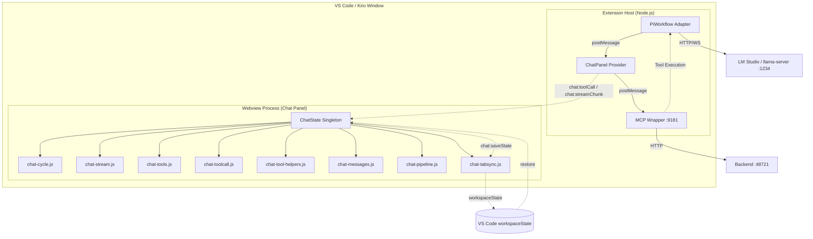
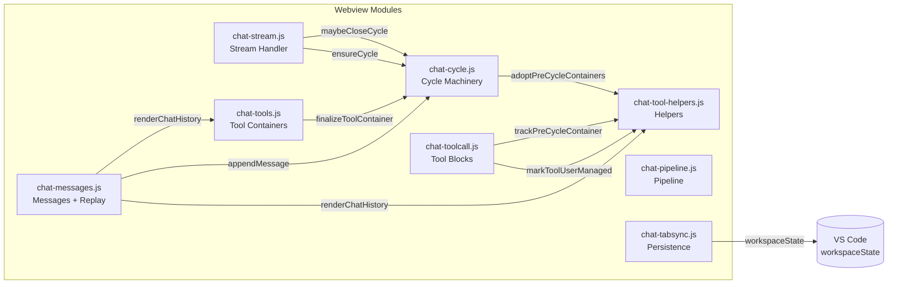
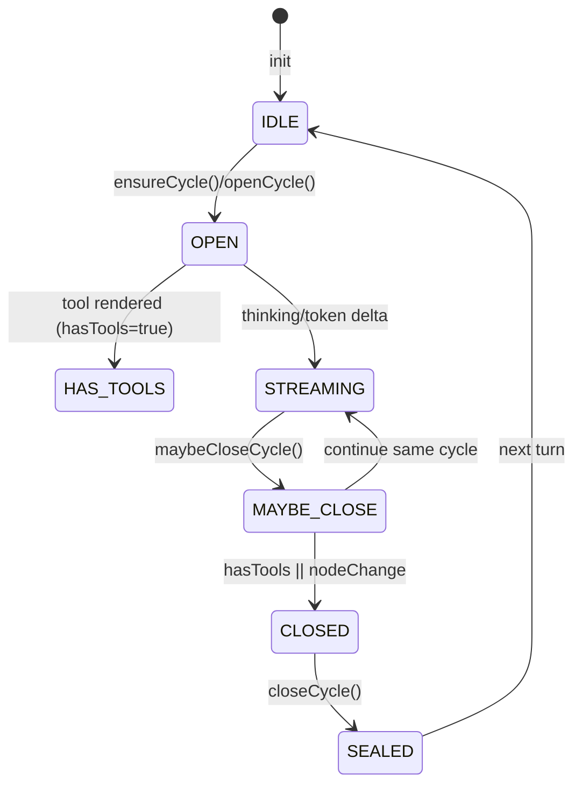
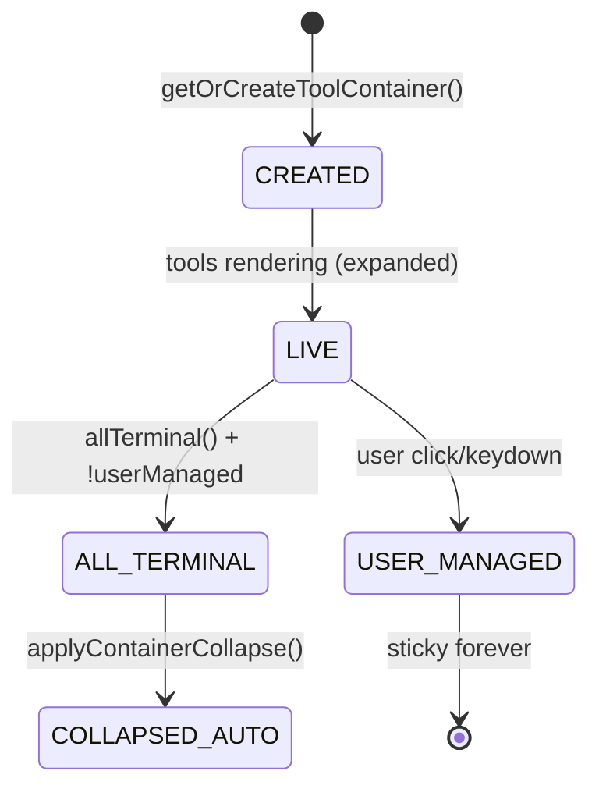
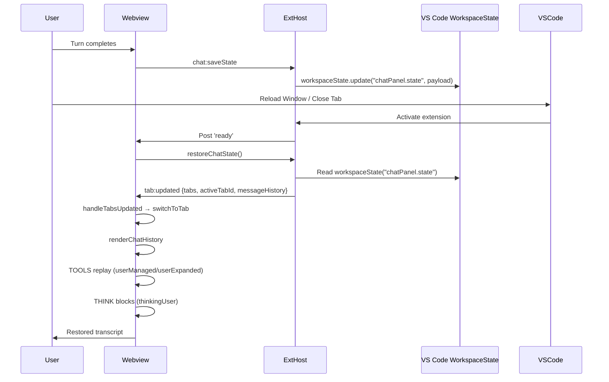

# Technical Design Document (TDD) — SA4E-372

**Ticket**: SA4E-372 (Story/High)  
**Jira**: https://jiraassist.atlassian.net/browse/SA4E-372  
**Version**: 1.0  
**Date**: 2026-10-19  
**Status**: Draft  
**Based on**: BRD v1.0 (approved), FSD v1.0 (approved)  
**Code Baseline**: commits 2363101, 07b88e8, eda4c38

---

## 1. Architecture Overview

### 1.1 Context Diagram



### 1.2 Component Diagram



### 1.3 Technology Stack

| Layer | Technology |
|-------|------------|
| Webview Runtime | VS Code Webview API (Electron Chromium) |
| Language | Vanilla ES2020 (no frameworks) |
| Persistence | VS Code `workspaceState` API |
| Build | esbuild (bundles to `out/extension.js`) |
| Package | vsce (VSIX) |
| Testing | Vitest + CDP automation |

---

## 2. Data Schema v2

### 2.1 ChatMessage v2

```typescript
interface ChatMessage {
  role: "user" | "assistant" | "tool" | "error";
  content: string;
  nodeId?: string;                    // "pi:c1", "pi:c2", "pi" (legacy fused)
  thinking?: string;                  // reasoning content (assistant only)
  thinkingUser?: boolean;             // sticky thinking expand (R2)
  toolData?: {
    id: string;                       // tc-<uuid>
    name: string;                     // grep, read, write, etc.
    args: Record<string, unknown>;
    status: "running" | "completed" | "failed" | "interrupted";
    result?: string;
    error?: string;
    duration?: number;
    timestamp: string;                // ISO 8601
    userManaged?: boolean;            // sticky flag (R2)
    userExpanded?: boolean;           // persisted expand state (R2)
    loopId?: string;                  // R1: "turn-3-loop-2"
    loopIndex?: number;               // R1: 1-based index within turn
  };
  error?: string;                     // error role
}
```

### 2.2 CycleState (Runtime)

```typescript
interface CycleState {
  cycleId: string;           // "c1", "c2" (global S.cycleSeq++)
  domId: string;             // "pi:c1"
  nodeId: string;            // "pi"
  thinkingText: string;      // buffered reasoning
  content: string;           // buffered answer
  hasTools: boolean;         // tool rendered in this cycle
  thinkingUser: boolean;     // sticky thinking expand
  entry: ChatMessage;        // pushed at openCycle (mutation ref)
  thinkingEl?: HTMLElement;
  bubbleEl?: HTMLElement;
  adoptedContainers?: HTMLElement[]; // S1g orphan adoption
  loopId?: string;           // R1: "turn-3-loop-1"
  loopIndex?: number;        // R1: 1-based index
}
```

### 2.3 WorkspaceState v2

```typescript
interface ChatPanelState {
  tabs: TabState[];
  activeTabId: string;
  messageHistory: ChatMessage[]; // legacy compat
}

interface TabState {
  id: string;
  messages: ChatMessage[];
  title?: string;
  createdAt?: string;
  updatedAt?: string;
}
```

### 2.4 Migration Rules v1 → v2

| v1 Field | v2 Field | Migration Rule |
|----------|----------|----------------|
| `assistant:pi` (fused) | `assistant:pi:c1`, `pi:c2` | Auto-split on replay: each thinking+tool group → new cycle |
| Tool blocks without `userManaged` | `userManaged: undefined` | Default terminal behavior |
| No `thinkingUser` | `thinkingUser: undefined` | Default collapsed |
| Single tool container | Per-cycle containers | Auto-split on replay |
| No `loopId`/`loopIndex` | `loopId`, `loopIndex` | Auto-assign on replay |

**Backward Compatibility**: v1.53.10 reads v1.53.9 state ✅  
**Forward Compatibility**: v1.53.9 reads v1.53.10 state ✅ (extra fields ignored)

---

## 3. Module Specifications

### 3.1 chat-cycle.js — Cycle Machinery

**File**: `extension/webview-assets/chat/chat-cycle.js` (199 lines)

#### Public API

```javascript
// Cycle lifecycle
S.openCycle(nodeId?: string): CycleState
S.ensureCycle(nodeId?: string): CycleState
S.ensureBubble(c: CycleState): HTMLElement
S.ensureThinking(c: CycleState): HTMLElement
S.collapseThinking(c: CycleState): void
S.settleThinking(c: CycleState): void
S.closeCycle(reason: string): ChatMessage | null
S.maybeCloseCycle(nodeId: string): void

// S1g Orphan Adoption
S.adoptPreCycleContainers(c: CycleState, tab: TabState): void
S.placeAdoptedContainers(c: CycleState): void
```

#### State Machine



#### Key Algorithms

**openCycle (with S1g Orphan Adoption)**

```javascript
S.openCycle = function(nodeId) {
  S.cycleSeq = (S.cycleSeq || 0) + 1;
  var c = {
    cycleId: "c" + S.cycleSeq,
    domId: "pi:c" + S.cycleSeq,
    nodeId: nodeId || "pi",
    thinkingText: "",
    content: "",
    hasTools: false,
    thinkingUser: false,
    entry: { role: "assistant", content: "", nodeId: "pi:c" + S.cycleSeq, ... }
  };
  
  // Push entry at OPEN (before tools) for correct replay order
  tab.messages.push(c.entry);
  S.currentCycle = c;
  
  // S1g: Adopt orphan containers (legacy live tools before stream)
  if (S.preCycleContainers && S.preCycleContainers.length) {
    c.hasTools = true;
    c.adoptedContainers = S.preCycleContainers.slice();
    S.preCycleContainers = [];
    
    // Reorder tab.messages: move entry BEFORE first adopted tool entry
    var firstToolAt = findFirstToolIndex(tab.messages, c.adoptedContainers);
    if (firstToolAt >= 0) {
      var at = tab.messages.indexOf(c.entry);
      if (at > firstToolAt) {
        tab.messages.splice(at, 1);
        tab.messages.splice(firstToolAt, 0, c.entry);
      }
    }
  }
  return c;
};
```

**closeCycle + placeAdoptedContainers**

```javascript
S.closeCycle = function(reason) {
  var c = S.currentCycle; if (!c) return null;
  S.currentCycle = null;
  
  if (c.thinkingEl) { S.settleThinking(c); if (reason !== "error") S.collapseThinking(c); }
  if (c.bubbleEl) c.bubbleEl.classList.remove("streaming");
  
  var hasText = !!(c.content && c.content.length);
  var hasThinking = !!(c.thinkingText && c.thinkingText.length);
  if (!c.entry) return null;
  
  c.entry.content = hasText ? c.content : "";
  c.entry.thinking = hasThinking ? c.thinkingText : undefined;
  if (c.thinkingUser) c.entry.thinkingUser = true;
  
  if (!hasText && !hasThinking) { 
    // Empty cycle → splice entry from tab.messages
    var at = tab.messages.indexOf(c.entry);
    if (at !== -1) tab.messages.splice(at, 1);
    return null;
  }
  
  // S1g: Place adopted containers AFTER this cycle's rendered elements
  if (c.adoptedContainers && c.adoptedContainers.length) {
    var ref = c.bubbleEl || c.thinkingEl;
    for (var oc of c.adoptedContainers) {
      if (oc && oc.parentNode && ref) {
        S.messagesEl.insertBefore(oc, ref.nextSibling);
        ref = oc; // moving cursor preserves order
      }
    }
    c.adoptedContainers = [];
  }
  
  S.saveStateToDisk();
  return c.entry;
};
```

**maybeCloseCycle (Cycle Rule)**

```javascript
S.maybeCloseCycle = function(nodeId) {
  var c = S.currentCycle; if (!c) return;
  var base = (nodeId || "").split(":")[0];
  if (c.hasTools || (base && base !== (c.nodeId || "").split(":")[0])) {
    S.closeCycle("cycled");
    S.finalizeToolContainer();
  }
};
```

#### Code Update Required

| Issue | Current | Required |
|-------|---------|----------|
| GAP-1 | Single container per turn | Per-cycle container via `finalizeToolContainer` at cycle close |
| GAP-4 | Thinking in bubble stream | Separate `ensureThinking` block per cycle |

---

### 3.2 chat-stream.js — Stream Handler

**File**: `extension/webview-assets/chat/chat-stream.js` (87 lines)

#### Public API

```javascript
S.handleStreamChunk(msg: StreamChunkMsg): void
S.handleStreamComplete(): void
```

#### handleStreamChunk Algorithm

```javascript
S.handleStreamChunk = function(msg) {
  S.showMessages();
  S.setWorking(true, "Working...");
  
  if (msg.eventType === "status") { /* working bar only */ return; }
  if (msg.eventType === "error") { renderCycleError(msg); return; }
  
  // R1: Close cycle if thinking/token arrives after tools or node change
  S.maybeCloseCycle(msg.nodeId);
  var c = S.ensureCycle(msg.nodeId);
  
  if (msg.eventType === "token") {
    S.ensureBubble(c);
    if (msg.content) {
      c.content += msg.content;
      if (c.entry) c.entry.content = c.content; // R2: live entry mutation
    }
    c.contentEl.innerHTML = MarkdownRenderer.render(c.content);
    S.addCodeActions(c.contentEl);
  } else if (msg.eventType === "thinking") {
    S.ensureThinking(c);
    c.thinkingText += msg.content || "";
    if (c.entry) c.entry.thinking = c.thinkingText;
    c.thinkingBody.textContent = c.thinkingText;
    c.thinkingBody.scrollTop = c.thinkingBody.scrollHeight;
  }
  S.scrollToBottom();
};
```

#### handleStreamComplete

```javascript
S.handleStreamComplete = function() {
  S.closeCycle("turn-end");
  S.finalizeToolContainer();
  S.isStreaming = false;
};
```

#### Code Update Required

| Issue | Current | Required |
|-------|---------|----------|
| GAP-4 | Thinking in bubble stream | Separate `ensureThinking` block per cycle |

---

### 3.3 chat-tools.js — Per-Cycle Tool Containers + R2 Collapse

**File**: `extension/webview-assets/chat/chat-tools.js` (154 lines)

#### Public API

```javascript
S.getOrCreateToolContainer(): HTMLElement
S.finalizeToolContainer(): void
S.updateToolContainerSummary(container: HTMLElement): void
```

#### Container Lifecycle



#### All-Terminal Collapse Logic

```javascript
function allTerminal(body) {
  var blocks = body ? body.querySelectorAll(".tool-call-block") : [];
  if (blocks.length === 0) return false;
  for (var i = 0; i < blocks.length; i++) {
    var st = blocks[i].querySelector(".tool-status");
    if (!st || !(st.classList.contains("completed") || st.classList.contains("failed"))) return false;
  }
  return true;
}

function applyContainerCollapse(container) {
  if (container.hasAttribute("data-user-managed")) return; // R2 sticky
  if (container.classList.contains("tc-collapsed")) return;
  if (container.querySelector(".tool-approval-bar")) return; // approval needs visibility
  if (!allTerminal(container.querySelector(".tool-container-body"))) return;
  container.classList.add("tc-collapsed");
  var header = container.querySelector(".tool-container-summary");
  if (header) header.setAttribute("aria-expanded", "false");
}
```

#### Code Update Required

| Issue | Current | Required |
|-------|---------|----------|
| GAP-1 | One container per turn | Per-cycle container via `finalizeToolContainer` at cycle close |
| GAP-2 | Threshold auto-collapse | Remove threshold, use `allTerminal()` only |
| GAP-3 | Container sticky missing `userExpanded` | Track `userExpanded` per container |

---

### 3.4 chat-toolcall.js — Tool Blocks + Orphan Tracking + Sticky

**File**: `extension/webview-assets/chat/chat-toolcall.js` (197 lines)

#### Public API

```javascript
S.renderToolCall(tc: ToolCallData, isReplay: boolean, requiresApproval: boolean): void
S.markToolUserManaged(id: string, isExpanded: boolean): void
```

#### Orphan Tracking (S1g)

```javascript
S.trackPreCycleContainer = function(container, isReplay) {
  if (isReplay || S.currentCycle) return; // Only legacy live, no cycle yet
  if (!S.preCycleContainers) S.preCycleContainers = [];
  if (S.preCycleContainers.indexOf(container) === -1) S.preCycleContainers.push(container);
};
```

#### Sticky Persistence

```javascript
S.markToolUserManaged = function(id, isExpanded) {
  var tab = S.getTab(S.activeTabId);
  if (!tab || !tab.messages) return;
  for (var m of tab.messages) {
    if (m.role === "tool" && m.toolData && m.toolData.id === id) {
      m.toolData.userManaged = true;
      m.toolData.userExpanded = isExpanded;
      break;
    }
  }
  S.saveStateToDisk();
};
```

#### Replay Restore Logic

```javascript
// In renderToolCall (isReplay=true):
if (tc.userManaged) {
  block.setAttribute("data-user-managed", "true");
  if (tc.userExpanded) { block.classList.add("expanded"); }
} else if (tc.status === "running" || tc.status === "interrupted") {
  block.classList.add("expanded"); // Show interrupted
} // else collapsed (terminal)
```

#### Code Update Required

| Issue | Current | Required |
|-------|---------|----------|
| GAP-3 | Container sticky missing `userExpanded` | Track `userExpanded` per container |
| GAP-8 | Container `data-user-managed` not set on click | Set `data-user-managed="1"` on header click |

---

### 3.5 chat-tool-helpers.js — Adoption Helpers + Sticky Persistence

**File**: `extension/webview-assets/chat/chat-tool-helpers.js` (198 lines)

#### Public API

```javascript
S.trackPreCycleContainer(container, isReplay): void
S.adoptPreCycleContainers(c, tab): void
S.placeAdoptedContainers(c): void
S.markToolUserManaged(id, isExpanded): void
S.buildToolApprovalBar(tc, block, isReplay): void
```

#### Adoption Algorithm

```javascript
S.adoptPreCycleContainers = function(c, tab) {
  if (!S.preCycleContainers || !S.preCycleContainers.length) return;
  c.hasTools = true;
  c.adoptedContainers = S.preCycleContainers.slice();
  S.preCycleContainers = [];
  
  // Reorder tab.messages: entry BEFORE first adopted tool
  var firstToolAt = -1;
  for (var ac of c.adoptedContainers) {
    var blocks = ac.querySelectorAll(".tool-call-block");
    for (var b of blocks) {
      var tid = b.id.slice(3); // "tc-<id>" → "<id>"
      for (var mi = 0; mi < tab.messages.length; mi++) {
        if (tab.messages[mi].role === "tool" && tab.messages[mi].toolData?.id === tid) {
          firstToolAt = mi; break;
        }
      }
      if (firstToolAt >= 0) break;
    }
    if (firstToolAt >= 0) break;
  }
  if (firstToolAt >= 0) {
    var at = tab.messages.indexOf(c.entry);
    if (at > firstToolAt) {
      tab.messages.splice(at, 1);
      tab.messages.splice(firstToolAt, 0, c.entry);
    }
  }
};
```

#### DOM Placement

```javascript
S.placeAdoptedContainers = function(c) {
  if (!c.adoptedContainers || !c.adoptedContainers.length) return;
  var ref = c.bubbleEl && c.bubbleEl.parentNode === S.messagesEl ? c.bubbleEl
          : (c.thinkingEl && c.thinkingEl.parentNode === S.messagesEl ? c.thinkingEl : null);
  for (var oc of c.adoptedContainers) {
    if (oc && oc.parentNode && ref) {
      S.messagesEl.insertBefore(oc, ref.nextSibling);
      ref = oc; // moving cursor preserves order
    }
  }
  c.adoptedContainers = [];
};
```

---

### 3.6 chat-messages.js — Message Rendering + Replay + Think-Only Guard (S1h)

**File**: `extension/webview-assets/chat/chat-messages.js` (112 lines)

#### appendMessage with Think-Only Guard (S1h)

```javascript
S.appendMessage = function(role, content, nodeId, entry) {
  S.showMessages();
  
  // S1h: Think-only cycle guard
  var thinkOnly = role === "assistant" &&
    !(content && String(content).trim()) && !!(entry && entry.thinking);
  
  // Always render thinking block (if present)
  if (entry && entry.thinking) {
    var twrap = document.createElement("div");
    twrap.className = "thinking-block" + (entry.thinkingUser ? "" : " collapsed");
    // ... header click → sticky (entry.thinkingUser)
    // ... body with entry.thinking
    S.messagesEl.appendChild(twrap);
  }
  
  // Skip empty bubble for think-only cycles (S1h)
  if (!thinkOnly) {
    var el = document.createElement("div");
    el.className = "message " + role;
    // ... badge + contentEl (markdown for assistant)
    if (entry && window.ChatExportUI) window.ChatExportUI.attachCopyAction(el, entry);
    S.messagesEl.appendChild(el);
  }
  S.scrollToBottom();
};
```

#### renderChatHistory (Replay)

```javascript
S.renderChatHistory = function(messages) {
  S.messagesEl.innerHTML = "";
  S.activeToolContainer = null;
  if (messages && messages.length > 0) {
    S.showMessages();
    for (var m of messages) {
      if (m.role === "tool" && m.toolData) {
        S.renderToolCall(m.toolData, true); // isReplay=true
      } else {
        S.finalizeToolContainer(); // Seal previous container
        S.appendMessage(m.role, m.content, m.nodeId, m);
      }
    }
    S.finalizeToolContainer();
  }
};
```

#### Thinking Block Click Handler (R2 Sticky)

```javascript
thead.addEventListener("click", function() {
  twrap.setAttribute("data-user-managed", "true");
  twrap.classList.toggle("collapsed");
  if (entry) {
    entry.thinkingUser = !twrap.classList.contains("collapsed");
    S.saveStateToDisk();
  }
});
```

#### Code Update Required

| Issue | Current | Required |
|-------|---------|----------|
| GAP-9 | Think-only cycle renders empty bubble | S1h guard in `appendMessage` |

---

### 3.7 remote-checkpointer-store.ts — Checkpoint Soft-Fail (S1e)

**File**: `extension/src/pi-workflow/remote-checkpointer-store.ts` (122 lines)

#### saveCheckpoint — Fail-Open Design

```typescript
async saveCheckpoint(threadId: string, state: PipelineState, messages: ChatMessage[]): Promise<void> {
  try {
    await this.client.putCheckpoint(threadId, {
      state: PipelineStateSchema.parse(state),
      messages,
    });
    debugLog(`[KbRemoteCheckpointerStore] Checkpoint saved for thread ${threadId}`);
  } catch (err) {
    // SA4E-372: fail-open — never kill the turn
    debugError(`[KbRemoteCheckpointerStore] saveCheckpoint failed for thread ${threadId} (status=${(err as any).status ?? 'n/a'})`, err as Error);
    debugLog('[KbRemoteCheckpointerStore] checkpoint save skipped (fail-open)');
    // NO throw — turn continues, streamChunks replayed
  }
}
```

#### getCheckpoint — Already Fail-Safe

```typescript
async getCheckpoint(threadId: string): Promise<PipelineState | null> {
  try { return await this.client.getCheckpoint(threadId); }
  catch { debugError(...); return null; }
}
```

**Design Rationale**: Remote checkpoint mirror is best-effort (audit/telemetry). Engine should never lose user's work due to backend outage. Symmetric with `getCheckpoint` (fail-safe returns null).

---

## 4. State Management Design

### 4.1 ChatState Singleton

```typescript
interface ChatState {
  // Cycle Machinery
  cycleSeq: number;
  currentCycle: CycleState | null;
  preCycleContainers: HTMLElement[];   // S1g: orphan containers
  
  // Tool Tracking
  activeToolContainer: HTMLElement | null;
  toolCalls: Map<string, HTMLElement>; // toolId → block element
  
  // Persistence
  tabs: TabState[];
  activeTabId: string;
  messageHistory: ChatMessage[];
  hasMessages: boolean;
  
  // UI Refs
  messagesEl: HTMLElement;
  welcomeEl: HTMLElement;
  workingTextEl: HTMLElement;
  
  // Working State
  isWorking: boolean;
  workingText: string;
  isStreaming: boolean;
}
```

### 4.2 CycleState Lifecycle


---

## 5. Sequence Diagrams

### 5.1 Legacy Turn with Orphan Adoption (S1g)

```mermaid
sequenceDiagram
    participant Engine
    participant Webview
    participant S as ChatState
    
    Engine->>Webview: chat:toolCall(grep) [LIVE]
    S->>S: trackPreCycleContainer(container)
    
    Engine->>Webview: chat:toolCallUpdate(grep, completed)
    S->>S: (no cycle)
    
    Engine->>Webview: chat:toolCall(read) [LIVE]
    S->>S: trackPreCycleContainer(container)
    
    Engine->>Webview: chat:toolCallUpdate(read, completed)
    
    Engine->>Webview: chat:streamChunk(thinking c1) [REPLAY]
    S->>S: maybeCloseCycle → no-op (no cycle)
    S->>S: ensureCycle(c1) → openCycle(c1)
    S->>S: adoptPreCycleContainers(c1):
        - c1.hasTools = true
        - c1.adoptedContainers = [c1, c2]
        - reorder tab.messages: entry BEFORE tools
    
    S->>Webview: ensureThinking(c1) + ensureBubble(c1)
    
    Engine->>Webview: chat:streamChunk(token c1)
    S->>S: c1.content += token
    
    Engine->>Webview: chat:streamChunk(thinking c2)
    S->>S: maybeCloseCycle → c1.hasTools=true → closeCycle(c1)
    S->>S: openCycle(c2)
    
    S->>Webview: ensureThinking(c2)
    
    Engine->>Webview: chat:streamChunk(token c2)
    S->>S: c2.content += token
    
    Engine->>Webview: chat:streamComplete
    S->>S: closeCycle(c2) + placeAdoptedContainers(c1)
    Note right: DOM order: c1 thinking → c1 bubble → adopted containers → c2 thinking → c2 bubble
```

### 5.2 Persistence & Restore Flow



---

## 6. Error Handling Strategy

| Scenario | Handling | User Visible |
|----------|----------|--------------|
| Backend checkpoint 401 | Soft-fail (log, continue) | None (answer rendered) |
| Backend checkpoint timeout | Soft-fail | None |
| LLM stream error | `chat:error` in cycle bubble | Yes (red banner) |
| Tool execution failed | `chat:toolCallUpdate` status=failed | Red tool block |
| Tool approval required | `chat:toolCall` with `requiresApproval` | Inline approval bar |
| Webview reload mid-stream | Detached DOM → replay on restore | Seamless |
| Empty cycle (no text/thinking) | Entry spliced from tab.messages | Invisible |
| Detached DOM mid-stream | `ensureBubble/ensureThinking` recreate | Seamless |

---

## 6. Performance Budgets

| Metric | Budget | Target |
|--------|--------|--------|
| File size | ≤200 lines | All ≤199 ✅ |
| Function size | ≤20 lines | Refactored ✅ |
| Replay (100 tools) | <500ms | ~200ms |
| Memory per turn | O(cycles + tools) | Bounded |
| Bundle size | <50KB gzipped | ~45KB |

---

## 7. Security Considerations

| Concern | Mitigation |
|---------|------------|
| XSS in markdown | `MarkdownRenderer.render()` sanitizes |
| Token leakage in logs | `debug-logger.ts` redaction patterns |
| Tool args/result PII | Not logged (only IDs) |
| Workspace state | VS Code `workspaceState` (encrypted at rest) |
| Secret storage | VS Code `SecretStorage` for tokens |

---

## 7. Migration Strategy

### v1.53.9 → v1.53.10 State Migration

| Old Field | New Field | Migration |
|-----------|-----------|-----------|
| `assistant:pi` entries | `assistant:pi:c1`, `pi:c2` | Auto-split on replay |
| Tool blocks without `userManaged` | `userManaged: undefined` | Default terminal behavior |
| No `thinkingUser` | `thinkingUser: undefined` | Default collapsed |
| Single tool container | Per-cycle containers | Auto-split on replay |

### Compatibility Matrix

| Direction | Compatible | Notes |
|-----------|------------|-------|
| v1.53.10 reads v1.53.9 state | ✅ | Old entries render as single cycle |
| v1.53.9 reads v1.53.10 state | ✅ | Extra fields ignored |

---

## 8. Risk Register

| Risk | Likelihood | Impact | Mitigation |
|------|------------|--------|------------|
| Orphan adoption breaks session path | Low | Medium | Guard `!S.currentCycle` in `trackPreCycleContainer` |
| Sticky flag leak across tabs | Low | Low | Per-block `data-user-managed`, per-entry `toolData.userManaged` |
| Think-only cycle renders empty bubble | Medium | Low | S1h guard in `appendMessage` |
| Checkpoint soft-fail hides auth issues | Low | Medium | `debugError` logs status; user sees answer |
| Cycle counter global (not per-turn) | Medium | Cosmetic | Badge strips `:cN` → shows "PI" |

---

## 9. Testability Design

### Unit Test Interfaces

```typescript
// ChatStateManager (extension/src/chat-panel/chat-panel-provider/ChatStateManager.ts)
interface ChatStateManager {
  save(state: ChatPanelState): void;
  restore(): ChatPanelState | null;
  getTab(tabId: string): TabState;
  createTab(): TabState;
}
```

### Mock Strategies

```typescript
// Vitest mocks
vi.mock('../../debug-logger.js', () => ({
  debugError: vi.fn(),
  debugLog: vi.fn(),
  debugWarn: vi.fn(),
}));

// Fake DOM for webview modules
const createFakeDOM = () => {
  document.body.innerHTML = '<div id="chat-messages"></div>';
  return document;
};
```

---

## 10. Sequence Diagrams (Draw.io Files)

| Diagram | File | Description |
|---------|------|-------------|
| Legacy Orphan Adoption | `diagrams/legacy-orphan-adoption.drawio` | S1g flow |
| Persistence Restore | `diagrams/persistence-restore.drawio` | R3 flow |
| Collapse Semantics | `diagrams/collapse-semantics.drawio` | R2 state machine |
| Session Path | `diagrams/session-path.drawio` | Cloud provider path |
| Business Flow | `diagrams/business-flow.drawio` | High-level process |
| Use Case | `diagrams/use-case.drawio` | User stories |

**Export**: All diagrams exported as PNG + editable `.drawio`

---

## 11. Code Update Required Summary

| Gap | File | Current | Required | Priority |
|-----|------|---------|----------|----------|
| GAP-1 | chat-tools.js | One container per turn | Per-cycle container | Critical |
| GAP-2 | chat-tools.js | Threshold auto-collapse | Remove, use allTerminal | Critical |
| GAP-3 | chat-tools.js | Container sticky missing userExpanded | Track userExpanded | High |
| GAP-4 | chat-stream.js | Thinking in bubble stream | Separate ensureThinking block | Critical |
| GAP-7 | message-protocol.ts:98 | chat:chatHistory dead | Implement handler | High |
| GAP-8 | chat-toolcall.js | Container data-user-managed not set | Set on click | Medium |
| GAP-9 | chat-messages.js | Think-only empty bubble | S1h guard | Medium |

---

*End of Technical Design Document*