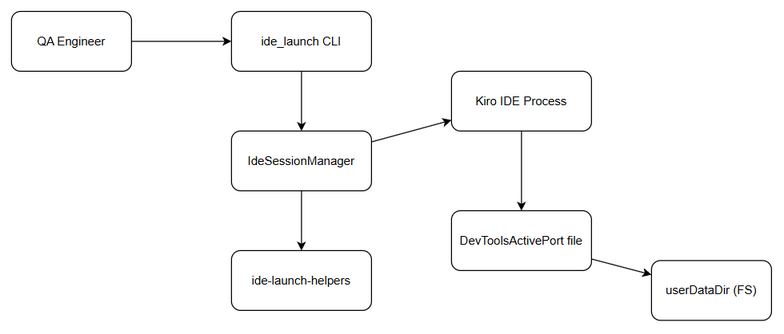
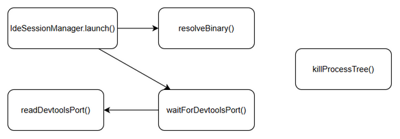
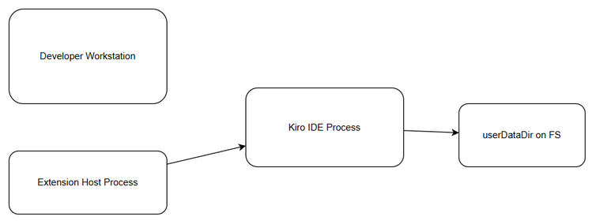
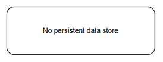
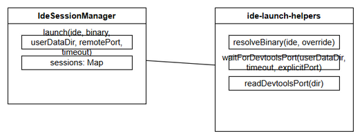
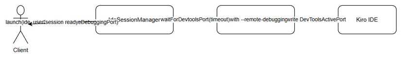

# Technical Design Document (TDD)

## ide_launch — SA4E-373: Fix ide_launch DevToolsActivePort timeout for Kiro

---

## Document Information

| Field | Value |
|-------|-------|
| Jira Ticket | SA4E-373 |
| Title | Fix ide_launch DevToolsActivePort timeout for Kiro |
| Author | SA Agent |
| Version | 1.0 |
| Date | 2026-10-19 |
| Status | Draft |
| Related BRD | BRD-v1.0-SA4E-373 |
| Related FSD | FSD-v1.0-SA4E-373 |

---

## Author Tracking

| Role | Name - Position | Responsibility |
|------|-----------------|----------------|
| Author | SA Agent – Solution Architect | Create document |
| Peer Reviewer |  –  | Review document |

---

## Revision History

| Version | Date | Author | Changes |
|---------|------|--------|---------|
| 1.0 | 2026-10-19 | SA Agent | Initiate document — auto-generated from BRD and FSD |

---

## Sign-Off

| Name | Signature and date |
|------|--------------------|
| | ☐ I agree and confirm the technical design in this TDD |
| | ☐ I agree and confirm the technical design in this TDD |

---

## 1. Introduction

> **Scope Boundary:** This TDD specifies HOW to implement the requirements defined in the FSD. It does NOT repeat functional requirements, business rules, use cases, or UI specifications — refer to the FSD for those. This document focuses on: technology choices, architecture decisions, implementation patterns, and deployment concerns.

### 1.1 Purpose

Design a reliable launch mechanism for Kiro IDE via ide_launch tool under custom userDataDir conditions. Current implementation times out after 30s waiting for DevToolsActivePort file exposure. The design introduces explicit --remote-debugging-port support and configurable timeout with improved polling to eliminate flaky launches for manual UAT (SA4E-370).

### 1.2 Scope

Technical scope covers:
- extension/src/mcp/ide-launch-helpers.ts — waitForDevtoolsPort enhancements
- extension/src/mcp/ide-session-manager.ts — launch parameter propagation
- CLI argument parsing for remoteDebuggingPort and timeoutSeconds
- Validation of userDataDir accessibility and port availability
- Error handling and logging

Out of scope: Kiro IDE core changes, other IDE launch paths unrelated to DevTools detection.

### 1.3 Technology Stack

| Layer | Technology | Version |
|-------|-----------|---------|
| Language | TypeScript | 5.x |
| Runtime | Node.js | 20.x |
| Framework | Extension Host (VS Code) | — |
| Process spawn | child_process.spawn | Node built-in |
| FS access | Node fs | built-in |
| Build Tool | npm | 9.x |

### 1.4 Design Principles

- Explicit over implicit: prefer deterministic port via flag
- Fail fast with clear errors
- Backward compatible: existing launches without new params remain unchanged
- Minimal change surface: modify helpers, not IDE

### 1.5 Constraints

- Kiro must support --remote-debugging-port flag (assumption from BRD)
- Polling limited to file system read; no IPC socket monitoring
- Timeout max 300s per FSD validation

### 1.6 References

| Document | Location |
|----------|----------|
| BRD | documents/SA4E-373/BRD.md |
| FSD | documents/SA4E-373/FSD.md |

## 2. System Architecture

### 2.1 Architecture Overview

ide_launch is a CLI tool executed inside the Extension Host. IdeSessionManager spawns Kiro process with userDataDir and monitors DevToolsActivePort exposure via file polling in ide-launch-helpers. With the fix, the manager can forward explicit --remote-debugging-port and configurable timeout to make detection deterministic.



*[Edit in draw.io](diagrams/architecture.drawio)*

### 2.2 Component Diagram



*[Edit in draw.io](diagrams/component.drawio)*

| Component | Responsibility | Technology |
|-----------|---------------|------------|
| IdeSessionManager | Orchestrates launch, session tracking, CDP endpoint | TypeScript |
| ide-launch-helpers | Binary resolution, port polling, process kill | TypeScript |
| Kiro IDE Process | Exposes DevToolsActivePort via file | Electron/Chromium |
| Filesystem | Persists DevToolsActivePort | OS FS |

### 2.3 Deployment Architecture



*[Edit in draw.io](diagrams/deployment.drawio)*

Deployment runs on developer QA workstation. Extension Host spawns Kiro process locally, writes to custom userDataDir on local FS.

### 2.4 Communication Patterns

| From | To | Protocol | Pattern | Description |
|------|----|----------|---------|-------------|
| IdeSessionManager | Kiro IDE | CLI args | Sync spawn | Pass --user-data-dir, --remote-debugging-port |
| ide-launch-helpers | FS | File read | Polling | Read DevToolsActivePort file |
| Kiro IDE | FS | File write | Async | Writes port file on startup |

## 3. API Design

> **Prerequisite:** Functional API contracts are defined in FSD §3.x.6. This section specifies technical implementation.

### 3.1 API Overview

| # | Endpoint | Method | Description | Source |
|---|----------|--------|-------------|--------|
| 1 | ide_launch --ide kirol [--userDataDir] [--remoteDebuggingPort] [--timeout] | CLI | Launch Kiro and wait for DevTools readiness | UC-001, UC-002 |

### 3.2 API: Launch Kiro

**Implements:** UC-001, UC-002, BR-1..BR-9

| Attribute | Value |
|-----------|-------|
| Method | CLI |
| Path | ide_launch |
| Auth | None (local tool) |
| Rate Limit | N/A |

**Request Parameters:**

| Parameter | Type | Required | Default | Description |
|-----------|------|----------|---------|-------------|
| ide | string | Yes | — | IDE identifier: kiro |
| userDataDir | string | No | temp dir | Custom user data directory |
| remoteDebuggingPort | integer | No | — | Explicit port 1024-65535 |
| timeoutSeconds | integer | No | 60 | Detection timeout, max 300 |

**Response:**

| Field | Type | Description |
|-------|------|-------------|
| launchSuccess | boolean | True if launched |
| devToolsPort | integer | Detected or configured port |
| processPid | integer | PID of Kiro |
| errorMessage | string | Human readable error |

**Error Responses:**

| Status | Code | Message | Description |
|--------|------|---------|-------------|
| CLI error | IdeLaunchError | UserDataDir not accessible | Path check fails |
| CLI error | IdeLaunchError | Remote debugging port already in use | Port bound |
| CLI error | IdeLaunchError | IDE did not expose DevToolsActivePort within Xs | Timeout |

## 4. Database Design

> No persistent data store is introduced. Launch parameters are transient.

### 4.1 Schema Overview



*[Edit in draw.io](diagrams/db-schema.drawio)*

No DDL required.

### 4.2 DDL Scripts

N/A

### 4.3 Migration Plan

N/A

### 4.4 Query Patterns

N/A — file system read only.

## 5. Class / Module Design

### 5.1 Package Structure

```
extension/src/mcp/
├── ide-launch-helpers.ts   # resolveBinary, waitForDevtoolsPort, readDevtoolsPort, killProcessTree
├── ide-session-manager.ts  # IdeSessionManager.launch with new params
└── ...
```

### 5.2 Key Interfaces

```typescript
export interface LaunchOptions {
  ide: string;
  ideBinaryPath?: string;
  userDataDir?: string;
  remoteDebuggingPort?: number;
  timeoutSeconds?: number;
}

export function waitForDevtoolsPort(userDataDir: string, options?: { timeoutMs?: number; explicitPort?: number }): string;
```

### 5.3 Design Patterns

| Pattern | Where Used | Rationale |
|---------|-----------|-----------|
| Strategy | Port detection mode (explicit vs auto) | Deterministic fallback |
| Fail-fast | Binary resolution & validation | Clear errors early |

### 5.4 Error Handling

| Exception | When Thrown |
|-----------|-------------|
| IdeLaunchError | Binary not found |
| IdeLaunchError | userDataDir not accessible/writable |
| IdeLaunchError | Port in use |
| IdeLaunchError | Timeout waiting for port |



*[Edit in draw.io](diagrams/class-diagram.drawio)*

## 6. Integration Design

### 6.1 External System: Kiro IDE

| Attribute | Value |
|-----------|-------|
| Protocol | CLI args |
| Endpoint | Binary path |
| Authentication | None |
| Timeout | Configurable up to 300s |
| Retry Policy | Poll every 500ms, no retry on spawn |

**Data Mapping:**

| Source Field | Target Field | Transformation |
|-------------|-------------|----------------|
| remoteDebuggingPort | --remote-debugging-port | ${port} |
| userDataDir | --user-data-dir | Path as-is |
| timeoutSeconds | waitForDevtoolsPort timeout | ms conversion |

**Sequence Diagram:**



*[Edit in draw.io](diagrams/api-sequence-launch.drawio)*

## 7. Security Design

### 7.1 Authentication
None required — local CLI tool.

### 7.2 Authorization
Only developers/QA executing the tool.

### 7.3 Data Protection
| Data Type | At Rest | In Transit | In Logs |
|-----------|---------|------------|---------|
| userDataDir path | Plain | N/A | Masked |
| Remote debugging port | Plain | N/A | Logged only on error |

Port exposure should remain localhost only. Do not bind to 0.0.0.0.

### 7.4 Input Validation
- userDataDir: fs.existsSync + writable check
- remoteDebuggingPort: 1024-65535, check net port availability
- timeoutSeconds: >0 && <=300

## 8. Performance & Scalability

### 8.1 Caching Strategy
None.

### 8.2 Connection Pooling
N/A.

### 8.3 Performance Targets
| Operation | Target | Measurement |
|-----------|--------|-------------|
| Port detection | <60s p95 | Logs |
| Launch success rate | >95% | Manual UAT runs |

## 9. Monitoring & Observability

### 9.1 Logging
| Log Event | Level | Fields | Destination |
|-----------|-------|--------|-------------|
| Launch start | INFO | ide, userDataDir, port | stdout |
| Port detected | INFO | port, elapsed | stdout |
| Timeout | ERROR | elapsed, dir | stderr |

### 9.2 Metrics
| Metric | Type | Description | Alert Threshold |
|--------|------|-------------|-----------------|
| launch_duration_seconds | Histogram | Time to port detection | >60s |
| launch_failures_total | Counter | Timeout failures | >5% of launches |

### 9.3 Health Checks
N/A.

## 10. Deployment Considerations

### 10.1 Environment Configuration
| Property | DEV | SIT | UAT | PROD |
|----------|-----|-----|-----|------|
| DEFAULT_TIMEOUT | 60s | 60s | 60s | 60s |
| POLL_INTERVAL | 500ms | 500ms | 500ms | 500ms |

### 10.2 Feature Flags
No feature flag; change is backward compatible.

### 10.3 Rollback Strategy
Revert commit to ide-launch-helpers.ts and ide-session-manager.ts. Existing launches without params unaffected.

## 11. Appendix

### Glossary

| Term | Definition |
|------|------------|
| DevToolsActivePort | File containing remote debugging port |
| userDataDir | Isolated profile directory |
| ide_launch | CLI tool for launching IDE with CDP |

### Open Questions
| # | Question | Status | Answer |
|---|----------|--------|--------|
| 1 | Does Kiro accept --remote-debugging-port flag? | Open | Assume yes per BRD assumption; fallback to timeout increase if not supported |


## ⛔ MANDATORY: Diagram Requirements

**Every diagram referenced in this TDD MUST exist as a draw.io file (.drawio) AND be exported to PNG (.png).**

### Required draw.io Diagrams

| # | Diagram | File | Section | Required |
|---|---------|------|---------|----------|
| 1 | Architecture Overview | diagrams/architecture.drawio + .png | §2.1 | ✅ |
| 2 | Component Diagram | diagrams/component.drawio + .png | §2.2 | ✅ |
| 3 | Deployment Diagram | diagrams/deployment.drawio + .png | §2.3 | ✅ |
| 4 | API Sequence | diagrams/api-sequence-launch.drawio + .png | §6.1 | ✅ |
| 5 | Database/Data Schema | diagrams/db-schema.drawio + .png | §4.1 | ✅ |
| 6 | Class Diagram | diagrams/class-diagram.drawio + .png | §5.x | ✅ |
